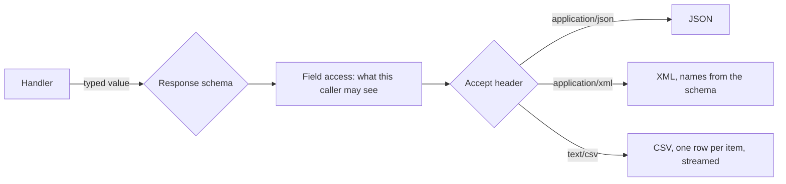

# Representations, field access and forms described by the server

**Summary.** A route answers a typed value that its response schema checks; how that value
becomes bytes is a presentation concern of its own. The same agenda is wanted as JSON by the
web application, as XML by a partner and as CSV by a spreadsheet; the same booking body is
filled by a patient, by an assistant and by a practitioner, who may not see or set the same
fields. This page explains the three ideas the kit builds on: one schema, several
representations chosen by content negotiation; the fields of a schema reserved to some callers,
decided by the same authorization as the use cases; and forms described by the server from what
a route already declares. The how-to is in the [README of `@ddd-ts-kit/http`](../../packages/http/README.md);
the libraries and renderers are compared in [tools/representations-and-forms.md](../tools/representations-and-forms.md).

## One value, several representations

The schema of a response is the contract: the server checks what it answers against it, and the
OpenAPI document is generated from it. A representation is a function of that value and that
schema, nothing else:

Three consequences:

- **No second model.** There is no "XML DTO" next to the JSON one: element names and attributes
  come from the schema (the XML object of OpenAPI), columns of a CSV from the properties of an
  item. A partner format with a vocabulary of its own (namespaces, mixed content, an XML Schema
  the partner owns) is not a representation: it is an anti-corruption layer with its own mapper.
- **Negotiation is a contract.** The route says what it produces; the request says what it
  accepts (RFC 9110); none in common is `406`. A body sent as XML is read into the value the JSON
  path would have produced and validated by the same schema: one set of rules, whatever the wire.
- **Serialization rules are standard.** An instant is ISO 8601 in UTC, money a decimal string
  with its currency, an identifier a string, a closed vocabulary its code, a list a page envelope
  or a stream. A project does not decide them again for each format.

Aggregates are never serialized. A representation sees the presentation type a controller
answers, which a serializer built from a read model.

## Fields reserved to some callers

"The patient does not see the internal note" is a right, so it belongs to authorization, not to
an `if (actor.roles.includes('practitioner'))` in a serializer: that test is forgotten in the
CSV export, in the XML for the partner and in the form, and no contract says the field may be
missing.

The kit marks the field on the schema instead: a field requires a permission or a policy to be
read, and possibly another one to be set. The permission is decided by the same `Access` as a use
case, about the element the field belongs to (the calendar of the appointment), so roles,
attribute policies and relationships all work, and the decision is recorded like any other.

| Where | A field the caller may not read | A field the caller may read but not set |
|---|---|---|
| An answer, in every representation | absent | present |
| A request body | refused, 403 | refused, 403 |
| A form described by the server | absent | read-only |
| The contract | marked `x-field-access`, not required | the same |

Two things stay elsewhere. **Which rows** an actor may read is the access scope of the query,
applied in the statement; field access never filters rows. **What a field may hold** is
validation, and a business rule about it stays an invariant of the domain. The use case still
checks the write permission itself (`Access.authorize` in the handler), because a job or another
transport sends the same command without passing through HTTP.

## Forms described by the server

A front end usually rebuilds, for every command, a form the server already describes: the
fields, their types, their lengths, the values of a closed vocabulary. Describing it from the
route keeps one source:

- **From what the route declares.** The request schema gives the fields, their constraints and
  their options; a few presentation hints add what a schema cannot say: groups and order, the
  widget of a field, the route a field takes its options from, when a field shows or is
  required. Labels are translation keys, never text.
- **For the caller.** The description is computed per request: hidden and read-only fields come
  from the same field access as the answers, about the element the request names (the calendar
  in `?calendarId=`).
- **Two formats from one tree.** A neutral tree of groups and fields is the model of the kit; JSON
  Forms (a JSON Schema, a UI schema and the data) is produced from it, because maintained
  renderers exist for React, Angular and Vue.

A form carries shape and presentation, never a business rule. "An appointment cannot overlap
another" is answered by the command when the form is sent; the form only tells the user early
what the schema would refuse anyway. And the server validates again: a form is a convenience for
the client, never a check.

## Limits

- XML here renders the JSON model; it is not a design tool for XML vocabularies.
- CSV is written, never read, and holds flat rows: an import is a use case with a body schema of
  its own.
- A streamed list cannot be refused once its first item is written: a failure later cuts the
  response short.
- Field access judges the fields of the schema it is declared on; a nested object is restricted
  through its own schema. Each requirement is one decision per element of the answer.
- A form describes scalars, nested objects and lists of a closed vocabulary; layout beyond
  groups and order, and the behaviour of a lookup, are the front end's.

## See also

- [The presentation layer](presentation-layer.md): controllers, mappers, serializers, guards.
- [Authentication and authorization](authentication-and-authorization.md): the models a field
  requirement is decided by.
- [Invariants, permissions, validation](invariants-permissions-validation.md): why a form never
  holds a business rule.
- [The read side](../proposals/read-side.md), parts 2 and 3.
- Rule `authz/fields-by-schema` in the [architecture reference](../ARCHITECTURE.md).
