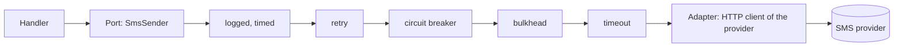
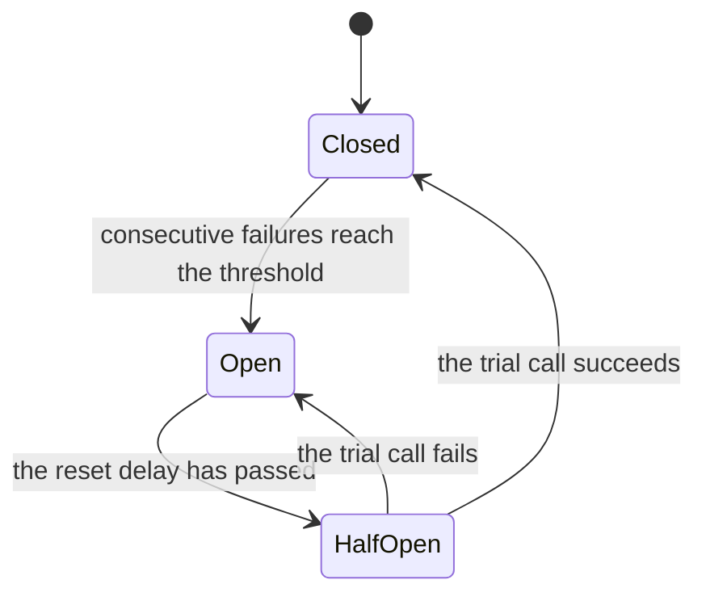

# Resilience

**Summary.** A call that leaves the process can be slow, fail, or never answer. Five patterns
deal with that: retry, timeout, circuit breaker, bulkhead and cache. Each one solves a precise
problem and each one has a failure mode that makes things worse when it is applied without
thought: a retry storm, a duplicated payment, a timeout that leaves the work running, a breaker
that hides an outage, a cache that serves a stale decision. This page explains what each
pattern does, when it harms, in which order they compose, and how the kit applies them from
outside the business code so that a handler never contains one.

## Where they apply

Resilience policies belong on calls to what you do not control: an outside system (the SMS
provider of `notifications`) or another context reached synchronously through a gateway
(`appointments` asking `calendars` for working hours). They do not belong inside a use case,
around a repository of aggregates by default, or in the domain.



The handler depends on the port and sees none of the boxes in between.

## The five patterns

### Timeout

Bounds how long a caller waits. Without one, a provider that stops answering holds a
connection, a request and eventually every worker of the process. Every outbound call needs a
timeout; it is the one policy with no good reason to be absent.

**Failure modes.**
- *A timeout that does not cancel.* Rejecting the promise does not stop the underlying call: it
  goes on, holds its socket, and may still succeed after the caller gave up. The kit's timeout
  aspect only stops the call when the adapter accepts an abort signal and passes it on.
- *A timed-out write is an unknown outcome*, not a failure. The SMS may have been sent.
- *Timeouts longer than the caller's.* If the route's client gives up after 5 seconds, an inner
  timeout of 30 seconds only wastes resources. Budgets shrink going inward.

### Retry

Calls again after a failure, on the bet that the fault was transient (a dropped connection, a
restart, a brief overload). Good retries wait between attempts with exponential backoff and
add jitter, a random share of the delay, so that many callers do not come back at the same
instant.

**Failure modes.**
- *Retrying what is not safe to repeat.* A retry repeats the call as it is. Charging a card or
  sending an SMS twice is a business incident unless the operation is idempotent, usually
  through an idempotency key the provider honours.
- *Retry storms.* Each layer that retries multiplies the load: three attempts at each of three
  layers is twenty-seven calls on a dependency that is already struggling. Retry at one layer,
  the one closest to the fault.
- *Retrying a refusal.* A business refusal or a validation error will fail the same way every
  time. The kit's retry never repeats after a `DomainError`, an open circuit or a full
  bulkhead.
- *Synchronised retries.* Without jitter, all clients that failed together retry together.

### Circuit breaker

Counts consecutive failures of a dependency and, past a threshold, refuses calls at once for a
while instead of letting each one wait for its timeout. After the pause it lets a trial call
through (half-open) and closes again on success. It protects the caller (fast failure) and the
callee (room to recover).



**Failure modes.**
- *A breaker that hides a real outage.* Calls are refused quickly and quietly, dashboards of
  latency look healthy, and nobody notices that no reminder left for an hour. Publish the
  state of each circuit as a metric and alert on "open".
- *One circuit for too much.* A breaker shared by all methods of an adapter opens for everyone
  when one endpoint fails. The kit keeps one circuit per instance and method by default.
- *State per process.* Each instance learns on its own that the provider is down; with many
  instances the dependency still receives many trial calls.
- *Business refusals counted as failures* open the circuit on normal traffic. A `DomainError`
  is not a failure for the kit's breaker.

### Bulkhead

Bounds how many calls run at once towards one dependency, and refuses beyond. Named after the
watertight compartments of a ship: a slow SMS provider may fill its own compartment, but it
cannot take every connection of the process and sink booking with it.

**Failure modes.** A limit set too low refuses healthy traffic; a queue in front of it converts
refusals into latency and memory. Like the breaker, its state is per process.

### Cache

Answers a repeated read from memory or from a shared store instead of calling again. It lowers
latency and load, and it can keep a read working while its source is briefly down.

**Failure modes.**
- *Stale data presented as fresh.* Every cached answer is an answer from the past. The time to
  live is a business decision: for how long may working hours be wrong?
- *A cached aggregate.* An aggregate served from a cache behind its repository hides that it is
  stale, and the next command decides on old state: an appointment booked on a slot that was
  taken a second ago. The kit's cache aspect refuses repositories and use cases unless
  explicitly allowed, which is a decision to record. Cache reads of gateways and outside
  systems, never the model you decide on.
- *Stampede.* When a popular entry expires, every request that misses it recomputes it at the
  same time. Sharing one computation among concurrent callers (single flight) solves it inside
  a process; across processes it needs a lock, as [`@ddd-ts-kit/redis`](../../packages/redis/README.md)
  describes.
- *Caching failures or per-user answers under a shared key.* A wrong key leaks one user's
  answer to another.

## Summary table

| Pattern | Protects against | Typical failure mode | Needs |
|---|---|---|---|
| timeout | waiting forever | work continuing behind; unknown outcome of a write | an abort signal passed to the call |
| retry | transient faults | duplicates; storms | an idempotent operation; backoff and jitter |
| circuit breaker | hammering a dependency that is down | a silent outage | a metric and an alert on its state |
| bulkhead | one dependency exhausting shared resources | refusing healthy traffic | a limit sized from measurements |
| cache | repeated reads, brief unavailability | stale decisions | a time to live chosen by the business; reads only |

## Order of composition

The policies wrap each other, and the order changes the meaning. Read outermost first:

```
tracing, logged, timed, cached, retry, circuitBreaker, bulkhead, timeout, the adapter
```

- **Retry outside timeout**: each attempt has its own time limit. The other way round, one
  limit covers all attempts and the waits between them.
- **Circuit breaker inside retry**: each failed attempt counts towards the threshold, and an
  open circuit ends the retries at once, since an open circuit is not retried.
- **Logging and metrics outside retry**: one measurement per call as the caller lived it,
  retries included.
- **Cache outside retry and breaker**: a hit costs nothing and is not refused by an open
  circuit.

This is the order of [`@ddd-ts-kit/aspects`](../../packages/aspects/README.md), and it follows
from the code: its `retry` does not repeat a `CircuitOpenError`. The other order exists in the
literature (a breaker outside the retry sees one outcome per logical call); the kit does not
use it.

## Three forms, one implementation

The kit applies the same policy in three ways, in this order of preference:

1. **On one binding.** In the declared style the declaration of the adapter states it,
   `@Adapter(SmsSender, { kind: 'external', aspects: [ownPolicy(retry(...), timeout(2000))] })`,
   which is what `ddd-ts-kit generate adapter` writes; in an explicit module the binding does,
   `.with(retry(...), timeout(...))`. The methods of the class contain no policy. `ownPolicy`
   is a helper of the project (`src/platform/resilience/own-policy.ts`): on tsyringe the first
   `generate adapter` writes it, so that a project without an adapter holds no file nothing
   imports; wired by hand, `init` writes it, because the platform itself uses it.
2. **On every binding of a kind, in the platform module**:
   `builder.around(['external', 'gateway'], ...)`. The generated platform
   (`src/platform/resilience/`) gives every adapter that leaves the process and states no
   policy of its own three attempts with backoff and a time limit per attempt, both read from
   the configuration.
3. **As a decorator on the adapter class**, in `infrastructure/` or the platform, when the
   policy is part of what the adapter is: a client of a provider that documents its own retry
   rules.

Use cases get their cross-cutting behaviour from bus middlewares instead. None of the three
forms is allowed in `domain/` or `application/`: rule
[`aspects/outside-in`](../ARCHITECTURE.md#3-dependency-rules) and the two `layer/*` rules.
Do not apply the same aspect in two forms: it would run twice.

What an aspect records follows the tracing rule: class, method, context, duration, error code;
never arguments, results or error messages.

## Synchronous calls are the expensive case

Most of this page disappears when two contexts collaborate through events. `notifications`
reacting to `appointments.appointment.booked` needs no timeout, retry or breaker towards
`appointments`: the broker and the outbox carry the retry, and the consumer is idempotent.
Resilience policies are the price of a synchronous dependency; prefer a local projection fed
by events when the data is needed often. See
[Delivery and idempotency](delivery-and-idempotency.md).

## Limits and when not to use it

- **State lives in the process**, per wrapped instance: circuits, compartments and single
  flight are not shared between instances.
- **Retry assumes idempotence** and the kit cannot verify it. Only the author of the adapter
  knows whether the call is safe to repeat.
- **Timeout without a signal does not stop the call.**
- **Only asynchronous methods are advised**, and a wrapped call always answers a promise: an
  object whose methods return a chainable query builder must not be wrapped.
- **A policy is not a guarantee of delivery.** Work that must not be lost and must be retried
  for hours belongs to the outbox and integration events, not to a retry in memory that dies
  with the process.
- **Do not wrap repositories by reflex.** A database retry inside a transaction can repeat half
  of a unit of work; the unit of work is the retry boundary.
- **Every policy adds configuration to tune and a behaviour to test.** A policy is tested once,
  on the adapter, with a fake that fails on demand; use cases are tested without it.

## Sources

- Michael T. Nygard, Release It!, 2nd edition, Pragmatic Bookshelf, 2018, chapter 5 "Stability
  Patterns": Timeouts, Circuit Breaker, Bulkheads, Fail Fast.
- Martin Fowler, "CircuitBreaker", martinfowler.com, 2014.
- Marc Brooker, "Exponential Backoff And Jitter", AWS Architecture Blog, 2015; "Timeouts,
  retries, and backoff with jitter", Amazon Builders' Library.
- Sam Newman, Building Microservices, 2nd edition, O'Reilly, 2021, chapter 12 "Resiliency".
- Martin Kleppmann, Designing Data-Intensive Applications, O'Reilly, 2017, chapter 8 "The
  Trouble with Distributed Systems": timeouts and unknown outcomes.
- [`@ddd-ts-kit/aspects`](../../packages/aspects/README.md): the aspects, their defaults, the
  order and the limits quoted above.

## See also

- [Observability](observability.md)
- [Scheduled jobs](scheduled-jobs.md)
- [Ports and composition](ports-and-composition.md)
- [Delivery and idempotency](delivery-and-idempotency.md)
- [Cache and coordination tools](../tools/cache-and-coordination.md)
- [HTTP caching](http-caching.md): the cache in front of the API, and its purge after the commit
- [Architecture reference](../ARCHITECTURE.md): "Cross-cutting behaviour", rule
  `aspects/outside-in`
