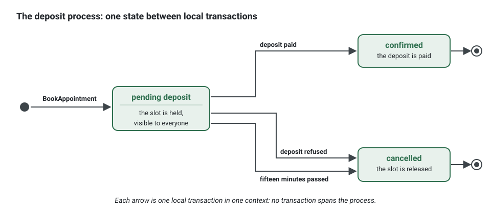

**English** · [Français](sagas-and-process-managers.fr.md)

# Sagas and process managers

**Summary.** A business process that spans several aggregates or contexts cannot be one
transaction in this architecture. A saga is the alternative: a sequence of local transactions,
each announced by an event, with a compensating action for each step that may need to be undone.
It can be choreographed (each context reacts to the others' events) or orchestrated (one
component, a process manager, decides the next step). The kit provides the building blocks
(integration events, the outbox, idempotent consumers, scheduled and background jobs) and a
small runtime for process managers: a process is a class whose steps decide from its state and
what happened, a runner keeps its state with optimistic concurrency and delivers its timeouts as
delayed background jobs. It is not a workflow engine.

## Why a saga at all

Suppose the product adds a deposit: an appointment with certain practitioners is confirmed only
once a deposit is paid, and the slot is released if payment does not arrive within fifteen
minutes. Three contexts are involved (`appointments`, a payment context or provider,
`notifications`), and the rule "one aggregate per transaction, no transaction across contexts"
([ARCHITECTURE.md](../ARCHITECTURE.md) section 4) forbids doing it in one commit.

The process becomes steps:



Each arrow is a local transaction in one context. Between two arrows the system is in a visible
intermediate state ("pending deposit"), which the product must name (see
[Eventual consistency](eventual-consistency.md)).

## Compensation

A saga has no rollback. A step that already committed is undone by another business action:

| Step | Compensation |
|---|---|
| hold the slot | release the slot (cancel the pending appointment) |
| take the deposit | refund the deposit |
| send the confirmation | send a cancellation notice (a message cannot be unsent) |

Compensations are part of the domain: "cancel with reason deposit-not-received" is an intention
method of `Appointment`, with its own event. Some steps cannot be compensated (an SMS, a
shipment that left); order the process so that those come last (Garcia-Molina and Salem;
Richardson calls the last such step the pivot).

## Choreography or orchestration

| | Choreography | Orchestration |
|---|---|---|
| Who decides the next step | each context, by reacting to events | one process manager, by sending commands |
| Where the process is visible | nowhere in one place: it is the sum of the subscriptions | in the process manager |
| Coupling | contexts know each other's events | the orchestrator knows every participant; participants know only their commands |
| Adding a step | a new subscriber; the others do not change | a change of the orchestrator |
| Timeouts and "did every step happen?" | awkward: nobody owns the question | natural: the orchestrator holds the state |
| Fits | short, linear flows of two or three steps | flows with branches, timeouts, compensations |
| Risk | cyclic event dependencies, a process nobody can describe | a central component that accumulates business logic |


In the scheduling application, "send a reminder when an appointment is booked" is choreography
and needs nothing more: `notifications` consumes `appointments.appointment.booked`. The deposit
flow, with its timeout and two outcomes, deserves an owner.

## What the kit provides, and what it does not

Provided:

- **integration events** declared in a published language, with versions;
- **the transactional outbox**, so each step's event exists if and only if the step committed;
- **idempotent consumers** with a processed-event store in the consumer's transaction, so a
  redelivered event does not run a step twice;
- **the correlation id and causation id** carried by the execution context and stamped on
  published events, so every step of one process can be found again in logs, traces and the
  audit trail;
- **process managers**: `ProcessManager`, `ProcessRunner` and `ProcessStore` in the kernel, the
  runner in `@ddd-ts-kit/scheduling`, the stores in the ORM packages, `givenProcess` in
  `@ddd-ts-kit/testing` (below);
- **timeouts** as [background jobs](background-jobs.md) enqueued with a delay, in the
  transaction of the step that arms them; **scheduled jobs** for the work derived from state;
- **dead letters and error reporting** for a step that fails for good.

Not provided:

- no workflow engine, DSL, visual designer or human task;
- no automatic compensation: undoing is a command the process decides;
- no command sent to another context: a context only reacts to events or answers through a
  gateway port, so a process lives in the context whose commands it sends;
- no ordering of the events of one instance beyond what the transport gives: a step decides
  from the state it finds, and optimistic concurrency settles two steps at once.

A project that needs long-running, heavily branching workflows with durable timers and human
steps should look at a dedicated workflow engine behind a port (Temporal, Camunda and similar
products exist; they were not evaluated for this kit and nothing here integrates them).

## A process manager

The scheduling example has one: the confirmation deadline of a requested appointment. It is
armed when the appointment is requested, disarmed when it is confirmed, cancelled or expired,
and when the deadline passes first, it expires the appointment at that very instant.

<!-- checked sample -->
```ts
// scheduling/application/processes/confirmation-deadline.process.ts
import {
  AuthorizedCommand,
  systemActor,
  type Actor,
  type DomainEvent,
  type ProcessDecision,
  type ProcessManager,
} from '@ddd-ts-kit/kernel';

// Declared here so that the sample compiles alone; in the example they are files of the context.
declare class AppointmentBooked implements DomainEvent {
  readonly name: string;
  readonly occurredAt: Date;
  readonly aggregateId: string;
  readonly held: { readonly confirmBefore?: Date };
}
declare class ExpireUnconfirmedAppointmentsCommand extends AuthorizedCommand {
  constructor(actor: Actor, at: Date);
}

/** The state of the deadline of one requested appointment: plain JSON, so the deadline is ISO text. */
export interface ConfirmationDeadlineState {
  readonly appointmentId: string;
  readonly confirmBefore: string;
}

/** The one timeout of the process. */
const DEADLINE = 'deadline';

export class ConfirmationDeadlineProcess implements ProcessManager<ConfirmationDeadlineState> {
  static readonly processName = 'scheduling.confirmation-deadline';

  static readonly timeoutJob = 'scheduling.confirmation-deadline-timeout';

  /** Recognises a state this version saved: a state written by another version is refused, not misread. */
  static isState(value: unknown): value is ConfirmationDeadlineState {
    return typeof value === 'object' && value !== null && 'appointmentId' in value && 'confirmBefore' in value;
  }

  /** Requested with a deadline: arm the timeout. Booked outright, or already armed: nothing to decide. */
  requested(
    event: AppointmentBooked,
    current: ConfirmationDeadlineState | undefined,
  ): ProcessDecision<ConfirmationDeadlineState> | undefined {
    const { confirmBefore } = event.held;

    if (current !== undefined || confirmBefore === undefined) {
      return undefined;
    }

    return {
      state: { appointmentId: event.aggregateId, confirmBefore: confirmBefore.toISOString() },
      timeouts: [{ name: DEADLINE, at: confirmBefore }],
    };
  }

  /** Confirmed, cancelled or expired in time: disarm the deadline and end. */
  settled(current: ConfirmationDeadlineState | undefined): ProcessDecision<ConfirmationDeadlineState> | undefined {
    return current === undefined ? undefined : { state: current, cancel: [DEADLINE], ended: true };
  }

  /** The deadline passed first: expire the appointment, as the process itself. */
  timedOut(name: string, current: ConfirmationDeadlineState): ProcessDecision<ConfirmationDeadlineState> | undefined {
    if (name !== DEADLINE) {
      return undefined;
    }

    const actor = systemActor(ConfirmationDeadlineProcess.processName);

    return {
      state: current,
      ended: true,
      commands: [new ExpireUnconfirmedAppointmentsCommand(actor, new Date(current.confirmBefore))],
    };
  }
}
```

- **A step is a function of the state and of what happened.** It answers a `ProcessDecision`:
  the next state (plain JSON), the commands to send, the timeouts to arm or disarm, whether the
  process ended; or `undefined` to ignore the event. It holds no repository and writes no
  aggregate: the commands do (`process/sends-commands-only`).
- **Correlation.** An instance is named by the process and a correlation key the event carries:
  the handler that receives an event gives the runner that key (`event.aggregateId`,
  `event.payload.orderId`), and the runner loads the instance, or none when it does not exist.
- **The runner** (`ProcessRunner`) runs a step in one unit of work: load, decide, disarm and arm
  the timeouts, save with optimistic concurrency, send the commands. Two steps that decide on
  the same version: one wins, the other fails with `ConcurrencyError`. For a step called by an
  integration event handler, the redelivery of its event runs it again on the new state; for a
  step called by a domain event handler, in the unit of work of the command that raised the
  event, the command fails and its caller retries it. An ended instance ignores every later
  event. A timeout disarmed or armed by a step that rolls back stays as it was, in every store
  of the queue.
- **Wiring.** The steps are called by the handlers of the context: domain event handlers for its
  own events, integration event handlers for those of upstream contexts, each calling
  `processes.run(Process, key, (current) => process.step(event, current))`. A timeout is a
  background job of the context named by the static `timeoutJob`, which calls
  `processes.timeout(Process, { ...due, jobId: execution.jobId }, ...)`: the runner runs it only
  while that very job is the armed one, so a disarmed or replaced timeout never fires.
- **Stores.** `InMemoryProcessStore` (kernel) for tests and one process; `KnexProcessStore` and
  `createProcessTable`, `DrizzleProcessStore` and `processesTable`, which save in the transaction
  of the step. Every store is held by `processStoreContract`.

The two classes that call the steps, in the example: the handler of a domain event of the
context, run in the unit of work of the command that booked, and the background job that
delivers the timeout.

<!-- checked sample -->
```ts
import {
  ProcessRunner,
  type BackgroundJob,
  type BackgroundJobExecution,
  type DomainEvent,
  type ProcessDecision,
  type ProcessTimeoutDue,
} from '@ddd-ts-kit/kernel';
import { Background, DomainEventHandler } from '@ddd-ts-kit/kernel/declarations';

// Declared here so that the sample compiles alone: the event and the process shown above.
interface ConfirmationDeadlineState {
  readonly appointmentId: string;
  readonly confirmBefore: string;
}
declare class AppointmentBooked implements DomainEvent {
  static readonly eventName: 'scheduling.appointment.booked';
  readonly name: string;
  readonly occurredAt: Date;
  readonly aggregateId: string;
}
type Decision = ProcessDecision<ConfirmationDeadlineState> | undefined;
declare class ConfirmationDeadlineProcess {
  static readonly processName: string;
  static readonly timeoutJob: string;
  static isState(value: unknown): value is ConfirmationDeadlineState;
  requested(event: AppointmentBooked, current: ConfirmationDeadlineState | undefined): Decision;
  timedOut(name: string, current: ConfirmationDeadlineState): Decision;
}

/** The step of the deadline of an appointment that is booked, in the unit of work that booked it. */
@DomainEventHandler(AppointmentBooked)
export class ConfirmationDeadlineOnBookedEventHandler implements DomainEventHandler<AppointmentBooked> {
  private readonly process = new ConfirmationDeadlineProcess();

  constructor(private readonly processes: ProcessRunner) {}

  async handle(event: AppointmentBooked): Promise<void> {
    // The correlation key: one instance of the process per appointment.
    await this.processes.run(ConfirmationDeadlineProcess, event.aggregateId, (current) =>
      this.process.requested(event, current),
    );
  }
}

/** A deadline delivered three times without success is dead: the expiry job still expires the appointment. */
const MAX_ATTEMPTS = 3;

/** Delivers the timeouts of the process, each when it is due. Its jobName is the timeoutJob of the process. */
@Background({ maxAttempts: MAX_ATTEMPTS })
export class ConfirmationDeadlineTimeoutBackgroundJob implements BackgroundJob<ProcessTimeoutDue> {
  static readonly jobName = 'scheduling.confirmation-deadline-timeout';

  private readonly process = new ConfirmationDeadlineProcess();

  constructor(private readonly processes: ProcessRunner) {}

  async run(due: ProcessTimeoutDue, execution: BackgroundJobExecution): Promise<void> {
    // The runner runs the step only while this very job is the armed one.
    await this.processes.timeout(ConfirmationDeadlineProcess, { ...due, jobId: execution.jobId }, (current) =>
      this.process.timedOut(due.timeout, current),
    );
  }
}
```


## Testing

A step is tested without a store, a queue or a bus:

<!-- checked sample -->
```ts
import { givenProcess } from '@ddd-ts-kit/testing';
import type { ProcessDecision } from '@ddd-ts-kit/kernel';
import { describe, it } from 'vitest';

// Declared here so that the sample compiles alone: the process shown above and an event of the spec.
interface ConfirmationDeadlineState {
  readonly appointmentId: string;
  readonly confirmBefore: string;
}
interface AppointmentBooked {
  readonly aggregateId: string;
  readonly held: { readonly confirmBefore?: Date };
}
type Decision = ProcessDecision<ConfirmationDeadlineState> | undefined;
declare const process: {
  requested(event: AppointmentBooked, current: ConfirmationDeadlineState | undefined): Decision;
  settled(current: ConfirmationDeadlineState | undefined): Decision;
};
declare const booked: AppointmentBooked; // appointment-1, requested, to confirm before the deadline

const deadline = new Date('2026-03-01T12:00:00.000Z');
const watching: ConfirmationDeadlineState = { appointmentId: 'appointment-1', confirmBefore: deadline.toISOString() };

describe('The confirmation deadline of an appointment', () => {
  it('is armed when the appointment is requested, for its deadline', () => {
    givenProcess<ConfirmationDeadlineState>(undefined)
      .when((current) => process.requested(booked, current))
      .thenState(watching)
      .thenTimeouts([{ name: 'deadline', at: deadline }])
      .thenCommands([]);
  });

  it('is disarmed and ended once the appointment is confirmed in time', () => {
    givenProcess(watching)
      .when((current) => process.settled(current))
      .thenCancelled(['deadline'])
      .thenEnded();
  });
});
```

`thenIgnored`, `thenState`, `thenCommands` (by class or by the properties that matter),
`thenTimeouts`, `thenCancelled` and `thenEnded` chain. The test application runs the whole
path: its `ProcessRunner` is in memory, `app.processes.list()` shows the instances and
`app.backgroundJobs.runDue()` delivers the timeouts due on its clock.

`ddd-ts-kit generate process <context> <Name>` starts one: the process with a first step that
arms a deadline, a step that ends it in time and the step of the deadline, the background job
that delivers its timeouts, and the specs of both, written with `givenProcess` and through the
queue of the test application on tsyringe, a queue and a runner in memory on the test buses
otherwise. The steps it has to react to are then called by event handlers
(`generate event-handler`) through `ProcessRunner.run`. The runner is bound by the kernel module
of `@ddd-ts-kit/di` on tsyringe and built by `src/platform/jobs/create-background-work.ts` where the
platform is wired by hand (`platform.processes`); `stack.queue` says where the instances are kept.

## Without a runtime: an aggregate holds the process

A process that belongs to one aggregate is often the aggregate itself: the `Appointment` can
carry `pending-deposit`, its methods being the transitions (see
[State machines](state-machines.md)), each step a command triggered by an event. A deadline is
then data on the aggregate, and a scheduled job sends "cancel the appointments whose deposit is
overdue", derived from state and safe to repeat. Reach for a process manager when the process
spans several aggregates, has its own state, or needs precise timeouts.

**Races are settled by concurrency.** "Deposit paid" and "deadline passed" can arrive together.
On an aggregate, optimistic concurrency lets one win and the other is refused or retried; on a
process, the version of its instance does the same.

## Limits and when not to use it

- **First ask whether the boundary is wrong.** A use case that must change two contexts in one
  transaction is the first signal the `bounded-contexts` skill lists for a misplaced boundary. A
  saga is the answer when the contexts are rightly separate, not a way to live with a wrong cut.
- **Intermediate states are visible.** Other users see the slot as held while the deposit is
  pending. Sagas have no isolation: design the states instead of hiding them.
- **Compensation is not always possible** and is itself a step that can fail and must be
  retried.
- **This runtime does not scale to complex workflows.** Past a handful of steps, parallel
  branches or human tasks, the bookkeeping is what workflow engines exist for.
- **Timeouts are as precise as the worker**: a delayed job runs once due and claimed, up to
  the polling interval of its queue later; a timeout derived by a scheduled job is as coarse as
  its interval. A deadline that must hold to the second needs both: the timeout, and a scheduled
  job as the safety net.
- **At least once.** A step can run twice (a redelivered event, a timeout whose worker died):
  the decision is derived from the state, and the commands are safe to repeat.
- **Choreography can create cycles.** If `appointments` consumed events of `notifications`
  while `notifications` consumes `appointments`, the declared relationships would form a cycle,
  which `context/no-cycle` refuses. The process owner should be upstream or the reply should go
  through a context that is.
- **Testing a saga end to end is slow.** Test each transition on the aggregate, each handler
  with fakes, and one end-to-end path.

## Sources

- Hector Garcia-Molina and Kenneth Salem, "Sagas", ACM SIGMOD 1987.
- Chris Richardson, Microservices Patterns, Manning, 2018, chapter 4 ("Managing transactions
  with sagas"); https://microservices.io/patterns/data/saga.html
- Gregor Hohpe and Bobby Woolf, Enterprise Integration Patterns, Addison-Wesley, 2003 (Process
  Manager, Routing Slip, Correlation Identifier).
- Sam Newman, Building Microservices, 2nd edition, O'Reilly, 2021, chapter 6 ("Workflow":
  orchestrated and choreographed sagas).
- Vaughn Vernon, Implementing Domain-Driven Design, Addison-Wesley, 2013, chapter 4
  ("Long-Running Processes").
- Vlad Khononov, Learning Domain-Driven Design, O'Reilly, 2021, chapter 9 (saga and process
  manager).
- Pat Helland, "Life beyond Distributed Transactions: an Apostate's Opinion", CIDR 2007.

## See also

- [Aggregates](aggregates.md)
- [Eventual consistency](eventual-consistency.md)
- [Domain and integration events](domain-and-integration-events.md)
- [Transactional outbox](transactional-outbox.md)
- [Delivery and idempotency](delivery-and-idempotency.md)
- [Scheduled jobs](scheduled-jobs.md)
- [Background jobs](background-jobs.md)
- [State machines](state-machines.md)
- [Bounded context](bounded-context.md)
- [Architecture reference](../ARCHITECTURE.md)
