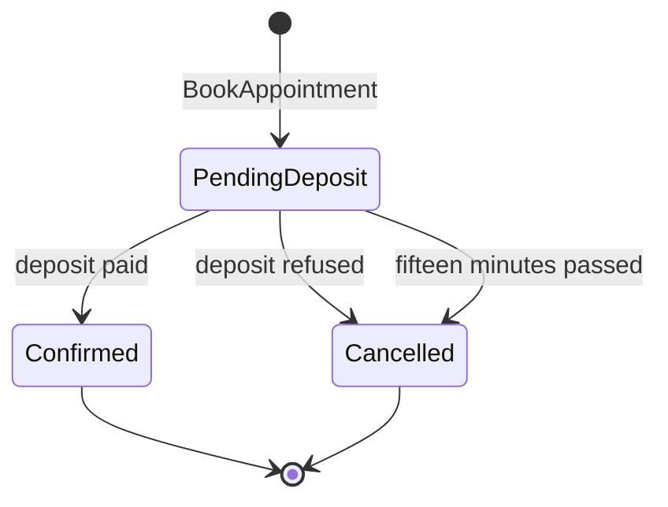
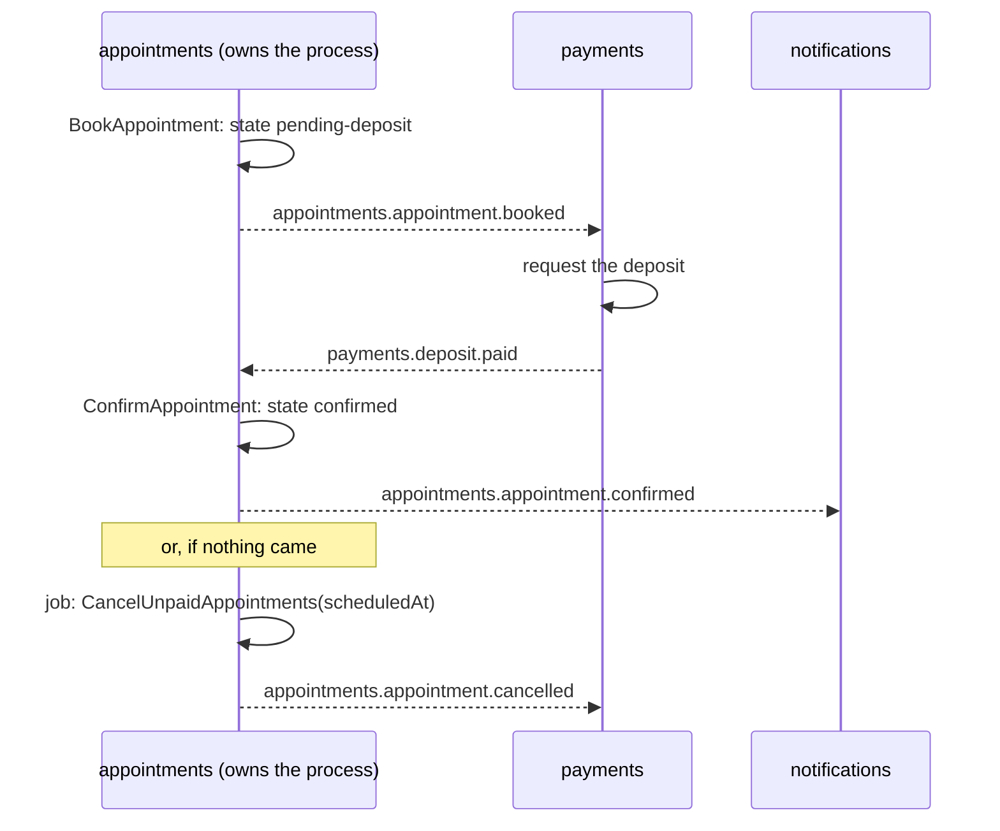

# Sagas and process managers

**Summary.** A business process that spans several aggregates or contexts cannot be one
transaction in this architecture. A saga is the alternative: a sequence of local transactions,
each announced by an event, with a compensating action for each step that may need to be undone.
It can be choreographed (each context reacts to the others' events) or orchestrated (one
component, a process manager, decides the next step). The kit provides the building blocks
(integration events, the outbox, idempotent consumers, scheduled jobs) and does not provide a
saga or process manager framework: a process is modelled by the project, usually as an aggregate
that holds the state of the process.

## Why a saga at all

Suppose the product adds a deposit: an appointment with certain practitioners is confirmed only
once a deposit is paid, and the slot is released if payment does not arrive within fifteen
minutes. Three contexts are involved (`appointments`, a payment context or provider,
`notifications`), and the rule "one aggregate per transaction, no transaction across contexts"
([ARCHITECTURE.md](../ARCHITECTURE.md) section 4) forbids doing it in one commit.

The process becomes steps:

Each arrow is a local transaction in one context. Between two arrows the system is in a visible
intermediate state ("pending deposit"), which the product must name (see
[Eventual consistency](eventual-consistency.md)).

## Compensation

A saga has no rollback. A step that already committed is undone by another business action:

| Step | Compensation |
|---|---|
| hold the slot | release the slot (cancel the pending appointment) |
| take the deposit | refund the deposit |
| send the confirmation | send a cancellation notice (a message cannot be unsent) |

Compensations are part of the domain: "cancel with reason deposit-not-received" is an intention
method of `Appointment`, with its own event. Some steps cannot be compensated (an SMS, a
shipment that left); order the process so that those come last (Garcia-Molina and Salem;
Richardson calls the last such step the pivot).

## Choreography or orchestration

| | Choreography | Orchestration |
|---|---|---|
| Who decides the next step | each context, by reacting to events | one process manager, by sending commands |
| Where the process is visible | nowhere in one place: it is the sum of the subscriptions | in the process manager |
| Coupling | contexts know each other's events | the orchestrator knows every participant; participants know only their commands |
| Adding a step | a new subscriber; the others do not change | a change of the orchestrator |
| Timeouts and "did every step happen?" | awkward: nobody owns the question | natural: the orchestrator holds the state |
| Fits | short, linear flows of two or three steps | flows with branches, timeouts, compensations |
| Risk | cyclic event dependencies, a process nobody can describe | a central component that accumulates business logic |

In the scheduling application, "send a reminder when an appointment is booked" is choreography
and needs nothing more: `notifications` consumes `appointments.appointment.booked`. The deposit
flow, with its timeout and two outcomes, deserves an owner.

## What the kit provides, and what it does not

Provided, as building blocks:

- **integration events** declared in a published language, with versions;
- **the transactional outbox**, so each step's event exists if and only if the step committed;
- **idempotent consumers** with a processed-event store in the consumer's transaction, so a
  redelivered event does not run a step twice;
- **the correlation id and causation id** carried by the execution context and stamped on
  published events, so every step of one process can be found again in logs, traces and the
  audit trail;
- **scheduled jobs** and **delayed background jobs**, which can drive timeouts (below);
- **dead letters and error reporting** for a step that fails for good.

Not provided (checked against the packages of this repository on 2026-10-10: no package, port
or generator for it):

- no saga or process manager base class, DSL or framework;
- no persisted state machine or workflow engine;
- no timeout manager of its own: a deadline is a [background job](background-jobs.md) enqueued
  with a delay, or a scheduled job that derives the overdue work from the state (below);
- no automatic compensation: undoing is code the project writes;
- no command sent to another context: a context only reacts to events or answers through a
  gateway port.

A project that needs long-running, heavily branching workflows with durable timers should look
at a dedicated workflow engine behind a port (Temporal, Camunda and similar products exist; they
were not evaluated for this kit and nothing here integrates them).

## Building one with the existing blocks

**The process state is an aggregate.** Here the `Appointment` itself can carry it: its state
includes `pending-deposit`, and its methods are the transitions (`confirm(at)`,
`cancel(reason, at)`). For a process that belongs to no existing aggregate, model a dedicated
one in the context that owns the process, named in the ubiquitous language (a `Booking` or an
`Enrolment`, not a `BookingSaga`: `language/no-technical-name` refuses technical names in the
domain anyway).

**Each step is a command of the owning context, triggered by an event.**

The integration event handler in `appointments` translates `payments.deposit.paid` into
`ConfirmAppointment` and sends it on the command bus; the aggregate decides whether the
transition is still valid (an appointment already cancelled by the timeout refuses to be
confirmed, and the payment context compensates with a refund on the cancellation event).
(`payments` and its events are illustrative; they are not part of the running example's
contexts.)

**Timeouts are a query plus a repeatable command.** With no delayed delivery, the deadline is
data: the aggregate stores when the deposit is due. A scheduled job runs every few minutes and
sends one command, "cancel the appointments whose deposit is overdue", which derives what to do
from the state. Because a job occurrence may run twice or not at all, the command must be safe
to repeat (see [Scheduled jobs](scheduled-jobs.md)). The precision of the timeout is the
interval of the job.

**Races are settled by the aggregate.** "Deposit paid" and "deadline passed" can arrive
together. Both are commands on the same aggregate; optimistic concurrency lets one win and the
other is refused with a domain error or retried against the new state. No lock is needed.

## Limits and when not to use it

- **First ask whether the boundary is wrong.** A use case that must change two contexts in one
  transaction is the first signal the `bounded-contexts` skill lists for a misplaced boundary. A
  saga is the answer when the contexts are rightly separate, not a way to live with a wrong cut.
- **Intermediate states are visible.** Other users see the slot as held while the deposit is
  pending. Sagas have no isolation: design the states instead of hiding them.
- **Compensation is not always possible** and is itself a step that can fail and must be
  retried.
- **Hand-built orchestration does not scale to complex workflows.** Past a handful of steps,
  parallel branches or human tasks, the bookkeeping (what was sent, what is awaited, what timed
  out) is what workflow engines exist for.
- **Timeouts driven by a job are coarse** (minute resolution for cron in the kit's scheduler,
  and best-effort single run) and depend on the job running.
- **Choreography can create cycles.** If `appointments` consumed events of `notifications`
  while `notifications` consumes `appointments`, the declared relationships would form a cycle,
  which `context/no-cycle` refuses. The process owner should be upstream or the reply should go
  through a context that is.
- **Testing a saga end to end is slow.** Test each transition on the aggregate, each handler
  with fakes, and one end-to-end path.

## Sources

- Hector Garcia-Molina and Kenneth Salem, "Sagas", ACM SIGMOD 1987.
- Chris Richardson, Microservices Patterns, Manning, 2018, chapter 4 ("Managing transactions
  with sagas"); https://microservices.io/patterns/data/saga.html
- Gregor Hohpe and Bobby Woolf, Enterprise Integration Patterns, Addison-Wesley, 2003 (Process
  Manager, Routing Slip, Correlation Identifier).
- Sam Newman, Building Microservices, 2nd edition, O'Reilly, 2021, chapter 6 ("Workflow":
  orchestrated and choreographed sagas).
- Vaughn Vernon, Implementing Domain-Driven Design, Addison-Wesley, 2013, chapter 4
  ("Long-Running Processes").
- Vlad Khononov, Learning Domain-Driven Design, O'Reilly, 2021, chapter 9 (saga and process
  manager).
- Pat Helland, "Life beyond Distributed Transactions: an Apostate's Opinion", CIDR 2007.

## See also

- [Aggregates](aggregates.md)
- [Eventual consistency](eventual-consistency.md)
- [Domain and integration events](domain-and-integration-events.md)
- [Transactional outbox](transactional-outbox.md)
- [Delivery and idempotency](delivery-and-idempotency.md)
- [Scheduled jobs](scheduled-jobs.md)
- [Bounded context](bounded-context.md)
- [Architecture reference](../ARCHITECTURE.md)
