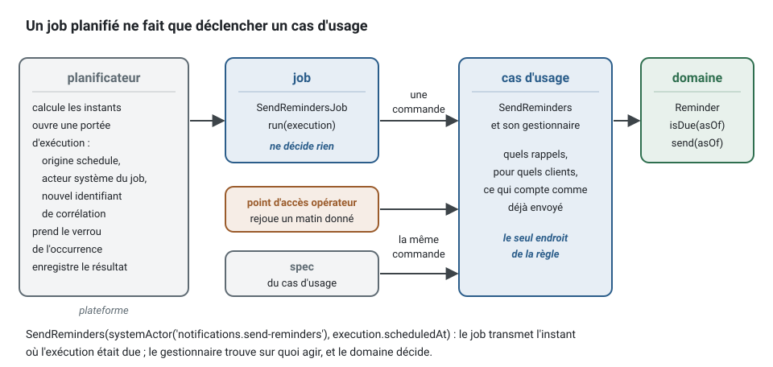
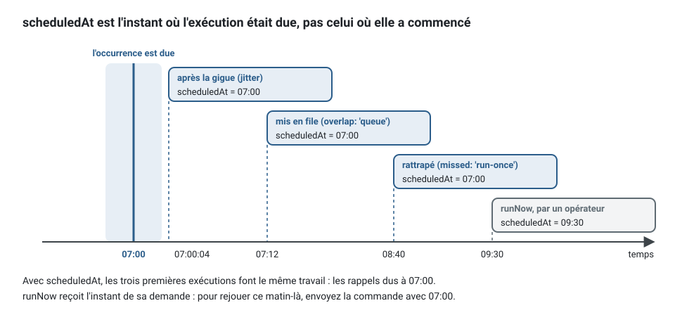
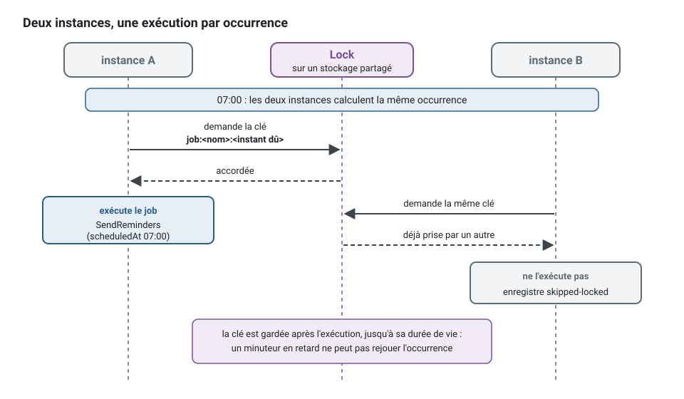

[English](scheduled-jobs.md) · **Français**
<!-- translation-of: scheduled-jobs.md sha256:2d984222a14fb4e8 -->

# Jobs planifiés

**Résumé.** Un *job* planifié (scheduled job) est un travail déclenché par le temps plutôt que
par une requête HTTP ou un événement : envoyer chaque matin les rappels du lendemain, vérifier
chaque nuit la chaîne d'audit. Dans ce kit, un *job* ne décide rien. C'est une petite classe de
la couche application qui dit quand elle s'exécute et envoie une commande ; la règle métier
reste dans le cas d'usage et dans le domaine. Entre plusieurs instances, un verrou limite une
occurrence à une seule exécution, au mieux : une occurrence peut s'exécuter deux fois ou pas du
tout. Chaque *job*, ou la commande qu'il envoie, est donc idempotent, et la période sur laquelle
porte le travail vient de l'instant où l'exécution était due, jamais de l'horloge.

## Un job ne fait que déclencher un cas d'usage



<!-- checked sample -->
```ts
// notifications/application/scheduling/send-reminders.job.ts
import { AuthorizedCommand, systemActor, type Actor, type CommandBus } from '@ddd-ts-kit/kernel';
import { Scheduled, type JobExecution, type ScheduledJob } from '@ddd-ts-kit/kernel/declarations';

// Le cas d'usage, dans son propre fichier sous application/commands/send-reminders/ : le job ne fait que l'envoyer.
export class SendReminders extends AuthorizedCommand<void> {
  /** L'instant auquel les rappels sont dus : l'occurrence du job, jamais l'instant où il s'exécute réellement. */
  constructor(
    actor: Actor,
    readonly asOf: Date,
  ) {
    super(actor);
  }
}

@Scheduled('notifications.send-reminders', { cron: '0 7 * * *', timeZone: 'Europe/Paris' })
export class SendRemindersJob implements ScheduledJob {
  constructor(private readonly commands: CommandBus) {}

  async run(execution: JobExecution): Promise<void> {
    await this.commands.execute(
      new SendReminders(systemActor('notifications.send-reminders'), execution.scheduledAt),
    );
  }
}
```

La déclaration vient de `@ddd-ts-kit/kernel/declarations`, les types et le bus de
`@ddd-ts-kit/kernel` : `application/` n'importe rien d'autre. Les dépendances sont ce que prend
le constructeur, chacune typée par un port. L'application d'exemple a le même *job* dans
`examples/scheduling/src/contexts/notification/application/scheduling/send-due-reminders.job.ts`,
toutes les 15 minutes.

Tout ce qui compte est dans `SendReminders` et son gestionnaire : quels rendez-vous, quels
clients, ce qui compte comme déjà rappelé. Plutôt qu'un *job* qui fait le travail lui-même :

```ts
// à éviter : un cas d'usage caché dans un job, refusé par scheduling/job-triggers-use-case
@Scheduled('notifications.send-reminders', { cron: '0 7 * * *', timeZone: 'Europe/Paris' })
export class SendRemindersJob implements ScheduledJob {
  constructor(private readonly appointments: AppointmentRepository, private readonly mailer: Mailer) {}

  async run(): Promise<void> {
    for (const appointment of await this.appointments.startingTomorrow()) {
      await this.mailer.remind(appointment.clientId); // deux fois si le job s'exécute deux fois
    }
  }
}
```

écrivez le *job* ci-dessus, et placez la boucle dans le gestionnaire de `SendReminders`, où elle
est un cas d'usage comme un autre ([Donc, idempotent](#donc-idempotent) montre ce gestionnaire).
Pourquoi ce découpage :

- **Un seul endroit pour la règle.** La même commande peut être envoyée par le *job*, par un
  opérateur via un point d'accès, ou par un test. Un *job* qui tient un *repository* et une
  boucle est un cas d'usage caché là où personne ne le cherche.
- **Il est observé comme toute autre unité de travail.** Le planificateur ouvre une portée
  d'exécution autour de chaque exécution (origine `schedule`, un acteur système nommé d'après le
  *job*, un identifiant de corrélation neuf) : journaux, métriques, traces, colonnes d'audit et
  journal d'audit fonctionnent comme pour une requête HTTP. Voir
  [L'acteur et la portée d'exécution](actor-and-execution-scope.fr.md).
- **L'autorisation reste explicite.** La commande est envoyée en tant qu'acteur système du
  *job*. Soit le modèle accorde la permission à cet acteur, soit la commande est déclarée
  publique quand rien d'autre ne peut l'envoyer.
- **Il se déplace avec son contexte.** Les *jobs* sont des déclarations d'un contexte. Un
  contexte extrait en service emporte ses *jobs* ; rien n'est global.

Une classe de *job* qu'aucun fichier de module n'enregistre ne tourne jamais, et rien d'autre ne le
remarque : dans le style explicite, `scheduling/job-registered` (une erreur) signale un *job* ou un
*job* d'arrière-plan qu'aucun `platform.jobs.register`, `platform.backgroundJobs.register` ni
`.handledBy(..)` ne nomme. Avec des relations, un *job* qui envoie une commande protégée a besoin
de la relation de son acteur système, que `authz/system-actor-granted` vérifie.

Le nom est `<context>.<job-name>`, écrit comme un littéral : c'est l'acteur sous lequel le *job*
s'exécute, la clé de son verrou, son étiquette dans les métriques et la clé de ses réglages, et
il survit au renommage de la classe. Il est unique dans le projet (`scheduling/job-name`). Un
*job* ne dépend d'aucun *repository*, d'aucune partie du modèle ni d'aucun adaptateur
(`scheduling/job-triggers-use-case`). Le décorateur vérifie le nom et la planification au
chargement du fichier : un nom qui n'est pas `<context>.<job-name>`, un cron illisible ou qui ne
se déclenche jamais, un intervalle nul ou un fuseau horaire inconnu lèvent une
`DeclarationError` qui nomme le *job*.

Un *job* est **global** par défaut : une exécution par occurrence, dans aucun *tenant*, et un cas
d'usage qui travaille par *tenant* reçoit le *tenant* dans sa commande. Déclaré
`tenancy: 'per-tenant'`, il s'exécute une fois par *tenant* du `TenantDirectory` à chaque
occurrence, chaque exécution dans la portée d'exécution de ce *tenant* (`execution.tenantId` dit
lequel) ; un *tenant* qui échoue n'arrête pas les autres.

```bash
npx ddd-ts-kit generate job notifications SendReminders --cron "0 7 * * *" --time-zone Europe/Paris --command SendReminders
```

Dans un projet avec *tenancy* (`stack.tenancy` autre que `none`), `generate job` écrit
`tenancy: 'per-tenant'`, car un *job* global s'exécute dans aucun *tenant* et un *repository*
confiné à un *tenant* le refuse (`NoCurrentTenantError`) à chaque exécution réelle ; `--global`
écrit `tenancy: 'global'` pour un travail à travers les *tenants*, et la note de la commande dit
lequel a été écrit. Le planificateur interroge à nouveau le `TenantDirectory` à **chaque
occurrence**, et ce que l'annuaire liste dépend du projet :

- Avec le *preset* d'identité (`--preset identity`), les *tenants* sont ses organisations, lues
  dans la base à chaque occurrence : une organisation ouverte après le démarrage du processus a son
  exécution à l'occurrence suivante, sans redémarrage. `init` écrit l'annuaire
  (`src/platform/composition/tenant-directory.ts`) au-dessus des organisations du contexte, sur
  Drizzle, Knex et Prisma.
- Sans source de *tenants*, `init` donne au planificateur les *tenants* de `TENANTS` (identifiants
  séparés par des virgules, `config.tenants`, transmis à l'application sous le nom `tenants`), lus
  **une seule fois au démarrage du processus**. Une liste fixe manque une organisation ou un client
  créé plus tard : ses *jobs* par *tenant* (rappels, purges, échéances) ne s'exécutent jamais pour
  lui, sans erreur, jusqu'au redémarrage du processus avec une nouvelle liste. Quand les *tenants*
  vivent dans une table à vous, faites lire cet annuaire dans cette table, comme le *preset*
  d'identité le fait dans `tenant-directory.ts`.

Une exécution d'un *job* par *tenant* dit pour combien de *tenants* elle a tourné : `JobRun.tenants`
(absent pour un *job* global). Avec un annuaire vide, le *job* n'est jamais appelé et l'exécution est
`succeeded` avec `tenants: 0` : regardez ce champ, ou `tenants` dans la ligne de journal de
l'exécution, avant de croire qu'un *job* n'a rien fait. `application.runJob(name)` du support e2e
lève sur une telle exécution et dit d'ouvrir d'abord un *tenant* (une organisation) ; ouvrez-en un
dans la *spec*, après `reset()`, puis lancez le *job*.

La *spec* générée exécute le *job* pour deux *tenants*. Un *job* écrit à la main sous *tenancy* doit aussi le dire :
`scheduling/tenancy-declared` (une erreur) signale un `@Scheduled` ou un `builder.job` dont les
options ne portent ni `tenancy: 'per-tenant'` ni `tenancy: 'global'`.

### Une exécution lit son propre tenant

Une exécution par *tenant* ouvre la portée d'exécution de son *tenant* : un *repository*
confiné à un *tenant* ne lit et n'écrit que celui-là. Prouvez-le sur le vrai *repository*, pas sur
un faux, quand un *handler* en dépend : enregistrez une ligne par *tenant* dans la base de test,
exécutez le *job* par l'application de test, et lisez les deux lignes par le *repository* depuis
l'exécution. Chaque exécution doit trouver sa ligne et pas l'autre. La suite de bout en bout du kit
fait exactement cela contre le *repository* généré d'un projet multi-*tenant* ; un faux *repository*
qui ignore le *tenant* passerait pour une mauvaise raison.

La commande écrit le *job*, sa *spec*, son interrupteur dans les réglages des *jobs* de la plateforme
(`src/platform/jobs/job-settings.ts`, désactivé par `JOB_<CONTEXT>_<JOB>_ENABLED=false`) et, là où le
modèle d'autorisation en fait une ligne, la permission accordée à son acteur système.

## Planifications

Deux formes : un intervalle (`every`) ou une expression cron avec un fuseau horaire.

```ts
{ every: '15m' }                                    // ou un nombre de millisecondes
{ cron: '0 7 * * 1-5', timeZone: 'Europe/Paris' }   // timeZone vaut UTC par défaut
{ every: '1h', overlap: 'queue', timeoutMs: 60_000 } // les options se placent à côté de la planification
```

**Les intervalles sont alignés sur l'époque Unix**, pas sur le démarrage du processus : toutes
les 15 minutes signifie :00, :15, :30 et :45 sur chaque instance, avant comme après un
redémarrage. C'est cet alignement qui permet à plusieurs instances de nommer les mêmes instants.
Un intervalle ne suit aucun fuseau horaire : pour « chaque matin », écrivez un cron.

**Le cron** a les cinq champs standard, à la minute près, ou un raccourci qui les remplace
(`@hourly`, `@daily`, `@weekly`, `@monthly`, `@yearly`), évalués sur l'horloge d'un fuseau horaire
IANA. Le changement d'heure mérite une décision par *job* :

| Quand les horloges sont | Un *job* fixé à une heure (`30 2 * * *`) | Un *job* de chaque heure (`0 * * * *`) |
|---|---|---|
| avancées | l'heure locale n'existe pas : aucune exécution ce jour-là | garde son rythme |
| reculées | l'heure locale survient deux fois : une seule exécution, la première fois | traverse deux fois l'heure répétée |

Ne planifiez pas dans l'heure changée ce qui doit s'exécuter chaque jour.

Un *job* se désactive, se replanifie ou se règle par environnement, par la configuration là où il
est câblé, jamais par un changement de code. Avec `@ddd-ts-kit/di`, les réglages ont pour clé le
nom du *job* :

```ts
createApplication({
  modules,
  jobs: {
    settings: {
      'notifications.send-reminders': { enabled: config.jobs.reminders.enabled },
      'billing.export-ledger': { schedule: { cron: config.jobs.ledgerCron, timeZone: 'Europe/Paris' } },
    },
  },
});
```

Des réglages pour un *job* qu'aucun module ne déclare sont refusés (`UNKNOWN_JOB`) : un *job*
renommé ne peut pas rester actif par une clé périmée.

## `scheduledAt`, pas l'horloge

Une exécution reçoit l'instant où elle était due (`scheduledAt`) et l'instant où elle a
réellement commencé (`startedAt`). Ils diffèrent d'une gigue, d'une attente en file ou d'un
rattrapage après une interruption. La commande doit être construite à partir du premier :



```ts
// avant : « demain » dépend du moment où le job s'est réellement exécuté
new SendReminders(actor, clock.now());

// après : « les rappels de cette matinée » sont le même travail, quel que soit le moment de l'exécution
new SendReminders(actor, execution.scheduledAt);
```

Avec l'instant dû, une exécution qui commence à 07:00:04 après la gigue, une autre mise en file
derrière l'exécution précédente qui commence à 07:12, et une autre rattrapée après un
redémarrage désignent toutes la même période. C'est aussi ce qui rend le travail idempotent par
clé. Une exécution demandée à la main par `runNow` reçoit l'instant de la demande : un opérateur
qui rejoue une matinée donnée envoie la commande avec l'instant de cette matinée, par un point
d'accès du cas d'usage.

## Plusieurs instances

Chaque instance d'une application répartie horizontalement fait tourner un planificateur et
calcule les mêmes instants. Avant d'exécuter une occurrence, le planificateur prend un verrou
dont la clé est le nom du *job* et l'instant dû (`job:<name>:<due instant in ISO 8601>`).
L'instance qui l'obtient exécute ; les autres enregistrent `skipped-locked`.



Deux faits sur ce verrou décident de la façon d'écrire les *jobs*.

**Il lui faut un stockage partagé entre processus.** Le verrou par défaut (`InMemoryLock`)
n'exclut qu'à l'intérieur d'un seul processus : avec lui, deux instances exécutent toutes deux
chaque *job*. Il convient à une instance unique et aux tests. Un verrou sur Redis, Dragonfly ou
Valkey (`RedisLock` de `@ddd-ts-kit/redis`, lié au `Lock` du noyau) donne la garantie entre
instances ([Outils de cache et de coordination](../tools/cache-and-coordination.fr.md)).

**La garantie est « au plus une exécution par occurrence, au mieux ».** Ce n'est pas un
consensus.

| Une occurrence peut s'exécuter | Quand |
|---|---|
| deux fois | le verrou expire pendant que son détenteur est en pause ; le stockage du verrou bascule et oublie la clé ; un rattrapage arrive après l'expiration du verrou ; les horloges divergent de plus que sa durée de vie |
| zéro fois | l'instance qui détient le verrou plante pendant l'exécution (personne ne retente) ; toutes les instances sont arrêtées à l'instant voulu ; le stockage du verrou est injoignable, auquel cas l'occurrence est enregistrée en échec plutôt qu'exécutée partout |

## Donc, idempotent

Une exécution qui a lieu deux fois doit laisser le même état qu'une seule. Deux techniques,
souvent combinées :

1. **Déduire le travail de l'état.** « Les rendez-vous de demain dont le rappel n'a pas été
   envoyé » se calcule sans risque deux fois : la seconde exécution ne trouve plus rien à faire.
   « Envoyer un rappel pour chaque rendez-vous de demain » ne le permet pas.
2. **Associer au travail une clé tirée de `scheduledAt`, protégée par une contrainte d'unicité.** Une ligne de
   rappel dont la clé est le rendez-vous et la date du rappel ne peut pas être insérée deux
   fois, quoi que croie un processus au sujet d'un verrou.

La première technique, écrite en entier : l'agrégat sait s'il est encore dû, et le gestionnaire
de `SendReminders` n'agit que sur ce qui l'est.

<!-- checked sample -->
```ts
import { AggregateRoot, DomainRefusal, Repository } from '@ddd-ts-kit/kernel';

// notification.codes.ts
export const NotificationCodes = { ReminderNotDue: 'REMINDER_NOT_DUE' } as const;

// domain/errors/reminder-not-due.error.ts
export class ReminderNotDue extends DomainRefusal {
  readonly code = NotificationCodes.ReminderNotDue;

  static forReminder(reminderId: string) {
    return ReminderNotDue.refusal(`Reminder ${reminderId} is not due.`, { reminderId });
  }
}

export class Reminder extends AggregateRoot<string> {
  private constructor(
    id: string,
    private readonly dueAt: Date,
    private sent: boolean,
  ) {
    super(id);
  }

  static plan(id: string, dueAt: Date): Reminder {
    return new Reminder(id, dueAt, false);
  }

  /** Dû et pas encore envoyé : une seconde exécution ne trouve plus rien à faire. */
  isDue(asOf: Date): boolean {
    return !this.sent && this.dueAt.getTime() <= asOf.getTime();
  }

  send(asOf: Date): void {
    if (!this.isDue(asOf)) {
      throw ReminderNotDue.forReminder(this.id);
    }

    this.sent = true;
  }
}

export abstract class ReminderRepository extends Repository<Reminder> {
  /** Tous les rappels dus à cet instant et pas encore envoyés, quel que soit le jour où ils étaient dus. */
  abstract findDue(asOf: Date): Promise<readonly Reminder[]>;
}

// ce que fait le gestionnaire de SendReminders avec l'instant que le job lui a passé
export async function sendReminders(reminders: ReminderRepository, asOf: Date): Promise<void> {
  for (const reminder of await reminders.findDue(asOf)) {
    reminder.send(asOf);

    await reminders.save(reminder);
  }
}
```

Le `Reminder` de l'application d'exemple fonctionne ainsi (`notification/domain/aggregates/reminder.aggregate.ts`),
et la *spec* de son *job* exécute deux fois la même occurrence pour prouver qu'un rappel n'est
envoyé qu'une fois.

Le noyau le dit du verrou lui-même : un outil d'efficacité, jamais la garde d'un invariant. Ce
qui ne doit pas arriver deux fois est refusé par une contrainte de la base de données. Le même
raisonnement interdit d'utiliser un verrou contre la double réservation (voir
[Agrégats](aggregates.fr.md)).

Une exécution qui a lieu zéro fois doit pouvoir être rattrapée : comme le travail se déduit de
l'état, l'occurrence suivante reprend ce que la manquée a laissé, à condition que la requête ne
regarde pas seulement « aujourd'hui ». Concevez la sélection avec une tolérance (« dû et pas
encore rappelé »), pas une correspondance exacte sur le jour.

## Échec, chevauchement et occurrences manquées

- **Pas de nouvelle tentative.** Une occurrence en échec est terminée ; l'occurrence suivante
  tient lieu de nouvelle tentative. La nouvelle tentative a sa place là où se produit l'échec :
  sur l'adaptateur (voir [Résilience](resilience.fr.md)), ou dans une commande que l'on peut
  renvoyer sans risque.
- **Chevauchement.** Une occurrence qui arrive alors que l'exécution précédente est encore en
  cours est sautée par défaut (`skipped-overlap`), ou mise en file derrière elle
  (`overlap: 'queue'`, une occurrence en attente au plus).
- **Occurrence manquée.** Une occurrence que le planificateur a atteinte trop tard (le processus
  était arrêté ou sa boucle d'événements bloquée) est abandonnée par défaut (`missed`), ou la
  plus récente s'exécute une fois (`missed: 'run-once'`). Ce qui est passé pendant l'arrêt du
  processus n'est connu que si le planificateur reçoit un stockage pour ses points de reprise
  (`JobCheckpoints`).
- **Un délai d'expiration ne tue pas.** Une exécution est une promesse, et rien n'arrête une
  promesse : passé `timeoutMs`, le planificateur interrompt `execution.signal`, enregistre
  `failed` avec `JOB_TIMEOUT` et cesse d'attendre. Un *job* qui ignore le signal continue
  derrière et chevauche l'exécution suivante. Transmettez le signal.
- **Un *job* en échec n'arrête ni le planificateur ni les autres *jobs***, et un échec inattendu
  est envoyé à la remontée des erreurs. Chaque occurrence est journalisée et comptée
  (`scheduled_job_runs_total`, étiquetée par `job` et `status`). Alertez sur l'absence de succès
  (« aucune exécution réussie depuis deux intervalles ») : cela attrape toutes les façons dont
  un *job* cesse de s'exécuter.

## Dans le processus de l'API ou dans un worker

Par défaut, chaque processus qui démarre l'application exécute les *jobs*. Pour les exécuter
dans un déploiement et servir les requêtes HTTP dans un autre, la même racine de composition est
démarrée avec les *jobs* désactivés d'un côté et sans serveur HTTP de l'autre :

```ts
// src/main.ts, le processus qui sert les requêtes HTTP
const app = createApplication({ modules, jobs: { start: false } });

// src/apps/worker/main.ts, le processus qui exécute les jobs : les mêmes modules, pas de serveur HTTP
const app = createApplication({ modules, jobs: { settings: jobSettings(config) } });
await app.start();
process.on('SIGTERM', () => void app.stop());
```

`npx ddd-ts-kit generate worker` écrit `src/apps/worker/main.ts` et désactive par défaut
`RUN_JOBS` pour l'API. Avec `start: false`, les *jobs* restent enregistrés et `runNow` en exécute
toujours un. Gardez le verrou d'exécution unique même avec un seul *worker* : un déploiement
progressif en fait tourner deux pendant un moment.

### Les services et les *jobs* de la plateforme

Les *jobs* de la plateforme elle-même (`audit.verify`, `audit.archive`, `privacy.purge-expired`,
`files.purge-staged`, `events.purge-published`, `jobs.purge-finished`) appartiennent à l'application entière. Un service écrit par `generate
service` se compose avec `platformJobs: false`, et son `jobSettings(env, '<context>')` ne garde que
les réglages de ses propres *jobs* ; l'application entière laisse de côté les *jobs* des contextes
exécutés comme services. Le verrou qui limite une occurrence à une exécution est partagé par Redis
sous `DEPLOYMENT_NAME` (comme le cache, le limiteur de débit et le magasin de *jobs*), jamais sous
`OTEL_SERVICE_NAME` : celui-ci nomme le conteneur dans les traces, et un verrou par conteneur n'est
pas un verrou.

## Tests

Une *spec* de *job* est une *spec* du cas d'usage qu'il déclenche : exécutez le *job* une fois
par l'application de test, vérifiez les *fakes*. Le temps n'intervient pas. L'application
d'exemple exécute deux fois la même occurrence et vérifie que le rappel n'est parti qu'une fois :

```ts
// examples/scheduling/src/contexts/notification/test/unit/send-due-reminders.job.spec.ts (un extrait)
it('sends each due reminder once, even when the same occurrence runs twice', async () => {
  const { application, reminderRepository, mailer } = await arrangeObserved();

  await reminderRepository.save(
    aReminder().of('appointment-1').plannedFor(new Date('2026-01-10T09:00:00.000Z')).build(),
  );

  await application.jobs.runNow('notification.send-due-reminders');
  await application.jobs.runNow('notification.send-due-reminders');

  expect(mailer.delivered).toEqual([
    { address: 'ada@example.test', recipientId: 'patient-1', kind: 'reminder', appointmentId: 'appointment-1' },
  ]);
});
```

Pour une *spec* qui porte sur le temps lui-même (chevauchement, occurrences manquées, deux
instances), un planificateur manuel avance une horloge fixe et déclenche chaque minuteur à son
instant. Deux planificateurs qui partagent une horloge et un verrou sont deux instances :

<!-- checked sample -->
```ts
import { FixedClock, FixedExecutionScope, InMemoryLock, SequentialIdGenerator } from '@ddd-ts-kit/kernel';
import { ManualJobScheduler } from '@ddd-ts-kit/scheduling/testing';
import { expect, it } from 'vitest';

it('runs each occurrence on one instance only', async () => {
  // deux instances : deux planificateurs sur la même horloge et le même verrou
  const clock = new FixedClock(new Date('2026-03-02T05:58:00Z'));
  const lock = new InMemoryLock(clock);
  const instances = [1, 2].map(
    () => new ManualJobScheduler({ clock, lock, scope: new FixedExecutionScope(), ids: new SequentialIdGenerator() }),
  );
  const ran: Date[] = [];

  for (const scheduler of instances) {
    scheduler.register({
      name: 'notifications.send-reminders',
      schedule: { cron: '0 7 * * *', timeZone: 'Europe/Paris' },
      run: async (execution) => {
        ran.push(execution.scheduledAt);
      },
    });
    await scheduler.start();
  }

  const [first, second] = instances;
  await first?.advance(2 * 60_000); // 07:00 à Paris, c'est 06:00 UTC en mars
  await second?.advance(0);

  expect(ran).toEqual([new Date('2026-03-02T06:00:00Z')]);
  expect(second?.runs.map((run) => run.outcome)).toEqual(['skipped-locked']);
});
```

## Limites et quand ne pas l'utiliser

Énoncées par [`@ddd-ts-kit/scheduling`](../../packages/scheduling/README.fr.md) :

- **L'exécution exactement une fois n'existe pas ici.** Au plus une fois par occurrence, au
  mieux.
- **Aucune persistance propre.** Les exécutions et leurs issues vivent dans la mémoire de
  l'instance ; seuls les points de reprise, si vous fournissez le stockage, survivent à un
  redémarrage.
- **Ni nouvelle tentative ni temporisation croissante (backoff).**
- **Résolution à la minute pour le cron** ; pas de champ des secondes, pas de `@reboot`, pas de
  `L`, `W`, `#`.
- **Un processus, une boucle d'événements.** Un *job* qui bloque la boucle retarde tous les
  autres.
- **Les règles des fuseaux horaires sont celles de l'environnement d'exécution** : un fuseau
  dont les règles ont changé demande un Node à jour.
- **Pas une file d'attente.** Un *job* fait une quantité bornée de travail selon une
  planification. Le travail demandé par une commande, qui ne doit pas être perdu et doit être
  retenté, est un [*job* en arrière-plan](background-jobs.fr.md), mis en file dans la
  transaction de la commande ; un fait auquel d'autres contextes réagissent est un événement
  d'intégration, par l'outbox.
- **Pas un moteur de workflow.** Un processus en plusieurs étapes avec des attentes et de la
  compensation est une saga ou un gestionnaire de processus
  ([Sagas et gestionnaires de processus](sagas-and-process-managers.fr.md)), que le kit ne
  fournit pas comme moteur d'exécution.
- **Quand un planificateur dédié convient mieux.** Des milliers de planifications dynamiques
  par *tenant*, un historique durable des exécutions ou une sémantique de rattrapage stricte
  demandent une autre implémentation du port `JobScheduler` (sur une base de données ou une file
  d'attente), ou le planificateur de la plateforme d'hébergement qui déclenche une commande.

## Sources

- Michael T. Nygard, Release It!, 2e édition, Pragmatic Bookshelf, 2018 : sur le travail
  planifié qui démarre à la même minute sur toute une flotte, et sur la gigue.
- Martin Kleppmann, « How to do distributed locking », 2016 (martin.kleppmann.com), et Designing
  Data-Intensive Applications, O'Reilly, 2017, chapitre 8 : pauses de processus, expiration des
  verrous et jetons de clôture (fencing tokens).
- Pat Helland, « Idempotence Is Not a Medical Condition », ACM Queue, 2012.
- The Open Group Base Specifications, `crontab` : les cinq champs et la règle quand les deux
  champs de jour sont restreints.
- IANA Time Zone Database (iana.org/time-zones).
- [`@ddd-ts-kit/scheduling`](../../packages/scheduling/README.fr.md) et les sections
  « Scheduled » et « Lock » de [`@ddd-ts-kit/kernel`](../../packages/kernel/README.fr.md).

## Voir aussi

- [L'acteur et la portée d'exécution](actor-and-execution-scope.fr.md)
- [Résilience](resilience.fr.md)
- [Garanties de livraison et idempotence](delivery-and-idempotency.fr.md)
- [Sagas et gestionnaires de processus](sagas-and-process-managers.fr.md)
- [Jobs en arrière-plan](background-jobs.fr.md)
- [Observabilité](observability.fr.md)
- [Outils de cache et de coordination](../tools/cache-and-coordination.fr.md)
- [Référence de l'architecture](../ARCHITECTURE.fr.md) : « Jobs planifiés »
