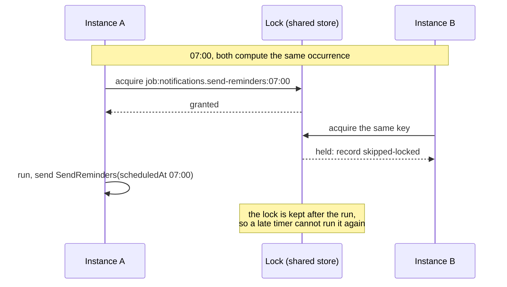

**English** · [Français](scheduled-jobs.fr.md)

# Scheduled jobs

**Summary.** A scheduled job is work started by time instead of by a request or an event:
send tomorrow's reminders every morning, verify the audit chain every night. In this kit a job
decides nothing. It is a small class of the application layer that says when it runs and sends
a command; the business rule stays in the use case and the domain. Across several instances a
lock keeps an occurrence to one run, best effort: an occurrence may run twice or not at all.
So every job, or the command it sends, is idempotent, and the period the work is for comes
from the instant the run was due, never from the clock.

## A job only triggers a use case

```ts
// notifications/application/scheduling/send-reminders.job.ts
@Scheduled('notifications.send-reminders', { cron: '0 7 * * *', timeZone: 'Europe/Paris' })
export class SendRemindersJob implements ScheduledJob {
  constructor(private readonly commands: CommandBus) {}

  async run(execution: JobExecution): Promise<void> {
    await this.commands.execute(
      new SendReminders(systemActor('notifications.send-reminders'), execution.scheduledAt),
    );
  }
}
```

Everything that matters is in `SendReminders` and its handler: which appointments, which
clients, what counts as already reminded. Why this split:

- **One place for the rule.** The same command can be sent by the job, by an operator through
  an endpoint, or by a test. A job holding a repository and a loop is a use case hidden where
  nobody looks for one.
- **It is observed like any other unit of work.** The scheduler opens an execution scope
  around each run (origin `schedule`, a system actor named after the job, a fresh correlation
  id), so logs, metrics, traces, audit columns and the audit trail work as for a request. See
  [The actor and the execution scope](actor-and-execution-scope.md).
- **Authorization stays explicit.** The command is sent as the system actor of the job. Either
  the model grants that actor the permission, or the command is declared public when nothing
  else can send it.
- **It moves with its context.** Jobs are declarations of a context. A context extracted as a
  service takes its jobs with it; nothing is global.

The name is `<context>.<job-name>`, written as a literal: it is the actor the job runs as, the
key of its lock, its label in the metrics and the key of its settings, and it survives the
renaming of the class. It is unique in the project (`scheduling/job-name`). A job depends on no
repository, no part of the model and no adapter (`scheduling/job-triggers-use-case`).

```bash
npx ddd-ts-kit generate job notifications SendReminders --cron "0 7 * * *" --time-zone Europe/Paris --command SendReminders
```

writes the job, its spec and its switch in the job settings of the platform.

## Schedules

Two forms: an interval (`every`) or a cron expression with a time zone.

**Intervals are aligned on the Unix epoch**, not on the start of the process: every 15 minutes
means :00, :15, :30 and :45 on every instance, before and after a restart. That alignment is
what lets several instances name the same instants. An interval follows no time zone: for
"every morning", write a cron.

**Cron** has the five standard fields at minute resolution, evaluated on the clocks of an IANA
time zone. Daylight saving time deserves one decision per job:

| When clocks are | A job pinned to an hour (`30 2 * * *`) | A job of every hour (`0 * * * *`) |
|---|---|---|
| set forward | the local time does not exist: no run that day | keeps its rhythm |
| set back | the local time occurs twice: runs once, the first time | runs through the repeated hour twice |

Do not schedule in the changed hour what must run every day.

A job is switched off, rescheduled or tuned per environment by configuration where it is
wired, never by a code change.

## `scheduledAt`, not the clock

A run receives the instant it was due (`scheduledAt`) and the instant it actually started.
They differ by a jitter, a queue or a catch-up after downtime. The command must be built from
the first:

```ts
// before: "tomorrow" depends on when the job really ran
new SendReminders(actor, clock.now());

// after: "the reminders of that morning" is the same work whenever it runs
new SendReminders(actor, execution.scheduledAt);
```

With the due instant, a run that starts at 07:00:04, one that is retried by hand at 09:30 and
one caught up after a restart all mean the same period. This is also what makes the work
idempotent by key.

## Several instances

Every instance of a horizontally scaled application runs a scheduler and computes the same
instants. Before running an occurrence, the scheduler takes a lock keyed by the job name and
the due instant. The instance that gets it runs; the others record that they skipped.



Two facts about that lock decide how jobs must be written.

**It needs a store shared between processes.** The default lock excludes inside one process
only: with it, two instances both run every job. It is right for a single instance and for
tests. A lock on Redis, Dragonfly or Valkey gives the guarantee between instances
([Cache and coordination tools](../tools/cache-and-coordination.md)).

**The guarantee is "at most one run per occurrence, best effort".** It is not consensus.

| An occurrence may run | When |
|---|---|
| twice | the lock expires while its holder is paused; the lock store fails over and forgets the key; a catch-up arrives after the lock expired; clocks disagree by more than its time to live |
| zero times | the instance holding the lock crashes during the run (nobody retries); every instance is down at the instant; the lock store cannot be reached, in which case the occurrence is recorded as failed rather than run everywhere |

## Therefore: idempotent

A run that happens twice must leave the same state as once. Two techniques, often combined:

1. **Derive the work from the state.** "Appointments starting tomorrow whose reminder has not
   been sent" is safe to compute twice: the second run finds nothing left. "Send a reminder
   for every appointment of tomorrow" is not.
2. **Key the work on `scheduledAt` behind a unique constraint.** A reminder row keyed by
   appointment and reminder date cannot be inserted twice, whatever any process believes about
   a lock.

The kernel says it of the lock itself: an efficiency tool, never the guard of an invariant.
What must not happen twice is refused by a database constraint. The same reasoning forbids
using a lock against double booking (see [Aggregates](aggregates.md)).

A run that happens zero times must be recoverable: because the work is derived from state, the
next occurrence picks up what the missed one left, provided the query does not look only at
"today". Design the selection with a tolerance ("due and not yet reminded"), not an exact
match on the day.

## Failure, overlap and missed occurrences

- **No retry.** A failed occurrence is over; the next occurrence is the retry. Retry belongs
  where the failure is: on the adapter (see [Resilience](resilience.md)), or in a command that
  is safe to send again.
- **Overlap.** An occurrence that comes while the previous run is still in progress is skipped
  by default, or queued behind it.
- **Missed.** An occurrence the scheduler reached too late (the process was down or its event
  loop blocked) is dropped by default, or the latest one runs once. What passed while the
  process was down is only known if the scheduler is given a store for its checkpoints.
- **A timeout does not kill.** A run is a promise and nothing stops a promise: the scheduler
  aborts a signal and stops waiting. A job that ignores the signal goes on behind and overlaps
  the next run. Pass the signal on.
- **A failing job stops neither the scheduler nor the other jobs**, and an unexpected failure
  is sent to the error reporter. Alert on the absence of success ("no successful run for two
  intervals"), which catches every way a job stops running.

## In the API process or in a worker

By default every process that starts the application runs the jobs. To run them in one
deployment and serve requests in another, the same composition root is started with the jobs
off on one side and without an HTTP server on the other: `npx ddd-ts-kit generate worker`
writes `apps/worker/main.ts` and starts the API with its jobs off. Keep the single-run lock on even with
one worker: a rolling deployment runs two for a while.

## Testing

A spec of a job is a spec of the use case it triggers: run the job once through the test
application, assert the fakes. Time is not involved. For a spec about time itself (overlap,
missed occurrences, two instances), a manual scheduler advances a fixed clock and fires each
timer at its instant.

## Limits and when not to use it

Stated by [`@ddd-ts-kit/scheduling`](../../packages/scheduling/README.md):

- **Exactly-once does not exist here.** At most once per occurrence is best effort.
- **No persistence of its own.** Runs and outcomes live in the memory of the instance; only
  checkpoints, if you provide the store, cross a restart.
- **No retry and no backoff.**
- **Minute resolution for cron**; no seconds field, no `@daily` shorthands, no `L`, `W`, `#`.
- **One process, one event loop.** A job that blocks the loop delays every other job.
- **Time zone rules are those of the runtime**: a zone whose rules changed needs an updated
  Node.
- **Not a queue.** A job does a bounded amount of work on a schedule. Work a command asks for,
  which must not be lost and must be retried, is a [background job](background-jobs.md),
  enqueued in the transaction of the command; a fact other contexts react to is an integration
  event, through the outbox.
- **Not a workflow engine.** A multi-step process with waits and compensation is a saga or a
  process manager ([Sagas and process managers](sagas-and-process-managers.md)), which the kit
  does not provide as a runtime.
- **When a dedicated scheduler fits better.** Thousands of dynamic, per-tenant schedules,
  durable run history or strict catch-up semantics call for another implementation of the
  `JobScheduler` port (on a database or a queue) or for the platform's own scheduler triggering
  a command.

## Sources

- Michael T. Nygard, Release It!, 2nd edition, Pragmatic Bookshelf, 2018: on scheduled work
  starting on the same minute across a fleet, and on jitter.
- Martin Kleppmann, "How to do distributed locking", 2016 (martin.kleppmann.com), and Designing
  Data-Intensive Applications, O'Reilly, 2017, chapter 8: process pauses, lock expiry and
  fencing tokens.
- Pat Helland, "Idempotence Is Not a Medical Condition", ACM Queue, 2012.
- The Open Group Base Specifications, `crontab`: the five fields and the rule when both day
  fields are restricted.
- IANA Time Zone Database (iana.org/time-zones).
- [`@ddd-ts-kit/scheduling`](../../packages/scheduling/README.md) and the "Scheduled" and
  "Lock" sections of [`@ddd-ts-kit/kernel`](../../packages/kernel/README.md).

## See also

- [The actor and the execution scope](actor-and-execution-scope.md)
- [Resilience](resilience.md)
- [Delivery and idempotency](delivery-and-idempotency.md)
- [Sagas and process managers](sagas-and-process-managers.md)
- [Background jobs](background-jobs.md)
- [Observability](observability.md)
- [Cache and coordination tools](../tools/cache-and-coordination.md)
- [Architecture reference](../ARCHITECTURE.md): "Scheduled jobs"
