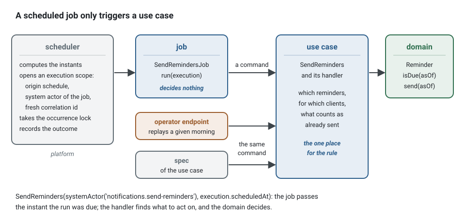
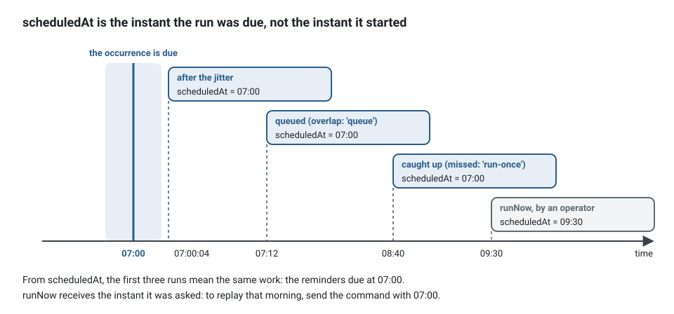
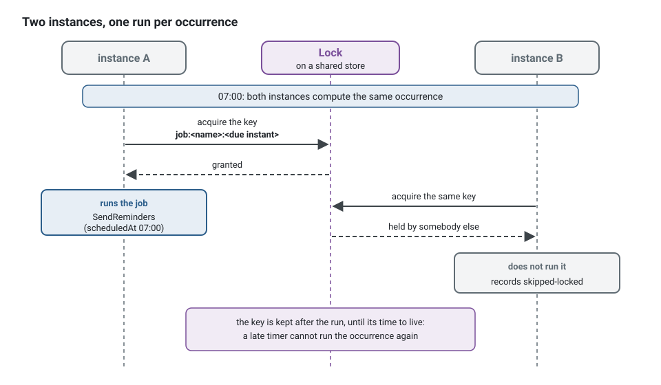

**English** · [Français](scheduled-jobs.fr.md)

# Scheduled jobs

**Summary.** A scheduled job is work started by time instead of by a request or an event:
send tomorrow's reminders every morning, verify the audit chain every night. In this kit a job
decides nothing. It is a small class of the application layer that says when it runs and sends
a command; the business rule stays in the use case and the domain. Across several instances a
lock keeps an occurrence to one run, best effort: an occurrence may run twice or not at all.
So every job, or the command it sends, is idempotent, and the period the work is for comes
from the instant the run was due, never from the clock.

## A job only triggers a use case



<!-- checked sample -->
```ts
// notifications/application/scheduling/send-reminders.job.ts
import { AuthorizedCommand, systemActor, type Actor, type CommandBus } from '@ddd-ts-kit/kernel';
import { Scheduled, type JobExecution, type ScheduledJob } from '@ddd-ts-kit/kernel/declarations';

// The use case, in its own file under application/commands/send-reminders/: the job only sends it.
export class SendReminders extends AuthorizedCommand<void> {
  /** The instant the reminders are due at: the occurrence of the job, never the instant it really runs. */
  constructor(
    actor: Actor,
    readonly asOf: Date,
  ) {
    super(actor);
  }
}

@Scheduled('notifications.send-reminders', { cron: '0 7 * * *', timeZone: 'Europe/Paris' })
export class SendRemindersJob implements ScheduledJob {
  constructor(private readonly commands: CommandBus) {}

  async run(execution: JobExecution): Promise<void> {
    await this.commands.execute(
      new SendReminders(systemActor('notifications.send-reminders'), execution.scheduledAt),
    );
  }
}
```

The declaration comes from `@ddd-ts-kit/kernel/declarations`, the types and the bus from
`@ddd-ts-kit/kernel`: `application/` imports nothing else. The dependencies are what the
constructor takes, each typed by a port. The example application has the same job in
`examples/scheduling/src/contexts/notification/application/scheduling/send-due-reminders.job.ts`,
every 15 minutes.

Everything that matters is in `SendReminders` and its handler: which appointments, which
clients, what counts as already reminded. Instead of a job that does the work itself:

```ts
// instead of: a use case hidden in a job, refused by scheduling/job-triggers-use-case
@Scheduled('notifications.send-reminders', { cron: '0 7 * * *', timeZone: 'Europe/Paris' })
export class SendRemindersJob implements ScheduledJob {
  constructor(private readonly appointments: AppointmentRepository, private readonly mailer: Mailer) {}

  async run(): Promise<void> {
    for (const appointment of await this.appointments.startingTomorrow()) {
      await this.mailer.remind(appointment.clientId); // twice if the job runs twice
    }
  }
}
```

write the job above, and put the loop in the handler of `SendReminders`, where it is a use case
like any other ([Therefore: idempotent](#therefore-idempotent) shows that handler). Why this
split:

- **One place for the rule.** The same command can be sent by the job, by an operator through
  an endpoint, or by a test. A job holding a repository and a loop is a use case hidden where
  nobody looks for one.
- **It is observed like any other unit of work.** The scheduler opens an execution scope
  around each run (origin `schedule`, a system actor named after the job, a fresh correlation
  id), so logs, metrics, traces, audit columns and the audit trail work as for a request. See
  [The actor and the execution scope](actor-and-execution-scope.md).
- **Authorization stays explicit.** The command is sent as the system actor of the job. Either
  the model grants that actor the permission, or the command is declared public when nothing
  else can send it.
- **It moves with its context.** Jobs are declarations of a context. A context extracted as a
  service takes its jobs with it; nothing is global.

The name is `<context>.<job-name>`, written as a literal: it is the actor the job runs as, the
key of its lock, its label in the metrics and the key of its settings, and it survives the
renaming of the class. It is unique in the project (`scheduling/job-name`). A job depends on no
repository, no part of the model and no adapter (`scheduling/job-triggers-use-case`). The
decorator checks the name and the schedule when the file loads: a name that is not
`<context>.<job-name>`, a cron that cannot be read or never fires, a zero interval or an
unknown time zone throws a `DeclarationError` that names the job.

A job is **global** by default: one run per occurrence, in no tenant, and a use case that works
per tenant receives the tenant in its command. Declared `tenancy: 'per-tenant'`, it runs once
per tenant of the `TenantDirectory` for each occurrence, each run in that tenant's execution
scope (`execution.tenantId` says which); a tenant that fails does not stop the others.

```bash
npx ddd-ts-kit generate job notifications SendReminders --cron "0 7 * * *" --time-zone Europe/Paris --command SendReminders
```

In a project with tenancy (`stack.tenancy` other than `none`), `generate job` writes
`tenancy: 'per-tenant'`, since a global job runs in no tenant and a tenant-scoped repository
refuses it (`NoCurrentTenantError`) on every real run; `--global` writes `tenancy: 'global'` for
work across tenants, and the note of the command says which was written. The scheduler asks the
`TenantDirectory` again at **each occurrence**, and what the directory lists depends on the project:

- With the identity preset (`--preset identity`), the tenants are its organisations, read from
  the database at each occurrence: an organisation opened after the process started gets its run
  at the next occurrence, with no restart. `init` writes the directory
  (`src/platform/composition/tenant-directory.ts`) over the organisations of the context, on
  Drizzle, Knex and Prisma.
- Without a source of tenants, `init` gives the scheduler the tenants of `TENANTS` (comma
  separated ids, `config.tenants`, passed to the application as `tenants`), read **once when the
  process starts**. A fixed list misses an organisation or a customer created later: its
  per-tenant jobs (reminders, purges, deadlines) never run for it, with no error, until the
  process restarts with a new list. Once the tenants live in a table of your own, make the
  directory read it, as the identity preset does in `tenant-directory.ts`.

The generated spec runs the job for two tenants. A job written by hand under tenancy must say it too:
`scheduling/tenancy-declared` (an error) reports a `@Scheduled` or `builder.job` whose options carry
neither `tenancy: 'per-tenant'` nor `tenancy: 'global'`.

### A run reads its own tenant

A per-tenant run opens the execution scope of its tenant, so a tenant-scoped repository reads
and writes that tenant only. Prove it on the real repository, not on a fake, when a handler
depends on one: save a row for each tenant on the test database, run the job through the test
application, and read both rows through the repository from inside the run. Each run must find
its own row and not the other. The end-to-end suite of the kit does exactly that against the
generated repository of a multi-tenant project; a fake repository that ignores the tenant would
pass for the wrong reason.

The command writes the job, its spec, its switch in the job settings of the platform
(`src/platform/jobs/job-settings.ts`, switched off with `JOB_<CONTEXT>_<JOB>_ENABLED=false`) and,
where the authorization model makes it one line, the grant of its system actor.

## Schedules

Two forms: an interval (`every`) or a cron expression with a time zone.

```ts
{ every: '15m' }                                    // or a number of milliseconds
{ cron: '0 7 * * 1-5', timeZone: 'Europe/Paris' }   // timeZone defaults to UTC
{ every: '1h', overlap: 'queue', timeoutMs: 60_000 } // the options sit next to the schedule
```

**Intervals are aligned on the Unix epoch**, not on the start of the process: every 15 minutes
means :00, :15, :30 and :45 on every instance, before and after a restart. That alignment is
what lets several instances name the same instants. An interval follows no time zone: for
"every morning", write a cron.

**Cron** has the five standard fields at minute resolution, or a shorthand that stands for them
(`@hourly`, `@daily`, `@weekly`, `@monthly`, `@yearly`), evaluated on the clocks of an IANA time
zone. Daylight saving time deserves one decision per job:

| When clocks are | A job pinned to an hour (`30 2 * * *`) | A job of every hour (`0 * * * *`) |
|---|---|---|
| set forward | the local time does not exist: no run that day | keeps its rhythm |
| set back | the local time occurs twice: runs once, the first time | runs through the repeated hour twice |

Do not schedule in the changed hour what must run every day.

A job is switched off, rescheduled or tuned per environment by configuration where it is
wired, never by a code change. With `@ddd-ts-kit/di`, the settings are keyed by the name of
the job:

```ts
createApplication({
  modules,
  jobs: {
    settings: {
      'notifications.send-reminders': { enabled: config.jobs.reminders.enabled },
      'billing.export-ledger': { schedule: { cron: config.jobs.ledgerCron, timeZone: 'Europe/Paris' } },
    },
  },
});
```

Settings for a job no module declares are refused (`UNKNOWN_JOB`), so a renamed job cannot stay
on by a stale key.

## `scheduledAt`, not the clock

A run receives the instant it was due (`scheduledAt`) and the instant it actually started
(`startedAt`). They differ by a jitter, a queue or a catch-up after downtime. The command must be
built from the first:



```ts
// before: "tomorrow" depends on when the job really ran
new SendReminders(actor, clock.now());

// after: "the reminders of that morning" is the same work whenever it runs
new SendReminders(actor, execution.scheduledAt);
```

With the due instant, a run that starts at 07:00:04 after the jitter, one queued behind the
previous run that starts at 07:12, and one caught up after a restart all mean the same period.
This is also what makes the work idempotent by key. A run asked by hand with `runNow` receives
the instant it was asked: an operator who replays a given morning sends the command with the
instant of that morning, through an endpoint of the use case.

## Several instances

Every instance of a horizontally scaled application runs a scheduler and computes the same
instants. Before running an occurrence, the scheduler takes a lock keyed by the job name and
the due instant (`job:<name>:<due instant in ISO 8601>`). The instance that gets it runs; the
others record `skipped-locked`.



Two facts about that lock decide how jobs must be written.

**It needs a store shared between processes.** The default lock (`InMemoryLock`) excludes
inside one process only: with it, two instances both run every job. It is right for a single
instance and for tests. A lock on Redis, Dragonfly or Valkey (`RedisLock` of
`@ddd-ts-kit/redis`, bound to the kernel `Lock`) gives the guarantee between instances
([Cache and coordination tools](../tools/cache-and-coordination.md)).

**The guarantee is "at most one run per occurrence, best effort".** It is not consensus.

| An occurrence may run | When |
|---|---|
| twice | the lock expires while its holder is paused; the lock store fails over and forgets the key; a catch-up arrives after the lock expired; clocks disagree by more than its time to live |
| zero times | the instance holding the lock crashes during the run (nobody retries); every instance is down at the instant; the lock store cannot be reached, in which case the occurrence is recorded as failed rather than run everywhere |

## Therefore: idempotent

A run that happens twice must leave the same state as once. Two techniques, often combined:

1. **Derive the work from the state.** "Appointments starting tomorrow whose reminder has not
   been sent" is safe to compute twice: the second run finds nothing left. "Send a reminder
   for every appointment of tomorrow" is not.
2. **Key the work on `scheduledAt` behind a unique constraint.** A reminder row keyed by
   appointment and reminder date cannot be inserted twice, whatever any process believes about
   a lock.

The first technique, written out: the aggregate knows whether it is still due, and the handler
of `SendReminders` only acts on what is.

<!-- checked sample -->
```ts
import { AggregateRoot, DomainRefusal, Repository } from '@ddd-ts-kit/kernel';

// notification.codes.ts
export const NotificationCodes = { ReminderNotDue: 'REMINDER_NOT_DUE' } as const;

// domain/errors/reminder-not-due.error.ts
export class ReminderNotDue extends DomainRefusal {
  readonly code = NotificationCodes.ReminderNotDue;

  static forReminder(reminderId: string) {
    return ReminderNotDue.refusal(`Reminder ${reminderId} is not due.`, { reminderId });
  }
}

export class Reminder extends AggregateRoot<string> {
  private constructor(
    id: string,
    private readonly dueAt: Date,
    private sent: boolean,
  ) {
    super(id);
  }

  static plan(id: string, dueAt: Date): Reminder {
    return new Reminder(id, dueAt, false);
  }

  /** Due and not yet sent: a second run finds nothing left to do. */
  isDue(asOf: Date): boolean {
    return !this.sent && this.dueAt.getTime() <= asOf.getTime();
  }

  send(asOf: Date): void {
    if (!this.isDue(asOf)) {
      throw ReminderNotDue.forReminder(this.id);
    }

    this.sent = true;
  }
}

export abstract class ReminderRepository extends Repository<Reminder> {
  /** Every reminder due at that instant and not sent yet, whatever day it was due. */
  abstract findDue(asOf: Date): Promise<readonly Reminder[]>;
}

// what the handler of SendReminders does with the instant the job passed
export async function sendReminders(reminders: ReminderRepository, asOf: Date): Promise<void> {
  for (const reminder of await reminders.findDue(asOf)) {
    reminder.send(asOf);

    await reminders.save(reminder);
  }
}
```

The `Reminder` of the example application works this way (`notification/domain/aggregates/reminder.aggregate.ts`),
and its job spec runs the same occurrence twice to prove that a reminder is sent once.

The kernel says it of the lock itself: an efficiency tool, never the guard of an invariant.
What must not happen twice is refused by a database constraint. The same reasoning forbids
using a lock against double booking (see [Aggregates](aggregates.md)).

A run that happens zero times must be recoverable: because the work is derived from state, the
next occurrence picks up what the missed one left, provided the query does not look only at
"today". Design the selection with a tolerance ("due and not yet reminded"), not an exact
match on the day.

## Failure, overlap and missed occurrences

- **No retry.** A failed occurrence is over; the next occurrence is the retry. Retry belongs
  where the failure is: on the adapter (see [Resilience](resilience.md)), or in a command that
  is safe to send again.
- **Overlap.** An occurrence that comes while the previous run is still in progress is skipped
  by default (`skipped-overlap`), or queued behind it (`overlap: 'queue'`, one occurrence
  waiting at most).
- **Missed.** An occurrence the scheduler reached too late (the process was down or its event
  loop blocked) is dropped by default (`missed`), or the latest one runs once
  (`missed: 'run-once'`). What passed while the process was down is only known if the scheduler
  is given a store for its checkpoints (`JobCheckpoints`).
- **A timeout does not kill.** A run is a promise and nothing stops a promise: past
  `timeoutMs`, the scheduler aborts `execution.signal`, records `failed` with `JOB_TIMEOUT`
  and stops waiting. A job that ignores the signal goes on behind and overlaps
  the next run. Pass the signal on.
- **A failing job stops neither the scheduler nor the other jobs**, and an unexpected failure
  is sent to the error reporter. Every occurrence is logged and counted
  (`scheduled_job_runs_total`, labelled by `job` and `status`). Alert on the absence of success
  ("no successful run for two intervals"), which catches every way a job stops running.

## In the API process or in a worker

By default every process that starts the application runs the jobs. To run them in one
deployment and serve requests in another, the same composition root is started with the jobs
off on one side and without an HTTP server on the other:

```ts
// src/main.ts, the process that serves requests
const app = createApplication({ modules, jobs: { start: false } });

// src/apps/worker/main.ts, the process that runs the jobs: the same modules, no HTTP server
const app = createApplication({ modules, jobs: { settings: jobSettings(config) } });
await app.start();
process.on('SIGTERM', () => void app.stop());
```

`npx ddd-ts-kit generate worker` writes `src/apps/worker/main.ts` and turns the default of
`RUN_JOBS` off for the API. With `start: false` the jobs are still registered and `runNow` still
runs one. Keep the single-run lock on even with one worker: a rolling deployment runs two for a
while.

### Services and the jobs of the platform

The jobs of the platform itself (`audit.archive`, `privacy.purge-expired`, `files.purge-staged`)
belong to the whole application. A service written by `generate service` composes with
`platformJobs: false`, and its `jobSettings(env, '<context>')` keeps the settings of its own jobs
only; the whole application leaves out the jobs of the contexts run as services. The lock that
keeps an occurrence to one run is shared through Redis under `DEPLOYMENT_NAME` (like the cache,
the rate limiter and the job store), never under `OTEL_SERVICE_NAME`: that one names the container
in the traces, and a lock per container is no lock.

## Testing

A spec of a job is a spec of the use case it triggers: run the job once through the test
application, assert the fakes. Time is not involved. The example application runs the same
occurrence twice and checks that the reminder left once:

```ts
// examples/scheduling/src/contexts/notification/test/unit/send-due-reminders.job.spec.ts (an excerpt)
it('sends each due reminder once, even when the same occurrence runs twice', async () => {
  const { application, reminderRepository, mailer } = await arrangeObserved();

  await reminderRepository.save(
    aReminder().of('appointment-1').plannedFor(new Date('2026-01-10T09:00:00.000Z')).build(),
  );

  await application.jobs.runNow('notification.send-due-reminders');
  await application.jobs.runNow('notification.send-due-reminders');

  expect(mailer.delivered).toEqual([
    { address: 'ada@example.test', recipientId: 'patient-1', kind: 'reminder', appointmentId: 'appointment-1' },
  ]);
});
```

For a spec about time itself (overlap, missed occurrences, two instances), a manual scheduler
advances a fixed clock and fires each timer at its instant. Two schedulers that share a clock
and a lock are two instances:

<!-- checked sample -->
```ts
import { FixedClock, FixedExecutionScope, InMemoryLock, SequentialIdGenerator } from '@ddd-ts-kit/kernel';
import { ManualJobScheduler } from '@ddd-ts-kit/scheduling/testing';
import { expect, it } from 'vitest';

it('runs each occurrence on one instance only', async () => {
  // two instances: two schedulers on the same clock and the same lock
  const clock = new FixedClock(new Date('2026-03-02T05:58:00Z'));
  const lock = new InMemoryLock(clock);
  const instances = [1, 2].map(
    () => new ManualJobScheduler({ clock, lock, scope: new FixedExecutionScope(), ids: new SequentialIdGenerator() }),
  );
  const ran: Date[] = [];

  for (const scheduler of instances) {
    scheduler.register({
      name: 'notifications.send-reminders',
      schedule: { cron: '0 7 * * *', timeZone: 'Europe/Paris' },
      run: async (execution) => {
        ran.push(execution.scheduledAt);
      },
    });
    await scheduler.start();
  }

  const [first, second] = instances;
  await first?.advance(2 * 60_000); // 07:00 in Paris is 06:00 UTC in March
  await second?.advance(0);

  expect(ran).toEqual([new Date('2026-03-02T06:00:00Z')]);
  expect(second?.runs.map((run) => run.outcome)).toEqual(['skipped-locked']);
});
```

## Limits and when not to use it

Stated by [`@ddd-ts-kit/scheduling`](../../packages/scheduling/README.md):

- **Exactly-once does not exist here.** At most once per occurrence is best effort.
- **No persistence of its own.** Runs and outcomes live in the memory of the instance; only
  checkpoints, if you provide the store, cross a restart.
- **No retry and no backoff.**
- **Minute resolution for cron**; no seconds field, no `@reboot`, no `L`, `W`, `#`.
- **One process, one event loop.** A job that blocks the loop delays every other job.
- **Time zone rules are those of the runtime**: a zone whose rules changed needs an updated
  Node.
- **Not a queue.** A job does a bounded amount of work on a schedule. Work a command asks for,
  which must not be lost and must be retried, is a [background job](background-jobs.md),
  enqueued in the transaction of the command; a fact other contexts react to is an integration
  event, through the outbox.
- **Not a workflow engine.** A multi-step process with waits and compensation is a saga or a
  process manager ([Sagas and process managers](sagas-and-process-managers.md)), which the kit
  does not provide as a runtime.
- **When a dedicated scheduler fits better.** Thousands of dynamic, per-tenant schedules,
  durable run history or strict catch-up semantics call for another implementation of the
  `JobScheduler` port (on a database or a queue) or for the platform's own scheduler triggering
  a command.

## Sources

- Michael T. Nygard, Release It!, 2nd edition, Pragmatic Bookshelf, 2018: on scheduled work
  starting on the same minute across a fleet, and on jitter.
- Martin Kleppmann, "How to do distributed locking", 2016 (martin.kleppmann.com), and Designing
  Data-Intensive Applications, O'Reilly, 2017, chapter 8: process pauses, lock expiry and
  fencing tokens.
- Pat Helland, "Idempotence Is Not a Medical Condition", ACM Queue, 2012.
- The Open Group Base Specifications, `crontab`: the five fields and the rule when both day
  fields are restricted.
- IANA Time Zone Database (iana.org/time-zones).
- [`@ddd-ts-kit/scheduling`](../../packages/scheduling/README.md) and the "Scheduled" and
  "Lock" sections of [`@ddd-ts-kit/kernel`](../../packages/kernel/README.md).

## See also

- [The actor and the execution scope](actor-and-execution-scope.md)
- [Resilience](resilience.md)
- [Delivery and idempotency](delivery-and-idempotency.md)
- [Sagas and process managers](sagas-and-process-managers.md)
- [Background jobs](background-jobs.md)
- [Observability](observability.md)
- [Cache and coordination tools](../tools/cache-and-coordination.md)
- [Architecture reference](../ARCHITECTURE.md): "Scheduled jobs"
