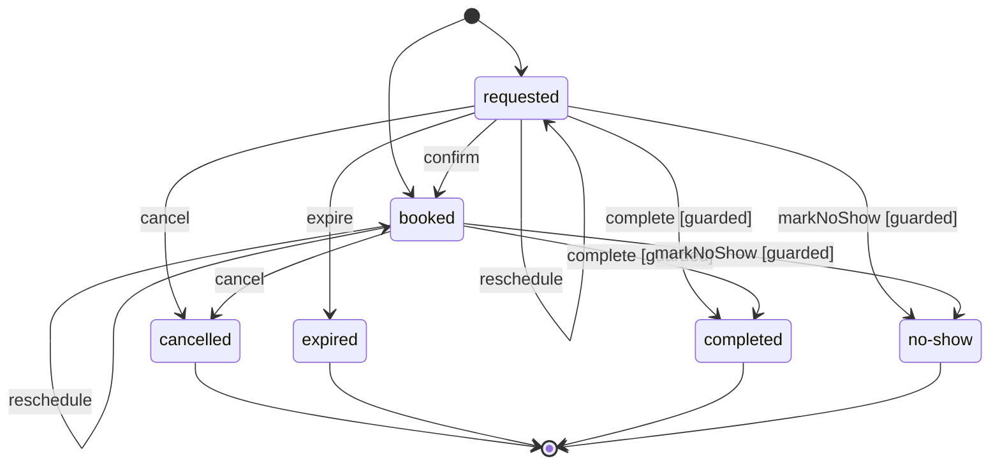

[English](state-machines.md) · **Français**
<!-- translation-of: state-machines.md sha256:39c5877cb906d6cc -->

# Machines à états

**Résumé.** Beaucoup d'agrégats ont un statut qui parcourt un cycle de vie : un rendez-vous est
demandé, puis réservé, puis terminé, annulé, expiré ou marqué comme non honoré. Écrit sous forme
d'instructions `if` dans chaque méthode d'intention, ce cycle de vie est éparpillé, personne ne
peut le dessiner, et une nouvelle méthode oublie facilement une vérification. Une machine à états
le déclare une fois, à côté de l'agrégat : les états, les transitions nommées d'après les méthodes
d'intention, les gardes que le statut seul ne tranche pas, et le refus d'une transition interdite,
construit par une fabrique statique d'une classe de refus du modèle. L'agrégat lui demande son
prochain statut ; la documentation la dessine.


## Déclarer le cycle de vie

Le cycle de vie d'un rendez-vous, tel que le déclare l'application d'exemple
([`examples/scheduling`](../../examples/scheduling)), avec le vocabulaire du statut et les refus
du modèle qu'il utilise, une classe chacun :

<!-- checked sample -->
```ts
import { DomainRefusal, defineStateMachine, type DomainError } from '@ddd-ts-kit/kernel';

// scheduling/domain/vocabularies/appointment-status.vocabulary.ts
export const AppointmentStatus = {
  Requested: 'requested',
  Booked: 'booked',
  Cancelled: 'cancelled',
  Expired: 'expired',
  Completed: 'completed',
  NoShow: 'no-show',
} as const;

export type AppointmentStatus = (typeof AppointmentStatus)[keyof typeof AppointmentStatus];

// scheduling.codes.ts (les trois codes qu'utilise la machine)
export const SchedulingCodes = {
  AppointmentAlreadyConfirmed: 'APPOINTMENT_ALREADY_CONFIRMED',
  AppointmentEnded: 'APPOINTMENT_ENDED',
  AppointmentNotStarted: 'APPOINTMENT_NOT_STARTED',
} as const;

// scheduling/domain/errors/appointment-already-confirmed.error.ts
export class AppointmentAlreadyConfirmed extends DomainRefusal {
  readonly code = SchedulingCodes.AppointmentAlreadyConfirmed;

  static forAppointment(appointmentId: string) {
    return AppointmentAlreadyConfirmed.refusal(`Appointment ${appointmentId} is booked: nothing is left to confirm.`, {
      appointmentId,
    });
  }
}

// scheduling/domain/errors/appointment-ended.error.ts
export class AppointmentEnded extends DomainRefusal {
  readonly code = SchedulingCodes.AppointmentEnded;

  static forAppointment(appointmentId: string, status: string) {
    return AppointmentEnded.refusal(`Appointment ${appointmentId} is ${status} and does not change any more.`, {
      appointmentId,
      status,
    }).exposing('status');
  }
}

// scheduling/domain/errors/appointment-not-started.error.ts
export class AppointmentNotStarted extends DomainRefusal {
  readonly code = SchedulingCodes.AppointmentNotStarted;

  static forAppointment(appointmentId: string, startsAt: Date) {
    return AppointmentNotStarted.refusal(
      `Appointment ${appointmentId} starts at ${startsAt.toISOString()}: its outcome is not known before.`,
      { appointmentId, startsAt },
    ).exposing('startsAt');
  }
}

// scheduling/domain/state-machines/appointment.state-machine.ts
/** Ce à partir de quoi les transitions d'un rendez-vous sont jugées. */
interface AppointmentMoment {
  readonly appointmentId: string;
  /** L'instant où la transition est demandée. */
  readonly at: Date;
  /** L'instant où commence le créneau du rendez-vous. */
  readonly startsAt: Date;
}

/** Le cycle de vie d'un rendez-vous : demandé ou réservé, puis l'une de quatre fins. */
export const appointmentLifecycle = defineStateMachine({
  states: Object.values(AppointmentStatus),
  initial: [AppointmentStatus.Requested, AppointmentStatus.Booked],
  transitions: {
    confirm: { from: [AppointmentStatus.Requested], to: AppointmentStatus.Booked },
    reschedule: { from: [AppointmentStatus.Requested, AppointmentStatus.Booked] },
    cancel: { from: [AppointmentStatus.Requested, AppointmentStatus.Booked], to: AppointmentStatus.Cancelled },
    expire: { from: [AppointmentStatus.Requested], to: AppointmentStatus.Expired },
    complete: {
      from: [AppointmentStatus.Requested, AppointmentStatus.Booked],
      to: AppointmentStatus.Completed,
      guard: started,
    },
    markNoShow: {
      from: [AppointmentStatus.Requested, AppointmentStatus.Booked],
      to: AppointmentStatus.NoShow,
      guard: started,
    },
  },
  refused,
});

/** Une issue est connue une fois le rendez-vous commencé. */
function started({ appointmentId, at, startsAt }: AppointmentMoment): DomainError | undefined {
  return startsAt.getTime() > at.getTime() ? AppointmentNotStarted.forAppointment(appointmentId, startsAt) : undefined;
}

/** Un rendez-vous réservé n'a plus rien à confirmer ; tout autre refus vient d'un rendez-vous terminé. */
function refused(
  { from, transition }: { readonly from: AppointmentStatus; readonly transition: string },
  { appointmentId }: AppointmentMoment,
): DomainError {
  return from === AppointmentStatus.Booked && transition === 'confirm'
    ? AppointmentAlreadyConfirmed.forAppointment(appointmentId)
    : AppointmentEnded.forAppointment(appointmentId, from);
}
```

- **Les états** sont les valeurs du vocabulaire fermé du champ (`AppointmentStatus`), si bien que
  la machine et le type du champ ne peuvent pas être en désaccord.
- **Les transitions** portent le nom de la méthode d'intention qui les effectue. Une transition
  sans `to` garde l'état qu'elle quitte : déplacer un rendez-vous n'autorise que certains états,
  et n'en change aucun.
- **Une garde** est une règle que le statut seul ne dit pas (« pas avant que le rendez-vous
  commence »). Elle reçoit le contexte que lui passe l'agrégat et répond par un refus ou par rien.
- **Le refus** d'une transition que l'état n'autorise pas est construit par une fabrique statique
  d'une classe de refus, à qui sont donnés l'état, la transition et le contexte : les codes
  d'erreur du modèle restent là où ils sont, dans `<context>.codes.ts`, et chaque refus dans
  sa propre classe (`AppointmentEnded`).
- Sans `refused`, une transition interdite lève `TransitionError.forbidden(from, transition)` du
  noyau (kernel), code `FORBIDDEN_TRANSITION` : une valeur d'attente jusqu'à ce que le cycle de
  vie ait ses propres refus.
- Une déclaration qui nomme un état qu'elle ne liste pas lève une erreur au chargement du fichier
  (`InvalidStateMachineError`).

`ddd-ts-kit generate state-machine <context> <Aggregate> --value requested --value booked
--transition "confirm:requested>booked"` écrit le vocabulaire du statut (ou y ajoute les valeurs
qui lui manquent), la machine, avec la première valeur comme état initial, et une spec de chaque
transition et d'un refus. Une transition s'écrit `<name>:<from>[,<from>]...[><to>]` :
`"cancel:requested,booked>cancelled"` quitte deux états, et `"reschedule:requested,booked"`, sans
`>`, garde l'état qu'elle quitte. L'agrégat est laissé tel quel : la règle ci-dessous lui demande
d'utiliser la machine dès qu'il écrit un statut.

## Comment `next` décide


L'ordre compte : une transition que l'état n'autorise pas est refusée avant qu'aucune garde ne
s'exécute, si bien qu'une garde n'est interrogée que sur les états pour lesquels elle a été écrite.
`can` suit le même chemin et répond `false` là où `next` lèverait une erreur.

## L'utiliser dans l'agrégat

Au lieu de tester le statut à la main dans chaque méthode d'intention :

```ts
confirm(now: Date): void {
  // Le cycle de vie, écrit une fois de plus : la prochaine méthode qui change le statut doit le
  // répéter, et lifecycle/status-through-machine refuse l'écriture du statut ci-dessous.
  if (this.state.status === AppointmentStatus.Booked) {
    throw AppointmentAlreadyConfirmed.forAppointment(this.id);
  }

  if (this.state.status !== AppointmentStatus.Requested) {
    throw AppointmentEnded.forAppointment(this.id, this.state.status);
  }

  this.state = { ...this.state, changedAt: now, status: AppointmentStatus.Booked };
  this.record(new AppointmentConfirmed(this.id, now, this.state.booking));
}
```

demandez le prochain statut à la machine :

```ts
confirm(now: Date): void {
  this.state = {
    ...this.carried(),
    changedAt: now,
    status: appointmentLifecycle.next(this.state.status, 'confirm', this.moment(now)),
  };

  this.record(new AppointmentConfirmed(this.id, now, this.state.booking));
}
```

`next` répond le statut auquel mène la transition, ou lève le refus ; `start` vérifie le statut
dans lequel un agrégat est créé ; `can` répond sans lever d'erreur, pour une opération qui doit
pouvoir être répétée sans risque (`expire`) ; `isFinal` remplace une liste de fins écrite à la
main ; `allowedFrom` liste les transitions qu'un état autorise, gardes mises à part. La règle
`lifecycle/status-through-machine` y tient l'agrégat : un agrégat dont la machine existe l'importe
dès qu'il écrit un statut, et son statut n'est écrit que depuis `next` ou `start`, ou recopié d'un
statut déjà lu. Toute autre écriture du statut est une seconde copie, muette, du cycle de vie.

Un agrégat entier, plus petit que le rendez-vous, qui utilise chacune d'elles :

<!-- checked sample -->
```ts
import { AggregateRoot, DomainRefusal, defineStateMachine, NamedDomainEvent } from '@ddd-ts-kit/kernel';

export const InvoiceStatus = { Draft: 'draft', Issued: 'issued', Paid: 'paid', Cancelled: 'cancelled' } as const;
export type InvoiceStatus = (typeof InvoiceStatus)[keyof typeof InvoiceStatus];

export const BillingCodes = { InvoiceEmpty: 'INVOICE_EMPTY', InvoiceClosed: 'INVOICE_CLOSED' } as const;

export class InvoiceEmpty extends DomainRefusal {
  readonly code = BillingCodes.InvoiceEmpty;

  static forInvoice(invoiceId: string) {
    return InvoiceEmpty.refusal(`Invoice ${invoiceId} has no line to issue.`, { invoiceId });
  }
}

export class InvoiceClosed extends DomainRefusal {
  readonly code = BillingCodes.InvoiceClosed;

  static forInvoice(invoiceId: string, status: string) {
    return InvoiceClosed.refusal(`Invoice ${invoiceId} is ${status}.`, { invoiceId, status }).exposing('status');
  }
}

/** Ce à partir de quoi les transitions d'une facture sont jugées. */
interface InvoiceCheck {
  readonly invoiceId: string;
  readonly lines: number;
}

export const invoiceLifecycle = defineStateMachine({
  states: Object.values(InvoiceStatus),
  initial: [InvoiceStatus.Draft],
  transitions: {
    addLine: { from: [InvoiceStatus.Draft] },
    issue: {
      from: [InvoiceStatus.Draft],
      to: InvoiceStatus.Issued,
      guard: ({ invoiceId, lines }: InvoiceCheck) => (lines === 0 ? InvoiceEmpty.forInvoice(invoiceId) : undefined),
    },
    pay: { from: [InvoiceStatus.Issued], to: InvoiceStatus.Paid },
    cancel: { from: [InvoiceStatus.Draft, InvoiceStatus.Issued], to: InvoiceStatus.Cancelled },
  },
  refused: ({ from }, { invoiceId }: InvoiceCheck) => InvoiceClosed.forInvoice(invoiceId, from),
});

export class InvoiceIssued extends NamedDomainEvent('billing.invoice.issued') {
  constructor(
    readonly aggregateId: string,
    readonly occurredAt: Date,
  ) {
    super();
  }
}

interface InvoiceState {
  readonly status: InvoiceStatus;
  readonly lines: readonly string[];
}

export class Invoice extends AggregateRoot<string> {
  private constructor(
    id: string,
    private state: InvoiceState,
  ) {
    super(id);
  }

  static draft(id: string): Invoice {
    // start refuse un état qui n'est pas initial : un défaut du code, pas un refus métier.
    return new Invoice(id, { status: invoiceLifecycle.start(InvoiceStatus.Draft), lines: [] });
  }

  addLine(line: string): void {
    // Une transition sans `to` : autorisée en brouillon seulement, et le statut reste draft.
    const status = invoiceLifecycle.next(this.state.status, 'addLine', this.check());

    this.state = { status, lines: [...this.state.lines, line] };
  }

  issue(now: Date): void {
    this.state = { ...this.state, status: invoiceLifecycle.next(this.state.status, 'issue', this.check()) };
    this.record(new InvoiceIssued(this.id, now));
  }

  /** Exécutée par le job des factures en retard, qui peut s'exécuter deux fois : une facture payée ou annulée reste telle quelle. */
  cancelOverdue(): void {
    if (!invoiceLifecycle.can(this.state.status, 'cancel', this.check())) {
      return;
    }

    this.state = { ...this.state, status: invoiceLifecycle.next(this.state.status, 'cancel', this.check()) };
  }

  get isOpen(): boolean {
    return !invoiceLifecycle.isFinal(this.state.status);
  }

  /**
   * Les actions qu'un écran peut proposer maintenant, gardes mises à part : issue figure pour
   * un brouillon vide, et il est refusé à l'exécution.
   */
  get actions(): string[] {
    return invoiceLifecycle.allowedFrom(this.state.status);
  }

  private check(): InvoiceCheck {
    return { invoiceId: this.id, lines: this.state.lines.length };
  }
}
```

## Ce qu'elle dessine

`ddd-ts-kit docs` lit la déclaration et écrit son diagramme dans la section `State machines` du
`CONTEXT.md` du contexte, en Mermaid, transitions gardées marquées ; `ddd-ts-kit describe` liste
les états et les transitions. `mermaidOfStateMachine(machine.describe())` donne le même diagramme
à l'exécution. Pour le rendez-vous, la section se lit ainsi :



Un état que Mermaid ne peut pas prendre comme identifiant (`no-show`) est déclaré sous un
identifiant sûr ; une transition sans `to` est une flèche vers son propre état ; les états finaux
sont ceux qu'aucune transition ne quitte.

## Tester

La machine est du code du domaine ordinaire : une spec lui demande des transitions et attend les
refus par leur code, sans agrégat. Les specs de l'agrégat continuent de tester son comportement
(les événements qu'il enregistre, les valeurs qu'il garde), ce que la machine ne remplace pas.

<!-- checked sample -->
```ts
import { describe, expect, it } from 'vitest';
import type { StateMachine } from '@ddd-ts-kit/kernel';

// La machine de la facture ci-dessus, déclarée ici pour l'exemple.
type InvoiceStatus = 'draft' | 'issued' | 'paid' | 'cancelled';
type InvoiceCheck = { readonly invoiceId: string; readonly lines: number };
declare const invoiceLifecycle: StateMachine<InvoiceStatus, 'addLine' | 'issue' | 'pay' | 'cancel', InvoiceCheck>;

const twoLines: InvoiceCheck = { invoiceId: 'invoice-1', lines: 2 };

describe('the lifecycle of an invoice', () => {
  it('issues a draft that has lines', () => {
    expect(invoiceLifecycle.next('draft', 'issue', twoLines)).toBe('issued');
  });

  it('refuses to issue an empty draft, by the code of its guard', () => {
    expect(() => invoiceLifecycle.next('draft', 'issue', { ...twoLines, lines: 0 })).toThrow(
      expect.objectContaining({ code: 'INVOICE_EMPTY' }),
    );
  });

  it('refuses to change a paid invoice, by the code of the declared refusal', () => {
    expect(() => invoiceLifecycle.next('paid', 'cancel', twoLines)).toThrow(
      expect.objectContaining({ code: 'INVOICE_CLOSED' }),
    );
  });

  it('ends with paid or cancelled', () => {
    expect(invoiceLifecycle.describe().final).toEqual(['paid', 'cancelled']);
  });
});
```

## Limites et quand ne pas l'utiliser

- **Un statut par agrégat.** La machine gouverne le champ `status` ; un agrégat avec deux cycles
  de vie indépendants est souvent deux agrégats.
- **Pas de hiérarchie, pas de régions parallèles, pas d'états historiques.** Un cycle de vie qui en
  a besoin est rarement le cycle de vie d'un seul agrégat ; ce peut être un
  [processus](sagas-and-process-managers.fr.md).
- **Une garde ne lit que ce qu'on lui donne.** Les règles qui portent sur d'autres agrégats
  relèvent d'un service du domaine ou d'une politique (policy), pas de la machine.
- **La documentation est lue depuis le texte source.** Un état écrit autrement que comme un
  littéral, un membre d'un vocabulaire du contexte ou `Object.values(<vocabulary>)` n'est pas
  dessiné.
- **Quand ne pas l'utiliser** : un agrégat dont le statut a deux valeurs et une transition gagne
  peu à une déclaration.

## Sources

- David Harel, "Statecharts: A Visual Formalism for Complex Systems", Science of Computer
  Programming, 1987.
- Eric Evans, Domain-Driven Design, Addison-Wesley, 2003, chapitre 10 ("Intention-Revealing
  Interfaces", "Assertions").
- Vaughn Vernon, Implementing Domain-Driven Design, Addison-Wesley, 2013, chapitre 10
  ("Aggregates").
- Documentation de Mermaid, "State diagrams", https://mermaid.js.org/syntax/stateDiagram.html

## Voir aussi

- [Agrégats](aggregates.fr.md)
- [Invariants, permissions, validation](invariants-permissions-validation.fr.md)
- [Sagas et gestionnaires de processus](sagas-and-process-managers.fr.md)
- [Référence d'architecture](../ARCHITECTURE.fr.md) : « Machines à états » et
  `lifecycle/status-through-machine`
