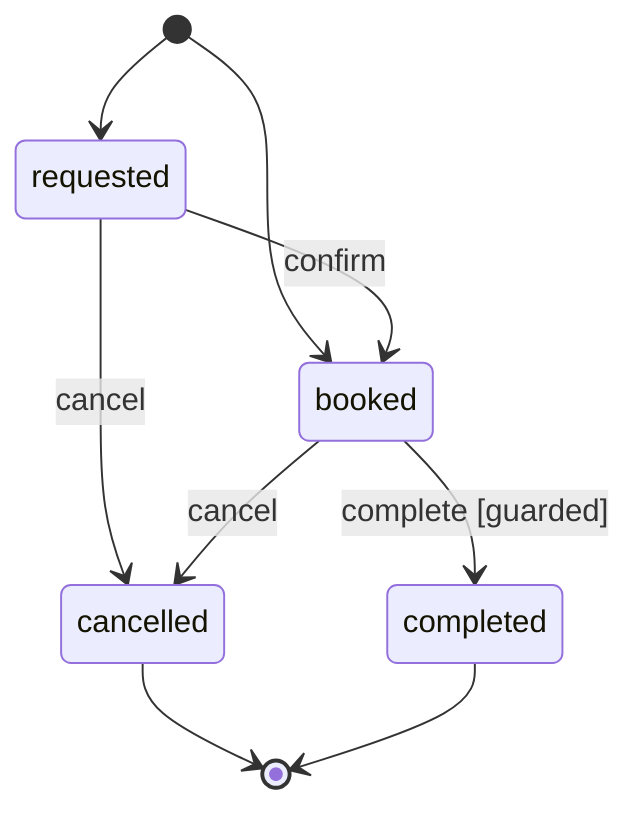

# State machines

**Summary.** Many aggregates have a status that moves through a lifecycle: an appointment is
requested, then booked, then completed, cancelled, expired or marked as a no-show. Written as
`if` statements in each intention method, that lifecycle is scattered, nobody can draw it, and a
new method easily forgets a check. A state machine declares it once, next to the aggregate: the
states, the transitions named after the intention methods, the guards that a status alone does
not decide, and the refusal of a forbidden transition from a static factory of the concept
error. The aggregate asks it for its next status; the documentation draws it.

## Declaring the lifecycle

```ts
// scheduling/domain/state-machines/appointment.state-machine.ts
export const appointmentLifecycle = defineStateMachine({
  states: Object.values(AppointmentStatus),
  initial: [AppointmentStatus.Requested, AppointmentStatus.Booked],
  transitions: {
    confirm: { from: [AppointmentStatus.Requested], to: AppointmentStatus.Booked },
    reschedule: { from: [AppointmentStatus.Requested, AppointmentStatus.Booked] },
    cancel: { from: [AppointmentStatus.Requested, AppointmentStatus.Booked], to: AppointmentStatus.Cancelled },
    complete: { from: [AppointmentStatus.Requested, AppointmentStatus.Booked], to: AppointmentStatus.Completed, guard: started },
  },
  refused,
});
```

- **States** are the values of the closed vocabulary of the field (`AppointmentStatus`), so the
  machine and the type of the field cannot disagree.
- **Transitions** carry the name of the intention method that performs them. A transition
  without `to` keeps the state it leaves: moving an appointment allows only some states, and
  changes none.
- **A guard** is a rule the status alone does not say ("not before the appointment starts"). It
  receives the context the aggregate passes and answers a refusal or nothing.
- **The refusal** of a transition the state does not allow is built by a static factory of the
  concept error, given the state, the transition and the context: the error codes of the model
  stay where they are, in `AppointmentError`.
- Without `refused`, a forbidden transition throws `TransitionError.forbidden(from, transition)`
  of the kernel, code `FORBIDDEN_TRANSITION`: a placeholder until the lifecycle has its own
  refusals.
- A declaration that names a state it does not list throws when the file loads
  (`InvalidStateMachineError`).

`ddd-ts-kit generate state-machine <context> <Aggregate> --value requested --value booked
--transition "confirm:requested>booked"` writes the vocabulary of the status (or adds the values
it misses), the machine, the first value initial, and a spec of each transition and of a refusal.
The aggregate is left as it is: the rule below asks it to use the machine once it writes a
status.

## Using it in the aggregate

```ts
confirm(now: Date): void {
  this.state = {
    ...this.state,
    changedAt: now,
    status: appointmentLifecycle.next(this.state.status, 'confirm', this.moment(now)),
  };
  this.record(new AppointmentConfirmed(this.id, now, this.state.booking));
}
```

`next` answers the status the transition leads to, or throws the refusal; `start` checks the
status an aggregate is created in; `can` answers without throwing, for an operation that must be
safe to repeat (`expire`); `isFinal` replaces a hand-written list of ends. The rule
`lifecycle/status-through-machine` holds the aggregate to it: an aggregate whose machine exists
imports it as soon as it writes a status, and its status is written only from `next` or `start`, or copied from a status
already read. Any other write of the status is a second, silent copy of the lifecycle.

## What it draws

`ddd-ts-kit docs` reads the declaration and writes its diagram in the `State machines` section
of the `CONTEXT.md` of the context, as Mermaid, guarded transitions marked; `ddd-ts-kit describe`
lists the states and the transitions. `mermaidOfStateMachine(machine.describe())` gives the same
diagram at run time.



## Testing

The machine is plain domain code: a spec asks it transitions and expects the refusals by their
code, without an aggregate. The specs of the aggregate keep testing its behaviour (the events it
records, the values it keeps), which the machine does not replace.

## Limits and when not to use it

- **One status per aggregate.** The machine governs the field `status`; an aggregate with two
  independent lifecycles is often two aggregates.
- **No hierarchy, no parallel regions, no history states.** A lifecycle that needs them is
  rarely the lifecycle of one aggregate; it may be a [process](sagas-and-process-managers.md).
- **A guard reads only what it is given.** Rules over other aggregates belong to a domain
  service or a policy, not to the machine.
- **The documentation is read from the source text.** A state written other than as a literal,
  a member of a vocabulary of the context or `Object.values(<vocabulary>)` is not drawn.
- **When not to use it**: an aggregate whose status has two values and one transition gains
  little from a declaration.

## Sources

- David Harel, "Statecharts: A Visual Formalism for Complex Systems", Science of Computer
  Programming, 1987.
- Eric Evans, Domain-Driven Design, Addison-Wesley, 2003, chapter 10 ("Intention-Revealing
  Interfaces", "Assertions").
- Vaughn Vernon, Implementing Domain-Driven Design, Addison-Wesley, 2013, chapter 10
  ("Aggregates").
- Mermaid documentation, "State diagrams", https://mermaid.js.org/syntax/stateDiagram.html

## See also

- [Aggregates](aggregates.md)
- [Invariants, permissions, validation](invariants-permissions-validation.md)
- [Sagas and process managers](sagas-and-process-managers.md)
- [Architecture reference](../ARCHITECTURE.md): "State machines" and
  `lifecycle/status-through-machine`
