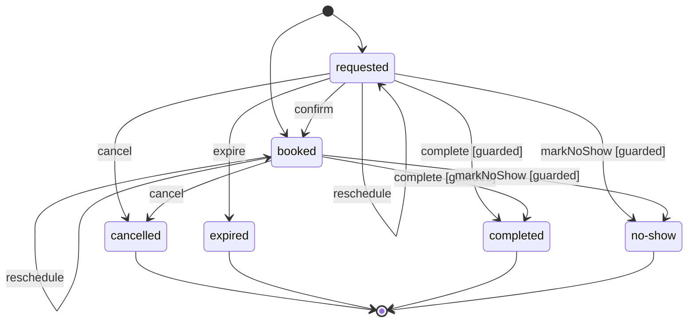

**English** · [Français](state-machines.fr.md)

# State machines

**Summary.** Many aggregates have a status that moves through a lifecycle: an appointment is
requested, then booked, then completed, cancelled, expired or marked as a no-show. Written as
`if` statements in each intention method, that lifecycle is scattered, nobody can draw it, and a
new method easily forgets a check. A state machine declares it once, next to the aggregate: the
states, the transitions named after the intention methods, the guards that a status alone does
not decide, and the refusal of a forbidden transition from a static factory of the concept
error. The aggregate asks it for its next status; the documentation draws it.


## Declaring the lifecycle

The lifecycle of an appointment, as the example application
([`examples/scheduling`](../../examples/scheduling)) declares it, with the vocabulary of the
status and the factories of the concept error it uses:

<!-- checked sample -->
```ts
import { ConceptError, defineStateMachine, type DomainError } from '@ddd-ts-kit/kernel';

// scheduling/domain/vocabularies/appointment-status.vocabulary.ts
export const AppointmentStatus = {
  Requested: 'requested',
  Booked: 'booked',
  Cancelled: 'cancelled',
  Expired: 'expired',
  Completed: 'completed',
  NoShow: 'no-show',
} as const;

export type AppointmentStatus = (typeof AppointmentStatus)[keyof typeof AppointmentStatus];

// scheduling/domain/errors/appointment.error.ts (the three factories the machine uses)
export class AppointmentError extends ConceptError {
  static alreadyConfirmed(appointmentId: string) {
    return AppointmentError.refusal(
      'APPOINTMENT_ALREADY_CONFIRMED',
      `Appointment ${appointmentId} is booked: nothing is left to confirm.`,
      { appointmentId },
    );
  }

  static ended(appointmentId: string, status: string) {
    return AppointmentError.refusal(
      'APPOINTMENT_ENDED',
      `Appointment ${appointmentId} is ${status} and does not change any more.`,
      { appointmentId, status },
    ).exposing('status');
  }

  static notStarted(appointmentId: string, startsAt: Date) {
    return AppointmentError.refusal(
      'APPOINTMENT_NOT_STARTED',
      `Appointment ${appointmentId} starts at ${startsAt.toISOString()}: its outcome is not known before.`,
      { appointmentId, startsAt },
    ).exposing('startsAt');
  }
}

// scheduling/domain/state-machines/appointment.state-machine.ts
/** What the transitions of an appointment are judged with. */
interface AppointmentMoment {
  readonly appointmentId: string;
  /** The instant the transition is asked. */
  readonly at: Date;
  /** The instant the slot of the appointment starts. */
  readonly startsAt: Date;
}

/** The lifecycle of an appointment: requested or booked, then one of four ends. */
export const appointmentLifecycle = defineStateMachine({
  states: Object.values(AppointmentStatus),
  initial: [AppointmentStatus.Requested, AppointmentStatus.Booked],
  transitions: {
    confirm: { from: [AppointmentStatus.Requested], to: AppointmentStatus.Booked },
    reschedule: { from: [AppointmentStatus.Requested, AppointmentStatus.Booked] },
    cancel: { from: [AppointmentStatus.Requested, AppointmentStatus.Booked], to: AppointmentStatus.Cancelled },
    expire: { from: [AppointmentStatus.Requested], to: AppointmentStatus.Expired },
    complete: {
      from: [AppointmentStatus.Requested, AppointmentStatus.Booked],
      to: AppointmentStatus.Completed,
      guard: started,
    },
    markNoShow: {
      from: [AppointmentStatus.Requested, AppointmentStatus.Booked],
      to: AppointmentStatus.NoShow,
      guard: started,
    },
  },
  refused,
});

/** An outcome is known once the appointment started. */
function started({ appointmentId, at, startsAt }: AppointmentMoment): DomainError | undefined {
  return startsAt.getTime() > at.getTime() ? AppointmentError.notStarted(appointmentId, startsAt) : undefined;
}

/** A booked appointment has nothing left to confirm; any other refusal comes from an appointment that ended. */
function refused(
  { from, transition }: { readonly from: AppointmentStatus; readonly transition: string },
  { appointmentId }: AppointmentMoment,
): DomainError {
  return from === AppointmentStatus.Booked && transition === 'confirm'
    ? AppointmentError.alreadyConfirmed(appointmentId)
    : AppointmentError.ended(appointmentId, from);
}
```

- **States** are the values of the closed vocabulary of the field (`AppointmentStatus`), so the
  machine and the type of the field cannot disagree.
- **Transitions** carry the name of the intention method that performs them. A transition
  without `to` keeps the state it leaves: moving an appointment allows only some states, and
  changes none.
- **A guard** is a rule the status alone does not say ("not before the appointment starts"). It
  receives the context the aggregate passes and answers a refusal or nothing.
- **The refusal** of a transition the state does not allow is built by a static factory of the
  concept error, given the state, the transition and the context: the error codes of the model
  stay where they are, in `AppointmentError`.
- Without `refused`, a forbidden transition throws `TransitionError.forbidden(from, transition)`
  of the kernel, code `FORBIDDEN_TRANSITION`: a placeholder until the lifecycle has its own
  refusals.
- A declaration that names a state it does not list throws when the file loads
  (`InvalidStateMachineError`).

`ddd-ts-kit generate state-machine <context> <Aggregate> --value requested --value booked
--transition "confirm:requested>booked"` writes the vocabulary of the status (or adds the values
it misses), the machine, the first value initial, and a spec of each transition and of a refusal.
A transition is written `<name>:<from>[,<from>]...[><to>]`: `"cancel:requested,booked>cancelled"`
leaves two states, and `"reschedule:requested,booked"`, without `>`, keeps the state it leaves.
The aggregate is left as it is: the rule below asks it to use the machine once it writes a
status.

## How `next` decides


The order matters: a transition the state does not allow is refused before any guard runs, so a
guard is only asked about the states it was written for. `can` takes the same path and answers
`false` where `next` would throw.

## Using it in the aggregate

Instead of testing the status by hand in each intention method:

```ts
confirm(now: Date): void {
  // The lifecycle, written once more: the next method that changes the status must repeat it,
  // and lifecycle/status-through-machine refuses the write of the status below.
  if (this.state.status === AppointmentStatus.Booked) {
    throw AppointmentError.alreadyConfirmed(this.id);
  }

  if (this.state.status !== AppointmentStatus.Requested) {
    throw AppointmentError.ended(this.id, this.state.status);
  }

  this.state = { ...this.state, changedAt: now, status: AppointmentStatus.Booked };
  this.record(new AppointmentConfirmed(this.id, now, this.state.booking));
}
```

ask the machine for the next status:

```ts
confirm(now: Date): void {
  this.state = {
    ...this.carried(),
    changedAt: now,
    status: appointmentLifecycle.next(this.state.status, 'confirm', this.moment(now)),
  };

  this.record(new AppointmentConfirmed(this.id, now, this.state.booking));
}
```

`next` answers the status the transition leads to, or throws the refusal; `start` checks the
status an aggregate is created in; `can` answers without throwing, for an operation that must be
safe to repeat (`expire`); `isFinal` replaces a hand-written list of ends; `allowedFrom` lists the
transitions a state allows, guards aside. The rule `lifecycle/status-through-machine` holds the
aggregate to it: an aggregate whose machine exists imports it as soon as it writes a status, and
its status is written only from `next` or `start`, or copied from a status already read. Any
other write of the status is a second, silent copy of the lifecycle.

A whole aggregate, smaller than the appointment, that uses each of them:

<!-- checked sample -->
```ts
import { AggregateRoot, ConceptError, defineStateMachine, NamedDomainEvent } from '@ddd-ts-kit/kernel';

export const InvoiceStatus = { Draft: 'draft', Issued: 'issued', Paid: 'paid', Cancelled: 'cancelled' } as const;
export type InvoiceStatus = (typeof InvoiceStatus)[keyof typeof InvoiceStatus];

export class InvoiceError extends ConceptError {
  static empty(invoiceId: string) {
    return InvoiceError.refusal('INVOICE_EMPTY', `Invoice ${invoiceId} has no line to issue.`, { invoiceId });
  }

  static closed(invoiceId: string, status: string) {
    return InvoiceError.refusal('INVOICE_CLOSED', `Invoice ${invoiceId} is ${status}.`, { invoiceId, status }).exposing(
      'status',
    );
  }
}

/** What the transitions of an invoice are judged with. */
interface InvoiceCheck {
  readonly invoiceId: string;
  readonly lines: number;
}

export const invoiceLifecycle = defineStateMachine({
  states: Object.values(InvoiceStatus),
  initial: [InvoiceStatus.Draft],
  transitions: {
    addLine: { from: [InvoiceStatus.Draft] },
    issue: {
      from: [InvoiceStatus.Draft],
      to: InvoiceStatus.Issued,
      guard: ({ invoiceId, lines }: InvoiceCheck) => (lines === 0 ? InvoiceError.empty(invoiceId) : undefined),
    },
    pay: { from: [InvoiceStatus.Issued], to: InvoiceStatus.Paid },
    cancel: { from: [InvoiceStatus.Draft, InvoiceStatus.Issued], to: InvoiceStatus.Cancelled },
  },
  refused: ({ from }, { invoiceId }: InvoiceCheck) => InvoiceError.closed(invoiceId, from),
});

export class InvoiceIssued extends NamedDomainEvent('billing.invoice.issued') {
  constructor(
    readonly aggregateId: string,
    readonly occurredAt: Date,
  ) {
    super();
  }
}

interface InvoiceState {
  readonly status: InvoiceStatus;
  readonly lines: readonly string[];
}

export class Invoice extends AggregateRoot<string> {
  private constructor(
    id: string,
    private state: InvoiceState,
  ) {
    super(id);
  }

  static draft(id: string): Invoice {
    // start refuses a state that is not initial: a defect of the code, not a business refusal.
    return new Invoice(id, { status: invoiceLifecycle.start(InvoiceStatus.Draft), lines: [] });
  }

  addLine(line: string): void {
    // A transition without `to`: allowed in draft only, and the status stays draft.
    const status = invoiceLifecycle.next(this.state.status, 'addLine', this.check());

    this.state = { status, lines: [...this.state.lines, line] };
  }

  issue(now: Date): void {
    this.state = { ...this.state, status: invoiceLifecycle.next(this.state.status, 'issue', this.check()) };
    this.record(new InvoiceIssued(this.id, now));
  }

  /** Run by the job of overdue invoices, which may run twice: an invoice paid or cancelled stays as it is. */
  cancelOverdue(): void {
    if (!invoiceLifecycle.can(this.state.status, 'cancel', this.check())) {
      return;
    }

    this.state = { ...this.state, status: invoiceLifecycle.next(this.state.status, 'cancel', this.check()) };
  }

  get isOpen(): boolean {
    return !invoiceLifecycle.isFinal(this.state.status);
  }

  /**
   * The actions a screen may offer now, guards aside: issue is listed for an empty draft,
   * and refused when run.
   */
  get actions(): string[] {
    return invoiceLifecycle.allowedFrom(this.state.status);
  }

  private check(): InvoiceCheck {
    return { invoiceId: this.id, lines: this.state.lines.length };
  }
}
```

## What it draws

`ddd-ts-kit docs` reads the declaration and writes its diagram in the `State machines` section
of the `CONTEXT.md` of the context, as Mermaid, guarded transitions marked; `ddd-ts-kit describe`
lists the states and the transitions. `mermaidOfStateMachine(machine.describe())` gives the same
diagram at run time. For the appointment, the section reads:



A state Mermaid cannot take as an identifier (`no-show`) is declared under a safe one; a
transition without `to` is an arrow onto its own state; the final states are those no transition
leaves.

## Testing

The machine is plain domain code: a spec asks it transitions and expects the refusals by their
code, without an aggregate. The specs of the aggregate keep testing its behaviour (the events it
records, the values it keeps), which the machine does not replace.

<!-- checked sample -->
```ts
import { describe, expect, it } from 'vitest';
import type { StateMachine } from '@ddd-ts-kit/kernel';

// The machine of the invoice above, declared here for the sample.
type InvoiceStatus = 'draft' | 'issued' | 'paid' | 'cancelled';
type InvoiceCheck = { readonly invoiceId: string; readonly lines: number };
declare const invoiceLifecycle: StateMachine<InvoiceStatus, 'addLine' | 'issue' | 'pay' | 'cancel', InvoiceCheck>;

const twoLines: InvoiceCheck = { invoiceId: 'invoice-1', lines: 2 };

describe('the lifecycle of an invoice', () => {
  it('issues a draft that has lines', () => {
    expect(invoiceLifecycle.next('draft', 'issue', twoLines)).toBe('issued');
  });

  it('refuses to issue an empty draft, by the code of its guard', () => {
    expect(() => invoiceLifecycle.next('draft', 'issue', { ...twoLines, lines: 0 })).toThrow(
      expect.objectContaining({ code: 'INVOICE_EMPTY' }),
    );
  });

  it('refuses to change a paid invoice, by the code of the declared refusal', () => {
    expect(() => invoiceLifecycle.next('paid', 'cancel', twoLines)).toThrow(
      expect.objectContaining({ code: 'INVOICE_CLOSED' }),
    );
  });

  it('ends with paid or cancelled', () => {
    expect(invoiceLifecycle.describe().final).toEqual(['paid', 'cancelled']);
  });
});
```

## Limits and when not to use it

- **One status per aggregate.** The machine governs the field `status`; an aggregate with two
  independent lifecycles is often two aggregates.
- **No hierarchy, no parallel regions, no history states.** A lifecycle that needs them is
  rarely the lifecycle of one aggregate; it may be a [process](sagas-and-process-managers.md).
- **A guard reads only what it is given.** Rules over other aggregates belong to a domain
  service or a policy, not to the machine.
- **The documentation is read from the source text.** A state written other than as a literal,
  a member of a vocabulary of the context or `Object.values(<vocabulary>)` is not drawn.
- **When not to use it**: an aggregate whose status has two values and one transition gains
  little from a declaration.

## Sources

- David Harel, "Statecharts: A Visual Formalism for Complex Systems", Science of Computer
  Programming, 1987.
- Eric Evans, Domain-Driven Design, Addison-Wesley, 2003, chapter 10 ("Intention-Revealing
  Interfaces", "Assertions").
- Vaughn Vernon, Implementing Domain-Driven Design, Addison-Wesley, 2013, chapter 10
  ("Aggregates").
- Mermaid documentation, "State diagrams", https://mermaid.js.org/syntax/stateDiagram.html

## See also

- [Aggregates](aggregates.md)
- [Invariants, permissions, validation](invariants-permissions-validation.md)
- [Sagas and process managers](sagas-and-process-managers.md)
- [Architecture reference](../ARCHITECTURE.md): "State machines" and
  `lifecycle/status-through-machine`
