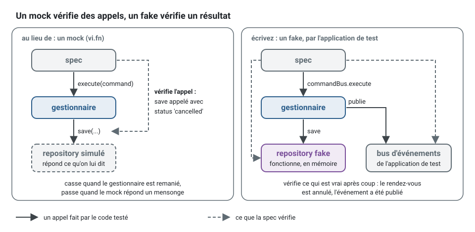
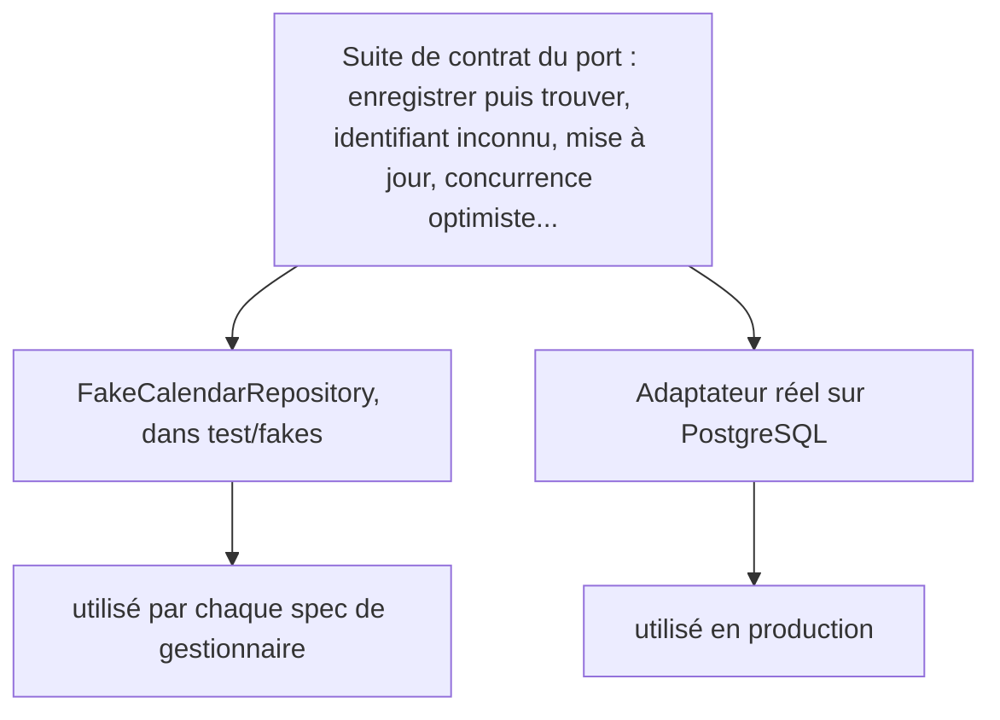
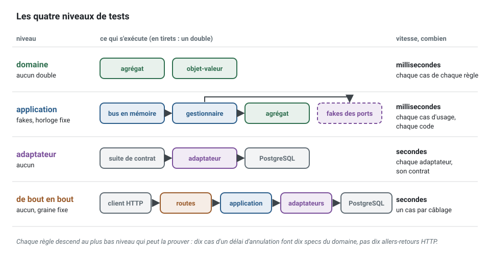

[English](testing-strategy.md) · **Français**
<!-- translation-of: testing-strategy.md sha256:f93def3001f8104b -->

# Stratégie de test

**Résumé.** Le kit teste le comportement à travers des interfaces publiques, à quatre niveaux
(domaine, application, adaptateur, de bout en bout), avec les mêmes *builders* de données de test à
chaque niveau. Les doublures de test sont des *fakes*, des implémentations en mémoire et
fonctionnelles des ports, plutôt que des *mocks* ; un *fake* reste honnête en passant la même
suite de contrat que l'adaptateur réel qu'il remplace. Les *specs* d'agrégat se lisent
« étant donné / quand / alors ». Le résultat est une suite où la plupart des tests s'exécutent en
quelques millisecondes sans aucune infrastructure, survivent aux refactorisations parce qu'ils
vérifient des résultats plutôt que des appels, et se lisent comme des règles métier. Cette page
explique chaque choix, dit quoi tester où, et énonce ce que la stratégie ne couvre pas.

## Le vocabulaire des doublures de test

« *Mock* » désigne souvent n'importe quelle doublure. Le vocabulaire de Gerard Meszaros,
popularisé par Martin Fowler, est plus précis :

| Doublure | Ce qu'elle est | Vérifie |
|---|---|---|
| *dummy* | passée mais jamais utilisée | rien |
| *stub* | renvoie des réponses préparées | l'état, indirectement |
| *spy* | un *stub* qui enregistre comment il a été appelé | les appels, après coup |
| *mock* | préprogrammé avec les appels qu'il attend | les appels : le test échoue s'ils diffèrent |
| *fake* | une implémentation qui fonctionne, avec un raccourci (en mémoire au lieu d'une base de données) | l'état |

La distinction qui compte est la dernière colonne. Un test avec des *mocks* vérifie une
interaction : « `save` a été appelée une fois avec cet objet ». Un test avec un *fake* vérifie un
résultat : « le rendez-vous est enregistré et annulé ».

## Des *fakes*, pas des *mocks*

```ts
// au lieu de, avec un mock : vérifie comment le gestionnaire parle à ses collaborateurs
const appointments = { findById: vi.fn().mockResolvedValue(appointment), save: vi.fn() };
// le contrôle d'accès est simulé lui aussi : le test connaît désormais chaque collaborateur du gestionnaire
const access = { authorize: vi.fn().mockResolvedValue(undefined) };
const handler = new CancelAppointmentHandler(appointments, access, clock);

await handler.execute(new CancelAppointmentCommand(patient, appointment.id));

expect(appointments.save).toHaveBeenCalledWith(expect.objectContaining({ status: 'cancelled' }));

// écrivez, avec un fake : vérifie ce qui est vrai après coup
const appointments = new FakeAppointmentRepository();
await appointments.save(appointment);

const app = createTestApplication({
  modules: [platformTestModule, contextModule('scheduling', schedulingDeclarations), holders],
  fakes: [fake(AppointmentRepository, appointments)],
});

await app.commandBus.execute(new CancelAppointmentCommand(patient, appointment.id));

expect((await appointments.findById(appointment.id))?.status).toBe('cancelled');
expect(app.eventBus.published).toMatchObject([{ type: 'scheduling.appointment.cancelled' }]);
```



Pourquoi le kit préfère la seconde forme (règle
[`test/no-mocks`](../ARCHITECTURE.fr.md#3-règles-de-dépendance), un avertissement par défaut) :

- **Les *mocks* couplent les tests à l'implémentation.** Renommez une méthode, enregistrez en deux
  étapes au lieu d'une, chargez par une autre méthode de recherche : le comportement est inchangé,
  les tests à base de *mocks* échouent. Des tests qui cassent à chaque refactorisation découragent
  de refactoriser.
- **Les *mocks* peuvent affirmer un mensonge.** Un *repository* simulé renvoie tout ce que dit le
  test, y compris des choses que le vrai ne renverrait jamais. Le test passe ; la production, non.
- **Les *fakes* sont réutilisables.** Un seul *repository* en mémoire sert toutes les *specs* de
  gestionnaire du contexte, et une panne est une méthode du *fake* (`mailer.failNextWith(...)`)
  plutôt qu'une préparation répétée dans chaque test.
- **L'architecture rend les *mocks* inutiles.** Chaque dépendance est un port reçu par le
  constructeur ; le temps et les identifiants sont aussi des ports. Une classe qui a besoin d'un
  *mock* de module pour être testée enfreint une règle de pureté ([Code propre](clean-code.fr.md)).

C'est l'école « classique » dans les termes de Fowler. L'école « mockiste », décrite par Freeman
et Pryce, utilise les *mocks* pour découvrir les interfaces en concevant de l'extérieur vers
l'intérieur ; c'est une pratique cohérente, et ses auteurs mettent eux aussi en garde contre le
fait de simuler des types que l'on ne possède pas. La position du kit est plus étroite qu'une
doctrine : ses ports sont déjà conçus et chacun a un *fake*, si bien que les vérifications
d'interaction ajoutent du couplage sans ajouter d'information.

La seule doublure acceptée qui n'est pas un *fake* : un *stub* d'une API HTTP extérieure au niveau
du réseau, dans la *spec* d'intégration d'un adaptateur.

Un *fake* est une petite classe de `test/fakes/` qui implémente le port avec un raccourci, et
offre sous forme de méthodes les pannes dont un test a besoin. Le *mailer* du contexte de
notification de l'exemple, raccourci :

<!-- checked sample -->
```ts
// notification/application/ports/mailer.port.ts
export abstract class Mailer {
  /** Échoue quand le fournisseur n'a pas pris le courriel. */
  abstract deliver(address: string, subject: string): Promise<void>;
}

// notification/test/fakes/mailer.fake.ts
export class FakeMailer implements Mailer {
  /** Ce que le fournisseur a pris, dans l'ordre : ce qu'une spec vérifie. */
  readonly delivered: { readonly address: string; readonly subject: string }[] = [];

  private readonly failures: Error[] = [];

  /** La prochaine livraison échoue avec cette erreur, puis le mailer fonctionne de nouveau. */
  failNextWith(error: Error): void {
    this.failures.push(error);
  }

  async deliver(address: string, subject: string): Promise<void> {
    const failure = this.failures.shift();

    if (failure !== undefined) {
      throw failure;
    }

    this.delivered.push({ address, subject });
  }
}
```

Une *spec* se lit alors comme la règle qu'elle prouve : `mailer.failNextWith(new Error('provider
unreachable'))`, envoyer la notification, et attendre que rien n'ait été enregistré ni publié.

## Les tests de contrat gardent les *fakes* honnêtes

La faiblesse d'un *fake* est la dérive : un *repository* en mémoire qui tolère ce que PostgreSQL
refuserait. La réponse est une suite de contrat : un ensemble de tests écrits contre le port,
exécutés contre le *fake* et contre l'adaptateur réel.



Dans le code, un appel par implémentation, avec les mêmes attentes. La *spec* du *repository* des
calendriers de l'exemple, raccourcie :

<!-- checked sample -->
```ts
// scheduling/test/integration/calendar.repository.contract.spec.ts
import { afterEach, beforeEach, describe, expect, it } from 'vitest';
import { AggregateRoot, type Repository } from '@ddd-ts-kit/kernel';
import { InMemoryRepository } from '@ddd-ts-kit/testing';
import { repositoryContract } from '@ddd-ts-kit/testing/contracts';

// venus du domaine, des builders et de la base de données de test du projet
interface CalendarState {
  readonly exceptions: readonly string[];
}
declare class Calendar extends AggregateRoot {
  static rehydrate(id: string, state: CalendarState): Calendar;
  addException(day: string, at: Date): void;
  toState(): CalendarState;
}
declare function aCalendar(): { build(): Calendar };
declare function knexCalendarRepositoryOnAFreshDatabase(): Promise<Repository<Calendar>>;

const runner = { describe, it, expect, beforeEach, afterEach };

const expectations = {
  createAggregate: () => aCalendar().build(),
  mutate: (calendar: Calendar) => calendar.addException('2026-12-25', new Date('2026-01-02T00:00:00.000Z')),
  idOf: (calendar: Calendar) => calendar.id,
  stateOf: (calendar: Calendar) => calendar.toState(),
};

// le fake qu'utilise chaque spec de gestionnaire
repositoryContract<Calendar>(runner, {
  ...expectations,
  name: 'FakeCalendarRepository',
  createRepository: () =>
    new InMemoryRepository<Calendar>({ clone: (stored) => Calendar.rehydrate(stored.id, stored.toState()) }),
});

// l'adaptateur qu'utilise la production, sur une vraie base de données
repositoryContract<Calendar>(runner, {
  ...expectations,
  name: 'KnexCalendarRepository',
  createRepository: () => knexCalendarRepositoryOnAFreshDatabase(),
});
```

Si les deux passent la même suite, un gestionnaire testé sur le *fake* se comporte de la même
façon sur l'adaptateur pour tout ce que couvre le contrat. Le kit fournit des suites pour ses
propres ports dans `@ddd-ts-kit/testing/contracts` (*repository*, unité de travail, store de
modèle de lecture et critères, bus d'événements, store d'événements, store de l'outbox, store des
événements traités, store des processus, store des *jobs*, planificateur de *jobs*, cache,
purgeur de cache, verrou, limiteur de débit, stockage de fichiers, *logger*, isolation des
*tenants*) et dans `@ddd-ts-kit/auth/testing` (autorisateur, store des tuples de relation),
ainsi que `ContractSuite`, la base pour écrire la suite d'un port à vous. Remplacer un ORM ou un
*broker* revient alors à « écrire l'adaptateur, passer la suite ».

Un contrat couvre ce qu'il teste et rien de plus : le comportement propre à un adaptateur (le
*mapping* de chaque colonne, l'annulation d'une transaction) a ses propres tests d'intégration.

## *Builders*

Les données de test viennent de *builders*, un par agrégat :

```ts
const appointment = anAppointment().forPatient('ada').startingAt(tomorrowAt9).cancelledByPatient().build();
```

Un *builder* étend `Builder` de `@ddd-ts-kit/testing` : des `defaults()` valides une fois pour
toutes, un `construct()` qui passe par l'API publique de l'agrégat, et une méthode par mot du
langage. Raccourci à partir du *builder* de l'exemple :

<!-- checked sample -->
```ts
// scheduling/test/builders/appointment.builder.ts
import { AggregateRoot } from '@ddd-ts-kit/kernel';
import { Builder, sequence, type Defaults } from '@ddd-ts-kit/testing';

// l'agrégat, venu du domaine
declare class Appointment extends AggregateRoot {
  static create(id: string, patientId: string, startsAt: Date, bornAt: Date): Appointment;
  cancel(by: 'patient' | 'practice', at: Date): void;
}

interface AppointmentIngredients {
  readonly id: string;
  readonly patientId: string;
  readonly startsAt: Date;
  readonly bornAt: Date;
  readonly cancelled: boolean;
}

export class AppointmentBuilder extends Builder<AppointmentIngredients, Appointment> {
  forPatient(patientId: string): this {
    return this.with('patientId', patientId);
  }

  startingAt(instant: Date): this {
    return this.with('startsAt', instant);
  }

  cancelledByPatient(): this {
    return this.with('cancelled', true);
  }

  protected defaults(): Defaults<AppointmentIngredients> {
    return {
      id: sequence('appointment'),
      patientId: 'patient-1',
      startsAt: new Date('2026-03-02T09:00:00.000Z'),
      bornAt: new Date('2026-03-01T00:00:00.000Z'),
      cancelled: false,
    };
  }

  /** Par l'API publique seulement : un test ne peut jamais partir d'un état que les règles interdisent. */
  protected construct({ id, patientId, startsAt, bornAt, cancelled }: AppointmentIngredients): Appointment {
    const appointment = Appointment.create(id, patientId, startsAt, bornAt);

    if (cancelled) {
      appointment.cancel('patient', bornAt);
    }

    return appointment;
  }
}

export function anAppointment(): AppointmentBuilder {
  return new AppointmentBuilder();
}
```

- **Des valeurs par défaut valides.** `anAppointment().build()` est un rendez-vous valide. Un test
  n'énonce que ce qui compte pour la règle qu'il vérifie, si bien que le lecteur voit la cause du
  résultat.
- **Nommés dans le langage omniprésent (ubiquitous language).** `cancelledByPatient()`, pas
  `withStatus('CANCELLED')`.
- **Construits par l'API publique.** `build()` passe par la fabrique et les méthodes d'intention
  de l'agrégat, si bien qu'un test ne peut pas partir d'un état invalide. Si un test a besoin d'un
  état que l'API publique ne peut pas atteindre, soit l'état est impossible, soit l'API est
  incomplète.
- **Immuables.** Chaque appel renvoie un nouveau *builder*, si bien qu'une base partagée ne peut
  pas fuiter d'un test à l'autre.

Règle [`test/builder-required`](../ARCHITECTURE.fr.md#3-règles-de-dépendance). Sans *builders*,
chaque changement d'un constructeur modifie cinquante tests, et chaque test enfouit son unique
valeur pertinente sous dix valeurs qui ne le sont pas.

## Mondes

Plusieurs *specs* de *handler* d'un contexte construisent la même application de test avec les
mêmes *fakes*. Cette mise en place s'écrit une fois, comme un monde de `test/worlds/`, et se
génère au lieu de se copier :

```bash
npx ddd-ts-kit generate test-world scheduling
```

Le générateur lit `test/fakes/*.fake.ts`, trouve le port que chaque classe implémente dans
`domain/repositories/` ou `application/ports/`, et écrit `test/worlds/scheduling.world.ts` :
`aSchedulingWorld(options)` construit chaque *fake*, laisse la *spec* enregistrer ce dont elle
part, puis confie les *fakes* à l'application de test et la rend avec chaque *fake* sous le nom
de son port. Une *spec* de l'exemple se lit alors :

```ts
// scheduling/test/unit/confirm-appointment.handler.spec.ts
const { application, appointmentRepository } = await aSchedulingWorld({
  modules: [holders],
  now: NOW,
  given: async (fakes) => {
    await fakes.appointmentRepository.save(requested);
  },
});
```

- **Ce qu'il prend.** `now` et `idPrefix` vont à l'application de test ; `modules` ajoute ce que
  la *spec* apporte, son module d'autorisation (par défaut aucun rôle ne détient de
  permission) ; `given` reçoit les *fakes* avant que l'application ne les branche, si bien que
  les événements enregistrés en construisant les agrégats stockés ne sont pas annoncés comme si
  une commande venait de s'exécuter.
- **Sans conteneur d'injection** (`createTestBuses`), le monde rend les bus et les *fakes*,
  chaque *repository* enveloppé par `dispatching`, et la *spec* enregistre le *handler* qu'elle
  teste.
- **Ce qu'il laisse de côté, en le disant.** Un *fake* dont le constructeur attend un argument
  (un lecteur qui répond ce que la *spec* lui donne) et, avec un conteneur, le *fake* d'un port
  que rien ne lie ni n'utilise encore : l'application de test le refuserait. Relancez le
  générateur avec `--force` quand le contexte a gagné un *fake*.
- **Ce qui reste dans la *spec*.** La permission qu'elle exerce, les données dont elle part
  (construites par les *builders*) et les faits qu'elle écoute. Un monde ne contient aucune
  donnée de test.

Une aide écrite parmi les *specs* à la place, `test/unit/scheduling-application.ts`, est
signalée par [`test/helper-placed`](../ARCHITECTURE.fr.md#3-règles-de-dépendance), un
avertissement : `test/unit/` et `test/integration/` contiennent des *specs*, et une mise en place
partagée, des données de test ou un port en mémoire ont chacun leur place (`test/worlds/`,
`test/builders/`, `test/fakes/`).

## Étant donné / quand / alors

Une *spec* d'agrégat est un scénario : un état construit (ou des événements passés), une
intention, puis les événements enregistrés ou l'erreur levée.

<!-- checked sample -->
```ts
// scheduling/test/unit/appointment.aggregate.spec.ts
import { describe, expect, it } from 'vitest';
import { AggregateRoot } from '@ddd-ts-kit/kernel';
import { Builder, given } from '@ddd-ts-kit/testing';

// l'agrégat et son builder, venus de l'exemple précédent
declare class Appointment extends AggregateRoot {
  readonly status: 'booked' | 'cancelled';
  cancel(by: 'patient' | 'practice', at: Date): void;
  reschedule(startsAt: Date, at: Date): void;
}
declare abstract class AppointmentBuilder extends Builder<object, Appointment> {
  cancelledByPatient(): this;
}
declare function anAppointment(): AppointmentBuilder;

const at = new Date('2026-03-01T08:00:00.000Z');

describe('Appointment', () => {
  it('records that it was cancelled', () => {
    given(anAppointment())
      .when((appointment) => appointment.cancel('patient', at))
      .thenEvents([{ name: 'scheduling.appointment.cancelled', occurredAt: at }])
      .thenState((appointment) => expect(appointment.status).toBe('cancelled'));
  });

  it('refuses to reschedule a cancelled appointment', () => {
    given(anAppointment().cancelledByPatient())
      .when((appointment) => appointment.reschedule(new Date('2026-03-03T09:00:00.000Z'), at))
      .thenError('APPOINTMENT_ENDED');
  });
});
```

`given` prend le *builder*, construit l'agrégat et oublie les événements enregistrés pendant sa
construction, si bien que `thenEvents` ne voit que ceux de `when`. `thenError` prend un code, ou la
classe de l'erreur et un code.

Une intention par test, et des vérifications sur les événements, les erreurs et l'état par l'API
publique seulement. Le nom du test énonce la règle : `refuses to reschedule a cancelled
appointment`.

## Les quatre niveaux

| Niveau | Ce qui s'exécute | Doublures | Vitesse |
|---|---|---|---|
| domaine | agrégats, objets-valeurs, services du domaine | aucune | millisecondes |
| application | les vrais gestionnaires à travers les bus en mémoire | des *fakes* pour chaque port, une horloge fixe | millisecondes |
| adaptateur | un adaptateur réel contre sa dépendance réelle, plus la suite de contrat | aucune | secondes |
| de bout en bout | l'application entière avec ses adaptateurs réels, par HTTP et le bus d'événements | aucune ; des données générées avec une graine fixe | secondes |



Tableau normatif : [section 7 de la référence de l'architecture](../ARCHITECTURE.fr.md#7-niveaux-de-test).
Un niveau d'architecture se tient à côté d'eux : `ddd-ts-kit check`, et un test généré qui démarre
chaque contexte seul pour prouver qu'il reste extractible.

Les mêmes *builders* servent à chaque niveau. Les tests de bout en bout créent leur état par l'API
publique, utilisent des données générées avec une graine affichée en cas d'échec pour qu'une
exécution en échec puisse être rejouée, et vérifient ce qu'un client observe (réponses, événements
publiés), jamais directement la base de données.
`generate e2e` nomme une *spec* d'après le cas d'usage dont elle conduit la route,
`test/e2e/issue-invoice.e2e.spec.ts`. Une *spec* qui dépasse la limite de taille
(`clean/file-size`, 350 lignes) est découpée par comportement en parties qui portent son nom,
`test/e2e/issue-invoice-refusals.e2e.spec.ts`, et un parcours qui traverse plusieurs cas d'usage
est `test/e2e/journey-<name>.e2e.spec.ts` : la garde du *plugin* laisse écrire ces deux-là à la
main, et refuse toute autre nouvelle *spec* de bout en bout. Ce que partagent les *specs* d'un
contexte (connecter une personne, un monde) vit dans `test/e2e/support/<context>/`, au lieu
d'être copié dans chacune.

Les *specs* d'adaptateur et de bout en bout d'un projet généré s'exécutent sur PostgreSQL dans le
processus (PGlite). Avec Vitest, une mise en place globale (`test/support/test-database-template.ts`)
le démarre une fois par exécution et enregistre son cluster initialisé ; chaque *spec* en ouvre une
copie au lieu de lancer son propre initdb, la partie lente du démarrage, si bien qu'une machine
chargée ne fait plus dépasser son délai au *hook* qui ouvre la base. Chaque *spec* crée encore ses
tables sur cette copie : le code des contextes qui les crée reste exécuté, et mesuré, comme avant.
Mesuré avec PGlite 0.5.9 sur une machine au repos (2026-10-18, cinq exécutions chacune) : un
initdb prend environ 770 ms, ouvrir une copie du cluster enregistré environ 170 ms, et créer vingt
tables avec leurs clés et leurs index sur elle environ 25 ms. Enregistrer aussi les tables dans
la copie épargnerait ces 25 ms et laisserait non exécuté le code qui les crée : ce n'est pas
fait. Contre un serveur (une URL), la base est migrée à l'avance et chaque *spec* ne fait que
vider ses tables : une base modèle n'épargnerait rien.

Avec Jest, chaque *spec* initialise encore le sien. Une mise en place globale de Jest se charge
comme un module ES sous `--experimental-vm-modules`, et aucune exécution de bout en bout du kit ne
tient un projet Jest avec une base de données : la copie n'est pas proposée là où rien ne
verrait qu'elle casse. Un projet Jest qui en a besoin peut écrire la même mise en place globale
(`globalSetup` et `globalTeardown` de `jest.config.js`) qui définit `TEST_DATABASE_TEMPLATE`, et
ouvrir la copie dans `src/platform/database/open-test-database.ts` comme le fait le fichier
généré pour Vitest.

Ce qui se passe après la réponse (l'outbox relayée, les gestionnaires qu'elle atteint, ce qu'ils
enregistrent à leur tour) s'attend avec `await application.settled()`, puis se vérifie aussitôt.
Un délai fixe est lent quand il est long et instable quand il est court ; `settled` se résout dès
que l'outbox ne tient plus aucun événement en attente, et quand le temps est écoulé il échoue en
nommant ce qui attend encore et combien en a échoué.

Un cas d'usage qu'aucune route n'atteint est lancé par l'événement d'intégration que reçoit son
gestionnaire : sa spec de bout en bout (`ddd-ts-kit generate e2e <context> <UseCase>`, avec
`--event <eventType>` quand des gestionnaires de plusieurs événements envoient sa commande)
construit cet événement depuis la déclaration de l'amont, le remet à l'application qui tourne avec
`await application.publish([event])`, comme le ferait le relais de l'amont, puis attend
`application.settled()` avant de vérifier ce qu'un client ou un autre contexte observe.

L'acceptation d'une *story* est une *spec* de bout en bout écrite avant son code, à partir des
critères de la *story* (`docs/architecture/stories/<story>.md`) :
`test/acceptance/<story>.acceptance.spec.ts`, un scénario par critère, par l'API seulement. Chaque
scénario s'exécute enveloppé dans `pending(...)` de `@ddd-ts-kit/testing/e2e`, qui passe tant
qu'une assertion échoue et échoue dès que le scénario passe, ou s'arrête sur autre chose, si bien
qu'un scénario qui attend son code ne cache jamais un scénario cassé.
`ddd-ts-kit acceptance <story> --lock` enregistre ensuite une empreinte de chaque critère et de
chaque scénario : un scénario changé alors que son critère ne l'est pas, ou un critère changé, est
signalé et n'est verrouillé à nouveau qu'une fois que l'agent `acceptance-judge`, qui n'a pas fait
le changement, a laissé passer cette version précise ; jamais rendu plus facile à passer en silence. La *slice* qui satisfait un scénario retire son enveloppe ; la
*story* se clôt quand il n'en reste aucune (`ddd-ts-kit acceptance <story> --gate passing`).

## Quoi tester où

| Comportement | Niveau | Pourquoi là |
|---|---|---|
| « Un rendez-vous annulé ne peut pas être reprogrammé » | domaine | un invariant : aucune entrée-sortie nécessaire, des cas exhaustifs ne coûtent pas cher |
| Bornes de `TimeSlot` (fin avant le début, durée nulle) | domaine, piloté par une table | validation d'un objet-valeur |
| « L'annulation publie `scheduling.appointment.cancelled` une fois que le gestionnaire de la commande a rendu la main ; un refus n'enregistre et ne publie rien » | application | orchestration : charger, une intention, enregistrer |
| Chaque code d'erreur déclaré d'un cas d'usage | application | le contrat du gestionnaire |
| « Un acteur sans `appointment.cancel` est refusé » | application, avec le module d'autorisation listé | une propriété du câblage du contexte |
| « Seul le client qui a réservé peut annuler » (la politique) | unitaire, sur la politique seule | une fonction pure |
| *Mapping* de chaque colonne, concurrence optimiste, annulation de transaction | adaptateur | seule la vraie base de données peut le dire |
| La contrainte d'exclusion qui empêche la double réservation | adaptateur | la contrainte vit dans la base de données |
| Le *fake* et l'adaptateur sont d'accord | contrat, au niveau adaptateur | garde le niveau application digne de confiance |
| 401 sans justificatif d'identité, 403 sans la permission, le statut documenté avec elle | de bout en bout | toute la chaîne : HTTP, authentification, bus |
| « Une réservation entraîne la planification d'un rappel », à travers deux contextes | de bout en bout | traverse le bus d'événements ; à terme, si bien que le test attend le résultat |
| Code de statut et corps du document *problem* pour une entrée de mauvaise forme | *spec* de route | validation à la frontière |

Deux principes découlent du tableau. Poussez chaque règle au niveau le plus bas qui peut la
prouver : dix cas d'un délai d'annulation font dix tests d'une milliseconde sur l'agrégat, pas dix
allers-retours HTTP. Et ne répétez pas une règle à chaque niveau : le test de bout en bout prouve
le câblage avec un cas, le test du domaine prouve la règle avec tous.

Chaque unité de comportement a une *spec* (règle
[`test/spec-required`](../ARCHITECTURE.fr.md#3-règles-de-dépendance)), et un test ne contient
aucune logique : pas de `if`, pas de boucle, préparation, action et vérification séparées par des
lignes vides.

## Seuils de couverture

Un projet énonce la couverture minimale de chaque couche à un seul endroit, la clé `coverage` de
`ddd-ts-kit.config.json` ([CONFIG.md](../CONFIG.fr.md#seuils-de-couverture)) ; le lanceur de tests
la lit, et `npm run verify` comme le *pipeline* échouent en dessous. La référence, en
instructions, branches, fonctions, lignes :

| Couche | Référence | Pourquoi ce plancher | Mesurée par |
|---|---|---|---|
| `domain/` | 90, 85, 90, 90 | du code pur, rien n'empêche de le tester ; il porte les règles | *specs* unitaires |
| `application/` | 85, 80, 85, 85 | les gestionnaires s'exécutent avec des *fakes* | *specs* unitaires |
| `presentation/` | 80, 70, 80, 80 | *mapping* et traduction des statuts ; ses chemins d'erreur sont aussi tenus de bout en bout | *specs* unitaires |
| `infrastructure/` | 70, 60, 70, 70 | les chemins de défaillance des pilotes sont difficiles à provoquer ; les adaptateurs sont tenus par des suites de contrat | *specs* d'intégration |

Chaque contexte est tenu à part, couche par couche, dès le premier fichier source de la couche. Un
projet fraîchement généré passe : ce qu'écrit un générateur vient avec une *spec* qui l'exécute, et
les entrées `it.todo` nomment le comportement qui reste à prouver.

**Ce que prouve un taux.** Qu'une ligne, une branche ou une fonction s'est exécutée pendant qu'un
test tournait. Une couche sous son plancher contient du code qu'aucun test n'a jamais exécuté :
c'est certain, et c'est ce que la porte attrape.

**Ce qu'il ne prouve pas.** Que quoi que ce soit a été vérifié sur ce qui s'est exécuté, que les
cas qui comptent ont été essayés, ou que le test échouerait si le comportement changeait. Une
*spec* qui appelle un gestionnaire et ne vérifie rien le couvre entièrement. Les *specs* nommées
d'après des règles métier, les suites de contrat et les parcours de bout en bout prouvent le
comportement ; la couverture dit seulement où rien ne le fait.

**Un plancher, pas un objectif.** Relevez un seuil quand une couche est restée au-dessus ;
n'écrivez jamais un test pour faire bouger un nombre. Un seuil ne s'abaisse que par une dérogation
enregistrée, et la mesure n'est jamais rétrécie autour du code qui la fait échouer
(`test/coverage-governed`) : une branche non couverte est testée, ou supprimée quand rien ne peut
l'atteindre.

```ts
// au lieu de, dans vitest.config.ts : une mesure rétrécie à la main, refusée par test/coverage-governed
test: { coverage: { exclude: ['src/contexts/billing/infrastructure/**'], thresholds: { branches: 50 } } }

// écrivez : le lanceur lit ce qu'il mesure et ses planchers dans ddd-ts-kit.config.json
test: { coverage: { provider: 'v8', ...governedCoverage(mode) } } // depuis @ddd-ts-kit/testing/coverage
```

```json
"coverage": { "infrastructure": { "branches": 50 } },
"deviations": [
  { "what": "coverage.infrastructure.branches", "adr": "0011", "reason": "The failure branches of the driver are held by its contract suite." }
]
```

## Vitesse

Une boucle qui attend est une boucle qu'on saute : les *specs* d'un contexte tournent après chaque
changement, donc chaque fichier de *spec* est tenu au budget de temps de son niveau, cinq secondes
pour une *spec* unitaire et trente pour une *spec* d'intégration par la référence (`budget` de
`ddd-ts-kit.config.json`, baissé librement, monté seulement par une dérogation enregistrée). Le
reporter du lanceur, `@ddd-ts-kit/testing/budget/vitest` ou `@ddd-ts-kit/testing/budget/jest`, nomme
la *spec* la plus lente de chaque niveau à la fin de chaque exécution et avertit quand les tests et les *hooks* d'un fichier dépassent son budget, le chargement de ses modules laissé de côté ; il fait échouer l'exécution une fois que le projet impose le budget (`"enforce": true` sous `budget`), quand ses mesures sont stables, puisqu'une durée dépend de la charge de la machine autant que de la *spec*. Une *spec* unitaire lente cache un
monde reconstruit à chaque test au lieu d'être partagé ([Mondes](#mondes)), des entrées-sorties
derrière ce qui devrait être un *fake*, ou une attente ; une *spec* d'intégration lente reconstruit un
schéma par test ou rejoue plus que le comportement qu'elle énonce. Les *specs* de l'application hors
des contextes, bout en bout, acceptation et architecture, ne sont pas tenues : un flux a le temps
qu'il lui faut ; une *spec* de la plateforme compte comme intégration, puisque ses adaptateurs
ouvrent une base. Sur l'exemple, la *spec* unitaire la plus lente prend 1,6 seconde et la *spec*
d'intégration la plus lente 11, sous charge.

## Score de mutation

Un taux de couverture dit qu'une ligne a tourné sous un test ; un score de mutation dit qu'un test
remarquerait si la ligne changeait. Chaque nuit le *pipeline* lance Stryker sur la couche domaine de
chaque contexte (`npm run test:mutation`) : chaque mutant est un petit changement du code, une
condition inversée, une borne déplacée, un retour vidé, et les *specs* unitaires tournent contre
lui ; un mutant que les *specs* remarquent est détecté, un qu'elles laissent passer est un
survivant. Puis `ddd-ts-kit mutation` lit le rapport et tient chaque contexte au plancher
`mutation` de `ddd-ts-kit.config.json`, 80 par la référence ([CONFIG.md](../CONFIG.fr.md#score-de-mutation)).

La config Stryker n'écrit ni *glob* ni nombre : elle étale `governedMutation()` de
`@ddd-ts-kit/testing/mutation`, qui mute la couche domaine de chaque contexte, écarte les textes
des refus par l'*ignorer* du kit, puisqu'un refus se vérifie par son code et jamais par son texte,
toute autre chaîne mesurée, et ignore les mutants statiques, ceux du code qui s'exécute une fois au
chargement du module. La règle
[`test/mutation-governed`](../ARCHITECTURE.fr.md#3-règles-de-dépendance) refuse un `mutate`, un
`mutator`, un `ignoreStatic` ou des `thresholds` écrits à la main.

Un survivant est une règle qu'aucun test n'énonce. Lisez-le comme une décision métier : quand le
comportement est la règle, énoncez-la dans un test nommé d'après elle, comme l'essai sur l'exemple
l'a fait pour un rappel retiré puis replanifié pour la même heure ; quand le comportement est un
accident du code, ou une branche qu'aucun appelant n'atteint, laissez le mutant en vie et dites
pourquoi, sans jamais le cacher par la configuration. Mesuré sur l'exemple le 2026-10-24
([README du *pipeline*](../../pipeline/README.md#mutation-testing)) avec la configuration livrée :
1436 mutants, dont 163 textes de refus et mutants statiques laissés de côté, 1226 tués, 41
survivants, 6 sans couverture, 96,3 % en 5 minutes, le contexte le plus bas à 95,4 %.

## Limites et quand ne pas l'utiliser

- **Les tests de mutation tournent chaque nuit, pas sur une *pull request*.** Huit minutes pour le
  domaine des quatre contextes de l'exemple, c'est trop long pour la boucle d'un changement : le
  *job* de la nuit tient le plancher et une *pull request* ne l'attend pas ; un survivant trouvé la
  nuit est une règle à énoncer le lendemain.
- **Un score de mutation dit qu'un changement a été remarqué, pas que la bonne règle a été énoncée.**
  Un test qui tue un mutant énonce ce que le code fait aujourd'hui : chacun se lit comme une
  décision métier avant d'être gardé, et un comportement accidentel reste en vie et on le dit,
  plutôt que d'être figé.
- **Un score de mutation ne dit rien d'une règle écrite en déclaration.** Les mutants statiques sont
  ignorés, ceux du code qui s'exécute une fois au chargement du module : les transitions d'une
  machine à états, une constante, une expression régulière déclarée en haut d'un fichier. Une
  transition fausse dans une telle table ne fait baisser aucun score, et le test qui énonce la règle
  en est la seule preuve ; `ddd-ts-kit mutation` montre les mutants ignorés de chaque contexte à
  côté de son score. Sur l'exemple, 90 des 1436 mutants sont statiques, dont la déclaration
  de la machine à états des rendez-vous.
- **Un *fake* ne vaut que ce que vaut sa suite de contrat.** Un comportement que la suite ne couvre
  pas peut différer en silence : collation et tri SQL, moment d'application des contraintes,
  gestion des fuseaux horaires. Quand un bogue vient d'un tel trou, ajoutez le cas à la suite, pas
  seulement à un adaptateur.
- **PostgreSQL dans le processus n'est pas le serveur de production.** Les *specs* rapides des
  adaptateurs s'exécutent sur PGlite ; une dernière exécution d'intégration contre le vrai serveur
  reste nécessaire, et les README des adaptateurs d'ORM disent que MySQL et SQLite sont hors de la
  suite automatisée, sauf les registres de Knex, tenus à leurs suites de contrat sur une base
  SQLite en mémoire dans l'exécution unitaire.
- **Les règles d'existence vérifient des fichiers, pas leur contenu.** `test/spec-required` et
  `test/builder-required` vérifient que le fichier existe ; une *spec* qui ne contient que des
  `it.todo` les satisfait. Des *todos* restants signifient que le travail n'est pas fini.
- **`test/no-mocks` est un avertissement par défaut** et concerne les tests d'un contexte. Du code
  existant en cours d'adoption, ou un SDK tiers sans point d'injection, peut justifier un *mock* ;
  faites-en une décision enregistrée plutôt qu'une habitude.
- **Les tests de bout en bout d'un comportement à terme sont plus lents et demandent du soin.** Ils
  attendent un résultat au lieu de dormir, et une attente mal bornée fait un test instable.
  `settled` compte ce que tient l'outbox : ce qu'un *broker* livre ensuite à ses
  consommateurs s'attend avec `collectEvents(...).waitFor`, et une projection lue par l'API avec
  `eventually`.
- **Aucun test de performance, de charge ou de sécurité** ne fait partie de cette stratégie, ni
  aucun test de contrat piloté par les consommateurs entre des services déployés séparément : les
  documents OpenAPI et AsyncAPI générés, avec leurs vérifications de dérive, tiennent les contrats à
  la place. Après l'extraction d'un service, envisagez de l'ajouter
  ([Quand extraire des microservices](../guides/when-to-extract-microservices.fr.md)).

## Sources

- Gerard Meszaros, xUnit Test Patterns, Addison-Wesley, 2007 : Test Double et ses variantes
  (Dummy, Stub, Spy, Mock, Fake), antécédents du Test Data Builder (Creation Method).
- Martin Fowler, « Mocks Aren't Stubs » (2007), « TestDouble », « TestPyramid », « ContractTest »
  et « GivenWhenThen », martinfowler.com.
- Steve Freeman et Nat Pryce, Growing Object-Oriented Software, Guided by Tests, Addison-Wesley,
  2009 : la pratique mockiste, « only mock types that you own », les *builders* de données de test
  (chapitre 22).
- Nat Pryce, « Test Data Builders: an alternative to the Object Mother pattern », 2007
  (natpryce.com).
- Vladimir Khorikov, Unit Testing Principles, Practices, and Patterns, Manning, 2020 : la
  résistance à la refactorisation comme propriété d'un bon test.
- Dan North, « Introducing BDD », 2006 (dannorth.net) : étant donné / quand / alors.
- [`@ddd-ts-kit/testing`](../../packages/testing/README.fr.md) et
  [`pipeline/README.md`](../../pipeline/README.md).

## Voir aussi

- [Code propre](clean-code.fr.md)
- [Agrégats](aggregates.fr.md)
- [Ports et composition](ports-and-composition.fr.md)
- [Garanties de livraison et consommateurs idempotents](delivery-and-idempotency.fr.md)
- [Lanceurs de tests](../tools/test-runners.fr.md)
- [Analyse statique et pipeline](../tools/static-analysis-and-pipeline.fr.md)
- [Référence de l'architecture](../ARCHITECTURE.fr.md) : sections 5 et 7, règles
  `test/spec-required`, `test/no-mocks`, `test/builder-required`
