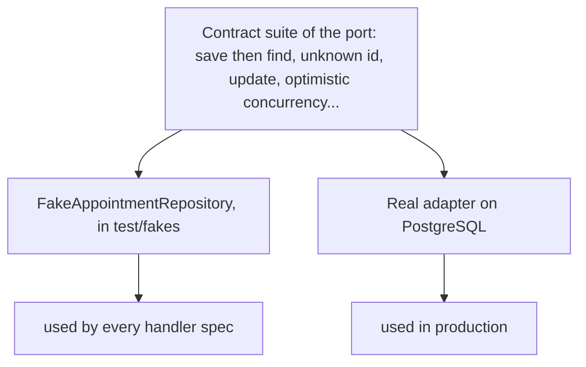

# Testing strategy

**Summary.** The kit tests behaviour through public interfaces at four levels (domain,
application, adapter, end to end), with the same test data builders at every level. Test
doubles are fakes, working in-memory implementations of ports, rather than mocks; a fake is
kept honest by passing the same contract suite as the real adapter it stands for. Aggregate
specs read given / when / then. The result is a suite where most tests run in milliseconds
with no infrastructure, survive refactoring because they assert outcomes rather than calls,
and read as business rules. This page explains each choice, says what to test where, and
states what the strategy does not cover.

## The vocabulary of test doubles

"Mock" is often used for any stand-in. Gerard Meszaros's vocabulary, popularised by Martin
Fowler, is more precise:

| Double | What it is | Verifies |
|---|---|---|
| dummy | passed but never used | nothing |
| stub | returns canned answers | state, indirectly |
| spy | a stub that records how it was called | calls, after the fact |
| mock | pre-programmed with the calls it expects | calls: the test fails if they differ |
| fake | a working implementation with a shortcut (in memory instead of a database) | state |

The distinction that matters is the last column. A test with mocks asserts an interaction:
"`save` was called once with this object". A test with a fake asserts an outcome: "the
appointment is stored and cancelled".

## Fakes, not mocks

```ts
// with a mock: asserts how the handler talks to its collaborators
const appointments = { findById: vi.fn().mockResolvedValue(appointment), save: vi.fn() };
await handler.execute(new CancelAppointment(actor, appointment.id, 'ill'));
expect(appointments.save).toHaveBeenCalledWith(expect.objectContaining({ status: 'cancelled' }));

// with a fake: asserts what is true afterwards
const appointments = new FakeAppointmentRepository();
const app = createTestApplication({
  modules: [platformTestModule, contextModule('appointments', appointmentsDeclarations), authorization],
  fakes: [fake(AppointmentRepository, appointments)],
});
await appointments.save(appointment);
await app.commandBus.execute(new CancelAppointment(actor, appointment.id, 'ill'));
expect((await appointments.findById(appointment.id))?.isCancelled).toBe(true);
expect(app.eventBus.published).toMatchObject([{ type: 'appointments.appointment.cancelled' }]);
```

Why the kit prefers the second form (rule
[`test/no-mocks`](../ARCHITECTURE.md#3-dependency-rules), a warning by default):

- **Mocks couple tests to the implementation.** Rename a method, save in two steps instead of
  one, load through another finder: behaviour is unchanged, mock-based tests fail. Tests that
  break on refactoring discourage refactoring.
- **Mocks can assert a lie.** A mocked repository returns whatever the test says, including
  things the real one never would. The test passes; production does not.
- **Fakes are reusable.** One in-memory repository serves every handler spec of the context,
  and a failure is a method on the fake (`sms.failNextWith(...)`) rather than a setup repeated
  in each test.
- **The architecture makes mocks unnecessary.** Every dependency is a port received by
  constructor; time and identifiers are ports too. A class that needs a module mock to be
  tested is breaking a purity rule ([Clean code](clean-code.md)).

This is the "classical" school in Fowler's terms. The "mockist" school, described by Freeman
and Pryce, uses mocks to discover interfaces while designing outside-in; it is a coherent
practice, and its authors also warn against mocking types you do not own. The kit's position is
narrower than a doctrine: its ports are already designed and each has a fake, so interaction
assertions add coupling without adding information.

The one accepted double that is not a fake: a stub of an outside HTTP API at the network level,
in an adapter's integration spec.

## Contract tests keep fakes honest

The weakness of a fake is drift: an in-memory repository that tolerates what PostgreSQL would
refuse. The answer is a contract suite: one set of tests written against the port, run against
the fake and against the real adapter.



If both pass the same suite, a handler tested on the fake behaves the same on the adapter for
everything the contract covers. The kit ships suites for its own ports (repository, event bus,
outbox store, processed-event store, cache, lock, rate limiter, job scheduler, logger,
authorizer) and a base to write the suite of a port of your own. Replacing an ORM or a broker
is then "write the adapter, pass the suite".

A contract covers what it tests and nothing more: behaviour specific to an adapter (the mapping
of every column, a transaction rollback) gets its own integration tests.

## Builders

Test data comes from builders, one per aggregate:

```ts
const appointment = anAppointment().withClient('ada').on(aSlot().tomorrowAt('09:00')).cancelled().build();
```

- **Valid defaults.** `anAppointment().build()` is a valid appointment. A test states only
  what matters to the rule it checks, so the reader sees the cause of the outcome.
- **Named in the ubiquitous language.** `cancelled()`, not `withStatus('CANCELLED')`.
- **Built through the public API.** `build()` goes through the aggregate's factory and
  intention methods, so a test cannot start from an invalid state. If a test needs a state the
  public API cannot reach, either the state is impossible or the API is incomplete.
- **Immutable.** Each call returns a new builder, so a shared base cannot leak between tests.

Rule [`test/builder-required`](../ARCHITECTURE.md#3-dependency-rules). Without builders, every
change of a constructor edits fifty tests and each test buries its one relevant value under ten
irrelevant ones.

## Given / when / then

An aggregate spec is a scenario: a built state (or past events), one intention, then the
recorded events or the raised error.

```ts
given(anAppointment().cancelled())
  .when((appointment) => appointment.reschedule(aSlot().build(), at))
  .thenError(AppointmentAlreadyCancelled, 'APPOINTMENT_ALREADY_CANCELLED');

given(anAppointment())
  .when((appointment) => appointment.cancel(reason, wellBeforeTheSlot))
  .thenEvents([{ name: 'appointments.appointment.cancelled' }]);
```

One intention per test, and assertions on events, errors and state through the public API
only. The test name states the rule: `refuses to reschedule a cancelled appointment`.

## The four levels

| Level | What runs | Doubles | Speed |
|---|---|---|---|
| domain | aggregates, value objects, domain services | none at all | milliseconds |
| application | real handlers through the in-memory buses | fakes for every port, a fixed clock | milliseconds |
| adapter | one real adapter against its real dependency, plus the contract suite | none | seconds |
| end to end | the whole application with real adapters, through HTTP and the event bus | none; generated data with a fixed seed | seconds |

Normative table: [section 7 of the architecture reference](../ARCHITECTURE.md#7-test-levels).
An architecture level sits beside them: `ddd-ts-kit check`, and a generated test that boots
each context alone to prove it stays extractable.

The same builders serve every level. End-to-end tests create their state through the public
API, use generated data with a seed printed on failure so a failing run can be replayed, and
assert what a client observes (responses, published events), never the database directly.

## What to test where

| Behaviour | Level | Why there |
|---|---|---|
| "A cancelled appointment cannot be rescheduled" | domain | an invariant: no I/O needed, exhaustive cases are cheap |
| Boundaries of `TimeSlot` (end before start, zero length) | domain, table-driven | value object validation |
| "Cancelling publishes `appointments.appointment.cancelled` once the command handler has returned; a refusal saves and publishes nothing" | application | orchestration: load, one intention, save |
| Each declared error code of a use case | application | the contract of the handler |
| "An actor without `appointment.cancel` is refused" | application, with the authorization module listed | a property of the wiring of the context |
| "Only the client who booked may cancel" (the policy) | unit, on the policy alone | a pure function |
| Mapping of every column, optimistic concurrency, rollback | adapter | only the real database can say |
| The exclusion constraint that prevents double booking | adapter | the constraint lives in the database |
| Fake and adapter agree | contract, at the adapter level | keeps the application level trustworthy |
| 401 without a credential, 403 without the permission, the documented status with it | end to end | the whole chain: HTTP, authentication, bus |
| "Booking leads to a reminder being scheduled" across two contexts | end to end | crosses the event bus; eventual, so the test waits for the outcome |
| Status code and problem body for an input of the wrong shape | route spec | boundary validation |

Two guidelines follow from the table. Push each rule to the lowest level that can prove it:
ten cases of a cancellation window are ten millisecond tests on the aggregate, not ten HTTP
round trips. And do not repeat a rule at every level: the end-to-end test proves the wiring
with one case, the domain test proves the rule with all of them.

Every unit of behaviour has a spec (rule
[`test/spec-required`](../ARCHITECTURE.md#3-dependency-rules)), and a test contains no logic:
no `if`, no loop, arrange, act and assert separated by blank lines.

## Coverage thresholds

The generated pipeline sets thresholds per layer (statements, branches, functions, lines), as
[`pipeline/README.md`](../../pipeline/README.md) states:

| Layer | Thresholds | Reason given | Measured by |
|---|---|---|---|
| `domain/` | 90, 85, 90, 90 | pure code, nothing prevents testing it | unit tests |
| `application/` | 85, 80, 85, 85 | handlers run through fakes | unit tests |
| `presentation/` | 80, 70, 80, 80 | mapping and status translation | unit tests |
| `infrastructure/` | 70, 60, 70, 70 | driver error paths are hard to provoke | integration tests |

A freshly generated project passes them, because the numbers leave room for the `it.todo`
entries of the scaffolds; raise them once the todos are written. Coverage says which lines
ran, not whether anything was asserted about them: it is a floor that catches untested code,
not a measure of test quality.

## Limits and when not to use it

- **Mutation testing is not shipped.** It is the tool that measures whether tests would notice
  a changed behaviour. The pipeline README records why: Stryker 10, run on the domain layer of
  a generated project with Vitest 5, executed no test per mutant and reported every mutant as
  survived, and its core rewrites the tsconfig through an API the native TypeScript 7 does not
  have. A gate that scores zero whatever the tests say is worse than no gate. Until the runner
  supports it, test quality rests on review and on the conventions above.
- **A fake is only as good as its contract suite.** Behaviour the suite does not cover can
  differ silently: SQL collation and ordering, constraint timing, time zone handling. When a
  bug comes from such a gap, add the case to the suite, not only to one adapter.
- **In-process PostgreSQL is not the production server.** Fast adapter specs run on PGlite; a
  final integration run against the real server remains necessary, and the READMEs of the ORM
  adapters state that MySQL and SQLite are outside the automated suite.
- **The existence rules check files, not content.** `test/spec-required` and
  `test/builder-required` verify that the file exists; a spec holding only `it.todo` satisfies
  them. Leftover todos mean the work is not done.
- **`test/no-mocks` is a warning by default** and concerns the tests of a context. Legacy code
  being adopted, or a third-party SDK with no seam, may justify a mock; make it a recorded
  decision rather than a habit.
- **End-to-end tests of eventual behaviour are slower and need care.** They wait for an
  outcome instead of sleeping, and a badly bounded wait makes a flaky test.
- **No performance, load or security testing** is part of this strategy, and no consumer-driven
  contract testing between separately deployed services: the generated OpenAPI and AsyncAPI
  documents with drift checks hold the contracts instead. After extracting a service, consider
  adding it ([When to extract microservices](../guides/when-to-extract-microservices.md)).

## Sources

- Gerard Meszaros, xUnit Test Patterns, Addison-Wesley, 2007: Test Double and its variations
  (Dummy, Stub, Spy, Mock, Fake), Test Data Builder antecedents (Creation Method).
- Martin Fowler, "Mocks Aren't Stubs" (2007), "TestDouble", "TestPyramid", "ContractTest" and
  "GivenWhenThen", martinfowler.com.
- Steve Freeman and Nat Pryce, Growing Object-Oriented Software, Guided by Tests,
  Addison-Wesley, 2009: the mockist practice, "only mock types that you own", test data
  builders (chapter 22).
- Nat Pryce, "Test Data Builders: an alternative to the Object Mother pattern", 2007
  (natpryce.com).
- Vladimir Khorikov, Unit Testing Principles, Practices, and Patterns, Manning, 2020:
  resistance to refactoring as a property of a good test.
- Dan North, "Introducing BDD", 2006 (dannorth.net): given / when / then.
- [`@ddd-ts-kit/testing`](../../packages/testing/README.md) and
  [`pipeline/README.md`](../../pipeline/README.md).

## See also

- [Clean code](clean-code.md)
- [Aggregates](aggregates.md)
- [Ports and composition](ports-and-composition.md)
- [Delivery and idempotency](delivery-and-idempotency.md)
- [Test runners](../tools/test-runners.md)
- [Static analysis and pipeline](../tools/static-analysis-and-pipeline.md)
- [Architecture reference](../ARCHITECTURE.md): sections 5 and 7, rules `test/spec-required`,
  `test/no-mocks`, `test/builder-required`
