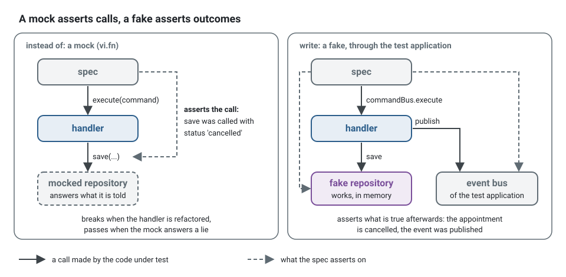
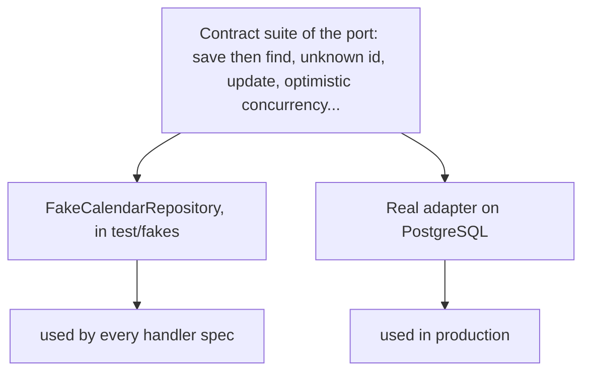
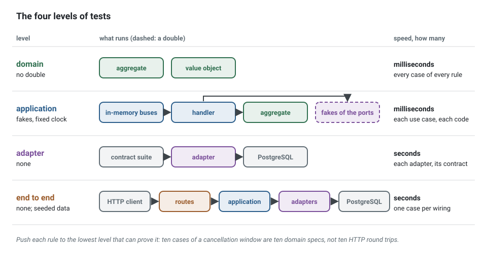

**English** · [Français](testing-strategy.fr.md)

# Testing strategy

**Summary.** The kit tests behaviour through public interfaces at four levels (domain,
application, adapter, end to end), with the same test data builders at every level. Test
doubles are fakes, working in-memory implementations of ports, rather than mocks; a fake is
kept honest by passing the same contract suite as the real adapter it stands for. Aggregate
specs read given / when / then. The result is a suite where most tests run in milliseconds
with no infrastructure, survive refactoring because they assert outcomes rather than calls,
and read as business rules. This page explains each choice, says what to test where, and
states what the strategy does not cover.

## The vocabulary of test doubles

"Mock" is often used for any stand-in. Gerard Meszaros's vocabulary, popularised by Martin
Fowler, is more precise:

| Double | What it is | Verifies |
|---|---|---|
| dummy | passed but never used | nothing |
| stub | returns canned answers | state, indirectly |
| spy | a stub that records how it was called | calls, after the fact |
| mock | pre-programmed with the calls it expects | calls: the test fails if they differ |
| fake | a working implementation with a shortcut (in memory instead of a database) | state |

The distinction that matters is the last column. A test with mocks asserts an interaction:
"`save` was called once with this object". A test with a fake asserts an outcome: "the
appointment is stored and cancelled".

## Fakes, not mocks

```ts
// instead of, with a mock: asserts how the handler talks to its collaborators
const appointments = { findById: vi.fn().mockResolvedValue(appointment), save: vi.fn() };
// the access check is mocked too: the test now knows every collaborator of the handler
const access = { authorize: vi.fn().mockResolvedValue(undefined) };
const handler = new CancelAppointmentHandler(appointments, access, clock);

await handler.execute(new CancelAppointmentCommand(patient, appointment.id));

expect(appointments.save).toHaveBeenCalledWith(expect.objectContaining({ status: 'cancelled' }));

// write, with a fake: asserts what is true afterwards
const appointments = new FakeAppointmentRepository();
await appointments.save(appointment);

const app = createTestApplication({
  modules: [platformTestModule, contextModule('scheduling', schedulingDeclarations), holders],
  fakes: [fake(AppointmentRepository, appointments)],
});

await app.commandBus.execute(new CancelAppointmentCommand(patient, appointment.id));

expect((await appointments.findById(appointment.id))?.status).toBe('cancelled');
expect(app.eventBus.published).toMatchObject([{ type: 'scheduling.appointment.cancelled' }]);
```



Why the kit prefers the second form (rule
[`test/no-mocks`](../ARCHITECTURE.md#3-dependency-rules), a warning by default):

- **Mocks couple tests to the implementation.** Rename a method, save in two steps instead of
  one, load through another finder: behaviour is unchanged, mock-based tests fail. Tests that
  break on refactoring discourage refactoring.
- **Mocks can assert a lie.** A mocked repository returns whatever the test says, including
  things the real one never would. The test passes; production does not.
- **Fakes are reusable.** One in-memory repository serves every handler spec of the context,
  and a failure is a method on the fake (`mailer.failNextWith(...)`) rather than a setup repeated
  in each test.
- **The architecture makes mocks unnecessary.** Every dependency is a port received by
  constructor; time and identifiers are ports too. A class that needs a module mock to be
  tested is breaking a purity rule ([Clean code](clean-code.md)).

This is the "classical" school in Fowler's terms. The "mockist" school, described by Freeman
and Pryce, uses mocks to discover interfaces while designing outside-in; it is a coherent
practice, and its authors also warn against mocking types you do not own. The kit's position is
narrower than a doctrine: its ports are already designed and each has a fake, so interaction
assertions add coupling without adding information.

The one accepted double that is not a fake: a stub of an outside HTTP API at the network level,
in an adapter's integration spec.

A fake is a small class of `test/fakes/` that implements the port with a shortcut, and offers
the failures a test needs as methods. The mailer of the notification context of the example,
shortened:

<!-- checked sample -->
```ts
// notification/application/ports/mailer.port.ts
export abstract class Mailer {
  /** Fails when the provider did not take the mail. */
  abstract deliver(address: string, subject: string): Promise<void>;
}

// notification/test/fakes/mailer.fake.ts
export class FakeMailer implements Mailer {
  /** What the provider took, in order: what a spec asserts. */
  readonly delivered: { readonly address: string; readonly subject: string }[] = [];

  private readonly failures: Error[] = [];

  /** The next delivery fails with this error, then the mailer works again. */
  failNextWith(error: Error): void {
    this.failures.push(error);
  }

  async deliver(address: string, subject: string): Promise<void> {
    const failure = this.failures.shift();

    if (failure !== undefined) {
      throw failure;
    }

    this.delivered.push({ address, subject });
  }
}
```

A spec then reads like the rule it proves: `mailer.failNextWith(new Error('provider
unreachable'))`, send the notification, and expect that nothing was saved and nothing published.

## Contract tests keep fakes honest

The weakness of a fake is drift: an in-memory repository that tolerates what PostgreSQL would
refuse. The answer is a contract suite: one set of tests written against the port, run against
the fake and against the real adapter.



In code, one call per implementation, with the same expectations. The spec of the calendar
repository of the example, shortened:

<!-- checked sample -->
```ts
// scheduling/test/integration/calendar.repository.contract.spec.ts
import { afterEach, beforeEach, describe, expect, it } from 'vitest';
import { AggregateRoot, type Repository } from '@ddd-ts-kit/kernel';
import { InMemoryRepository } from '@ddd-ts-kit/testing';
import { repositoryContract } from '@ddd-ts-kit/testing/contracts';

// from the domain, the builders and the test database of the project
interface CalendarState {
  readonly exceptions: readonly string[];
}
declare class Calendar extends AggregateRoot {
  static rehydrate(id: string, state: CalendarState): Calendar;
  addException(day: string, at: Date): void;
  toState(): CalendarState;
}
declare function aCalendar(): { build(): Calendar };
declare function knexCalendarRepositoryOnAFreshDatabase(): Promise<Repository<Calendar>>;

const runner = { describe, it, expect, beforeEach, afterEach };

const expectations = {
  createAggregate: () => aCalendar().build(),
  mutate: (calendar: Calendar) => calendar.addException('2026-12-25', new Date('2026-01-02T00:00:00.000Z')),
  idOf: (calendar: Calendar) => calendar.id,
  stateOf: (calendar: Calendar) => calendar.toState(),
};

// the fake every handler spec uses
repositoryContract<Calendar>(runner, {
  ...expectations,
  name: 'FakeCalendarRepository',
  createRepository: () =>
    new InMemoryRepository<Calendar>({ clone: (stored) => Calendar.rehydrate(stored.id, stored.toState()) }),
});

// the adapter production uses, on a real database
repositoryContract<Calendar>(runner, {
  ...expectations,
  name: 'KnexCalendarRepository',
  createRepository: () => knexCalendarRepositoryOnAFreshDatabase(),
});
```

If both pass the same suite, a handler tested on the fake behaves the same on the adapter for
everything the contract covers. The kit ships suites for its own ports in
`@ddd-ts-kit/testing/contracts` (repository, unit of work, read model store and criteria, event
bus, event store, outbox store, processed-event store, process store, job store, job scheduler,
cache, cache purger, lock, rate limiter, file storage, logger, tenant isolation) and in
`@ddd-ts-kit/auth/testing` (authorizer, relation tuple store), and `ContractSuite`, the base to
write the suite of a port of your own. Replacing an ORM or a broker is then "write the adapter,
pass the suite".

A contract covers what it tests and nothing more: behaviour specific to an adapter (the mapping
of every column, a transaction rollback) gets its own integration tests.

## Builders

Test data comes from builders, one per aggregate:

```ts
const appointment = anAppointment().forPatient('ada').startingAt(tomorrowAt9).cancelledByPatient().build();
```

A builder extends `Builder` of `@ddd-ts-kit/testing`: valid `defaults()` once, a `construct()`
that goes through the public API of the aggregate, and one method per word of the language.
Shortened from the builder of the example:

<!-- checked sample -->
```ts
// scheduling/test/builders/appointment.builder.ts
import { AggregateRoot } from '@ddd-ts-kit/kernel';
import { Builder, sequence, type Defaults } from '@ddd-ts-kit/testing';

// the aggregate, from the domain
declare class Appointment extends AggregateRoot {
  static create(id: string, patientId: string, startsAt: Date, bornAt: Date): Appointment;
  cancel(by: 'patient' | 'practice', at: Date): void;
}

interface AppointmentIngredients {
  readonly id: string;
  readonly patientId: string;
  readonly startsAt: Date;
  readonly bornAt: Date;
  readonly cancelled: boolean;
}

export class AppointmentBuilder extends Builder<AppointmentIngredients, Appointment> {
  forPatient(patientId: string): this {
    return this.with('patientId', patientId);
  }

  startingAt(instant: Date): this {
    return this.with('startsAt', instant);
  }

  cancelledByPatient(): this {
    return this.with('cancelled', true);
  }

  protected defaults(): Defaults<AppointmentIngredients> {
    return {
      id: sequence('appointment'),
      patientId: 'patient-1',
      startsAt: new Date('2026-03-02T09:00:00.000Z'),
      bornAt: new Date('2026-03-01T00:00:00.000Z'),
      cancelled: false,
    };
  }

  /** Through the public API only: a test can never start from a state the rules forbid. */
  protected construct({ id, patientId, startsAt, bornAt, cancelled }: AppointmentIngredients): Appointment {
    const appointment = Appointment.create(id, patientId, startsAt, bornAt);

    if (cancelled) {
      appointment.cancel('patient', bornAt);
    }

    return appointment;
  }
}

export function anAppointment(): AppointmentBuilder {
  return new AppointmentBuilder();
}
```

- **Valid defaults.** `anAppointment().build()` is a valid appointment. A test states only
  what matters to the rule it checks, so the reader sees the cause of the outcome.
- **Named in the ubiquitous language.** `cancelledByPatient()`, not `withStatus('CANCELLED')`.
- **Built through the public API.** `build()` goes through the aggregate's factory and
  intention methods, so a test cannot start from an invalid state. If a test needs a state the
  public API cannot reach, either the state is impossible or the API is incomplete.
- **Immutable.** Each call returns a new builder, so a shared base cannot leak between tests.

Rule [`test/builder-required`](../ARCHITECTURE.md#3-dependency-rules). Without builders, every
change of a constructor edits fifty tests and each test buries its one relevant value under ten
irrelevant ones.

## Worlds

Several handler specs of a context build the same test application with the same fakes. That
arrangement is written once, as a world of `test/worlds/`, and generated rather than copied:

```bash
npx ddd-ts-kit generate test-world scheduling
```

The generator reads `test/fakes/*.fake.ts`, finds the port each class implements in
`domain/repositories/` or `application/ports/`, and writes
`test/worlds/scheduling.world.ts`: `aSchedulingWorld(options)` builds every fake, lets the spec
store what it starts from, then hands the fakes to the test application and returns it with
each fake under the name of its port. A spec of the example then reads:

```ts
// scheduling/test/unit/confirm-appointment.handler.spec.ts
const { application, appointmentRepository } = await aSchedulingWorld({
  modules: [holders],
  now: NOW,
  given: async (fakes) => {
    await fakes.appointmentRepository.save(requested);
  },
});
```

- **What it takes.** `now` and `idPrefix` go to the test application; `modules` adds what the
  spec brings, its authorization module (by default no role holds a permission); `given`
  receives the fakes before the application wires them, so the events recorded while building
  the stored aggregates are not announced as if a command had just run.
- **Without an injection container** (`createTestBuses`), the world returns the buses and the
  fakes, each repository wrapped by `dispatching`, and the spec registers the handler it tests.
- **What it leaves out, and says so.** A fake whose constructor needs an argument (a reader that
  answers what the spec gives it), and, under a container, the fake of a port that nothing binds
  or depends on yet: the test application would refuse it. Run the generator again with
  `--force` when the context gained a fake.
- **What stays in the spec.** The permission it exercises, the data it starts from (built by the
  builders) and the facts it listens to. A world holds no test data.

A helper written among the specs instead, `test/unit/scheduling-application.ts`, is reported by
[`test/helper-placed`](../ARCHITECTURE.md#3-dependency-rules), a warning: `test/unit/` and
`test/integration/` hold specs, and a shared arrangement, test data or an in-memory port each
has its place (`test/worlds/`, `test/builders/`, `test/fakes/`).

## Given / when / then

An aggregate spec is a scenario: a built state (or past events), one intention, then the
recorded events or the raised error.

<!-- checked sample -->
```ts
// scheduling/test/unit/appointment.aggregate.spec.ts
import { describe, expect, it } from 'vitest';
import { AggregateRoot } from '@ddd-ts-kit/kernel';
import { Builder, given } from '@ddd-ts-kit/testing';

// the aggregate and its builder, from the previous sample
declare class Appointment extends AggregateRoot {
  readonly status: 'booked' | 'cancelled';
  cancel(by: 'patient' | 'practice', at: Date): void;
  reschedule(startsAt: Date, at: Date): void;
}
declare abstract class AppointmentBuilder extends Builder<object, Appointment> {
  cancelledByPatient(): this;
}
declare function anAppointment(): AppointmentBuilder;

const at = new Date('2026-03-01T08:00:00.000Z');

describe('Appointment', () => {
  it('records that it was cancelled', () => {
    given(anAppointment())
      .when((appointment) => appointment.cancel('patient', at))
      .thenEvents([{ name: 'scheduling.appointment.cancelled', occurredAt: at }])
      .thenState((appointment) => expect(appointment.status).toBe('cancelled'));
  });

  it('refuses to reschedule a cancelled appointment', () => {
    given(anAppointment().cancelledByPatient())
      .when((appointment) => appointment.reschedule(new Date('2026-03-03T09:00:00.000Z'), at))
      .thenError('APPOINTMENT_ENDED');
  });
});
```

`given` takes the builder, builds the aggregate and forgets the events recorded while
building it, so `thenEvents` sees only those of `when`. `thenError` takes a code, or the class
of the error and a code.

One intention per test, and assertions on events, errors and state through the public API
only. The test name states the rule: `refuses to reschedule a cancelled appointment`.

## The four levels

| Level | What runs | Doubles | Speed |
|---|---|---|---|
| domain | aggregates, value objects, domain services | none at all | milliseconds |
| application | real handlers through the in-memory buses | fakes for every port, a fixed clock | milliseconds |
| adapter | one real adapter against its real dependency, plus the contract suite | none | seconds |
| end to end | the whole application with real adapters, through HTTP and the event bus | none; generated data with a fixed seed | seconds |



Normative table: [section 7 of the architecture reference](../ARCHITECTURE.md#7-test-levels).
An architecture level sits beside them: `ddd-ts-kit check`, and a generated test that boots
each context alone to prove it stays extractable.

The same builders serve every level. End-to-end tests create their state through the public
API, use generated data with a seed printed on failure so a failing run can be replayed, and
assert what a client observes (responses, published events), never the database directly.
`generate e2e` names a spec after the use case whose route it drives,
`test/e2e/issue-invoice.e2e.spec.ts`. A spec that grows past the size limit (`clean/file-size`,
350 lines) is split by behaviour into parts named after it,
`test/e2e/issue-invoice-refusals.e2e.spec.ts`, and a journey that crosses use cases is
`test/e2e/journey-<name>.e2e.spec.ts`: the guard of the plugin lets these two be written by hand,
and refuses any other new end-to-end spec. What the specs of one context share (signing a
person in, a world) lives in `test/e2e/support/<context>/`, instead of being copied into each.

Adapter and end-to-end specs of a generated project run on PostgreSQL in process (PGlite). With
Vitest, a global setup (`test/support/test-database-template.ts`) starts it once per run and saves
its initialised cluster; each spec opens a copy of it instead of running an initdb of its own, the
slow part of starting, so that a busy machine no longer makes the hook that opens the database
outlast its timeout. Each spec still creates its tables on that copy: the code of the contexts that
creates them stays run, and measured, as before. Measured with PGlite 0.5.9 on an idle machine
(2026-10-18, five runs each): an initdb takes about 770 ms, opening a copy of the saved cluster
about 170 ms, and creating twenty tables with their keys and indexes on it about 25 ms. Saving the
tables in the copy as well would spare those 25 ms and leave the code that creates them unrun: it
is not done. Against a server (a URL), the database is migrated beforehand and each spec only
empties its tables, so a template database would spare nothing.

With Jest, each spec still initialises its own. A global setup of Jest loads as an ES module
under `--experimental-vm-modules`, and no end-to-end run of the kit holds a Jest project with a
database, so the copy is not offered where nothing would catch it breaking. A Jest project that
needs it can write the same global setup (`globalSetup` and `globalTeardown` of
`jest.config.js`) that sets `TEST_DATABASE_TEMPLATE`, and open the copy in
`src/platform/database/open-test-database.ts` as the file generated for Vitest does.

What happens after the answer (the outbox relayed, the handlers it reaches, what they store in
turn) is awaited with `await application.settled()`, then asserted at once. A fixed delay is slow
when long and flaky when short; `settled` resolves as soon as the outbox holds no pending event,
and when the time is up it fails naming what is still pending and how much of it failed.

A use case no route reaches is started by the integration event its handler receives: its
end-to-end spec (`ddd-ts-kit generate e2e <context> <UseCase>`, with `--event <eventType>` when
handlers of several events send its command) builds that event from the declaration of the
upstream, hands it to the running application with `await application.publish([event])`, as the
relay of the upstream would, then awaits `application.settled()` before asserting what a client or
another context observes.

The acceptance of a story is an end-to-end spec written before its code, from the criteria of the
story (`docs/architecture/stories/<story>.md`): `test/acceptance/<story>.acceptance.spec.ts`, one
scenario per criterion, through the API only. Each scenario runs wrapped in `pending(...)` of
`@ddd-ts-kit/testing/e2e`, which passes while an assertion fails and fails once the scenario
passes, or stops on anything else, so that a scenario waiting for its code never hides a broken
one. `ddd-ts-kit acceptance <story> --lock` then records a fingerprint of each criterion and each
scenario: a scenario changed while its criterion was not, or a criterion changed, is reported and
locked again only once the `acceptance-judge` agent, which did not make the change, let that very
version through; never silently made easier to pass. The slice that satisfies a scenario removes its wrapper; the story closes when none is
left (`ddd-ts-kit acceptance <story> --gate passing`).

## What to test where

| Behaviour | Level | Why there |
|---|---|---|
| "A cancelled appointment cannot be rescheduled" | domain | an invariant: no I/O needed, exhaustive cases are cheap |
| Boundaries of `TimeSlot` (end before start, zero length) | domain, table-driven | value object validation |
| "Cancelling publishes `scheduling.appointment.cancelled` once the command handler has returned; a refusal saves and publishes nothing" | application | orchestration: load, one intention, save |
| Each declared error code of a use case | application | the contract of the handler |
| "An actor without `appointment.cancel` is refused" | application, with the authorization module listed | a property of the wiring of the context |
| "Only the client who booked may cancel" (the policy) | unit, on the policy alone | a pure function |
| Mapping of every column, optimistic concurrency, rollback | adapter | only the real database can say |
| The exclusion constraint that prevents double booking | adapter | the constraint lives in the database |
| Fake and adapter agree | contract, at the adapter level | keeps the application level trustworthy |
| 401 without a credential, 403 without the permission, the documented status with it | end to end | the whole chain: HTTP, authentication, bus |
| "Booking leads to a reminder being scheduled" across two contexts | end to end | crosses the event bus; eventual, so the test waits for the outcome |
| Status code and problem body for an input of the wrong shape | route spec | boundary validation |

Two guidelines follow from the table. Push each rule to the lowest level that can prove it:
ten cases of a cancellation window are ten millisecond tests on the aggregate, not ten HTTP
round trips. And do not repeat a rule at every level: the end-to-end test proves the wiring
with one case, the domain test proves the rule with all of them.

Every unit of behaviour has a spec (rule
[`test/spec-required`](../ARCHITECTURE.md#3-dependency-rules)), and six rules of the ESLint plugin
hold the shape of each test: its title states the rule it proves, in lower case, never `should` or
the name of a method (`test/title-states-a-rule`); it holds no `if`, no loop, no `try`
(`test/no-logic`); it asserts an outcome (`test/assertion-present`), a refusal by its code and its
facts rather than by a message (`test/refusal-by-code`), and never a snapshot (`test/no-snapshot`);
and every test runs, no `.only`, no `.skip` (`test/no-only-no-skip`). Arrange, act and assert stay
separated by blank lines. The four rules that read what a test says are warnings until 0.90.0, so
that an upgrade never turns a green lint red; `ddd-ts-kit lint` lists them after its report.

## Properties

A value object holds laws that hold for every value, not for the three a test names: two ranges
overlap in both directions or in none, a slot is held at least until it ends, a parse then a format
gives the value back. Such a law is stated once, as a property, and checked on generated values:

```ts
import fc from 'fast-check';

it('overlaps another range in both directions or in none, for any two ranges', () => {
  fc.assert(fc.property(anyRange(), anyRange(), (one, other) => one.overlaps(other) === other.overlaps(one)));
});
```

`fast-check` joins the development dependencies with the first property (`npm i -D fast-check`), under
Vitest as under Jest; a project without a property carries no dead dependency. The title states the law, so that the page
of what the tests state reads it; `fc.assert` is an assertion for `test/assertion-present`; the
arbitrary (`anyRange()`) is a small helper of the spec built on the factories of the model, so that
every generated value is one the model accepts. A failing run prints the seed and the counterexample,
shrunk to the smallest. A property is for a law of the model: an invariant, a symmetry, a round trip,
an idempotence; the orchestration of a use case is stated by its scenarios, with named values, not
by a property. The spec `generate value-object` writes ends with a planned rule to remind of it:
`keeps its invariants for any value a generator can produce, as a property`. The example states four,
on its ranges and its slots.

## Coverage thresholds

A project states the minimum coverage of each layer in one place, the `coverage` key of
`ddd-ts-kit.config.json` ([CONFIG.md](../CONFIG.md#coverage-thresholds)); the test runner reads
it, and `npm run verify` and the pipeline fail under it. The reference, as statements,
branches, functions, lines:

| Layer | Reference | Why this floor | Measured by |
|---|---|---|---|
| `domain/` | 90, 85, 90, 90 | pure code, nothing prevents testing it; it holds the rules | unit specs |
| `application/` | 85, 80, 85, 85 | handlers run through fakes | unit specs |
| `presentation/` | 80, 70, 80, 80 | mapping and status translation; its error paths are also held end to end | unit specs |
| `infrastructure/` | 70, 60, 70, 70 | driver failure paths are hard to provoke; adapters are held by contract suites | integration specs |

Each context is held on its own, layer by layer, from the first source file of the layer. A
freshly generated project passes: what a generator writes comes with a spec that runs it, and
the `it.todo` entries name the behaviour still to prove.

**What a rate proves.** That a line, a branch or a function ran while a test was running. A
layer under its floor holds code no test has ever executed: that is certain, and it is what
the gate catches.

**What it does not prove.** That anything was asserted about what ran, that the cases that
matter were tried, or that the test would fail if the behaviour changed. A spec that calls a
handler and checks nothing covers it fully. The specs named after business rules, the
contract suites and the end-to-end journeys prove behaviour; coverage only says where nothing
does.

**A floor, not a goal.** Raise a threshold when a layer has stayed above it; never write a
test to move a number. A threshold is lowered only by a recorded deviation, and the measure is
never narrowed around the code that fails it (`test/coverage-governed`): an uncovered branch
is tested, or deleted when nothing can reach it.

```ts
// instead of, in vitest.config.ts: a measure narrowed by hand, refused by test/coverage-governed
test: { coverage: { exclude: ['src/contexts/billing/infrastructure/**'], thresholds: { branches: 50 } } }

// write: the runner reads what it measures and its floors from ddd-ts-kit.config.json
test: { coverage: { provider: 'v8', ...governedCoverage(mode) } } // from @ddd-ts-kit/testing/coverage
```

```json
"coverage": { "infrastructure": { "branches": 50 } },
"deviations": [
  { "what": "coverage.infrastructure.branches", "adr": "0011", "reason": "The failure branches of the driver are held by its contract suite." }
]
```

## Mutation score

A coverage rate says that a line ran under a test; a mutation score says that a test would notice
if the line changed. Every night the pipeline runs Stryker on the domain and application layers of every context
(`npm run test:mutation`): each mutant is one small change of the code, a condition negated, a
boundary moved, a return emptied, and the unit specs run against it; a mutant the specs notice is
detected, one they let through is a survivor. Then `ddd-ts-kit mutation` reads the report and holds
each layer of each context to its `mutation` floor of `ddd-ts-kit.config.json`, 80 and 75 by the
reference
([CONFIG.md](../CONFIG.md#mutation-score)).

The Stryker config writes no glob and no number: it spreads `governedMutation()` of
`@ddd-ts-kit/testing/mutation`, which mutates the domain and application layers of every context, leaves the texts
of refusals out through the ignorer of the kit, since a refusal is asserted by its code and never
by its text, every other string measured, and ignores the static mutants, those of code that runs
once when the module loads. Rule
[`test/mutation-governed`](../ARCHITECTURE.md#3-dependency-rules) refuses a `mutate`, `mutator`,
`ignoreStatic` or `thresholds` written by hand.

A survivor is a rule no test states. Read it as a business decision: when the behaviour is the
rule, state it in a test named after it, as the trial on the example did for a withdrawn reminder
planned again for the same start; when the behaviour is an accident of the code, or a branch no
caller can reach, leave the mutant alive and say why, never hide it by configuration. Measured on
the example on 2026-10-24 ([pipeline README](../../pipeline/README.md#mutation-testing)) with the
shipped configuration: 1436 mutants, 163 of them texts of refusals and static mutants left out,
1226 killed, 41 survivors, 6 without coverage, 96.3% in 5 minutes, the lowest context at
95.4%. With the application layer, measured the same day: 2412 mutants in 283 files, 96.1% in
5 minutes 24 seconds, the application layer at 95.7% and its lowest context at 93.5%; the initial
test run is what the night pays for, not the mutants.

A pull request gets a reading of its change, not the whole measure: the `mutation-changed` job of
the pipeline reuses the report of the last night for what the change leaves alone (the incremental
mode of Stryker, about a minute on the example when the change stays in the domain, the use cases and the specs), runs the whole measure again, about five minutes, when the change touches code the tests lean on and Stryker does not diff (a route, an adapter, a fake, a builder, a world, the platform, a dependency, the common case of a feature), then lists the survivors of the files the change touched
(`ddd-ts-kit mutation --changed <base>`). Read them before asking for a review; the floor stays the
business of the night.

## Living documentation

The business asks of tests what Gherkin promises: a reading of the rules in its own words. The kit
gives it without a second language: the title of a test states a rule (`test/title-states-a-rule`),
and `ddd-ts-kit docs` writes `docs/behaviour/<context>.md` from the titles of the specs of each
context, grouped as the specs group them, with the role of each spec (`slot (value object), in
calendars`), a planned rule (`it.todo`) and a spec put aside said so, and `docs/behaviour/application.md`
for the specs outside the contexts (end to end, acceptance, architecture). `npm run docs:generate`
writes them, the pre-commit hook regenerates and adds them when a spec is staged (a worker confined
to its context leaves them to the trunk), `docs --check` holds them current, and they are committed
with the specs: the test is the proof, the page its reading. On the example, `scheduling` lists 593 rules from 165 specs, a
table of cases counting as one rule.

A `.feature` file would promise the same reading, at the price of a glue of step definitions, a
second grammar to teach, and a drift the pipeline cannot see. Gherkin pays only when the business
writes the scenarios itself; then it is an input for the acceptance specs of a story, never the
runner.

## Limits and when not to use it

- **The whole measure runs every night; a pull request gets a reading of its change.** Five
  minutes for the domain of the four contexts of the example is too long for the loop of a change,
  so the job of the night holds the floor, and a pull request lists the survivors of the files it
  touched from a run that reuses the results of the night when the change stays in the model and the use cases, never a gate; a survivor found at night is a rule to state the next day.
- **A mutation score says that a change was noticed, not that the right rule was stated.** A test
  that kills a mutant states what the code does today: each one is read as a business decision
  before it is kept, and an accidental behaviour is left alive and said so rather than frozen.
- **A mutation score says nothing about a rule written as a declaration.** The static mutants are
  ignored, those of code that runs once when the module loads: the transitions of a state machine, a
  constant, a regular expression declared at the top of a file. A wrong transition in such a table
  lowers no score, and the test that states the rule is its only proof; `ddd-ts-kit mutation` shows
  the ignored mutants of each context beside its score. On the example, 90 of the 1436 mutants are
  static, the declaration of the appointment state machine among them.
- **A fake is only as good as its contract suite.** Behaviour the suite does not cover can
  differ silently: SQL collation and ordering, constraint timing, time zone handling. When a
  bug comes from such a gap, add the case to the suite, not only to one adapter.
- **In-process PostgreSQL is not the production server.** Fast adapter specs run on PGlite; a
  final integration run against the real server remains necessary, and the READMEs of the ORM
  adapters state that MySQL and SQLite are outside the automated suite, except the Knex stores,
  held to their contract suites on an in-memory SQLite database in the unit run.
- **The existence rules check files, not content.** `test/spec-required` and
  `test/builder-required` verify that the file exists; a spec holding only `it.todo` satisfies
  them. The shape rules read each test, not whether the cases that matter were tried:
  `expect(true).toBe(true)` passes `test/assertion-present`. Leftover todos mean the work is not
  done: `ddd-ts-kit todo` lists them, and `story --gate close` refuses to close a story while an
  `it.todo` of its own is left.
- **`test/no-mocks` is a warning by default** and concerns the tests of a context. Legacy code
  being adopted, or a third-party SDK with no seam, may justify a mock; make it a recorded
  decision rather than a habit.
- **End-to-end tests of eventual behaviour are slower and need care.** They wait for an
  outcome instead of sleeping, and a badly bounded wait makes a flaky test. `settled` counts
  what the outbox holds: what a broker server delivers to its consumers afterwards is awaited
  with `collectEvents(...).waitFor`, and a projection read through the API with `eventually`.
- **No performance, load or security testing** is part of this strategy, and no consumer-driven
  contract testing between separately deployed services: the generated OpenAPI and AsyncAPI
  documents with drift checks hold the contracts instead. After extracting a service, consider
  adding it ([When to extract microservices](../guides/when-to-extract-microservices.md)).

## Sources

- Gerard Meszaros, xUnit Test Patterns, Addison-Wesley, 2007: Test Double and its variations
  (Dummy, Stub, Spy, Mock, Fake), Test Data Builder antecedents (Creation Method).
- Martin Fowler, "Mocks Aren't Stubs" (2007), "TestDouble", "TestPyramid", "ContractTest" and
  "GivenWhenThen", martinfowler.com.
- Steve Freeman and Nat Pryce, Growing Object-Oriented Software, Guided by Tests,
  Addison-Wesley, 2009: the mockist practice, "only mock types that you own", test data
  builders (chapter 22).
- Nat Pryce, "Test Data Builders: an alternative to the Object Mother pattern", 2007
  (natpryce.com).
- Vladimir Khorikov, Unit Testing Principles, Practices, and Patterns, Manning, 2020:
  resistance to refactoring as a property of a good test.
- Dan North, "Introducing BDD", 2006 (dannorth.net): given / when / then.
- [`@ddd-ts-kit/testing`](../../packages/testing/README.md) and
  [`pipeline/README.md`](../../pipeline/README.md).

## See also

- [Clean code](clean-code.md)
- [Aggregates](aggregates.md)
- [Ports and composition](ports-and-composition.md)
- [Delivery and idempotency](delivery-and-idempotency.md)
- [Test runners](../tools/test-runners.md)
- [Static analysis and pipeline](../tools/static-analysis-and-pipeline.md)
- [Architecture reference](../ARCHITECTURE.md): sections 5 and 7, rules `test/spec-required`,
  `test/no-mocks`, `test/builder-required`
