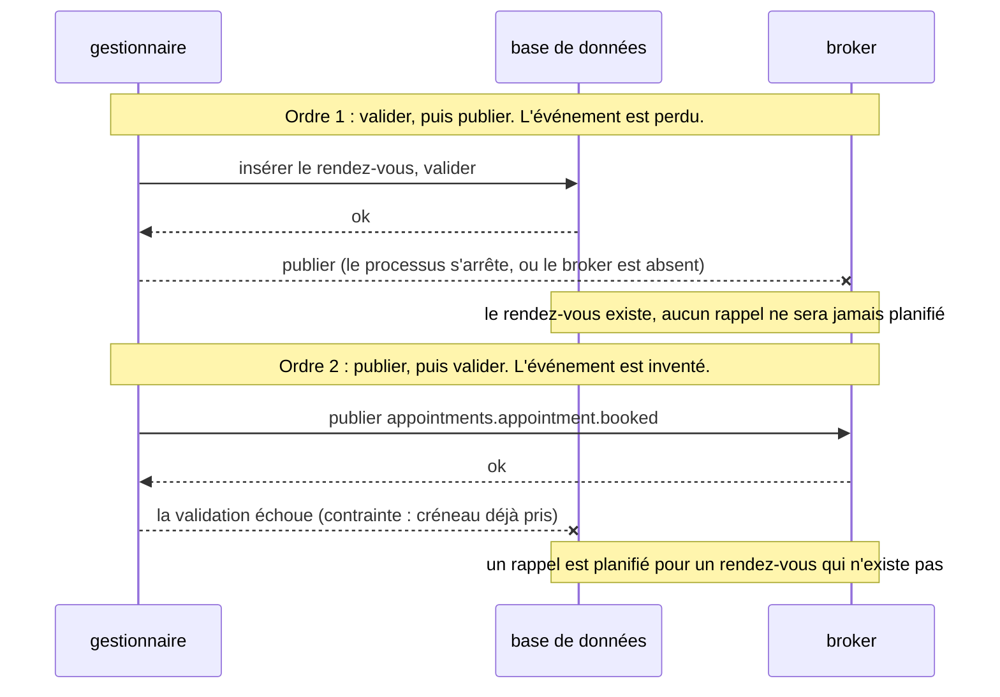

[English](transactional-outbox.md) · **Français**
<!-- translation-of: transactional-outbox.md sha256:45add3dcc78322f2 -->

# Outbox transactionnelle

**Résumé.** Quand un cas d'usage change l'état dans une base de données et doit l'annoncer aux
autres contextes, il a deux écritures vers deux systèmes, et aucune transaction ne couvre les
deux. Publier directement vers un *broker* perd des événements (état validé, message jamais
envoyé) ou en invente (message envoyé, état annulé). L'outbox transactionnelle retire le second
système du cas d'usage : l'événement est écrit dans une table, dans la même transaction que le
changement d'état, et un relais le publie ensuite, au moins une fois. Dans ce kit, l'outbox est
obligatoire dès qu'il y a une base de données (`events/outbox-required`). Cette page explique la
panne qu'elle évite, les stratégies de relais et ce qui reste à concevoir.

## Le problème de la double écriture

`BookAppointmentHandler` doit enregistrer le rendez-vous et annoncer
`appointments.appointment.booked`. Quel que soit l'ordre choisi, un arrêt brutal entre les deux
étapes laisse les deux systèmes en désaccord.



Les réponses courantes qui ne marchent pas :

- **Publier dans la transaction de la base, avant la validation (commit).** Même chose que
  l'ordre 2 : le *broker* ne peut pas être annulé.
- **Attraper l'erreur de publication et réessayer dans le gestionnaire (handler).** Le processus
  peut mourir entre la validation et la nouvelle tentative ; rien ne se souvient qu'un événement
  est dû.
- **Une transaction distribuée (validation en deux phases) entre la base et le broker.** La
  plupart des *brokers* et des services cloud ne la proposent pas, et là où elle existe, elle lie
  la disponibilité du cas d'usage à celle des deux systèmes (Helland ; Kleppmann, chapitre 9).

La panne n'a rien d'exotique. Un déploiement qui redémarre des *pods*, une bascule du *broker* ou
une connexion réinitialisée suffit, et la perte est silencieuse : aucune erreur n'est levée nulle
part.

## Le patron

Faire de la seconde écriture une écriture dans la même base de données.


- Le rendez-vous et l'enregistrement de l'outbox sont validés ensemble ou pas du tout :
  l'événement existe si et seulement si le changement existe.
- Le relais est une boucle à part. S'il s'arrête après avoir publié et avant d'avoir marqué, il
  publie de nouveau au redémarrage. L'outbox change donc « peut-être perdu, peut-être inventé »
  en « livré au moins une fois », et le consommateur absorbe le doublon (voir
  [Livraison et idempotence](delivery-and-idempotency.fr.md)).

Dans le kit, le *publisher* de la couche application est un gestionnaire de l'événement du
domaine dans la phase `before-commit` : il s'exécute à la fin de l'unité de travail de la
commande, après chaque enregistrement et avant la validation, et ne connaît que le port
`IntegrationEventPublisher`. Avec une base de données, la racine de composition lie ce port au
*publisher* de l'outbox, qui ne fait que stocker ; le stockage est un adaptateur du *package*
d'ORM (Drizzle, Knex, Prisma, TypeORM), et le relais publie vers le vrai fournisseur. Rien dans
`domain/` ni dans `application/` ne change quand le fournisseur change.

```ts
// Au lieu de : deux écritures vers deux systèmes, dans le gestionnaire de la commande
await this.appointments.save(appointment);
await this.broker.publish([booked]); // perdu si le processus s'arrête entre les deux lignes
```

Écrivez plutôt un *publisher* : un gestionnaire de l'événement du domaine qui le transforme en
événement d'intégration du langage publié et le remet au port :

<!-- checked sample -->
```ts
// contexts/appointments/application/integration/publishers/appointment-booked.publisher.ts
import type { IntegrationEventDefinition } from '@ddd-ts-kit/events';
import type { DomainEvent, IdGenerator, IntegrationEventPublisher } from '@ddd-ts-kit/kernel';
import { DomainEventHandler } from '@ddd-ts-kit/kernel/declarations';

// L'événement du domaine de l'agrégat, et l'événement d'intégration du langage publié :
declare class AppointmentBooked implements DomainEvent {
  static readonly eventName: 'appointments.appointment.booked';
  readonly name: string;
  readonly occurredAt: Date;
  readonly aggregateId: string;
  readonly startsAt: Date;
}
declare const appointmentBookedV1: IntegrationEventDefinition<{
  readonly appointmentId: string;
  readonly startsAt: string;
}>;

// Aucune phase donnée : 'before-commit', dans la transaction de la commande.
@DomainEventHandler(AppointmentBooked)
export class AppointmentBookedPublisher implements DomainEventHandler<AppointmentBooked> {
  constructor(
    private readonly publisher: IntegrationEventPublisher,
    private readonly ids: IdGenerator,
  ) {}

  async handle(event: AppointmentBooked): Promise<void> {
    const booked = appointmentBookedV1.create(
      { appointmentId: event.aggregateId, startsAt: event.startsAt.toISOString() },
      { id: this.ids.next(), occurredAt: event.occurredAt },
    );

    // Avec une base de données, le port est lié à l'outbox : ceci ajoute une ligne, rien ne part encore.
    await this.publisher.publish([booked]);
  }
}
```

La racine de composition construit les deux moitiés : le *publisher* que voient les
gestionnaires, qui ne fait que stocker, et le relais, qui tourne de son côté et publie vers le
vrai fournisseur :

<!-- checked sample -->
```ts
// platform/messaging.ts (un module du conteneur lie les mêmes objets)
import { OutboxPublisher, OutboxRelay, type OutboxStore } from '@ddd-ts-kit/events';
import {
  scopedPublisher,
  type Clock,
  type ExecutionScope,
  type IntegrationEventPublisher,
  type Logger,
} from '@ddd-ts-kit/kernel';

declare const store: OutboxStore; // l'adaptateur du package d'ORM : il rejoint la transaction
declare const broker: IntegrationEventPublisher; // RabbitMQ, Kafka, NATS..., ou le bus en mémoire
declare const scope: ExecutionScope;
declare const clock: Clock;
declare const logger: Logger;

// Ce à quoi IntegrationEventPublisher est lié : il ajoute à l'outbox, et appose la
// corrélation et le tenant du travail en cours sur chaque événement qui ne les
// nomme pas déjà.
export const publisher = scopedPublisher(new OutboxPublisher(store), scope);

// Le relais : réclame les enregistrements dus, les publie, les marque publiés, réessaie les échecs.
const relay = new OutboxRelay({
  store,
  publisher: broker,
  clock,
  maxAttempts: 8,
  onFailure: (failure) => logger.warn('outbox relay failure', { ...failure }), // des codes seulement
});

relay.start({ intervalMs: 500 });
process.on('SIGTERM', () => void relay.stop()); // attend le tour en cours
```

Si le gestionnaire de la commande lève une erreur, si un gestionnaire suivant échoue ou si la
validation elle-même échoue, la ligne disparaît avec la transaction : le relais ne publie jamais
pour une commande annulée. Le moment où sont traités les événements du domaine est décrit dans
[Événements du domaine et d'intégration](domain-and-integration-events.fr.md), « Quand un
événement du domaine est traité ».

## Stratégies de relais

| Stratégie | Comment elle fonctionne | Latence | Convient à | Coûte |
|---|---|---|---|---|
| interrogation périodique (polling) | le relais réclame les enregistrements dus à intervalle régulier | l'intervalle | tout ; la base de référence | une requête SQL par tour même au repos ; un intervalle court charge la base |
| interrogation réveillée par un signal | le stockage notifie après un ajout (`LISTEN/NOTIFY` de PostgreSQL, une publication Redis, un signal en mémoire) ; l'interrogation reste sur un intervalle long | quasi immédiate | une faible latence sans interrogation rapide | une pièce mobile de plus ; le signal est un indice, jamais le seul déclencheur |
| capture des changements de données (change data capture) | un connecteur (Debezium et son outbox event router, ou un lecteur de réplication logique) lit les lignes de l'outbox dans le journal de la base et les publie | quasi immédiate | les journaux comme Kafka, l'ordre par clé dans l'ordre des validations | un connecteur à faire tourner et à surveiller ; la comptabilité des nouvelles tentatives du relais ne s'applique plus |

Trois points sur lesquels insiste le README des événements :

- **L'interrogation reste le filet de sécurité** sous un signal de réveil. Une notification
  manquée pendant une reconnexion ne doit que retarder la publication jusqu'à l'intervalle
  suivant.
- **La capture des changements de données remplace le relais, jamais la table.** Les
  gestionnaires écrivent toujours les événements dans l'outbox. Capturer plutôt les tables métier
  publie des lignes, pas des événements, et couple les consommateurs au schéma.
- **Un relais ou un connecteur par destination**, pas les deux sur la même table.

Ce que le relais et le côté consommateur doivent faire dépend du transport (même processus,
*broker* à files d'attente, journal, file d'attente cloud). Le tableau « L'outbox, selon le
transport » de [ARCHITECTURE.md](../ARCHITECTURE.fr.md), section 4, fait référence, et chaque
*package* de fournisseur documente sa ligne.

Plusieurs relais peuvent se partager le travail : les stockages SQL du kit réclament les
enregistrements avec `FOR UPDATE SKIP LOCKED` là où la base le permet (une réclamation par
comparaison et échange ailleurs) et accordent un bail sur ce qu'ils distribuent, si bien que les
enregistrements d'un relais mort reviennent quand le bail expire.

## Le traitement des échecs

Un enregistrement qui ne peut pas être publié est retenté avec un délai exponentiel. Après le
nombre de tentatives configuré, il est marqué mort et reste dans la table jusqu'à ce qu'un
opérateur le ranime. L'outbox est donc aussi le stockage de rejet (dead letter) du côté
publication.


Les valeurs par défaut de `OutboxRelay` : `maxAttempts` vaut 8, et le délai est de 1 seconde
avant la deuxième tentative, doublé à chaque tentative, 5 minutes au plus
(`backoff: { baseMs, factor, maxMs }`).

## Ce qu'il faut surveiller

Le stockage expose le nombre d'enregistrements en attente, en échec et morts. Le README des
événements en donne la lecture :

| Signal | Sens |
|---|---|
| morts au-dessus de zéro | des enregistrements ont abandonné : alerter, corriger la cause, les ranimer |
| en échec au-dessus de zéro pendant longtemps | le fournisseur refuse ou est en panne |
| en attente en hausse | le relais est plus lent que les producteurs, ou arrêté |
| âge du plus ancien enregistrement en attente | le vrai délai de livraison ; c'est une requête SQL sur la table, les statistiques ne le portent pas |

Les enregistrements publiés doivent être purgés régulièrement, sinon la table et son index
grossissent sans limite. Le stockage répond aux trois besoins :

<!-- checked sample -->
```ts
import type { OutboxStore } from '@ddd-ts-kit/events';

declare const store: OutboxStore;

const WEEK_MS = 7 * 24 * 60 * 60 * 1000;

// Une vérification de santé : tout enregistrement mort est une alerte.
export async function outboxHealth() {
  const { pending, failed, dead } = await store.stats();

  return { healthy: dead === 0, pending, failed, dead };
}

// L'entretien, depuis un job planifié : supprimer ce qui a été publié il y a plus d'une semaine.
export async function purgeOutbox(now: Date): Promise<number> {
  return store.purgePublished(new Date(now.getTime() - WEEK_MS));
}

// Une fois la cause corrigée, un opérateur ranime les enregistrements morts avec un budget de tentatives neuf.
export async function reviveDead(ids: readonly string[], now: Date): Promise<number> {
  return store.retryDead(ids, now);
}
```

## Sans base de données

Sans rien avec quoi être atomique, il n'y a pas de double écriture : le bus en mémoire suffit à
lui seul, et le kit n'exige pas d'outbox. Choisir des événements en mémoire alors qu'un ORM est
configuré est une dérogation à consigner dans un enregistrement de décision (ADR)
([CONFIG.md](../CONFIG.fr.md)).

## Limites et quand ne pas l'utiliser

Énoncées par les README des *packages* d'événements et d'ORM :

- **Au moins une fois, pas exactement une fois.** Les doublons sont attendus par construction.
- **Aucun ordre par défaut, pas même par agrégat.** Un enregistrement en échec est retenté
  pendant que ses successeurs partent, et plusieurs relais peuvent tourner côte à côte.
- **L'ordre par clé est disponible, avec des réserves** : un seul relais, un blocage en tête de
  file pour la clé, et un redémarrage oublie quel enregistrement bloque quelle clé, donc un ordre
  strict à travers les redémarrages n'est pas fourni. Le *broker* et le consommateur doivent
  aussi garder l'ordre.
- **La latence.** Un événement part après la validation plus le délai du relais. Un flux qui a
  besoin d'une réponse dans la même requête HTTP n'est pas un événement.
- **La table est sur le chemin d'écriture.** Chaque commande qui publie ajoute une insertion, et
  le relais ajoute de la charge. La base est aussi un point unique : si elle est en panne, rien
  n'est publié, ce qui est cohérent puisque rien n'est validé non plus.
- **L'outbox n'aide pas le consommateur.** Ce que le consommateur fait d'un doublon ou d'un
  événement en retard relève d'une conception à part.
- **Elle a besoin d'un stockage qui partage la transaction de l'écriture métier.** Une outbox
  dans un autre système (un cache, une autre base) recrée la double écriture. C'est pourquoi le
  kit n'a pas d'outbox ni de registre des événements traités sur Redis.
- **La capture des changements de données à la place du relais n'a pas été vérifiée par les
  suites de tests du kit** (le *package* Kafka le dit).

Quand ne pas l'utiliser : sans base de données (rien avec quoi être atomique) ; pour un événement
dont la perte est acceptable et enregistrée comme telle (une notification qui tient de la
métrique), ce qui est une dérogation à écrire, pas un défaut.

## Sources

- Chris Richardson, Microservices Patterns, Manning, 2018, chapitre 3 (messagerie
  transactionnelle) ; « Transactional outbox »,
  https://microservices.io/patterns/data/transactional-outbox.html ; « Polling publisher » et
  « Transaction log tailing » sur le même site.
- Martin Kleppmann, Designing Data-Intensive Applications, O'Reilly, 2017, chapitre 9
  (transactions distribuées) et chapitre 11 (capture des changements de données).
- Pat Helland, « Life beyond Distributed Transactions: an Apostate's Opinion », CIDR 2007.
- Gregor Hohpe et Bobby Woolf, Enterprise Integration Patterns, Addison-Wesley, 2003
  (Guaranteed Delivery, Transactional Client).
- Documentation de Debezium, « Outbox Event Router »,
  https://debezium.io/documentation/reference/stable/transformations/outbox-event-router.html
- Documentation de PostgreSQL, `NOTIFY`, https://www.postgresql.org/docs/current/sql-notify.html
- README de [`@ddd-ts-kit/events`](../../packages/events/README.fr.md) et des *packages* d'ORM.

## Voir aussi

- [Événements du domaine et d'intégration](domain-and-integration-events.fr.md)
- [Livraison et idempotence](delivery-and-idempotency.fr.md)
- [Cohérence à terme](eventual-consistency.fr.md)
- [Sagas et gestionnaires de processus](sagas-and-process-managers.fr.md)
- [Brokers de messages](../tools/message-brokers.fr.md)
- [Persistance](../tools/persistence.fr.md)
- [Référence d'architecture](../ARCHITECTURE.fr.md)
