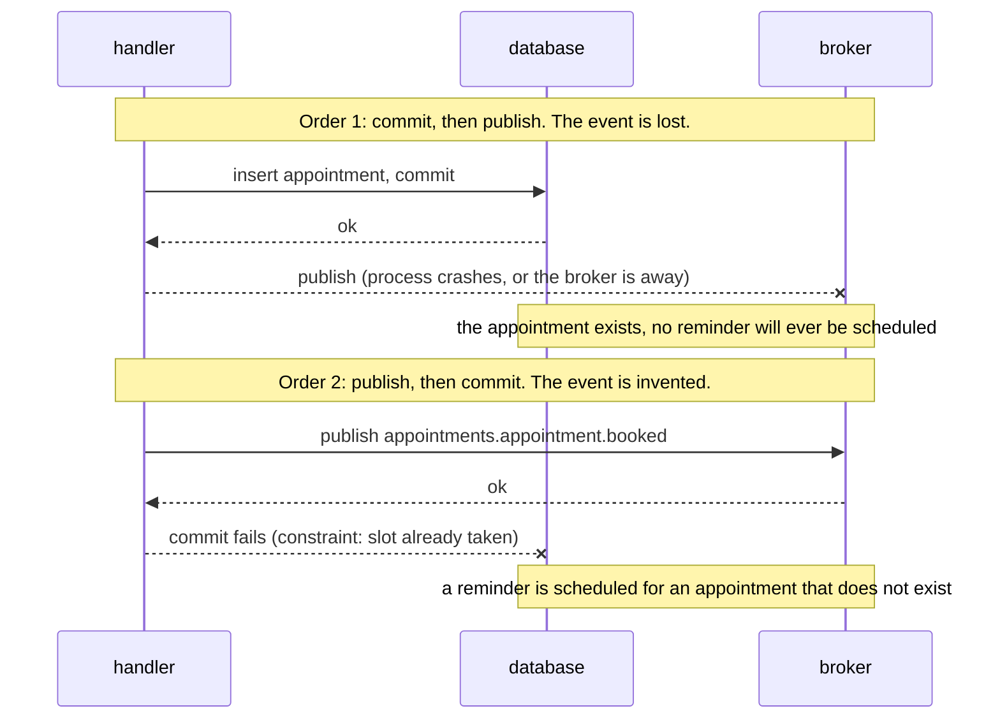
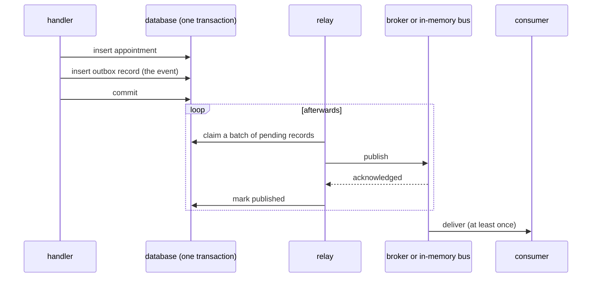

# Transactional outbox

**Summary.** When a use case changes state in a database and must tell other contexts about it,
it has two writes to two systems and no transaction that covers both. Publishing straight to a
broker either loses events (state committed, message never sent) or invents them (message sent,
state rolled back). The transactional outbox removes the second system from the use case: the
event is written to a table in the same transaction as the state change, and a relay publishes
it afterwards, at least once. In this kit the outbox is mandatory as soon as there is a database
(`events/outbox-required`). This page explains the failure it prevents, the relay strategies and
what remains to design.

## The dual write problem

`BookAppointmentHandler` must save the appointment and announce
`appointments.appointment.booked`. Whatever order it chooses, a crash between the two steps
leaves the two systems disagreeing.

Common answers that do not work:

- **Publish inside the database transaction, before the commit.** Same as order 2: the broker
  cannot be rolled back.
- **Catch the publish error and retry in the handler.** The process can die between the commit
  and the retry; nothing remembers that an event is owed.
- **A distributed transaction (two-phase commit) across the database and the broker.** Most
  brokers and cloud services do not offer it, and where it exists it couples the availability of
  the use case to the availability of both systems (Helland; Kleppmann, chapter 9).

The failure is not exotic. A deployment that restarts pods, a broker failover or a connection
reset is enough, and the loss is silent: no error is raised anywhere.

## The pattern

Make the second write a write to the same database.

- The appointment and the outbox record commit together or not at all: the event exists if and
  only if the change does.
- The relay is a separate loop. If it crashes after publishing and before marking, it publishes
  again on restart. So the outbox turns "maybe lost, maybe invented" into "delivered at least
  once", and the consumer absorbs the duplicate (see
  [Delivery and idempotency](delivery-and-idempotency.md)).

In the kit, the publisher of the application layer is a handler of the domain event in the
`before-commit` phase: it runs at the end of the unit of work of the command, after every save
and before the commit, and only knows the `IntegrationEventPublisher` port. With a database the
composition root binds that port to the outbox publisher, which only stores; the store is an
adapter of the ORM package (Drizzle, Knex, Prisma, TypeORM), and the relay publishes to the real
provider. Nothing in `domain/` or `application/` changes when the provider does.

If the command handler throws, a later handler fails or the commit itself fails, the row
disappears with the transaction: the relay never publishes for a command that rolled back. The
timing of domain events is in
[Domain and integration events](domain-and-integration-events.md), "When a domain event is
handled".

## Relay strategies

| Strategy | How it runs | Latency | Fits | Costs |
|---|---|---|---|---|
| polling | the relay claims due records on an interval | the interval | everything; the baseline | a query per tick even when idle; a short interval loads the database |
| polling woken by a signal | the store notifies after an append (PostgreSQL `LISTEN/NOTIFY`, a Redis publication, an in-memory signal); polling stays on a long interval | near immediate | low latency without fast polling | one more moving part; the signal is a hint, never the only trigger |
| change data capture | a connector (Debezium and its outbox event router, or a logical replication reader) reads the outbox rows from the database log and publishes them | near immediate | logs such as Kafka, per-key order in commit order | a connector to run and monitor; the relay's retry bookkeeping no longer applies |

Three points the events README insists on:

- **Polling remains the safety net** under a wake-up signal. A notification missed during a
  reconnection must only delay the publication until the next interval.
- **Change data capture replaces the relay, never the table.** Handlers still write events to
  the outbox. Capturing the business tables instead publishes rows, not events, and couples
  consumers to the schema.
- **One relay or one connector per destination**, not both on the same table.

What the relay and the consumer side must do depends on the transport (same process, queue
broker, log, cloud queue). The table "Outbox, by transport" in
[ARCHITECTURE.md](../ARCHITECTURE.md) section 4 is the reference, and each provider package
documents its row.

Several relays can share the work: the SQL stores of the kit claim records with
`FOR UPDATE SKIP LOCKED` where the database has it (a compare-and-set claim elsewhere) and lease
what they hand out, so the records of a relay that died come back when the lease expires.

## Failure handling

A record that cannot be published is retried with an exponential backoff. After the configured
number of attempts it is marked dead and stays in the table until an operator revives it. The
outbox is thus also the dead-letter store of the publishing side.

## What to monitor

The store exposes counts of pending, failed and dead records. The events README gives the
reading:

| Signal | Meaning |
|---|---|
| dead above zero | records gave up: alert, fix the cause, revive them |
| failed above zero for long | the provider refuses or is down |
| pending growing | the relay is slower than the producers, or stopped |
| age of the oldest pending record | the real delivery delay; it is a query on the table, the stats do not carry it |

Published records must be purged regularly, or the table and its index grow without bound.

## Without a database

With nothing to be atomic with, there is no dual write: the in-memory bus alone is enough, and
the kit does not require an outbox. Choosing in-memory events while an ORM is configured is a
deviation that must be recorded with a decision record ([CONFIG.md](../CONFIG.md)).

## Limits and when not to use it

Stated by the events and ORM package READMEs:

- **At least once, not exactly once.** Duplicates are expected by design.
- **No ordering by default, not even per aggregate.** A failed record is retried while its
  successors go out, and several relays may run side by side.
- **Per-key ordering is available with caveats**: a single relay, head-of-line blocking for the
  key, and a restart forgets which record blocks which key, so strict order across restarts is
  not provided. The broker and the consumer must keep the order too.
- **Latency.** An event leaves after the commit plus the relay delay. A flow that needs an
  answer in the same request is not an event.
- **The table is in the write path.** Every command that publishes adds an insert, and the
  relay adds load. The database is also a single point: if it is down, nothing is published,
  which is consistent since nothing is committed either.
- **The outbox does not help the consumer.** What the consumer does with a duplicate or a
  late event is a separate design.
- **It needs a store that shares the transaction of the business write.** An outbox in another
  system (a cache, another database) recreates the dual write. This is why the kit has no outbox
  or processed-event store on Redis.
- **Change data capture in place of the relay was not verified by the kit's test suites** (the
  Kafka package says so).

When not to use it: no database (nothing to be atomic with); an event whose loss is acceptable
and recorded as such (a metric-like notification), which is a deviation to write down, not a
default.

## Sources

- Chris Richardson, Microservices Patterns, Manning, 2018, chapter 3 (transactional messaging);
  "Transactional outbox", https://microservices.io/patterns/data/transactional-outbox.html;
  "Polling publisher" and "Transaction log tailing" on the same site.
- Martin Kleppmann, Designing Data-Intensive Applications, O'Reilly, 2017, chapter 9
  (distributed transactions) and chapter 11 (change data capture).
- Pat Helland, "Life beyond Distributed Transactions: an Apostate's Opinion", CIDR 2007.
- Gregor Hohpe and Bobby Woolf, Enterprise Integration Patterns, Addison-Wesley, 2003
  (Guaranteed Delivery, Transactional Client).
- Debezium documentation, "Outbox Event Router",
  https://debezium.io/documentation/reference/stable/transformations/outbox-event-router.html
- PostgreSQL documentation, `NOTIFY`, https://www.postgresql.org/docs/current/sql-notify.html
- READMEs of [`@ddd-ts-kit/events`](../../packages/events/README.md) and of the ORM packages.

## See also

- [Domain and integration events](domain-and-integration-events.md)
- [Delivery and idempotency](delivery-and-idempotency.md)
- [Eventual consistency](eventual-consistency.md)
- [Sagas and process managers](sagas-and-process-managers.md)
- [Message brokers](../tools/message-brokers.md)
- [Persistence](../tools/persistence.md)
- [Architecture reference](../ARCHITECTURE.md)
