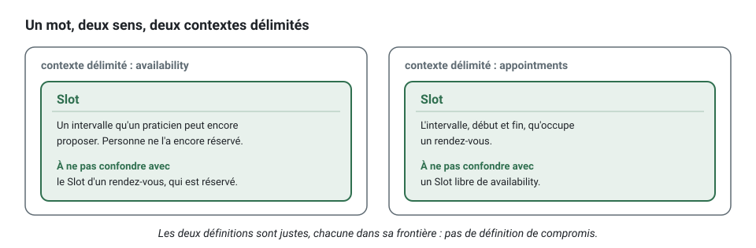

[English](ubiquitous-language.md) · **Français**
<!-- translation-of: ubiquitous-language.md sha256:cd286a5c2174f568 -->

# Langage omniprésent

**Résumé.** Le langage omniprésent (ubiquitous language) est le vocabulaire sur lequel une
équipe et ses experts du domaine s'accordent pour un contexte délimité (bounded context), et
qu'ils emploient sans traduction dans la conversation, dans les documents et dans le code. Son
but est de supprimer l'écart entre ce que dit le métier et le nom des classes, parce que chaque
traduction est un endroit où une règle se perd. Ce kit fait du langage un préalable : chaque
contexte a un glossaire dans son `CONTEXT.md`, écrit avant tout code, et une classe du domaine
ou un cas d'usage nommé avec un mot que le glossaire ne définit pas est refusé par le générateur
et signalé par le *checker*.

## Pourquoi un vocabulaire partagé

Un développeur dit « on met à jour le statut de l'enregistrement de réservation » ; le praticien
dit « le client a annulé trop tard, donc le rendez-vous compte comme non honoré ». La seconde
phrase contient deux règles (un délai d'annulation, ce que devient une annulation tardive). La
première n'en contient aucune. Le code écrit dans le premier vocabulaire a un `setStatus` ; le
code écrit dans le second a `appointment.cancel(reason, at)` et un refus
`CancellationWindowPassed.forAppointment(...)` de code `CANCELLATION_WINDOW_PASSED`.

```ts
// La phrase du développeur, en code : rien ne dit ce que le métier a décidé.
booking.setStatus('CANCELLED');
await bookingRecords.update(booking);

// La phrase du praticien, en code : la règle a un nom, et son refus aussi.
appointment.cancel(reason, clock.now()); // lève CancellationWindowPassed.forAppointment(...) quand il est trop tard
await appointments.save(appointment);
```

Le langage est omniprésent à l'intérieur d'un contexte, pas dans toute l'entreprise. « Slot »,
dans `availability`, est un intervalle qu'un praticien peut encore proposer ; dans
`appointments`, c'est l'intervalle d'un rendez-vous. Les deux définitions sont justes, chacune
dans son [contexte délimité](bounded-context.fr.md), et le glossaire de chacun dit avec quoi le
mot ne doit pas être confondu.



## Le glossaire d'abord

L'ordre est fixé dans ce kit : le terme, puis le nom, puis le code.


Le glossaire est le tableau `## Ubiquitous language` du `CONTEXT.md` du contexte :

```markdown
## Ubiquitous language

| Term | Meaning in this context | Not to be confused with |
|---|---|---|
| Appointment | A commitment of a practitioner to see a client during a slot | the Reminder that announces it (notifications) |
| Slot | The interval, start and end, an appointment occupies | an open Slot of availability, which nobody has booked |
| Book | To create an appointment for a client in a slot that is free | |
| Reschedule | To move a booked appointment to another slot | cancelling and booking again: the appointment keeps its identity |
| Cancel | To give up an appointment, with a reason | a no-show, which is decided after the slot has passed |
| Cancellation reason | Why an appointment was cancelled, as stated by whoever cancelled | |
```

Comment l'écrire, en suivant la *skill* `glossary` :

- Listez chaque **nom** qu'emploie le métier : des candidats pour les agrégats, les entités et
  les objets-valeurs.
- Listez chaque **verbe** : des candidats pour les commandes et les méthodes d'agrégat.
- Listez chaque **fait**, au passé : des candidats pour les événements.
- Pour chacun, une phrase de signification dans ce contexte, et ce avec quoi il ne doit pas
  être confondu dans un contexte voisin.
- Rejetez les mots techniques (`record`, `data`, `item`, `manager`) et demandez le mot du
  métier.
- Dix termes précis valent mieux que cinquante termes vagues.

Un mot manquant est une information : le concept n'est pas encore compris. La réponse est une
question à l'expert du domaine, pas un nom provisoire.

## Comment le kit le fait respecter

| Mécanisme | Ce qu'il fait |
|---|---|
| `language/glossary-term` | chaque agrégat, entité, objet-valeur, service du domaine, événement du domaine, commande et requête est nommé avec des termes du glossaire de son contexte, et, sous `"stack.refusals": "factories"` ou `"named"`, chaque classe de `domain/errors/` aussi (`AppointmentError`, `SlotTaken`) ; une classe de refus de `named` peut aussi employer les qualificatifs `invalid`, `unknown`, `already`, `too`, `no`, `missing` et `required` (`BookingTooLate`) |
| `language/no-technical-name` | pas de `Manager`, `Helper`, `Data`, `Impl`, `Model` ni rien de semblable dans un nom sous `domain/` ou dans le nom d'un cas d'usage |
| le générateur | refuse un nom qui contient un mot non défini, un mot technique, ou un fait d'événement qui ne se lit pas au passé |
| `--term "<Term>=<meaning>"` | ajoute les lignes du glossaire dans la commande même qui en a besoin, répétable ; `--term "<Term>=<meaning>\|<not to be confused with>"` remplit aussi la troisième cellule, la barre verticale étant le seul caractère qu'une cellule du tableau ne peut pas contenir |
| `events/name-format` | les événements sont nommés `<context>.<aggregate>.<fact>` |
| `language/declared-vocabulary` | une valeur d'un vocabulaire fermé (un statut, un rôle, un identifiant de permission) est lue par sa déclaration, jamais réécrite sous forme de chaîne |
| `tree/context-doc` | le `CONTEXT.md` et ses sections existent |

Les listes et les conditions exactes sont dans [ARCHITECTURE.fr.md](../ARCHITECTURE.fr.md),
section 3, et `npx ddd-ts-kit explain language/glossary-term` donne le raisonnement avec des
exemples.

```bash
# Refusé : « Reschedule » n'est pas encore dans le glossaire d'appointments.
npx ddd-ts-kit generate command appointments RescheduleAppointment --aggregate Appointment \
  --permission appointment.reschedule

# Accepté : le terme arrive avec le nom.
npx ddd-ts-kit generate command appointments RescheduleAppointment --aggregate Appointment \
  --permission appointment.reschedule \
  --term "Reschedule=To move a booked appointment to another slot"
```

Les mots d'une permission sont vérifiés de la même façon. `--allow-name` lève les vérifications
du générateur pour une commande ; `check` signale toujours ce que le glossaire ne définit pas,
de sorte que la dérogation ne cache pas la dette.

Le langage va plus loin que les noms de classes :

- **Les méthodes** sont ce que le métier dit qu'il se passe : `appointment.cancel(reason, at)`,
  jamais `setStatus`, `update` ou `process` ([Code propre](clean-code.fr.md)).
- **Les erreurs** sont des refus nommés dans les mots du métier, avec un code stable,
  construits par une fabrique qui dit sur quoi ils portent :
  `SlotTaken.forCalendar(calendarId, startsAt)`, code `SLOT_TAKEN` (`errors/through-factory`,
  `errors/factory-name`).
- **Les noms de tests** se lisent comme des règles métier :
  `refuses to reschedule a cancelled appointment`.
- **Les *builders*** le parlent aussi : `anAppointment().cancelled()`, pas
  `withStatus('CANCELLED')` ([Stratégie de test](testing-strategy.fr.md)).
- **Les permissions** sont nommées dans ce langage : `appointment.cancel`, pas `admin.write`.
- **Les vocabulaires fermés** sont déclarés une fois (voir plus bas) :
  `AppointmentStatus.NoShow`, jamais `'no-show'` écrit dans un gestionnaire (handler).

Une tranche verticale du contexte `appointments`, où chaque nom est pris dans le glossaire
ci-dessus : la permission, la commande, le refus et l'événement disent « reschedule »,
« appointment » et « cancel », tous des mots du glossaire ci-dessus ; aucun n'invente un terme
métier qui lui serait propre.

<!-- checked sample -->
```ts
import { definePermissions } from '@ddd-ts-kit/auth';
import { AuthorizedCommand, DomainRefusal, type Actor, NamedDomainEvent } from '@ddd-ts-kit/kernel';
import { Requires } from '@ddd-ts-kit/kernel/declarations';

export const appointmentsPermissions = definePermissions('appointments', {
  'appointment.reschedule': { description: 'Move a booked appointment to another slot' },
});

@Requires(appointmentsPermissions['appointment.reschedule'], {
  resource: (command: RescheduleAppointment) => ({ type: 'appointment', id: command.appointmentId }),
})
export class RescheduleAppointment extends AuthorizedCommand {
  constructor(
    actor: Actor,
    readonly appointmentId: string,
    readonly startsAt: Date,
  ) {
    super(actor);
  }
}

export const AppointmentsCodes = {
  CannotRescheduleCancelled: 'CANNOT_RESCHEDULE_CANCELLED',
} as const;

export class CannotRescheduleCancelled extends DomainRefusal {
  readonly code = AppointmentsCodes.CannotRescheduleCancelled;

  static forAppointment(appointmentId: string) {
    return CannotRescheduleCancelled.refusal(`Appointment ${appointmentId} is cancelled: it cannot be rescheduled.`, {
      appointmentId,
    });
  }
}

export class AppointmentRescheduled extends NamedDomainEvent('appointments.appointment.rescheduled') {
  constructor(
    readonly aggregateId: string,
    readonly occurredAt: Date,
    readonly startsAt: Date,
  ) {
    super();
  }
}
```

Sa *spec* se lit comme la règle qu'elle garantit :
`it('refuses to reschedule a cancelled appointment')`.

## Nommer d'après le métier, jamais avec un mot générique

Le langage ne s'arrête pas aux noms des classes. Dans un gestionnaire, la liaison qui tient le
rendez-vous s'appelle `appointment` : `target`, `data` ou `item` diraient qu'une valeur est là et
cacheraient quel concept du glossaire elle est, si bien qu'une ligne se lirait comme de la
plomberie là où l'expert du domaine attend une phrase du métier. Le kit refuse ces mots dans
`domain/` et `application/` (`naming/business-name`), et `npx eslint --fix` renomme une liaison
dont l'initialiseur nomme déjà le concept.

<!-- checked sample -->
```ts
export class Appointment {
  private cancelledAt: Date | undefined;

  constructor(readonly id: string) {}

  get isCancelled(): boolean {
    return this.cancelledAt !== undefined;
  }

  cancel(at: Date): void {
    this.cancelledAt = at;
  }
}

export abstract class AppointmentRepository {
  abstract findById(id: string): Promise<Appointment | undefined>;

  abstract save(appointment: Appointment): Promise<void>;
}

// Avant : `target` pourrait être n'importe quel élément du modèle.
export async function cancelTarget(repository: AppointmentRepository, id: string, at: Date): Promise<void> {
  const target = await repository.findById(id);

  target?.cancel(at);
}

// Après : les mots du glossaire, jusqu'à la variable.
export async function cancelAppointment(
  appointmentRepository: AppointmentRepository,
  appointmentId: string,
  at: Date,
): Promise<void> {
  const appointment = await appointmentRepository.findById(appointmentId);

  appointment?.cancel(at);
}
```

La liste des mots refusés, et la façon dont le correctif trouve le nom, sont dans
[Code propre](clean-code.fr.md#nommer-daprès-le-métier-jamais-avec-un-mot-générique).

## Vocabulaires fermés

Un statut, un type, un rôle, un canal : un mot du langage dont les valeurs forment une liste
fermée. Écrite en chaînes, chaque valeur est épelée de nouveau partout où elle est comparée,
accordée ou stockée, et une faute de frappe compile. Le kit déclare chaque liste une seule fois,
sous la forme d'un objet `as const` et du type union du même nom :

<!-- checked sample -->
```ts
// contexts/scheduling/domain/vocabularies/appointment-status.vocabulary.ts
export const AppointmentStatus = {
  Requested: 'requested',
  Booked: 'booked',
  NoShow: 'no-show',
} as const;

export type AppointmentStatus = (typeof AppointmentStatus)[keyof typeof AppointmentStatus];
```

Au lieu d'épeler une valeur de nouveau, le code la lit par sa clé :

<!-- checked sample -->
```ts
// Le vocabulaire ci-dessus, tel que le donne un import.
declare const AppointmentStatus: {
  readonly Requested: 'requested';
  readonly Booked: 'booked';
  readonly NoShow: 'no-show';
};
type AppointmentStatus = (typeof AppointmentStatus)[keyof typeof AppointmentStatus];

// Au lieu de : status === 'no-show', qui compile encore avec une faute de frappe ('no_show') et que la règle signale.
export function countsAsMissed(status: AppointmentStatus): boolean {
  return status === AppointmentStatus.NoShow;
}

// Une clé d'un objet Record se lit de la même façon.
export const statusLabels: Record<AppointmentStatus, string> = {
  [AppointmentStatus.Requested]: 'Waiting for confirmation',
  [AppointmentStatus.Booked]: 'Booked',
  [AppointmentStatus.NoShow]: 'No show',
};
```

Le code lit `AppointmentStatus.NoShow`, complété par l'éditeur ; un paramètre typé
`AppointmentStatus` n'accepte rien d'autre ; la valeur stockée et envoyée reste la chaîne, si
bien qu'une colonne de base de données, une charge utile et une énumération OpenAPI ne changent
pas. `npx ddd-ts-kit generate vocabulary scheduling AppointmentStatus --value requested --value
booked --value no-show` écrit le fichier (`domain/vocabularies/`), et relancée, la commande
ajoute les valeurs qu'il ne contient pas encore. Les rôles que porte un justificatif
sont le vocabulaire `Role` de la plateforme (`<platformDir>/auth/authorization/role.ts`), écrit par `init` et
complété par `generate route-group --role <role>` ; une permission se lit dans l'ensemble de
permissions de son contexte (`billingPermissions['invoice.issue']`), jamais par son
identifiant.

`language/declared-vocabulary` le fait respecter, dans le *checker* et dans ESLint : une chaîne
littérale dont un vocabulaire déclare la valeur est signalée avec la clé à écrire à la place, y
compris une clé entre guillemets (`[AppointmentStatus.NoShow]: 'No show'`). Un vocabulaire d'un
contexte n'est jugé que dans ce contexte, puisque chaque contexte parle son propre langage ; les
vocabulaires de la plateforme, dans la plateforme et dans les groupes de routes, où une garde
nomme un rôle ; un identifiant de permission et un vocabulaire du noyau partagé, partout. Les
tests, les langages publiés et le schéma de relations du modèle d'accès ne sont pas jugés : ils
nomment leurs valeurs à dessein, pas plus qu'un mot dont le type dit qu'il appartient à un autre
langage ([plus bas](#un-mot-dun-autre-langage)). Une valeur que partagent deux vocabulaires est
signalée avec les deux. Un vocabulaire est reconnu quand chaque entrée est une clé et une chaîne littérale, les
commentaires, les deux sortes de guillemets et `as const satisfies ..` étant permis ; la règle
s'applique sous `"stack.literals": "named"`, qu'écrit `init`, et reste silencieuse dans un
projet dont la configuration ne dit rien, comme l'écrivait la version 0.5
([Configuration](../CONFIG.fr.md#stack)).

Une liste de deux mots courants ne vaut pas toujours un vocabulaire. Dans l'exemple, qui a
annulé un rendez-vous est `'patient' | 'practice'`, et ces deux mots sont aussi les noms d'un
type de ressource et d'une relation du modèle d'accès, ainsi qu'un champ d'un modèle de lecture :
déclaré, le vocabulaire signalerait chacun de ces homonymes. Il reste une union de types
littéraux, que le compilateur vérifie.

Les noms des messages suivent la même règle là où le code peut les lire. Un événement du domaine
déclare son nom une fois, `static readonly eventName = 'scheduling.appointment.booked'`, et
chaque réaction le lit, `@DomainEventHandler(AppointmentBooked)` ; un gestionnaire d'événement
d'intégration lit le type qu'il traite dans le contrat de son contexte amont,
`appointmentBookedV1.type`.

<!-- checked sample -->
```ts
import { NamedDomainEvent } from '@ddd-ts-kit/kernel';
import { DomainEventHandler } from '@ddd-ts-kit/kernel/declarations';

export class AppointmentBooked extends NamedDomainEvent('scheduling.appointment.booked') {
  constructor(
    readonly aggregateId: string,
    readonly occurredAt: Date,
  ) {
    super();
  }
}

// Un port du contexte, déclaré ici pour que l'exemple compile seul.
export abstract class Agenda {
  abstract hold(appointmentId: string, at: Date): Promise<void>;
}

// La réaction nomme l'événement par sa déclaration, jamais par une chaîne réécrite.
@DomainEventHandler(AppointmentBooked)
export class AgendaOnAppointmentBooked implements DomainEventHandler<AppointmentBooked> {
  constructor(private readonly agenda: Agenda) {}

  async handle(event: AppointmentBooked): Promise<void> {
    await this.agenda.hold(event.aggregateId, event.occurredAt);
  }
}
```

Le nom d'un *job* et le nom d'un consommateur s'écrivent dans le décorateur de leur classe, qui
ne peut pas lire un membre statique de cette classe, et une fois de plus dans son
`systemActor(..)` : deux littéraux d'un même fichier, que `scheduling/job-name` maintient égaux
pour un *job*. Les relations et les types de ressource du modèle d'accès sont déclarés par son
schéma de relations, dans la plateforme, et écrits en chaînes là où un contexte relie ou garde
quelque chose. L'exemple liste chacune de ces catégories avec son décompte
([rapport d'outillage](../../examples/scheduling/docs/tooling-report.fr.md)).

Pourquoi pas un `enum` TypeScript : ce n'est pas une syntaxe effaçable. Mesuré avec chaque
compilateur qu'exécute un projet généré, sur Node 24.21 : le retrait des types propre à Node le
refuse (`ERR_UNSUPPORTED_TYPESCRIPT_SYNTAX`), `tsc` le refuse sous `erasableSyntaxOnly`
(TS1294), et seuls les transpileurs l'exécutent : `tsc` sans cette option, tsx (esbuild) pour
`npm run dev`, Oxc pour Vitest, SWC pour Jest. L'objet `as const` s'exécute partout, n'ajoute
aucun code d'exécution qui lui soit propre, et donne la même complétion et le même
affinage de type.

### Un mot d'un autre langage

Un contexte lit des mots qui ne sont pas les siens : le contenu du langage publié d'un contexte
amont, l'enregistrement d'un système externe. Quand l'un d'eux épelle une valeur d'un vocabulaire
du contexte (catalog publie un `state` valant `'draft' | 'issued'`, et billing a son propre
`InvoiceStatus` avec les mêmes chaînes), le mot appartient toujours à l'autre langage : écrire
`InvoiceStatus.Issued` à sa place affirmerait que les deux sens n'en font qu'un.

Le premier choix est en amont : le producteur déclare ses valeurs fermées comme un vocabulaire de
son langage publié, un objet `as const` avec son type union, et le consommateur les lit par leur
clé (`[ProductState.Issued]: InvoiceStatus.Issued`), si bien que rien n'est épelé deux fois.
Sinon le littéral dit par son type à quel langage il appartient, et le compilateur vérifie son
orthographe : une clé d'une table typée `Record<TheirType, ..>`, une valeur d'une table typée
`Record<.., TheirType>` (par l'annotation de sa déclaration ou par `satisfies`), ou
`'issued' satisfies TheirType` dans une comparaison ou un `case`. Traduisez une fois à la
frontière, dans le gestionnaire d'intégration ou le traducteur anticorruption, puis parlez le
vocabulaire du contexte.

<!-- checked sample -->
```ts
// Le contenu que publie catalog, tel que le donne un import de son langage publié.
interface ProductListedV1Payload {
  readonly productId: string;
  readonly state: 'draft' | 'issued';
}

// Le vocabulaire de billing, qui contient les deux mêmes chaînes avec son propre sens.
declare const InvoiceStatus: { readonly Draft: 'draft'; readonly Issued: 'issued' };
type InvoiceStatus = (typeof InvoiceStatus)[keyof typeof InvoiceStatus];

// Indexée par le type de l'autre langage : le compilateur vérifie chaque clé par rapport à lui.
const statusOf = {
  'draft': InvoiceStatus.Draft,
  'issued': InvoiceStatus.Issued,
} as const satisfies Record<ProductListedV1Payload['state'], InvoiceStatus>;

export function toInvoiceStatus(payload: ProductListedV1Payload): InvoiceStatus {
  return statusOf[payload.state];
}

// Une comparaison ou un case dit à quel langage appartient son mot.
export function isListedAsIssued(payload: ProductListedV1Payload): boolean {
  return payload.state === ('issued' satisfies ProductListedV1Payload['state']);
}
```

`language/declared-vocabulary` ne juge pas un tel mot hors de `domain/` quand `TheirType` est
une seule référence de type (`Payload['state']`, `typeof x`, pas d'union) dont le nom est importé
d'un langage publié, importé comme type d'un paquet, ou importé de ou déclaré dans
`infrastructure/anti-corruption/` ou `infrastructure/external/`. Là, les types littéraux d'une
interface ou d'un alias de type, qui décrivent un enregistrement extérieur tel qu'il arrive, ne
sont pas jugés non plus. Une clé d'une table typée par le vocabulaire du contexte, une comparaison
ou un `case` sans `satisfies`, et une valeur du contexte dans une table de traduction restent
signalés, et dans un fichier qui lit un autre langage le correctif nomme les types qu'il y lit.
Sans information de type, la règle fait confiance au type qu'elle lit : un type étranger qui vaut
`string` ne vérifie rien.

## Le même mot dans deux contextes

Quand un mot franchit une frontière avec un sens différent, ne cherchez pas une définition de
compromis. Gardez les deux, et traduisez à la frontière :

- Le producteur nomme ses événements dans son propre langage
  (`appointments.appointment.booked`) et les publie dans son `published-language/`.
- Le consommateur traduit l'événement en une commande de son propre vocabulaire :
  `notifications` transforme « rendez-vous réservé » en « planifier un rappel ». Un gestionnaire
  d'événement d'intégration ne contient aucune logique métier ; il ne fait que traduire.
- Quand le vocabulaire amont est étranger ou instable (un fournisseur de courriel ou de SMS), la
  traduction reçoit sa propre place, une couche anticorruption
  ([Carte des contextes](context-map.fr.md)).


Le gestionnaire de `notifications` est une traduction et rien de plus : il lit le contrat de son
contexte amont et envoie une commande dans ses propres mots. Le moment où le rappel est dû est
une règle du `Reminder`, pas du gestionnaire.

<!-- checked sample -->
```ts
import { AuthorizedCommand, CommandBus, systemActor, type Actor, type IntegrationEvent } from '@ddd-ts-kit/kernel';
import { IntegrationEventHandler, type EventContract } from '@ddd-ts-kit/kernel/declarations';

// Le contrat du contexte amont : dans un projet, importé de appointments/published-language.
interface AppointmentBookedV1Payload {
  readonly appointmentId: string;
  readonly clientId: string;
  readonly startsAt: string;
}
declare const appointmentBookedV1: EventContract<AppointmentBookedV1Payload>;

// Une commande dans les mots de notifications.
export class ScheduleReminder extends AuthorizedCommand {
  constructor(
    actor: Actor,
    readonly recipientId: string,
    readonly appointmentId: string,
    readonly appointmentStartsAt: Date,
  ) {
    super(actor);
  }
}

@IntegrationEventHandler(appointmentBookedV1, { consumer: 'notifications.reminder-on-appointment-booked' })
export class ReminderOnAppointmentBookedHandler {
  readonly actor = systemActor('notifications.reminder-on-appointment-booked');

  constructor(private readonly commands: CommandBus) {}

  async handle(event: IntegrationEvent<AppointmentBookedV1Payload>): Promise<void> {
    const { appointmentId, clientId, startsAt } = event.payload;

    await this.commands.execute(new ScheduleReminder(this.actor, clientId, appointmentId, new Date(startsAt)));
  }
}
```

Un mot commun au sens commun, employé par deux contextes ou plus (un objet-valeur `TimeSlot`,
par exemple), peut rejoindre le noyau partagé. Que cela reste rare : chaque type partagé est un
couplage que les deux côtés doivent accepter de changer ensemble.

## Le garder vivant

- Mettez à jour le glossaire dans le même changement que celui qui introduit un nom. La *skill*
  `document` traite un glossaire périmé comme une dérive de la documentation.
- Quand le métier change un mot, renommez dans le glossaire et dans le code ensemble. Un
  renommage repoussé crée les deux vocabulaires que la pratique existe pour empêcher.
- Le glossaire appartient à l'équipe propriétaire du contexte, et les experts du domaine doivent
  pouvoir le lire. Qui le modifie et comment il est relu est traité dans
  [Travail en équipe](../guides/team-workflow.fr.md).

## Limites et quand ne pas l'utiliser

La lecture du langage par le *checker* est volontairement simple. Le README de la CLI en énonce
les limites :

- `language/glossary-term` compare **mot à mot, avec une flexion anglaise rudimentaire** (les
  formes au pluriel, au participe passé et en -ing sont reconnues). Elle ne connaît pas les
  synonymes, et un terme de plusieurs mots couvre chacun de ses mots séparément.
- Elle vérifie que les mots existent, **pas que le nom signifie ce que dit le glossaire**. Une
  classe peut être nommée avec des termes du glossaire et modéliser pourtant le mauvais concept.
  Seule une revue le détecte.
- `events/name-format` vérifie la forme et le préfixe du contexte, **pas la grammaire du fait** ;
  la vérification du passé par le générateur est elle aussi une heuristique.
- `language/no-technical-name` fonctionne à partir d'une liste fixe. Un nom technique hors de la
  liste n'est pas signalé, et un concept métier qui s'appelle légitimement « Model » dans un
  domaine donné a besoin d'une exception enregistrée.
- Le glossaire est **taillé pour l'anglais** : une équipe dont les experts du domaine parlent une
  autre langue doit décider de la langue du code. L'outillage et la flexion du kit supposent
  l'anglais.
- On peut tromper un glossaire en y ajoutant des termes vagues (« Item=A thing »). L'outil
  l'accepte ; un relecteur ne devrait pas.
- Dans un contexte générique qui enveloppe un produit acheté, le vocabulaire est celui du
  fournisseur. Traduisez-le à la frontière au lieu de le forcer dans votre glossaire.

## Sources

- Eric Evans, *Domain-Driven Design*, Addison-Wesley, 2003, chapitre 2 « Communication and the
  Use of Language ».
- Vaughn Vernon, *Implementing Domain-Driven Design*, Addison-Wesley, 2013, chapitre 1
  (ubiquitous language) et chapitre 2.
- Vlad Khononov, *Learning Domain-Driven Design*, O'Reilly, 2021, chapitre 2 « Discovering
  Domain Knowledge ».
- Robert C. Martin, *Clean Code*, Prentice Hall, 2008, chapitre 2 « Meaningful Names » (un mot
  par concept, des noms tirés du domaine du problème).

## Voir aussi

- [Contexte délimité](bounded-context.fr.md)
- [Domaine et sous-domaines](domain-and-subdomains.fr.md)
- [Carte des contextes](context-map.fr.md)
- [Code propre](clean-code.fr.md)
- [Modèle anémique](anemic-model.fr.md)
- [Travail en équipe](../guides/team-workflow.fr.md)
- [Méthodologie](../guides/methodology.fr.md)
- [Référence d'architecture](../ARCHITECTURE.fr.md)
- [Index des concepts](README.fr.md)
