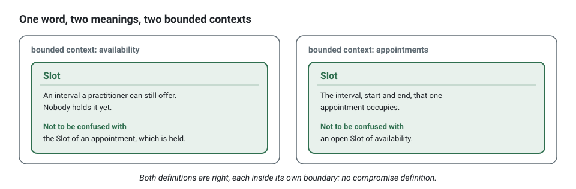

**English** · [Français](ubiquitous-language.fr.md)

# Ubiquitous language

**Summary.** The ubiquitous language is the vocabulary a team and its domain experts agree on
for one bounded context, used without translation in conversation, in documents and in the
code. Its purpose is to remove the gap between what the business says and what the classes are
called, because every translation is a place where a rule gets lost. This kit makes the
language a precondition: each context has a glossary in its `CONTEXT.md`, written before any
code, and a domain class or use case named with a word the glossary does not define is refused
by the generator and reported by the checker.

## Why a shared vocabulary

A developer says "we update the status of the booking record"; the practitioner says "the
client cancelled too late, so the appointment counts as a no-show". The second sentence holds
two rules (a cancellation window, what a late cancellation becomes). The first holds none. Code
written in the first vocabulary has `setStatus`; code written in the second has
`appointment.cancel(reason, at)` and a refusal `CancellationWindowPassed.forAppointment(...)`
with the code `CANCELLATION_WINDOW_PASSED`.

```ts
// The developer's sentence, in code: nothing says what the business decided.
booking.setStatus('CANCELLED');
await bookingRecords.update(booking);

// The practitioner's sentence, in code: the rule has a name, and so has its refusal.
appointment.cancel(reason, clock.now()); // throws CancellationWindowPassed.forAppointment(...) when too late
await appointments.save(appointment);
```

The language is ubiquitous within a context, not across the company. "Slot" in `availability`
is an interval a practitioner can still offer; in `appointments` it is the interval of one
appointment. Both definitions are right, each inside its
[bounded context](bounded-context.md), and the glossary of each says what the word must not be
confused with.



## Glossary first

The order is fixed in this kit: the term, then the name, then the code.


The glossary is the `## Ubiquitous language` table of the context's `CONTEXT.md`:

```markdown
## Ubiquitous language

| Term | Meaning in this context | Not to be confused with |
|---|---|---|
| Appointment | A commitment of a practitioner to see a client during a slot | the Reminder that announces it (notifications) |
| Slot | The interval, start and end, an appointment occupies | an open Slot of availability, which nobody has booked |
| Book | To create an appointment for a client in a slot that is free | |
| Reschedule | To move a booked appointment to another slot | cancelling and booking again: the appointment keeps its identity |
| Cancel | To give up an appointment, with a reason | a no-show, which is decided after the slot has passed |
| Cancellation reason | Why an appointment was cancelled, as stated by whoever cancelled | |
```

How to write it, following the `glossary` skill:

- List each **noun** the business uses: candidates for aggregates, entities and value objects.
- List each **verb**: candidates for commands and aggregate methods.
- List each **fact**, in the past tense: candidates for events.
- For each, one sentence of meaning in this context, and what it must not be confused with in
  a neighbouring one.
- Reject technical words (`record`, `data`, `item`, `manager`) and ask for the business word.
- Ten precise terms beat fifty vague ones.

A missing word is information: the concept is not understood yet. The answer is a question to
the domain expert, not a placeholder name.

## How the kit holds it

| Mechanism | What it does |
|---|---|
| `language/glossary-term` | every aggregate, entity, value object, domain service, domain event, command and query is named with terms of the glossary of its context, and, under `"stack.refusals": "factories"` or `"named"`, every class of `domain/errors/` too (`AppointmentError`, `SlotTaken`); a refusal class of `named` may also use the qualifiers `invalid`, `unknown`, `already`, `too`, `no`, `missing` and `required` (`BookingTooLate`) |
| `language/no-technical-name` | no `Manager`, `Helper`, `Data`, `Impl`, `Model` and the like in a name under `domain/` or in a use case name |
| the generator | refuses a name with an undefined word, a technical word, or an event fact that does not read as past tense |
| `--term "<Term>=<meaning>"` | adds the glossary rows in the same command that needs them, repeatable; `--term "<Term>=<meaning>\|<not to be confused with>"` fills the third cell too, the pipe being the one character a cell of the table cannot hold |
| `events/name-format` | events are named `<context>.<aggregate>.<fact>` |
| `language/declared-vocabulary` | a value of a closed vocabulary (a status, a role, a permission id) is read through its declaration, never written again as a string |
| `tree/context-doc` | the `CONTEXT.md` and its sections exist |

The exact lists and conditions are in [ARCHITECTURE.md](../ARCHITECTURE.md), section 3, and
`npx ddd-ts-kit explain language/glossary-term` gives the reasoning with examples.

```bash
# Refused: "Reschedule" is not in the glossary of appointments yet.
npx ddd-ts-kit generate command appointments RescheduleAppointment --aggregate Appointment \
  --permission appointment.reschedule

# Accepted: the term arrives with the name.
npx ddd-ts-kit generate command appointments RescheduleAppointment --aggregate Appointment \
  --permission appointment.reschedule \
  --term "Reschedule=To move a booked appointment to another slot"
```

The words of a permission are checked the same way. `--allow-name` overrides the generator's
checks for one command; `check` still reports what the glossary does not define, so the
override does not hide the debt.

The language reaches further than class names:

- **Methods** are what the business says happens: `appointment.cancel(reason, at)`, never
  `setStatus`, `update` or `process` ([Clean code](clean-code.md)).
- **Errors** are refusals named in the words of the business, with a stable code, built by a
  factory that says what they are about: `SlotTaken.forCalendar(calendarId, startsAt)`, code
  `SLOT_TAKEN` (`errors/through-factory`, `errors/factory-name`).
- **Test names** read as business rules: `refuses to reschedule a cancelled appointment`.
- **Builders** speak it too: `anAppointment().cancelled()`, not `withStatus('CANCELLED')`
  ([Testing strategy](testing-strategy.md)).
- **Permissions** are named in it: `appointment.cancel`, not `admin.write`.
- **Closed vocabularies** are declared once (see below): `AppointmentStatus.NoShow`, never
  `'no-show'` written in a handler.

One slice of the `appointments` context, with every name taken from the glossary above: the
permission, the command, the refusal and the event say "reschedule", "appointment" and "cancel",
all words of the glossary above; none of them coins a business term of its own.

<!-- checked sample -->
```ts
import { definePermissions } from '@ddd-ts-kit/auth';
import { AuthorizedCommand, DomainRefusal, type Actor, NamedDomainEvent } from '@ddd-ts-kit/kernel';
import { Requires } from '@ddd-ts-kit/kernel/declarations';

export const appointmentsPermissions = definePermissions('appointments', {
  'appointment.reschedule': { description: 'Move a booked appointment to another slot' },
});

@Requires(appointmentsPermissions['appointment.reschedule'], {
  resource: (command: RescheduleAppointment) => ({ type: 'appointment', id: command.appointmentId }),
})
export class RescheduleAppointment extends AuthorizedCommand {
  constructor(
    actor: Actor,
    readonly appointmentId: string,
    readonly startsAt: Date,
  ) {
    super(actor);
  }
}

export const AppointmentsCodes = {
  CannotRescheduleCancelled: 'CANNOT_RESCHEDULE_CANCELLED',
} as const;

export class CannotRescheduleCancelled extends DomainRefusal {
  readonly code = AppointmentsCodes.CannotRescheduleCancelled;

  static forAppointment(appointmentId: string) {
    return CannotRescheduleCancelled.refusal(`Appointment ${appointmentId} is cancelled: it cannot be rescheduled.`, {
      appointmentId,
    });
  }
}

export class AppointmentRescheduled extends NamedDomainEvent('appointments.appointment.rescheduled') {
  constructor(
    readonly aggregateId: string,
    readonly occurredAt: Date,
    readonly startsAt: Date,
  ) {
    super();
  }
}
```

Its spec reads as the rule it holds: `it('refuses to reschedule a cancelled appointment')`.

## Name things after the business, never generic

The language does not stop at the names of classes. Inside a handler, the binding that holds
the appointment is `appointment`: `target`, `data` or `item` would say that a value is there and
hide which concept of the glossary it is, so that a line reads as plumbing where the domain
expert expects a sentence of the business. The kit refuses those words in `domain/` and
`application/` (`naming/business-name`), and `npx eslint --fix` renames a binding whose
initializer already names the concept.

<!-- checked sample -->
```ts
export class Appointment {
  private cancelledAt: Date | undefined;

  constructor(readonly id: string) {}

  get isCancelled(): boolean {
    return this.cancelledAt !== undefined;
  }

  cancel(at: Date): void {
    this.cancelledAt = at;
  }
}

export abstract class AppointmentRepository {
  abstract findById(id: string): Promise<Appointment | undefined>;

  abstract save(appointment: Appointment): Promise<void>;
}

// Before: `target` could be any element of the model.
export async function cancelTarget(repository: AppointmentRepository, id: string, at: Date): Promise<void> {
  const target = await repository.findById(id);

  target?.cancel(at);
}

// After: the words of the glossary, down to the variable.
export async function cancelAppointment(
  appointmentRepository: AppointmentRepository,
  appointmentId: string,
  at: Date,
): Promise<void> {
  const appointment = await appointmentRepository.findById(appointmentId);

  appointment?.cancel(at);
}
```

The list of refused words, and how the fix finds the name, are in
[Clean code](clean-code.md#name-things-after-the-business-never-generic).

## Closed vocabularies

A status, a kind, a role, a channel: a word of the language whose values are a closed list. Written
as strings, each value is spelled again wherever it is compared, granted or stored, and a typo
compiles. The kit declares each list once, as an object `as const` and the union type of the same
name:

<!-- checked sample -->
```ts
// contexts/scheduling/domain/vocabularies/appointment-status.vocabulary.ts
export const AppointmentStatus = {
  Requested: 'requested',
  Booked: 'booked',
  NoShow: 'no-show',
} as const;

export type AppointmentStatus = (typeof AppointmentStatus)[keyof typeof AppointmentStatus];
```

Instead of spelling a value again, code reads it by its key:

<!-- checked sample -->
```ts
// The vocabulary above, as an import gives it.
declare const AppointmentStatus: {
  readonly Requested: 'requested';
  readonly Booked: 'booked';
  readonly NoShow: 'no-show';
};
type AppointmentStatus = (typeof AppointmentStatus)[keyof typeof AppointmentStatus];

// Instead of: status === 'no-show', which a typo ('no_show') still compiles and the rule reports.
export function countsAsMissed(status: AppointmentStatus): boolean {
  return status === AppointmentStatus.NoShow;
}

// A key of a record is read the same way.
export const statusLabels: Record<AppointmentStatus, string> = {
  [AppointmentStatus.Requested]: 'Waiting for confirmation',
  [AppointmentStatus.Booked]: 'Booked',
  [AppointmentStatus.NoShow]: 'No show',
};
```

Code reads `AppointmentStatus.NoShow`, completed by the editor; a parameter typed
`AppointmentStatus` accepts nothing else; the value stored and sent stays the string, so a
database column, a payload and an OpenAPI enum do not change. `npx ddd-ts-kit generate vocabulary
scheduling AppointmentStatus --value requested --value booked --value no-show` writes the file
(`domain/vocabularies/`), and run again adds the values it does not hold yet. The roles a
credential carries are the vocabulary `Role` of the platform (`<platformDir>/auth/authorization/role.ts`),
written by `init` and completed by `generate route-group --role <role>`; a permission is read
from the permission set of its context (`billingPermissions['invoice.issue']`), never by its id.

`language/declared-vocabulary` holds it, in the checker and in ESLint: a string literal whose
value a vocabulary declares is reported with the key to write instead, a quoted key included
(`[AppointmentStatus.NoShow]: 'No show'`). A vocabulary of a context is judged in that context
only, since each context speaks its own language; the vocabularies of the platform in the
platform and in the route groups, where a guard names a role; a permission id and a vocabulary of
the shared kernel everywhere. Tests, published languages and the relationship schema of the access
model are not judged: they name their values on purpose, and neither is a word whose type says
it belongs to another language ([below](#a-word-of-another-language)). A value two vocabularies
share is reported with both. A vocabulary is read when each entry is a key and a string literal, comments,
either quote and `as const satisfies ..` allowed; the rule holds under `"stack.literals":
"named"`, which `init` writes, and stays silent in a project whose config does not say, as 0.5
wrote it ([Configuration](../CONFIG.md#stack)).

A list of two common words is not always worth a vocabulary. In the example, who cancelled an
appointment is `'patient' | 'practice'`, and both words are also the names of a type of resource
and of a relation of the access model, and a field of a read model: declared, the vocabulary would
report each of those homonyms. It stays a union of literal types, which the compiler holds.

The names of the messages follow the same rule where the code can read them. A domain event
declares its name once, `static readonly eventName = 'scheduling.appointment.booked'`, and every
reaction reads it, `@DomainEventHandler(AppointmentBooked)`; an integration event handler reads the
type it handles from the contract of its upstream, `appointmentBookedV1.type`.

<!-- checked sample -->
```ts
import { NamedDomainEvent } from '@ddd-ts-kit/kernel';
import { DomainEventHandler } from '@ddd-ts-kit/kernel/declarations';

export class AppointmentBooked extends NamedDomainEvent('scheduling.appointment.booked') {
  constructor(
    readonly aggregateId: string,
    readonly occurredAt: Date,
  ) {
    super();
  }
}

// A port of the context, declared here so that the sample compiles alone.
export abstract class Agenda {
  abstract hold(appointmentId: string, at: Date): Promise<void>;
}

// The reaction names the event by its declaration, never by a string written again.
@DomainEventHandler(AppointmentBooked)
export class AgendaOnAppointmentBooked implements DomainEventHandler<AppointmentBooked> {
  constructor(private readonly agenda: Agenda) {}

  async handle(event: AppointmentBooked): Promise<void> {
    await this.agenda.hold(event.aggregateId, event.occurredAt);
  }
}
```

A job name and a consumer name are written in the decorator of their class, which cannot read a
static of that class, and once more in its `systemActor(..)`: two literals of one file, held equal by
`scheduling/job-name` for a job. The relations and resource types of the access model are
declared by its relationship schema, in the platform, and written as strings where a context
relates or guards something. The example lists every such category with its count
([tooling report](../../examples/scheduling/docs/tooling-report.md)).

Why not a TypeScript `enum`: it is not erasable syntax. Measured with each compiler a generated
project runs, on Node 24.21: Node's own type stripping refuses it
(`ERR_UNSUPPORTED_TYPESCRIPT_SYNTAX`), `tsc` refuses it under `erasableSyntaxOnly` (TS1294), and
only the transpilers run it: `tsc` without that option, tsx (esbuild) for `npm run dev`, Oxc for
Vitest, SWC for Jest. The object `as const` runs everywhere, adds no
runtime of its own, and gives the same completion and the same narrowing.

### A word of another language

A context reads words that are not its own: the payload of an upstream's published language, the
record of an external system. When one of them spells a value of a vocabulary of the context
(catalog publishes a `state` of `'draft' | 'issued'`, and billing has its own `InvoiceStatus`
with the same strings), the word still belongs to the other language: writing
`InvoiceStatus.Issued` for it would state that the two meanings are one.

The first choice is upstream: the producer declares its closed values as a vocabulary of its
published language, an object `as const` with its union type, and the consumer reads them by
their key (`[ProductState.Issued]: InvoiceStatus.Issued`), so that nothing is spelled twice.
Otherwise the literal says by its type which language it belongs to, and the compiler holds its
spelling: a key of a table typed `Record<TheirType, ..>`, a value of one typed
`Record<.., TheirType>` (by the annotation of its declaration or by `satisfies`), or
`'issued' satisfies TheirType` in a comparison or a `case`. Translate once at the edge, in the
integration handler or the anti-corruption translator, then speak the vocabulary of the context.

<!-- checked sample -->
```ts
// The payload catalog publishes, as an import from its published language gives it.
interface ProductListedV1Payload {
  readonly productId: string;
  readonly state: 'draft' | 'issued';
}

// The vocabulary of billing, which holds the same two strings with its own meaning.
declare const InvoiceStatus: { readonly Draft: 'draft'; readonly Issued: 'issued' };
type InvoiceStatus = (typeof InvoiceStatus)[keyof typeof InvoiceStatus];

// Keyed by the type of the other language: the compiler checks each key against it.
const statusOf = {
  'draft': InvoiceStatus.Draft,
  'issued': InvoiceStatus.Issued,
} as const satisfies Record<ProductListedV1Payload['state'], InvoiceStatus>;

export function toInvoiceStatus(payload: ProductListedV1Payload): InvoiceStatus {
  return statusOf[payload.state];
}

// A comparison or a case says which language its word belongs to.
export function isListedAsIssued(payload: ProductListedV1Payload): boolean {
  return payload.state === ('issued' satisfies ProductListedV1Payload['state']);
}
```

`language/declared-vocabulary` does not judge such a word outside `domain/` when `TheirType` is
one type reference (`Payload['state']`, `typeof x`, no union) whose name is imported from a
published language, imported as a type from a package, or imported from or declared in
`infrastructure/anti-corruption/` or `infrastructure/external/`. There, the literal types of an
interface or a type alias, which describe an outside record as it arrives, are not judged either.
A key of a table typed by the vocabulary of the context, a comparison or a `case` without
`satisfies`, and a value of the context in a translation table are still reported, and in a
file that reads another language the fix names the types it reads from there. Without type
information the rule trusts the type it reads: a foreign type that is `string` holds nothing.

## The same word in two contexts

When a word crosses a boundary with a different meaning, do not look for a compromise
definition. Keep both, and translate at the edge:

- The producer names its events in its own language
  (`appointments.appointment.booked`) and publishes them in its `published-language/`.
- The consumer translates the event into a command of its own vocabulary: `notifications`
  turns "appointment booked" into "schedule a reminder". An integration event handler holds no
  business logic; it only translates.
- When the upstream vocabulary is foreign or unstable (an email or SMS provider), the
  translation gets its own place, an anti-corruption layer
  ([Context map](context-map.md)).


The handler of `notifications` is a translation and nothing more: it reads the contract of its
upstream and sends a command in its own words. When the reminder is due is a rule of the
`Reminder`, not of the handler.

<!-- checked sample -->
```ts
import { AuthorizedCommand, CommandBus, systemActor, type Actor, type IntegrationEvent } from '@ddd-ts-kit/kernel';
import { IntegrationEventHandler, type EventContract } from '@ddd-ts-kit/kernel/declarations';

// The contract of the upstream: in a project, imported from appointments/published-language.
interface AppointmentBookedV1Payload {
  readonly appointmentId: string;
  readonly clientId: string;
  readonly startsAt: string;
}
declare const appointmentBookedV1: EventContract<AppointmentBookedV1Payload>;

// A command in the words of notifications.
export class ScheduleReminder extends AuthorizedCommand {
  constructor(
    actor: Actor,
    readonly recipientId: string,
    readonly appointmentId: string,
    readonly appointmentStartsAt: Date,
  ) {
    super(actor);
  }
}

@IntegrationEventHandler(appointmentBookedV1, { consumer: 'notifications.reminder-on-appointment-booked' })
export class ReminderOnAppointmentBookedHandler {
  readonly actor = systemActor('notifications.reminder-on-appointment-booked');

  constructor(private readonly commands: CommandBus) {}

  async handle(event: IntegrationEvent<AppointmentBookedV1Payload>): Promise<void> {
    const { appointmentId, clientId, startsAt } = event.payload;

    await this.commands.execute(new ScheduleReminder(this.actor, clientId, appointmentId, new Date(startsAt)));
  }
}
```

A shared word with a shared meaning, used by two contexts or more (a `TimeSlot` value object,
for example), may move to the shared kernel. Keep that rare: every shared type is a coupling
both sides must agree to change. Its term then moves with it, to the glossary of the shared
kernel, `src/shared-kernel/CONTEXT.md`, which `generate value-object shared-kernel <Name> --term
"<Term>=<meaning>"` starts and `language/glossary-term` reads for the value objects and the
refusals of the shared kernel.

## Keeping it alive

- Update the glossary in the same change that introduces a name. The `document` skill treats a
  stale glossary as documentation drift.
- When the business changes a word, rename in the glossary and in the code together. A rename
  that is postponed creates the two vocabularies the practice exists to prevent.
- The glossary belongs to the team that owns the context, and domain experts must be able to
  read it. Who edits it and how it is reviewed is covered in
  [Team workflow](../guides/team-workflow.md).

## Limits and when not to use it

The checker's reading of the language is deliberately simple. The CLI README states its limits:

- `language/glossary-term` matches **word by word, with a crude English inflection** (plural,
  past participle and -ing forms are recognised). It does not know synonyms, and a term of
  several words covers each of its words separately.
- It checks that the words exist, **not that the name means what the glossary says**. A class
  can be named with glossary terms and still model the wrong concept. Only a review catches
  that.
- `events/name-format` checks the shape and the context prefix, **not the grammar of the
  fact**; the generator's past-tense check is a heuristic too.
- `language/no-technical-name` works from a fixed list. A technical name outside the list is
  not reported, and a business concept that is legitimately called "Model" in some domain needs
  a recorded exception.
- The glossary is **English-shaped**: a team whose domain experts speak another language must
  decide which language the code uses. The kit's own tooling and inflection assume English.
- A glossary can be gamed by adding vague terms ("Item=A thing"). The tool accepts it; a
  reviewer should not.
- In a generic context wrapping a bought product, the vocabulary is the vendor's. Translate it
  at the boundary instead of forcing it into your glossary.

## Sources

- Eric Evans, *Domain-Driven Design*, Addison-Wesley, 2003, chapter 2 "Communication and the
  Use of Language".
- Vaughn Vernon, *Implementing Domain-Driven Design*, Addison-Wesley, 2013, chapter 1
  (ubiquitous language) and chapter 2.
- Vlad Khononov, *Learning Domain-Driven Design*, O'Reilly, 2021, chapter 2 "Discovering Domain
  Knowledge".
- Robert C. Martin, *Clean Code*, Prentice Hall, 2008, chapter 2 "Meaningful Names" (one word
  per concept, names from the problem domain).

## See also

- [Bounded context](bounded-context.md)
- [Domain and subdomains](domain-and-subdomains.md)
- [Context map](context-map.md)
- [Clean code](clean-code.md)
- [Anemic model](anemic-model.md)
- [Team workflow](../guides/team-workflow.md)
- [Methodology](../guides/methodology.md)
- [Architecture reference](../ARCHITECTURE.md)
- [Concepts index](README.md)
