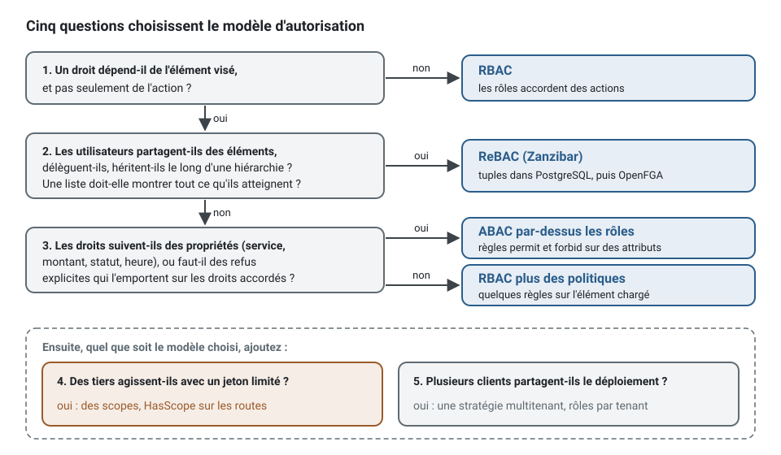
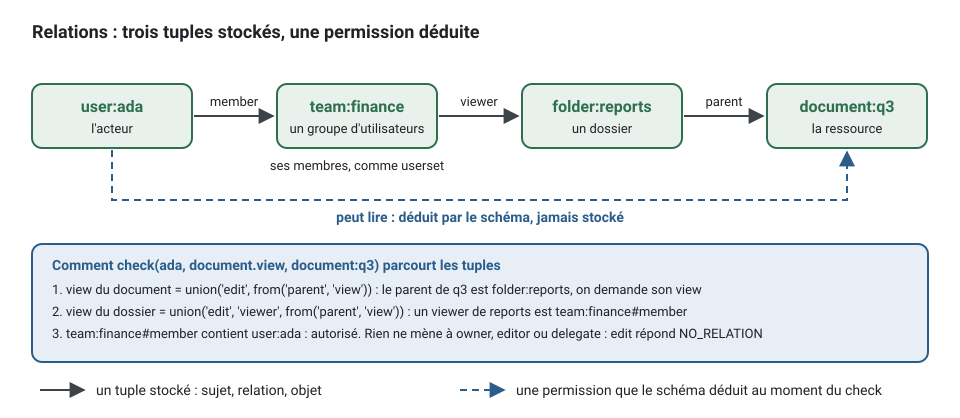

[English](choosing-access-control.md) · **Français**
<!-- translation-of: choosing-access-control.md sha256:6cbcecacd3714da4 -->

# Choisir le contrôle d'accès, avec des préréglages commentés

**Résumé.** Cinq questions décident du modèle d'autorisation d'un projet : si les droits dépendent
de l'élément, si les utilisateurs partagent des éléments entre eux, si les droits suivent des
propriétés, si des tiers agissent avec un identifiant limité, et si plusieurs clients partagent le
déploiement. Les réponses choisissent des rôles (RBAC), des politiques sur attributs (ABAC), des
relations (ReBAC, d'après Zanzibar), ou une combinaison, et l'endroit où les relations sont
évaluées. Chaque modèle a ensuite un préréglage commenté plus bas : les permissions comme
vocabulaire typé, les attributions ou les règles, une politique (policy) sur un élément, et une
recherche restreinte à ce que l'acteur peut lire. Les raisons derrière les modèles sont dans
[Authentification et autorisation](../concepts/authentication-and-authorization.fr.md) ; l'API est
le README de [`@ddd-ts-kit/auth`](../../packages/auth/README.fr.md).

## Les cinq questions

Posez-les dans l'ordre ; le premier « oui » qui change la réponse l'emporte, et les suivants
s'y ajoutent.

| # | Question | Oui | Non |
|---|---|---|---|
| 1 | Un droit dépend-il de **quel élément**, et pas seulement de l'action ? (« peut modifier *cet* agenda ») | passez à 2 | **RBAC** : des rôles accordent des actions |
| 2 | Les utilisateurs **partagent**-ils des éléments entre eux, **délèguent**-ils, ou héritent-ils de droits le long d'une **hiérarchie** (dossiers, équipes, cabinet, puis bureau, puis agenda) ? Une liste doit-elle montrer « tout ce que je peux atteindre » parmi de nombreux éléments ? | **ReBAC** (Zanzibar) | passez à 3 |
| 3 | Les droits suivent-ils des **propriétés** (service, montant, statut, heure de la journée), ou demandent-ils des **refus explicites** qui l'emportent sur les attributions ? | **ABAC**, par-dessus les rôles | **RBAC plus des politiques** : une poignée de règles « seul celui qui... » |
| 4 | Des **tiers** agissent-ils avec un identifiant limité à certaines opérations (un client mobile, une intégration partenaire) ? | ajoutez des **scopes** : `HasScope` sur les routes | rien à ajouter |
| 5 | **Plusieurs clients** partagent-ils le déploiement ? | ajoutez une **stratégie de multitenance** ([Multitenance](../concepts/multitenancy.fr.md)) et gardez les rôles par *tenant* | rien à ajouter |



Ensuite, pour ReBAC, l'endroit où vivent les relations : le **magasin de tuples PostgreSQL** du
projet (dans la transaction de la commande, rien d'autre à faire tourner) jusqu'à ce que les
listes ou les vérifications le dépassent, puis **OpenFGA**, le modèle Zanzibar complet en tant que
service, derrière le même port ([Moteurs d'autorisation](../tools/authorization-engines.fr.md) les
compare).

| Produit typique | Réponse |
|---|---|
| Back-office d'une seule entreprise, fonctions métier | RBAC |
| Outil de prise de rendez-vous où « seul le patient qui a réservé peut annuler » | RBAC plus une politique |
| Validation de notes de frais selon le montant et le service, avec une règle des quatre yeux | ABAC par-dessus les rôles |
| Documents, dossiers, partage, équipes, délégation | ReBAC |
| SaaS pour de nombreuses entreprises, chacune avec ses administrateurs et ses membres | RBAC avec la vérification du *tenant*, tables partagées ; ReBAC à l'intérieur d'un *tenant* si les utilisateurs partagent |
| API publique pour des partenaires | n'importe lequel des modèles ci-dessus, plus des scopes |

## Ce que tous les préréglages ont en commun

Quel que soit le modèle, une requête HTTP rencontre les mêmes quatre points de contrôle, et le
modèle ne change que l'adaptateur derrière le port `Authorizer` :


| Point de contrôle | Demande | Décide avec | Refus |
|---|---|---|---|
| garde du groupe de routes | ce client peut-il seulement appeler ces routes ? | la session : `Authenticated`, `HasRole`, `HasScope`, `TenantMember` | 401 ou 403 avant le contrôleur, signalé par `onGuardRefusal` |
| exigence du cas d'usage | cet acteur peut-il exécuter cette commande ou cette requête, sur cet élément ? | `@Requires(permission, { resource, context })`, vérifié par le *middleware* du bus via `Authorizer.check` | `ForbiddenError` (`FORBIDDEN`), avant l'ouverture de l'unité de travail |
| politique dans le gestionnaire | une règle sur l'élément chargé l'autorise-t-elle ? | `Access.authorize(actor, permission, appointment)` : les politiques de la permission, puis l'*authorizer* | `ForbiddenError`, dont la raison est le nom de la politique |
| port de lecture | quels éléments cet acteur peut-il lister ? | `Access.scope(actor, permission, type)`, un `AccessScope` | rien n'est refusé : les lignes que l'acteur ne peut pas lire ne sont jamais sélectionnées |

Les permissions sont déclarées une fois par contexte, dans ses mots, et sont typées : une exigence
ne peut nommer qu'une permission qui existe.

<!-- checked sample -->
```ts
import { definePermissions } from '@ddd-ts-kit/auth';
import { AuthorizedCommand, type Actor } from '@ddd-ts-kit/kernel';
import { Requires } from '@ddd-ts-kit/kernel/declarations';

// contexts/billing/billing.permissions.ts
export const billingPermissions = definePermissions('billing', {
  'invoice.read': { description: 'See invoices and their lines' },
  'invoice.issue': { description: 'Make an invoice final and send it' },
  'invoice.void': { description: 'Cancel an issued invoice' },
});
// billingPermissions['invoice.void'].id vaut 'billing:invoice.void' ;
// billingPermissions['invoice.delete'] ne compile pas : cette permission n'existe pas.

// contexts/billing/application/commands/void-invoice/void-invoice.command.ts
@Requires(billingPermissions['invoice.void'], {
  resource: (command: VoidInvoice) => ({ type: 'invoice', id: command.invoiceId }),
})
export class VoidInvoice extends AuthorizedCommand {
  constructor(
    actor: Actor,
    readonly invoiceId: string,
  ) {
    super(actor);
  }
}
```

L'acteur est le premier argument de la commande : la route ou le consommateur qui la construit dit
qui agit, et le gestionnaire ne lit jamais « l'utilisateur courant ». La règle vit sur le cas
d'usage, pas dans le contrôleur :

```ts
// Au lieu de : un test de rôle dans un contrôleur, par lequel un job, un consommateur ou un autre transport ne passe jamais
if (!request.user.roles.includes('accountant')) {
  throw new ForbiddenException();
}
await this.invoices.void(request.params.invoiceId);

// Écrivez : le contrôleur construit la commande ; l'exigence ci-dessus est vérifiée par le bus
await commandBus.execute(new VoidInvoice(actorOf(context.principal), params.invoiceId));
```

Une recherche ne charge jamais pour filtrer ensuite : le gestionnaire demande le périmètre de
l'acteur et le port de lecture le transforme en requête. `scoped` du noyau joint le périmètre aux
critères par un ET, sur les champs que le port de lecture nomme (`ids: 'id'` pour une liste
d'identifiants, `filter: { tenantId: 'tenantId' }` pour la vérification du *tenant*), et des
critères qu'un appelant affine ensuite gardent la restriction.

<!-- checked sample -->
```ts
import { Access, type PermissionSet } from '@ddd-ts-kit/auth';
import { AuthorizedQuery, scoped, type Actor, type Criteria, type Page, type ScopedCriteria } from '@ddd-ts-kit/kernel';
import { QueryHandler, Requires } from '@ddd-ts-kit/kernel/declarations';

declare const billingPermissions: PermissionSet<'billing', 'invoice.read' | 'invoice.issue' | 'invoice.void'>;

export interface InvoiceLine {
  readonly id: string;
  readonly tenantId: string;
  readonly customer: string;
  readonly total: number;
}

// application/ports/invoice-reader.port.ts : un port de lecture n'accepte que des critères restreints par un périmètre
export abstract class InvoiceReader {
  abstract search(criteria: ScopedCriteria<InvoiceLine>): Promise<Page<InvoiceLine>>;
}

@Requires(billingPermissions['invoice.read'])
export class SearchInvoices extends AuthorizedQuery<Page<InvoiceLine>> {
  constructor(
    actor: Actor,
    readonly criteria: Criteria<InvoiceLine>,
  ) {
    super(actor);
  }
}

@QueryHandler(SearchInvoices)
export class SearchInvoicesHandler implements QueryHandler<SearchInvoices> {
  constructor(
    private readonly invoices: InvoiceReader,
    private readonly access: Access,
  ) {}

  async execute(query: SearchInvoices): Promise<Page<InvoiceLine>> {
    const scope = await this.access.scope(query.actor, billingPermissions['invoice.read'], 'invoice');

    return this.invoices.search(scoped(query.criteria, scope, { ids: 'id', filter: { tenantId: 'tenantId' } }));
  }
}
```

```ts
// Au lieu de : toutes les factures chargées, puis filtrées en mémoire (lent, et une page n'est plus une page)
const visible = (await this.invoices.all()).filter((invoice) => canRead(query.actor, invoice));
```

| `AccessScope` | Donné par | Ce que le port de lecture ajoute |
|---|---|---|
| `{ kind: 'all' }` | un rôle qui accorde la permission, sans vérification du *tenant* | rien |
| `{ kind: 'filter', filter: { tenantId } }` | un rôle, avec la vérification du *tenant* | `tenant_id = :tenantId` |
| `{ kind: 'ids', ids }` | les relations | `id IN (...)` |
| `{ kind: 'none' }` | n'importe quel modèle, et toujours pour l'acteur anonyme | une page vide, sans requête |

## Préréglage 1 : des rôles, et des politiques pour les quelques règles sur un élément

Les rôles sont un vocabulaire typé : un rôle qui n'existe pas ne peut pas être accordé, et
l'*authorizer* refuse, dès sa construction, une attribution qui ne pourrait jamais correspondre,
un rôle hérité inconnu et un cycle dans la hiérarchie.

<!-- checked sample -->
```ts
import { RoleBasedAuthorizer, tenantOfContext, type Grant, type PermissionSet } from '@ddd-ts-kit/auth';

declare const billingPermissions: PermissionSet<'billing', 'invoice.read' | 'invoice.issue' | 'invoice.void'>;

// platform/auth/roles/roles.ts
export const ROLES = ['admin', 'accountant', 'clerk', 'system'] as const;
export type Role = (typeof ROLES)[number];

export const roles: Readonly<Record<Role, readonly Grant[]>> = {
  admin: ['*'],
  accountant: [billingPermissions['invoice.void']],
  clerk: [billingPermissions['invoice.read'], billingPermissions['invoice.issue']],
  system: [billingPermissions['invoice.issue']], // les jobs et les consommateurs qui envoient la commande
};

export const authorizer = new RoleBasedAuthorizer({
  roles,
  inherits: { accountant: ['clerk'] }, // un comptable a tout ce qu'a un employé
  tenantOf: tenantOfContext, // active la vérification du tenant
  crossTenantRoles: ['admin'], // peut agir dans tous les tenants
  systemRole: 'system', // le rôle de systemActor(...) et d'aucun autre acteur, aucun par défaut
});
```

Ce qu'il répond, pour un employé (`clerk`) du *tenant* `acme` :

| Demande | Décision |
|---|---|
| `invoice.read`, sans *tenant* nommé | autorisé |
| `invoice.void` | refusé, `NO_MATCHING_ROLE` |
| `invoice.issue` pour le *tenant* `globex` (l'exigence passe `context: { tenantId: 'globex' }`) | refusé, `TENANT_MISMATCH` |
| `invoice.read` en liste | `{ kind: 'filter', filter: { tenantId: 'acme' } }` |

Une règle a besoin de l'élément chargé : une politique, pure et testée unitairement, que le
gestionnaire interroge.

<!-- checked sample -->
```ts
import { Access, type PermissionSet } from '@ddd-ts-kit/auth';
import { AuthorizedCommand, NotFoundError, type Actor, type Clock } from '@ddd-ts-kit/kernel';
import { CommandHandler, Policy } from '@ddd-ts-kit/kernel/declarations';

declare const billingPermissions: PermissionSet<'billing', 'invoice.read' | 'invoice.issue' | 'invoice.void'>;
declare class Invoice {
  readonly id: string;
  readonly issuedBy: string;
  void(at: Date): void;
}
declare abstract class InvoiceRepository {
  abstract findById(id: string): Promise<Invoice | undefined>;
  abstract save(invoice: Invoice): Promise<void>;
}
declare class VoidInvoice extends AuthorizedCommand {
  readonly invoiceId: string;
}

// application/authorization/only-issuer-voids.policy.ts
@Policy(billingPermissions['invoice.void'], { name: 'billing.only-issuer-voids' })
export class OnlyIssuerVoidsPolicy {
  appliesTo(subject: unknown): boolean {
    return subject instanceof Invoice;
  }

  allows(actor: Actor, invoice: Invoice): boolean {
    return invoice.issuedBy === actor.id;
  }
}

// application/commands/void-invoice/void-invoice.handler.ts
@CommandHandler(VoidInvoice)
export class VoidInvoiceHandler implements CommandHandler<VoidInvoice> {
  constructor(
    private readonly invoices: InvoiceRepository,
    private readonly access: Access,
    private readonly clock: Clock,
  ) {}

  async execute(command: VoidInvoice): Promise<void> {
    const invoice = await this.invoices.findById(command.invoiceId);
    if (invoice === undefined) {
      throw new NotFoundError(`Invoice ${command.invoiceId} not found`);
    }
    // les politiques de la permission d'abord, puis l'authorizer ; ForbiddenError si l'un des deux dit non
    await this.access.authorize(command.actor, billingPermissions['invoice.void'], invoice);
    invoice.void(this.clock.now());
    await this.invoices.save(invoice);
  }
}
```

La *spec* de la politique n'a besoin de rien d'autre que la politique : `new
OnlyIssuerVoidsPolicy().allows(actor, invoice)` répond `true` quand la facture a été émise par cet
acteur, sans *authorizer*, sans conteneur et sans base de données.

Les listes : un rôle qui accorde la permission lit `all`, restreint au *tenant* par la
vérification du *tenant* (`{ kind: 'filter', filter: { tenantId } }`).

## Préréglage 2 : des politiques sur attributs par-dessus les rôles

Les règles lisent des attributs de l'acteur (tirés de son jeton), de la ressource (à travers un
port `ResourceAttributes`, une projection que les politiques interrogent) et du moment. Un `forbid`
qui correspond l'emporte sur tous les `permit` ; sans `permit` qui corresponde, la réponse est non.

<!-- checked sample -->
```ts
import {
  PolicyBasedAuthorizer,
  ResourceAttributes,
  allOf,
  forbid,
  known,
  not,
  permit,
  type AttributePolicy,
  type Condition,
  type PermissionSet,
  type ResourceAttributeValues,
  type ResourceRef,
} from '@ddd-ts-kit/auth';
import type { Clock } from '@ddd-ts-kit/kernel';

declare const billingPermissions: PermissionSet<'billing', 'invoice.read' | 'invoice.issue' | 'invoice.void'>;
declare const clock: Clock;

// platform/auth/attributes/attribute-policies.ts
const sameDepartment: Condition = ({ actor, attributes }) => {
  const department = actor.attributes['department'];

  return department !== undefined && department === attributes['department'];
};
const large: Condition = ({ attributes }) => Number(attributes['amount']) > 10_000;
const approvedTwice: Condition = ({ attributes }) => attributes['approvals'] === 2;

export const attributePolicies: readonly AttributePolicy[] = [
  permit('administrators-do-everything', ['*'], ({ actor }) => actor.roles.includes('admin')),
  permit('read-own-department', [billingPermissions['invoice.read']], allOf(known('department'), sameDepartment)),
  permit('managers-void', [billingPermissions['invoice.void']], ({ actor }) => actor.attributes['manager'] === true),
  forbid('no-void-of-an-unknown-invoice', [billingPermissions['invoice.void']], not(known('amount', 'approvals'))),
  forbid('no-large-void-without-four-eyes', [billingPermissions['invoice.void']], allOf(large, not(approvedTwice))),
];

// infrastructure : les attributs d'une facture, lus dans une projection que tient le contexte billing
interface InvoiceAttributeRow {
  readonly department: string;
  readonly amount: number;
  readonly approvals: number;
}

export class ProjectedInvoiceAttributes implements ResourceAttributes {
  constructor(private readonly rows: ReadonlyMap<string, InvoiceAttributeRow>) {}

  async of(resource: ResourceRef): Promise<ResourceAttributeValues | undefined> {
    const row = resource.type === 'invoice' ? this.rows.get(resource.id) : undefined;

    return row === undefined ? undefined : { department: row.department, amount: row.amount, approvals: row.approvals };
  }
}

export const authorizer = new PolicyBasedAuthorizer({
  clock, // les politiques voient `now` par le port Clock, jamais par new Date()
  attributes: new ProjectedInvoiceAttributes(new Map()),
  policies: attributePolicies,
});
```

Un responsable du service financier annule une facture de 12 000 approuvée une fois : le permit
`managers-void` correspond, mais le forbid `no-large-void-without-four-eyes` aussi, et la réponse
est `EXPLICIT_DENY`.

Une projection est cohérente à terme : juste après la création d'une facture, et chaque fois que
sa ligne manque, le port répond `undefined` et chaque règle lit des attributs qui ne sont pas là.
Écrite naïvement, une telle règle échoue ouverte : `Number(undefined) > 10_000` est faux, donc le
forbid ne tient pour une facture d'aucun montant, et `undefined === undefined` met un acteur sans
service dans le même service qu'une facture inconnue. Chaque règle exige donc les faits qu'elle
lit : un `permit` qui lit un attribut de la ressource l'exige (`known('department')`), un fait dont
un `forbid` a besoin est refusé quand il manque (`no-void-of-an-unknown-invoice`), et une
comparaison avec un attribut de l'acteur exige que l'acteur l'ait (`sameDepartment`). L'autorisateur
ne peut pas le faire à la place des règles : le bus interroge aussi sur le contexte d'un cas
d'usage, qu'aucune projection ne tient.

Les listes : un prédicat n'est pas une requête, donc `Access.scope` lève
`ListingNotSupportedError` en ABAC pur. Donnez au port de lecture la même condition sous forme de
filtre (le service de l'acteur), ou listez par les rôles et décidez de chaque élément avec les
politiques.

## Préréglage 3 : des relations (Zanzibar)

Le schéma dit qui est quoi pour quel élément, et qui compte comme quoi : le propriétaire, un
membre d'une équipe avec laquelle l'élément est partagé, quiconque peut modifier le dossier
parent. Une relation dérivée nommée d'après une permission l'accorde sur son type.

<!-- checked sample -->
```ts
import { definePermissions } from '@ddd-ts-kit/auth';
import { InMemoryRelationTupleStore, RelationBasedAuthorizer, defineSchema, via } from '@ddd-ts-kit/auth/rebac';
import type { Actor } from '@ddd-ts-kit/kernel';

export const docsPermissions = definePermissions('docs', {
  'document.edit': { description: 'Change a document' },
  'document.view': { description: 'Read a document' },
  'folder.view': { description: 'Read a folder and list what it holds' },
});

const viewFolder = docsPermissions['folder.view'].id;
const editDocument = docsPermissions['document.edit'].id;

// platform/auth/relationships/relationship-schema.ts : les relations stockées, les dérivées, et la permission que chacune accorde
export const relationshipSchema = defineSchema({
  user: {},
  system: {},
  team: { relations: { member: ['user', 'team#member'] } },
  folder: {
    relations: { owner: ['user'], viewer: ['user', 'team#member'], parent: ['folder'] },
    derived: {
      edit: { anyOf: ['owner', via('parent', 'edit')] },
      [viewFolder]: { anyOf: ['edit', 'viewer', via('parent', viewFolder)] },
    },
  },
  document: {
    relations: { owner: ['user'], editor: ['user', 'team#member'], delegate: ['user'], parent: ['folder'] },
    derived: {
      [editDocument]: { anyOf: ['owner', 'editor', 'delegate', via('parent', 'edit')] },
      [docsPermissions['document.view'].id]: { anyOf: [editDocument, via('parent', viewFolder)] },
    },
  },
});

// Le magasin PostgreSQL du projet en production ; celui en mémoire ici et dans les tests.
const store = new InMemoryRelationTupleStore();
export const authorizer = new RelationBasedAuthorizer({ schema: relationshipSchema, store });

export async function adaReadsTheQuarterlyReport(): Promise<void> {
  await store.write([
    { object: 'team:finance', relation: 'member', subject: 'user:ada' },
    { object: 'folder:reports', relation: 'viewer', subject: 'team:finance' },
    { object: 'document:q3', relation: 'parent', subject: 'folder:reports' },
  ]);

  const ada: Actor = { id: 'ada', type: 'user', roles: [], attributes: {} };
  const q3 = { type: 'document', id: 'q3' };

  await authorizer.check({ actor: ada, permission: docsPermissions['document.view'], resource: q3 });
  // { allowed: true } : ada est membre de finance, finance voit reports, reports est le parent de q3
  await authorizer.check({ actor: ada, permission: docsPermissions['document.edit'], resource: q3 });
  // { allowed: false, reason: 'NO_RELATION' } : rien ne fait d'elle une propriétaire, une éditrice ou une déléguée
  await authorizer.listAccessible({ actor: ada, permission: docsPermissions['document.view'], resourceType: 'document' });
  // { kind: 'ids', ids: ['q3'] }
}
```



Un cas d'usage nomme l'élément sur lequel sa permission est vérifiée, dans le `resource` de son
exigence (`{ type: 'document', id: command.documentId }`). Les générateurs écrivent le contexte
(`{ type: 'context', id: '<contexte>' }`) avec un `TODO(domain)` qui nomme l'élément, car le contexte
n'est la bonne ressource que pour un cas d'usage sur aucun élément (en déclarer un, lancer une
recherche dont la portée restreint les identifiants). Le schéma écrit par `init` ne dérive sur le
type `context` que les permissions qu'aucun élément ne dérive : une permission modélisée sur un
élément quitte les opérateurs du contexte, si bien qu'une vérification qui nomme encore le contexte
est refusée au lieu d'être accordée à tous les opérateurs. Une recherche garde pour cela deux
permissions : l'une tenue sur le contexte pour la lancer, l'autre dérivée sur l'élément pour sa
portée.

Les tuples s'écrivent à travers un port, dans les mots de l'application, dans la transaction de la
commande quand le magasin est celui de PostgreSQL. Le gestionnaire dit ce qui s'est passé (« cet
utilisateur possède ce document ») ; seul l'adaptateur connaît les tuples :

<!-- checked sample -->
```ts
import { RelationTupleStore } from '@ddd-ts-kit/auth/rebac';

// application/ports/document-grants.port.ts
export abstract class DocumentGrants {
  abstract ownerAssigned(documentId: string, ownerId: string): Promise<void>;
  abstract delegatedTo(documentId: string, delegateId: string): Promise<void>;
}

// infrastructure/external/tuple-document-grants.ts
export class TupleDocumentGrants implements DocumentGrants {
  constructor(private readonly tuples: RelationTupleStore) {}

  ownerAssigned(documentId: string, ownerId: string): Promise<void> {
    return this.tuples.write([{ object: `document:${documentId}`, relation: 'owner', subject: `user:${ownerId}` }]);
  }

  delegatedTo(documentId: string, delegateId: string): Promise<void> {
    return this.tuples.write([{ object: `document:${documentId}`, relation: 'delegate', subject: `user:${delegateId}` }]);
  }
}
```

**Un tuple ne nomme aucun tenant.** `context:ordering operator user:olivia` tient quel que soit
le *tenant* dans lequel le travail s'exécute : les tuples, le schéma et `RelationBasedAuthorizer`
ne connaissent aucun *tenant*. Un élément est atteint par son propre identifiant, que deux
*tenants* ne partagent jamais quand il est généré (un UUID), donc un tuple sur lui donne un élément
d'un *tenant*. Le contexte, la ressource d'un cas d'usage sur aucun élément, est le même objet dans
chaque *tenant* : avec des *tenants*, l'opérateur du contexte dans un *tenant* l'opère dans tous,
et de même une personne qui appartient à deux *tenants* avec un statut différent dans chacun. Avec
des *tenants*, gardez les relations pour les éléments, et décidez *tenant* par *tenant* ce que
permet un cas d'usage sur aucun élément : par des rôles avec la vérification du *tenant*
(préréglage 1, posé en premier comme dans le modèle combiné ci-dessous), ou sur un objet qui nomme
le *tenant* (un type `tenant` avec son `operator`, les éléments l'atteignant par une relation
`parent`), jamais sur le contexte.

Les listes viennent par construction : `listAccessible` répond les identifiants que l'acteur
atteint, que le port de lecture transforme en `id in (...)`. La recherche elle-même nomme quand
même une ressource dans son exigence, une ressource englobante (le contexte, ou le *tenant* quand
un acteur qui n'atteint rien doit recevoir 403), et sa portée est demandée sur la permission d'un
élément, `document.view` sur `document`, jamais sur une permission que détient toute personne
connectée, qui liste `all`. La délégation est une relation de
plus (`delegate`), et une hiérarchie aussi (`parent`) ; rien ne change dans les cas d'usage quand
on en ajoute une.

## Le modèle combiné de l'exemple

`examples/scheduling` superpose deux modèles derrière l'unique port
(`RolesAndRelationshipsAuthorizer`) : une courte liste d'attributions de rôles décide d'abord
(l'administrateur d'un réseau, l'équipe de la plateforme, le libre-service d'un patient), puis les
relations décident du reste : un cabinet avec ses responsables et ses praticiens, un bureau tenu ou délégué, un agenda
d'un bureau, un rendez-vous d'un agenda et de son patient. Un droit sur un élément est toujours
une relation, jamais un rôle ; une liste ne vaut `all` que pour une attribution sans condition,
sinon ce sont les identifiants qu'atteignent les relations. Un acteur système (un *job* planifié,
un gestionnaire d'événement d'intégration, nommé `<context>.<what it does>`) ne tient aucun rôle :
il peut utiliser les permissions de son propre contexte sur ce contexte, et tout ce qu'il demande
d'autre va aux relations. Le cabinet n'y est pas un *tenant* : les patients prennent rendez-vous
dans plusieurs cabinets, donc la frontière entre cabinets est une relation décidée élément par
élément. Le réseau de cabinets est le *tenant*, une frontière de stockage sous toutes les relations
([ADR 0003 de l'exemple](../../examples/scheduling/docs/adr/0003-one-network-is-one-tenant.fr.md)).

| Qui demande | Ce qui décide | Exemple |
|---|---|---|
| l'acteur anonyme | toujours refusé, `ANONYMOUS` | une session expirée |
| un acteur système de `notification` | son propre contexte, sans tuple | le *job* `notification.send-due-reminders` qui envoie les rappels arrivés à échéance |
| un administrateur de la plateforme | une attribution de rôle, sans condition, liste `all` | ouvrir un cabinet, lire le journal d'audit |
| un patient qui prend rendez-vous pour lui-même | une attribution de rôle avec une condition (`selfService` dans le `context` de l'exigence) | prendre un rendez-vous |
| un praticien, un responsable, un assistant | les relations | modifier un rendez-vous d'un agenda de son bureau |

## Les scopes et les gardes à la bordure

Un scope limite le client qui présente un identifiant, pas l'acteur : une intégration partenaire
avec `invoices:read` ne peut pas émettre de facture, quoi que puisse faire son utilisateur.
Déclarez le vocabulaire une fois, et protégez les routes par une garde :

```ts
declare module '@ddd-ts-kit/kernel' {
  interface SessionScopes {
    readonly 'invoices:read': true;
    readonly 'invoices:write': true;
  }
}

@RouteGroup({ prefix: '/invoices', guards: [HasScope('invoices:read')], errors: ['FORBIDDEN'] })
export class InvoicesRoutes {}
```

Une fois que `SessionScopes` déclare le vocabulaire, `HasScope('invoice:read')` (une faute de
frappe) ne compile plus. Les authentificateurs JWT et Keycloak remplissent `Session.scopes` à
partir de la *claim* `scope` (ou `scp`). Chaque refus d'une garde (`HasRole`, `HasScope`,
`TenantMember`, un *tenant* auquel l'appelant n'appartient pas) est signalé par `onGuardRefusal`
du *pipeline* HTTP, que `auditGuardRefusals` de `@ddd-ts-kit/audit` écrit dans le journal d'audit
comme une décision refusée, à côté des refus des cas d'usage.

## Limites et quand ne pas l'utiliser

- **Les préréglages sont des points de départ.** Les rôles, les règles et le schéma d'une vraie
  organisation viennent de ses membres ; les préréglages montrent la forme, pas le contenu.
- **Un modèle trop riche pour le problème coûte tous les jours.** Des tuples à garder
  synchronisés, des projections d'attributs à maintenir : commencez par des rôles et des
  politiques, et faites passer un contexte aux relations quand le partage apparaît.
- **Les scopes ne sont pas des permissions.** Un scope n'accorde jamais ce que l'acteur n'a pas le
  droit de faire ; il ne fait que retirer.

## Voir aussi

- [Authentification et autorisation](../concepts/authentication-and-authorization.fr.md)
- [Moteurs d'autorisation](../tools/authorization-engines.fr.md)
- [Multitenance](../concepts/multitenancy.fr.md)
- [Journal d'audit](../concepts/audit-trail.fr.md)
- La *skill* `ddd-ts-kit:access-control`
