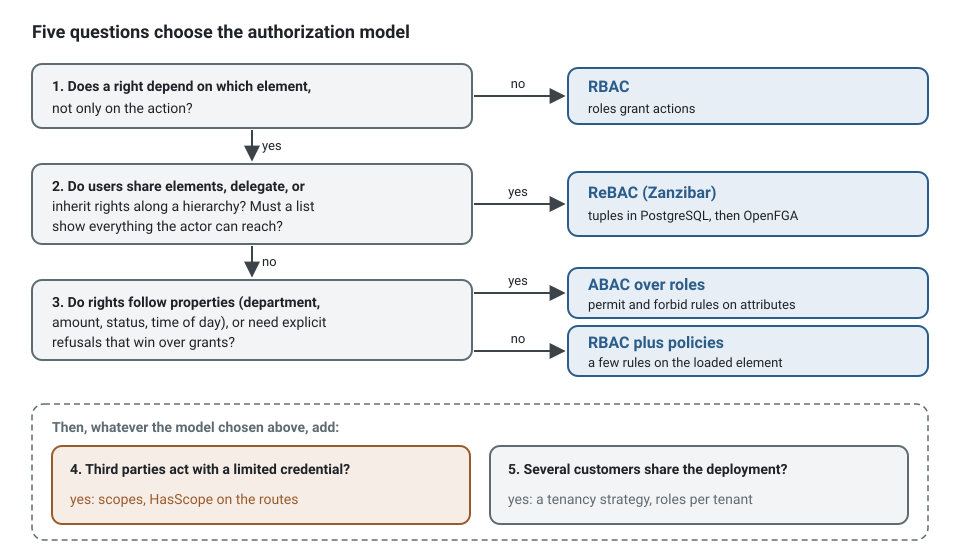
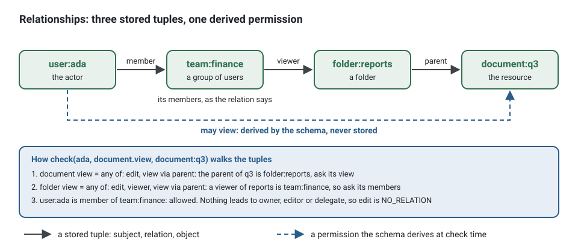

**English** · [Français](choosing-access-control.fr.md)

# Choosing access control, with worked presets

**Summary.** Five questions decide the authorization model of a project: whether rights depend on
the element, whether users share elements with each other, whether rights follow properties,
whether third parties act with a limited credential, and whether several customers share the
deployment. The answers pick roles (RBAC), attribute policies (ABAC), relationships (ReBAC, after
Zanzibar), or a combination, and where the relationships are evaluated. Each model then has a
worked preset below: the permissions as a typed vocabulary, the grants or rules, one policy on an
element, and a search narrowed by what the actor may read. The reasons behind the models are in
[Authentication and authorization](../concepts/authentication-and-authorization.md); the API is
the README of [`@ddd-ts-kit/auth`](../../packages/auth/README.md).

## The five questions

Ask them in order; the first "yes" that changes the answer wins, and the later ones add to it.

| # | Question | Yes | No |
|---|---|---|---|
| 1 | Does a right depend on **which element**, not only on the action? ("may edit *this* calendar") | go on to 2 | **RBAC**: roles grant actions |
| 2 | Do users **share** elements with each other, **delegate**, or inherit rights along a **hierarchy** (folders, teams, practice to desk to calendar)? Must a list show "everything I can reach" across many elements? | **ReBAC** (Zanzibar) | go on to 3 |
| 3 | Do rights follow **properties** (department, amount, status, time of day), or need **explicit refusals** that win over grants? | **ABAC**, over roles | **RBAC plus policies**: a handful of "only the one who..." rules |
| 4 | Do **third parties** act with a credential limited to some operations (a mobile client, a partner integration)? | add **scopes**: `HasScope` on the routes | nothing to add |
| 5 | Do **several customers** share the deployment? | add a **tenancy strategy** ([Multitenancy](../concepts/multitenancy.md)) and keep roles per tenant | nothing to add |



Then where the relationships live, for ReBAC: the **PostgreSQL tuple store** of the project (in
the transaction of the command, nothing else to run) until listing or checks outgrow it, then
**OpenFGA**, the full Zanzibar model as a service, behind the same port
([Authorization engines](../tools/authorization-engines.md) compares them).

| Typical product | Answer |
|---|---|
| Back office of one company, job functions | RBAC |
| Booking tool where "only the patient who booked may cancel" | RBAC plus one policy |
| Expense approval by amount and department, with a four-eyes rule | ABAC over roles |
| Documents, folders, sharing, teams, delegation | ReBAC |
| SaaS for many companies, each with its admins and members | RBAC with the tenant check, shared tables; ReBAC inside a tenant if users share |
| Public API for partners | any of the above, plus scopes |

## What every preset shares

Whatever the model, a request meets the same four checkpoints, and the model only changes the
adapter behind the `Authorizer` port:


| Checkpoint | Asks | Decides with | Refusal |
|---|---|---|---|
| guard of the route group | may this client call these routes at all? | the session: `Authenticated`, `HasRole`, `HasScope`, `TenantMember` | 401 or 403 before the controller, reported through `onGuardRefusal` |
| requirement of the use case | may this actor run this command or query, on this element? | `@Requires(permission, { resource, context })`, checked by the bus middleware through `Authorizer.check` | `ForbiddenError` (`FORBIDDEN`), before the unit of work opens |
| policy in the handler | does a rule about the loaded element allow it? | `Access.authorize(actor, permission, appointment)`: the policies of the permission, then the authorizer | `ForbiddenError`, its reason the name of the policy |
| read port | which elements may this actor list? | `Access.scope(actor, permission, type)`, an `AccessScope` | nothing is refused: the rows the actor may not read are never selected |

Permissions are declared once per context, in its words, and are typed: a requirement can only
name a permission that exists.

<!-- checked sample -->
```ts
import { definePermissions } from '@ddd-ts-kit/auth';
import { AuthorizedCommand, type Actor } from '@ddd-ts-kit/kernel';
import { Requires } from '@ddd-ts-kit/kernel/declarations';

// contexts/billing/application/authorization/billing.permissions.ts
export const billingPermissions = definePermissions('billing', {
  'invoice.read': { description: 'See invoices and their lines' },
  'invoice.issue': { description: 'Make an invoice final and send it' },
  'invoice.void': { description: 'Cancel an issued invoice' },
});
// billingPermissions['invoice.void'].id is 'billing:invoice.void';
// billingPermissions['invoice.delete'] does not compile: no such permission.

// contexts/billing/application/commands/void-invoice/void-invoice.command.ts
@Requires(billingPermissions['invoice.void'], {
  resource: (command: VoidInvoice) => ({ type: 'invoice', id: command.invoiceId }),
})
export class VoidInvoice extends AuthorizedCommand {
  constructor(
    actor: Actor,
    readonly invoiceId: string,
  ) {
    super(actor);
  }
}
```

The actor is the first argument of the command: the route or the consumer that builds it says
who acts, and the handler never reads "the current user". The rule lives on the use case, not
in the controller:

```ts
// Instead of: a role test in a controller, which a job, a consumer or another transport never passes
if (!request.user.roles.includes('accountant')) {
  throw new ForbiddenException();
}
await this.invoices.void(request.params.invoiceId);

// Write: the controller builds the command; the requirement above is checked by the bus
await commandBus.execute(new VoidInvoice(actorOf(context.principal), params.invoiceId));
```

A search never loads then filters: the handler asks the scope of the actor and the read port turns
it into the query. `scoped` of the kernel joins the scope to the criteria by AND, on the fields
the read port names (`ids: 'id'` for a list of identifiers, `filter: { tenantId: 'tenantId' }`
for the tenant check), and a criteria a caller refines afterwards keeps the restriction.

<!-- checked sample -->
```ts
import { Access, type PermissionSet } from '@ddd-ts-kit/auth';
import { AuthorizedQuery, scoped, type Actor, type Criteria, type Page, type ScopedCriteria } from '@ddd-ts-kit/kernel';
import { QueryHandler, Requires } from '@ddd-ts-kit/kernel/declarations';

declare const billingPermissions: PermissionSet<'billing', 'invoice.read' | 'invoice.issue' | 'invoice.void'>;

export interface InvoiceLine {
  readonly id: string;
  readonly tenantId: string;
  readonly customer: string;
  readonly total: number;
}

// application/ports/invoice-reader.port.ts: a read port accepts only a scoped criteria
export abstract class InvoiceReader {
  abstract search(criteria: ScopedCriteria<InvoiceLine>): Promise<Page<InvoiceLine>>;
}

@Requires(billingPermissions['invoice.read'])
export class SearchInvoices extends AuthorizedQuery<Page<InvoiceLine>> {
  constructor(
    actor: Actor,
    readonly criteria: Criteria<InvoiceLine>,
  ) {
    super(actor);
  }
}

@QueryHandler(SearchInvoices)
export class SearchInvoicesHandler implements QueryHandler<SearchInvoices> {
  constructor(
    private readonly invoices: InvoiceReader,
    private readonly access: Access,
  ) {}

  async execute(query: SearchInvoices): Promise<Page<InvoiceLine>> {
    const scope = await this.access.scope(query.actor, billingPermissions['invoice.read'], 'invoice');

    return this.invoices.search(scoped(query.criteria, scope, { ids: 'id', filter: { tenantId: 'tenantId' } }));
  }
}
```

```ts
// Instead of: every invoice loaded, then filtered in memory (slow, and a page is no longer a page)
const visible = (await this.invoices.all()).filter((invoice) => canRead(query.actor, invoice));
```

| `AccessScope` | Given by | What the read port adds |
|---|---|---|
| `{ kind: 'all' }` | a role that grants the permission, without tenant check | nothing |
| `{ kind: 'filter', filter: { tenantId } }` | a role, with the tenant check | `tenant_id = :tenantId` |
| `{ kind: 'ids', ids }` | the relationships | `id IN (...)` |
| `{ kind: 'none' }` | any model, and always for the anonymous actor | an empty page, without querying |

## Preset 1: roles, and policies for the few element rules

The roles are a typed vocabulary: a role that does not exist cannot be granted, and the
authorizer refuses, when it is built, a grant that could never match, an unknown inherited role
and a cycle in the hierarchy.

<!-- checked sample -->
```ts
import { RoleBasedAuthorizer, tenantOfContext, type Grant, type PermissionSet } from '@ddd-ts-kit/auth';

declare const billingPermissions: PermissionSet<'billing', 'invoice.read' | 'invoice.issue' | 'invoice.void'>;

// platform/auth/roles.ts
export const ROLES = ['admin', 'accountant', 'clerk', 'system'] as const;
export type Role = (typeof ROLES)[number];

export const roles: Readonly<Record<Role, readonly Grant[]>> = {
  admin: ['*'],
  accountant: [billingPermissions['invoice.void']],
  clerk: [billingPermissions['invoice.read'], billingPermissions['invoice.issue']],
  system: [billingPermissions['invoice.issue']], // the jobs and consumers that send the command
};

export const authorizer = new RoleBasedAuthorizer({
  roles,
  inherits: { accountant: ['clerk'] }, // an accountant has all a clerk has
  tenantOf: tenantOfContext, // turns the tenant check on
  crossTenantRoles: ['admin'], // may act in every tenant
  systemRole: 'system', // the role of systemActor(...), none by default
});
```

What it answers, for a clerk of the tenant `acme`:

| Request | Decision |
|---|---|
| `invoice.read`, no tenant named | allowed |
| `invoice.void` | refused, `NO_MATCHING_ROLE` |
| `invoice.issue` for the tenant `globex` (the requirement passes `context: { tenantId: 'globex' }`) | refused, `TENANT_MISMATCH` |
| `invoice.read` as a list | `{ kind: 'filter', filter: { tenantId: 'acme' } }` |

One rule needs the loaded element: a policy, pure and unit-tested, asked by the handler.

<!-- checked sample -->
```ts
import { Access, type PermissionSet } from '@ddd-ts-kit/auth';
import { AuthorizedCommand, NotFoundError, type Actor, type Clock } from '@ddd-ts-kit/kernel';
import { CommandHandler, Policy } from '@ddd-ts-kit/kernel/declarations';

declare const billingPermissions: PermissionSet<'billing', 'invoice.read' | 'invoice.issue' | 'invoice.void'>;
declare class Invoice {
  readonly id: string;
  readonly issuedBy: string;
  void(at: Date): void;
}
declare abstract class InvoiceRepository {
  abstract findById(id: string): Promise<Invoice | undefined>;
  abstract save(invoice: Invoice): Promise<void>;
}
declare class VoidInvoice extends AuthorizedCommand {
  readonly invoiceId: string;
}

// application/authorization/only-issuer-voids.policy.ts
@Policy(billingPermissions['invoice.void'], { name: 'billing.only-issuer-voids' })
export class OnlyIssuerVoidsPolicy {
  appliesTo(subject: unknown): boolean {
    return subject instanceof Invoice;
  }

  allows(actor: Actor, invoice: Invoice): boolean {
    return invoice.issuedBy === actor.id;
  }
}

// application/commands/void-invoice/void-invoice.handler.ts
@CommandHandler(VoidInvoice)
export class VoidInvoiceHandler implements CommandHandler<VoidInvoice> {
  constructor(
    private readonly invoices: InvoiceRepository,
    private readonly access: Access,
    private readonly clock: Clock,
  ) {}

  async execute(command: VoidInvoice): Promise<void> {
    const invoice = await this.invoices.findById(command.invoiceId);
    if (invoice === undefined) {
      throw new NotFoundError(`Invoice ${command.invoiceId} not found`);
    }
    // the policies of the permission first, then the authorizer; ForbiddenError if either says no
    await this.access.authorize(command.actor, billingPermissions['invoice.void'], invoice);
    invoice.void(this.clock.now());
    await this.invoices.save(invoice);
  }
}
```

The spec of the policy needs nothing but the policy: `new OnlyIssuerVoidsPolicy().allows(actor,
invoice)` answers `true` when the invoice was issued by that actor, without an authorizer, a
container or a database.

Lists: a role that grants the permission reads `all`, narrowed to the tenant by the tenant check
(`{ kind: 'filter', filter: { tenantId } }`).

## Preset 2: attribute policies over roles

The rules read attributes of the actor (from its token), of the resource (through a
`ResourceAttributes` port, a projection the policies query) and of the moment. A matching `forbid`
wins over every `permit`; with no matching `permit` the answer is no.

<!-- checked sample -->
```ts
import {
  PolicyBasedAuthorizer,
  ResourceAttributes,
  allOf,
  forbid,
  not,
  permit,
  type AttributePolicy,
  type Condition,
  type PermissionSet,
  type ResourceAttributeValues,
  type ResourceRef,
} from '@ddd-ts-kit/auth';
import type { Clock } from '@ddd-ts-kit/kernel';

declare const billingPermissions: PermissionSet<'billing', 'invoice.read' | 'invoice.issue' | 'invoice.void'>;
declare const clock: Clock;

// platform/auth/attribute-policies.ts
const sameDepartment: Condition = ({ actor, attributes }) => actor.attributes['department'] === attributes['department'];
const large: Condition = ({ attributes }) => Number(attributes['amount']) > 10_000;
const approvedTwice: Condition = ({ attributes }) => attributes['approvals'] === 2;

export const attributePolicies: readonly AttributePolicy[] = [
  permit('administrators-do-everything', ['*'], ({ actor }) => actor.roles.includes('admin')),
  permit('read-own-department', [billingPermissions['invoice.read']], sameDepartment),
  permit('managers-void', [billingPermissions['invoice.void']], ({ actor }) => actor.attributes['manager'] === true),
  forbid('no-large-void-without-four-eyes', [billingPermissions['invoice.void']], allOf(large, not(approvedTwice))),
];

// infrastructure: the attributes of an invoice, read from a projection the billing context keeps
interface InvoiceAttributeRow {
  readonly department: string;
  readonly amount: number;
  readonly approvals: number;
}

export class ProjectedInvoiceAttributes implements ResourceAttributes {
  constructor(private readonly rows: ReadonlyMap<string, InvoiceAttributeRow>) {}

  async of(resource: ResourceRef): Promise<ResourceAttributeValues | undefined> {
    const row = resource.type === 'invoice' ? this.rows.get(resource.id) : undefined;

    return row === undefined ? undefined : { department: row.department, amount: row.amount, approvals: row.approvals };
  }
}

export const authorizer = new PolicyBasedAuthorizer({
  clock, // policies see `now` from the Clock port, never new Date()
  attributes: new ProjectedInvoiceAttributes(new Map()),
  policies: attributePolicies,
});
```

A manager of the finance department voids an invoice of 12 000 approved once: the
`managers-void` permit matches, but so does the `no-large-void-without-four-eyes` forbid, and
the answer is `EXPLICIT_DENY`.

Lists: a predicate is not a query, so `Access.scope` throws `ListingNotSupportedError` under pure
ABAC. Give the read port the same condition as a filter (the department of the actor), or list
through roles and decide each element with the policies.

## Preset 3: relationships (Zanzibar)

The schema says who is what to which element, and derives the permissions by rewriting: the
owner, a member of a group it is shared with, whoever may edit the parent folder.

<!-- checked sample -->
```ts
import { definePermissions } from '@ddd-ts-kit/auth';
import { InMemoryRelationTupleStore, RelationBasedAuthorizer, defineSchema, from, union } from '@ddd-ts-kit/auth/rebac';
import type { Actor } from '@ddd-ts-kit/kernel';

export const docsPermissions = definePermissions('docs', {
  'document.edit': { description: 'Change a document' },
  'document.view': { description: 'Read a document' },
  'folder.view': { description: 'Read a folder and list what it holds' },
});

// platform/auth/relationship-schema.ts
export const relationshipSchema = defineSchema({
  user: {},
  system: {},
  team: { relations: { member: ['user', 'team#member'] } },
  folder: {
    relations: { owner: ['user'], viewer: ['user', 'team#member'], parent: ['folder'] },
    permissions: { edit: union('owner', from('parent', 'edit')), view: union('edit', 'viewer', from('parent', 'view')) },
  },
  document: {
    relations: { owner: ['user'], editor: ['user', 'team#member'], delegate: ['user'], parent: ['folder'] },
    permissions: {
      edit: union('owner', 'editor', 'delegate', from('parent', 'edit')),
      view: union('edit', from('parent', 'view')),
    },
  },
});

// platform/auth/permission-mapping.ts: which permission of the schema each use case permission stands for
export const mapping = {
  document: { [docsPermissions['document.edit'].id]: 'edit', [docsPermissions['document.view'].id]: 'view' },
  folder: { [docsPermissions['folder.view'].id]: 'view' },
};

// The PostgreSQL store of the project in production; the in-memory one here and in tests.
const store = new InMemoryRelationTupleStore();
export const authorizer = new RelationBasedAuthorizer({ schema: relationshipSchema, store, mapping });

export async function adaReadsTheQuarterlyReport(): Promise<void> {
  await store.write([
    { object: 'team:finance', relation: 'member', subject: 'user:ada' },
    { object: 'folder:reports', relation: 'viewer', subject: 'team:finance#member' },
    { object: 'document:q3', relation: 'parent', subject: 'folder:reports' },
  ]);

  const ada: Actor = { id: 'ada', type: 'user', roles: [], attributes: {} };
  const q3 = { type: 'document', id: 'q3' };

  await authorizer.check({ actor: ada, permission: docsPermissions['document.view'], resource: q3 });
  // { allowed: true }: ada is a member of finance, finance views reports, reports is the parent of q3
  await authorizer.check({ actor: ada, permission: docsPermissions['document.edit'], resource: q3 });
  // { allowed: false, reason: 'NO_RELATION' }: nothing makes her an owner, an editor or a delegate
  await authorizer.listAccessible({ actor: ada, permission: docsPermissions['document.view'], resourceType: 'document' });
  // { kind: 'ids', ids: ['q3'] }
}
```



Tuples are written through a port in the words of the application, in the transaction of the
command when the store is the PostgreSQL one. The handler says what happened ("this user owns
this document"); only the adapter knows the tuples:

<!-- checked sample -->
```ts
import { RelationTupleStore } from '@ddd-ts-kit/auth/rebac';

// application/ports/document-grants.port.ts
export abstract class DocumentGrants {
  abstract ownerAssigned(documentId: string, ownerId: string): Promise<void>;
  abstract delegatedTo(documentId: string, delegateId: string): Promise<void>;
}

// infrastructure/external/tuple-document-grants.ts
export class TupleDocumentGrants implements DocumentGrants {
  constructor(private readonly tuples: RelationTupleStore) {}

  ownerAssigned(documentId: string, ownerId: string): Promise<void> {
    return this.tuples.write([{ object: `document:${documentId}`, relation: 'owner', subject: `user:${ownerId}` }]);
  }

  delegatedTo(documentId: string, delegateId: string): Promise<void> {
    return this.tuples.write([{ object: `document:${documentId}`, relation: 'delegate', subject: `user:${delegateId}` }]);
  }
}
```

Lists come by construction: `listAccessible` answers the ids the actor reaches, which the read
port turns into `id in (...)`. The search itself still names a resource in its requirement, an
enclosing one (the context, or the tenant when an actor who reaches nothing must get 403), and
its scope is asked on the permission of one element, `document.view` on `document`, never on a
permission every signed-in person holds, which lists `all`. Delegation is one more relation (`delegate`), and so is a hierarchy
(`parent`); nothing in the use cases changes when one is added.

## The combined model of the example

`examples/scheduling` layers two models behind the one port
(`RolesAndRelationshipsAuthorizer`): a short list of role grants decides first (the
administrator of a network, platform staff, the self-service of a patient), then the
relationships decide the rest, a practice with its managers and practitioners, a desk held or
delegated, a calendar of a desk, an appointment of a calendar and of its patient. A right over one
element is always a relationship, never a role; a list is `all` only for an unconditional grant,
otherwise the ids the relationships reach. A system actor (a scheduled job, an integration
event handler, named `<context>.<what it does>`) holds no role: it may use the permissions of
its own context on that context, and anything else it asks goes to the relationships. The
practice is not a tenant there: patients book in several practices, so the boundary between
practices is a relationship decided per element. The network of practices is the tenant, a
storage boundary under every relationship
([ADR 0003 of the example](../../examples/scheduling/docs/adr/0003-one-network-is-one-tenant.md)).

| Who asks | What decides | Example |
|---|---|---|
| the anonymous actor | always refused, `ANONYMOUS` | an expired session |
| a system actor of `notification` | its own context, without a tuple | the job `notification.send-due-reminders` sending the reminders that are due |
| a platform administrator | a role grant, unconditional, lists `all` | opening a practice, reading the audit trail |
| a patient booking for themselves | a role grant with a condition (`selfService` in the `context` of the requirement) | booking an appointment |
| a practitioner, a manager, an assistant | the relationships | changing an appointment of a calendar of their desk |

## Scopes and guards at the edge

A scope limits the client that presents a credential, not the actor: a partner integration with
`invoices:read` cannot issue an invoice whatever its user may do. Declare the vocabulary once,
and guard the routes:

```ts
declare module '@ddd-ts-kit/kernel' {
  interface SessionScopes {
    readonly 'invoices:read': true;
    readonly 'invoices:write': true;
  }
}

@RouteGroup({ prefix: '/invoices', guards: [HasScope('invoices:read')], errors: ['FORBIDDEN'] })
export class InvoicesRoutes {}
```

Once `SessionScopes` declares the vocabulary, `HasScope('invoice:read')` (a typo) no longer
compiles. The JWT and Keycloak authenticators fill `Session.scopes` from the `scope` (or `scp`)
claim. Every refusal of a guard (`HasRole`, `HasScope`, `TenantMember`, a tenant the caller does
not belong to) is reported through `onGuardRefusal` of the HTTP pipeline, which
`auditGuardRefusals` of `@ddd-ts-kit/audit` writes to the audit trail as a denied decision, next
to the refusals of the use cases.

## Limits and when not to use it

- **The presets are starting points.** The roles, rules and schema of a real organisation come
  from its people; the presets show the shape, not the content.
- **A model too rich for the problem costs every day.** Tuples to keep in sync, attribute
  projections to maintain: start with roles and policies, and move one context to relationships
  when sharing appears.
- **Scopes are not permissions.** A scope never grants what the actor may not do; it only takes
  away.

## See also

- [Authentication and authorization](../concepts/authentication-and-authorization.md)
- [Authorization engines](../tools/authorization-engines.md)
- [Multitenancy](../concepts/multitenancy.md)
- [Audit trail](../concepts/audit-trail.md)
- The skill `ddd-ts-kit:access-control`
