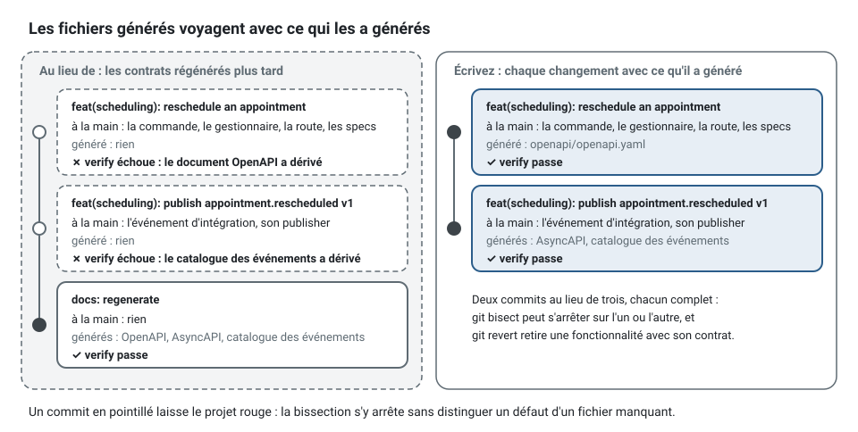
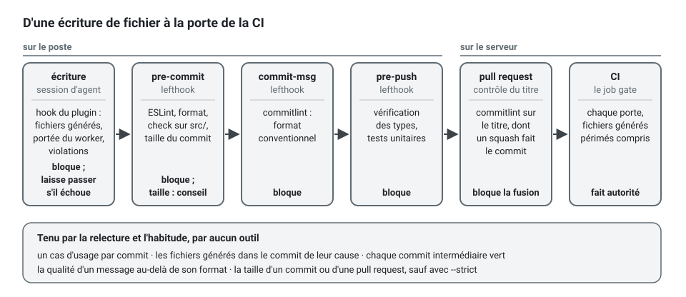

[English](commit-discipline.md) · **Français**
<!-- translation-of: commit-discipline.md sha256:1fd13ba7f38a5fbb -->

# La discipline des commits et des pull requests

**Résumé.** Un *commit* porte un cas d'usage ou un concept, avec tout ce qui a été généré à partir
de lui ; une *pull request* porte une idée relisible et reste assez petite pour être lue d'une
traite. Ce guide donne l'unité d'un *commit*, la règle des fichiers générés, le format des
messages, des tailles cibles avec les raisons qui les fondent (qualité de la revue, recherche par
bissection, possibilité d'annuler), des façons de découper un changement qui a grossi, et la liste
exacte de ce que les *hooks* et le *pipeline* du kit imposent, et de ce qu'ils laissent aux
personnes.

## L'unité : un cas d'usage ou un concept

L'architecture découpe déjà le travail en unités qui font de bons *commits* :

| Unité | Ce que contient le *commit* |
|---|---|
| un concept du domaine | un objet-valeur ou une méthode d'agrégat, sa *spec*, la modification de son *builder*, le terme du glossaire |
| un cas d'usage | la commande ou la requête, son gestionnaire (handler), le comportement du domaine dont il a besoin, les *specs*, la route, le document OpenAPI régénéré |
| un contrat | la déclaration d'un événement d'intégration, son *publisher*, le catalogue et le document AsyncAPI régénérés |
| un consommateur | un gestionnaire d'événement d'intégration, sa *spec*, les listes régénérées |
| un adaptateur | l'adaptateur, sa *spec* d'intégration, l'appel de la suite de contrat pour lui et pour le *fake* |
| une décision | un ADR, et l'entrée de configuration ou la désactivation qu'il justifie |
| un changement de structure | un renommage ou un déplacement, sans aucun changement de comportement |

Deux choses ne partagent jamais un *commit* : un changement de structure et un changement de
comportement. Un renommage qui touche quarante fichiers est trivial à relire seul, et impossible à
relire quand un changement de règle se cache dedans.

Chaque *commit* devrait laisser le projet dans un état où `npm run verify` passe. C'est ce qui rend
l'historique utilisable par `git bisect` et permet d'annuler n'importe quel *commit* isolément.

## Les fichiers générés voyagent avec ce qui les a générés

Plusieurs fichiers sont des produits des sources et sont commités : `openapi/openapi.yaml`,
`docs/integration/asyncapi.yaml`, `docs/integration/event-catalog.md`, `docs/context-map.md` et
les listes générées de chaque `CONTEXT.md`, les déclarations `<context>.declarations.ts` et le
`<folder>.declarations.ts` de chaque dossier de rôle,
`.dependency-cruiser.cjs`.

La règle : **le fichier régénéré est dans le même *commit* que le changement qui l'a causé.**



- Une route ajoutée sans son diff OpenAPI échoue à la porte de dérive en CI.
- Un relecteur lit le diff généré comme un résumé : le diff du catalogue dit en dix lignes ce que
  le changement d'événement signifie pour les consommateurs.
- Un *commit* « regenerate docs » qui suit trois *commits* de fonctionnalité rend ces trois
  *commits* rouges chacun pris isolément, ce qui casse la bissection.

En revue, les diffs générés se lisent, ils ne se commentent pas ligne par ligne : si le produit
est faux, c'est la source ou le générateur qui est faux. Ils ne sont jamais modifiés à la main, et
le *hook* du *plugin* refuse une telle modification pour les trois contrats générés, les *barrels*
et `.dependency-cruiser.cjs`.

## Les messages : conventional commits

```
<type>(<scope>): <summary>

<body: why, not what>
```

- **type** : `feat`, `fix`, `refactor`, `test`, `docs`, `chore`, `perf`, `build`, `ci` (le jeu
  conventionnel).
- **scope** : le contexte délimité (bounded context), ou `platform`, `pipeline`, `docs`. Il dit
  quel propriétaire relit.
- **summary** : à l'impératif, dans le langage omniprésent (ubiquitous language) : `feat(scheduling):
  refuse to book a slot that is already taken`, pas `feat: add check in handler`.
- **body** : la raison, la règle encodée et où, ce qui a été délibérément laissé de côté. Le diff
  dit déjà ce qui a changé.
- **changements cassants** : un `!` après le *scope* et un pied de message `BREAKING CHANGE:`,
  pour une route ou un événement dont le contrat casse.

Des exemples, avec les contextes de `examples/scheduling` :

```
feat(scheduling): publish scheduling.appointment.cancelled v1

docs(scheduling): add TimeOff to the glossary

refactor(scheduling): extract BookingWindow from Calendar

fix(notification): send one reminder when the event is redelivered
```

Un message est lu dans `git log --oneline` un an plus tard, par quelqu'un qui n'a pas le diff en
tête :

```
# Au lieu de
fix: stuff
feat: add check in handler
wip

# Écrivez
feat(scheduling): refuse to book a slot that is already taken

Two patients confirming the same slot at once both got it. The aggregate now
refuses the second booking; the unique index on the slot stays as the last line
of defence, not as the rule.
```

Avec les fusions par *squash*, le titre de la *pull request* devient le *commit* sur la branche
par défaut ; le titre suit donc le même format, et le *pipeline* le vérifie avec la même
configuration.

Deux *trailers* portent ce qu'un message ne peut pas dire. `Slice: <id de ligne>` nomme la ligne
de `docs/architecture/slices.md` qu'un *commit* clôt ([Travail en parallèle](parallel-work.fr.md)) ;
`story-check` le lit. `Change: <id>` nomme le ticket de changement, ou la *story*, auquel
appartient une modification d'une migration ou des conteneurs : le *hook* `change-reference` du
profil réglementé ([Mettre les agents de code en bac à sable](agent-sandbox.fr.md#le-profil-réglementé))
le demande avant la modification, et la session l'écrit dans le *commit* qui porte le fichier :

```
feat(billing): add the paid_at column to invoices

Change: CHG-1234
```

Le *trailer* est lu par des personnes, dans l'historique
(`git log --format='%h %(trailers:key=Change,valueonly)' -- migrations/`), et par
`npx ddd-ts-kit story-check <code>` : un *commit* de la *story* (son *trailer* `Slice:`, sinon son
message qui nomme une ligne ou la *story*) qui change une migration ou un fichier de conteneur
sans ce *trailer* est listé avec ses fichiers, et bloque la *story* sous
`agents.profile: regulated` ou avec `--strict` ; les chemins qu'il surveille sont ceux du *hook*
`change-reference`, tenus alignés dans le kit. Ajoutez le *trailer* avant la *pull request* :
`git commit --amend` pour le dernier *commit*, un *rebase* interactif de la branche pour un plus
ancien.

## Des tailles cibles, et pourquoi

Ce sont des cibles pour se guider. Le kit en mesure une, avec un seuil un peu au-dessus des
cibles : `npx ddd-ts-kit check --commit-size` compte les fichiers et les lignes sur le point
d'être commités (`--staged` ne lit que l'index) et les compare à `commit` dans la configuration,
20 fichiers et 600 lignes modifiées par défaut, fichiers générés non comptés (voir
[Configuration](../CONFIG.fr.md)). Au-delà des limites, il nomme les tranches à commiter une par
une. Il ne fait que conseiller : il ne sort en 1 qu'avec `--strict`. Le `lefthook.yml` généré le
lance au `pre-commit` sans `--strict`, et le *hook* du *plugin* fait le même rappel dans une
session d'agent, sans bloquer. Sa réponse tient sur une ligne, coupée ici :

```bash
$ npx ddd-ts-kit check --commit-size --staged
34 changed files and 912 changed lines are staged (advised at most 20 files and 600 lines a
commit, generated files not counted): over the limits. Commit each finished slice on its own,
with the files its generator wrote: scheduling: reschedule-appointment (12 files),
scheduling: cancel-appointment (10 files), scheduling: domain (8 files), scheduling: test (4 files).
```

Une tranche est un cas d'usage d'un contexte (le dossier de sa commande ou de sa requête, sa
route, leurs *specs*), sinon une couche d'un contexte, sinon `platform` ou le dossier de premier
niveau du fichier. « Généré » désigne ce qu'une commande réécrit : les fichiers de verrouillage,
les documents OpenAPI et AsyncAPI, le catalogue d'événements, `docs/context-map.md`,
`.dependency-cruiser.cjs`, et les déclarations (à la racine de chaque contexte et dans ses
dossiers de rôle) et les fichiers de dépendances de chaque contexte. Les
limites sont une clé de `ddd-ts-kit.config.json` :

```json
{
  "commit": { "maxFiles": 15, "maxLines": 400 }
}
```

et une équipe qui veut que la limite bloque ajoute `--strict` au *job* de son `lefthook.yml` :

```yaml
    - name: commit size
      run: npx --no -- ddd-ts-kit check --commit-size --staged --strict
```

| Mesure | Cible | Au-delà, attendez-vous à |
|---|---|---|
| lignes modifiées à la main dans une *pull request* | jusqu'à environ 400 | des relecteurs qui survolent au lieu de lire |
| fichiers modifiés à la main | jusqu'à environ 15 | un changement qui porte plus d'une idée |
| cas d'usage par *pull request* | 1 | un échec de l'un qui bloque la fusion de l'autre |
| contextes touchés à la main | 1 | deux propriétaires, deux revues, un déploiement couplé |
| âge d'une branche | 1 à 2 jours | des conflits dans l'agrégat et dans chaque fichier généré |

Les fichiers générés sont exclus des comptes : un diff OpenAPI de 600 lignes causé par une route
de 40 lignes est un changement de 40 lignes.

**Qualité de la revue.** Les mesures les plus connues viennent d'une étude de la revue de code
chez Cisco publiée par SmartBear : la détection des défauts chutait nettement dès qu'une revue
dépassait quelques centaines de lignes, et les relecteurs étaient les plus efficaces en dessous
d'environ 200 à 400 lignes et en une heure environ. Les pratiques d'ingénierie de Google ne
donnent pas de chiffre mais la même direction : un changement devrait être une seule chose
autonome, et environ 100 lignes y sont qualifiées de taille généralement raisonnable, alors que
1000 est généralement trop. Prenez ces chiffres comme des ordres de grandeur ; le mécanisme, lui,
ne fait pas de doute : l'attention est limitée, et un relecteur qui ne peut pas garder le
changement en tête l'approuve.

**Recherche par bissection.** `git bisect` trouve le *commit* qui a introduit une faute en un
nombre d'étapes logarithmique dans la taille de l'historique. Sa réponse n'est utile que si ce
*commit* est petit et compile. Trouver « la faute est quelque part dans ce *commit* de 3000
lignes » n'est pas une réponse.

**Possibilité d'annuler.** Un petit *commit* à un seul objet peut être annulé en production sans
emporter du travail sans rapport. Un cas d'usage et son contrat régénéré s'annulent ensemble
précisément parce qu'ils ont été commités ensemble.

**Conflits de fusion.** Ils grandissent avec la durée de vie et l'étendue d'une branche, et les
fichiers partagés de cette architecture (voir [Travail en parallèle](parallel-work.fr.md)) rendent
les branches longues particulièrement coûteuses.

**Sessions d'agent.** Une tâche petite et délimitée borne aussi ce qu'un agent de code doit lire
et ce qu'il peut casser ; voir [Économie de tokens](token-economy.fr.md).

## Découper un changement qui a grossi

Cela arrive : un cas d'usage s'est révélé avoir besoin d'un nouvel objet-valeur, d'un port, d'un
changement de contrat. Découpez avant la revue, pas après.

1. **Extraire la refonte.** Si la fonctionnalité demandait d'abord un renommage ou un
   déplacement, celui-ci va dans son propre *commit*, avant la fonctionnalité : « rendre le
   changement facile, puis faire le changement facile » (Kent Beck).
2. **Extraire le contrat.** Un événement d'intégration ou une définition de route, nouveau ou
   modifié, forme sa propre *pull request*, fusionnée en premier ; voir « Les contrats d'abord »
   dans [Organisation du travail en équipe](team-workflow.fr.md).
3. **Ne découper selon les couches que de l'intérieur vers l'extérieur.** Le concept du domaine
   avec sa *spec* d'abord (utile et vert à lui seul), puis le cas d'usage qui l'utilise. Jamais le
   gestionnaire avant le comportement du domaine qu'il appelle.
4. **Découper selon les cas d'usage.** `RescheduleAppointment` et `CancelAppointment` écrits
   ensemble font deux *pull requests*.
5. **Les empiler.** Quand la seconde dépend de la première, ouvrez-la par-dessus la première et
   dites-le ; fusionnez dans l'ordre.


La mécanique avec git : `git add -p` pour indexer une partie d'un fichier, `git reset` jusqu'à la
base (les changements restent dans l'arbre de travail) puis recommiter en morceaux pour une
branche que personne d'autre n'utilise, ou `git rebase -i` en local. Ne réécrivez jamais une
branche que quelqu'un d'autre a récupérée ; ajoutez plutôt des *commits*.

```bash
# une branche que personne d'autre n'a récupérée : défaire ses commits, garder les changements, recommiter en morceaux
git reset "$(git merge-base HEAD origin/main)"

# la refonte d'abord, morceau par morceau
git add -p src/contexts/scheduling/domain/calendars/aggregates/calendar.aggregate.ts
git add src/contexts/scheduling/domain/calendars/value-objects/booking-window.vo.ts
git commit -m "refactor(scheduling): extract BookingWindow from Calendar"

# puis un cas d'usage avec tout ce que son générateur et docs:generate ont écrit :
# commande et gestionnaire, route, leurs specs, les déclarations régénérées de leurs dossiers et le contrat
git add src/contexts/scheduling/application/calendars/commands/reschedule-appointment/ \
        src/contexts/scheduling/presentation/http/appointments/reschedule-appointment/ \
        src/contexts/scheduling/test/unit/reschedule-appointment.*.spec.ts \
        src/contexts/scheduling/application/calendars/commands/commands.declarations.ts \
        src/contexts/scheduling/presentation/http/http.declarations.ts \
        openapi/openapi.yaml
npx ddd-ts-kit check --commit-size --staged
git commit -m "feat(scheduling): reschedule an appointment"
```

Après tout découpage, passez la porte sur chaque morceau : un *commit* qui ne compile qu'avec le
suivant n'est pas découpé, seulement coupé. Pour tester exactement ce qui est indexé, mettez
d'abord le reste de côté :

```bash
git stash push --keep-index --include-untracked   # l'arbre de travail est maintenant l'index
npm run verify
git stash pop
```

## Ce que les hooks et le pipeline imposent

Énoncé exactement, d'après [pipeline/lefthook.yml](../../pipeline/lefthook.yml),
[pipeline/README.md](../../pipeline/README.md) et le *plugin* :

| Moment | Ce qui tourne | Impose |
|---|---|---|
| chaque écriture de fichier dans une session d'agent | le *hook* du *plugin* | refuse un fichier écrit à la main là où un générateur existe, une modification d'un fichier généré (contrats, *barrels*, `.dependency-cruiser.cjs`) et, pour un *worker* d'un seul contexte, une écriture hors de ce contexte ; demande au propriétaire avant une désactivation, un test sauté ou un changement des fichiers gouvernés ; renvoie les violations du fichier écrit ; refuse de terminer tant que des erreurs d'architecture restent, puis rappelle la taille du *commit* sans bloquer |
| `pre-commit` (lefthook) | ESLint et le formateur (`biome format`) sur les fichiers indexés ; `ddd-ts-kit check` sur les sources indexées sous `src/` ; `ddd-ts-kit check --commit-size --staged` ; `secrets`, gitleaks sur les changements indexés quand son binaire est sur le chemin, une ligne sinon | les règles de code, le format et la structure de ce qui est commité ; la taille du *commit*, à titre de conseil ; un secret tenu hors du *commit* (le pipeline balaie tout l'historique de toute façon) |
| `commit-msg` (lefthook) | commitlint | le format conventional commits |
| `pre-push` (lefthook) | la vérification des types ; les *specs* unitaires des contextes que la branche atteint (`ddd-ts-kit affected --run`) ; `ddd-ts-kit verify-merge --warn` | le projet compile et les tests rapides de ce que la branche a changé passent ; ce qu'une fusion depuis le tronc a perdu (une ligne, une tranche terminée, un test) est affiché, en avertissement dans cette version |
| *pull request* | la vérification du titre | le titre est un conventional commit |
| CI | vérification des types, lint, architecture, code mort, tests, dérive de la documentation et des contrats, sécurité, build, image, puis le *job* unique `gate` | tout, y compris les fichiers générés périmés |



Les *hooks* s'installent une fois par clone (`npm run hooks:install`) et sont partagés par ses
*worktrees* ; chaque *worktree* lance son propre lefthook (`lefthook: node_modules/.bin/lefthook`),
si bien qu'un *worktree* sans ses dépendances fait échouer le *commit* au lieu de sauter les
vérifications. Le *hook* du *plugin*
laisse passer en cas d'échec, par conception : une garde cassée ne bloque jamais le travail ; il
est donc une commodité, et la CI fait autorité.

**Imposé par aucun outil :** la taille d'un *commit* ou d'une *pull request* (`check
--commit-size` et le *hook* du *plugin* ne font que conseiller, sauf si vous ajoutez `--strict` au
*job* `pre-commit`), un cas d'usage par *commit*, la présence des fichiers générés dans le *même*
*commit* que leur cause (la porte vérifie l'état final de la branche, pas chaque *commit*), la
qualité d'un message au-delà de son format, et le fait que chaque *commit* intermédiaire compile.
Ce sont la revue et l'habitude qui les tiennent. Si le vert à chaque *commit* compte pour vous,
fusionnez par *squash* : le seul *commit* qui atteint alors la branche par défaut est celui que la
porte a vérifié.

## Limites et quand ne pas l'utiliser

- **Les petites *pull requests* demandent une revue rapide.** Si une revue prend deux jours, dix
  petites *pull requests* prennent plus de temps qu'une grande, et les gens réagissent en les
  regroupant. Corrigez d'abord le délai de revue.
- **Les *pull requests* empilées sont malcommodes** sur les plateformes qui ne les prennent pas
  en charge nativement : un changement demandé dans la première se répercute sur les autres.
- **Certains changements sont atomiques et gros** : une montée de version majeure d'une
  dépendance, un renommage mécanique, une migration de chaque adaptateur de *repository*.
  Gardez-les purs (rien d'autre dans le *commit*) plutôt que petits.
- **La fusion par *squash* échange l'historique contre la propreté.** Elle garantit un *commit*
  vert et titré par *pull request* et perd les étapes intermédiaires ; une équipe qui fait des
  bissections à l'intérieur des *pull requests* devrait fusionner sans *squash* et garder elle-même
  chaque *commit* vert.
- **Les tailles cibles sont des heuristiques.** L'étude citée repose sur les données d'une seule
  entreprise dans les années 2000 ; la direction est bien étayée, les seuils exacts ne sont pas
  des lois.

## Sources

- Conventional Commits 1.0.0, https://www.conventionalcommits.org/en/v1.0.0/
- SmartBear, « Best Practices for Peer Code Review » (qui rapporte l'étude de Cisco, Jason Cohen,
  2006), https://smartbear.com/learn/code-review/best-practices-for-peer-code-review/
- Google Engineering Practices, « Small CLs »,
  https://google.github.io/eng-practices/review/developer/small-cls.html
- Documentation de Git, `git-bisect`, https://git-scm.com/docs/git-bisect
- Kent Beck, sur le fait de rendre le changement facile avant de faire le changement facile
  (2012).
- Ce dépôt : [pipeline/README.md](../../pipeline/README.md), la section du README racine sur le
  *hook*.

## Voir aussi

- [Organisation du travail en équipe](team-workflow.fr.md)
- [Travail en parallèle](parallel-work.fr.md)
- [Analyse statique et pipeline](../tools/static-analysis-and-pipeline.fr.md)
- [Versionnement des événements](../concepts/event-versioning.fr.md)
- [Référence d'architecture](../ARCHITECTURE.fr.md)
