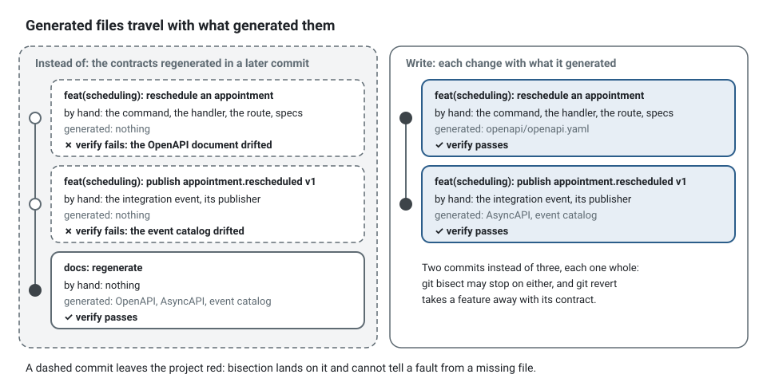
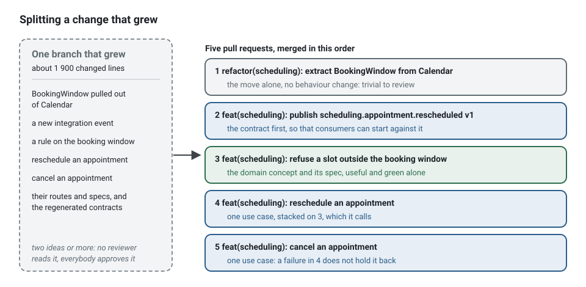
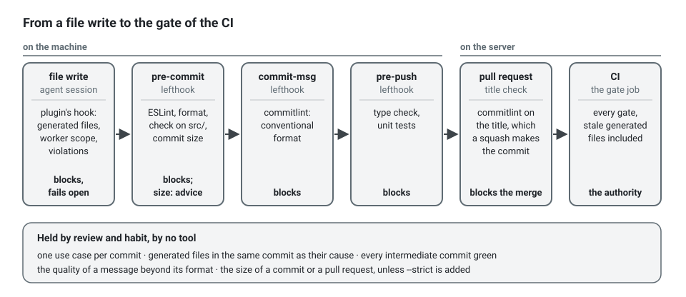

**English** · [Français](commit-discipline.fr.md)

# Commit and pull request discipline

**Summary.** A commit carries one use case or one concept, together with everything that was
generated from it; a pull request carries one reviewable idea and stays small enough to be read
in one sitting. This guide gives the unit of a commit, the rule for generated files, the
message format, target sizes with the reasons behind them (review quality, bisectability,
revertability), ways to split a change that grew, and an exact list of what the kit's hooks
and pipeline enforce, and what they leave to people.

## The unit: one use case or one concept

The architecture already cuts work into units that make good commits:

| Unit | What the commit contains |
|---|---|
| one concept of the domain | a value object or an aggregate method, its spec, its builder change, the glossary term |
| one use case | the command or query, its handler, the domain behaviour it needs, specs, the route, the regenerated OpenAPI document |
| one contract | an integration event declaration, its publisher, the regenerated catalog and AsyncAPI document |
| one consumer | an integration event handler, its spec, the regenerated lists |
| one adapter | the adapter, its integration spec, the contract suite call for it and for the fake |
| one decision | an ADR, and the config entry or suppression it justifies |
| one structural change | a rename or a move, with no behaviour change at all |

Two things never share a commit: a structural change and a behavioural one. A rename that
touches forty files is trivial to review alone and impossible to review when a rule change
hides inside it.

Each commit should leave the project in a state where `npm run verify` passes. That is what
makes the history usable by `git bisect` and makes any single commit revertable.

## Generated files travel with what generated them

Several files are outputs of the sources and are committed: `openapi/openapi.yaml`,
`docs/integration/asyncapi.yaml`, `docs/integration/event-catalog.md`, `docs/context-map.md`
and the generated lists of each `CONTEXT.md`, the declarations `<context>.declarations.ts` and
the `<folder>.declarations.ts` of each role folder,
`.dependency-cruiser.cjs`.

The rule: **the regenerated file is in the same commit as the change that caused it.**



- A route added without its OpenAPI diff fails the drift gate in CI.
- A reviewer reads the generated diff as a summary: the catalog diff says in ten lines what
  the event change means for consumers.
- A commit "regenerate docs" that follows three feature commits makes those three commits
  individually red, which breaks bisection.

In a review, generated diffs are read, not line-commented: if the output is wrong, the source
or the generator is wrong. They are never edited by hand, and the plugin's hook refuses such
an edit for the three generated contracts, the barrels and `.dependency-cruiser.cjs`.

## Messages: conventional commits

```
<type>(<scope>): <summary>

<body: why, not what>
```

- **type**: `feat`, `fix`, `refactor`, `test`, `docs`, `chore`, `perf`, `build`, `ci` (the
  conventional set).
- **scope**: the bounded context, or `platform`, `pipeline`, `docs`. It tells which owner
  reviews.
- **summary**: imperative, in the ubiquitous language: `feat(scheduling): refuse to book a
  slot that is already taken`, not `feat: add check in handler`.
- **body**: the reason, the rule encoded and where, what was deliberately left out. The diff
  already says what changed.
- **breaking changes**: a `!` after the scope and a `BREAKING CHANGE:` footer, for a route or
  an event whose contract breaks.

Examples, with the contexts of `examples/scheduling`:

```
feat(scheduling): publish scheduling.appointment.cancelled v1

docs(scheduling): add TimeOff to the glossary

refactor(scheduling): extract BookingWindow from Calendar

fix(notification): send one reminder when the event is redelivered
```

A message is read in `git log --oneline` a year later, by someone who does not have the diff in
mind:

```
# Instead of
fix: stuff
feat: add check in handler
wip

# Write
feat(scheduling): refuse to book a slot that is already taken

Two patients confirming the same slot at once both got it. The aggregate now
refuses the second booking; the unique index on the slot stays as the last line
of defence, not as the rule.
```

With squash merges the pull request title becomes the commit on the default branch, so the
title follows the same format and the pipeline checks it with the same configuration.

Two trailers carry what a message cannot. `Slice: <row id>` names the row of
`docs/architecture/slices.md` a commit closes ([Parallel work](parallel-work.md)); `story-check`
reads it. `Change: <id>` names the change ticket, or the story, a change of a migration or of the
containers belongs to: the `change-reference` hook of the regulated profile
([Sandboxing coding agents](agent-sandbox.md#the-regulated-profile)) asks for it before the
edit, and the session writes it in the commit that holds the file:

```
feat(billing): add the paid_at column to invoices

Change: CHG-1234
```

The trailer is read by people, in the history (`git log --format='%h %(trailers:key=Change,valueonly)' -- migrations/`),
and by `npx ddd-ts-kit story-check <code>`: a commit of the story (its `Slice:` trailer, else its
message naming a row or the story) that changes a migration or a container file without it is
listed with its files, and blocks the story under `agents.profile: regulated` or with `--strict`;
the paths it watches are those of the `change-reference` hook, kept aligned in the kit. Add the
trailer before the pull request: `git commit --amend` for the last commit, an interactive rebase
of the branch for an earlier one.

## Target sizes, and why

These are targets to steer by. The kit measures one of them, with a threshold a little above
the targets: `npx ddd-ts-kit check --commit-size` counts the files and lines about to be
committed (`--staged` reads the index only) against `commit` in the config, 20 files and 600
changed lines by default, generated files not counted (see [Configuration](../CONFIG.md)).
Past the limits it names the slices to commit one by one. It is advisory: it exits 1 only
with `--strict`. The generated `lefthook.yml` runs it at `pre-commit` without `--strict`, and
the plugin's hook gives the same reminder in an agent session, without blocking. Its answer
is one line, wrapped here:

```bash
$ npx ddd-ts-kit check --commit-size --staged
34 changed files and 912 changed lines are staged (advised at most 20 files and 600 lines a
commit, generated files not counted): over the limits. Commit each finished slice on its own,
with the files its generator wrote: scheduling: reschedule-appointment (12 files),
scheduling: cancel-appointment (10 files), scheduling: domain (8 files), scheduling: test (4 files).
```

A slice is a use case of a context (the folder of its command or query, its route, their
specs), else a layer of a context, else `platform` or the top folder of the file. "Generated"
means what a command rewrites: the lock files, the OpenAPI and AsyncAPI documents, the event
catalog, `docs/context-map.md`, `.dependency-cruiser.cjs`, and the declarations (at the root of
each context and in its role folders) and dependency files of each context. The limits are a key of `ddd-ts-kit.config.json`:

```json
{
  "commit": { "maxFiles": 15, "maxLines": 400 }
}
```

and a team that wants the limit to block adds `--strict` to the job of its `lefthook.yml`:

```yaml
    - name: commit size
      run: npx --no -- ddd-ts-kit check --commit-size --staged --strict
```

| Measure | Target | Past this, expect |
|---|---|---|
| lines changed by hand in a pull request | up to about 400 | reviewers skim instead of reading |
| files changed by hand | up to about 15 | the change holds more than one idea |
| use cases per pull request | 1 | a failure in one blocks the merge of the other |
| contexts touched by hand | 1 | two owners, two reviews, a coupled deployment |
| age of a branch | 1 to 2 days | conflicts in the aggregate and in every generated file |

Generated files are excluded from the counts: a 600-line OpenAPI diff caused by a 40-line
route is a 40-line change.

**Review quality.** The best-known measurements come from a study of code review at Cisco
published by SmartBear: defect detection fell off sharply once a review exceeded a few hundred
lines, and reviewers were most effective below roughly 200 to 400 lines and within about an
hour. Google's engineering practices give no number but the same direction: a change should be
one self-contained thing, and about 100 lines is called a usually reasonable size while 1000 is
usually too large. Treat the figures as orders of magnitude; the mechanism is not in doubt:
attention is finite, and a reviewer who cannot hold the change in mind approves it.

**Bisectability.** `git bisect` finds the commit that introduced a fault in a number of steps
logarithmic in the history. Its answer is useful only if that commit is small and builds.
Finding "the fault is somewhere in this 3000-line commit" is not an answer.

**Revertability.** A small commit with one purpose can be reverted in production without
taking unrelated work with it. A use case and its regenerated contract revert together
precisely because they were committed together.

**Merge conflicts.** They grow with the lifetime and the breadth of a branch, and the shared
files of this architecture (see [Parallel work](parallel-work.md)) make long branches
especially costly.

**Agent sessions.** A small, scoped task also bounds what a coding agent must read and what it
can break; see [Token economy](token-economy.md).

## Splitting a change that grew

It happens: a use case turned out to need a new value object, a port, a contract change. Split
before review, not after.

1. **Extract the refactoring.** If the feature needed a rename or a move first, that goes in
   its own commit, ahead of the feature: "make the change easy, then make the easy change"
   (Kent Beck).
2. **Extract the contract.** A new or changed integration event or route definition is its own
   pull request, merged first; see "Contracts first" in [Team workflow](team-workflow.md).
3. **Cut along the layers only from the inside out.** Domain concept with its spec first
   (useful and green alone), then the use case that uses it. Never the handler before the
   domain behaviour it calls.
4. **Cut along use cases.** `RescheduleAppointment` and `CancelAppointment` written together
   are two pull requests.
5. **Stack them.** When the second depends on the first, open it on top of the first and say
   so; merge in order.



The mechanics with git: `git add -p` to stage part of a file, `git reset` to the base (the
changes stay in the working tree) and recommit in pieces for a branch nobody else uses, or
`git rebase -i` locally. Never rewrite a branch somebody else has pulled; add commits instead.

```bash
# a branch nobody else has pulled: undo its commits, keep the changes, recommit in pieces
git reset "$(git merge-base HEAD origin/main)"

# the refactoring first, hunk by hunk
git add -p src/contexts/scheduling/domain/calendars/aggregates/calendar.aggregate.ts
git add src/contexts/scheduling/domain/calendars/value-objects/booking-window.vo.ts
git commit -m "refactor(scheduling): extract BookingWindow from Calendar"

# then one use case with everything its generator and docs:generate wrote:
# command and handler, route, their specs, the regenerated declarations of their folders and the contract
git add src/contexts/scheduling/application/calendars/commands/reschedule-appointment/ \
        src/contexts/scheduling/presentation/http/appointments/reschedule-appointment/ \
        src/contexts/scheduling/test/unit/reschedule-appointment.*.spec.ts \
        src/contexts/scheduling/application/calendars/commands/commands.declarations.ts \
        src/contexts/scheduling/presentation/http/http.declarations.ts \
        openapi/openapi.yaml
npx ddd-ts-kit check --commit-size --staged
git commit -m "feat(scheduling): reschedule an appointment"
```

After any split, run the gate on each piece: a commit that only builds together with the next
one is not split, just cut. To test exactly what is staged, put the rest aside first:

```bash
git stash push --keep-index --include-untracked   # the working tree is now the index
npm run verify
git stash pop
```

## What the hooks and the pipeline enforce

Stated exactly, from [pipeline/lefthook.yml](../../pipeline/lefthook.yml), [pipeline/README.md](../../pipeline/README.md) and the plugin:

| Moment | What runs | Enforces |
|---|---|---|
| every file write in an agent session | the plugin's hook | refuses a hand-written file where a generator exists, an edit of a generated file (contracts, barrels, `.dependency-cruiser.cjs`) and, for a worker of one context, a write outside that context; asks the owner before a suppression, a skipped test or a change of the governed files; returns the violations of the written file; refuses to finish while architecture errors remain, then reminds of the commit size without blocking |
| `pre-commit` (lefthook) | ESLint and the formatter (`biome format`) on staged files; `ddd-ts-kit check` on staged sources under `src/`; `ddd-ts-kit check --commit-size --staged`; `secrets`, gitleaks on the staged changes when its binary is on the path, one line otherwise | code rules, format and structure on what is being committed; the size of the commit, as advice; a secret kept out of the commit (the pipeline scans the whole history anyway) |
| `commit-msg` (lefthook) | commitlint | the conventional commit format |
| `pre-push` (lefthook) | type check; the unit specs of the contexts the branch reaches (`ddd-ts-kit affected --run`); `ddd-ts-kit verify-merge --warn` | the project compiles and the fast tests of what the branch changed pass; what a merge since the trunk lost (a line, a row done, a test) is shown, as a warning in this version |
| pull request | the title check | the title is a conventional commit |
| CI | type check, lint, architecture, dead code, tests, documentation and contract drift, security, build, image, then the single `gate` job | everything, including stale generated files |



The hooks are installed once per clone (`npm run hooks:install`) and shared by its worktrees;
each worktree runs its own lefthook (`lefthook: node_modules/.bin/lefthook`), so one without its
dependencies fails the commit instead of skipping the checks. The plugin's hook fails open
by design: a broken guard never blocks work, so it is a convenience and CI is the authority.

**Not enforced by any tool:** the size of a commit or a pull request (`check --commit-size`
and the plugin's hook only advise, unless you add `--strict` to the `pre-commit` job), one
use case per commit,
generated files being in the *same* commit as their cause (the gate checks the final state of
the branch, not each commit), the quality of a message beyond its format, and whether each
intermediate commit builds. These are held by review and by habit. If per-commit greenness
matters to you, squash-merge: then the only commit that reaches the default branch is the one
the gate checked.

## Limits and when not to use it

- **Small pull requests need fast review.** If a review takes two days, ten small pull
  requests take longer than one large one, and people respond by batching. Fix the review
  latency first.
- **Stacked pull requests are awkward** on platforms without native support: a change
  requested in the first ripples through the others.
- **Some changes are atomic and large**: a dependency major upgrade, a mechanical rename, a
  migration of every repository adapter. Keep them pure (nothing else in the commit) rather
  than small.
- **Squash merging trades history for cleanliness.** It guarantees a green, titled commit per
  pull request and loses the intermediate steps; a team that bisects inside pull requests
  should merge without squashing and keep every commit green itself.
- **The size targets are heuristics.** The cited study is one company's data from the 2000s;
  the direction is well supported, the exact thresholds are not laws.

## Sources

- Conventional Commits 1.0.0, https://www.conventionalcommits.org/en/v1.0.0/
- SmartBear, "Best Practices for Peer Code Review" (reporting the Cisco study, Jason Cohen,
  2006), https://smartbear.com/learn/code-review/best-practices-for-peer-code-review/
- Google Engineering Practices, "Small CLs",
  https://google.github.io/eng-practices/review/developer/small-cls.html
- Git documentation, `git-bisect`, https://git-scm.com/docs/git-bisect
- Kent Beck, on making the change easy before making the easy change (2012).
- This repository: [pipeline/README.md](../../pipeline/README.md), the root README section on
  the hook.

## See also

- [Team workflow](team-workflow.md)
- [Parallel work](parallel-work.md)
- [Static analysis and pipeline](../tools/static-analysis-and-pipeline.md)
- [Event versioning](../concepts/event-versioning.md)
- [Architecture reference](../ARCHITECTURE.md)
