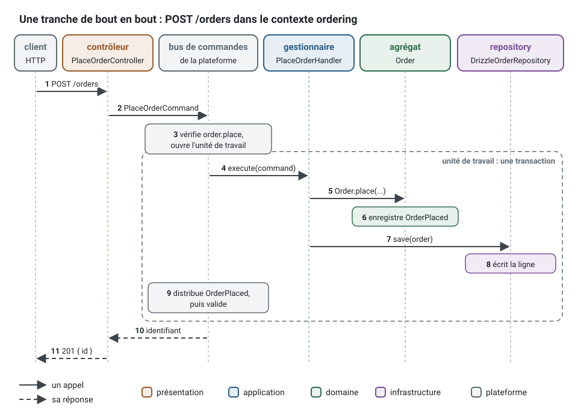

[English](first-slice.md) · **Français**
<!-- translation-of: first-slice.md sha256:881baca31d5e2b43 -->

# Une tranche, de bout en bout

Les lignes `generate` des [commandes que l'agent exécute](../../README.fr.md#ce-que-lagent-exécute) construisent une
tranche verticale du contexte `ordering` : la requête HTTP `POST /orders` traverse les quatre
couches. Le contrôleur, le gestionnaire,
l'agrégat `Order` et son repository sont des classes que les générateurs ont écrites ; le bus
de commandes vient de la plateforme qu'a écrite `init`.



1. Le contrôleur (`presentation/http/orders/place-order/place-order.controller.ts`) valide le
   corps avec son schéma, construit `PlaceOrderCommand` avec l'acteur de la requête HTTP et
   l'envoie sur le bus de commandes (1, 2).
2. Le bus de commandes de la plateforme journalise et mesure le cas d'usage, ne le laisse
   passer que si l'acteur détient `order.place`, et ouvre l'unité de travail (3).
3. Le gestionnaire (`application/commands/place-order/place-order.handler.ts`) interroge
   l'agrégat : `Order.place(...)` vérifie ses invariants et enregistre `OrderPlaced`, ou lève un
   refus (4 à 6).
4. Le gestionnaire sauvegarde par le port `OrderRepository` du domaine. L'adaptateur Drizzle
   (`infrastructure/persistence/drizzle-order.repository.ts`), lié à ce port au démarrage de
   l'application, écrit la ligne dans la transaction (7, 8).
5. L'unité de travail remet `OrderPlaced` à ses gestionnaires, toujours dans la transaction,
   puis valide (9). Le contrôleur répond `201` avec l'identifiant (10, 11). Un refus reçoit à
   la place un document d'erreur « problem details » (RFC 9457) qui porte son code stable.

Ce qui vous reste, c'est le métier : les endroits `TODO(domain)`. Une fois remplie, la partie
domaine et application de cette tranche se lit ainsi, en un seul bloc ici, là où les
générateurs écrivent un fichier par classe (le refus vient de
`generate error ordering Order empty`, l'événement de
`generate domain-event ordering Order Placed`) :

<!-- checked sample -->
```ts
import { definePermissions } from '@ddd-ts-kit/auth';
import {
  type Actor,
  AggregateRoot,
  AuthorizedCommand,
  type Clock,
  ConceptError,
  type DomainEvent,
  type IdGenerator,
  Repository,
} from '@ddd-ts-kit/kernel';
import { CommandHandler, Requires } from '@ddd-ts-kit/kernel/declarations';

// application/authorization/ordering.permissions.ts : `generate command` a déclaré la permission
export const orderingPermissions = definePermissions('ordering', {
  'order.place': { description: 'Place order' },
});

// domain/errors/order.error.ts : chaque refus est une fabrique statique avec un code stable
export class OrderError extends ConceptError {
  static empty() {
    return OrderError.refusal('ORDER_EMPTY', 'An order holds at least one product.');
  }
}

// domain/events/order-placed.event.ts : un fait, nommé au passé
export class OrderPlaced implements DomainEvent {
  static readonly eventName = 'ordering.order.placed';

  readonly name = OrderPlaced.eventName;

  constructor(
    readonly aggregateId: string,
    readonly occurredAt: Date,
    readonly customerId: string,
  ) {}
}

// domain/aggregates/order.aggregate.ts : les invariants vivent ici, et nulle part ailleurs
export interface OrderState {
  readonly customerId: string;
  readonly productIds: readonly string[];
  readonly placedAt: Date;
}

export class Order extends AggregateRoot<string> {
  private constructor(
    id: string,
    private state: OrderState,
  ) {
    super(id);
  }

  // le client et les produits voyagent ensemble : un objet de paramètres, trois paramètres au plus
  static place(id: string, request: Pick<OrderState, 'customerId' | 'productIds'>, now: Date): Order {
    if (request.productIds.length === 0) {
      throw OrderError.empty();
    }

    const order = new Order(id, { ...request, placedAt: now });

    order.record(new OrderPlaced(id, now, request.customerId));

    return order;
  }

  static rehydrate(id: string, state: OrderState): Order {
    return new Order(id, state);
  }

  toState(): OrderState {
    return { ...this.state };
  }
}

// domain/repositories/order.repository.ts : un port, une classe abstraite qui est son propre jeton d'injection
export abstract class OrderRepository extends Repository<Order> {}

// application/commands/place-order/place-order.command.ts : l'acteur d'abord, puis des données simples
@Requires(orderingPermissions['order.place'])
export class PlaceOrderCommand extends AuthorizedCommand<string> {
  constructor(
    actor: Actor,
    readonly customerId: string,
    readonly productIds: readonly string[],
  ) {
    super(actor);
  }
}

// application/commands/place-order/place-order.handler.ts : le temps et les identifiants viennent de ports
@CommandHandler(PlaceOrderCommand)
export class PlaceOrderHandler implements CommandHandler<PlaceOrderCommand> {
  constructor(
    private readonly orderRepository: OrderRepository,
    private readonly ids: IdGenerator,
    private readonly clock: Clock,
  ) {}

  async execute({ customerId, productIds }: PlaceOrderCommand): Promise<string> {
    const order = Order.place(this.ids.next(), { customerId, productIds }, this.clock.now());

    await this.orderRepository.save(order);

    return order.id;
  }
}
```

Le gestionnaire n'ouvre jamais de transaction, ne vérifie jamais la permission et ne publie
jamais l'événement : le bus de commandes et le repository le font, autour de lui. Sa spec
l'exécute dans l'application de test avec les fakes de ses ports ;
[Quelle commande, quand](commands.fr.md#une-première-fonctionnalité-à-partir-de-zéro)
suit cette première fonctionnalité jusqu'au bout, et l'[application d'exemple](../../examples/scheduling/README.fr.md)
montre un produit entier construit de cette façon.
