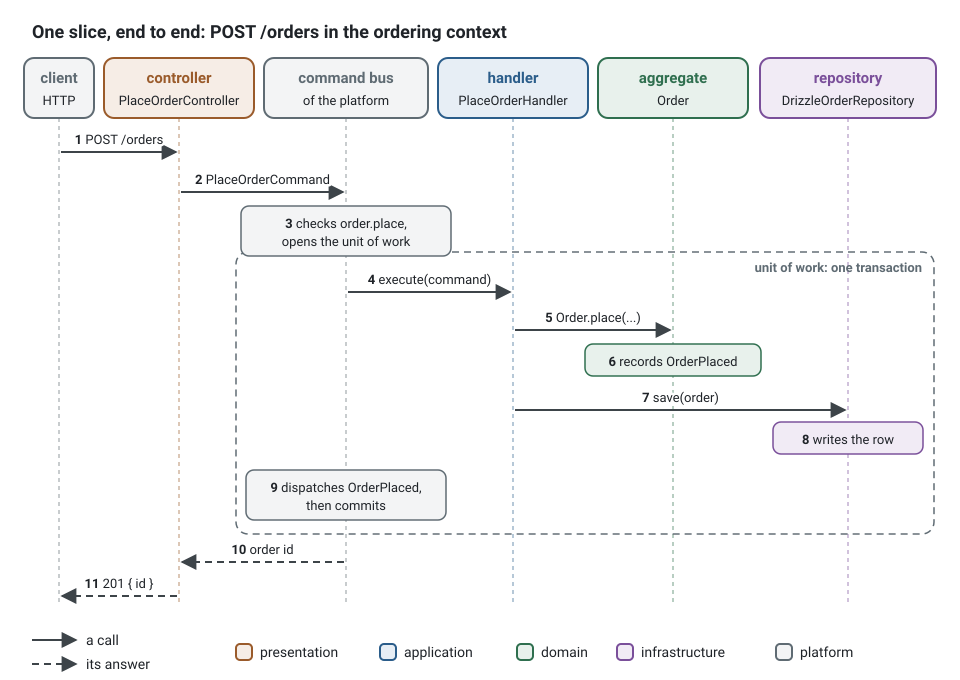

**English** · [Français](first-slice.fr.md)

# One slice, end to end

The `generate` lines of the [commands the agent runs](../../README.md#what-the-agent-runs) build a vertical slice of
the `ordering` context: the request `POST /orders` crosses the four layers. The controller, the handler, the `Order` aggregate and
its repository are classes the generators wrote; the command bus comes from the platform that
`init` wrote.



1. The controller (`presentation/http/orders/place-order/place-order.controller.ts`) validates
   the body with its schema, builds `PlaceOrderCommand` with the actor of the request and sends
   it on the command bus (1, 2).
2. The command bus of the platform logs and measures the use case, lets it through only when the
   actor holds `order.place`, and opens the unit of work (3).
3. The handler (`application/commands/place-order/place-order.handler.ts`) asks the aggregate:
   `Order.place(...)` checks its invariants and records `OrderPlaced`, or throws a refusal
   (4 to 6).
4. The handler saves through the `OrderRepository` port of the domain. The Drizzle adapter
   (`infrastructure/persistence/drizzle-order.repository.ts`), bound to that port when the
   application starts, writes the row inside the transaction (7, 8).
5. The unit of work hands `OrderPlaced` to its handlers, still inside the transaction, then
   commits (9). The controller answers `201` with the identifier (10, 11). A refusal answers a
   problem document (RFC 9457) that carries its stable code instead.

What is left to you is the business: the `TODO(domain)` places. Filled in, the domain and
application part of this slice reads as follows, in one block here where the generators write
one file per class (the refusal comes from `generate error ordering OrderEmpty onPlacement`, the
event from `generate domain-event ordering Order Placed`):

<!-- checked sample -->
```ts
import { definePermissions } from '@ddd-ts-kit/auth';
import { NamedDomainEvent, 
  type Actor,
  AggregateRoot,
  AuthorizedCommand,
  type Clock,
  DomainRefusal,
  type DomainEvent,
  type IdGenerator,
  Repository,
} from '@ddd-ts-kit/kernel';
import { CommandHandler, Requires } from '@ddd-ts-kit/kernel/declarations';

// ordering.permissions.ts: `generate command` declared the permission
export const orderingPermissions = definePermissions('ordering', {
  'order.place': { description: 'Place order' },
});

// ordering.codes.ts: the codes of the context, one closed list
export const OrderingCodes = {
  OrderEmpty: 'ORDER_EMPTY',
} as const;

// domain/errors/order-empty.error.ts: one class per refusal, built by a static factory
export class OrderEmpty extends DomainRefusal {
  readonly code = OrderingCodes.OrderEmpty;

  static onPlacement() {
    return OrderEmpty.refusal('An order holds at least one product.');
  }
}

// domain/events/order-placed.event.ts: a fact, named in the past tense
export class OrderPlaced extends NamedDomainEvent('ordering.order.placed') {
  constructor(
    readonly aggregateId: string,
    readonly occurredAt: Date,
    readonly customerId: string,
  ) {
    super();
  }
}

// domain/aggregates/order.aggregate.ts: the invariants live here, and nowhere else
export interface OrderState {
  readonly customerId: string;
  readonly productIds: readonly string[];
  readonly placedAt: Date;
}

export class Order extends AggregateRoot<string> {
  private constructor(
    id: string,
    private state: OrderState,
  ) {
    super(id);
  }

  // the customer and the products travel together: one parameter object, three parameters at most
  static place(id: string, request: Pick<OrderState, 'customerId' | 'productIds'>, now: Date): Order {
    if (request.productIds.length === 0) {
      throw OrderEmpty.onPlacement();
    }

    const order = new Order(id, { ...request, placedAt: now });

    order.record(new OrderPlaced(id, now, request.customerId));

    return order;
  }

  static rehydrate(id: string, state: OrderState): Order {
    return new Order(id, state);
  }

  toState(): OrderState {
    return { ...this.state };
  }
}

// domain/repositories/order.repository.ts: a port, an abstract class that is its own injection token
export abstract class OrderRepository extends Repository<Order> {}

// application/commands/place-order/place-order.command.ts: the actor comes first, then plain data
@Requires(orderingPermissions['order.place'])
export class PlaceOrderCommand extends AuthorizedCommand<string> {
  constructor(
    actor: Actor,
    readonly customerId: string,
    readonly productIds: readonly string[],
  ) {
    super(actor);
  }
}

// application/commands/place-order/place-order.handler.ts: time and identifiers come from ports
@CommandHandler(PlaceOrderCommand)
export class PlaceOrderHandler implements CommandHandler<PlaceOrderCommand> {
  constructor(
    private readonly orderRepository: OrderRepository,
    private readonly ids: IdGenerator,
    private readonly clock: Clock,
  ) {}

  async execute({ customerId, productIds }: PlaceOrderCommand): Promise<string> {
    const order = Order.place(this.ids.next(), { customerId, productIds }, this.clock.now());

    await this.orderRepository.save(order);

    return order.id;
  }
}
```

The handler never opens a transaction, never checks the permission and never publishes the
event: the command bus and the repository do, around it. Its spec runs it through the test
application with the fakes of its ports; [Which command, when](commands.md#a-first-feature-from-zero) follows
this first feature to the end, and the [example application](../../examples/scheduling/README.md)
shows a whole product built this way.
