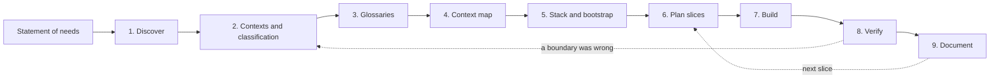

# Methodology: from a statement of needs to running code

**Summary.** This guide walks the path the plugin drives, step by step: discover the domain in
writing, find and classify the bounded contexts, write the glossaries, draw the context map,
choose the stack by criteria, bootstrap, plan vertical slices, build them (in parallel when
there are several workers), verify, and document. Each step names its input, the file it leaves
in the repository, the tool that produces it and the question that tells you the step is done.
Strategic decisions belong to people; the tools make them explicit and keep them true.

## The path at a glance



| Step | Input | Output artefact | Produced by | Done when |
|---|---|---|---|---|
| 1. Discover | statement of needs, domain experts | `docs/architecture/discovery.md` | skill `discover-domain` (a written event storming) | every need appears as a command and a domain event, and every disagreement is a listed hot spot |
| 2. Contexts | the discovery timeline | `docs/architecture/contexts.md` | skill `bounded-contexts` | each context is one language and one owner, the core is named, every boundary is argued |
| 3. Glossaries | the nouns, verbs and facts of each context | `docs/architecture/glossary.md` before the bootstrap, then `## Ubiquitous language` of each `CONTEXT.md` | skill `glossary`; `generate ... --term` | a domain expert would sign each definition |
| 4. Context map | policies and read models that cross a boundary | `docs/architecture/context-map.md` (draft), then `contexts.<name>.upstreams` in the config and `docs/context-map.md` | skill `context-map`; `ddd-ts-kit docs` | every arrow has a pattern, a contract and a reason, and there is no cycle |
| 5. Stack and bootstrap | constraints of the team and of operations; the three drafts | `stack` in `ddd-ts-kit.config.json`, the project skeleton, the pipeline, one ADR per debated choice | skill `bootstrap` (started by a person), `ddd-ts-kit init`, `generate adr` | `npm run verify` is green on the empty project, and it is committed |
| 6. Plan | the commands and queries of step 1 | `docs/architecture/slices.md` | skill `plan-slices` | each slice can be built and merged on its own, in this order |
| 7. Build | one slice | domain, handler, adapter, route, their specs; one commit per slice | skill `use-case` (which uses `scaffold`), or `parallel-work` for several workers | no `TODO(domain)` and no `it.todo` is left in the slice |
| 8. Verify | the change | a green gate | `npm run verify`, skill `quality-gate` | every check passes without a new suppression |
| 9. Document | the diff of the generated documents | context map, `CONTEXT.md` lists, OpenAPI, AsyncAPI, catalog, ADRs | `ddd-ts-kit docs`, `npm run docs:generate`, skill `document` | `docs --check` reports nothing stale |

Steps 1 to 7 are the ones the `start` skill of the plugin conducts (`/ddd-ts-kit:start`, run
by a person). It keeps the state of the project in `docs/architecture/plan.md` (steps done,
decisions, open questions, and a `Next:` line), so a later session resumes from one file, and
it closes each step on a yes of the project owner, never on its own judgement. Steps 8 and 9
happen inside every slice of step 7; they are listed apart because they are also what CI
replays.

The plugin's skills were being reorganised while this guide was written (2026-10-10): the
names above are those of the `plugin/skills` directory on that day. If a name differs in your
version, the list printed by the plugin is right.

## 1. Discover the domain: a light event storming in writing

Event storming (Brandolini) is usually done on a wall with sticky notes. The same questions
work in a text file, which is what a small team or a coding agent can actually keep. The skill
`discover-domain` drafts it from the needs, asks only what the needs do not say, and writes
`docs/architecture/discovery.md` as a timeline. Its elements, in this order:

1. **Events**: facts in the past tense. "An appointment was booked", "working hours were
   changed", "a reminder was sent".
2. **Commands**: what somebody asked for that caused each event. "Book an appointment".
3. **Actors**: who gives each command. A client, a practitioner, a scheduled job.
4. **Policies**: "whenever X happened, then Y". "Whenever an appointment is booked, a
   confirmation is sent." A policy is the seed of an integration event handler.
5. **Read models**: what somebody needs to see in order to decide. "The open slots of a
   practitioner for a week."

For the scheduling application, a fragment:

| Actor | Command | Event | Policy that follows | Read model needed |
|---|---|---|---|---|
| client | book an appointment | appointment booked | send a confirmation; schedule a reminder | open slots of a practitioner |
| client or practitioner | cancel an appointment | appointment cancelled | free the slot; tell the other party | my appointments |
| practitioner | set working hours | working hours changed | recompute open slots | my calendar |
| time (every morning) | send reminders | reminder sent | none | appointments of tomorrow |

The skill also lists the external systems (here: the identity provider, the email and SMS
providers) with what happens when each is down, and the rules heard on the way ("a
practitioner is never booked twice").

Then mark the hot spots: every place where two people use one word differently, or where
nobody knows the rule ("until when may a client cancel for free?"). A hot spot is a question
for a domain expert, never a guess.

**Done when** every event has a command and an actor, every cross-cutting consequence is a
policy, and the open questions are listed.

## 2. Find and classify the contexts

Group events and commands that speak one language and change together. The skill
`bounded-contexts` proposes candidates and tests each one with you: language (does a word
change meaning?), autonomy (who decides the rules?), consistency (what must be true in the
same transaction?), size, and whether one person or one agent can hold it in mind. It writes
`docs/architecture/contexts.md` with the reason for every boundary and the cuts that were
rejected. See [Bounded context](../concepts/bounded-context.md) and the
[worked example](../concepts/context-map-worked-example.md).

Classify each one (`core`, `supporting`, `generic`): the classification decides where the
design effort goes, see [Domain and subdomains](../concepts/domain-and-subdomains.md).

**Done when** no use case of step 1 needs to write in two contexts in one transaction. If one
does, either the two are one context, or the requirement becomes a process: one decides, the
other reacts.

## 3. Write the glossaries

Before the bootstrap the glossary is a draft, `docs/architecture/glossary.md`, one section per
context; after it, the only copy is the `## Ubiquitous language` table of each `CONTEXT.md`.
The glossary comes before the code, and the tools hold that order: the scaffolder refuses a
name whose words are not terms of the context, and `language/glossary-term` reports it
afterwards ([rule table](../ARCHITECTURE.md#3-dependency-rules)).

```bash
npx ddd-ts-kit generate context appointments --classification core \
  --purpose "Clients book, reschedule and cancel appointments with practitioners. It guards that a practitioner is never booked twice for the same time." \
  --term "Appointment=A client's reserved time with a practitioner" \
  --term "Book=To reserve a slot for a client" \
  --term "Slot=A start and an end instant at which a practitioner can receive"
```

Then fill `CONTEXT.md` by hand: for each term, its meaning here and what it must not be
confused with in a neighbouring context. See
[Ubiquitous language](../concepts/ubiquitous-language.md).

**Done when** the first aggregate and the first use case can be named without `--allow-name`.

## 4. Draw the context map and choose relationship patterns

A relationship is declared, never implied by an import. The downstream names its upstream and
the pattern; `published-language` is the default. Before the bootstrap the skill `context-map`
writes a draft table (downstream, upstream, pattern, what crosses, why); afterwards the
relationships live in the config.

```bash
npx ddd-ts-kit generate context notifications --classification supporting \
  --upstream appointments:published-language
npx ddd-ts-kit docs
```

`docs/context-map.md` then holds a generated diagram and table between markers, and four
written sections outside them (reading guide, why these boundaries, relationship notes, known
tensions). Write those: the diagram shows what, only people can say why. The patterns and
their costs are in [Context map](../concepts/context-map.md).

**Done when** `npx ddd-ts-kit check --rule context/no-cycle --rule context/declared-relationship`
is clean and every pattern other than the default has a sentence of justification.

## 5. Choose the stack by criteria, then bootstrap

Choosing among supported options is the project owner's call, and it is not a deviation. Decide
each line with a criterion you can state, and write an ADR for a choice that was debated:

| Decision | Page |
|---|---|
| HTTP framework | [HTTP frameworks](../tools/http-frameworks.md) |
| Validation library | [Validation](../tools/validation.md) |
| Dependency injection | [Dependency injection](../tools/dependency-injection.md) |
| ORM and database | [Persistence](../tools/persistence.md) |
| Broker, or none | [Message brokers](../tools/message-brokers.md) |
| Cache and locks | [Cache and coordination](../tools/cache-and-coordination.md) |
| Identity provider | [Identity](../tools/identity.md) |
| Authorization model | [Authorization engines](../tools/authorization-engines.md) |
| Tracing, logs, errors | [Observability](../tools/observability.md) |
| CI platform | [Static analysis and pipeline](../tools/static-analysis-and-pipeline.md) |
| Test runner | [Test runners](../tools/test-runners.md) |

Start with the least that works: no broker (the in-memory bus behind the outbox), roles for
authorization, one deployable. Each of these can be changed later by replacing an adapter;
that is what the ports are for.

Each value of `stack` in the config should be defensible in one sentence.

`/ddd-ts-kit:bootstrap` is run by a person, not started by the agent on its own. It previews
with `--dry-run`, runs `ddd-ts-kit init` with the chosen flags, installs, and proves the
result with `npm run verify`. An existing project is adopted: existing files are skipped
unless `--force` is given.

This step is the one that must be finished, merged and shared before any parallel work
starts, because it creates the files everybody else's work is registered in
([Parallel work](parallel-work.md)).

**Done when** `npm run verify` passes on the default branch and the pipeline's final gate is a
required check.

## 6. Plan vertical slices per context

A slice is one command or one query, end to end, inside one context: domain behaviour,
handler, adapter if a new port is needed, route, tests. Order them per context so that each
one is demonstrable:

1. the slice that creates the main aggregate (`BookAppointment`);
2. the slices that change it (`RescheduleAppointment`, `CancelAppointment`);
3. the reads (`GetAppointment`, `ListAppointments`);
4. what crosses a boundary: the integration event, then its handler in the downstream.

`npx ddd-ts-kit list` shows what exists per context, so the plan is a difference between that
output and the lists of step 1. The skill `plan-slices` writes it to
`docs/architecture/slices.md`.

**Done when** no slice touches two contexts, and every cross-context need is two slices: a
published event upstream, a handler downstream.

## 7. Build, test first, inside out

The skill `use-case` drives one slice: restate it in the domain's words, name the permission
(a use case is protected or explicitly public, never undecided), scaffold each file with
`generate ... --json`, open only the `TODO(domain)` places the output lists, write the
aggregate spec, then the handler spec with fakes, then the adapter and the route.

With several workers, one context per worker: see [Parallel work](parallel-work.md).

**Done when** the slice has no `TODO(domain)` and no `it.todo` left; a marker that cannot be
resolved is a question for the owner, listed as such.

## 8. Verify

`npm run verify` chains the checks; `npx ddd-ts-kit check --changed-since origin/main` is the
fast loop while working. A violation carries a rule id and a fix sentence, and
`npx ddd-ts-kit explain <rule-id>` gives the reason. Fix the cause. A suppression, a lowered
severity or a skipped test is a deviation: it needs the owner's agreement and a decision
record (`governance/recorded-deviation`).

**Done when** the gate is green with no new suppression.

## 9. Document

Generated documents are regenerated, never edited: `npx ddd-ts-kit docs` for the context map,
the `CONTEXT.md` lists and the barrels; `npm run docs:generate` for the OpenAPI document, the
AsyncAPI document and the event catalog. Read their diff: it is the summary of what the change
did to the architecture. Then update the written parts the diff makes stale, and commit
documentation with the code that changed it ([Commit discipline](commit-discipline.md)).

**Done when** `npx ddd-ts-kit docs --check` and `npm run docs:check` report nothing.

## Limits and when not to use it

- **The method front-loads thinking.** For a throwaway prototype or a three-table CRUD tool,
  steps 1 to 4 cost more than they return. A `generic` or simple `supporting` context deserves
  a thin model; do not run a full discovery for it.
- **A written event storming is a substitute, not an equivalent.** The workshop format exists
  to put experts and developers in one room. Use the text form to prepare or record a
  conversation, not to avoid it.
- **The first boundaries are hypotheses.** Expect to move one within the first weeks; the
  "known tensions" section of the context map is where the suspicion is written before the
  move. Moving a boundary late is expensive: data moves with it.
- **The tools check form, not truth.** The checker verifies that a term exists in the glossary,
  not that its meaning is right; that a relationship is declared, not that the pattern fits.
- **The glossary check matches words crudely** (see the limits in the
  [CLI README](../../packages/cli/README.md)): it knows no synonyms.

## Sources

- Alberto Brandolini, *Introducing EventStorming*, Leanpub (events, commands, actors, policies,
  read models, hot spots).
- Eric Evans, *Domain-Driven Design*, Addison-Wesley, 2003, parts I and IV (ubiquitous language,
  strategic design).
- Vlad Khononov, *Learning Domain-Driven Design*, O'Reilly, 2021, chapters 1 to 4 and 12
  (subdomains, bounded contexts, event storming).
- Michael Nygard, "Documenting Architecture Decisions", 2011.
- This repository: [`plugin/skills`](../../plugin/skills), the
  [CLI README](../../packages/cli/README.md).

## See also

- [Context map: a worked example](../concepts/context-map-worked-example.md)
- [Team workflow](team-workflow.md)
- [Parallel work](parallel-work.md)
- [Commit discipline](commit-discipline.md)
- [Architecture reference](../ARCHITECTURE.md) and [configuration](../CONFIG.md)
