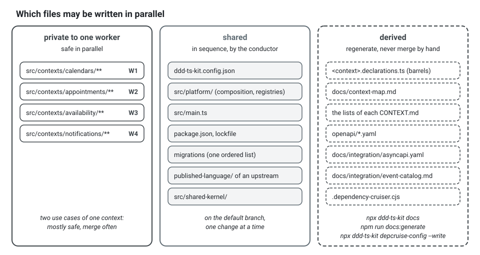
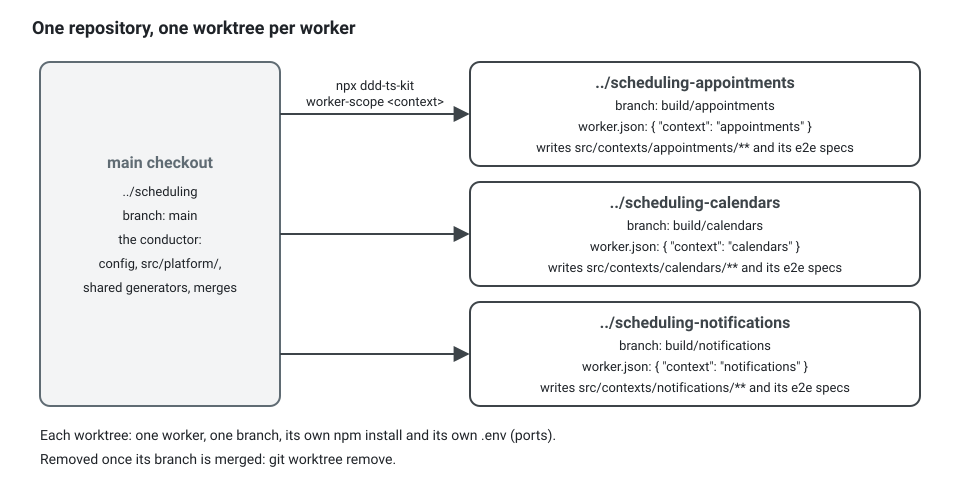

**English** · [Français](parallel-work.fr.md)

# Parallel work without collisions

**Summary.** Several people, or several coding agents, can build one project at the same time
if the work is sliced along the two seams the architecture already has: the bounded context
and the vertical use case. Almost everything inside a context is private to it and safe to
write in parallel. A short list of files is shared by construction (the config, the generated
barrels and documents, the composition root, the migrations, the published language of an
upstream) and must be changed in sequence. This guide lists both, explains worktrees, merge
order and who regenerates what, and ends with a concrete plan: four contexts of a scheduling
application built by four workers after a shared bootstrap.

## Two ways to slice

**By bounded context.** One worker, one context. The closed tree puts everything a context
needs under `src/contexts/<context>/`, and the rules forbid reaching into another context
except through its published language. Two workers in two contexts therefore edit disjoint
directories.

**By vertical use case, inside a context.** One command or query, end to end: its folder under
`application/commands/` or `application/queries/`, its route, its specs. Two use cases of one
context share the aggregate file and the context's generated barrel, so they conflict more
often than two contexts do. Parallelise inside a context only after the aggregate's shape has
settled.

Do not slice by layer ("you write the domain, I write the handlers"): each half is untestable
until the other exists, and the two meet in every file.

## What is safe in parallel, and what must be sequenced

| File or area | Written by | Parallel? | How to handle |
|---|---|---|---|
| `src/contexts/<A>/**` and `src/contexts/<B>/**` | different workers | yes | disjoint by construction |
| two use case folders of one context | different workers | mostly | they meet in the aggregate, the barrel and the routes file: merge often |
| `ddd-ts-kit.config.json` | `init`, `generate context`, `generate service`, `generate worker`, `generate adr --deviation` | **no** | create all contexts and relationships in the bootstrap; later changes one at a time, by the platform owner |
| `src/platform/compose-application.ts`, `src/platform/platform.module.ts`, `src/platform/platform-test.module.ts` | `generate context` (the composition root), `generate gateway` (the two modules, in the declared style), hand edits | **no** | registration regions are written between markers; two branches adding a context both touch them |
| the registries of the platform: `src/platform/database/schema.ts` (with Prisma, `prisma/schema.prisma`), `src/platform/auth/authorization/permissions.ts`, `src/platform/auth/authorization/role.ts`, `src/platform/auth/authorization/access-policies.ts` (explicit style), `src/platform/audit/audited-events.ts`, `src/platform/job-settings.ts`, the grants under `src/platform/auth/`, and the helper `src/platform/resilience/own-policy.ts` | `generate context`, `generate repository` (the first of a context; every one with Prisma), `generate command --aggregate` on an aggregate that has no repository yet, `generate route-group --role` with a new role, `generate policy` (explicit style), `generate integration-event`, `generate job`, `generate adapter` (the first of a project wired on tsyringe) | **no** | run these generators on the trunk before the workers start; `generate --help --json` says which kinds write shared files (`writesShared`) and which ones |
| `src/main.ts` | hand edits | **no** | the platform owner |
| `test/architecture/extractable.spec.ts`, `knip.json` (the first context) | `init`, `generate context` | **no** | same: written with each context |
| `<context>.declarations.ts` (the barrel, with what each constructor is injected), `<context>.dependencies.ts` under discovery | every `generate` in that context, `docs`, and `npm run dev` | per context | derived: never merge by hand, regenerate (below) |
| `docs/context-map.md`, the generated lists of each `CONTEXT.md` | `ddd-ts-kit docs`, every `generate` | **no**, but cheap | derived: regenerate after merging |
| `openapi/*.yaml`, `docs/integration/asyncapi.yaml`, `docs/integration/event-catalog.md` | `npm run docs:generate` | **no**, but cheap | derived and deterministic: regenerate after merging |
| `.dependency-cruiser.cjs` | `depcruise-config --write`, `generate context` | **no**, but cheap | derived from the config: regenerate |
| database migrations | the ORM's tooling | **no** | one schema per context keeps tables apart, but the migration sequence is one list: a worker generates a working migration, the conductor the real one at merge time |
| the `published-language/` of an upstream | the upstream's owner, and `generate gateway` run for a consumer (the read contract) | **no** for its consumers | merge the contract first; consumers branch from it |
| `src/shared-kernel/` | co-owners | **no** | rare by design; one change at a time |
| `package.json`, the lockfile | anyone adding a dependency | **no** | add dependencies in the bootstrap or in a dedicated change |

The pattern behind the table: a file is safe when one worker owns it, and a derived file is
never a merge problem as long as nobody tries to merge it.



### Generated files: regenerate, never resolve by hand

The barrel, the context map, the `CONTEXT.md` lists, the dependency-cruiser configuration, the
OpenAPI document, the AsyncAPI document and the event catalog are all functions of the sources.
When two branches changed one of them, the conflict carries no information. Take either side,
then:

```bash
npm run regenerate           # dependency rules, then docs:generate: context map, CONTEXT.md lists, barrels, OpenAPI, AsyncAPI, event catalog
npm run verify
```

In full, for the branch that lands second. Here the `notification` worker added
`GET /notifications/preferences` while the default branch received `GET /people/invitations` from
`identity`. The OpenAPI document sorts its paths, so both new entries land at the same place,
just before `/people/me`, and git cannot put one after the other. `merge-trunk` settles it:

```bash
git fetch origin
npx ddd-ts-kit merge-trunk                   # origin/HEAD, then origin/main; --trunk <ref> names another
```

```text
merge-trunk build/notification <- origin/main (4be1d07)
base 9c2e5a0: git merge-base (no commit of this branch found landed on the trunk)
conflicts: plain git merge 1, own diff since base 1, automatic 1, for you 0
automatic:
  openapi/openapi.yaml  derived: trunk side, regenerated at the end
regenerate: ok
lost lines: none lost
committed 71d0c3a "Merge origin/main into build/notification"
next: `npm run verify` in this worktree, then push
```

The regenerated document holds both routes, `/notifications/preferences` from this branch and
`/people/invitations` from the default branch, because both are now in the sources.

`npx ddd-ts-kit merge-trunk` brings the trunk into the branch as one merge commit and never
rebases. It settles by itself what a tool writes: a derived file takes the trunk's side and is
rewritten by `npm run regenerate` at the end, the generated regions of `CONTEXT.md` and of the
context map take the trunk's side, a conflict inside a generated registry
(`// ddd-ts-kit:<region>`) keeps the lines of both sides (a line one side removed stays removed),
`slices.md` merges row by row (each status the furthest of both sides), the stored-events lock
merges by key, the drizzle-kit journal and snapshots take the trunk's side before the replay, the
lockfile takes the trunk's side and is installed again when the branch changed `package.json`.

What is left (a conflict in a source file, in a test, outside a generated region, a cell of
`slices.md` both sides changed) stays in a merge in progress that git understands (`git status`
shows `UU`), and the command exits 1 with, for each file, the lines of each hunk, what this branch
and its rows did there, the commits of the trunk that touched it since the base and what they did:

```text
for you (a merge is in progress; `merge-trunk --abort` undoes it):
  src/contexts/billing/domain/invoice.ts  hunks at lines 40-58
    ours  (build/billing-2, rows #M1.02): adds 4 lines: pay(amount: Money, at: Date): void {
    theirs (origin/main since 6d8be4b, 9a0c1f2 "feat(billing): cancel an invoice (#7)"): adds 3 lines: cancel(reason: CancelReason): void {
    both sides only add lines: keep both. Never take one side of the whole file.
next: resolve each hunk, `git add <file>`, then `npx ddd-ts-kit merge-trunk --continue`
```

Each hunk is resolved keeping what both sides meant. `git merge -X theirs`, `-X ours` or
`git checkout --theirs <file>` on a source file settle every conflict at once by dropping the
other side, and git reports a clean merge while a whole slice of the branch (its method, its
route, its spec, its row marked done) is gone; the guard of the plugin refuses them to a
sub-agent. `--continue` refuses while a path is unmerged or keeps a conflict marker, then lands
the migrations, regenerates, and runs `verify-merge` on the uncommitted result: a line one side
added that the result lacks, a row of `slices.md` no longer done, a test, a spec file or a
migration gone stops it (exit 1), with `file:line` and the side to restore it from
(`git show ORIG_HEAD:<file>` for this branch). A removal decided on purpose:
`merge-trunk --continue --accept-lost`, which records it in the merge commit as a trailer
`Lost-Accepted: <file:line>,...`, listed by every later run without failing. The commit holds the
paths of the merge only (the conflicted ones, the derived files, the migrations, the decision
records, the lockfile); any other changed path is listed and blocks it until it is staged or set
aside. The message carries `Merge-Base: <commit>`, `Trunk: <commit>` and, when the branch was
found squashed there, `Landed: <commit>`: `verify-merge` judges the merge on that base later too.
A merge finished by hand with `git commit` keeps those trailers.

`--dry-run` previews (nothing changes), `--abort` undoes the merge in progress. The tree must be
clean and no other merge, rebase or cherry-pick in progress (exit 2 otherwise); the trunk is never
fetched, the commit it names is printed. `merge-trunk` needs git 2.40; an older git merges only
from the base git computes (`--since <merge base>`), with `git merge` itself.

`verify-merge` alone reads git only and lists, merge by merge, what a merge lost; it is silent
without a merge, so the pre-push hook of `init` runs it on every push, and `verify-slice` runs it
too; both only warn in this version, and a later minor version makes them block.

The generators are deterministic (sorted output, independent of registration order), so two
people regenerating from the same sources get the same bytes. `docs --check` and
`declarations/barrel-current` fail the pipeline if somebody forgot.

**Who regenerates:** everyone, then whoever merges second. A worker runs `npm run regenerate`
after each slice and commits the derived files with it, so that its branch passes `docs:check`
alone and never stops on "regenerate" as a need. The first branch to land is consistent by
itself; the second one runs `npx ddd-ts-kit merge-trunk`, which takes the trunk's side of each
derived file, regenerates and commits the result.

### Migrations

Each context owns its tables in its own database schema, so two contexts never alter the same
table. What they share is the ordered list of migration files. Generate the migration last,
just before merging, on top of the current default branch; if two branches each added "the
next" migration, the second one regenerates its own. Never edit a migration that has run
somewhere.

A worker whose slice changes the stored state still needs the table for its specs: it generates
a working migration, `npm run db:generate working-<what-it-does>`, the only migration the guard
lets it write. `persistence/migration-history` accepts it in the worktree and reports it on the
trunk, so the conductor replaces it at the merge by the real one, generated on the trunk
([persistence](../tools/persistence.md#migrations-names-merges-and-order)).

Under drizzle-kit, nobody deletes and regenerates by hand: when both sides added a migration
since the base, `merge-trunk` takes the trunk's journal and snapshots and generates the
migrations of the branch the trunk does not have again on top (`drizzle-generate --replay`), in
their order and under their names. In the worktree of a worker they stay working migrations.
Just before the squash merge, the conductor runs `npx ddd-ts-kit merge-trunk --to-land --cwd
<worktree>`: the `working-` prefix goes, in the worktree of a worker too, and the real migration
lands with the branch. A refusal of the replay (two migrations of the branch that change the
schema) stops the merge with its fix. Under knex, Prisma and TypeORM, `--to-land` renames each
migration of the branch the trunk does not have: a number after the trunk's last, without
`working-` (TypeORM: the class and its `name` follow, Prisma: the folder), the content kept.
When a migration the trunk gained since the base changes a table a migration of the branch
changes too, their order is a decision: the merge stops and says to generate it again on the
trunk (`npm run db:generate <what-it-does>`). `drizzle-generate --replay` stays for a merge made
without `merge-trunk`. A decision record of the branch whose number the trunk took meanwhile
gets the next free number (its file, its `# ADR-NNNN` title, the links of its translations).

A decision taken while building a slice (how a late fee is rounded, from which date a deadline
counts) is recorded by the worker itself: `generate adr "<title>"` writes a new
file of `docs/adr/`, which the guard lets the worker fill until it is committed with the slice.
A deviation from a rule, `generate adr --deviation`, also writes the config: it stays a need
for the conductor and a decision of the project owner. Two branches that took the same number
meet at the merge, where the later record takes the next free one.

### The published language of an upstream

A consumer cannot be built against a contract that is still moving. Merge the upstream's
declaration first (the event, its publisher, the regenerated catalog), as its own small pull
request, then let the consumers start. See "Contracts first" in
[Team workflow](team-workflow.md).

## Git worktrees

A worktree is a second working directory of the same repository on another branch. It lets
several workers run at once on one machine without stashing or switching:

```bash
git worktree add .worktrees/appointments -b feat/appointments-book
git worktree add .worktrees/calendars -b feat/calendars-working-hours
```

The worktrees of a project live in its `.worktrees/` folder, which `init` lists in `.gitignore`
and every tool of the project leaves out (Biome, ESLint, the checker, Docker): one place, never
a sibling folder lost next to the project, never one worktree nested in another, whichever
worktree a command runs from. `npx ddd-ts-kit worktree <name>` opens one for any piece of work,
on `work/<name>` cut from `origin/main`, installed. In a project `init` created, the guard of the
plugin refuses the code of a context in the main checkout of the trunk (`"worktrees":
"required"`, see [configuration](../CONFIG.md)): the conductor writes the contracts and the
skeletons in a worktree of its own too, lands them as a pull request, then cuts the workers from
`origin/main`. A project started before keeps `"advised"` until its owner sets it: the guard only
says where the code goes, and while its `.gitignore` does not hold `.worktrees/` the worktrees
open next to it, as before. A worktree of `.worktrees/` without its own `node_modules` would run
on the packages of the main checkout above it, the trunk's versions: the commands install it,
and the guard refuses its code until it is.

For one worker per context the CLI does it in one command:

```bash
npx ddd-ts-kit worker-scope appointments --base origin/main --rows M1.12
```

It adds a worktree on the branch `build/appointments` (by default in
`.worktrees/appointments`; `--worktree <path>` and `--branch <name>` change both), cut from
`--base` (by default the current branch), writes `.ddd-ts-kit/worker.json` naming the context in
it, with the rows briefed, the base and the branch, and prints the briefing of that worker: the directory it may write, the generators it may
run, its rows of `docs/architecture/slices.md` with the rules written under the tables
(`- #M1.12: refuses a booking outside working hours`), the contracts it consumes, and the base as
the trunk of its checks. `--rows` narrows the briefing to those rows, in that order, with a note
past two; without it, the briefing holds the first batch `plan-waves` cuts for the context (one
or two rows still to do on one aggregate: one agent's work), and a note names the `--rows` of the
next batch. `--dry-run` prints
the same without touching anything. It needs a repository with at least one commit. An
existing worktree, or branch, is kept when it contains the base, and refused when it does not:
a worker never starts from a stale trunk. Without `--base`, run from a worker's worktree, it
refuses too, since that worker's branch would become the trunk. When it keeps a worktree, only
the file is written again. In a worktree it creates, it then runs the clean install of the
package manager of the project (`npm ci`, `pnpm install --frozen-lockfile`), quietly, and its
notes say how long it took; when the install fails, or `--no-install` leaves it out, a note
says what to run before the worker starts. `init` lists `.ddd-ts-kit/` in `.gitignore`, so the file
is never committed. The guard of the plugin reads its `context`; the rest is what
`status --workers` shows:

```json
{
  "context": "appointments",
  "rows": ["M1.12"],
  "base": "origin/main",
  "branch": "build/appointments"
}
```

From the checkout of the trunk, `npx ddd-ts-kit status --workers` (`--json` for data) reads
every worktree of the repository that holds that file and shows, for each worker: its
worktree, its branch, its context, its rows, its base, the number of commits it is ahead of
the base, `dependencies not installed` when its copy of the project has no `node_modules`
(`installed` in JSON), the files it changed (committed since the merge base with the base,
modified, and untracked but not ignored), and whether it wrote `.ddd-ts-kit/report.md`, with
when and whether it is current. Once its branch was squash-merged into the base, the commit that took it in is shown
(`landed`), and its commits ahead and its files are counted from there: a reused branch with
nothing new counts nothing, and what already landed is no overlap. Its commits behind the base
and what `merge-trunk` would leave conflicted now (`behind`, `mergePreview`) follow. A `state:` line says where its rows stand and what to do next
(`progress` in JSON, described under [When an agent stops](#when-an-agent-stops)):

```text
    state: stopped mid-row #M1.14 (6 files uncommitted, 3 TODO(domain), last verify-slice failed: tests); resume: npx ddd-ts-kit worker-scope billing --resume
```

Then the
overlaps: a context built by two workers, and each file changed by more than one worker, with
the workers that changed it. Such a file conflicts at the merge of the second branch when both
changed the same lines: run it before briefing a second worker in a context, to give it other
files, and before each merge, to know which branches will meet in which files. A
file written by an older version of the kit holds the context only: the worker is shown
without its rows and its base, and its files are the uncommitted ones only. With no worker, it
says so in one line.

The briefing is filled from the project. In the example application, an excerpt of what
`npx ddd-ts-kit worker-scope notification --rows M1.31,M1.32,M1.33,M1.34 --dry-run` prints (the path shortened, `main` as the
trunk, and the generators, steps and report left out):

```text
You build the bounded context notification of scheduling.

Worktree: .worktrees/notification/   Branch: build/notification   Trunk: main
Run every command from the worktree (`cd .worktrees/notification/ && ...` or `--cwd .worktrees/notification/`).
Without node_modules: `npm ci`, never an install that names a package.

Scope
- You may write: src/contexts/notification/** and test/e2e/<use-case>.e2e.spec.ts of your slices.
- You may not write anything else. Shared files (config, src/platform, src/main.ts,
  package.json, lockfile, migrations, docs/) and other contexts are refused by the guard:
  report the need, do not work around it. The shell writes inside your scope only, as the editor tools do:
  a write outside it is refused, and inline code (`node -e`, a heredoc) that changed one stops you. A slice that changes the stored state generates a
  working migration only: `npm run db:generate working-<what-it-does>`. A decision taken in a slice is
  recorded by `generate adr` (without --deviation), and committed with it. The derived files (generated
  documents, barrels, context map, dependency rules) are written by `npm run regenerate`, never by hand.

Slices, in this order (rows of docs/architecture/slices.md)
- #M1.31 Contacts known from identity (projection): `@Projection` over `identity.person.registered` ; ...
- #M1.32 Send a notification for a fact of an appointment: `port notification Mailer`; ...
- #M1.33 Plan, withdraw and send reminders: `command notification PlanReminder --aggregate Reminder --permission reminder.plan`; ...
- #M1.34 Sent notifications of a person: `query notification SearchNotifications --permission notification.read --search` (`GET /notifications`) ; ...

Contracts you consume (read-only): src/contexts/scheduling/published-language/, src/contexts/identity/published-language/
```

### The design of a row, checked against the trunk

A row is often designed before it is built: in its `Slice` and `Start with` cells, in its rule
line, and in a design review of `docs/architecture/` (by convention
`docs/architecture/reviews/<topic>.md`, one `## #M2.03 <slice>` heading per row, names in
backticks). The trunk moves meanwhile: a service becomes a port, a command is removed. Under
each row whose design lives in such a document, the briefing names it:

```text
- #M2.03 Compute the refund: `command billing ComputeRefund ...` ; rules: ...
  design: docs/architecture/reviews/refunds.md (section "#M2.03 Compute the refund")
```

`worker-scope` then reads the names that design cites as code (paths, classes, `Class.member`)
against the base, from the history of the repository, without checking it out. It reports only
what has evidence: a name the history of the base removed (with the commit, and what replaced
it: the file it was renamed to, or a file the same commit added with the same words), a place
the canonical tree refuses, and a name the base never had when a close name of the same part (a
port for a service) arrived after the line citing it was written. A name still to build stays
silent, and so does a name whose sentence says it was removed. When something is reported, the
briefing carries a block of eight lines at most:

```text
Names of the design that origin/main does not have (checked at 1a2b3c4): build on what origin/main has,
and put each line in your report as a note for the conductor, who corrects the document.
- docs/architecture/reviews/refunds.md:14 `RefundBasisService`: removed by 9f3e2d1 (2026-10-16, "fix(billing): read the refund basis through a port"); now `RefundBasisReader`, src/contexts/billing/application/ports/refund-basis-reader.port.ts (added with the removal)
```

and the conductor gets a note naming the lines: correct them on the trunk before the worker
starts, or launch as is, since its briefing lists them. A worker never edits `docs/`. A local
base behind its upstream, or a shallow clone, is noted too: the names were checked against
what it has. `--json` holds the same under `citations`.

Without workers, `npx ddd-ts-kit cited --rows <id> --base origin/main` checks the design of a
row the same way, and `cited` alone every row not done; the conductor runs it before committing
a design review. After a change, `verify-slice` lists the names the slice removes that the
design of a row not done still cites, the worker's own rows left out; it never fails on them,
and the worker passes them on as notes. The reviewer runs `cited --removed-since <base>` for a
whole branch.



Each worktree has its own dependencies (they are not shared between worktrees: `worker-scope`
installs them) and its own ports if two of them run `npm run dev` or the end-to-end tests at once: the generated
`docker-compose.yml` takes its ports from `.env`, so give each worktree its own `.env`. Fast
tests need no server at all (adapter specs can run on an in-process PostgreSQL), which is what
makes four workers on one laptop practical.

A repository with submodules clones each of them again in every new worktree, which can take
minutes. Borrow the objects of a checkout that has them, and copy them at once:
`git submodule update --init --reference <checkout>/<submodule path> --dissociate <submodule path>`.
Without `--dissociate`, the new worktree keeps pointing at the objects of the reference, and
removing that checkout breaks it.

The git hooks are shared by every worktree of the repository, and the generated `lefthook.yml`
runs the lefthook of the worktree they fire in (`lefthook: node_modules/.bin/lefthook`): a
worktree without its dependencies fails the commit, loudly, instead of skipping the checks or
borrowing the lefthook of a checkout that may be gone. `npx ddd-ts-kit doctor` says when
`lefthook.yml` lacks that line or the clone lacks the hook (`npm run hooks:install`).

A new worktree starts from nothing, and what goes wrong there is its environment, not its code.
`npx ddd-ts-kit doctor` in it says, in a second and without network, what it lacks to run the
project: a Node that `engines.node` refuses or that `.nvmrc` does not name, `node_modules`
missing or installed before the lockfile last changed, a package of the kit installed at another
version than the CLI, a submodule not initialised; each with its fix. `--strict` fails while the
worktree cannot run the project.

Rules that keep worktrees from hurting:

- one worker per worktree, one branch per worktree; a worktree is not a place to share;
- stage file by file, and read the staged diff before committing: a broad `git add` in a
  directory another process writes to commits somebody else's half-finished work;
- remove the worktree when its branch is merged (`git worktree remove`);
- a `context-builder` agent rewrites `.ddd-ts-kit/report.md` in its worktree (ignored by git)
  after each commit and before it ends: when one stops, `worker-scope --resume` reads it there
  with the rest of the worktree.

For coding agents specifically: an agent told to work "in the appointments context" that is
started in the main checkout will still read, and may edit, anything. Give it a worktree and
name the directory it owns. The plugin's hook refuses a hand-written file where a generator
exists and any edit of a generated file (the three contracts, the barrel,
`.dependency-cruiser.cjs`), and asks before a change of the governed files (the config, the
lint, test, compiler and pipeline configuration). For its `context-builder` agent it goes
further: with a `.ddd-ts-kit/worker.json` in the worktree, a write outside
`src/contexts/<context>/` and the end-to-end specs is refused (in the acceptance spec of a story,
anything but removing `pending(...)` around a scenario; locking it is refused too), and so are a generator that
writes shared files and a dependency change, wherever its flags stand (`npm i -D zod`); the
clean install stays free. The same scope holds for the shell: an in-place edit such as
`sed -i`, a redirection or `tee`, and `cp`, `mv`, `rm`, `touch`, `git checkout -- <path>` or
`git restore` pass inside the scope and are refused outside it, or on a path only the shell
knows (`"$FILE"`). Inline code given to an interpreter (`node -e`, a heredoc) cannot be read in
advance: it runs, the guard notes the files outside the scope before it and compares them at
the worker's next command, and a file it changed there stops the worker until it is put back
(`git restore`, or `rm` of a new file, allowed for those files). `npx prettier` in a project
that `format` runs Biome on and a bare `npx biome` are refused. Output to `/dev/null` or the system temp directory stays free, and the conductor
is not held to any of this. A worker passes `--local-only` to `generate`:
the command then refuses, and writes nothing, when the kind would write outside its context:

```text
$ npx ddd-ts-kit generate job notification SendDueConfirmations --every 15m --command SendNotification --local-only
Error: --local-only: this command would write 2 shared files: src/platform/auth/relationships/relate-system-actors.ts, src/platform/job-settings.ts.
  fix: Nothing was written. Have it run on the trunk without --local-only (the conductor of a parallel build does it), merge the trunk, then go on; a generated document listed alone means the trunk is stale: run `ddd-ts-kit docs` there first.
```

### When an agent stops

An agent stops before its rows are done for many reasons: its turn limit (`maxTurns: 150` for
the `context-builder`), a full context (`Prompt is too long`), a rate limit, a person. It cannot
count its own turns, so it is not asked to: the guard counts and warns it, and what it leaves is
read from git and from files the kit writes, never from what it says.

**Two notices before the limit.** The guard counts the tool calls of a `context-builder` inside
the hooks that already run on its shell commands and its writes (no hook is added on every tool
call), and adds a notice to the call that crosses each threshold, once a run: "your turn limit
is near" (finish the slice under way, start no other) and "your turn limit is close" (stop
changing code, commit what `verify-slice` passed, rewrite the report, end). Reads (`Read`,
`Grep`, `Glob`) are not seen, so the thresholds assume a quarter of the calls uncounted: on the
measured runs, where nearly every call went through the shell, the notices came at 90 and 117
calls of 150, early rather than late. Stopping early costs a message; stopping late loses the
report. A resumed agent gets a new turn budget, and its count starts again.

**What the worktree holds**, all under `.ddd-ts-kit/`, ignored by git:

- the commits of the branch, each closing one row with the trailer `Slice: <id>`: in a worker's
  worktree, `verify-slice` prints the exact commit command, `git commit -m "feat(billing): pay an
  invoice" -m "Slice: M1.14"` (a commit without trailer, from an older kit, is matched in order
  with the `feat(<context>)` commits and shown `(by order)`);
- `verification.json`, written by `verify-slice` in a worker's worktree: when it ran, at which
  commit, for which row, the steps that failed and the paths it listed to stage;
- `agent.json`, written by the guard: the agent id, its run (1 at launch, one more at each
  resume), when its run started and at which commit, when it was last seen, the calls counted,
  the calls each committed row took, and its last stop when it ended on its own;
- `report.md`, written by the agent, whose freshness is read from the time of the last commit
  and of the last change of a file of the slice.

**One command for the conductor.** On a stop notification, from the trunk:

```text
$ npx ddd-ts-kit worker-scope billing --resume
worker build/billing  .worktrees/billing  (base origin/main)
rows: #M1.07 committed a1b2c3d, #M1.12 committed d4e5f6a, #M1.14 in progress, #M1.15 to do
#M1.14: 6 files uncommitted (src/contexts/billing/...), 3 TODO(domain), 2 it.todo; last verify-slice 2026-10-17T19:02Z failed: tests (2 files changed since)
report: written 2026-10-17T19:05Z (current)
agent: a389e09, run 1, 104 tool calls counted, last tool call 2026-10-17T19:06Z, stopped without ending (a limit or an error) with a current report

next: SendMessage to a389e09:
---
Continue row #M1.14 (Pay an invoice) in .worktrees/billing; do not start #M1.15.
Committed: #M1.07, #M1.12. Left modified by you: src/contexts/billing/... 3 TODO(domain) and 2 it.todo remain; your last verify-slice failed at tests.
Next: finish #M1.14, `npx ddd-ts-kit verify-slice billing --since origin/main` until it passes, commit with the command it prints, rewrite .ddd-ts-kit/report.md, end with the report.
---
If SendMessage is refused, or the agent stops again without progress: launch a new context-builder with this briefing:
---
<the briefing of #M1.14 only, then: Resume: row #M1.14 was started by an earlier agent. These files exist and are yours
to continue: never regenerate, delete or reset them: ... Start with `npx ddd-ts-kit todo billing` and `verify-slice`, not
with the generators. Its report: (quoted, 200 words at most)>
---
```

It reads only: it creates no worktree or branch and rewrites no file, so a sub-agent may run it
too. `next` is `SendMessage` when the agent stopped mid-row after progress in a run that is not
its third (it keeps its history); a new agent between rows, without a recorded agent, after
three runs, after a run without progress, or with `--fresh` (a full context); the merge once
every row is committed and nothing is left. Several worktrees of one context need
`--worktree <path>` or `--branch <name>`. `--json` gives `{ progress, next, sendMessage,
briefing }`. In a new session of the conductor, the session start names each worker to resume
with this command; without a worker worktree it starts no process for it.

**What the hooks verify, and what they cannot.** Checked with headless runs of Claude Code: a
notice added by the guard reaches the agent's model, which follows it; `SubagentStart` fires at
the launch and at a `SendMessage` resume; `SubagentStop` fires when the agent ends on its own and
honours one `block`, and then the guard keeps it going once when it would leave a slice that
passed `verify-slice` uncommitted, or no current report. A stop at the turn limit runs no hook at
all: the notices are the primary mechanism, and `--resume` reads the rest from the worktree.

The parallel-work skill tells the conductor what to do on each kind of stop: run `--resume`, send
the message as it is without asking, launch the briefing for a new agent, wait for a rate limit,
and after two stops on one row without a new commit, split the row or ask the owner.

## Waves and batches

When several stories build in one context at once, which rows can start, how to group them for
the agents, which groups can run side by side and in which order to merge is computed from
`docs/architecture/slices.md`, not worked out by hand:

```bash
npx ddd-ts-kit plan-waves            # the whole plan; plan-waves <context> for one context; --json for data
```

It takes the rows that are not `done`. Wave 1 holds the rows whose dependencies are all done;
wave n the rows whose dependencies are done or in earlier waves: the rows of one wave never wait
for each other. Each wave is cut into batches: one owner and one context per batch (a context's
worker, the conductor or a person), two rows at most, since an agent holds two before its turns
or its context run out, and two rows in one batch only when their `Start with` names the same
aggregate (`--aggregate Invoice`, `aggregate billing Invoice`, `repository billing Invoice`). Two
batches of one context in one wave that name the same aggregate are likely to touch the same
files: run them one after the other. When a batch names no aggregate, the command says the
overlap is unknown instead of guessing. Each batch of a worker comes with its `worker-scope`
command, with a worktree and a branch of its own when its wave holds another batch of that
context; a batch of the conductor is built on the trunk. The merge order follows: by wave, and in
a wave the batch the most rows wait for first. For two stories in `billing`, an excerpt:

```text
Waves (docs/architecture/slices.md): 7 rows not done, 2 waves, 6 batches
Wave 1
  W1.1 billing (aggregate Invoice)
    #US1.02 slice "Issue invoice"
    #US1.03 slice "Cancel invoice"
    npx ddd-ts-kit worker-scope billing --base origin/main --rows US1.02,US1.03 --worktree .worktrees/billing-w1.1 --branch build/billing-w1.1
    likely to touch the same files as W1.3
  W1.2 conductor, billing (aggregate Customer)
    #US2.01 skeleton "Customer"
    on the trunk, by the conductor
  ...
Wave 2
  W2.3 billing (aggregate unknown)
    #US2.03 slice "Overdue invoices", after #US1.02
    npx ddd-ts-kit worker-scope billing --base origin/main --rows US2.03 --worktree .worktrees/billing-w2.3 --branch build/billing-w2.3
    unknown whether it touches the files of W2.1, W2.2: no aggregate named
Merge order: W1.1, W1.2, W1.3, W2.1, W2.2, W2.3
Before each merge: `npx ddd-ts-kit merge-trunk --to-land --cwd <worktree>`, then the squash merge
```

A plan that cannot be ordered gets no wave: a cycle in `Depends on`, a dependency on an id no row
carries, a row without owner or an id two rows carry is reported alone, and the command exits 1.

Between two merges, `npx ddd-ts-kit status` says of each row not done whether it is ready on the
trunk (every dependency done), ready on a branch (each dependency not done is a row briefed to a
worker whose worktree has commits ahead of its base, read from its `.ddd-ts-kit/worker.json`), or
waiting, with the ids it waits for:

```text
    #US1.04 billing slice "Pay invoice" (owner billing, depends on US1.02): ready on a branch, once #US1.02 merges
    #US2.02 billing slice "Register customer" (owner billing, depends on US2.01): waits for #US2.01
```

A story or a milestone closes when `npx ddd-ts-kit story-check <code>` exits 0: its rows are done
and no marker of its own is left. With several stories building one context at once, a marker is
attributed before it blocks: to the row its text names (`TODO(review): #US1.04 <remark>`, the form
the review writes), else to the row the commit that wrote its line names (its `Slice: <id>`
trailer, else its message), else, not committed in a worker's worktree, to that worker's rows. A
marker that belongs to no row blocks only when no other open story has a row in its context;
otherwise it is listed without blocking, for the conductor to settle or to attribute by naming its
row. `--strict` blocks on every marker of the story's contexts. `status` names a story whose rows
are all done while markers of its own keep it open:

```text
  story US1: every row done, 2 markers left: npx ddd-ts-kit story-check US1
```

A row that landed with a worker's branch while the slices file of the trunk does not mark it
done is named, so that the conductor marks it:

```text
  #US1.02 landed on the trunk (d8d281b) but is not marked done: mark it done in docs/architecture/slices.md
```

## Merge order

1. **The bootstrap**, alone, first.
2. **Contracts**, upstream before downstream: follow the arrows of the context map.
3. **Slices inside each context**, in any order between contexts.
4. **Consumers** of an event, after the event's declaration is merged (they do not need the
   producer's behaviour to exist: a handler is tested with events built from the declaration).
5. **End-to-end specs that cross contexts**, last, when both sides are in.

Merge small and often. Two branches that each lived a week will conflict in the aggregate and
in every derived file; the same work in ten pull requests conflicts in none.

Before each squash merge, the conductor brings the trunk into the branch and lands its
migrations: `npx ddd-ts-kit merge-trunk --to-land --cwd <worktree>`, `npm run verify` in the
worktree, push, then the squash merge. `--to-land` is the conductor's: the guard refuses it to a
sub-agent, which runs `merge-trunk` alone. A squash made outside GitHub or GitLab is checked with
`npx ddd-ts-kit verify-merge <squash commit> --theirs <head of the branch>`.

A branch cut from another unmerged branch is stacked, and a branch reused for its next row
after its first row was squash-merged is in the same place: its first commits are on the default
branch as one new commit, and a plain `git merge` replays them as conflicts (and keeps a working
migration next to the real one the trunk generated). `merge-trunk` computes the merge from the
newest commit of the branch the trunk already holds instead: the commit whose whole patch, the
files tools write again left out, is one commit of the trunk (found on this branch, on the branch
recorded as its base in `.ddd-ts-kit/worker.json`, or on a local branch sharing commits with it),
else the base worker-scope recorded when all its lines are on the trunk, else git's merge base.
No GitHub or GitLab call: patch ids only.

```text
merge-trunk build/billing-2 <- origin/main (d8d281b)
base 6d8be4b: build/billing-1 landed as d8d281b "feat(billing): issue and cancel (#1)"
conflicts: plain git merge 3, own diff since base 1, automatic 1, for you 0
```

A base found too old shows as more conflicts, never as a silent loss: when the first branch was
deleted and nothing proves where it landed, the report names each branch sharing commits that was
not found, with the `--since <commit>` to pass once a person has checked. `status --workers`
previews it for every worker: where its branch landed, its commits ahead and files changed counted
from there (no more false overlaps with what already landed), its commits behind, and what
`merge-trunk` would leave conflicted now.

## A concrete plan: four contexts, four workers

A scheduling application with four contexts: `calendars`, `appointments`, `availability`,
`notifications` (`analytics` is added later the same way; identity is bought, not built). The
example application of this repository ran the same kind of plan on its own four contexts
(`identity`, `scheduling`, `notification`, `analytics`), with `scheduling` shared by two
workers on two aggregates: its table is
[examples/scheduling/docs/architecture/slices.md](../../examples/scheduling/docs/architecture/slices.md).


**Phase 0, shared bootstrap (one worker, nobody else starts).**

```bash
npx ddd-ts-kit init --context calendars:supporting --context appointments:core \
  --context availability:supporting --context notifications:supporting
pnpm install && pnpm run verify   # npm install && npm run verify with --package-manager npm
```

Then, still sequentially, because each of these edits the config or a shared registration:
the upstreams of each context (`appointments` names `calendars`; `availability` names
`calendars` and `appointments`; `notifications` names `appointments`), the first terms of each
glossary, and any dependency the stack needs. Merge. From here on, the config is frozen for
the phase.

**Phase 1, contracts (sequential, each a small pull request).** The two upstreams declare
their integration events with `generate integration-event`. The aggregates behind them can be
empty shells: what matters is the declared type, version and payload. Regenerate the catalog.
Merge `calendars` first, then `appointments`.

**Phase 2, four workers, each in a worktree, each owning one directory.**

| Worker | Owns | Builds | Depends on (already merged) |
|---|---|---|---|
| W1 | `src/contexts/calendars/` | `Calendar` aggregate, `SetWorkingHours`, `AddTimeOff`, their routes; emits the two events | nothing |
| W2 | `src/contexts/appointments/` | `Appointment` aggregate, the booking commands and queries, the no-double-booking constraint; emits the three events | the declared `calendars` events, if it keeps a local copy of working hours |
| W3 | `src/contexts/availability/` | integration handlers feeding its projection, `FindOpenSlots` | the declared events of both upstreams |
| W4 | `src/contexts/notifications/` | handler under the consumer name `notifications.appointments-appointment-booked` (the generated form, `<context>.<reaction>`), the job `notifications.send-reminders`, the anti-corruption layer of the provider | the declared `appointments` events |

Each worker's brief says: the one directory it may write, the files it must not touch (the
config, `src/platform/`, `src/main.ts`, another context, any generated document), that it must
not regenerate shared documents, and that it stops and reports if its slice seems to need a
change outside its directory, marking each need blocking (the slice cannot be finished without
it) or a note for the merge. `worker-scope` prints that brief. W3 and W4 test their handlers with events built from the
declarations; they do not wait for W1 and W2 to finish.

**Phase 3, integration (one worker).** Merge in the order of the map (`calendars`,
`appointments`, `availability`, `notifications`), regenerate the derived files after each
merge, write the migrations in sequence, then add the end-to-end specs that cross contexts
(book an appointment, observe the confirmation and the slot disappearing) and run
`npm run verify`.

The plugin writes the same plan down as a table: the skill `plan-slices` produces
`docs/architecture/slices.md`, where each row is a `contract`, a `skeleton` (an aggregate and
its repository, whose generators also write shared files) or a `slice`, with an owner and the
rows it depends on. Contracts and skeletons belong to the conductor, slices to the worker of
their context, and only the conductor edits the file. `npx ddd-ts-kit status` reads it back:
the slices by status and by owner, and the `TODO(domain)`, `TODO(platform)`, `it.todo` and
`TODO(review)` left in each context; `npx ddd-ts-kit todo <context>` lists them as `file:line`.

Four rows of that table in the example application, as `status` and `worker-scope` read them:

| # | Context | Kind | Slice | Start with | Depends on | Owner | Status |
|---|---|---|---|---|---|---|---|
| M1.03 | notification | skeleton | Notification, Reminder | `aggregate notification <Name>` then `repository notification <Name>`, twice | | conductor | done |
| M1.31 | notification | slice | Contacts known from identity (projection) | `@Projection` over `identity.person.registered` | M1.04 | notification | todo |
| M1.32 | notification | slice | Send a notification for a fact of an appointment | `port notification Mailer`; `adapter notification Mailer --kind external --decorators`; `command notification SendNotification --aggregate Notification --permission notification.send`; `integration-handler notification scheduling scheduling.appointment.booked`, `.confirmed`, `.rescheduled`, `.cancelled` | M1.03, M1.05, M1.31 | notification | todo |
| M1.34 | notification | slice | Sent notifications of a person | `query notification SearchNotifications --permission notification.read --search` (`GET /notifications`) | M1.32 | notification | todo |

Row M1.03 is a skeleton: its generators write the schema index of the platform, so the conductor
runs it on the trunk. Rows M1.31, M1.32 and M1.34 belong to the `notification` worker, as does row M1.33, left out of this
excerpt; the worker starts each one once the rows it depends on are merged.

What makes the plan work is that phases 0 and 1 are deliberately not parallel. They take a
small fraction of the total time and remove nearly every collision from the rest.

## Limits and when not to use it

- **Parallelism does not help discovery.** While the boundaries and the language are still
  moving, four workers produce four incompatible guesses. Split only after the bootstrap and
  the contracts are merged.
- **Inside one context the gain is small.** Use cases share the aggregate; past two workers
  the merges cost more than the parallelism returns.
- **A context whose upstream contract is not stable cannot start.** Sequence it.
- **An agent holds one row, two at most.** Given a dozen, a coding agent runs out of turns
  or context in the middle of one, and leaves a half-modified worktree with no report. Brief
  one agent per row (`--rows`), launch them in sequence in the context's worktree, each
  committing its row, then bring the trunk into the branch (`npx ddd-ts-kit merge-trunk`),
  review the batch once, run
  `npm run verify` on the merged branch, and open the pull request: `check --changed-since`
  sees the files of the branch only, and what the trunk gained meanwhile can break the whole.
  The guard warns the plugin's `context-builder` agent twice before its turn limit, so that it
  keeps its last turns for a commit and its report, and `worker-scope --resume` turns what it left
  into the message or the briefing that resumes it ([When an agent stops](#when-an-agent-stops)).
- **Agents multiply cost as well as speed.** Each one carries its own context window; four
  workers spend roughly four times the tokens of one, see
  [Token economy](token-economy.md). On one machine they also share memory, CPU, ports and the
  Docker daemon: run as many workers as the machine holds, and cap them
  ([Sandboxing coding agents](agent-sandbox.md)).
- **Nothing locks a file between people.** The rules forbid cross-context imports; they do not
  stop two branches from editing the config. The sequencing above is a discipline, held by
  review and by the brief each worker receives. The confinement by `.ddd-ts-kit/worker.json`
  described above applies only to the plugin's `context-builder` agent, inside a Claude Code
  session, and fails open like the rest of the hook; `--local-only` holds for anyone, but only
  for what `generate` writes.
- **The plan assumes the declared style with a barrel per context.** In the explicit style,
  `<context>.module.ts` is a hand-maintained registration file inside each context: still
  private to the context, but a conflict point between two use cases of that context.

## Sources

- Git documentation, `git-worktree`, https://git-scm.com/docs/git-worktree
- Matthew Skelton and Manuel Pais, *Team Topologies*, IT Revolution, 2019.
- Sam Newman, *Building Microservices*, 2nd edition, O'Reilly, 2021, chapter 5 (contracts and
  consumer-first design).
- This repository: the [CLI README](../../packages/cli/README.md) (what each generator writes,
  marker regions, derived barrels, `worker-scope`), the skills `parallel-work` and `plan-slices`.

## See also

- [Story workflow](story-workflow.md): one session per user story, one story per terminal
- [Sandboxing coding agents](agent-sandbox.md): the load of several workers on one machine, and isolating them
- [Team workflow](team-workflow.md)
- [Commit discipline](commit-discipline.md)
- [Methodology](methodology.md)
- [Token economy](token-economy.md)
- [Context map: a worked example](../concepts/context-map-worked-example.md)
- [Modular monolith](../concepts/modular-monolith.md)
