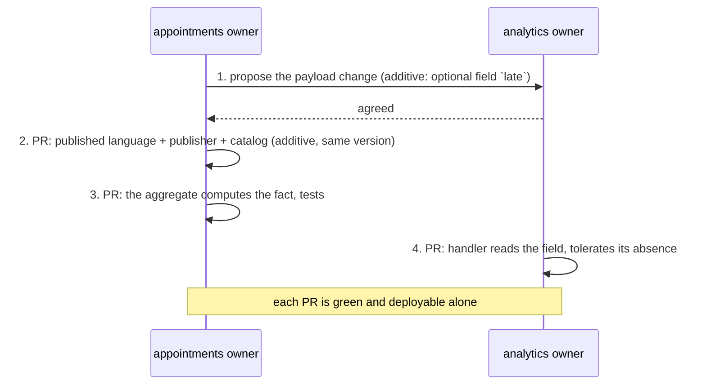

# Working as a team on a DDD project

**Summary.** A bounded context is a unit of ownership as much as a unit of code. This guide
describes how a team organises around that: one owner per context, the glossary as a shared
asset with a named editor, contracts agreed before both sides build, a context map that says
who may touch what, a review that looks at something different in each layer, small pull
requests, a fixed order for changes that cross two contexts, decision records, and automated
checks that take the recurring review comments off people's hands. It ends with a one-day
onboarding plan.

## Ownership per bounded context

Each context has one owning team or person. Owning means deciding its model, editing its
glossary, approving changes to its `published-language/`, and answering for its tests. It does
not mean nobody else may open a pull request there; it means nobody merges one without the
owner.

| Thing | Owner | Others may |
|---|---|---|
| `src/contexts/<context>/domain`, `application`, `infrastructure`, `presentation` | the context's owner | propose a change, reviewed by the owner |
| `src/contexts/<context>/published-language/` | the context's owner, with its consumers consulted | import it, if the relationship is declared |
| `src/contexts/<context>/CONTEXT.md` | the context's owner | propose a term |
| `src/shared-kernel/` | every context that uses it, jointly | nothing without the co-owners |
| `src/platform/`, `src/main.ts`, `ddd-ts-kit.config.json`, the pipeline files | a named platform owner (often the tech lead) | propose; these files hold the rules |
| `docs/context-map.md` written sections, `docs/adr/` | the tech lead, with the owners concerned | propose |

On GitHub or GitLab, a code owners file expresses this table mechanically. The kit does not
generate one: write it by hand from the context list (`npx ddd-ts-kit list`).

Why one owner: a model stays coherent only if somebody can say no. Conway's law works in both
directions (Skelton and Pais call the deliberate use the inverse Conway manoeuvre): boundaries
that follow team boundaries hold, boundaries that cut across a team's daily work erode. A
context a single team cannot hold in its head is too big, see
[When to extract microservices](when-to-extract-microservices.md) for what cognitive load
justifies and what it does not.

## The glossary is a shared asset

The `## Ubiquitous language` table of each `CONTEXT.md` is the source of every class, method
and event name in the context, and the checker holds code to it (`language/glossary-term`).
That makes the glossary the most reviewed file of a context, so decide who edits it:

- **The owner edits; anyone proposes.** A new term arrives in the same pull request as the
  first name that uses it (`--term "<Term>=<meaning>"` on the generator), and the owner
  reviews the meaning, not the spelling.
- **A domain expert validates the meaning.** A developer can write "Slot: a start and an end
  instant at which a practitioner can receive"; only somebody from the business can say
  whether a slot includes the buffer between two appointments.
- **Same word, two contexts: two rows.** `Appointment` in `appointments` is a commitment with
  rules; in `analytics` it is a counted fact. Each glossary says what the word must not be
  confused with next door. Do not unify them in the shared kernel to save a row.
- **A term changes meaning: treat it as a breaking change.** Rename in code in the same pull
  request, and look at the published events that carry the word.

`--allow-name` exists to override the scaffolder; `check` still reports the name. Using it is a
signal that the glossary conversation was skipped.

## Contracts first

Two teams can build in parallel only if what flows between them is agreed before either
starts. There are three kinds of contract in this kit, and all are files that can be reviewed
on their own:

| Contract | File | Agreed between |
|---|---|---|
| integration event | a `defineIntegrationEvent` declaration in the producer's `published-language/` | producer and every consumer |
| read contract for a synchronous need | an abstract class in the upstream's `published-language/` (`*.contract.ts`, written by `generate gateway`), behind a gateway port of the caller | upstream and caller |
| HTTP API | route definitions, from which `openapi/openapi.json` is generated | the backend and its clients |

The practice:

1. The consumer says what it needs to act without calling back ("to send a confirmation I need
   the appointment id, the client id, the practitioner id and the start instant").
2. The producer's owner writes the declaration (type, version, payload schema with a
   description per field) and opens a pull request that contains only that: the event, its
   publisher and the regenerated catalog.
3. Consumers review that pull request. Once merged, both sides build: the producer makes the
   aggregate emit the fact, the consumer writes its handler against the declared type, tested
   with events built from the declaration.

The same applies to a route: merge the route definition with its schemas and declared errors,
regenerate the OpenAPI document, and a front-end team can generate its client from the
committed file while the handler is still a `TODO(domain)`.

A contract-first pull request is small and cheap to argue about. The same argument held after
both sides are built costs a rewrite on one of them.

## The context map bounds who can touch what

The map is not only documentation. Three rules turn it into a permission system for imports:

- another context is reached only through its `published-language/`
  (`context/published-language-only`);
- and only if the relationship is declared in the config (`context/declared-relationship`);
- and the declared relationships form no cycle (`context/no-cycle`).

So "may my context use something of yours?" has a mechanical answer, and adding a dependency
between two contexts is a visible change of `ddd-ts-kit.config.json`, reviewed by both owners,
not a stray import found six months later. The relationship pattern says how the two teams
work together: under `customer-supplier` the downstream's needs enter the upstream's planning;
under `conformist` the downstream accepts what comes; a `shared-kernel` needs joint approval
of every change. See [Context map](../concepts/context-map.md).

## Review focus per layer

Automated checks hold the structure, so a human review can spend its attention where a tool
cannot judge. What to look for differs by layer:

| Layer | The reviewer asks | Not worth a comment (a check holds it) |
|---|---|---|
| `domain/` | Is the rule in the aggregate, and is it the right rule? Can an invalid state be built? Do names say what the business says? Is the aggregate the right size? | constructor visibility, setters, imports, `new Date()` |
| `application/` | Does the handler only orchestrate (load, one intention, save)? Is the permission the right one? Is each failure a named domain error? | handler shape, missing permission declaration, reading the ambient scope, a manual dispatch of domain events (the save hands them over, the unit of work dispatches them), a domain event handler with an effect outside the database left in the `before-commit` phase |
| `infrastructure/` | Does the mapper cover every field both ways? Is the query scoped by tenant? Does the adapter pass the same contract suite as its fake? What happens when the dependency is down? | importing `presentation/`, an adapter built outside the composition root |
| `presentation/` | Is the response a DTO and not the aggregate? Are all error codes declared on the route? Is the change breaking for clients? | missing `security`, a role test in the route |
| `published-language/` | Would a consumer understand this payload without asking? Is anything internal or personal leaking? Is this additive, or a new version? | importing outside the allow-list |
| tests | Does the name read as a business rule? Does it assert an outcome through the public API? | mocks, a missing spec file, a missing builder |

The plugin offers the same split as a tool: the `architecture-reviewer` agent reviews a diff
or a whole context read-only, starting from the checker's output and then judging what tools
cannot.

## Branching and small pull requests

- Trunk-based: short-lived branches off the default branch, merged within a day or two. A
  long-lived branch per context defeats the generated files (barrels, context map, OpenAPI),
  which conflict more the longer they diverge.
- One use case or one concept per pull request; sizes and reasoning are in
  [Commit discipline](commit-discipline.md).
- Squash merge, with a conventional commit title: the pipeline checks the pull request title
  with the same commitlint configuration as the commit hook, because with squash merges the
  title becomes the commit on the default branch.
- The final `gate` job is the one required check; see
  [pipeline/README.md](../../pipeline/README.md).

## A change that crosses two contexts

"When an appointment is cancelled late, `analytics` should count it as a late cancellation."
This touches `appointments` (the fact must say whether it was late) and `analytics` (the
count). It is never one pull request. Split it along the contract and order it upstream first:

Rules of the split:

1. **Upstream first.** The downstream cannot import a field that is not published.
2. **Additive whenever possible.** A new optional field stays inside the version; the consumer
   deployed before step 3 keeps working. Anything else is a new version published next to the
   old one, see [Event versioning](../concepts/event-versioning.md).
3. **The consumer tolerates both worlds** until the producer is deployed everywhere: events
   already in the outbox or in a queue were produced by the old code.
4. **Each pull request is deployable on its own.** If step 4 cannot ship before step 3, the
   order is wrong.

A change that seems to need both contexts to change in the same transaction is not a split
problem but a boundary problem: go back to the consistency test of
[Bounded context](../concepts/bounded-context.md).

## Architecture decision records

A choice that constrains the future gets a record in `docs/adr/`: a boundary, a relationship
pattern other than the default, a provider, an exception to a rule.
`npx ddd-ts-kit generate adr "<title>"` writes the numbered file; with `--deviation <what>` it
also writes the `deviations` entry of the config that points to it, which
`governance/recorded-deviation` requires for any relaxed rule.

Keep them to half a page: context, decision, consequences, alternatives rejected. An accepted
record is never rewritten; a later one supersedes it. The record is what lets a newcomer tell
a decision from an accident.

## Checks replace recurring review comments

Every comment a reviewer writes for the third time should become a check, and most of the
usual ones already are:

| The comment that no longer needs writing | Held by |
|---|---|
| "the domain must not import the ORM" | `layer/domain-purity` |
| "don't reach into the other context's internals" | `context/published-language-only` |
| "what does `Manager` mean here?" | `language/no-technical-name`, `language/glossary-term` |
| "inject the clock" | `purity/no-system-clock` |
| "this use case has no permission" | `authz/declared` |
| "where is the test?" | `test/spec-required` |
| "don't mock the repository" | `test/no-mocks` |
| "remove the commented-out code" | `clean/no-commented-out-code` |
| "why is this rule disabled?" | `governance/recorded-deviation` |
| "you forgot to regenerate the OpenAPI file" | the documentation drift gate |

Rule ids and their exact statements are in the
[architecture reference](../ARCHITECTURE.md#3-dependency-rules). The checks run at three
moments: at each file write in an agent session (the plugin's hook), on staged files
(pre-commit), and in CI. A review that starts after a green gate is a review of design.

## Onboarding a newcomer in a day

| When | What | Why |
|---|---|---|
| first hour | read `docs/context-map.md`, then the `CONTEXT.md` of the context they join; run `npx ddd-ts-kit list` and `npx ddd-ts-kit describe <context>` | the map before the territory |
| second hour | `npm install`, `npm run infra:up`, `npm run dev`, open `/docs`; run `npm run verify` (on pnpm, the default of `init`: `pnpm install`, `pnpm run <script>`; the README of the project says them as its package manager does) | prove the machine works before changing anything |
| morning | read one existing slice top down: route, command, handler, aggregate, their specs | the tree is the same in every context, so one slice teaches all |
| after lunch | with the owner, pick a small real use case; restate it in the glossary's words | the first conversation is about language |
| afternoon | build it with the generator: fill the `TODO(domain)` places, replace the `it.todo` entries, break a rule on purpose and run `npx ddd-ts-kit explain <rule-id>` | the checks teach the architecture faster than a document |
| end of day | open the pull request; the owner reviews design, the gate has reviewed the rest | a merged change on day one |

What makes this possible is not the newcomer's speed but the closed tree: a file of a given
role is always in the same place under the same suffix, so knowledge of one context transfers
to the next.

## Limits and when not to use it

- **Ownership per context needs enough people.** A team of two cannot have six owners; then
  ownership is per person-with-a-backup, and the review rule is "the other one".
- **Strict ownership slows a change that spans contexts.** That friction is intended (it is
  the cost of coupling made visible), but if most changes span the same two contexts, the
  boundary is wrong: merge them.
- **Contract-first assumes the contract can be known first.** In early discovery it cannot;
  keep the two sides in one context until the shape settles, then split.
- **Checks do not review design.** A model can pass every rule and still be wrong: the checker
  verifies that a term is in the glossary, not that it means the right thing.
- **Code owners files, branch protection and merge request settings are not enforced by the
  kit.** The pipeline ships a description of the settings to apply
  (`branch-protection.md`, `merge-request-settings.md`); applying them is a manual step, and
  the pipeline README states that these were written from the platforms' documentation and not
  executed.

## Sources

- Eric Evans, *Domain-Driven Design*, Addison-Wesley, 2003, chapter 14 (context map, team
  relationships).
- Vaughn Vernon, *Implementing Domain-Driven Design*, Addison-Wesley, 2013, chapter 3.
- Matthew Skelton and Manuel Pais, *Team Topologies*, IT Revolution, 2019 (team cognitive load,
  inverse Conway manoeuvre).
- Michael Nygard, "Documenting Architecture Decisions", 2011.
- Conventional Commits 1.0.0, https://www.conventionalcommits.org/
- This repository: [pipeline/README.md](../../pipeline/README.md), the skills
  `bounded-contexts`, `glossary`, `context-map`, `document`, `deviation`.

## See also

- [Parallel work](parallel-work.md)
- [Commit discipline](commit-discipline.md)
- [Methodology](methodology.md)
- [Context map](../concepts/context-map.md)
- [Ubiquitous language](../concepts/ubiquitous-language.md)
- [Static analysis and pipeline](../tools/static-analysis-and-pipeline.md)
