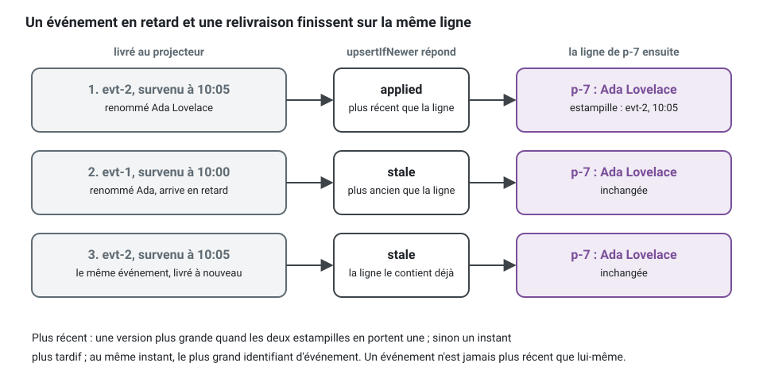

[English](read-side.md) · **Français**
<!-- translation-of: read-side.md sha256:ab90b182205c9275 -->

# Proposition : le côté lecture

Cette page décrit ce que le kit ajoute, ou ajouterait, pour lire des données : critères et
filtres, représentations (JSON, XML et autres), formulaires décrits par le serveur, modèles de
lecture qui ont besoin de données d'un autre contexte délimité (bounded context), projections et
moteur de recherche. Chaque partie se termine par ce qu'elle coûte et ce qu'elle ne fait pas.

## État (2026-10-13)

Trois états : **construit dans les *packages* d'exécution** (exporté par un *package*, documenté
dans son README, tenu par une suite de contrat), **pas encore généré par la CLI** (les *packages*
d'exécution l'ont, `ddd-ts-kit generate` et `check` ne le connaissent pas), **pas construit**.

| Partie | Construit dans les *packages* d'exécution | Pas encore généré par la CLI | Pas construit |
|---|---|---|---|
| 1. Critères et filtres | `Criteria`, `defineCriteria`, `validateCriteria`, `planCriteria`, `scoped` et l'évaluateur en mémoire `evaluateCriteria` dans `@ddd-ts-kit/kernel` ; la grammaire des paramètres d'URL et ses paramètres OpenAPI dans `@ddd-ts-kit/http` (`criteriaQuerySchema`, `criteriaFrom`, `criteriaParameters`) ; `criteriaToKnex`, `criteriaToDrizzle`, `criteriaToPrisma`, `criteriaToTypeOrm` ; le DSL de requête d'OpenSearch dans `@ddd-ts-kit/opensearch` ; `criteriaContract` dans `@ddd-ts-kit/testing` | `generate query --search` écrit un port de lecture qui prend le périmètre d'accès et une `PageRequest`, un adaptateur en mémoire et un `TODO(domain)` pour les critères : pas de `defineCriteria`, pas de paramètres `filter[...]` | RSQL |
| 2. Représentations | `Representation`, `Representations.standard()` et la négociation sur `Accept` (406) dans `@ddd-ts-kit/http` ; JSON, `application/problem+json` et `+xml`, XML écrit et lu (415 sinon), CSV diffusé en flux, `streamSchemaOf`, `everyPage` pour diffuser une recherche page par page à travers le bus ; fichiers et réponses sans corps laissés hors de la négociation ; chaque type de média, 406 et 415 dans le contrat ; `withFieldAccess` et `fieldDeciderOf` pour les champs réservés à une permission ou à une politique, dans chaque représentation et dans les corps de requête HTTP ; la règle `authz/fields-by-schema` | généré depuis le 2026-10-13 : `stack.representations` choisi à `init`, `generate representation`, `describe` liste les types de média | un vocabulaire XML propre (espaces de noms, contenu mixte) ; l'entrée CSV |
| 3. Formulaires | `formRoutes` sur `GET /forms/<operationId>`, les indications de `defineForm`, JSON Forms et l'arbre de blocs neutre, le formulaire donné seulement à qui peut exécuter son cas d'usage (`requires`), des champs cachés et en lecture seule selon l'appelant, `formDocumentsOf` | généré depuis le 2026-10-13 : `stack.forms` choisi à `init`, `generate form`, les formulaires écrits dans `openapi/forms/` | d'autres dialectes que JSON Forms, qu'un front-end obtient de l'arbre ; un moteur de rendu de consultation |
| 4. Les données d'un autre contexte | l'hydratation : `hydrate(...).with(...).orElse(...)` dans le noyau, avec la politique en cas d'échec et de délai dépassé ; le port *gateway* qu'elle appelle (`generate gateway`) | aucun usage généré de `hydrate` | la règle des analyseurs : c'est le compilateur qui refuse des critères sur un champ hydraté, à sa place |
| 5. Projections et recherche | `@Projection` et `@On` (`@ddd-ts-kit/kernel/declarations`), leur enregistrement et leurs métriques dans `@ddd-ts-kit/di` ; le port `ReadModelStore`, `TableReadModelStore` au-dessus d'`InMemoryReadModelStore`, `KnexReadModelStore`, `DrizzleReadModelStore`, `PrismaReadModelStore`, `TypeOrmReadModelStore`, tenus par `readModelStoreContract` ; `ProjectionRebuild` sur PostgreSQL ; `OpenSearchReadModelStore` de `@ddd-ts-kit/opensearch`, tenu par `readModelRowsContract` et `criteriaContract` sur OpenSearch 3, les locataires dans un index chacun ou derrière des alias filtrés | générés depuis le 2026-10-12, dans le style déclaré : `generate projection <context> <Name> <event-type>` écrit un projecteur et sa *spec*, `application/projections/` est un rôle de l'arborescence canonique, le *barrel* généré exporte un projecteur et enregistre ce que son constructeur reçoit, `describe` et `CONTEXT.md` le listent. Toujours pas générés : le port du modèle de lecture avec son adaptateur, que donnent `generate port` et le *package* de l'ORM | la reconstruction du store OpenSearch, un passage sur Elasticsearch, la recherche plein texte et les facettes ; le câblage d'OpenSearch par `init` ; un *job* de reconstruction généré |

La référence de ce qui est construit est le README de chaque *package* : `@ddd-ts-kit/kernel`
(« Criteria », « Hydration », « Projections »), `@ddd-ts-kit/http` (la grammaire des requêtes, les
représentations, les champs réservés à certains appelants, les formulaires),
`@ddd-ts-kit/di` (« Projections »), les quatre *packages* d'ORM (« Criteria », « Read models »).
Là où cette page et un README divergent sur une partie construite, le README a raison. Les
critères et les modèles de lecture n'ont été exécutés que sur PostgreSQL.

## Résumé

Le côté écriture du kit est strict à dessein : agrégats, invariants, une transaction. Le côté
lecture a d'autres besoins : des listes avec filtres et tris, plusieurs formats de sortie, des
écrans qui mêlent des données de plusieurs contextes, de la recherche. Les traiter avec le modèle
d'écriture, c'est ce qui fait grossir les agrégats et pousser sur les *repositories* des méthodes
`findByXAndYOrderByZ`. La conception garde les deux séparés, selon CQRS tel que le kit l'utilise
déjà, et donne au côté lecture son propre vocabulaire, petit et standard, pour que chaque projet
filtre, pagine, sérialise et projette de la même manière.


Lisez le dessin par ses deux bouts. En haut, le côté écriture ne change pas : une commande, un
agrégat, une transaction, et les événements sortent par l'outbox. Un projecteur transforme ces
événements en un modèle de lecture taillé pour les écrans qui le lisent. En bas, une recherche ne
touche jamais un agrégat : la route lit les paramètres de l'URL en critères, le gestionnaire les
joint à ce que l'acteur a le droit de voir, le port de lecture répond par une page, et les données
détenues par un autre contexte sont ajoutées par hydratation. Deux boîtes, la route et le modèle de
lecture, disent lesquelles de leurs parties sont construites et lesquelles sont proposées.

## 1. Critères et filtres

Construit dans les *packages* d'exécution, le traducteur pour OpenSearch compris ; pas encore
généré par la CLI.

**Problème.** Chaque route de recherche réinvente ses paramètres de requête HTTP, et chaque
*repository* se couvre de méthodes de recherche.

**Ce qui existe.** Une description standard et typée d'une lecture, dans le noyau à côté de
`Page` et de `PageRequest`. Comparez les deux façons de servir trois écrans qui listent des
rendez-vous :

```ts
// Au lieu de : une méthode de recherche par écran sur le repository de l'agrégat
interface AppointmentRepository {
  findByPractitionerAndStatusOrderByStartsAt(practitionerId: string, statuses: string[]): Promise<Appointment[]>;
  findByTenantAndStartsAtBetween(tenantId: string, from: Date, to: Date): Promise<Appointment[]>;
  findCancelledByPractitionerPaged(practitionerId: string, page: number): Promise<Appointment[]>;
  // ... et une de plus pour l'écran suivant, chacune avec sa pagination et son contrôle des droits
}
```

écrivez un seul port de lecture au-dessus d'un modèle de lecture, qui déclare une fois ce qu'un
appelant peut filtrer et trier, et décrivez chaque lecture par des critères :

<!-- checked sample -->
```ts
import { Criteria, ReadModelStore, defineCriteria, offsetPage, scoped, type Page, type ReadScope } from '@ddd-ts-kit/kernel';

// application/ports/appointment-list.port.ts : les lignes du modèle de lecture, et ce qu'un appelant peut en demander
export interface AppointmentRow {
  readonly id: string;
  readonly status: 'booked' | 'confirmed' | 'cancelled';
  readonly startsAt: Date;
  readonly practitionerId: string;
  readonly tenantId: string;
}

export const appointmentCriteria = defineCriteria<AppointmentRow>({
  fields: {
    id: { type: 'string' },
    status: { type: 'string', filter: ['eq', 'in'], sortable: true },
    startsAt: { type: 'instant', filter: ['gte', 'lt', 'between'], sortable: true },
    practitionerId: { type: 'string', filter: ['eq'] },
    tenantId: { type: 'string' },
  },
  defaultSort: [{ field: 'startsAt', direction: 'asc' }],
  tieBreaker: 'id',
  limits: { maxPageSize: 50 },
});

export abstract class AppointmentList extends ReadModelStore<AppointmentRow> {}

// application/queries/search-appointments : le corps du gestionnaire, une lecture décrite comme une donnée
export function upcomingOf(
  appointments: AppointmentList,
  scope: ReadScope,
  practitionerId: string,
  from: Date,
): Promise<Page<AppointmentRow>> {
  const criteria = Criteria.of<AppointmentRow>()
    .where('status', 'in', ['booked', 'confirmed'])
    .where('startsAt', 'gte', from)
    .where('practitionerId', 'eq', practitionerId)
    .orderBy('startsAt', 'asc')
    .page(offsetPage({ limit: 20 }));

  // Le périmètre calculé par l'autoriseur (authorizer) est joint par un ET : aucun filtre de l'appelant ne peut l'élargir.
  return appointments.search(scoped(criteria, scope, { ids: 'id', filter: { tenantId: 'tenantId' } }));
}
```

Le compilateur retient déjà la plupart des erreurs : `where('status', 'eq', 'pending')` (une
valeur hors de l'union), `where('startsAt', 'contains', '2026')` (un opérateur pour chaînes sur
un instant), `where('practitionerId', 'isNull', true)` (un champ qui n'est jamais nul) et
`orderBy('colour')` (un champ que la ligne n'a pas) ne compilent pas. Ce que le compilateur ne
peut pas voir, un champ que la définition n'ouvre pas aux appelants, est refusé quand les
critères sont planifiés.


- Un port de lecture déclare avec `defineCriteria` quels champs peuvent être filtrés et triés,
  et avec quels opérateurs (`eq`, `ne`, `in`, `gt`, `gte`, `lt`, `lte`, `contains`,
  `startsWith`, `isNull`, `between`). Tout le reste est refusé à la frontière par un 422, une
  entrée par erreur, qui nomme le champ et ne cite jamais une valeur.
- Une seule grammaire de paramètres d'URL pour toutes les routes, analysée et validée par le
  *package* HTTP :
  `?filter[status]=in:booked,confirmed&filter[startsAt]=gte:2026-10-01&sort=-startsAt`.
  Les paramètres OpenAPI viennent de la même définition (`criteriaParameters`).
- Des traducteurs transforment un plan de critères en requête du stockage : Knex, Drizzle,
  Prisma, TypeORM, et un évaluateur en mémoire pour les *fakes*. Une seule suite de contrat
  (`criteriaContract`) les tient à la même table de critères et de réponses, et le store
  OpenSearch de la partie 5 aussi. Le *fake* d'un port de lecture est une
  classe de quelques lignes, et répond avec la sémantique de référence :
  `class FakeAppointmentList extends InMemoryReadModelStore<AppointmentRow> implements AppointmentList`,
  son constructeur appelant `super(appointmentCriteria)`.
- Le périmètre d'accès calculé par l'autoriseur (*authorizer*) est joint aux critères avec
  `scoped`, par un ET, et rien dans les paramètres de l'URL ne peut le retirer : un filtre
  n'élargit jamais ce que l'acteur a le droit de voir.
- Les groupes (`and`, `or`, `not`) sont pris en charge sur un niveau par défaut (`maxDepth`) ;
  des arbres plus profonds sont une option de la définition, parce que c'est là que se perdent
  les performances des requêtes.

Ce qu'écrit aujourd'hui `generate query --search` est antérieur à tout cela : un port de lecture
qui prend le périmètre d'accès et une `PageRequest`, les critères laissés en `TODO(domain)`.
Passer une liste générée à `defineCriteria` se fait à la main, en suivant le README de
`@ddd-ts-kit/http`.

**À ne pas confondre avec le patron spécification.** Une spécification est un prédicat métier
sur un agrégat (« ce créneau est-il réservable »), vit dans le domaine et sert au côté écriture.
Les critères décrivent une lecture et ne connaissent que des noms de champs.

**Limites.** Pas de jointures : un champ d'un autre contexte n'est pas filtrable, sauf si une
projection l'a copié (partie 4). Pas de langage d'agrégation ; les comptages et les facettes
relèvent de l'adaptateur de recherche.

## 2. Représentations et sérialisation

Construit dans les *packages* d'exécution et généré par la CLI. Le mode d'emploi est dans le
README de `@ddd-ts-kit/http` (« Représentations : JSON, XML, CSV » et « Champs réservés à
certains appelants »), les idées dans
[concepts/representations-and-forms.fr.md](../concepts/representations-and-forms.fr.md), les
bibliothèques dans [tools/representations-and-forms.fr.md](../tools/representations-and-forms.fr.md).

**Problème.** Une réponse relève de la présentation, mais les mêmes données sont voulues en JSON
par l'application web, en XML par un partenaire, en CSV par un export.

**Ce qui existe.** Une route continue de renvoyer une valeur typée, vérifiée par son schéma de
réponse ; une `Representation` la transforme en texte pour un type de média choisi par
négociation de contenu (`Accept`), depuis le registre que la plateforme donne aux adaptateurs et
au générateur du contrat (`Representations.standard()`) :

| Type de média | Fourni | Remarques |
|---|---|---|
| `application/json` | par défaut | comme avant ; premier dans toute négociation |
| `application/problem+json` / `+xml` | erreurs | RFC 9457 ; `+xml` quand XML a été négocié |
| `application/xml` | `XmlRepresentation`, aucune dépendance | noms et attributs tirés du schéma et de son objet XML, la convention par défaut d'OpenAPI pour les listes, `xsi:nil` pour `null` ; relu selon la même convention ; aucune déclaration de type de document acceptée |
| `text/csv` | `CsvRepresentation` | pour une page ou une liste de lignes plates ; diffusé en flux ; jamais lu |

- Une route déclare `produces` et `consumes` ; le contrat liste chaque type de média de chaque
  route, les types de problème de ses refus, `406 NOT_ACCEPTABLE` sur chaque route qu'écrit une
  représentation et `415 UNSUPPORTED_MEDIA_TYPE` sur chaque route qui lit un corps. Une route qui
  répond par un fichier ne déclare aucun schéma de corps et n'est jamais refusée par un 406.
- Un gestionnaire qui répond par un `AsyncIterable` sous `streamSchemaOf(item)` est écrit élément
  par élément dans chaque représentation, dans la portée d'exécution de sa requête HTTP ; un
  curseur qui ne peut pas s'ouvrir reçoit encore une réponse sous forme de problème, un curseur
  qui échoue plus tard est signalé à `onError`. `everyPage` construit cette liste à partir d'une
  requête par page envoyée par le bus, si bien que chaque page s'exécute sous les *middlewares* du
  bus (transaction, session du *tenant*, délai d'expiration, traçage).
- Les règles de sérialisation sont standard et tenues une seule fois
  (`standard-serialization.spec.ts`) : un instant en ISO 8601 UTC, les décimaux et les montants
  en chaînes avec une devise (`decimalText`, `money`), les identifiants en chaînes, l'enveloppe de
  page, un vocabulaire fermé par son code.
- Visibilité des champs : `withFieldAccess(schema, { field: { read, write, subject } })` réserve
  un champ à une permission (décidée par `Access`) ou à une politique ; le *pipeline* l'écarte de
  toute représentation, le refuse dans un corps de requête HTTP, et le contrat le marque avec
  `x-field-access`. Un champ montré ou caché est décidé sans être enregistré ; un champ posé est
  enregistré. La règle `authz/fields-by-schema` refuse l'alternative écrite à la main dans une
  requête.
- Un projet généré choisit `stack.representations` à `init` (`negotiated` par défaut avec une
  *stack* HTTP) ; `generate representation <context> <UseCase> xml,csv` déclare les types de
  média d'un contrôleur.

**Limites.** Le XML est ici un rendu fidèle du modèle JSON, pas un outil de conception de
vocabulaires XML avec espaces de noms et contenu mixte ; un format de partenaire doté de son
propre schéma est une couche anticorruption avec son propre *mapper*. Les agrégats ne sont jamais
sérialisés : seuls les modèles de lecture et les types de présentation le sont. Une liste en flux
ne peut plus être refusée une fois son premier élément écrit. L'accès aux champs juge les champs
d'un schéma, jamais les lignes.

## 3. Formulaires décrits par le serveur

Construit dans les *packages* d'exécution et généré par la CLI.

**Problème.** Le front-end reconstruit à la main, pour chaque commande, un formulaire que le
back-end décrit déjà : champs, types, contraintes, vocabulaires fermés.

**Ce qui existe.** Une route qui déclare `form` (les indications de `defineForm`, à côté de ses
schémas) est servie par `formRoutes` sur `GET /forms/<operationId>`, dans deux formats issus d'un
même arbre :

1. **JSON Forms** (schéma, schéma d'interface et données), le choix par défaut, avec des moteurs
   de rendu maintenus pour React, Angular et Vue.
2. **Un arbre de blocs neutre** (`?format=blocks`), pour un front-end qui a son propre moteur :

```json
{ "type": "form", "operation": "bookAppointment", "method": "POST", "path": "/appointments",
  "label": "bookAppointment", "blocks": [
  { "type": "group", "name": "when", "label": "bookAppointment.when", "blocks": [
    { "type": "field", "name": "startsAt", "label": "bookAppointment.startsAt", "widget": "datetime", "required": true } ] },
  { "type": "field", "name": "internalNote", "label": "bookAppointment.internalNote", "widget": "textarea",
    "required": false, "readOnly": true, "constraints": { "maxLength": 2000 } } ] }
```

- Les blocs s'imbriquent ; un champ a un *widget*, une clé de traduction, les contraintes de son
  schéma, des options tirées d'un vocabulaire fermé ou d'une route de consultation, et des
  conditions simples (`visibleWhen`, `requiredWhen`).
- La description respecte l'appelant : le formulaire n'est donné qu'à qui peut exécuter son cas
  d'usage (`requires`, la permission demandée comme la demande `@Requires`), un champ qu'il ne
  peut pas voir est absent, un champ qu'il ne peut pas renseigner est en lecture seule (un objet
  avec chacun des champs qu'il contient), décidé par le même accès aux champs que les réponses, à
  propos de l'élément que nomme la requête (`?calendarId=`).
- La validation reste sur le serveur : le formulaire reprend les contraintes de forme, la route
  valide de nouveau et refuse un champ que l'appelant ne peut pas renseigner, et la commande
  applique les règles métier.
- Un projet généré choisit `stack.forms` à `init` ; `generate form <context> <UseCase>` ajoute les
  indications à un contrôleur ; `npm run docs:generate` écrit chaque formulaire en entier dans
  `openapi/forms/<operationId>.json`.

**Limites.** Une description de formulaire porte la forme et la présentation, jamais les règles
métier : « un rendez-vous ne peut pas en chevaucher un autre » reçoit sa réponse de la commande,
pas du formulaire. La mise en page au-delà des groupes et de l'ordre est l'affaire du front-end,
de même que le comportement d'une consultation.

## 4. Les modèles de lecture qui ont besoin des données d'un autre contexte

L'hydratation est construite dans les *packages* d'exécution ; la CLI n'en génère aucun usage.

**Problème.** La liste des rendez-vous doit afficher le nom du praticien, qui appartient au
contexte d'identité. La règle tient : pas de jointure, pas de table partagée, pas d'accès aux
entrailles d'un autre contexte.

**Trois stratégies**, choisies lecture par lecture.

| Stratégie | Comment | À utiliser quand | Coût |
|---|---|---|---|
| **Projection** (par défaut) | le contexte consommateur garde les quelques champs étrangers dont il a besoin, mis à jour par des événements d'intégration | listes, filtres ou tris sur le champ étranger, gros volume de lecture, des données légèrement en retard sont acceptables | cohérence à terme, un projecteur à écrire, un chemin de reconstruction |
| **Hydratation au moment de la requête** | le gestionnaire de requête lit ses propres lignes, puis les complète par un port *gateway* vers le contrat de lecture publié de l'autre contexte, par lots d'identifiants | vues de détail et petites pages, données qui doivent être fraîches, faible volume | la latence et la disponibilité dépendent désormais de l'autre contexte ; ni filtre ni tri sur les champs hydratés |
| **Composition au-dessus des contextes** | une route au niveau de la présentation (ou une *gateway* de front-end) appelle deux requêtes et fusionne | écrans qui sont vraiment un mélange des vues de deux contextes | l'orchestration vit hors de tout contexte |


Pour l'hydratation, le noyau fournit un petit utilitaire déclaratif (`hydrate`), pour qu'elle ne
soit jamais écrite comme une boucle d'appels :

```ts
// Au lieu de : un appel à l'autre contexte par ligne, écrit à la main
for (const row of page.items) {
  row.practitioner = await this.practitioners.byId(row.practitionerId); // 20 lignes, 20 appels
}
```

<!-- checked sample -->
```ts
import { hydrate, type Page } from '@ddd-ts-kit/kernel';

interface AppointmentRow {
  readonly id: string;
  readonly practitionerId: string;
  readonly locationId: string;
}

interface Practitioner {
  readonly displayName: string;
}

interface Location {
  readonly city: string;
}

// application/ports : ports gateway vers ce que publient identity et sites, un appel pour plusieurs identifiants
export abstract class PractitionerGateway {
  abstract byIds(ids: readonly string[]): Promise<ReadonlyMap<string, Practitioner>>;
}

export abstract class LocationGateway {
  abstract byIds(ids: readonly string[]): Promise<ReadonlyMap<string, Location>>;
}

const unknownPractitioner: Practitioner = { displayName: 'Unknown practitioner' };

export class AppointmentDetails {
  constructor(
    private readonly practitioners: PractitionerGateway,
    private readonly locations: LocationGateway,
  ) {}

  async complete(page: Page<AppointmentRow>) {
    return hydrate(page)
      // une recherche est appelée sans son objet : enveloppez la méthode d'une classe dans une fonction fléchée
      .with('practitioner', (row) => row.practitionerId, (ids) => this.practitioners.byIds(ids))
      .with('location', (row) => row.locationId, (ids) => this.locations.byIds(ids))
      .orElse('practitioner', unknownPractitioner, { onFailure: 'fallback', timeoutMs: 300 });
  }
}
```

Une page de 20 lignes coûte deux appels, un par relation, faits en même temps. Chaque ligne a un
`practitioner` : la valeur de repli quand identity ne connaît pas l'identifiant, et aussi quand sa
recherche échoue ou prend plus de 300 ms, ce que `warnings` signale alors (`lookup_failed`,
`lookup_timed_out`). `location` est facultatif dans le type des lignes, et une recherche de lieu
qui échoue fait échouer toute la lecture, parce que cette relation n'a pas de valeur de repli.

- Un appel par relation et par page, jamais un par ligne ; les identifiants sont dédoublonnés ;
  les relations sont recherchées en même temps ; la *gateway* peut être mise en cache avec
  l'aspect `cached` existant.
- Une politique déclarée quand l'autre côté échoue ou dépasse son délai, champ hydraté par champ
  hydraté : faire échouer la requête (le défaut), ou répondre avec la valeur de repli et un
  avertissement (`lookup_failed`, `lookup_timed_out`).
- Des critères ne peuvent pas nommer un champ hydraté : le type d'une définition de critères
  garde les champs scalaires du modèle de lecture, si bien que le compilateur le refuse. La règle
  proposée pour les deux analyseurs, avec la correction « projetez-le », n'est pas construite.

## 5. Les projections et un moteur de recherche

Les projections sur SQL sont construites dans les *packages* d'exécution, et
`generate projection` écrit un projecteur ; la CLI n'écrit avec lui ni le port du modèle de
lecture, ni un *job* de reconstruction. Un store de modèle de lecture sur OpenSearch est
construit, sans sa reconstruction.

**Problème.** Sans standard, les modèles de lecture sont écrits à la main dans des gestionnaires
d'événements d'intégration, chacun avec sa propre réponse à l'idempotence, à la reconstruction et
au retard ; et certaines lectures (plein texte, facettes, grandes listes filtrées) conviennent mal
à la base de données transactionnelle.

**Ce qui existe.**

- **Un rôle de projecteur.** `@Projection('<context>.<name>')` sur une classe
  d'`application/projections/`, dans un fichier `*.projection.ts`, avec `@On(definition)` sur
  une méthode par événement d'intégration qu'il applique et `@On(EventClass, { name })` pour un
  événement du domaine de son propre contexte. Il est abonné comme consommateur sous son nom. Il
  écrit son modèle de lecture par un port et ne fait rien d'autre : il n'envoie aucune commande
  et ne lit aucun autre contexte. Ses écritures sont idempotentes et ordonnées par clé par
  construction : chaque ligne porte l'estampille de l'événement qui l'a modifiée en dernier
  (`stampOf`), et `upsertIfNewer` n'écrit que pour un événement plus récent.
- **Un port de stockage de modèle de lecture**, `ReadModelStore<Row>`, avec une implémentation
  (`TableReadModelStore`) au-dessus d'une table que donne un adaptateur : en mémoire pour les
  *fakes*, Knex, Drizzle, Prisma et TypeORM pour une table SQL dans le schéma du contexte, écrite
  dans l'unité de travail qui porte la marque de l'événement traité.
- **Reconstruction.** Un modèle de lecture alimenté par des événements qu'aucun stockage ne garde
  est reconstruit à partir de la source de vérité (un modèle de lecture d'agrégats en *event
  sourcing* est reconstruit à partir du magasin d'événements à la place,
  `EventStoreProjectionRebuild`) : le contexte propriétaire expose un export paginé de lignes
  estampillées par son langage publié, `ProjectionRebuild` le copie dans une nouvelle table
  pendant que les événements continuent d'être appliqués, puis échange les deux en une
  transaction. PostgreSQL seulement.
- **Observabilité.** `projection_events_total` par résultat (`applied`, `stale`, `ignored`,
  `failed`) et `projection_last_event_age_ms`, le retard, sur le port `Metrics` ; un *span*
  `process <projection>` par livraison ; un événement enterré après ses nouvelles tentatives
  parvient à la remontée des erreurs comme pour tout consommateur.

Un projecteur du modèle de lecture des noms de praticiens, alimenté par un événement que publie
identity, son port, son *fake*, et ce qu'il fait d'un événement en retard ou répété :

<!-- checked sample -->
```ts
import { InMemoryReadModelStore, ReadModelStore, defineCriteria, stampOf, type IntegrationEvent, type ReadModelWrite } from '@ddd-ts-kit/kernel';
import { On, Projection, type EventContract } from '@ddd-ts-kit/kernel/declarations';

// identity/published-language : déclaré par identity avec defineIntegrationEvent, importé ici
interface PractitionerRenamedPayload {
  readonly practitionerId: string;
  readonly displayName: string;
}
declare const practitionerRenamedV1: EventContract<PractitionerRenamedPayload>;

// scheduling/application/ports/practitioner-names.port.ts : le modèle de lecture et son port
export interface PractitionerName {
  readonly practitionerId: string;
  readonly displayName: string;
}

export const practitionerNameCriteria = defineCriteria<PractitionerName>({
  fields: {
    practitionerId: { type: 'string', filter: ['eq', 'in'] },
    displayName: { type: 'string', filter: ['startsWith'], sortable: true },
  },
  tieBreaker: 'practitionerId',
});

export abstract class PractitionerNames extends ReadModelStore<PractitionerName> {}

// scheduling/application/projections/practitioner-names.projection.ts
@Projection('scheduling.practitioner-names')
export class PractitionerNamesProjection {
  constructor(private readonly names: PractitionerNames) {}

  @On(practitionerRenamedV1)
  renamed(event: IntegrationEvent<PractitionerRenamedPayload>): Promise<ReadModelWrite> {
    const { practitionerId, displayName } = event.payload;

    return this.names.upsertIfNewer(practitionerId, stampOf(event), () => ({ practitionerId, displayName }));
  }
}

// scheduling/test/fakes/practitioner-names.fake.ts
export class FakePractitionerNames extends InMemoryReadModelStore<PractitionerName> implements PractitionerNames {
  constructor() {
    super(practitionerNameCriteria);
  }
}

// Ce que font une relivraison et un événement en retard : la ligne finit sur l'événement le plus récent, quel que soit l'ordre.
const renamed = (id: string, occurredAt: string, displayName: string): IntegrationEvent<PractitionerRenamedPayload> => ({
  id,
  type: 'identity.practitioner.renamed',
  version: 1,
  occurredAt,
  payload: { practitionerId: 'p-7', displayName },
});

export async function deliveredOutOfOrder(): Promise<PractitionerName | undefined> {
  const names = new FakePractitionerNames();
  const projection = new PractitionerNamesProjection(names);
  const older = renamed('evt-1', '2026-10-01T10:00:00.000Z', 'Ada');
  const newer = renamed('evt-2', '2026-10-01T10:05:00.000Z', 'Ada Lovelace');

  await projection.renamed(newer); // 'applied'
  await projection.renamed(older); // 'stale' : plus ancien que l'événement que porte la ligne
  await projection.renamed(newer); // 'stale' : le même événement, livré à nouveau

  return names.get('p-7'); // { practitionerId: 'p-7', displayName: 'Ada Lovelace' }
}
```



**Ce qui reste proposé.**

- **Dans la CLI.** Ce qui est généré depuis le 2026-10-12 figure dans le tableau d'état :
  `generate projection <context> <Name> <event-type>` écrit le projecteur d'un événement
  d'intégration et sa *spec*, et le *barrel* l'enregistre. Dans le style explicite sur tsyringe,
  le fichier de module du contexte inclut la classe par `builder.include(<Name>Projection)` ; sur
  une plateforme câblée à la main, le projecteur est une classe simple que le module souscrit sous
  son nom de consommateur, avec la marque de traitement de tout consommateur mais sans les métriques
  de projection du câblage déclaré. Toujours proposés : un projecteur pour
  plusieurs événements (`--on <event>...`), un `--store sql|search` qui écrit le port du modèle
  de lecture avec son adaptateur et son *fake* (aujourd'hui `generate port` et le *package* de
  l'ORM, à la main), et le *job* de reconstruction.
- **Un index de recherche**, construit comme `@ddd-ts-kit/opensearch` : la
  seconde sorte de stockage de modèle de lecture, un index par modèle de lecture, son *mapping*
  tiré de la définition des critères, les critères traduits dans le DSL de requête, les
  locataires dans un index chacun ou derrière un alias filtré chacun, toute lecture par un alias
  ([ADR-0008](../adr/0008-a-read-model-store-on-opensearch.fr.md)). Toujours proposés : la
  bascule d'alias d'une reconstruction sans interruption, l'application des événements en masse,
  le plein texte et les facettes comme extensions des critères, un passage sur Elasticsearch, et
  le câblage par `init` une fois le *package* publié.

**Limites.** Un événement plus ancien écarté comme périmé (stale) n'est pas appliqué plus tard :
un événement devrait porter l'état des champs qu'il fixe, ou arriver dans l'ordre par clé. Avec un
`updatedAt` seul comme estampille de la source, une reconstruction n'est exacte que pour les
événements qui fixent un état, pas pour ceux qui comptent (le README du noyau énonce les deux). Un
index de recherche serait une copie, jamais la source de vérité, et cohérent à terme : une
écriture suivie aussitôt d'une recherche peut ne pas se voir elle-même ; le kit documenterait les
façons de le gérer (lire sa propre écriture dans le modèle SQL, ou attendre le rafraîchissement
pour cette seule requête HTTP) plutôt que de le cacher. Faire tourner un cluster de recherche a un
vrai coût d'exploitation ; une table PostgreSQL avec les bons index, et sa recherche plein texte,
couvre bien des projets.

## Ce qui est demandé au propriétaire du projet

1. **Grammaire des filtres** : tranchée par ce qui a été construit, la forme à crochets
   ci-dessus. RSQL (`status=in=(booked,confirmed)`) n'est pas fourni.
2. **Formulaires** : tranché par ce qui a été construit : les deux, l'arbre de blocs comme
   modèle propre au kit et JSON Forms comme son premier *mapper*.
3. **Moteur de recherche** : tranché par ce qui a été construit : OpenSearch d'abord, par le
   sous-ensemble de l'API REST qu'Elasticsearch partage, sans bibliothèque cliente. Il tourne sur
   OpenSearch 3 ; un passage sur Elasticsearch est ce qui prouverait le sous-ensemble partagé.
4. **Ordre du travail.** Les critères, l'hydratation, les projections sur SQL, les
   représentations et les formulaires sont dans les *packages* d'exécution, les représentations
   et les formulaires dans la CLI aussi, le projecteur est généré, et l'adaptateur de recherche
   est construit sur OpenSearch. Ce qui reste, dans l'ordre recommandé : les critères dans le
   générateur et le *checker* (`defineCriteria` et les paramètres `filter[...]` depuis
   `generate query --search`) et le reste du générateur de projections (le port du modèle de
   lecture, le *job* de reconstruction), puis la reconstruction de l'adaptateur de recherche et
   son câblage par `init`.

## Voir aussi

- [Référence d'architecture](../ARCHITECTURE.fr.md)
- [ADR-0008 : un store de modèle de lecture sur OpenSearch](../adr/0008-a-read-model-store-on-opensearch.fr.md)
- README des *packages* : [kernel](../../packages/kernel/README.fr.md),
  [http](../../packages/http/README.fr.md), [di](../../packages/di/README.fr.md),
  [testing](../../packages/testing/README.fr.md), [knex](../../packages/knex/README.fr.md),
  [drizzle](../../packages/drizzle/README.fr.md), [prisma](../../packages/prisma/README.fr.md),
  [typeorm](../../packages/typeorm/README.fr.md), [opensearch](../../packages/opensearch/README.fr.md)
- [CQRS tel qu'il est utilisé ici](../concepts/cqrs.fr.md)
- [Représentations, accès aux champs et formulaires](../concepts/representations-and-forms.fr.md)
- [Cohérence à terme](../concepts/eventual-consistency.fr.md)
- [Carte des contextes](../concepts/context-map.fr.md)
