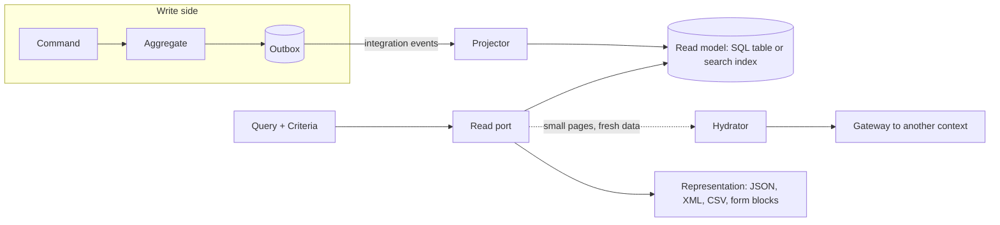

# Proposal: the read side

Status: proposed, not built. This page describes what the kit would add for reading data:
criteria and filters, representations (JSON, XML and others), forms described by the server,
read models that need data of another bounded context, projections and a search engine.
Nothing here exists yet; each part ends with what it would cost and what it would not do.

## Summary

The write side of the kit is strict on purpose: aggregates, invariants, one transaction. The
read side has other needs: lists with filters and sorting, several output formats, screens
that mix data of several contexts, search. Treating those with the write model is what makes
aggregates grow and repositories sprout `findByXAndYOrderByZ` methods. The proposal keeps
the two apart, CQRS as the kit already uses it, and gives the read side its own small,
standard vocabulary so every project filters, pages, serializes and projects the same way.



## 1. Criteria and filters

**Problem.** Every list route reinvents its query parameters, and every repository grows
finder methods.

**Proposal.** One standard, typed description of a read, in the kernel next to `Page` and
`PageRequest`:

```ts
const criteria = Criteria.of<AppointmentRow>()
  .where('status', 'in', ['booked', 'confirmed'])
  .where('startsAt', 'gte', from)
  .where('practitionerId', 'eq', practitionerId)
  .orderBy('startsAt', 'asc')
  .page(pageRequest);
```

- A read port declares which fields may be filtered and sorted, and with which operators
  (`eq`, `ne`, `in`, `gt`, `gte`, `lt`, `lte`, `contains`, `startsWith`, `isNull`,
  `between`). Anything else is refused at the boundary with a 422 naming the field.
- One query-string grammar for every route, parsed and validated by the HTTP package:
  `?filter[status]=in:booked,confirmed&filter[startsAt]=gte:2026-10-01&sort=-startsAt`.
  The OpenAPI parameters are generated from the port's declaration.
- Translators turn a `Criteria` into the store's query: Knex, Drizzle, Prisma, TypeORM, an
  in-memory evaluator for fakes, and a search engine (part 5). One contract suite proves that
  the same criteria give the same rows on each.
- The access scope computed by the authorizer is combined with the criteria by the kit, with
  AND, and cannot be removed by the caller: a filter never widens what the actor may see.
- Groups (`and`, `or`, `not`) are supported one level deep by default; deeper trees are an
  option, because they are where query performance is lost.

**Not to confuse with the specification pattern.** A specification is a business predicate
on an aggregate ("is this slot bookable"), lives in the domain and is used by the write side.
Criteria describe a read and know only field names.

**Limits.** No joins: a field of another context is not filterable unless a projection
copied it (part 4). No aggregation language; counts and facets belong to the search adapter.

## 2. Representations and serialization

**Problem.** A response is a presentation concern, but the same data is wanted as JSON by the
web app, XML by a partner, CSV by an export.

**Proposal.** A route keeps returning a typed value checked against its response schema; a
`Representation` port turns it into bytes for a media type chosen by content negotiation
(`Accept`), with a registry in the platform:

| Media type | Provided | Notes |
|---|---|---|
| `application/json` | default | as today |
| `application/problem+json` / `+xml` | errors | RFC 9457 defines both |
| `application/xml` | new package | element names and attributes derived from the response schema, overridable per field; one documented convention for arrays, nulls and dates |
| `text/csv` | new | for flat list rows; streamed |

- The response schema stays the single source: the OpenAPI document lists every media type a
  route produces, and the XML shape is documented from the same schema (XML object hints).
- Serialization rules that every project needs are standard and tested once: dates in ISO
  8601 UTC, decimals and money as strings with a currency, identifiers as strings, page
  envelope, enumerations by their code.
- Field visibility by permission: a response schema can mark a field as requiring a
  permission; the serializer drops it for an actor who lacks it, and the OpenAPI document
  says so. This replaces hand-written "if admin then add field".
- Request bodies: XML input is accepted on the routes that declare it, parsed into the same
  object the JSON path produces, then validated by the same schema.

**Limits.** XML here is a faithful rendering of the JSON model, not a design tool for XML
vocabularies with namespaces and mixed content; a partner format with its own schema is an
anti-corruption layer with its own mapper. Aggregates are never serialized: only read models
and presentation types are.

## 3. Forms described by the server

**Problem.** The front end rebuilds by hand, for every command, a form that the back end
already describes: fields, types, constraints, closed vocabularies.

**Proposal.** Generate a form description from what a route already declares, served at
`GET /forms/<operationId>` and generated into the documentation.

Two outputs from one source, the request schema plus optional presentation hints:

1. **JSON Forms** (schema plus UI schema), an existing open standard with maintained
   renderers for React, Angular and Vue. This is the recommended default: no new format to
   maintain, and the front end can use a library.
2. **A neutral block tree**, for a front end with its own rendering engine:

```json
{ "type": "form", "operation": "bookAppointment", "blocks": [
  { "type": "group", "label": "appointment.when", "blocks": [
    { "type": "field", "name": "startsAt", "widget": "datetime", "required": true },
    { "type": "field", "name": "durationMinutes", "widget": "select",
      "options": [15, 30, 45, 60] } ] },
  { "type": "field", "name": "reason", "widget": "textarea", "maxLength": 500,
    "visibleWhen": { "field": "kind", "eq": "consultation" } } ] }
```

- Blocks nest; a block has a type, labels as translation keys, constraints taken from the
  schema, options taken from enumerations or from a lookup route, and simple conditions.
  Other dialects are produced by small mappers of this tree.
- The description respects the caller: a field the actor may not set is absent or read-only.
- Validation stays on the server: the form mirrors shape constraints so the user is told
  early, and the command still validates and still enforces the business rules.

**Limits.** A form description carries shape and presentation, never business rules: "an
appointment cannot overlap another" is answered by the command, not by the form. Layout
beyond groups and order is the front end's job.

## 4. Read models that need another context's data

**Problem.** The appointment list must show the practitioner's name, which belongs to the
identity context. The rule stands: no join, no shared table, no reaching into another
context's internals.

**Proposal.** Three strategies, chosen per read, with the kit supporting each explicitly.

| Strategy | How | Use when | Cost |
|---|---|---|---|
| **Projection** (default) | the consuming context keeps the few foreign fields it needs, updated by integration events | lists, filters or sorting on the foreign field, high read volume, the data may be slightly stale | eventual consistency, a projector to write, a rebuild path |
| **Hydration at query time** | the query handler reads its own rows, then completes them through a gateway port to the other context's published read contract, by batch of identifiers | detail views and small pages, data that must be fresh, low volume | latency and availability now depend on the other context; no filtering or sorting on hydrated fields |
| **Composition above the contexts** | a presentation-level route (or a front-end gateway) calls two queries and merges | screens that are truly a mix of two contexts' views | orchestration lives outside any context |

For hydration the kit would provide a small, declarative helper so it is never written as a
loop of calls:

```ts
const page = await this.appointments.list(criteria);

return hydrate(page)
  .with('practitioner', (row) => row.practitionerId, this.practitioners.byIds)
  .with('location', (row) => row.locationId, this.locations.byIds)
  .orElse('practitioner', unknownPractitioner);
```

- One call per foreign context per page, never one per row; identifiers are deduplicated;
  the gateway can be cached with the existing `cached` aspect.
- A declared policy when the other side fails or times out: fail the query, or answer with a
  placeholder and a warning, per hydrated field.
- A rule in both analyzers: a criteria field must be a field of the read model itself; trying
  to filter on a hydrated field is reported with the fix "project it".

## 5. Projections and a search engine

**Problem.** Read models are today written by hand in integration event handlers, with no
standard for idempotence, rebuild or lag; and some reads (full-text, facets, large filtered
lists) are a poor fit for the transactional database.

**Proposal.**

- **A projector role.** `@Projection('<context>.<name>')` on a class in
  `application/projections/` with one method per event it applies. It is an integration
  event handler (or a domain event handler inside its own context) specialised for read
  models: idempotent by construction (event id and per-key version stored with the row),
  ordered per key, never calls a command, never reads another context.
- **A read model store port** with two implementations: a SQL table in the context's schema
  (default, same transaction as the processed-event mark) and a search index.
- **Rebuild.** The kit has no event store, so a projection is rebuilt from the source of
  truth: the owning context exposes a paged export through its published language, the
  projector replays it into a new table or index, then switches. The procedure is generated
  with the projection and tested.
- **Observability.** Lag (age of the last applied event), applied and failed counts, dead
  letters, through the existing metrics and error reporting; a projection that falls behind
  is visible before a user notices.
- **Search engine adapter.** A package for Elasticsearch and OpenSearch (same protocol for
  what is needed): index per read model, mapping derived from the read model's schema,
  criteria translated to the query language, bulk application of events, alias switch for
  rebuilds without downtime, full-text and facets as extensions of criteria.
- **Generator.** `generate projection <context> <Name> --on <event>... [--store sql|search]`
  writes the read model, the projector, its spec and its rebuild job.

**Limits.** The search index is a copy, never the source of truth, and is eventually
consistent: a write followed at once by a search may not see itself; the kit documents the
ways to handle it (read your own write from the SQL model, or wait for refresh on that one
request) rather than hide it. Running a search cluster is a real operational cost; a
PostgreSQL table with the right indexes, and its full-text search, covers many projects.

## What is asked of the project owner

1. **Filter grammar**: the bracket form above, or RSQL (`status=in=(booked,confirmed)`).
   Recommended: the bracket form, simpler to read and to document in OpenAPI.
2. **Forms**: JSON Forms only, the neutral block tree only, or both. Recommended: both, the
   block tree as the kit's own model and JSON Forms as its first mapper.
3. **Search engine**: Elasticsearch, OpenSearch, or both behind one adapter. Recommended:
   one adapter tested on OpenSearch (open licence) and on Elasticsearch.
4. **Order of work**. Recommended: criteria and hydration first (every project needs them),
   then projections on SQL, then representations and forms, then the search adapter.

## See also

- [Architecture reference](../ARCHITECTURE.md)
- [CQRS as used here](../concepts/cqrs.md)
- [Eventual consistency](../concepts/eventual-consistency.md)
- [Context map](../concepts/context-map.md)
