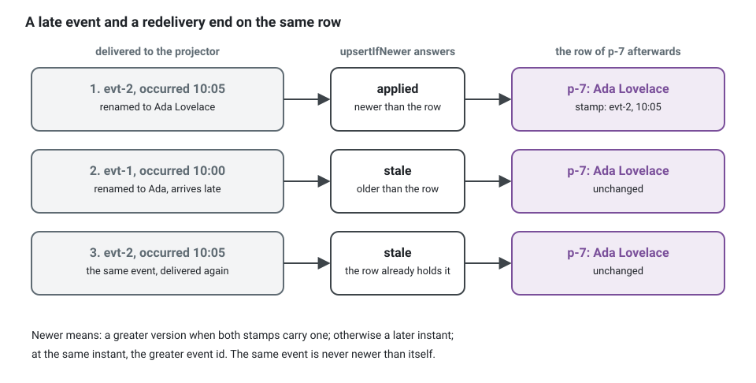

**English** · [Français](read-side.fr.md)

# Proposal: the read side

This page describes what the kit adds, or would add, for reading data: criteria and filters,
representations (JSON, XML and others), forms described by the server, read models that need
data of another bounded context, projections and a search engine. Each part ends with what it
costs and what it does not do.

## Status (2026-10-13)

Three states: **built in the runtime** (exported by a package, documented in its README, held
by a contract suite), **not yet generated by the CLI** (the runtime has it, `ddd-ts-kit
generate` and `check` do not know it), **not built**.

| Part | Built in the runtime | Not yet generated by the CLI | Not built |
|---|---|---|---|
| 1. Criteria and filters | `Criteria`, `defineCriteria`, `validateCriteria`, `planCriteria`, `scoped` and the in-memory `evaluateCriteria` in `@ddd-ts-kit/kernel`; the query-string grammar and its OpenAPI parameters in `@ddd-ts-kit/http` (`criteriaQuerySchema`, `criteriaFrom`, `criteriaParameters`); `criteriaToKnex`, `criteriaToDrizzle`, `criteriaToPrisma`, `criteriaToTypeOrm`; `criteriaContract` in `@ddd-ts-kit/testing` | `generate query --search` writes a read port that takes the access scope and a `PageRequest`, an in-memory adapter and a `TODO(domain)` for the criteria: no `defineCriteria`, no `filter[...]` parameters | the search engine translator; RSQL |
| 2. Representations | nothing beyond JSON and `application/problem+json` | | all of it: the `Representation` port, content negotiation, XML, CSV, field visibility by permission |
| 3. Forms | | | all of it |
| 4. Another context's data | hydration: `hydrate(...).with(...).orElse(...)` in the kernel, with the failure and timeout policy; the gateway port it calls (`generate gateway`) | no generated use of `hydrate` | the analyzer rule: the compiler refuses a criteria on a hydrated field instead |
| 5. Projections and search | `@Projection` and `@On` (`@ddd-ts-kit/kernel/declarations`), their registration and metrics in `@ddd-ts-kit/di`; the `ReadModelStore` port, `TableReadModelStore` over `InMemoryReadModelStore`, `KnexReadModelStore`, `DrizzleReadModelStore`, `PrismaReadModelStore`, `TypeOrmReadModelStore`, held to `readModelStoreContract`; `ProjectionRebuild` on PostgreSQL | generated since 2026-10-12, in the declared style: `generate projection <context> <Name> <event-type>` writes a projector and its spec, `application/projections/` is a role of the canonical tree, the generated barrel exports a projector and registers what its constructor takes, `describe` and `CONTEXT.md` list it. Still not generated: the port of the read model with its adapter, which `generate port` and the ORM package give | the search index store and the Elasticsearch and OpenSearch package; a generated rebuild job |

The reference for what is built is the README of each package: `@ddd-ts-kit/kernel`
("Criteria", "Hydration", "Projections"), `@ddd-ts-kit/http` (the query grammar),
`@ddd-ts-kit/di` ("Projections"), the four ORM packages ("Criteria", "Read models"). Where
this page and a README differ on a built part, the README is right. Criteria and read models
were run on PostgreSQL only.

## Summary

The write side of the kit is strict on purpose: aggregates, invariants, one transaction. The
read side has other needs: lists with filters and sorting, several output formats, screens
that mix data of several contexts, search. Treating those with the write model is what makes
aggregates grow and repositories sprout `findByXAndYOrderByZ` methods. The design keeps
the two apart, CQRS as the kit already uses it, and gives the read side its own small,
standard vocabulary so every project filters, pages, serializes and projects the same way.


Read the drawing from the two ends. At the top, the write side does not change: a command, an
aggregate, one transaction, and the events leave through the outbox. A projector turns those
events into a read model shaped for the screens that read it. At the bottom, a search never
touches an aggregate: the route reads the query string into a criteria, the handler joins it
to what the actor may see, the read port answers a page, and data owned by another context is
added by hydration. Two boxes, the route and the read model, say which of their parts are built
and which are proposed.

## 1. Criteria and filters

Built in the runtime; not yet generated by the CLI; no search engine translator.

**Problem.** Every search route reinvents its query parameters, and every repository grows
finder methods.

**What exists.** One standard, typed description of a read, in the kernel next to `Page` and
`PageRequest`. Compare the two ways of serving three screens that list appointments:

```ts
// Instead of: one finder per screen on the repository of the aggregate
interface AppointmentRepository {
  findByPractitionerAndStatusOrderByStartsAt(practitionerId: string, statuses: string[]): Promise<Appointment[]>;
  findByTenantAndStartsAtBetween(tenantId: string, from: Date, to: Date): Promise<Appointment[]>;
  findCancelledByPractitionerPaged(practitionerId: string, page: number): Promise<Appointment[]>;
  // ... and one more for the next screen, each with its own paging and its own rights check
}
```

write one read port over a read model, which declares once what a caller may filter and sort,
and describe each read as a criteria:

<!-- checked sample -->
```ts
import { Criteria, ReadModelStore, defineCriteria, offsetPage, scoped, type Page, type ReadScope } from '@ddd-ts-kit/kernel';

// application/ports/appointment-list.port.ts: the rows of the read model, and what a caller may ask of them
export interface AppointmentRow {
  readonly id: string;
  readonly status: 'booked' | 'confirmed' | 'cancelled';
  readonly startsAt: Date;
  readonly practitionerId: string;
  readonly tenantId: string;
}

export const appointmentCriteria = defineCriteria<AppointmentRow>({
  fields: {
    id: { type: 'string' },
    status: { type: 'string', filter: ['eq', 'in'], sortable: true },
    startsAt: { type: 'instant', filter: ['gte', 'lt', 'between'], sortable: true },
    practitionerId: { type: 'string', filter: ['eq'] },
    tenantId: { type: 'string' },
  },
  defaultSort: [{ field: 'startsAt', direction: 'asc' }],
  tieBreaker: 'id',
  limits: { maxPageSize: 50 },
});

export abstract class AppointmentList extends ReadModelStore<AppointmentRow> {}

// application/queries/search-appointments: the body of the handler, one read described as data
export function upcomingOf(
  appointments: AppointmentList,
  scope: ReadScope,
  practitionerId: string,
  from: Date,
): Promise<Page<AppointmentRow>> {
  const criteria = Criteria.of<AppointmentRow>()
    .where('status', 'in', ['booked', 'confirmed'])
    .where('startsAt', 'gte', from)
    .where('practitionerId', 'eq', practitionerId)
    .orderBy('startsAt', 'asc')
    .page(offsetPage({ limit: 20 }));

  // The scope the authorizer computed is joined by AND: no filter of the caller can widen it.
  return appointments.search(scoped(criteria, scope, { ids: 'id', filter: { tenantId: 'tenantId' } }));
}
```

The compiler already holds most mistakes: `where('status', 'eq', 'pending')` (a value outside
the union), `where('startsAt', 'contains', '2026')` (an operator for strings on an instant),
`where('practitionerId', 'isNull', true)` (a field that is never null) and `orderBy('colour')`
(a field the row does not have) do not compile. What the compiler cannot
see, a field the definition does not open to callers, is refused when the criteria is planned.


- A read port declares with `defineCriteria` which fields may be filtered and sorted, and
  with which operators (`eq`, `ne`, `in`, `gt`, `gte`, `lt`, `lte`, `contains`, `startsWith`,
  `isNull`, `between`). Anything else is refused at the boundary with a 422, one issue per
  mistake, naming the field and never quoting a value.
- One query-string grammar for every route, parsed and validated by the HTTP package:
  `?filter[status]=in:booked,confirmed&filter[startsAt]=gte:2026-10-01&sort=-startsAt`.
  The OpenAPI parameters come from the same definition (`criteriaParameters`).
- Translators turn a criteria plan into the store's query: Knex, Drizzle, Prisma, TypeORM,
  and an in-memory evaluator for fakes. One contract suite (`criteriaContract`) holds them to
  the same table of criteria and answers. A search engine translator (part 5) is not built.
  The fake of a read port is a class of a few lines, and answers with the reference semantics:
  `class FakeAppointmentList extends InMemoryReadModelStore<AppointmentRow> implements AppointmentList`,
  its constructor calling `super(appointmentCriteria)`.
- The access scope computed by the authorizer is joined to the criteria with `scoped`, with
  AND, and nothing in a query string can remove it: a filter never widens what the actor may
  see.
- Groups (`and`, `or`, `not`) are supported one level deep by default (`maxDepth`); deeper
  trees are an option of the definition, because they are where query performance is lost.

What `generate query --search` writes today is older than this: a read port taking the access
scope and a `PageRequest`, with the criteria left as a `TODO(domain)`. Moving a generated
list to `defineCriteria` is done by hand, following the README of `@ddd-ts-kit/http`.

**Not to confuse with the specification pattern.** A specification is a business predicate
on an aggregate ("is this slot bookable"), lives in the domain and is used by the write side.
Criteria describe a read and know only field names.

**Limits.** No joins: a field of another context is not filterable unless a projection
copied it (part 4). No aggregation language; counts and facets belong to the search adapter.

## 2. Representations and serialization

Not built.

**Problem.** A response is a presentation concern, but the same data is wanted as JSON by the
web app, XML by a partner, CSV by an export.

**Proposal.** A route keeps returning a typed value checked against its response schema; a
`Representation` port turns it into bytes for a media type chosen by content negotiation
(`Accept`), with a registry in the platform:

| Media type | Provided | Notes |
|---|---|---|
| `application/json` | default | as today |
| `application/problem+json` / `+xml` | errors | RFC 9457 defines both |
| `application/xml` | new package | element names and attributes derived from the response schema, overridable per field; one documented convention for arrays, nulls and dates |
| `text/csv` | new | for flat list rows; streamed |

- The response schema stays the single source: the OpenAPI document lists every media type a
  route produces, and the XML shape is documented from the same schema (XML object hints).
- Serialization rules that every project needs are standard and tested once: dates in ISO
  8601 UTC, decimals and money as strings with a currency, identifiers as strings, page
  envelope, enumerations by their code.
- Field visibility by permission: a response schema can mark a field as requiring a
  permission; the serializer drops it for an actor who lacks it, and the OpenAPI document
  says so. This replaces hand-written "if admin then add field".
- Request bodies: XML input is accepted on the routes that declare it, parsed into the same
  object the JSON path produces, then validated by the same schema.

**Limits.** XML here is a faithful rendering of the JSON model, not a design tool for XML
vocabularies with namespaces and mixed content; a partner format with its own schema is an
anti-corruption layer with its own mapper. Aggregates are never serialized: only read models
and presentation types are.

## 3. Forms described by the server

Not built.

**Problem.** The front end rebuilds by hand, for every command, a form that the back end
already describes: fields, types, constraints, closed vocabularies.

**Proposal.** Generate a form description from what a route already declares, served at
`GET /forms/<operationId>` and generated into the documentation.

Two outputs from one source, the request schema plus optional presentation hints:

1. **JSON Forms** (schema plus UI schema), an existing open standard with maintained
   renderers for React, Angular and Vue. This is the recommended default: no new format to
   maintain, and the front end can use a library.
2. **A neutral block tree**, for a front end with its own rendering engine:

```json
{ "type": "form", "operation": "bookAppointment", "blocks": [
  { "type": "group", "label": "appointment.when", "blocks": [
    { "type": "field", "name": "startsAt", "widget": "datetime", "required": true },
    { "type": "field", "name": "durationMinutes", "widget": "select",
      "options": [15, 30, 45, 60] } ] },
  { "type": "field", "name": "reason", "widget": "textarea", "maxLength": 500,
    "visibleWhen": { "field": "kind", "eq": "consultation" } } ] }
```

- Blocks nest; a block has a type, labels as translation keys, constraints taken from the
  schema, options taken from enumerations or from a lookup route, and simple conditions.
  Other dialects are produced by small mappers of this tree.
- The description respects the caller: a field the actor may not set is absent or read-only.
- Validation stays on the server: the form mirrors shape constraints so the user is told
  early, and the command still validates and still enforces the business rules.

**Limits.** A form description carries shape and presentation, never business rules: "an
appointment cannot overlap another" is answered by the command, not by the form. Layout
beyond groups and order is the front end's job.

## 4. Read models that need another context's data

Hydration is built in the runtime; the CLI generates no use of it.

**Problem.** The appointment list must show the practitioner's name, which belongs to the
identity context. The rule stands: no join, no shared table, no reaching into another
context's internals.

**Three strategies**, chosen per read.

| Strategy | How | Use when | Cost |
|---|---|---|---|
| **Projection** (default) | the consuming context keeps the few foreign fields it needs, updated by integration events | lists, filters or sorting on the foreign field, high read volume, the data may be slightly stale | eventual consistency, a projector to write, a rebuild path |
| **Hydration at query time** | the query handler reads its own rows, then completes them through a gateway port to the other context's published read contract, by batch of identifiers | detail views and small pages, data that must be fresh, low volume | latency and availability now depend on the other context; no filtering or sorting on hydrated fields |
| **Composition above the contexts** | a presentation-level route (or a front-end gateway) calls two queries and merges | screens that are truly a mix of two contexts' views | orchestration lives outside any context |


For hydration the kernel provides a small, declarative helper (`hydrate`) so it is never
written as a loop of calls:

```ts
// Instead of: one call to the other context per row, written by hand
for (const row of page.items) {
  row.practitioner = await this.practitioners.byId(row.practitionerId); // 20 rows, 20 calls
}
```

<!-- checked sample -->
```ts
import { hydrate, type Page } from '@ddd-ts-kit/kernel';

interface AppointmentRow {
  readonly id: string;
  readonly practitionerId: string;
  readonly locationId: string;
}

interface Practitioner {
  readonly displayName: string;
}

interface Location {
  readonly city: string;
}

// application/ports: gateway ports to what identity and sites publish, one call for many ids
export abstract class PractitionerGateway {
  abstract byIds(ids: readonly string[]): Promise<ReadonlyMap<string, Practitioner>>;
}

export abstract class LocationGateway {
  abstract byIds(ids: readonly string[]): Promise<ReadonlyMap<string, Location>>;
}

const unknownPractitioner: Practitioner = { displayName: 'Unknown practitioner' };

export class AppointmentDetails {
  constructor(
    private readonly practitioners: PractitionerGateway,
    private readonly locations: LocationGateway,
  ) {}

  async complete(page: Page<AppointmentRow>) {
    return hydrate(page)
      // a lookup is called without its object: wrap the method of a class in an arrow
      .with('practitioner', (row) => row.practitionerId, (ids) => this.practitioners.byIds(ids))
      .with('location', (row) => row.locationId, (ids) => this.locations.byIds(ids))
      .orElse('practitioner', unknownPractitioner, { onFailure: 'fallback', timeoutMs: 300 });
  }
}
```

A page of 20 rows costs two calls, one per relation, made at the same time. Every row has a
`practitioner`: the fallback when identity does not know the id, and also when its lookup
fails or takes more than 300 ms, which `warnings` then reports (`lookup_failed`,
`lookup_timed_out`). `location` is optional in the type of the rows, and a location lookup
that fails fails the whole read, because that relation has no fallback.

- One call per relation per page, never one per row; identifiers are deduplicated; the
  relations are looked up at the same time; the gateway can be cached with the existing
  `cached` aspect.
- A declared policy when the other side fails or times out, per hydrated field: fail the
  query (the default), or answer with the fallback and a warning (`lookup_failed`,
  `lookup_timed_out`).
- A criteria cannot name a hydrated field: the type of a criteria definition keeps the scalar
  fields of the read model, so the compiler refuses it. The rule proposed for both analyzers,
  with the fix "project it", is not built.

## 5. Projections and a search engine

Projections on SQL are built in the runtime, and `generate projection` writes a projector; the
CLI does not write the port of the read model with it, nor a rebuild job; the search engine is
not built.

**Problem.** Without a standard, read models are written by hand in integration event
handlers, each with its own answer to idempotence, rebuild and lag; and some reads
(full-text, facets, large filtered lists) are a poor fit for the transactional database.

**What exists.**

- **A projector role.** `@Projection('<context>.<name>')` on a class of
  `application/projections/`, in a `*.projection.ts` file, with `@On(definition)` on one
  method per integration event it applies and `@On(EventClass, { name })` for a domain event
  of its own context. It is subscribed as a consumer under its name. It writes its read model
  through a port and does nothing else: it sends no command and reads no other context. Its
  writes are idempotent and ordered per key by construction: every row carries the stamp of
  the event that last changed it (`stampOf`), and `upsertIfNewer` writes only for a newer one.
- **A read model store port**, `ReadModelStore<Row>`, with one implementation
  (`TableReadModelStore`) over a table an adapter gives: in memory for the fakes, Knex,
  Drizzle, Prisma and TypeORM for a SQL table in the context's schema, written in the unit of
  work that holds the processed-event mark.
- **Rebuild.** A read model fed by events no store keeps is rebuilt from the source of
  truth (a read model of event-sourced aggregates is rebuilt from the event store instead,
  `EventStoreProjectionRebuild`): the owning context exposes a paged export of stamped rows
  through its published language, `ProjectionRebuild` copies it into a new table while events keep being applied,
  then swaps the two in one transaction. PostgreSQL only.
- **Observability.** `projection_events_total` by result (`applied`, `stale`, `ignored`,
  `failed`) and `projection_last_event_age_ms`, the lag, on the `Metrics` port; one
  `process <projection>` span per delivery; an event buried after its retries reaches the
  error reporter as for any consumer.

A projector of the read model of practitioner names, fed by an event identity publishes, its
port, its fake, and what it does with a late or repeated event:

<!-- checked sample -->
```ts
import { InMemoryReadModelStore, ReadModelStore, defineCriteria, stampOf, type IntegrationEvent, type ReadModelWrite } from '@ddd-ts-kit/kernel';
import { On, Projection, type EventContract } from '@ddd-ts-kit/kernel/declarations';

// identity/published-language: declared by identity with defineIntegrationEvent, imported here
interface PractitionerRenamedPayload {
  readonly practitionerId: string;
  readonly displayName: string;
}
declare const practitionerRenamedV1: EventContract<PractitionerRenamedPayload>;

// scheduling/application/ports/practitioner-names.port.ts: the read model and its port
export interface PractitionerName {
  readonly practitionerId: string;
  readonly displayName: string;
}

export const practitionerNameCriteria = defineCriteria<PractitionerName>({
  fields: {
    practitionerId: { type: 'string', filter: ['eq', 'in'] },
    displayName: { type: 'string', filter: ['startsWith'], sortable: true },
  },
  tieBreaker: 'practitionerId',
});

export abstract class PractitionerNames extends ReadModelStore<PractitionerName> {}

// scheduling/application/projections/practitioner-names.projection.ts
@Projection('scheduling.practitioner-names')
export class PractitionerNamesProjection {
  constructor(private readonly names: PractitionerNames) {}

  @On(practitionerRenamedV1)
  renamed(event: IntegrationEvent<PractitionerRenamedPayload>): Promise<ReadModelWrite> {
    const { practitionerId, displayName } = event.payload;

    return this.names.upsertIfNewer(practitionerId, stampOf(event), () => ({ practitionerId, displayName }));
  }
}

// scheduling/test/fakes/practitioner-names.fake.ts
export class FakePractitionerNames extends InMemoryReadModelStore<PractitionerName> implements PractitionerNames {
  constructor() {
    super(practitionerNameCriteria);
  }
}

// What a redelivery and a late event do: the row ends on the newest event, whatever the order.
const renamed = (id: string, occurredAt: string, displayName: string): IntegrationEvent<PractitionerRenamedPayload> => ({
  id,
  type: 'identity.practitioner.renamed',
  version: 1,
  occurredAt,
  payload: { practitionerId: 'p-7', displayName },
});

export async function deliveredOutOfOrder(): Promise<PractitionerName | undefined> {
  const names = new FakePractitionerNames();
  const projection = new PractitionerNamesProjection(names);
  const older = renamed('evt-1', '2026-10-01T10:00:00.000Z', 'Ada');
  const newer = renamed('evt-2', '2026-10-01T10:05:00.000Z', 'Ada Lovelace');

  await projection.renamed(newer); // 'applied'
  await projection.renamed(older); // 'stale': older than the event the row holds
  await projection.renamed(newer); // 'stale': the same event, delivered again

  return names.get('p-7'); // { practitionerId: 'p-7', displayName: 'Ada Lovelace' }
}
```



**What is still proposed.**

- **In the CLI.** What is generated since 2026-10-12 is in the status table:
  `generate projection <context> <Name> <event-type>` writes the projector of one integration
  event and its spec, and the barrel registers it. This holds in the declared style only: in the
  explicit style the generator refuses, and the projector is a class written by hand, registered
  with `builder.include(...)`. Still proposed: one projector for several
  events (`--on <event>...`), a `--store sql|search` that writes the read model's port with
  its adapter and its fake (today `generate port` and the ORM package, by hand), and the
  rebuild job.
- **A search index** as a second implementation of the read model store.
- **Search engine adapter.** A package for Elasticsearch and OpenSearch (same protocol for
  what is needed): index per read model, mapping derived from the read model's schema,
  criteria translated to the query language, bulk application of events, alias switch for
  rebuilds without downtime, full-text and facets as extensions of criteria.

**Limits.** An older event skipped as stale is not applied later: an event should carry the
state of the fields it sets, or come in order per key. With an `updatedAt` alone as the stamp
of the source, a rebuild is exact only for events that set state, not for events that count
(the kernel README states both). A search index would be a copy, never the source of truth,
and eventually consistent: a write followed at once by a search may not see itself; the kit
would document the ways to handle it (read your own write from the SQL model, or wait for
refresh on that one request) rather than hide it. Running a search cluster is a real
operational cost; a PostgreSQL table with the right indexes, and its full-text search, covers
many projects.

## What is asked of the project owner

1. **Filter grammar**: settled by what was built, the bracket form above. RSQL
   (`status=in=(booked,confirmed)`) is not provided.
2. **Forms**: JSON Forms only, the neutral block tree only, or both. Recommended: both, the
   block tree as the kit's own model and JSON Forms as its first mapper.
3. **Search engine**: Elasticsearch, OpenSearch, or both behind one adapter. Recommended:
   one adapter tested on OpenSearch (open licence) and on Elasticsearch.
4. **Order of work**. Criteria, hydration and projections on SQL are in the runtime, and the
   projector is generated. What remains, in the recommended order: criteria in the generator
   (`defineCriteria` and the `filter[...]` parameters from `generate query --search`) and the
   rest of the projection generator (the port of the read model, the rebuild job), then
   representations and forms, then the search adapter.

## See also

- [Architecture reference](../ARCHITECTURE.md)
- Package READMEs: [kernel](../../packages/kernel/README.md),
  [http](../../packages/http/README.md), [di](../../packages/di/README.md),
  [testing](../../packages/testing/README.md), [knex](../../packages/knex/README.md),
  [drizzle](../../packages/drizzle/README.md), [prisma](../../packages/prisma/README.md),
  [typeorm](../../packages/typeorm/README.md)
- [CQRS as used here](../concepts/cqrs.md)
- [Eventual consistency](../concepts/eventual-consistency.md)
- [Context map](../concepts/context-map.md)
