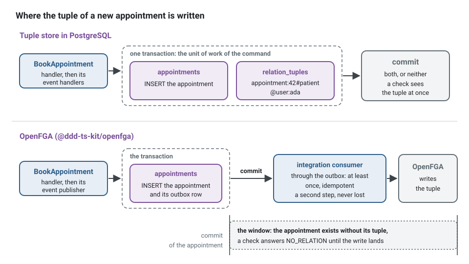
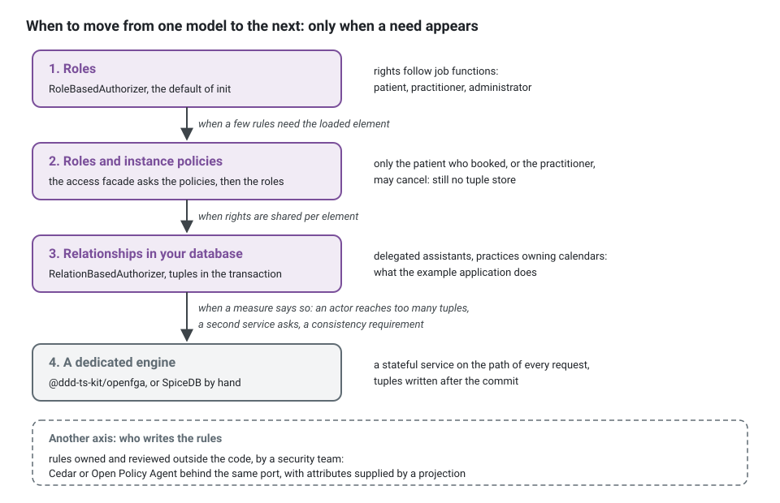

**English** · [Français](authorization-engines.fr.md)

# Authorization engines: in process or a dedicated service

**Summary.** The kit decides permissions behind one port, `Authorizer`, and ships three
in-process implementations: roles (RBAC), attribute policies (ABAC) and relationships in the
manner of Zanzibar (ReBAC). Dedicated engines exist for the same job: OpenFGA and SpiceDB for
relationships, Cedar and Open Policy Agent for policies. This page compares them and says when
moving from the in-process authorizer to a service pays for its cost. For relationships the kit
holds both ends to the same contract suites: a tuple store in the PostgreSQL of the project (the
port and its suite ship with `@ddd-ts-kit/auth`, the example application has a Knex adapter of
it, and `init --authz rebac` starts a project on the in-memory store with a note to replace it, and that store refuses to start in production),
and [`@ddd-ts-kit/openfga`](../../packages/openfga/README.md), the same two ports on an OpenFGA
server, its model generated from the same schema. The other services have a contract suite to
hold an adapter to.

## What is being chosen

A use case declares the permission it requires (`appointment.cancel`), a middleware asks the
`Authorizer` before the handler runs, and a search query asks for an access scope. The concept
page [authentication and authorization](../concepts/authentication-and-authorization.md)
explains the three models. The choice here is where the decision is computed and where its data
lives:


Handlers, permissions, routes and handler tests do not change with the choice. The adapter and
the data it needs do. The port is two methods: every engine of this page answers `check`;
`listAccessible` is optional, and absent where the engine cannot enumerate (Cedar, OPA without
partial evaluation), so asking such an adapter for a scope fails loudly. `Authorizer` itself is an
abstract class, the injection token an adapter extends; the interface below only shows its shape:

<!-- checked sample -->
```ts
import type { AccessScope, CheckRequest, Decision, ListRequest } from '@ddd-ts-kit/auth';

// The shape of Authorizer, from @ddd-ts-kit/auth: what a middleware and a search handler ask.
export interface AuthorizerShape {
  check(request: CheckRequest): Promise<Decision>; // { allowed: true } or { allowed: false, reason: 'NO_RELATION' }
  listAccessible?(request: ListRequest): Promise<AccessScope>; // all, none, ids or a filter for the read port
}
```

## Comparison

Third-party facts were checked on 2026-10-10 against the sources listed at the end.

| | Kit, in process | OpenFGA | SpiceDB | Cedar | Open Policy Agent |
|---|---|---|---|---|---|
| Model | RBAC, ABAC or ReBAC, layered if wanted | ReBAC after Zanzibar, with conditions on tuples | ReBAC after Zanzibar, with caveats | policies over principal, action, resource and context: RBAC and ABAC, relationships through entity hierarchies | general-purpose policy over JSON input and data |
| Language | TypeScript: a role table, policy functions, a schema DSL | a modelling DSL (also JSON) | a schema language | the Cedar policy language, with a schema and a validator | Rego |
| Deployment | a library in the API process | a server with its own datastore (PostgreSQL, MySQL, SQLite), HTTP and gRPC | a server with its own datastore (PostgreSQL, CockroachDB, Spanner, MySQL), gRPC and HTTP | a library (Rust, with a WebAssembly build for JavaScript); or the hosted Amazon Verified Permissions | a server, a sidecar or a library; a WebAssembly target exists |
| Where the data lives | your database, in the transaction of the change when you write tuples | the engine's store, written through its API | the engine's store, written through its API | you pass the entities with each request (or store policies in the hosted service) | pushed or pulled into the engine, or passed as input |
| Consistency | that of your store; no consistency token | a per-request preference between lower latency and higher consistency | per-request levels, with ZedTokens for "at least as fresh as" | the request is evaluated on what you pass | that of the data you loaded |
| Listing "what can this actor see" | constant for roles; not available for attribute policies; reverse expansion for tuples, bounded | ListObjects | LookupResources | not an engine feature: it evaluates one request (partial evaluation is the related research direction) | not built in: partial evaluation can produce a filter, with work |
| Licence | MIT (this repository) | Apache-2.0 | Apache-2.0 | Apache-2.0 | Apache-2.0 |
| Governance | this project | CNCF incubating (since October 2025), started at Auth0/Okta | AuthZed, a company; not a CNCF project | CNCF sandbox (accepted October 2025), started at AWS | CNCF graduated |
| Latest release seen | not applicable | v1.22.0 (2026-10-06) | v1.56.2 (2026-09-11) | 4.13.0 (2026-09-15) | v1.21.1 (2026-09-29) |

Not verified for this page: the exact list of datastores each server supports today, the
current names of the consistency options, and the state of list or partial-evaluation features
in Cedar and OPA. They are stated from the projects' documentation as known to the author and
should be confirmed in the linked documentation before a decision.

## Selection criteria

- **Shape of the rights.** Rights that follow job functions fit roles. Rights that depend on
  properties (the status of an appointment, the time before it starts) fit policies. Rights
  per element and shared (the practitioner of this calendar, an assistant delegated to it, a
  clinic owning many calendars) fit relationships.
- **Listing.** "Show the appointments I may see" must become a query filter. Ask of each engine
  how it answers a list, at your sizes, before anything else.
- **Consistency after a change.** When a patient is removed from an appointment, how soon must
  access stop? In process with SQL tuples, the tuple commits with the change. With a remote
  engine the write is a second step, through the outbox, and reads may lag unless you carry a
  consistency token.
- **How many systems ask.** One API asking about its own data does not need a shared service.
  Several services, in several languages, asking about the same objects do.
- **Who writes the rules.** Developers in TypeScript, or a security team in a policy language
  with its own review and tooling.
- **Operations.** A remote engine is a stateful service on the path of every request: latency,
  availability, backups, upgrades, and a failure mode to decide (refuse when it is down).

## What this kit supports and verified

From [`@ddd-ts-kit/auth`](../../packages/auth/README.md):

- **Three authorizers, one port, one contract suite.** `RoleBasedAuthorizer`,
  `PolicyBasedAuthorizer` and `RelationBasedAuthorizer` (entry `/rebac`) implement `Authorizer`
  and pass `authorizerContract`. Every one refuses the anonymous actor, and a system actor has
  no right unless the model gives it one.
- **Layering.** The access facade asks the instance policies, then the authorizer: "roles for
  actions, policies for the few per-element rules" needs no tuple store, and the README calls
  it the place to start.
- **Relationships.** A schema of stored and derived relations (`anyOf`, `allOf`, `butNot`,
  `via`: the words of OpenFGA), a derived relation named after a permission granting it, a
  validating `defineSchema`, cycle protection and a depth limit (16 by default, answered
  `DEPTH_EXCEEDED`, never a guess), an `explain` that tells one decision in words for debugging,
  a store wrapper that refuses tuples the schema does not describe. A reduced version of the schema of
  the example application, and one check:
<!-- checked sample -->
```ts
import { definePermissions } from '@ddd-ts-kit/auth';
import { defineSchema, InMemoryRelationTupleStore, RelationBasedAuthorizer, via } from '@ddd-ts-kit/auth/rebac';
import type { Actor } from '@ddd-ts-kit/kernel';

const schedulingPermissions = definePermissions('scheduling', {
  'appointment.cancel': { description: 'Cancel an appointment' },
});

// Who is what to which element: a practice has managers, a calendar its holder and assistants.
const schema = defineSchema({
  user: {},
  practice: { relations: { manager: ['user'] }, derived: { manage: 'manager' } },
  calendar: {
    relations: { holder: ['user'], assistant: ['user'], practice: ['practice'] },
    derived: { run: { anyOf: ['holder', 'assistant', via('practice', 'manage')] } },
  },
  appointment: {
    relations: { patient: ['user'], calendar: ['calendar'] },
    // The derived relation named after the permission grants it: to cancel is to hold `change`.
    derived: { change: { anyOf: ['patient', via('calendar', 'run')] }, [schedulingPermissions['appointment.cancel'].id]: 'change' },
  },
});

const tuples = new InMemoryRelationTupleStore();
const authorizer = new RelationBasedAuthorizer({ schema, store: tuples });

await tuples.write([
  { object: 'calendar:dr-grace', relation: 'assistant', subject: 'user:ada' },
  { object: 'appointment:42', relation: 'calendar', subject: 'calendar:dr-grace' },
  { object: 'appointment:42', relation: 'patient', subject: 'user:bob' },
]);

const ada: Actor = { id: 'ada', type: 'user', roles: [], attributes: {} };

// { allowed: true }: ada assists the calendar that holds appointment 42.
export const decision = await authorizer.check({
  actor: ada,
  permission: schedulingPermissions['appointment.cancel'],
  resource: { type: 'appointment', id: '42' },
});
```

- **Tuples in the transaction.** With a SQL-backed tuple store the handler writes the tuple in
  the unit of work of the command: the appointment and its relationship commit together. The
  package has a tested example with the rollback case.
- **Switching model** changes the adapter given to the authorization module and its data. From
  roles to relationships, the use cases that named no resource must name one.

What the README states is **not** implemented, compared with Zanzibar:

- no consistency tokens: every check reads the store as it is now;
- no caveats or conditional tuples: a condition on attributes belongs to a policy;
- no distributed evaluation, no check caching, no parallel fan-out: evaluation is sequential,
  in process;
- no public wildcard subject, no schema versioning or migration tooling, no watch API;
- `explain` is the trace of one check, not Zanzibar's userset tree;
- listing by reverse expansion costs one store read per reached subject and throws beyond a
  limit (10000 reached subjects by default) rather than return a partial list. It is not a
  search index.

**OpenFGA.** [`@ddd-ts-kit/openfga`](../../packages/openfga/README.md) implements the tuple
store and the authorizer on an OpenFGA server, with the official SDK (0.9.7) as an optional
peer. The authorization model is generated from the relationship schema of the project
(`authorizationModelOf`), written when it differs (`ensureAuthorizationModel`) and compared
(`modelDrift`): one source of truth. Both adapters pass the contract suites of the in-process
ones, in memory and against `openfga/openfga` v1.22.0 in the integration job. `init` does not
wire it yet: bind the two adapters in the platform by hand, as the README of the package shows:

<!-- checked sample -->
```ts
import type { Schema } from '@ddd-ts-kit/auth/rebac';
import { ensureAuthorizationModel, OpenFgaAuthorizer, OpenFgaRelationTupleStore } from '@ddd-ts-kit/openfga';
import { openFgaClient } from '@ddd-ts-kit/openfga/sdk';

declare const relationshipSchema: Schema; // the defineSchema(...) the in-process authorizer read, unchanged
declare const config: { readonly openfga: { readonly url: string; readonly storeId: string } };

const client = openFgaClient({ apiUrl: config.openfga.url, storeId: config.openfga.storeId });

// At deployment or start-up: the model of the store becomes the one the schema generates.
const { modelId, changes } = await ensureAuthorizationModel(client, relationshipSchema);
console.log(`authorization model ${modelId}`, changes);

// The same two ports, bound to the server instead of the table of the project.
export const tuples = new OpenFgaRelationTupleStore(client, relationshipSchema);
export const authorizer = new OpenFgaAuthorizer({ client, schema: relationshipSchema, listObjectsLimit: 1000 });
```

**SpiceDB** maps to `CheckPermission`, `LookupResources` and `WriteRelationships` behind the
same ports; no adapter is shipped. `init --authz custom` generates an adapter skeleton, its
contract spec and the permissions file. Cedar and OPA are not mentioned in the repository:
plugging one is the same port, with nothing prepared.

## The PostgreSQL tuple store or OpenFGA

Both hold the same tuples and answer the same ports; the schema of the project is the one source
of both. What differs is where the evaluation runs and whether a tuple commits with the change it
describes.



Whoever writes the tuple, the handlers name a fact of their context, never the model: the
adapter of a port in the words of the context knows the tuples, and the binding decides where
they go.

```ts
// Instead of: the handler knows the authorization model, and calls a service inside the transaction
async execute(command: BookAppointment): Promise<string> {
  const appointment = Appointment.book(this.ids.next(), command.booking);
  await this.appointments.save(appointment);
  await this.openFga.write({ writes: [{ object: `appointment:${appointment.id}`, relation: 'patient', user: `user:${command.actor.id}` }] });
  return appointment.id;
}
```

<!-- checked sample -->
```ts
import type { RelationTupleStore } from '@ddd-ts-kit/auth/rebac';

// application/ports/scheduling-relationships.port.ts: what the platform must know, in the words of the context.
export abstract class SchedulingRelationships {
  abstract recordAppointment(appointment: {
    readonly appointmentId: string;
    readonly calendarId: string;
    readonly patientId: string;
  }): Promise<void>;
}

// infrastructure/persistence/tuple-scheduling-relationships.repository.ts: the adapter knows the model.
export class TupleSchedulingRelationships implements SchedulingRelationships {
  constructor(private readonly tuples: RelationTupleStore) {}

  async recordAppointment({ appointmentId, calendarId, patientId }: Parameters<SchedulingRelationships['recordAppointment']>[0]): Promise<void> {
    await this.tuples.write([
      { object: `appointment:${appointmentId}`, relation: 'patient', subject: `user:${patientId}` },
      { object: `appointment:${appointmentId}`, relation: 'calendar', subject: `calendar:${calendarId}` },
    ]);
  }
}
```

In the example application, the domain event handler of `AppointmentBooked` calls
`recordAppointment`: domain events are dispatched inside the unit of work of the command, so with
the Knex store the tuples commit with the appointment. Bound to `OpenFgaRelationTupleStore`, the
write is a remote call that cannot join the transaction, and it must not be lost: a tuple that
never lands means the patient never gets access to the appointment. So the same call moves to the
consumer of an integration event published through the outbox (or of a command or job queued
the same way): delivered at least once, the consumer idempotent. A handler of phase `after-commit`
is no substitute: it runs at most once, a failure is only logged and reported, and a crash
between the commit and the call loses it (see
[when a domain event is handled](../concepts/domain-and-integration-events.md#when-a-domain-event-is-handled)).
The adapter and the port do not change.

| | Tuple store in PostgreSQL | OpenFGA (`@ddd-ts-kit/openfga`) |
|---|---|---|
| Where tuples live | a table of the project, written in the transaction of the command | the datastore of the OpenFGA server, through its API |
| A tuple and its aggregate | commit together, or not at all | two steps: the aggregate commits, then the tuple is written (through the outbox, at least once, idempotent) |
| Evaluation | in the API process, sequential, bounded by a depth limit | in the server, parallel, with its caches |
| Listing | reverse expansion, one read per reached subject, refused beyond 10000 | `ListObjects`, evaluated in the server; capped by `OPENFGA_LIST_OBJECTS_MAX_RESULTS` (1000) and `OPENFGA_LIST_OBJECTS_DEADLINE` (3 s), which cut the list without an error: the adapter refuses an answer at the cap, and a cut by the deadline is not visible |
| Consistency | that of the database: what committed is seen | a preference per request; no token is carried by the kit |
| Shared with other services | no: one application's data | yes: any service, any language, asks the same server |
| Operations | nothing more to run | a stateful service on the path of every request, its datastore, its upgrades |
| Model | the schema, in TypeScript | generated from the same schema; drift checked |

Choose the PostgreSQL store first: it is consistent by construction and costs nothing to run.
Move to OpenFGA when a measure says so: an actor reaching more tuples than reverse expansion
should walk, lists that must be fast over large shared hierarchies, or a second service, in any
language, that must ask the same questions about the same objects. The move is a binding and a
migration of the tuples (read them from the table, write them to the store), not a change of the
use cases.

## Limits and when not to use it

**The in-process authorizers** stop fitting when:

- an actor reaches more than a few thousand tuples and lists are needed (the README's own
  bound for reverse expansion);
- several services must share one view of who can access what;
- you need consistency tokens, conditional tuples or a watch stream;
- rules must be owned and audited outside the application code.

**A dedicated relationship engine** is the wrong first step when rights are a role table and
three ownership rules. It adds a stateful dependency to every request and makes writes a
two-step process: the aggregate commits, then the tuple is written, and for a short while the
two disagree. Deciding what a request sees in that window is your work.

**A policy engine (Cedar, OPA)** does not store relationships for you and does not answer
lists natively. It fits when the decision depends on attributes you can pass with the request,
or when one policy language must cover applications and infrastructure. For per-element
sharing at scale it needs the data fetched first, which is the hard part.

**Amazon Verified Permissions** is a hosted Cedar service of one cloud provider: a remote call
and a vendor dependency. Its limits and prices were not checked for this page.

**None of them replaces invariants.** "An appointment cannot be cancelled twice" is not a
permission. See
[invariants, permissions and validation](../concepts/invariants-permissions-validation.md).

## Recommendation by situation



| Situation | Choice |
|---|---|
| New project, rights follow job functions (patient, practitioner, administrator) | in-process roles, the default of `init` |
| A few per-element rules: only the patient who booked or the practitioner may cancel | roles plus instance policies; still no tuple store |
| Sharing per element: delegated assistants, clinics owning calendars | in-process relationships with a SQL tuple store written in the handler |
| Lists over large shared hierarchies, or reverse expansion hitting its limit | a projection of accessible ids first; then `@ddd-ts-kit/openfga` behind the port (its `ListObjects` is capped too, 1000 objects by default, refused at the cap) or SpiceDB by hand |
| Several services and languages asking about the same objects | OpenFGA (`@ddd-ts-kit/openfga`) or SpiceDB as a shared service; choose on consistency needs, datastore and governance |
| Attribute rules owned by a security team, reviewed as policy | Cedar (embedded) or OPA, behind the port, with attributes supplied by a projection |
| Already on one cloud provider and wanting no engine to run | Amazon Verified Permissions, accepting the remote call and the vendor |

When to move, in one sentence: when a measured need (list size, a second consumer of the same
rights, a consistency requirement the store cannot give) exists, not before. Record the choice
in a decision record: it changes failure modes.

## Sources

- `packages/auth/README.md` of this repository: "Choosing a model", "Relationships",
  "Keeping relationships in sync", "Testing"; `packages/openfga/README.md`.
- Ruoming Pang et al., "Zanzibar: Google's Consistent, Global Authorization System", USENIX
  ATC 2019.
- OpenFGA: https://openfga.dev/docs and https://github.com/openfga/openfga/releases (v1.22.0,
  Apache-2.0); CNCF incubation: https://www.cncf.io/blog/2025/11/11/openfga-becomes-a-cncf-incubating-project/
- SpiceDB: https://authzed.com/docs/spicedb and https://github.com/authzed/spicedb/releases
  (v1.56.2, Apache-2.0).
- Cedar: https://docs.cedarpolicy.com and https://github.com/cedar-policy/cedar/releases
  (4.13.0, Apache-2.0); CNCF: https://www.cncf.io/projects/cedar/ ; the JavaScript build:
  https://www.npmjs.com/package/@cedar-policy/cedar-wasm
- Amazon Verified Permissions: https://docs.aws.amazon.com/verifiedpermissions/
- Open Policy Agent: https://www.openpolicyagent.org/docs and
  https://github.com/open-policy-agent/opa/releases (v1.21.1, Apache-2.0).
- CNCF maturity levels read from the CNCF landscape data
  (https://github.com/cncf/landscape), checked on 2026-10-10.

## See also

- [Authentication and authorization](../concepts/authentication-and-authorization.md)
- [The actor and the execution scope](../concepts/actor-and-execution-scope.md)
- [Invariants, permissions and validation](../concepts/invariants-permissions-validation.md)
- [Identity](identity.md)
- [Transactional outbox](../concepts/transactional-outbox.md): how a remote tuple write stays
  reliable
- [Configuration](../CONFIG.md): `stack.authz`
