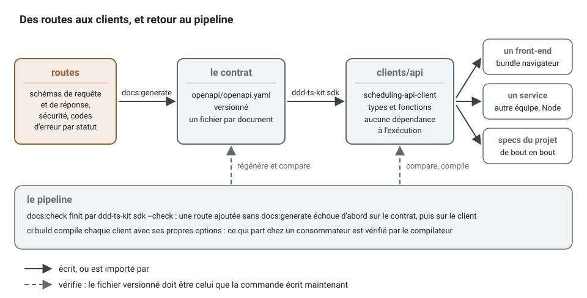

[English](client-sdk.md) · **Français**
<!-- translation-of: client-sdk.md sha256:2ffb21aa9cbcbe50 -->

# SDK client : un client typé à partir du contrat OpenAPI

**Résumé.** Un projet du kit écrit son contrat OpenAPI à partir de ses routes
(`openapi/openapi.yaml`, ou un fichier par document de `openapi.documents`). Ceux qui appellent
l'API (une interface web, une autre équipe, un partenaire, les *specs* de bout en bout du projet
lui-même) veulent un client typé de ce contrat, à jour avec lui, qui refuse ce que l'API refuse
dans les mots de ses codes d'erreur. Trois générateurs maintenus ont été mesurés sur le contrat de
l'application d'exemple. Aucun ne lit les codes d'erreur que le contrat déclare par statut, deux
d'entre eux ajoutent au projet une installation de 35 à 73 Mo, et l'un d'eux refuse la version de
TypeScript qu'utilisent les projets du kit. Le kit écrit donc le client lui-même :
`ddd-ts-kit sdk`, sans dépendance à installer, ni pour le projet ni pour le consommateur. Cette
page donne les mesures, la décision, et la façon dont le client généré s'utilise, se vérifie et
se publie.

## Ce que doit faire le client d'un contrat du kit

Le contrat de l'exemple (`examples/scheduling/openapi/openapi.yaml`, 32 opérations) montre ce
qu'un client doit porter :

- **Les refus comme des données.** Chaque refus est un document *problem* (RFC 9457,
  `application/problem+json`) avec un `code` stable. Chaque réponse liste dans `x-error-codes`
  les codes qu'elle peut porter : `POST /practices` répond `404` avec `PERSON_NOT_REGISTERED`,
  `422` avec `UNKNOWN_TIME_ZONE` ou `VALIDATION_FAILED`. L'appelant choisit sa branche selon le
  code, donc le client doit typer `problem.code` avec exactement ces codes, statut par statut.

  ```yaml
  # openapi/openapi.yaml : la réponse 422 de POST /practices, telle que docs:generate l'écrit
  '422':
    description: 'Unprocessable Content. Error codes: UNKNOWN_TIME_ZONE, VALIDATION_FAILED.'
    content:
      application/problem+json:
        schema:
          $ref: '#/components/schemas/Problem'
    x-error-codes:
      - UNKNOWN_TIME_ZONE
      - VALIDATION_FAILED
  ```

- **La sécurité par opération.** La plupart des opérations exigent le schéma `bearer`, quelques
  unes sont publiques.
- **Les documents séparés.** Avec `openapi.documents`, un contrat est fait de plusieurs fichiers
  autonomes : une API publique et un *back office* ont chacun leur client.
- **Les paramètres d'URL tels qu'ils sont écrits.** Les filtres s'appellent `filter[status]`, les
  listes sont répétées.
- **De nombreux consommateurs.** Un *bundle* de navigateur, un service Node, les *specs* de bout
  en bout : aucune dépendance à l'exécution, et ce qu'un *bundle* n'appelle pas ne doit pas s'y
  trouver.

## Comparaison

Mesuré le 2026-10-12 sur le contrat d'exemple tel qu'il était alors (25 opérations, version 0.6.0
du kit ; il compte aujourd'hui 32 opérations, et son client 82 ko de sources), versions lues sur
npm le même jour, chaque générateur avec ses réglages par défaut documentés (`openapi-fetch` pour
openapi-typescript, le client fetch pour orval). Les tailles sont minifiées avec esbuild 0.28 ;
« une opération » met dans le *bundle* `getAppointment` et ce dont elle a besoin. Les tailles
d'installation comprennent TypeScript 6 (24 Mo), que chaque projet du kit installe déjà.

| | openapi-typescript + openapi-fetch | @hey-api/openapi-ts | orval | `ddd-ts-kit sdk` |
|---|---|---|---|---|
| Version, licence | 7.13.0 et 0.17.0, MIT | 0.99.0, MIT | 8.41.0, MIT | la CLI, MIT |
| Installé pour générer | 35 *packages*, 45 Mo | 46 *packages*, 35 Mo | 60 *packages*, 73 Mo | rien : la CLI que le projet a déjà |
| S'installe à côté de TypeScript 6 | non : sa plage de pair est `typescript@^5.x`, `npm install` s'arrête sur ERESOLVE | oui | oui | oui |
| Sortie sur l'exemple | un `.d.ts` de 80 ko, des types seulement | 16 fichiers, 110 ko, dont la moitié est un *runtime* copié | un fichier de 68 ko | 6 fichiers, 66 ko, et un README |
| Dépendance à l'exécution du consommateur | `openapi-fetch` et son *package* utilitaire | aucune (*runtime* copié) | aucune | aucune |
| Client entier, minifié (gzip) | 6,6 ko (2,6 ko) : le *runtime*, les chemins sont des types | 13,6 ko (4,5 ko) | 13,9 ko (2,2 ko) | 10,1 ko (2,8 ko) |
| Une opération, minifiée | tout le *runtime*, 6,6 ko | 9,6 ko | 0,2 ko | 2,4 ko |
| Codes d'erreur de `x-error-codes` | perdus : `code: string` | perdus : `code: string` | perdus : `code: string` | typés par statut : `Failure<422, 'UNKNOWN_TIME_ZONE' \| 'VALIDATION_FAILED', Problem>` |
| Résultat discriminé par statut | oui, `{ data, error, response }` | oui avec `throwOnError: false` | oui, `{ data, status }` | oui, `{ ok, status, data \| problem }` |
| Sécurité du contrat | non lue : un *middleware* pose l'en-tête | par opération, un *callback* `auth` | non lue : aucun justificatif n'est joint | par opération et par schéma, une valeur ou une fonction par schéma |
| Documents séparés | une exécution par fichier | une exécution par fichier | une cible par fichier | un client par document, à partir de `openapi.documents` |
| URL de base | une option | une option | aucune : des URL relatives, un *mutator* pour en ajouter une | une option |
| Maintenance | active, version majeure stable | active, encore en 0.x : changements cassants entre versions mineures | active, versions publiées fréquentes | publié avec le kit, tenu par ses *specs* |

Aucun des trois ne lit `x-error-codes` : une extension propre au fournisseur, qu'ils laissent en
commentaires (openapi-typescript et hey-api recopient la description « Error codes: ... » dans
la JSDoc). Faire entrer les codes dans les types demanderait un second générateur par-dessus le
leur, plus leur installation, plus, pour openapi-typescript, une surcharge de sa plage de pair
dans chaque projet. Les contrats qu'écrit le kit utilisent un sous-ensemble connu d'OpenAPI 3.1
(corps de requête HTTP en JSON, réponses JSON et *problem*, schémas de composants, schémas de
sécurité HTTP et clé d'API), puisque c'est le kit qui les écrit : un générateur de ce
sous-ensemble tient en quelques centaines de lignes, que la CLI, qui n'a aucune dépendance à
l'exécution, peut porter.

## La décision

`ddd-ts-kit sdk` génère les clients. Il lit le contrat validé dans le dépôt (YAML ou JSON, selon
`openapi.format`) : il n'a donc besoin ni d'un *build* ni du réseau, et la même commande répond à
`--check` pour le *pipeline*.



La boucle, en commandes :

```bash
npx ddd-ts-kit sdk          # une fois : inscrit "sdk" dans la config et écrit clients/<document>
npm install                 # npm inscrit le nouveau package du workspace dans package-lock.json
npm run docs:generate       # après la modification d'une route : le contrat, puis les clients
npm run docs:check          # ce que lance le pipeline : échoue sur un contrat ou un client périmé
npm run sdk:build           # compile chaque client, comme le fait ci:build
```

Quand le contrat vient d'ailleurs, ou quand l'équipe veut des *hooks* React Query, des schémas
Zod ou des *mocks* générés avec le client, orval et hey-api sont les meilleurs outils : ils
couvrent OpenAPI largement et ont des *plugins* pour cela. Lancez-les sur `openapi/*.yaml` comme
sur n'importe quel autre contrat ; le kit ne les en empêche pas.

## Ce qui est généré

`init --sdk` demande les clients dans un nouveau projet ; `npx ddd-ts-kit sdk` les demande dans
un projet existant (il inscrit `"sdk"` dans ddd-ts-kit.config.json, voir
[CONFIG](../CONFIG.fr.md), ajoute à AGENTS.md (à CLAUDE.md dans un projet écrit avant lui) la
consigne qu'écrit `init --sdk` pour les agents, ne jamais modifier un client, et indique d'ajouter
`clients/**` aux chemins de `.claude/rules/presentation.md` et de
`.github/instructions/presentation.instructions.md`). Pour chaque document du contrat, un *package* du *workspace* :

```text
clients/
  tsconfig.json          compile tous les clients : tsc -b clients
  api/                   le contrat entier ; un contrat séparé donne clients/<document>
    package.json         nom tiré de "sdk.name" ; la version appartient à l'équipe
    README.md            usage, opérations, codes d'erreur, comment publier
    tsconfig.json        modules ES, déclarations, types DOM : un navigateur comme Node
    src/
      index.ts           ce qu'exporte le package
      client.ts          createClient(), connect(), les schémas de sécurité
      operations.ts      par opération : son type d'entrée, son type de résultat, sa fonction
      errors.ts          ERROR_CODES, ErrorCode, isErrorCode(), isProblem()
      schemas.ts         un type par schéma de composant
      runtime.ts         le même pour tout contrat : requête HTTP, justificatifs, réponse
```

Un contrat séparé (`openapi.documents`) donne `clients/<nom>` pour chaque document, y compris un
document nommé `openapi` ; deux fichiers de contrat qui écriraient un même client
(`openapi.yaml` et un `api.yaml` égaré dans un contrat qui n'est pas séparé) sont refusés, avec
les deux noms.

Chaque exécution réécrit tous les fichiers sauf package.json ; package.json garde sa version et
toutes les clés que l'équipe ajoute, et seuls le nom, les points d'entrée, le script de *build* et
`publishConfig.access` suivent la config. Quand une branche a relevé la version et que le tronc a
changé le même package.json, `merge-trunk` garde le fichier du tronc à la plus haute des deux
versions, et le dit dans son rapport ; une version qui n'est pas une version sémantique d'un côté
ou de l'autre vous est laissée comme un conflit.

La commande câble aussi le projet, et la relancer ne change rien :

- les clients sont des *packages* du *workspace* (`"workspaces"` dans package.json,
  `pnpm-workspace.yaml` sous pnpm). npm inscrit chacun d'eux dans `package-lock.json`, et
  `npm ci` refuse un fichier de verrouillage où il en manque un : tant que le fichier de
  verrouillage d'un projet npm ne liste pas un client (la première exécution, un nouveau document
  d'un contrat séparé, un nouveau `sdk.name`), la commande indique de lancer `npm install` et de
  valider le fichier de verrouillage, et `sdk --check` échoue. pnpm accepte un nouveau *package*
  du *workspace* lors d'une installation figée ;
- le nom de chaque client se résout vers ses sources dans les `paths` de `tsconfig.json`, que
  lisent la vérification de types, Vitest, tsx et knip : une *spec* importe le client par son nom
  de *package*, comme le ferait un consommateur, sans *build* préalable ;
- leurs sources sont exclues de Biome et de knip, qui liraient du code généré comme du code écrit
  à la main, et du *preset* ESLint, qui les exclut quand la config porte `"sdk"` : un projet sans
  cette clé continue de linter et de formater ce qu'il a sous `clients/` ;
- knip.json nomme la racine comme un *workspace* à part entière (`workspaces["."]`), ce que knip
  exige dès que package.json a des *workspaces* ; ce que knip.json disait du projet y est déplacé,
  et c'est là que les générateurs inscrivent désormais un nouveau contexte ou un nouveau point
  d'entrée ;
- les scripts : `sdk:generate`, `sdk:build` ; `docs:generate` régénère les clients après le
  contrat, `docs:check` et `ci:docs` les comparent, `ci:build` les compile.

### Utilisation

Ce que le client change, sur un appel. Écrit à la main, rien ne lie la requête HTTP ni le code du
refus au contrat :

```ts
// À éviter : une requête HTTP écrite à la main
const response = await fetch('https://api.example.com/practices', {
  method: 'POST',
  headers: { 'content-type': 'application/json', authorization: `Bearer ${session.token()}` },
  body: JSON.stringify({ name: 'Riverside', timeZone: 'Europe/Paris', manager: 'ada' }), // le champ s'appelle managerId
});
const problem = (await response.json()) as { code?: string };

if (response.status === 422 && problem.code === 'UNKNOWN_TIMEZONE') {
  // jamais vrai : le code est UNKNOWN_TIME_ZONE, et rien ne le dit avant la production
}
```

Par le client, les deux mêmes erreurs ne compilent pas :

```ts
// À écrire : le client du contrat
const result = await api.openPractice({ body: { name: 'Riverside', timeZone: 'Europe/Paris', manager: 'ada' } });
// error TS2561: Object literal may only specify known properties, but 'manager' does not exist
// in type '{ name: string; timeZone: string; managerId: string; }'. Did you mean to write 'managerId'?

if (!result.ok && result.status === 422 && result.problem.code === 'UNKNOWN_TIMEZONE') {
  // error TS2367: This comparison appears to be unintentional because the types
  // '"UNKNOWN_TIME_ZONE" | "VALIDATION_FAILED"' and '"UNKNOWN_TIMEZONE"' have no overlap.
}
```

L'utilisation complète :

```ts
import { createClient, isProblem, unwrap } from 'scheduling-api-client';

const api = createClient({ baseUrl: 'https://api.example.com', credentials: { bearer: () => session.token() } });

const result = await api.openPractice({ body: { name: 'Riverside', timeZone: 'Europe/Paris', managerId: 'ada' } });

if (result.ok) {
  console.log(result.data.id);
} else if (result.status === 422 && result.problem.code === 'UNKNOWN_TIME_ZONE') {
  // result.problem.code vaut ici 'UNKNOWN_TIME_ZONE' | 'VALIDATION_FAILED', et rien d'autre.
}

try {
  const page = await unwrap(api.searchAppointments({ query: { 'filter[status]': 'booked' } }));
  console.log(page.items.length);
} catch (error) {
  if (isProblem(error, 'INVALID_CRITERIA')) {
    // error.code vaut 'INVALID_CRITERIA'.
  }
}
```


- Une méthode ne lève jamais d'exception pour un statut que son contrat déclare : le résultat est
  une union discriminée par `ok` et `status`. `unwrap` transforme un refus en une `ProblemError`
  levée.
- Un statut que le contrat ne déclare pas lève `UnexpectedResponseError`. Le cas courant est une
  panne du serveur : le kit répond à toute erreur inattendue par un document *problem* 500
  (`code` `INTERNAL_ERROR`, `requestId`) qu'aucune opération ne déclare, et l'erreur le lit :
  `error.code`, `error.requestId` (la référence à citer à l'équipe de l'API, qui retrouve la
  requête HTTP dans ses journaux) et `error.problem`. Une passerelle intermédiaire (502, 503) et
  un serveur en désaccord avec son contrat aboutissent là aussi ; la vérification de dérive
  maintient le contrat égal aux routes, pas à chaque réponse du serveur.
- Un statut déclaré inférieur à 400 est un succès (`ok: true`), y compris un 304 ou un 302 sous
  `redirect: 'manual'` ; 400 et au-delà, un refus.
- Un justificatif (credential) se donne par schéma de sécurité, comme une valeur ou comme une
  fonction appelée avant chaque requête HTTP. Une opération envoie les justificatifs de la
  première alternative de sa sécurité pour laquelle ils sont tous fournis, et rien quand elle
  autorise les appels anonymes et qu'aucun n'est fourni.
- `headers` ajoute des en-têtes à chaque requête HTTP, et un en-tête de l'appel remplace celui du
  client, quelle que soit la casse de son nom ; `fetch` remplace la fonction globale (un test, une
  nouvelle tentative).
- Chaque opération est aussi une fonction, `getAppointment(connect(options), input)`, pour qu'un
  *bundle* ne contienne que les opérations qu'il appelle.
- Le corps n'est pas validé par rapport à son schéma : le client fait confiance au contrat, et
  `docs:check` maintient le contrat égal aux routes.

**Dans un *bundle* de navigateur**, importez les fonctions des opérations qu'il appelle, et non
`createClient`, qui les contient toutes. Même origine, les *cookies* du navigateur comme
justificatif :

```ts
import { connect, getAppointment } from 'scheduling-api-client';

const connection = connect({ baseUrl: '/api', fetch: (request) => fetch(request, { credentials: 'include' }) });

const appointment = await getAppointment(connection, { path: { appointmentId: 'appointment-42' } });
```

**Quand le serveur échoue**, l'erreur à signaler porte ce dont l'équipe de l'API a besoin pour
retrouver la requête HTTP dans ses journaux :

```ts
import { createClient, UnexpectedResponseError, unwrap } from 'scheduling-api-client';

const api = createClient({ baseUrl: 'https://api.example.com', credentials: { bearer: 'token' } });

try {
  await unwrap(api.getAppointment({ path: { appointmentId: 'appointment-42' } }));
} catch (error) {
  if (error instanceof UnexpectedResponseError) {
    console.error(`${error.status} ${error.code ?? ''}: quote ${error.requestId ?? 'the time of the call'} to the team of the API`);
  }

  throw error;
}
```

**Dans les tests d'un consommateur**, `fetch` est le point de couture : donnez-en un qui répond
ce dont le test a besoin et enregistre ce qui a été envoyé, sans serveur ni bibliothèque de
*mocks* :

```ts
import { createClient } from 'scheduling-api-client';

const requests: Request[] = [];

const api = createClient({
  baseUrl: 'https://api.test',
  credentials: { bearer: 'token-of-ada' },
  fetch: async (request) => {
    requests.push(request);
    return Response.json({ id: 'practice-1' }, { status: 201 });
  },
});

const opened = await api.openPractice({ body: { name: 'Riverside', timeZone: 'Europe/Paris', managerId: 'ada' } });

console.log(opened.ok && opened.data.id); // practice-1
console.log(requests[0]?.headers.get('authorization')); // Bearer token-of-ada
```

Ces exemples importent le client de l'exemple par son nom de *package*, qui se résout dans un
projet qui l'a généré, pas dans le dépôt du kit : les exemples vérifiés de cette documentation
les laissent donc de côté. Ils ont été compilés à la main contre `examples/scheduling/clients/api`,
et les messages du compilateur cités plus haut sont les siens ; aucune porte ne les maintient en
l'état.

### Limites

- Les corps de requête HTTP sont en JSON. Une route d'un autre type de média (un téléversement)
  est générée sans le type de son corps ; envoyez-la avec `fetch`.
- Une réponse `default` ou une plage (`4XX`) n'est pas typée : le kit n'écrit ni l'une ni
  l'autre.
- Les paramètres de *cookie* ne sont pas générés ; un schéma de sécurité par *cookie* l'est,
  envoyé comme un en-tête `Cookie`, que seul un appelant hors d'un navigateur peut poser. Un
  navigateur le supprime et envoie ses propres *cookies* : là, donnez un `fetch` qui appelle la
  fonction globale avec `credentials: 'include'`, et aucun justificatif pour ce schéma.
- Un schéma de composant nommé comme un type qu'utilisent les fichiers générés (`Array`,
  `Record`) ou comme un export du client (`ErrorCode`, `Client`, `unwrap`...) reçoit un `_` final.
- Une opération est nommée d'après son `operationId`. Un mot réservé est suivi de `Operation`
  (`deleteOperation`) ; un nom qu'une autre opération porte déjà (`listItems` et `ListItems`), un
  nom du client (`send`, `createClient`), ou un nom dont un schéma porte déjà les types
  (`<Name>Input`, `<Name>Result`), est suivi d'un nombre (`createClient2`).

## Vérifié par le pipeline

Les clients sont validés dans le dépôt, si bien qu'un clone neuf compile sans rien générer. Le
*job* des documents lance `docs:check`, qui se termine par `ddd-ts-kit sdk --check` : une route
ajoutée sans `docs:generate` le fait échouer d'abord sur `openapi/openapi.yaml`, puis sur le
client. Le *job* de *build* lance `ci:build`, qui compile chaque client avec ses propres options
de compilation (`npm run sdk:build`) : ce qui est livré à un consommateur est vérifié par le typage
dans GitHub Actions comme dans GitLab CI. Les *specs* de bout en bout qui importent un client le
vérifient avec le projet dans `ci:typecheck`.

## Publier

Publier est une décision de l'équipe, jamais une étape que prend le *pipeline* généré. Pour
publier un client :

1. choisissez son nom (`"sdk.name"`, une portée npm pour un registre privé) et son accès
   (`"sdk.access"` : `restricted` pour une portée privée, `public`), puis lancez
   `npx ddd-ts-kit sdk` ;
2. augmentez `version` dans `clients/<document>/package.json` (la version du contrat est une
   bonne source : `info.version`) ;
3. pour un registre autre que npm, écrivez son URL dans un `.npmrc` à côté de ce package.json, et
   son jeton dans l'environnement, jamais dans le dépôt ;
4. `npm publish --workspace clients/<document>` (`pnpm publish --filter <name>`) : son
   `prepublishOnly` le compile d'abord.

Une équipe qui veut automatiser ajoute son propre *job* déclenché par un *tag*, avec le jeton du
registre comme secret du *pipeline*, et `npm publish --provenance` depuis GitHub Actions.

## Dans l'exemple

L'exemple scheduling génère `clients/api` (`scheduling-api-client`). Dans le dépôt du kit,
l'exemple est lui-même un *workspace* de la racine, et npm ignore les `"workspaces"` propres d'un
*workspace* : là, le client n'est atteint que par l'entrée `paths` de `tsconfig.json`, ce
qu'utilisent les *specs* et la vérification de types. Son entrée de *workspace* prend effet dans
une copie autonome de l'exemple, la disposition qu'a un projet généré, où
`npm publish --workspace clients/api` fonctionne. Ses *specs* de bout en bout de l'inscription
d'une personne et de l'ouverture d'un cabinet, ainsi que les fonctions utilitaires avec lesquelles
chaque parcours prépare son cabinet (`registerPeople`, `openStaffedPractice`), appellent l'API à
travers lui (`application.apiAs(actor)` dans `test/e2e/support/start-application.ts`, avec
`expectAnswer` et `expectRefusal`, que le compilateur tient aux statuts et aux codes de chaque
opération) :

```ts
// adapté de test/e2e/identity-open-practice.e2e.spec.ts : le commentaire après 'UNKNOWN_TIME_ZONE' est ajouté
it('answers the documented problem for each business refusal', async () => {
  await registerPeople(application, 'ada');
  const root = application.apiAs({ id: 'root', roles: ['network-admin'] });

  expectRefusal(
    await root.openPractice({ body: { ...opening, timeZone: 'Europe/Atlantis' } }),
    422,
    'UNKNOWN_TIME_ZONE', // 'UNKNOWN_TIMEZONE', ou 'PERSON_NOT_REGISTERED' avec 422, ne compilerait pas
  );

  expectRefusal(await root.openPractice({ body: { ...opening, managerId: 'nobody' } }), 404, 'PERSON_NOT_REGISTERED');
});
```

`apiAs` donne le jeton de l'acteur comme justificatif du schéma `bearer`, une fonction appelée
avant chaque requête HTTP : l'authentification du client est prouvée contre le vrai serveur. Les
autres *specs* gardent les fonctions utilitaires HTTP, qui restent l'outil pour une requête HTTP
que le contrat ne décrit pas : un corps que le client refuserait de compiler est envoyé avec
elles pour prouver `VALIDATION_FAILED`. La *spec* de bout en bout
`packages/cli/test/e2e/client-sdk.spec.ts` prouve la boucle sur un projet neuf : `init --sdk`,
une route ajoutée, le contrat et le client régénérés, un consommateur vérifié par le typage.
