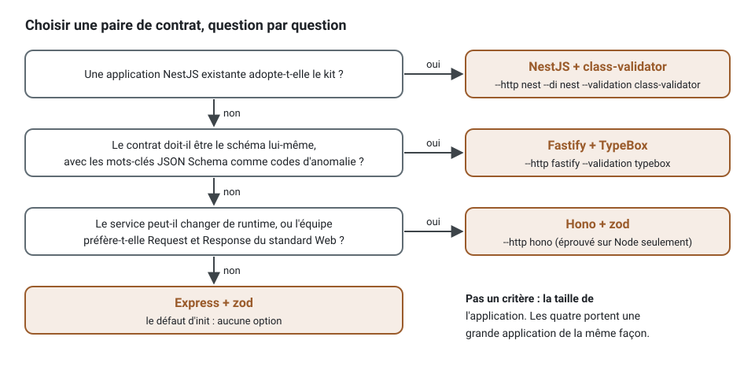

[English](contract-pairs.md) · **Français**
<!-- translation-of: contract-pairs.md sha256:3cf60ebe6988969e -->

# Paires de contrat : un framework HTTP et une bibliothèque de validation

**Résumé.** Un projet de ce kit déclare chaque route une seule fois, comme une classe contrôleur
avec une méthode `handle`, ses schémas, sa réponse et ses codes d'erreur ; un adaptateur la monte
sur un framework, et le contrat OpenAPI est généré à partir de la même déclaration. Le framework
et la bibliothèque de validation sont donc deux choix faits à `init` et changés plus tard sans
toucher au comportement d'une route. Quatre paires sont générées et exécutées de bout en bout par
le kit : Express et zod, Fastify et TypeBox, Hono sur Node et zod, NestJS et class-validator.
oRPC a été évalué et n'en fait pas partie. Ce qui sépare les paires, c'est moins la vitesse que
l'équipe : ce qu'elle connaît déjà, comment elle écrit les types, et quelle part d'un framework
elle est prête à laisser inutilisée.

## Ce que chaque paire garde

Quelle que soit la paire, ces points tiennent de la même façon, par un seul pipeline
(`executeRoute`) et une seule suite de tests de comportement exécutée sur chaque adaptateur :

| Invariant | Comment |
|---|---|
| une route, une classe | `@Controller` sur une classe avec une seule `handle` ; le groupe de routes donne le préfixe, les étiquettes et les gardes |
| les gardes à la frontière, les permissions sur le cas d'usage | `guards` du groupe ou du contrôleur ; `@Requires` sur la commande, décidé par le bus |
| les refus en documents *problem* | RFC 9457 `application/problem+json`, le `code` stable de la fabrique statique, 422 avec une anomalie par chemin pour une entrée refusée |
| les codes d'erreur dans le contrat | `errors` du contrôleur, une réponse *problem* par statut dans le document OpenAPI |
| le traçage | la requête HTTP est le *span* racine nommé d'après sa route, avec la commande, le *repository* et les événements en dessous (vérifié par la *spec* de bout en bout générée) |
| un seul contrat | OpenAPI 3.1 généré à partir des déclarations, versionné, contrôlé contre la dérive en CI ; une forme déclarée une fois arrive une fois dans `components.schemas` ([schémas partagés](validation.fr.md)) |
| un client typé | `ddd-ts-kit sdk` l'écrit à partir du contrat versionné, quel que soit le framework qui l'a produit ([SDK client](client-sdk.fr.md)) : une forme partagée est un type nommé du client, `Accepted` compris ; généré et compilé dans le projet de chaque paire par `contract-pairs.spec.ts` |


Le framework se trouve au bord droit du schéma et la bibliothèque de validation au bord gauche ;
tout ce qui est entre les deux appartient au kit. C'est pourquoi une paire peut être changée : un
contrôleur n'importe aucun framework, et ses schémas sont des valeurs qu'il nomme dans sa
déclaration, enveloppées dans l'unique interface `Schema` de `@ddd-ts-kit/validation`.

## Les paires

| Paire | Options d'`init` | Prouvée par |
|---|---|---|
| Express et zod 4 | le défaut (`--http express --validation zod`) | `contract-pairs.spec.ts`, `proven-stacks.spec.ts` |
| Fastify et TypeBox | `--http fastify --validation typebox` | `contract-pairs.spec.ts` |
| Hono sur Node et zod | `--http hono` | `contract-pairs.spec.ts` |
| NestJS et class-validator | `--http nest --di nest --validation class-validator` | `contract-pairs.spec.ts` |

La *spec* de bout en bout génère un projet par paire (avec `--sdk`), ajoute deux routes de
commande qui imbriquent une forme déclarée avec `generate schema` (son fichier généré rempli, pas
remplacé) et une recherche, installe le kit tel que publié, et tient le projet à zéro constat (le
*checker*, ESLint, dependency-cruiser, knip), à ses *specs* unitaires, à ses *specs* de bout en
bout (401, 403, 201 et l'arbre des *spans* de la requête HTTP), à un contrat régénéré, à jour,
qui contient une seule fois la forme partagée et la réponse `Accepted` de la plateforme, et au
client généré à partir de ce contrat : à jour, nommant `Money` et `Accepted` une fois chacun, et
compilant seul. D'autres combinaisons sont générées, vérifiées et typées par la matrice de
`stacks.ts` (Fastify avec zod parmi elles, et deux ajoutées avec cette page : Hono avec TypeBox
et un cache Redis, Fastify avec TypeBox sur Knex) ; seules ces quatre-là sont exécutées de bout
en bout.

Les routes sont une liste de valeurs simples, quelle que soit la paire : les monter, c'est un
appel de l'adaptateur du framework. Les trois adaptateurs ci-dessous reçoivent les mêmes `routes`
et les mêmes options, et répondent de la même façon :

<!-- checked sample -->
```ts
import { serve } from '@hono/node-server';
import type { ExecuteOptions, Route } from '@ddd-ts-kit/http';
import { mountExpress } from '@ddd-ts-kit/http/express';
import { mountFastify } from '@ddd-ts-kit/http/fastify';
import { mountHono } from '@ddd-ts-kit/http/hono';
import express from 'express';
import Fastify from 'fastify';
import { Hono } from 'hono';

declare const routes: readonly Route[]; // controllerRoutes([...], { resolve }) : la même liste pour chaque paire
declare const options: ExecuteOptions; // portée d'exécution, authentification, mapper d'erreurs, onError

export async function listen(framework: 'express' | 'fastify' | 'hono'): Promise<void> {
  if (framework === 'express') {
    const app = express();

    app.use(express.json()); // l'adaptateur ne lit pas les corps
    mountExpress(app, routes, options);
    app.listen(3000);
  } else if (framework === 'fastify') {
    const app = Fastify();

    mountFastify(app, routes, options);
    await app.listen({ port: 3000 });
  } else {
    const app = new Hono();

    mountHono(app, routes, options); // lit lui-même le corps JSON, jusqu'à bodyLimit
    serve({ fetch: app.fetch, port: 3000 });
  }
}
```

NestJS prend la même liste par `createRoutesModule(routes, options)` de
`@ddd-ts-kit/http/nest`, importé par le module racine ; le
[README de `@ddd-ts-kit/http`](../../packages/http/README.fr.md) montre chaque montage.

« zod-openapi » dans la demande à l'origine de cette page : `zod-openapi` (6.0.2) et
`@asteasolutions/zod-to-openapi` (9.1.0) existent pour transformer des schémas zod en document
OpenAPI. Le kit n'en a pas besoin : zod 4 écrit son propre JSON Schema (`z.toJSONSchema`, draft
2020-12, identifiants tirés de `.meta({ id })` en `$defs`), que le générateur de
`@ddd-ts-kit/http` place dans le document. C'est l'équivalent maintenu, intégré à zod lui-même.

## Table de décision

| | Express + zod | Fastify + TypeBox | Hono + zod | NestJS + class-validator |
|---|---|---|---|---|
| Types d'une requête HTTP | déduits du schéma (`Infer<typeof body>`) | déduits du schéma (`Static`) | déduits du schéma | la classe DTO, écrite à la main |
| Composition des formes | `.pick`, `.omit`, `.partial`, `.extend`, `.meta({ id })` | `Type.Pick`, `Type.Omit`, `Type.Partial`, `Type.Intersect`, `Type.Interface`, `$id` | comme Express + zod | `pickClass`, `omitClass`, `partialClass` du kit, `extends`, des classes imbriquées |
| Fidélité du contrat | haute : zod écrit son JSON Schema ; les transformations et les raffinements ne sont pas décrits | la plus haute : le schéma est du JSON Schema | comme Express + zod | bonne, par `class-validator-jsonschema` ; les validateurs personnalisés demandent un convertisseur |
| Codes d'anomalie (issue codes) pour un client | ceux de zod (`too_small`, `invalid_format`) | le mot-clé JSON Schema (`minLength`, `format`) | ceux de zod | le nom de la contrainte (`isUuid`) |
| Décorateurs | aucun | aucun | aucun | le mode historique (legacy) pour tout le programme |
| Écosystème | le plus large (*middlewares*, recrutement) | *plugins*, *hooks*, pino intégré | tourne sur Node, Bun, Deno et les runtimes edge ; Node seulement ici | modules, injection de dépendances, GraphQL, files d'attente ; les routes du kit contournent ses pipes, ses gardes et ses filtres |
| Maintenance vue sur npm (2026-10-13) | express 5.3.0, zod 4.6.5 | fastify 5.12.5, typebox 1.3.37 (publiée la veille) | hono 4.13.13, @hono/node-server 2.1.4 | @nestjs/core 12.1.2, class-validator 0.15.1, class-transformer 0.5.1 (2021) |
| Convient à | une nouvelle équipe, une API JSON simple, le défaut | une équipe qui veut que le contrat soit le schéma lui-même, et moins de millisecondes de validation par requête HTTP que class-validator | une équipe qui pourrait déplacer le service vers un autre runtime plus tard, ou qui aime `Request` et `Response` du standard Web | une application Nest existante qui adopte le kit contexte par contexte |

La taille de l'application ne choisit pas la paire : l'arborescence, les règles et les schémas
partagés portent une grande application de la même façon sur les quatre. Ce qui grandit avec
elle, c'est le nombre de schémas, si bien que la composition des formes et les codes d'anomalie
que lisent les clients comptent plus que le framework.



### Le même corps, dans chaque bibliothèque

Le corps de « réserver un rendez-vous », avec un `Slot` partagé, déclaré pour chaque paire. Le
contrôleur ne change pas : son option `body` nomme le schéma, et `handle` lit le même type.

<!-- checked sample -->
```ts
import type { Infer } from '@ddd-ts-kit/validation';
import { typeboxSchema } from '@ddd-ts-kit/validation/typebox';
import { zodSchema } from '@ddd-ts-kit/validation/zod';
import Type from 'typebox';
import { z } from 'zod';

// Express + zod, Hono + zod : l'id dans les métadonnées fait de Slot un composant du contrat.
const slot = z.object({ startsAt: z.iso.datetime(), endsAt: z.iso.datetime() }).meta({ id: 'Slot' });

export const bookWithZod = zodSchema(z.object({ patientId: z.uuid(), slot }));

// Fastify + TypeBox : le schéma est déjà du JSON Schema ; le $id fait de Slot un composant.
const slotSchema = Type.Object(
  { startsAt: Type.String({ format: 'date-time' }), endsAt: Type.String({ format: 'date-time' }) },
  { $id: 'Slot' },
);

export const bookWithTypeBox = typeboxSchema(Type.Object({ patientId: Type.String({ format: 'uuid' }), slot: slotSchema }));

// Ce que reçoit handle, dans un cas comme dans l'autre : { patientId: string; slot: { startsAt: string; endsAt: string } }
export type BookBody = Infer<typeof bookWithZod>;
export const sameBody: Infer<typeof bookWithTypeBox> extends BookBody ? true : false = true;
```

NestJS + class-validator écrit une classe par forme, avec des décorateurs, et compile dans le mode
historique des décorateurs :

<!-- checked sample: legacy-decorators -->
```ts
import { classSchema } from '@ddd-ts-kit/validation/class-validator';
import { Type } from 'class-transformer';
import { IsISO8601, IsUUID, ValidateNested } from 'class-validator';

// Une classe imbriquée est toujours un composant du contrat, nommé d'après la classe.
class SlotDto {
  @IsISO8601() startsAt = '';
  @IsISO8601() endsAt = '';
}

class BookBodyDto {
  @IsUUID() patientId = '';

  @ValidateNested()
  @Type(() => SlotDto)
  slot: SlotDto = new SlotDto();
}

export const bookWithClassValidator = classSchema(BookBodyDto);
```

Là où les paires diffèrent pour un client, c'est le 422. Le même corps invalide,
`{ "patientId": "p-1", "slot": { "startsAt": "tomorrow" } }`, est refusé par chaque schéma avec
ces anomalies (exécuté contre les *packages* de ce dépôt) ; le pipeline les renvoie sous
`issues` d'un *problem* `VALIDATION_FAILED`, chaque chemin préfixé par `body.` :

| Chemin | zod | TypeBox | class-validator |
|---|---|---|---|
| `patientId` | `invalid_format` | `format` | `isUuid` |
| `slot.startsAt` | `invalid_format` | `format` | `isIso8601` |
| `slot.endsAt` (absent) | `invalid_type` | `required` | `isIso8601` |

Un client qui se branche sur les codes d'anomalie est écrit pour une seule bibliothèque. Changer
de paire plus tard change ces codes et leurs messages ; le statut, le `code` du *problem* et les
chemins restent.

## Mesuré

`node pipeline/monorepo/measure-contract-pairs.mjs`, après `npm run build`. Node 24.21.0, Linux
x64, 20 cœurs, sur une machine partagée (charge moyenne d'environ 10 pendant les exécutions) :
trois exécutions, la première d'entre elles sans le tour d'échauffement de 1 000 requêtes que le
script fait désormais ; la fourchette est donnée là où les exécutions divergeaient. Un seul
corps : un UUID, un texte facultatif de 500 caractères au plus, et un `Slot` partagé imbriqué de
deux instants.

| Mesure | zod | TypeBox | class-validator |
|---|---|---|---|
| Document OpenAPI de 200 routes (ms) | 7,3 à 12,3 | 2,5 à 5,2 | 8,5 à 13,1 |
| Un `parse` d'un corps valide (µs) | 0,49 à 0,68 | 6,2 à 11,2 | 5,3 à 8,6 |
| Une requête HTTP par `executeRoute`, dans le processus (µs) | 1,4 à 1,6 | 7,3 à 8,9 | 5,8 à 8,6 |

La même requête par `executeRoute` sans corps coûte de 1,1 à 1,4 µs : le pipeline du kit
(principal, portée d'exécution, correspondance des erreurs, réponse) prend environ une
microseconde, le reste est la validation. TypeBox vérifie en 0,75 µs à lui seul ; l'adaptateur
remplit aussi les valeurs par défaut et retire les propriétés non déclarées (`Default`, `Clean`),
et c'est là que passe son temps.

| Framework, 50 routes | Démarrage à froid jusqu'à la première réponse, médiane de 5 (ms) | Requêtes par seconde, kit, 32 en parallèle, client dans un autre processus |
|---|---|---|
| Express 5 | 167 à 244 | 4 800 à 11 700 |
| Fastify 5 | 188 à 268 | 6 000 à 14 700 |
| Hono 4 sur `@hono/node-server` | 152 à 205 | 7 300 à 14 200 |
| NestJS 12 sur Express | 301 à 395 | 7 800 à 13 600 |

Les débits de requêtes sont bornés par le client qui les mesure et par les autres travaux de la
machine : le même framework a varié de plus d'un facteur deux d'une exécution à l'autre, et le
débit à travers le kit et à travers un gestionnaire nu du framework restaient dans ce bruit.
Lisez-les comme « les quatre servent des milliers de requêtes par seconde à travers le kit » ; le
démarrage à froid, où Nest paie pour son conteneur, est la seule différence entre frameworks sur
laquelle les exécutions s'accordent.

## Limites de chaque paire

- **Express + zod.** `express.json()` doit être installé ; un corps qu'Express refuse (JSON mal
  formé) reçoit la réponse du gestionnaire d'erreurs propre à Express, pas un *problem*. zod
  décrit le côté entrée par défaut : un schéma avec des valeurs par défaut utilisé comme réponse
  reçoit un second composant (`Slot_2`) sauf s'il a son propre id.
- **Fastify + TypeBox.** La validation et la sérialisation propres à Fastify ne sont pas
  utilisées : les routes ne portent aucun schéma Fastify, TypeBox valide dans le pipeline.
  TypeBox 1 (`typebox`) est récent et uniquement ESM ; `@sinclair/typebox` 0.34 est son
  prédécesseur et n'est pas pris en charge par l'adaptateur. `Type.Ref` n'est pas résolu :
  partagez un schéma en imbriquant le schéma construit avec un `$id`.
- **Hono + zod.** Éprouvé sur Node seulement. L'adaptateur lit lui-même le corps en JSON, jusqu'à
  `bodyLimit` (1 Mio par défaut, la borne de Fastify ; Express s'arrête à 100 ko) : il répond 413
  (`BODY_TOO_LARGE`) à un corps plus grand et 400 (`MALFORMED_BODY`) à un corps mal formé, les deux
  en *problems*, là où Express et Fastify y répondent avec leur propre gestionnaire d'erreurs. La
  requête brute est `HonoRaw`, si bien qu'un code qui lisait `request.ip` d'Express lit
  `getConnInfo(context)` de `@hono/node-server/conninfo`.
- **NestJS + class-validator.** Le mode historique des décorateurs, l'équivalent en concepts de
  deux conteneurs, et les pipes, gardes, intercepteurs, filtres et `@nestjs/swagger` de Nest ne
  voient pas les routes ([frameworks HTTP](http-frameworks.fr.md)). class-transformer n'a eu
  aucune version publiée depuis 2021.

## oRPC : évalué, pas une paire

oRPC 1.15.6 (MIT, première version publiée en novembre 2024) part du contrat : un contrat
(`oc.route({ method, path }).input(schema).output(schema).errors({...})`) est implémenté par des
procédures, servi en HTTP par un `OpenAPIHandler`, et transformé en document OpenAPI par un
`OpenAPIGenerator` avec un convertisseur par bibliothèque de schémas. Vérifié en l'exécutant avec
zod 4 :

| Invariant du kit | Ce que fait oRPC à la place |
|---|---|
| une classe contrôleur avec une seule `handle` | une procédure est une fonction (`os.book.handler(({ input, context, errors }) => ...)`) ; une classe ne serait qu'appelée depuis elle |
| les gardes | des *middlewares* sur la procédure ou le routeur, avec leur propre contexte |
| des documents *problem* avec le code de la fabrique | son propre corps d'erreur, `application/json` : `{"defined":true,"code":"SLOT_TAKEN","status":409,"message":"..."}` ; une entrée refusée est un 400 `BAD_REQUEST` avec les anomalies sous `data`, pas un *problem* 422 |
| une forme déclarée une fois dans le contrat | un schéma zod avec `.meta({ id })` a été recopié deux fois ; il n'est référencé que s'il est aussi listé dans l'option `commonSchemas` du générateur, un second registre |
| un seul générateur de contrat | oRPC génère son propre document à partir de son contrat, à côté de celui du kit |

L'intégrer comme paire donnerait à un projet deux façons de déclarer une route, deux formats
d'erreur et deux générateurs de contrat, soit ce que le kit existe pour éviter. Ce qu'oRPC offre
et qu'une équipe peut vouloir, un client typé de bout en bout, le kit l'obtient du contrat qu'il
génère déjà : `ddd-ts-kit sdk` écrit un client typé à partir de `openapi/*.yaml`
([SDK client](client-sdk.fr.md)). Utilisez oRPC seul, hors des contextes délimités (bounded
contexts), pour un RPC interne entre un front-end et son backend-for-frontend ; utilisez les
contrôleurs du kit pour l'API des contextes.

## Sources

- Registre npm, lu le 2026-10-13 : express, fastify, hono, @hono/node-server, @nestjs/core,
  zod, typebox, @sinclair/typebox, class-validator, class-transformer, zod-openapi,
  @asteasolutions/zod-to-openapi, @orpc/server, @orpc/contract, @orpc/openapi, @orpc/zod.
- zod, JSON Schema et métadonnées : https://zod.dev/json-schema
- TypeBox : https://github.com/sinclairzx81/typebox
- Hono sur Node : https://hono.dev/docs/getting-started/nodejs
- oRPC : https://orpc.dev (approche par le contrat, gestionnaire et générateur OpenAPI)
- La sonde d'oRPC a été exécutée dans un répertoire jetable avec `@orpc/server`,
  `@orpc/contract`, `@orpc/openapi` et `@orpc/zod` 1.15.6 et zod 4.6.5 ; son code est résumé dans
  le tableau ci-dessus.
- Non vérifié : Hono sur Bun, Deno ou un runtime edge ; TypeBox par `Type.Ref` et un contexte.

## Voir aussi

- [Frameworks HTTP](http-frameworks.fr.md) et [bibliothèques de validation](validation.fr.md)
- [Référence d'architecture](../ARCHITECTURE.fr.md), les schémas partagés dans la section 2
- [Configuration](../CONFIG.fr.md) : `stack.http`, `stack.validation`, `stack.schemas`
