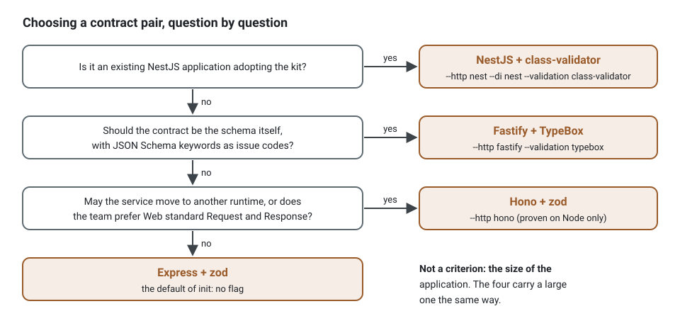

**English** · [Français](contract-pairs.fr.md)

# Contract pairs: an HTTP framework and a validation library

**Summary.** A project of this kit declares each route once, as a controller class with one
`handle` method, its schemas, its response and its error codes; an adapter mounts it on a
framework and the OpenAPI contract is generated from the same declaration. The framework and the
validation library are therefore two choices made at `init` and changed later without touching a
route's behaviour. Four pairs are generated and run end to end by the kit: Express and zod,
Fastify and TypeBox, Hono on Node and zod, NestJS and class-validator. oRPC and tRPC are not
pairs: they serve the same routes a second way, as procedures for a typed TypeScript client. What separates the pairs is less speed than the team: what it already knows,
how it writes types, and how much of a framework it is ready to leave unused.

## What every pair keeps

Whatever the pair, these hold the same way, through one pipeline (`executeRoute`) and one suite
of behaviour tests run on every adapter:

| Invariant | How |
|---|---|
| one route, one class | `@Controller` on a class with one `handle`; the route group gives the prefix, the tags and the guards |
| guards at the edge, permissions on the use case | `guards` of the group or the controller; `@Requires` on the command, decided by the bus |
| refusals as problem documents | RFC 9457 `application/problem+json`, the stable `code` of the static factory, 422 with one issue per path for a refused input |
| error codes in the contract | `errors` of the controller, one problem response per status in the OpenAPI document |
| tracing | the request is the root span named after its route, the command, the repository and the events below it (asserted by the generated end-to-end spec) |
| one contract | OpenAPI 3.1 generated from the declarations, committed, checked for drift in CI; a shape declared once lands once in `components.schemas` ([shared schemas](validation.md)) |
| a typed client | `ddd-ts-kit sdk` writes it from the committed contract, whatever framework produced it ([client SDK](client-sdk.md)): a shared shape is one named type of the client, `Accepted` included; generated and compiled in each pair's project by `contract-pairs.spec.ts` |


The framework sits at the right edge of the drawing and the validation library at the left
edge; everything in between is the kit's. That is why a pair can be changed: a controller
imports no framework, and its schemas are values it names in its declaration, wrapped in the one
`Schema` interface of `@ddd-ts-kit/validation`.

## The pairs

| Pair | `init` flags | Proven by |
|---|---|---|
| Express and zod 4 | the default (`--http express --validation zod`) | `contract-pairs.spec.ts`, `proven-stacks.spec.ts` |
| Fastify and TypeBox | `--http fastify --validation typebox` | `contract-pairs.spec.ts` |
| Hono on Node and zod | `--http hono` | `contract-pairs.spec.ts` |
| NestJS and class-validator | `--http nest --di nest --validation class-validator` | `contract-pairs.spec.ts` |

The end-to-end spec generates one project per pair (with `--sdk`), adds two command routes that
nest one shape declared with `generate schema` (its generated file filled in, not replaced) and a
search, installs the kit as published, and holds the project to zero finding (the checker,
ESLint, dependency-cruiser, knip), its unit specs, its end-to-end specs (401, 403, 201 and the
span tree of the request), a contract regenerated, current, holding the shared shape once and
the `Accepted` answer of the platform, and the client generated from that contract: current,
naming `Money` and `Accepted` once each, and compiling on its own. Other combinations are
generated, checked and type-checked by the matrix of `stacks.ts` (Fastify with zod among them,
and two added with this page: Hono with TypeBox and a Redis cache, Fastify with TypeBox on
Knex); only these four are run end to end.

The routes are a list of plain values, whatever the pair: mounting them is one call of the
adapter of the framework. The three adapters below receive the same `routes` and the same
options, and answer the same way:

<!-- checked sample -->
```ts
import { serve } from '@hono/node-server';
import type { ExecuteOptions, Route } from '@ddd-ts-kit/http';
import { mountExpress } from '@ddd-ts-kit/http/express';
import { mountFastify } from '@ddd-ts-kit/http/fastify';
import { mountHono } from '@ddd-ts-kit/http/hono';
import express from 'express';
import Fastify from 'fastify';
import { Hono } from 'hono';

declare const routes: readonly Route[]; // controllerRoutes([...], { resolve }): the same list for every pair
declare const options: ExecuteOptions; // execution scope, authentication, error mapper, onError

export async function listen(framework: 'express' | 'fastify' | 'hono'): Promise<void> {
  if (framework === 'express') {
    const app = express();

    app.use(express.json()); // the adapter does not parse bodies
    mountExpress(app, routes, options);
    app.listen(3000);
  } else if (framework === 'fastify') {
    const app = Fastify();

    mountFastify(app, routes, options);
    await app.listen({ port: 3000 });
  } else {
    const app = new Hono();

    mountHono(app, routes, options); // reads the JSON body itself, up to bodyLimit
    serve({ fetch: app.fetch, port: 3000 });
  }
}
```

NestJS takes the same list through `createRoutesModule(routes, options)` of
`@ddd-ts-kit/http/nest`, imported by the root module; the
[`@ddd-ts-kit/http` README](../../packages/http/README.md) shows each mount.

"zod-openapi" in the request that started this page: `zod-openapi` (6.0.2) and
`@asteasolutions/zod-to-openapi` (9.1.0) exist to turn zod schemas into an OpenAPI document. The
kit does not need them: zod 4 writes its own JSON Schema (`z.toJSONSchema`, draft 2020-12, ids
from `.meta({ id })` as `$defs`), which the generator of `@ddd-ts-kit/http` places in the
document. That is the maintained equivalent, built into zod itself.

## Decision table

| | Express + zod | Fastify + TypeBox | Hono + zod | NestJS + class-validator |
|---|---|---|---|---|
| Types of a request | inferred from the schema (`Infer<typeof body>`) | inferred from the schema (`Static`) | inferred from the schema | the DTO class, written by hand |
| Composition of shapes | `.pick`, `.omit`, `.partial`, `.extend`, `.meta({ id })` | `Type.Pick`, `Type.Omit`, `Type.Partial`, `Type.Intersect`, `Type.Interface`, `$id` | as Express + zod | `pickClass`, `omitClass`, `partialClass` of the kit, `extends`, nested classes |
| Contract fidelity | high: zod writes its JSON Schema; transforms and refinements are not described | highest: the schema is JSON Schema | as Express + zod | good, through `class-validator-jsonschema`; custom validators need a converter |
| Issue codes for a client | zod's (`too_small`, `invalid_format`) | the JSON Schema keyword (`minLength`, `format`) | zod's | the constraint name (`isUuid`) |
| Decorators | none | none | none | legacy mode for the whole program |
| Ecosystem | the widest (middlewares, hiring) | plugins, hooks, pino built in | runs on Node, Bun, Deno and edge runtimes; Node only here | modules, DI, GraphQL, queues; the kit's routes bypass its pipes, guards and filters |
| Maintenance seen on npm (2026-10-13) | express 5.3.0, zod 4.6.5 | fastify 5.12.5, typebox 1.3.37 (published the day before) | hono 4.13.13, @hono/node-server 2.1.4 | @nestjs/core 12.1.2, class-validator 0.15.1, class-transformer 0.5.1 (2021) |
| Fits | a new team, a plain JSON API, the default | a team that wants the contract to be the schema itself, and fewer milliseconds of validation per request than class-validator | a team that may move the service to another runtime later, or that likes Web standard `Request` and `Response` | an existing Nest application adopting the kit context by context |

Size of the application does not pick the pair: the tree, the rules and the shared schemas carry
a large application the same way on all four. What grows with it is the number of schemas, so
the composition of shapes and the issue codes clients read matter more than the framework.



### The same body, in each library

The body of "book an appointment", with a shared `Slot`, declared for each pair. The controller
does not change: its `body` option names the schema, and `handle` reads the same type.

<!-- checked sample -->
```ts
import type { Infer } from '@ddd-ts-kit/validation';
import { typeboxSchema } from '@ddd-ts-kit/validation/typebox';
import { zodSchema } from '@ddd-ts-kit/validation/zod';
import Type from 'typebox';
import { z } from 'zod';

// Express + zod, Hono + zod: the id in the metadata makes Slot one component of the contract.
const slot = z.object({ startsAt: z.iso.datetime(), endsAt: z.iso.datetime() }).meta({ id: 'Slot' });

export const bookWithZod = zodSchema(z.object({ patientId: z.uuid(), slot }));

// Fastify + TypeBox: the schema is JSON Schema already; the $id makes Slot one component.
const slotSchema = Type.Object(
  { startsAt: Type.String({ format: 'date-time' }), endsAt: Type.String({ format: 'date-time' }) },
  { $id: 'Slot' },
);

export const bookWithTypeBox = typeboxSchema(Type.Object({ patientId: Type.String({ format: 'uuid' }), slot: slotSchema }));

// What handle receives, either way: { patientId: string; slot: { startsAt: string; endsAt: string } }
export type BookBody = Infer<typeof bookWithZod>;
export const sameBody: Infer<typeof bookWithTypeBox> extends BookBody ? true : false = true;
```

NestJS + class-validator writes a class per shape, with decorators, and compiles in the legacy
decorator mode:

<!-- checked sample: legacy-decorators -->
```ts
import { classSchema } from '@ddd-ts-kit/validation/class-validator';
import { Type } from 'class-transformer';
import { IsISO8601, IsUUID, ValidateNested } from 'class-validator';

// A nested class is always a component of the contract, named after the class.
class SlotDto {
  @IsISO8601() startsAt = '';
  @IsISO8601() endsAt = '';
}

class BookBodyDto {
  @IsUUID() patientId = '';

  @ValidateNested()
  @Type(() => SlotDto)
  slot: SlotDto = new SlotDto();
}

export const bookWithClassValidator = classSchema(BookBodyDto);
```

Where the pairs differ for a client is the 422. The same invalid body,
`{ "patientId": "p-1", "slot": { "startsAt": "tomorrow" } }`, is refused by each schema with these
issues (run against the packages of this repository); the pipeline answers them under
`issues` of a `VALIDATION_FAILED` problem, each path prefixed by `body.`:

| Path | zod | TypeBox | class-validator |
|---|---|---|---|
| `patientId` | `invalid_format` | `format` | `isUuid` |
| `slot.startsAt` | `invalid_format` | `format` | `isIso8601` |
| `slot.endsAt` (missing) | `invalid_type` | `required` | `isIso8601` |

A client that branches on issue codes is written for one library. Changing the pair later
changes these codes and their messages; the status, the `code` of the problem and the paths
stay.

## Measured

`node pipeline/monorepo/measure-contract-pairs.mjs`, after `npm run build`. Node 24.21.0,
Linux x64, 20 cores, on a shared machine (load average about 10 during the runs): three runs,
the first of them without the warm-up round of 1,000 requests the script now makes; the range
is given where the runs disagreed. One body: a UUID, an optional text of 500
characters at most, and a nested shared `Slot` of two instants.

| Measure | zod | TypeBox | class-validator |
|---|---|---|---|
| OpenAPI document of 200 routes (ms) | 7.3 to 12.3 | 2.5 to 5.2 | 8.5 to 13.1 |
| One `parse` of a valid body (µs) | 0.49 to 0.68 | 6.2 to 11.2 | 5.3 to 8.6 |
| One request through `executeRoute`, in the process (µs) | 1.4 to 1.6 | 7.3 to 8.9 | 5.8 to 8.6 |

The same request through `executeRoute` without a body costs 1.1 to 1.4 µs: the pipeline of
the kit (principal, execution scope, error mapping, answer) is about a microsecond, the rest is
validation. TypeBox checks in 0.75 µs on its own; the adapter also fills defaults and drops
undeclared properties (`Default`, `Clean`), which is where its time goes.

| Framework, 50 routes | Cold start to the first answer, median of 5 (ms) | Requests per second, kit, 32 concurrent, client in another process |
|---|---|---|
| Express 5 | 167 to 244 | 4,800 to 11,700 |
| Fastify 5 | 188 to 268 | 6,000 to 14,700 |
| Hono 4 on `@hono/node-server` | 152 to 205 | 7,300 to 14,200 |
| NestJS 12 on Express | 301 to 395 | 7,800 to 13,600 |

The request rates are bounded by the client measuring them and by the other work on the
machine: the same framework varied by more than a factor of two between runs, and the rate
through the kit and through a bare handler of the framework were within that noise. Read them
as "all four serve thousands of requests a second through the kit"; the cold start, where Nest
pays for its container, is the one framework difference the runs agree on.

## Limits of each pair

- **Express + zod.** `express.json()` must be installed; a body Express refuses (malformed JSON)
  is answered as a problem only with `problemErrorHandler` of `@ddd-ts-kit/http/express` mounted
  last, as the generated server does; without it, by Express's own error handler. zod
  describes the input side by default: a schema with defaults used as a response gets a second
  component (`Slot_2`) unless it has its own id.
- **Fastify + TypeBox.** Fastify's own validation and serialization are not used: the routes
  carry no Fastify schema, TypeBox validates in the pipeline. TypeBox 1 (`typebox`) is recent and
  ESM only; `@sinclair/typebox` 0.34 is its predecessor and is not supported by the adapter.
  `Type.Ref` is not resolved: share a schema by nesting the schema built with an `$id`.
- **Hono + zod.** Proven on Node only. The adapter reads the body as JSON itself, up to
  `bodyLimit` (1 MiB by default, Fastify's bound; Express stops at 100 kB): it answers a larger
  body 413 (`BODY_TOO_LARGE`) and a malformed one 400 (`MALFORMED_BODY`), both as problems, the
  answers `problemErrorHandler` gives on Express and Fastify. The raw request is `HonoRaw`, so
  code that read `request.ip` of Express reads `getConnInfo(context)` of
  `@hono/node-server/conninfo`.
- **NestJS + class-validator.** The legacy decorator mode, two containers' worth of concepts,
  and Nest's pipes, guards, interceptors, filters and `@nestjs/swagger` do not see the routes
  ([HTTP frameworks](http-frameworks.md)). class-transformer has had no release since 2021.

## oRPC: a second door, not a pair

oRPC 1.15.6 (MIT, first release November 2024) is contract-first: a contract
(`oc.route({ method, path }).input(schema).output(schema).errors({...})`) is implemented by
procedures, served over HTTP by an `OpenAPIHandler`, and turned into an OpenAPI document by an
`OpenAPIGenerator` with a converter per schema library. Checked by running it with zod 4:

| Kit invariant | What oRPC does instead, as a pair |
|---|---|
| a controller class with one `handle` | a procedure is a function (`os.book.handler(({ input, context, errors }) => ...)`); a class would only be called from it |
| guards | middlewares on the procedure or the router, with their own context |
| problem documents with the code of the factory | its own error body, `application/json`: `{"defined":true,"code":"SLOT_TAKEN","status":409,"message":"..."}`; a refused input is a 400 `BAD_REQUEST` with the issues under `data`, not a 422 problem |
| a shape declared once in the contract | a zod schema with `.meta({ id })` was inlined twice; it is referenced only when also listed in the `commonSchemas` option of the generator, a second registry |
| one contract generator | oRPC generates its own document from its contract, next to the kit's |

As a pair, it would give a project two ways to declare a route, two error formats and two
contract generators, which is what the kit exists to avoid. What a TypeScript front end wants
from oRPC is its client: procedures called by name, inputs and answers inferred, refusals
narrowed to their codes, the integrations of TanStack Query. The kit gives that client without
a second declaration (`stack.rpc: orpc`, `init --rpc orpc`):

- the routes stay the only declaration: `orpcRouter` of `@ddd-ts-kit/http/orpc` serves each one
  as a procedure named by its `operationId` on oRPC's own RPC protocol (`RPCHandler`, under
  `/rpc`), through the same `executeRoute`, guards, validation and permissions included;
- one error format: a refusal is an `ORPCError` whose code and status are those of the problem
  document, which it carries as its data;
- one contract: `ddd-ts-kit sdk` writes the oRPC contract of each client from the OpenAPI
  document (`<client>/orpc`), its inputs and answers the types of the HTTP client, its refusals
  the codes `x-error-codes` declares. oRPC's `OpenAPIHandler` and `OpenAPIGenerator` are not used.

What only HTTP carries stays with the routes: the headers of an answer (an `ETag`, a cache
policy), the representations other than JSON, uploads, files and lists streamed as they are read
([the package README](../../packages/http/README.md), "oRPC procedures"). A client that needs
them keeps the HTTP client, which `ddd-ts-kit sdk` still writes ([client SDK](client-sdk.md)).

## tRPC: the same door, for a tRPC client

tRPC declares no contract: a client is typed by the type of the server's router, which a front
end imports from the server's code, and its procedures have no path, no method and no OpenAPI
document. As a pair, it would make the router the declaration of the API, next to the routes.
The kit serves it the way it serves oRPC (`stack.rpc: trpc`, `init --rpc trpc`):

- `trpcRouter` of `@ddd-ts-kit/http/trpc` serves each route as a procedure named by its
  `operationId`, a query for a `GET` and a mutation for the other methods, through the same
  `executeRoute`;
- a refusal is a `TRPCError` of the code tRPC has for its status, with the problem document in
  `data.problem`: tRPC has a fixed set of codes, so the code of the kit is read there;
- the type of the router is written by `ddd-ts-kit sdk` from the OpenAPI document
  (`<client>/trpc`, `AppRouter`): a front end imports the client, never the server's code.

What tRPC types less than oRPC: a refusal is not narrowed to the codes of its procedure, its
`data.problem.code` is any code of the contract; and a binary body has no procedure answer, as
tRPC answers JSON only.

## Sources

- npm registry, read on 2026-10-13: express, fastify, hono, @hono/node-server, @nestjs/core,
  zod, typebox, @sinclair/typebox, class-validator, class-transformer, zod-openapi,
  @asteasolutions/zod-to-openapi, @orpc/server, @orpc/contract, @orpc/openapi, @orpc/zod.
- zod, JSON Schema and metadata: https://zod.dev/json-schema
- TypeBox: https://github.com/sinclairzx81/typebox
- Hono on Node: https://hono.dev/docs/getting-started/nodejs
- oRPC: https://orpc.dev (contract-first, OpenAPI handler and generator)
- The probe of oRPC was run in a throwaway directory with `@orpc/server`, `@orpc/contract`,
  `@orpc/openapi` and `@orpc/zod` 1.15.6 and zod 4.6.5; its code is summarised in the table above.
  The procedures of the kit are proven with `@orpc/server`, `@orpc/client` and `@orpc/contract`
  1.16.1 (`packages/http/test/orpc.spec.ts`, and a generated project on each framework).
- tRPC: https://trpc.io. The procedures of the kit are proven with `@trpc/server` and
  `@trpc/client` 11.19.0 (`packages/http/test/trpc.spec.ts`, a generated project on each
  framework, and the router type of the client of the example, type-checked).
- Not verified: Hono on Bun, Deno or an edge runtime; TypeBox through `Type.Ref` and a context.

## See also

- [HTTP frameworks](http-frameworks.md) and [validation libraries](validation.md)
- [Architecture reference](../ARCHITECTURE.md), shared schemas under section 2
- [Configuration](../CONFIG.md): `stack.http`, `stack.validation`, `stack.schemas`
