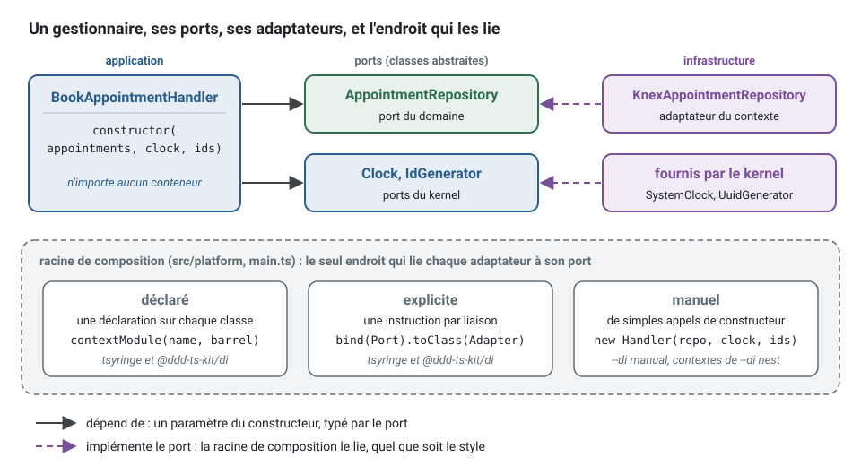

[English](dependency-injection.md) · **Français**
<!-- translation-of: dependency-injection.md sha256:7f8dd0964aeb8c90 -->

# Injection de dépendances : les conteneurs du kit, NestJS, câblage manuel

**Résumé.** La Clean Architecture n'attend qu'une chose de l'injection de dépendances : un
endroit unique, la racine de composition, où les adaptateurs sont liés aux ports. Ce kit offre
trois façons d'écrire cet endroit. Avec `@ddd-ts-kit/di`, sur tsyringe, InversifyJS ou Awilix, les
classes déclarent ce qu'elles sont et le contexte est assemblé à partir des déclarations, les
erreurs de câblage étant trouvées avant que quoi que ce soit ne soit instancié. Avec NestJS, le conteneur du framework
fait le travail et les contextes sont câblés explicitement. Avec le câblage manuel, une fonction
construit les objets à la main. Les trois gardent `domain/` et `application/` libres de tout
conteneur ; ils diffèrent par ce qui est vérifié pour vous et par ce que le kit peut générer.
Les conteneurs sont comparés plus bas, mesures à l'appui, et la page dit quoi faire quand une
équipe tient à une technologie.

## Ce qui se décide

Quel que soit l'outil, les règles sont les mêmes (`composition/only-in-module`, `layer/*`,
`ports/*` dans [ARCHITECTURE.md](../ARCHITECTURE.fr.md) et la page
[ports et composition](../concepts/ports-and-composition.fr.md)) : un port est une classe
abstraite, un cas d'usage reçoit ses ports par son constructeur, et seule la racine de
composition sait quel adaptateur se tient derrière quel port.



Le gestionnaire (handler) de l'exemple fil rouge réserve un rendez-vous. Il nomme ce dont il a
besoin par port, dans son constructeur, et rien d'autre :

<!-- checked sample -->
```ts
import { definePermissions } from '@ddd-ts-kit/auth';
import { AuthorizedCommand, type Actor, type Clock, type IdGenerator } from '@ddd-ts-kit/kernel';
import { CommandHandler, Requires } from '@ddd-ts-kit/kernel/declarations';

// contexts/appointments/domain/aggregates/appointment.aggregate.ts, réduit à ce qu'utilise l'exemple
declare class Appointment {
  static book(props: { id: string; clientId: string; startsAt: Date; bookedAt: Date }): Appointment;
  readonly id: string;
}

// contexts/appointments/domain/repositories/appointment.repository.ts : un port est une classe abstraite
export abstract class AppointmentRepository {
  abstract save(appointment: Appointment): Promise<void>;
}

// contexts/appointments/appointments.permissions.ts
export const appointmentsPermissions = definePermissions('appointments', {
  'appointment.book': { description: 'Book an appointment' },
});

// contexts/appointments/application/commands/book-appointment/book-appointment.command.ts
@Requires(appointmentsPermissions['appointment.book'])
export class BookAppointment extends AuthorizedCommand<string> {
  constructor(
    actor: Actor,
    readonly startsAt: Date,
  ) {
    super(actor);
  }
}

// contexts/appointments/application/commands/book-appointment/book-appointment.handler.ts
@CommandHandler(BookAppointment)
export class BookAppointmentHandler implements CommandHandler<BookAppointment> {
  constructor(
    private readonly appointments: AppointmentRepository,
    private readonly clock: Clock,
    private readonly ids: IdGenerator,
  ) {}

  async execute(command: BookAppointment): Promise<string> {
    const appointment = Appointment.book({
      id: this.ids.next(),
      clientId: command.actor.id,
      startsAt: command.startsAt,
      bookedAt: this.clock.now(),
    });

    await this.appointments.save(appointment);

    return appointment.id;
  }
}
```

Le décorateur vient de `@ddd-ts-kit/kernel/declarations`. Ce n'est que de la métadonnée : il
n'instancie rien et n'importe aucun conteneur. Ce dont dépend le gestionnaire est dit une seule
fois, par son constructeur : `ddd-ts-kit docs` lit la signature dans le source et écrit, dans le
fichier généré du contexte, la liste que le conteneur injecte
([ports et composition](../concepts/ports-and-composition.fr.md), « Comment le constructeur
atteint la racine de composition », compare cela à une liste dans le décorateur et à
`emitDecoratorMetadata`, qui ne tient que dans trois des dix combinaisons de compilateur et
d'exécuteur mesurées). La même classe de gestionnaire, sans le décorateur, est ce que NestJS ou
le câblage manuel lieraient.

Ce que les règles refusent, c'est un cas d'usage qui va chercher lui-même ses dépendances. Au
lieu d'atteindre le conteneur, ou de construire l'adaptateur, dans la couche application :

```ts
// application/commands/book-appointment/book-appointment.handler.ts : refusé
// layer/application-inward : un package de conteneur et un fichier d'infrastructure, importés par l'application
import { container } from 'tsyringe';
import { KnexAppointmentRepository } from '@/contexts/appointments/infrastructure/persistence/knex-appointment.repository';

export class BookAppointmentHandler {
  // composition/only-in-module : l'adaptateur est choisi ici, une fois pour toutes, et un test ne peut pas le remplacer
  private readonly appointments = new KnexAppointmentRepository();
  // une dépendance cachée : le constructeur ne dit plus ce dont le gestionnaire a besoin
  private readonly clock = container.resolve(Clock);

  async execute(command: BookAppointment): Promise<string> { /* ... */ }
}
```

écrivez le constructeur ci-dessus : le gestionnaire reçoit ses ports, un test lui donne des
*fakes*, et le choix de l'adaptateur reste dans la racine de composition.

## Le même contexte, trois racines de composition

Les trois styles lient les mêmes classes. Seul change l'endroit où la liaison est écrite.

**Déclaré (`@ddd-ts-kit/di`).** Chaque classe porte sa déclaration ; le contexte
est assemblé à partir des classes elles-mêmes. `ddd-ts-kit docs` écrit, dans le fichier généré
du contexte, la liste que reçoit chaque constructeur, et `contextModule` transforme les
déclarations en liaisons :

<!-- checked sample -->
```ts
import { AuthorizedCommand, Clock, IdGenerator, type Actor } from '@ddd-ts-kit/kernel';
import { CommandHandler, Repository, injected } from '@ddd-ts-kit/kernel/declarations';
import { contextModule, kernelModule } from '@ddd-ts-kit/di';
import { createApplication } from '@ddd-ts-kit/di/tsyringe';

// les classes du premier exemple, réduites à leur forme
declare class Appointment {
  readonly id: string;
}
abstract class AppointmentRepository {
  abstract save(appointment: Appointment): Promise<void>;
}
declare class BookAppointment extends AuthorizedCommand<string> {
  constructor(actor: Actor, startsAt: Date);
}

@CommandHandler(BookAppointment)
class BookAppointmentHandler implements CommandHandler<BookAppointment> {
  constructor(
    private readonly appointments: AppointmentRepository,
    private readonly clock: Clock,
    private readonly ids: IdGenerator,
  ) {}

  async execute(command: BookAppointment): Promise<string> {
    // le corps du premier exemple
    return `${this.ids.next()} booked at ${this.clock.now().toISOString()} for ${command.actor.id}`;
  }
}

// contexts/appointments/infrastructure/persistence/in-memory-appointment.repository.ts
@Repository(AppointmentRepository)
class InMemoryAppointmentRepository implements AppointmentRepository {
  readonly saved: Appointment[] = [];

  async save(appointment: Appointment): Promise<void> {
    this.saved.push(appointment);
  }
}

// contexts/appointments/application/application.declarations.ts, généré : jamais écrit à la main
injected(BookAppointmentHandler, [AppointmentRepository, Clock, IdGenerator]);

// main.ts
export async function main(): Promise<void> {
  const appointments = contextModule('appointments', { BookAppointmentHandler, InMemoryAppointmentRepository });
  const app = createApplication({ modules: [kernelModule(), appointments] });

  await app.start();
}
```

Dans un projet, la racine de composition importe le *barrel* généré entier au lieu de nommer
les classes : `contextModule('appointments', appointments)` après
`import * as appointments from '@/contexts/appointments/appointments.declarations'`. Ce fichier
ne fait que réexporter les déclarations générées de chaque couche du contexte, où se
trouvent les instructions `injected`, un fichier par couche
(`application/application.declarations.ts`).

**Explicite (`@ddd-ts-kit/di`).** Chaque liaison est une instruction de
`<context>.module.ts`, avec la liste de ce que prend chaque constructeur. Aucun décorateur n'est
nécessaire :

<!-- checked sample -->
```ts
import { definePermissions } from '@ddd-ts-kit/auth';
import { AuthorizedCommand, Clock, IdGenerator, type Actor } from '@ddd-ts-kit/kernel';
import { defineContextModule, kernelModule } from '@ddd-ts-kit/di';
import { createApplication } from '@ddd-ts-kit/di/tsyringe';

// les classes du premier exemple, sans leurs décorateurs
declare class Appointment {
  readonly id: string;
}
abstract class AppointmentRepository {
  abstract save(appointment: Appointment): Promise<void>;
}
declare class BookAppointment extends AuthorizedCommand<string> {
  constructor(actor: Actor, startsAt: Date);
}
declare class BookAppointmentHandler {
  constructor(appointments: AppointmentRepository, clock: Clock, ids: IdGenerator);
  execute(command: BookAppointment): Promise<string>;
}
abstract class Database {
  abstract readonly url: string;
}
declare class KnexAppointmentRepository implements AppointmentRepository {
  constructor(database: Database);
  save(appointment: Appointment): Promise<void>;
}
const appointmentsPermissions = definePermissions('appointments', {
  'appointment.book': { description: 'Book an appointment' },
});

// contexts/appointments/appointments.module.ts
export const appointmentsModule = defineContextModule({
  name: 'appointments',
  register(builder) {
    builder.bind(Database).toValue({ url: 'postgres://localhost/appointments' });
    builder.bind(AppointmentRepository).toClass(KnexAppointmentRepository, [Database]);
    builder
      .command(BookAppointment)
      .requires(appointmentsPermissions['appointment.book'])
      .handledBy(BookAppointmentHandler, [AppointmentRepository, Clock, IdGenerator]);
  },
});

// main.ts
export const app = createApplication({ modules: [kernelModule(), appointmentsModule] });
```

Le compilateur tient chaque liste à son constructeur : `[Clock, AppointmentRepository, IdGenerator]`
(un autre ordre) ou `[AppointmentRepository, Clock]` (un élément de moins) ne compile pas.

**Manuel (`--di manual`, et les contextes de `--di nest`).** Une fonction de la plateforme
construit les objets avec `new` et inscrit chaque gestionnaire sur le bus ; le générateur écrit
les inscriptions entre des marqueurs de `<context>.module.ts` :

<!-- checked sample -->
```ts
import { definePermissions, requires, type UseCaseDeclaration } from '@ddd-ts-kit/auth';
import { AuthorizedCommand, type Actor, type Clock, type IdGenerator, type InMemoryCommandBus } from '@ddd-ts-kit/kernel';

// les classes du premier exemple, sans leurs décorateurs
declare class Appointment {
  readonly id: string;
}
interface AppointmentRepository {
  save(appointment: Appointment): Promise<void>;
}
declare class BookAppointment extends AuthorizedCommand<string> {
  constructor(actor: Actor, startsAt: Date);
}
declare class BookAppointmentHandler {
  constructor(appointments: AppointmentRepository, clock: Clock, ids: IdGenerator);
  execute(command: BookAppointment): Promise<string>;
}
declare class KnexAppointmentRepository implements AppointmentRepository {
  constructor(databaseUrl: string);
  save(appointment: Appointment): Promise<void>;
}
const appointmentsPermissions = definePermissions('appointments', {
  'appointment.book': { description: 'Book an appointment' },
});

// platform/composition/platform.ts, réduit : ce que reçoit chaque contexte
interface Platform {
  readonly commands: InMemoryCommandBus;
  readonly clock: Clock;
  readonly ids: IdGenerator;
  readonly databaseUrl: string;
}

// contexts/appointments/appointments.module.ts
export function appointmentsModule(platform: Platform): { name: string; useCases: readonly UseCaseDeclaration[] } {
  const appointments = new KnexAppointmentRepository(platform.databaseUrl);

  // ddd-ts-kit:registrations
  platform.commands.register(BookAppointment, new BookAppointmentHandler(appointments, platform.clock, platform.ids), {
    context: 'appointments',
  });
  // /ddd-ts-kit:registrations

  return {
    name: 'appointments',
    useCases: [requires(BookAppointment, appointmentsPermissions['appointment.book'])],
  };
}
```

Ici le compilateur vérifie les arguments de chaque `new`, et rien d'autre. Un cas d'usage absent
de `useCases` est trouvé par `ddd-ts-kit check` (`authz/declared` lit le fichier du module) ; un
gestionnaire jamais inscrit est trouvé par la première commande qui n'atteint aucun
gestionnaire, pas au démarrage.

**Dans un test**, un module de `@ddd-ts-kit/di` (déclaré ou explicite) s'exécute tel quel, avec
un *fake* lié sous la classe du port, une horloge figée et des identifiants séquentiels :

<!-- checked sample -->
```ts
import { anActor } from '@ddd-ts-kit/auth/testing';
import { AuthorizedCommand, Clock, IdGenerator, type Actor, type CommandHandler } from '@ddd-ts-kit/kernel';
import { defineContextModule, fake } from '@ddd-ts-kit/di';
import { createTestApplication } from '@ddd-ts-kit/di/tsyringe';
import { expect, it } from 'vitest';

// le port, la commande et le gestionnaire du premier exemple, en quelques lignes
type Appointment = { readonly id: string; readonly bookedAt: Date };
abstract class AppointmentRepository {
  abstract save(appointment: Appointment): Promise<void>;
}
class BookAppointment extends AuthorizedCommand<string> {}
class BookAppointmentHandler implements CommandHandler<BookAppointment> {
  constructor(
    private readonly appointments: AppointmentRepository,
    private readonly clock: Clock,
    private readonly ids: IdGenerator,
  ) {}

  async execute(): Promise<string> {
    const appointment = { id: this.ids.next(), bookedAt: this.clock.now() };
    await this.appointments.save(appointment);

    return appointment.id;
  }
}
const appointmentsModule = defineContextModule({
  name: 'appointments',
  register(builder) {
    builder.command(BookAppointment).public().handledBy(BookAppointmentHandler, [AppointmentRepository, Clock, IdGenerator]);
  },
});

// contexts/appointments/test/fakes/in-memory-appointment.repository.ts : un fake implémente le port
class InMemoryAppointmentRepository implements AppointmentRepository {
  readonly saved: Appointment[] = [];

  async save(appointment: Appointment): Promise<void> {
    this.saved.push(appointment);
  }
}

// contexts/appointments/test/unit/book-appointment.handler.spec.ts
it('books the appointment at the instant of the clock, under a new id', async () => {
  const appointments = new InMemoryAppointmentRepository();
  const app = createTestApplication({
    modules: [appointmentsModule],
    fakes: [fake(AppointmentRepository, appointments)],
    now: new Date('2026-03-02T08:00:00.000Z'),
  });
  const client: Actor = anActor().named('ada').build();

  const id = await app.commandBus.execute(new BookAppointment(client));

  expect(id).toBe('id-1');
  expect(appointments.saved).toEqual([{ id: 'id-1', bookedAt: new Date('2026-03-02T08:00:00.000Z') }]);
});
```

`fake(AppointmentRepository, appointments)` ne compile pas quand il manque à `appointments` une
méthode du port. Le câblage manuel n'a pas de conteneur où lier un *fake* : ses *specs*
construisent le gestionnaire avec `new` et l'inscrivent sur `createTestBuses()` de
`@ddd-ts-kit/testing`.

Quand plusieurs *specs* d'un contexte construisent la même application, ou les mêmes bus, avec
les mêmes *fakes*, `npx ddd-ts-kit generate test-world <context>` écrit cette mise en place une
fois, dans `test/worlds/` : voir [Mondes](../concepts/testing-strategy.fr.md#mondes).

## Comparaison

| | `@ddd-ts-kit/di` | Conteneur de NestJS | Câblage manuel |
|---|---|---|---|
| Qui assemble un contexte | le kit, à partir des déclarations (*barrel* généré ou découverte) ou d'un module explicite | tel que généré, la même fonction `<context>Module(platform)` que le câblage manuel ; des *providers* Nest par fabrique quand vous liez vous-même dans des modules Nest | une fonction `<context>Module(platform)` dans `<context>.module.ts` : de simples appels de constructeurs, des inscriptions entre marqueurs |
| Style disponible (`stack.style`) | `declared` ou `explicit`, combinables | `explicit` seulement | `explicit` seulement |
| Jeton d'injection | la classe du port elle-même | les jetons de Nest ; les ports liés dans le module | aucun : de simples variables |
| Ce qu'une classe reçoit | ce que prend son constructeur, chaque paramètre typé par un port : lu dans le source vers un fichier généré, jamais obtenu par réflexion | ce que passe la fabrique du *provider*, ou les `design:paramtypes` et `@Inject` propres à Nest quand vous déclarez les *providers* par classe | les arguments de `new Handler(a, b)` |
| Décorateurs dans vos classes | des déclarations dans `application/` et `infrastructure/`, aucune dans `domain/` ; aucun décorateur de paramètre, aucune réflexion | `@Injectable()` tenu hors de `domain/` et `application/` par une règle ; *providers* déclarés par fabrique | aucun |
| Mode des décorateurs | standard ou legacy | legacy | non concerné |
| Erreurs trouvées avant le démarrage | liaison en double, dépendance non liée, cycle, gestionnaire, consommateur ou *job* en double, autorisation non déclarée, et d'autres (`WiringError` avec un code) | les erreurs de résolution propres à Nest, à l'amorçage | le compilateur, pour les constructeurs ; rien pour un gestionnaire oublié |
| Point d'accroche transverse | `instrumentation` de `kernelModule` (traçage, de l'extérieur), `around(kinds, ...)` dans un module pour chaque liaison d'une sorte, `.with(...)` ou les `aspects` d'une déclaration pour une liaison | appeler les enveloppes dans la fabrique du *provider* | appeler les enveloppes à la main |
| Application de test | `createTestApplication` avec `fake(Port, instance)` | module de test de Nest, ou `createTestBuses` | `createTestBuses` |
| Dépendances d'exécution en plus | `tsyringe` et `reflect-metadata`, `inversify` et `reflect-metadata`, ou `awilix` | les *packages* de Nest | aucune |

## Les bibliothèques sous-jacentes, vérifiées le 2026-10-31

- **tsyringe** (Microsoft, MIT) : dernière version npm 4.10.0, publiée le 2025-04-16 ; environ
  21 millions de téléchargements par semaine. Le dépôt n'est pas archivé, mais ses derniers
  *commits* fonctionnels datent d'avril 2025 (le seul *commit* ultérieur, en septembre 2026,
  épingle des actions de CI), sa dernière étiquette de version publiée (release) sur GitHub est
  v4.4.0, de 2020, et 82 tickets sont ouverts. En clair : très utilisé, stable, en maintenance
  peu active. Il refuse de se charger sans `reflect-metadata` (0.2.2, mars 2024).
- **À quel point le kit en dépend.** `@ddd-ts-kit/di` utilise un conteneur enfant de tsyringe
  comme registre : les ports sont inscrits sous une identité de symbole, les dépendances sont
  nommées dans des listes et jamais obtenues par réflexion, aucun décorateur de tsyringe
  n'apparaît dans votre code, et `reflect-metadata` n'est importé par le *package* que parce que
  tsyringe l'exige. La surface exposée à l'avenir de tsyringe est donc petite, et les
  vérifications du câblage sont celles du kit. C'est malgré tout une dépendance envers un projet
  calme : une équipe pour qui c'est inacceptable a `--di inversify` ou `--di awilix`, qui changent
  le registre et rien d'autre.
- **NestJS** (MIT) : `@nestjs/core` 12.3.2, publié le 2026-10-27, environ 23 millions de
  téléchargements par semaine, Node 20 ou plus récent, publié activement.
- **InversifyJS** (MIT) : `inversify` 8.2.3, publié le 2026-07-23, environ 3,7 millions de
  téléchargements par semaine, des *commits* en octobre 2026 (`inversify/monorepo`), 11 tickets
  ouverts.
- **Awilix** (MIT) : `awilix` 13.0.5, publié le 2026-06-15, environ 830 000 téléchargements par
  semaine, Node 20 ou plus récent, des *commits* en octobre 2026, 7 tickets ouverts.
- **Ce que le kit fait de ces deux-là** : la même chose qu'avec tsyringe. `--di inversify` et
  `--di awilix` placent l'un d'eux sous `@ddd-ts-kit/di`, comme registre. La suite du *package*
  tourne sur les trois.

## Cinq façons de câbler, comparées et mesurées

InversifyJS et Awilix sont les deux conteneurs qu'une équipe TypeScript demandera le plus
probablement à côté de tsyringe, et chacun s'utilise de deux façons qu'il ne faut pas confondre :

- **Sous le kit, `--di inversify` ou `--di awilix`.** `@ddd-ts-kit/di` garde ses déclarations, ses
  générateurs et ses vérifications, et seul le registre en dessous change. Le code du projet est
  celui d'un projet sur tsyringe : `createApplication` vient d'un autre point d'entrée, et personne
  n'écrit `bind()` ni `register()`. Le gain est de ne plus dépendre de tsyringe.
- **À la main, sur `--di manual`.** L'équipe écrit l'API du conteneur dans ses fichiers de module,
  et renonce à ce que le kit génère et vérifie
  ([Écrire leur API à la main](#écrire-lapi-dinversifyjs-ou-dawilix-à-la-main)).

Ce qui suit dit ce que chacune apporte et ce qu'elle coûte. Tout ce qui est donné comme mesuré a
été compilé et exécuté le 2026-10-31. Sauf quand une colonne dit « sous le kit », InversifyJS et
Awilix sont utilisés à la main, parce que c'est là qu'ils diffèrent : sous le kit, ils se
comportent comme tsyringe.

### Pourquoi ces deux-là

Trois conditions : une version publiée dans les douze derniers mois, plus de 500 000
téléchargements par semaine, et un conteneur utilisable sans adopter un framework. Les chiffres
ont été relevés le 2026-10-31.

| Conteneur | Dernière version | Téléchargements par semaine | Verdict |
|---|---|---|---|
| **InversifyJS** 8.2.3 | 2026-07-23 | 3,7 millions | retenu : actif, le plus proche de tsyringe, et capable de se passer de décorateurs |
| **Awilix** 13.0.5 | 2026-06-15 | 830 000 | retenu : actif, l'approche opposée, ni décorateur ni réflexion |
| typed-inject 5.0.0 | 2024-12-13 | 5,5 millions | écarté : aucune version depuis 22 mois, et Stryker en dépend, si bien que ses téléchargements disent peu de qui le choisit |
| injection-js 2.6.1 | 2025-10-22 | 1,8 million | écarté : l'injecteur d'Angular sorti d'Angular, et ng-packagr en dépend, la même remarque vaut donc |
| TypeDI 0.10.0 | 2022-12-09 | 830 000 | écarté : aucune version depuis 2022 |
| iti 0.8.0 | 2025-10-08 | 57 000 | écarté : trop peu d'utilisateurs |
| `@tsed/di` 8.44.13 | 2026-10-29 | 38 000 | écarté : le conteneur du framework Ts.ED |
| brandi 5.1.0 | 2026-01-15 | 31 000 | écarté : trop peu d'utilisateurs |
| `@needle-di/core` 1.2.1 | 2026-09-04 | 28 000 | écarté : trop peu d'utilisateurs |

### La même liaison dans chacun

Les classes sont celles du premier exemple : seules les lignes qui les lient diffèrent.

```ts
// InversifyJS avec une liste : aucun décorateur, et le compilateur tient la liste aux paramètres de la fonction
container
  .bind(BookAppointmentHandler)
  .toResolvedValue(
    (appointments: AppointmentRepository, clock: Clock, ids: IdGenerator) =>
      new BookAppointmentHandler(appointments, clock, ids),
    [AppointmentRepository, Clock, IdGenerator],
  );

// InversifyJS tel que sa documentation l'écrit : des décorateurs sur la classe elle-même
@injectable()
class BookAppointmentHandler {
  constructor(
    @inject(AppointmentRepository) private readonly appointments: AppointmentRepository,
    @inject(Clock) private readonly clock: Clock,
    @inject(IdGenerator) private readonly ids: IdGenerator,
  ) {}
}

// Awilix avec une fonction : le cradle est l'objet qui tient chaque inscription, par nom
container.register({
  bookAppointmentHandler: asFunction(
    ({ appointments, clock, ids }: Cradle) => new BookAppointmentHandler(appointments, clock, ids),
  ).singleton(),
});

// Awilix classic : aucune liste, les noms des paramètres du constructeur sont les jetons
container.register({ bookAppointmentHandler: asClass(BookAppointmentHandler).singleton() });
```

### La grille

| | `@ddd-ts-kit/di`, sur tsyringe, InversifyJS ou Awilix | NestJS | Manuel | InversifyJS à la main | Awilix à la main |
|---|---|---|---|---|---|
| L'option | `--di tsyringe`, le défaut, `--di inversify`, `--di awilix` | `--di nest`, avec `--http nest` seulement | `--di manual` | `--di manual` | `--di manual` |
| Ce qu'écrivent les générateurs | chaque liaison, déclarée ou explicite | la famille câblée à la main : `new` dans le fichier du module | `new` dans le fichier du module | `new` à côté de votre conteneur, à déplacer à la main | `new` à côté de votre conteneur, à déplacer à la main |
| Jeton | la classe du port | la classe du port | aucun : une variable | la classe du port | une chaîne, la clé du *cradle* |
| Comment une dépendance est nommée | une liste, générée ou écrite, tenue au constructeur par le compilateur | `inject`, une liste que rien ne tient à la fabrique | les arguments de `new` | une liste tenue à la fonction par le compilateur ; ou `@inject` | une clé du *cradle* ; ou le nom du paramètre en mode classic |
| Décorateurs dans vos classes | les déclarations du kit, ou aucun dans le style explicite | aucun avec des *providers* par fabrique | aucun | aucun avec des listes ; sinon `@injectable()` et `@inject()`, refusés dans `application/` et `domain/` | aucun |
| Mode des décorateurs | standard ou legacy | legacy | non concerné | l'un ou l'autre avec des listes ; legacy avec `@inject()`, un décorateur de paramètre | non concerné |
| Graphe vérifié avant le premier message | oui, avant que rien ne soit construit | oui, tout est construit au démarrage | par le compilateur | non : à chaque premier `get` | non : à chaque premier `resolve` |
| Autorisation et gestionnaires en double au démarrage | oui (`WiringError`) | non | non | non | non |
| Remplacer un port dans un test | `fake(Port, instance)` | module de test de Nest, ou `createTestBuses` | `new` et `createTestBuses` | un conteneur enfant, ou `rebind` ; les *specs* générées utilisent `new` | `createScope` et `register` ; les *specs* générées utilisent `new` |
| Objet par requête | *singleton* ou transitoire ; l'acteur, le *tenant* et l'identifiant de corrélation passent par `ExecutionScope` | `Scope.REQUEST` | à la main | `inRequestScope` : par appel à `get`, pas par requête HTTP | `createScope` et `.scoped()` : son point fort |
| Fermer une ressource | `onStop` d'un module | `onModuleDestroy` | à la main | `onDeactivation`, exécuté par `unbindAll` | `.disposer()`, exécuté par `dispose` |
| *Bundle* minifié | oui, avec le *barrel* ; jamais avec la découverte | oui, ses *packages* optionnels laissés externes | oui | oui | oui avec des fonctions ; classic échoue (plus bas) |
| Santé du projet, 2026-10-31 | activité faible pour tsyringe, actif pour les deux autres | actif | aucune dépendance | actif | actif |

### Quand une erreur de câblage est trouvée

La différence la plus utile, et celle qu'une liste de fonctionnalités cache. Six erreurs ont été
écrites exprès dans une petite application, une fois par façon de câbler, puis chaque cas a été
compilé par `tsc` 7 et exécuté ; un septième cas sans erreur a passé partout. Le plus tôt est le
mieux : **compilation**, puis **démarrage** (avant de servir quoi que ce soit), **première
résolution**, **premier appel** (le gestionnaire s'exécute et casse), et **jamais** (rien ne dit
rien).

| Erreur | `@ddd-ts-kit/di`, sur l'un des trois | NestJS, fabriques | Manuel | InversifyJS à la main, listes | InversifyJS à la main, décorateurs | Awilix à la main, fonctions | Awilix à la main, classic |
|---|---|---|---|---|---|---|---|
| Un port lié à rien | démarrage | démarrage | compilation | première résolution | première résolution | première résolution | première résolution |
| Deux dépendances interverties | compilation | premier appel | compilation | compilation | premier appel | compilation | impossible : par nom |
| Une dépendance oubliée | compilation | premier appel | compilation | compilation | démarrage | compilation | un paramètre renommé : première résolution |
| Un adaptateur à qui manque une méthode du port | compilation | premier appel | compilation | compilation | compilation | premier appel | premier appel |
| Un port lié deux fois | démarrage | jamais : la dernière gagne | compilation | première résolution | première résolution | jamais : la dernière gagne | jamais : la dernière gagne |
| Un cycle entre deux ports | démarrage | démarrage | compilation | première résolution | première résolution | première résolution | première résolution |

Trois lectures :

- **Le câblage manuel est la colonne la plus stricte.** Il trouve les six à la compilation, parce
  qu'une variable doit exister avant d'être passée. Ce à quoi il renonce est ailleurs : un
  gestionnaire jamais inscrit et une enveloppe oubliée autour d'un adaptateur, qu'aucun
  compilateur ne voit.
- **La colonne du kit est la même sur les trois conteneurs,** puisque ces vérifications sont les
  siennes.
- **À la main, InversifyJS avec des listes est le plus strict des deux,** et ses décorateurs en
  abandonnent une partie : un `@inject` qui nomme le mauvais port compile. Ses erreurs nomment ce
  qui ne va pas (`Ambiguous bindings found for service`, `Circular dependency found: A -> B -> A`).
- **Awilix ne lie pas `register` au type du conteneur** : `createContainer<Cradle>()` type ce que
  vous lisez, pas ce que vous écrivez, si bien qu'un adaptateur incomplet compile et qu'un second
  `register` remplace le premier sans un mot.

Résoudre chaque gestionnaire à la fin de la composition fait de chaque « première résolution » un
« démarrage » : la recette plus bas le fait.

### Ce que cela coûte, mesuré

| Façon de câbler | Démarrage, 91 liaisons | Démarrage, 346 liaisons | Démarrage, *bundle* minifié | *Bundle*, minifié / gzip | Tas | Mémoire résidente | Résoudre un *singleton* | Construire trois classes transitoires |
|---|---|---|---|---|---|---|---|---|
| Manuel | 87 ms | 92 ms | 24 ms | 23 / 2 Kio | 8,7 Mio | 75 Mio | 43 ns | 46 ns |
| tsyringe seul | 94 ms | 102 ms | 28 ms | 56 / 11 Kio | 9,3 Mio | 75 Mio | 88 ns | 227 ns |
| `@ddd-ts-kit/di`, style explicite | 125 ms | 133 ms | 36 ms | 146 / 40 Kio | 10,6 Mio | 85 Mio | 236 ns | 1 378 ns |
| InversifyJS, listes | 124 ms | 133 ms | 35 ms | 126 / 25 Kio | 11,2 Mio | 79 Mio | 59 ns | 110 ns |
| InversifyJS, décorateurs | 124 ms | 135 ms | 36 ms | 130 / 27 Kio | 11,4 Mio | 78 Mio | 64 ns | 110 ns |
| Awilix, fonctions | 102 ms | 109 ms | 36 ms | 123 / 32 Kio | 10,1 Mio | 78 Mio | 55 ns | 211 ns |
| Awilix, classic | 101 ms | 108 ms | échoue | 118 / 32 Kio | 10,0 Mio | 77 Mio | 58 ns | 215 ns |
| NestJS, fabriques | 202 ms | 218 ms | 80 ms | 425 / 109 Kio | 17,3 Mio | 104 Mio | 58 ns | 5 447 ns |

La même application sous le kit, un conteneur par ligne, dans une série à part le même jour (le
câblage manuel y démarre en 84 ms, 3 ms sous la première série) :

| `@ddd-ts-kit/di` sur | Démarrage, 91 liaisons | Démarrage, 346 liaisons | Démarrage, *bundle* minifié | *Bundle*, minifié / gzip | Tas | Mémoire résidente | Résoudre un *singleton* | Construire trois classes transitoires |
|---|---|---|---|---|---|---|---|---|
| tsyringe | 120 ms | 130 ms | 37 ms | 146 / 40 Kio | 10,5 Mio | 85 Mio | 235 ns | 1 415 ns |
| InversifyJS | 149 ms | 161 ms | 42 ms | 204 / 51 Kio | 12,3 Mio | 84 Mio | 198 ns | 1 289 ns |
| Awilix | 128 ms | 137 ms | 43 ms | 211 / 61 Kio | 11,2 Mio | 86 Mio | 179 ns | 1 190 ns |

| Ce qui est installé | *Packages* | Sur le disque |
|---|---|---|
| tsyringe et `reflect-metadata` | 3 | 1,1 Mo |
| `@ddd-ts-kit/di` avec eux, kernel et scheduling compris (le kernel est dans chaque projet du kit) | 6 | 16 Mo |
| InversifyJS | 8 | 6,9 Mo |
| Awilix | 19 (sa seule dépendance, `fast-glob`, amène les autres) | 1,7 Mo |
| NestJS (`core`, `common`, `rxjs`, `reflect-metadata`) | 22 | 18 Mo |

Comment cela a été mesuré : un poste (Intel Core i7-12700H, 20 CPU logiques, 31 Go, Linux,
Node.js 26.13.0), `@ddd-ts-kit/di` et `@ddd-ts-kit/kernel` 0.105.0, tsyringe 4.10.0, InversifyJS
8.2.3, Awilix 13.0.5, `@nestjs/core` 12.3.2, `tsc` 7.0.2, esbuild 0.28.2. Un générateur écrit la
même application une fois par façon de la câbler : cinq contextes de quatre ports avec leurs
adaptateurs, un service et douze gestionnaires de commande de quatre dépendances chacun, trois
ports partagés et une chaîne de trois classes transitoires, soit 91 liaisons et 60 gestionnaires ;
puis vingt contextes, 346 liaisons et 240 gestionnaires. Chaque variante charge
`@ddd-ts-kit/kernel`, comme chaque projet du kit ; aucune n'a de bus, de route ni de base de
données, le chiffre est donc celui du conteneur. Le style déclaré n'a pas été mesuré.

Un démarrage est un nouveau processus, de son lancement à sa sortie une fois chaque gestionnaire
construit : 40 exécutions par variante prises à tour de rôle, sous `nice`, la médiane dans le
tableau, le 90e centile à moins de 11 % d'elle ; un processus `node` vide prend 18 ms. Le *bundle*
est esbuild avec `--bundle --minify` pour Node 22, les *packages* optionnels de Nest laissés
externes. La mémoire est la médiane de 10 exécutions après deux passages forcés du ramasse-miettes,
chaque gestionnaire construit. Une résolution est la médiane de 5 processus de cinq tours chacun,
200 000 *singletons* et 50 000 graphes, dans une boucle asynchrone, comme l'est un message du bus :
les 43 ns de la ligne manuelle sont cette boucle, une lecture dans une *map*, et rien d'autre.
NestJS construit un graphe transitoire par son `resolve` asynchrone. La charge de la machine n'a
jamais dépassé 2,03, et aucune exécution n'a échoué ni n'a été écartée.

Ce qu'il faut en retenir :

- **La vitesse ne décide de rien.** L'écart entre le *singleton* le plus rapide et le plus lent est
  de 0,2 microseconde par message, contre une milliseconde pour une requête. Le kit est le plus
  lent ici parce que chaque résolution vérifie la liaison et surveille les cycles.
- **À la main, InversifyJS démarre dans le temps du kit, sans ses vérifications.** Awilix démarre
  23 ms plus tôt. Dans un *bundle* minifié, où le chargement des fichiers a disparu, les trois sont
  à égalité, de 35 à 36 ms.
- **Sous le kit, le choix coûte quelques millisecondes au démarrage et rien ensuite.** Awilix ajoute
  8 ms à tsyringe et InversifyJS 29 ms ; tous deux résolvent un peu plus vite que tsyringe. Entre
  les deux, Awilix démarre plus tôt, prend le quart du disque et se passe de `reflect-metadata`.
- **NestJS est le seul dont le coût se prévoit** : 77 ms de plus que le kit à chaque démarrage,
  44 ms de plus dans un *bundle* minifié, environ 7 Mio de tas en plus et trois fois le *bundle*.
  C'est le prix d'un framework présent pour d'autres raisons, et il compte sur une fonction
  démarrée à chaque requête.
- **Awilix classic ne survit pas à un minificateur**, qui renomme les paramètres qu'il lit : `Could
  not resolve 'e'`, à la première résolution. `--keep-names` n'y change rien. Sans identifiants
  minifiés il fonctionne, sous `tsc`, `tsx` comme swc.
- **`@inject()` demande le mode legacy.** Sous les décorateurs standard, `tsc` le refuse (`TS1206`)
  et `tsx` échoue à l'exécuter ; `@injectable()` seul fonctionne dans les deux modes. En mode
  legacy il a tourné sous `tsc`, `tsx` et swc, sans `emitDecoratorMetadata`. InversifyJS importe
  `reflect-metadata` lui-même. Rien de cela ne concerne `--di inversify` : le kit n'utilise jamais
  ses décorateurs.
- **Sous le kit, InversifyJS refuse une promesse liée à un port**, à sa première résolution : son
  `get` est synchrone. tsyringe et Awilix la transmettent. Liez ce que la promesse a donné.

## Critères de choix

1. **Voulez-vous le style déclaré ?** Un décorateur par classe, aucun fichier de module, aucune
   liste de dépendances : un *barrel* généré, qui inscrit aussi ce que prend chaque
   constructeur, tenu à jour par le générateur (`declarations/barrel-current`). Seul `@ddd-ts-kit/di`
   le donne, sur chacun de ses trois conteneurs, et c'est leur défaut : la CLI refuse `--style declared` avec `--di manual` et
   `--di nest`, dont le défaut est `explicit`. `--di nest` va avec `--http nest`, et
   réciproquement.
2. **NestJS est-il déjà le framework ?** Son conteneur est alors là de toute façon
   ([frameworks HTTP](http-frameworks.fr.md)).
3. **Combien de vérifications au démarrage voulez-vous ?** Les vérifications de
   `createApplication` (une commande avec deux gestionnaires, deux consommateurs qui partagent un
   nom, un cas d'usage qui ne déclare aucune permission) sont ce à quoi renonce le câblage
   manuel.
4. **Empaquetage (bundling) et démarrage à froid.** Un *barrel* avec `contextModule` est
   statique et suivi par un *bundler* ; la découverte lit des répertoires au démarrage et ne peut
   pas être empaquetée.
5. **Budget de dépendances.** Le câblage manuel n'ajoute rien.

## Ce que ce kit prend en charge et a vérifié

D'après [`packages/di/README.md`](../../packages/di/README.fr.md),
[`packages/kernel/README.md`](../../packages/kernel/README.fr.md) et
[`packages/cli/README.md`](../../packages/cli/README.fr.md) :

- **Une injection par constructeur qui tient quel que soit le compilateur** : les deux modes de
  décorateurs, `tsc` 6 et 7, `tsx`, Vitest et Jest avec swc, parce que rien n'est demandé au
  compilateur à l'exécution.
- **Des vérifications à la compilation**, dans les deux modes de décorateurs : une liste de
  dépendances, générée ou écrite, qui ne correspond pas au constructeur, une classe qui
  n'implémente pas le port dont elle est déclarée l'adaptateur, une classe concrète nommée là où
  un port est attendu.
- **Des vérifications au chargement** (`DeclarationError`) : un port qui a un corps, un
  adaptateur qui étend son port, deux déclarations sur une même classe.
- **Des vérifications au démarrage** (`WiringError`) : liaisons en double ou absentes, cycles
  entre liaisons de classes, gestionnaires, consommateurs et *jobs* en double, `rebind` de rien,
  une classe déclarée dont le constructeur prend des paramètres et qu'aucune liste ne couvre, ou
  une liste d'une autre longueur ; avec `authorization: 'required'`, un cas d'usage qui ne
  déclare ni une permission ni qu'il est public, et des déclarations qu'aucun module n'applique.
- **`kernelModule()`** lie une implémentation par défaut qui fonctionne pour chaque port du
  kernel (bus en mémoire, unité de travail, cache, verrou, limiteur de débit, *logger* et
  métriques sans effet), chacune remplaçable par option ou par `rebind`.
- **Deux assemblages** d'un contexte déclaré (`stack.assembly`) : `barrel` (le défaut) et
  `discovery`, avec ou sans *broker*. `--assembly` est refusé avec `--style explicit`.
- **Prouvé de bout en bout par la CLI** (`proven-stacks.spec.ts`, tel que son README les
  énumère) : des projets générés dans le style déclaré (la *stack* par défaut ; avec ReBAC et
  RabbitMQ ; avec knex et la découverte, seule et derrière NATS), dans le style explicite (la
  *stack* par défaut ; avec ReBAC et RabbitMQ), sur InversifyJS et sur Awilix (la *stack* par défaut
  à chaque *pull request* ; le style explicite, ReBAC et RabbitMQ, knex et la découverte, Prisma,
  TypeORM et le preset identity la nuit et avant une release), avec `--di manual` (avec ABAC et knex ; avec Fastify, knex, RabbitMQ et Redis), et une
  *stack* NestJS (ses contrôleurs, class-validator, Passport).
- **Application de test** avec horloge fixe, identifiants séquentiels, bus en mémoire et *fakes*
  liés sous la classe du port.

Les vérifications ci-dessus attrapent chaque erreur au plus tôt, à l'un de quatre moments ;
seule une dépendance résolue dans une fabrique attend le premier message qui construit la
classe :


## Limites, et quand ne pas l'utiliser

Énoncées par le *package* :

- Une classe joue un rôle : une déclaration par classe. Un adaptateur qui implémente deux ports
  est lié explicitement, une fois par port.
- Une déclaration ne s'hérite pas : une sous-classe se déclare elle-même ou est liée
  explicitement.
- Les noms (consommateur, politique, *job*, événement du domaine) sont écrits dans la
  déclaration, jamais déduits du nom de la classe.
- Un port à vous est identifié par sa classe : chargé depuis deux copies d'un *package*, il fait
  deux jetons, sauf s'il déclare une `tokenKey`. Une application compilée comme un seul
  programme ne rencontre jamais ce cas.
- Les fabriques ne déclarent pas ce qu'elles résolvent : un cycle ou un port absent qui passe
  par une fabrique est signalé quand il est résolu, pas au démarrage.
- La découverte importe des fichiers que rien d'autre n'importe : il faut le dire à knip et à
  dependency-cruiser, elle s'exécute séquentiellement au démarrage, et un *bundler* ne peut pas
  la suivre.
- Un décorateur de classe d'une autre bibliothèque qui remplace la classe doit se placer sous la
  déclaration du kit.

Des alternatives :

- **NestJS** : style explicite seulement ; les routes du kit contournent le *pipeline* de
  requêtes HTTP de Nest ; le mode legacy des décorateurs s'applique à tout le programme ; les
  vérifications au démarrage ci-dessus sont remplacées par celles de Nest.
- **Manuel** : aucune vérification que chaque gestionnaire est inscrit ou chaque cas d'usage
  protégé, au-delà de ce que `ddd-ts-kit check` lit dans le texte (`authz/declared`,
  `events/consumer-idempotent`) ; les enveloppes transverses sont appliquées à la main, si bien
  qu'un appel oublié fait un adaptateur non tracé.

N'introduisez aucun conteneur dans un script, une migration ou un contexte de trois classes
exécuté seul : construire les objets à la main, c'est cela la racine de composition.

## Recommandation selon la situation


### Selon les besoins du projet

| Situation | Choix |
|---|---|
| Nouveau projet sur Express ou Fastify | tsyringe dans le style déclaré avec un *barrel* : le défaut, le plus généré, le plus vérifié |
| Câblage inhabituel dans un contexte (fabriques, liaisons conditionnelles) | le même, avec un module explicite pour ce contexte, ou `include` dans un module mixte |
| Déploiement serverless ou empaqueté | `@ddd-ts-kit/di`, `contextModule` avec le *barrel*, sur l'un de ses conteneurs ; évitez la découverte |
| Application NestJS existante | conteneur de NestJS, style explicite, *providers* par fabrique |
| Une politique contre les dépendances peu actives | `--di awilix`, ou `--di inversify` si l'équipe le connaît : tout ce que donne le défaut, sur un projet actif, pour 8 et 29 ms au démarrage |
| Un très petit service | câblage manuel, en sachant à quelles vérifications au démarrage on renonce |
| Chaque invocation démarre un processus, chaque milliseconde compte | câblage manuel dans un *bundle* minifié : 24 ms, contre 36 pour le kit et 80 pour NestJS |
| Beaucoup d'objets qui vivent le temps d'une requête | `ExecutionScope` d'abord : il porte déjà l'acteur, le *tenant* et l'identifiant de corrélation. Au-delà, Awilix avec `createScope` sur `--di manual` |

### Par affinité : l'équipe tient à une technologie

Une équipe qui connaît bien un outil a une vraie raison de le garder. Le tableau dit quoi faire,
ce que ce choix garde et ce qu'il paie. Demandez-vous d'abord ce que l'on attend de l'outil : sa
présence dans les dépendances, c'est `--di inversify` ou `--di awilix`, et cela ne coûte presque
rien ; son API dans votre code, c'est le chemin écrit à la main, et cela coûte les générateurs et
les vérifications. Écrit à la main, aucun des deux conteneurs ne trouve une erreur plus tôt que le
kit, et le câblage manuel les trouve toutes les six à la compilation.

| L'équipe veut | Faites ceci | Elle garde | Elle paie |
|---|---|---|---|
| tsyringe | `--di tsyringe`, le défaut ; `@injectable()` et `@inject()` de tsyringe restent hors de votre code | tout ce que dit cette page | l'habitude de ses décorateurs : les dépendances sont listées, jamais obtenues par réflexion |
| NestJS | `--http nest`, qui amène `--di nest` ; des *providers* par fabrique | ses modules, son cycle de vie et son module de test | le style déclaré, les vérifications de `createApplication`, une liste `inject` que rien ne tient à la fabrique, 77 ms à chaque démarrage |
| InversifyJS, comme dépendance | `--di inversify` | tout ce que dit cette page, et le conteneur natif dans `application.container` | aucun `bind()` dans votre code, 29 ms à chaque démarrage, une promesse liée à un port refusée |
| InversifyJS, son API dans votre code | `--di manual`, des liaisons avec listes dans `<context>.module.ts`, aucun décorateur dans `application/` | son API de liaison, des listes que le compilateur vérifie, des erreurs qui nomment un cycle ou une double liaison, `onDeactivation` | les générateurs, qui écrivent `new` à côté de lui ; les vérifications de `createApplication` ; un déplacement à la main après chaque `generate` |
| Awilix, comme dépendance | `--di awilix` | tout ce que dit cette page, et le conteneur natif dans `application.container` | aucun `register()` dans votre code, 8 ms à chaque démarrage |
| Awilix, son API dans votre code | `--di manual`, des fonctions sur un *cradle* typé dans `<context>.module.ts` ; le mode classic seulement si les identifiants ne sont jamais minifiés | le *cradle*, `createScope`, `.disposer()`, `container.registrations` pour tout résoudre au démarrage | la même chose qu'InversifyJS à la main, plus un port lié deux fois ou un adaptateur incomplet qui compilent |
| Aucun conteneur | `--di manual`, tel que généré | chaque erreur ci-dessus à la compilation, aucune dépendance | les vérifications de `createApplication`, les enveloppes appliquées à la main |

## Écrire l'API d'InversifyJS ou d'Awilix à la main

Pour une équipe qui veut `bind()` ou `register()` dans son propre code ; sinon, `--di inversify` et
`--di awilix` font le câblage. Essayé sur un projet généré par 0.105.0 avec
`--di manual --http express`, un contexte, un
*repository*, une commande. Avec l'un ou l'autre conteneur à la place des lignes générées,
`typecheck`, `ddd-ts-kit check`, `ddd-ts-kit lint` et dependency-cruiser passent, et une commande
envoyée à travers l'application composée atteint son gestionnaire. Les exemples ne sont pas
compilés par le *pipeline* de ce dépôt, qui ne dépend d'aucune des deux bibliothèques. Le contexte
construit son conteneur dans son fichier de module, le seul fichier d'un contexte autorisé à
connaître toutes les couches :

```ts
// contexts/billing/billing.module.ts
function registerHandlers(platform: Platform): void {
  const container = billingContainer(platform);

  // ddd-ts-kit:handlers
  platform.commands.register(IssueInvoiceCommand, container.get(IssueInvoiceHandler), { context: 'billing' });
  // /ddd-ts-kit:handlers
}

function billingContainer(platform: Platform): Container {
  const container = new Container({ defaultScope: 'Singleton' });

  container
    .bind(InvoiceRepository)
    .toResolvedValue(() =>
      platform.adapter(new InMemoryInvoiceRepository(), {
        kind: 'repository',
        context: 'billing',
        token: 'InvoiceRepository',
      }),
    );

  container
    .bind(IssueInvoiceHandler)
    .toResolvedValue((invoices: InvoiceRepository) => new IssueInvoiceHandler(invoices), [InvoiceRepository]);

  return container;
}
```

Avec Awilix, `billingContainer` déclare un *cradle* et inscrit des fonctions, et le gestionnaire
vient de `container.resolve('issueInvoiceHandler')` :

```ts
interface BillingCradle {
  invoiceRepository: InvoiceRepository;
  issueInvoiceHandler: IssueInvoiceHandler;
}

function billingContainer(platform: Platform): AwilixContainer<BillingCradle> {
  const container = createContainer<BillingCradle>({ injectionMode: InjectionMode.PROXY, strict: true });

  container.register({
    invoiceRepository: asFunction(() =>
      platform.adapter(new InMemoryInvoiceRepository(), {
        kind: 'repository',
        context: 'billing',
        token: 'InvoiceRepository',
      }),
    ).singleton(),
    issueInvoiceHandler: asFunction(
      ({ invoiceRepository }: BillingCradle) => new IssueInvoiceHandler(invoiceRepository),
    ).singleton(),
  });

  return container;
}
```

Demander le gestionnaire pendant que le module l'inscrit construit le graphe au démarrage : un port
lié à rien ou un cycle arrête alors l'application avant qu'elle ne serve quoi que ce soit. Ce qui
tient, et ce qu'il faut surveiller :

- **Le conteneur reste dans le fichier du module.** Un conteneur importé dans `domain/` ou
  `application/` est refusé (`layer/*`, par `check`, par le lint et par dependency-cruiser), si bien
  que `@injectable()` sur un gestionnaire est refusé. Sur une classe d'`infrastructure/`, il passe.
- **Chaque adaptateur passe toujours par `platform.adapter`.** C'est lui qui applique le traçage et
  la résilience ; une liaison qui l'évite laisse un adaptateur non tracé, et rien ne le signale.
- **`generate` continue d'écrire `new`, et rien ne vous prévient.** Le `generate command` suivant
  sur ce module a ajouté son propre `new InMemoryInvoiceRepository()` entre les marqueurs, à côté
  du conteneur : cela a compilé et `ddd-ts-kit check` n'a rien signalé, avec deux instances du
  *repository* et l'état d'un adaptateur en mémoire partagé entre elles. Après chaque `generate`,
  déplacez ce qu'il a écrit dans le conteneur.
- **Un gestionnaire jamais inscrit reste invisible.** `check` ne le voit pas, comme avec le câblage
  manuel : la première commande le trouve.
- **Les *specs* ne passent pas par votre conteneur.** Une *spec* générée construit le gestionnaire
  avec `new` et l'exécute sur `createTestBuses`. C'est ce qui la garde rapide ; cela veut aussi dire
  qu'une *spec* unitaire ne trouve pas une erreur dans le conteneur.

## Sources

- tsyringe : https://github.com/microsoft/tsyringe (*commits*, versions publiées et tickets lus
  le 2026-10-31) ; entrée `tsyringe` du registre npm.
- Documentation de NestJS, *providers* personnalisés : https://docs.nestjs.com/fundamentals/custom-providers
- InversifyJS : https://inversify.io et https://github.com/inversify/monorepo ; Awilix :
  https://github.com/jeffijoe/awilix ; entrées du registre npm et chiffres hebdomadaires de
  https://api.npmjs.org/downloads, lus le 2026-10-31.
- Notes de version de TypeScript 5.0, décorateurs :
  https://www.typescriptlang.org/docs/handbook/release-notes/typescript-5-0.html
- Robert C. Martin, Clean Architecture, Prentice Hall, 2017, chapitre 26 (« The Main
  Component »).
- Mark Seemann, « Composition Root » (2011) : https://blog.ploeh.dk/2011/07/28/CompositionRoot/
- Martin Fowler, « Inversion of Control Containers and the Dependency Injection pattern »
  (2004) : https://martinfowler.com/articles/injection.html

## Voir aussi

- [Ports et composition](../concepts/ports-and-composition.fr.md)
- [Les couches et la règle de dépendance](../concepts/layers-and-dependency-rule.fr.md)
- [Frameworks HTTP](http-frameworks.fr.md)
- [Stratégie de test](../concepts/testing-strategy.fr.md)
- [L'analyse statique et le *pipeline*](static-analysis-and-pipeline.fr.md)
- [Configuration](../CONFIG.fr.md)
