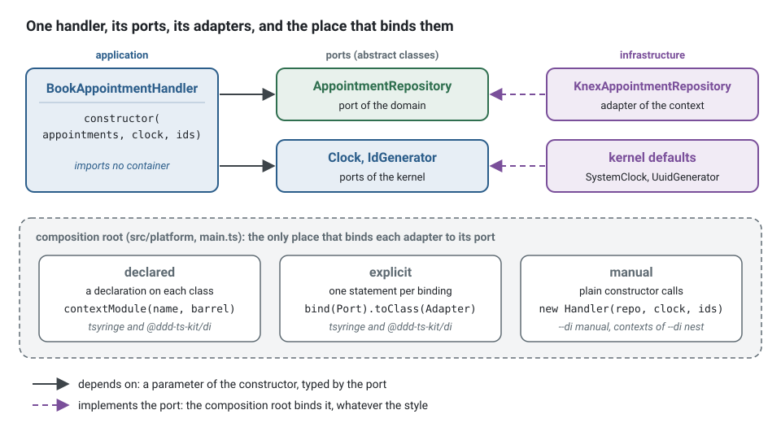

**English** · [Français](dependency-injection.fr.md)

# Dependency injection: the containers of the kit, NestJS, manual wiring

**Summary.** Clean Architecture needs one thing from dependency injection: a single place, the
composition root, where adapters are bound to ports. This kit offers three ways to write that
place. With `@ddd-ts-kit/di`, on tsyringe, InversifyJS or Awilix, classes declare what they are
and the context is assembled from the declarations, with wiring errors found before anything is
instantiated. With NestJS, the framework's container does the job and contexts are wired explicitly. With
manual wiring, a function builds the objects by hand. All three keep `domain/` and
`application/` free of any container; they differ in how much is checked for you and in how
much the kit can generate. The containers are compared below, with measures, and the page says
what to do when a team insists on one technology.

## What is being decided

Whatever the tool, the rules are the same (`composition/only-in-module`, `layer/*`,
`ports/*` in [ARCHITECTURE.md](../ARCHITECTURE.md) and the
[ports and composition](../concepts/ports-and-composition.md) page): a port is an abstract
class, a use case receives its ports by constructor, and only the composition root knows which
adapter stands behind which port.



The handler of the running example books an appointment. It names what it needs by port, in
its constructor, and nothing else:

<!-- checked sample -->
```ts
import { definePermissions } from '@ddd-ts-kit/auth';
import { AuthorizedCommand, type Actor, type Clock, type IdGenerator } from '@ddd-ts-kit/kernel';
import { CommandHandler, Requires } from '@ddd-ts-kit/kernel/declarations';

// contexts/appointments/domain/aggregates/appointment.aggregate.ts, reduced to what the sample uses
declare class Appointment {
  static book(props: { id: string; clientId: string; startsAt: Date; bookedAt: Date }): Appointment;
  readonly id: string;
}

// contexts/appointments/domain/repositories/appointment.repository.ts: a port is an abstract class
export abstract class AppointmentRepository {
  abstract save(appointment: Appointment): Promise<void>;
}

// contexts/appointments/appointments.permissions.ts
export const appointmentsPermissions = definePermissions('appointments', {
  'appointment.book': { description: 'Book an appointment' },
});

// contexts/appointments/application/commands/book-appointment/book-appointment.command.ts
@Requires(appointmentsPermissions['appointment.book'])
export class BookAppointment extends AuthorizedCommand<string> {
  constructor(
    actor: Actor,
    readonly startsAt: Date,
  ) {
    super(actor);
  }
}

// contexts/appointments/application/commands/book-appointment/book-appointment.handler.ts
@CommandHandler(BookAppointment)
export class BookAppointmentHandler implements CommandHandler<BookAppointment> {
  constructor(
    private readonly appointments: AppointmentRepository,
    private readonly clock: Clock,
    private readonly ids: IdGenerator,
  ) {}

  async execute(command: BookAppointment): Promise<string> {
    const appointment = Appointment.book({
      id: this.ids.next(),
      clientId: command.actor.id,
      startsAt: command.startsAt,
      bookedAt: this.clock.now(),
    });

    await this.appointments.save(appointment);

    return appointment.id;
  }
}
```

The decorator comes from `@ddd-ts-kit/kernel/declarations`. It is metadata only: it
instantiates nothing and imports no container. What the handler depends on is said once, by
its constructor: `ddd-ts-kit docs` reads the signature from the source and writes the list
the container injects into the generated file of the context
([ports and composition](../concepts/ports-and-composition.md), "How the constructor reaches
the composition root", compares this with a list in the decorator and with
`emitDecoratorMetadata`, which holds in three of the ten compiler and runner combinations
measured). The same handler class, without the decorator, is what NestJS or manual wiring
would bind.

What the rules refuse is a use case that fetches its own dependencies. Instead of reaching
for the container, or building the adapter, inside the application layer:

```ts
// application/commands/book-appointment/book-appointment.handler.ts: refused
// layer/application-inward: a container package and an infrastructure file, imported by the application
import { container } from 'tsyringe';
import { KnexAppointmentRepository } from '@/contexts/appointments/infrastructure/persistence/knex-appointment.repository';

export class BookAppointmentHandler {
  // composition/only-in-module: the adapter is chosen here, for good, and a test cannot replace it
  private readonly appointments = new KnexAppointmentRepository();
  // a hidden dependency: the constructor no longer says what the handler needs
  private readonly clock = container.resolve(Clock);

  async execute(command: BookAppointment): Promise<string> { /* ... */ }
}
```

write the constructor above: the handler receives its ports, a test gives it fakes, and the
choice of the adapter stays in the composition root.

## The same context, three composition roots

The three styles bind the same classes. Only the place where the binding is written changes.

**Declared (`@ddd-ts-kit/di`).** Each class carries its declaration; the context is
assembled from the classes themselves. `ddd-ts-kit docs` writes, in the generated file of the
context, the list each constructor receives, and `contextModule` turns the declarations into
bindings:

<!-- checked sample -->
```ts
import { AuthorizedCommand, Clock, IdGenerator, type Actor } from '@ddd-ts-kit/kernel';
import { CommandHandler, Repository, injected } from '@ddd-ts-kit/kernel/declarations';
import { contextModule, kernelModule } from '@ddd-ts-kit/di';
import { createApplication } from '@ddd-ts-kit/di/tsyringe';

// the classes of the first sample, reduced to their shape
declare class Appointment {
  readonly id: string;
}
abstract class AppointmentRepository {
  abstract save(appointment: Appointment): Promise<void>;
}
declare class BookAppointment extends AuthorizedCommand<string> {
  constructor(actor: Actor, startsAt: Date);
}

@CommandHandler(BookAppointment)
class BookAppointmentHandler implements CommandHandler<BookAppointment> {
  constructor(
    private readonly appointments: AppointmentRepository,
    private readonly clock: Clock,
    private readonly ids: IdGenerator,
  ) {}

  async execute(command: BookAppointment): Promise<string> {
    // the body of the first sample
    return `${this.ids.next()} booked at ${this.clock.now().toISOString()} for ${command.actor.id}`;
  }
}

// contexts/appointments/infrastructure/persistence/in-memory-appointment.repository.ts
@Repository(AppointmentRepository)
class InMemoryAppointmentRepository implements AppointmentRepository {
  readonly saved: Appointment[] = [];

  async save(appointment: Appointment): Promise<void> {
    this.saved.push(appointment);
  }
}

// contexts/appointments/application/application.declarations.ts, generated: never written by hand
injected(BookAppointmentHandler, [AppointmentRepository, Clock, IdGenerator]);

// main.ts
export async function main(): Promise<void> {
  const appointments = contextModule('appointments', { BookAppointmentHandler, InMemoryAppointmentRepository });
  const app = createApplication({ modules: [kernelModule(), appointments] });

  await app.start();
}
```

In a project, the composition root imports the whole generated barrel instead of naming the
classes: `contextModule('appointments', appointments)` after
`import * as appointments from '@/contexts/appointments/appointments.declarations'`. That file
only re-exports the generated declarations of each layer of the context, where the
`injected` statements are, one file per layer (`application/application.declarations.ts`).

**Explicit (`@ddd-ts-kit/di`).** Every binding is a statement of
`<context>.module.ts`, with the list of what each constructor takes. No decorator is needed:

<!-- checked sample -->
```ts
import { definePermissions } from '@ddd-ts-kit/auth';
import { AuthorizedCommand, Clock, IdGenerator, type Actor } from '@ddd-ts-kit/kernel';
import { defineContextModule, kernelModule } from '@ddd-ts-kit/di';
import { createApplication } from '@ddd-ts-kit/di/tsyringe';

// the classes of the first sample, without their decorators
declare class Appointment {
  readonly id: string;
}
abstract class AppointmentRepository {
  abstract save(appointment: Appointment): Promise<void>;
}
declare class BookAppointment extends AuthorizedCommand<string> {
  constructor(actor: Actor, startsAt: Date);
}
declare class BookAppointmentHandler {
  constructor(appointments: AppointmentRepository, clock: Clock, ids: IdGenerator);
  execute(command: BookAppointment): Promise<string>;
}
abstract class Database {
  abstract readonly url: string;
}
declare class KnexAppointmentRepository implements AppointmentRepository {
  constructor(database: Database);
  save(appointment: Appointment): Promise<void>;
}
const appointmentsPermissions = definePermissions('appointments', {
  'appointment.book': { description: 'Book an appointment' },
});

// contexts/appointments/appointments.module.ts
export const appointmentsModule = defineContextModule({
  name: 'appointments',
  register(builder) {
    builder.bind(Database).toValue({ url: 'postgres://localhost/appointments' });
    builder.bind(AppointmentRepository).toClass(KnexAppointmentRepository, [Database]);
    builder
      .command(BookAppointment)
      .requires(appointmentsPermissions['appointment.book'])
      .handledBy(BookAppointmentHandler, [AppointmentRepository, Clock, IdGenerator]);
  },
});

// main.ts
export const app = createApplication({ modules: [kernelModule(), appointmentsModule] });
```

The compiler holds each list to its constructor: `[Clock, AppointmentRepository, IdGenerator]`
(another order) or `[AppointmentRepository, Clock]` (one short) does not compile.

**Manual (`--di manual`, and the contexts of `--di nest`).** A function of the platform builds
the objects with `new` and registers each handler on the bus; the generator writes the
registrations between markers of `<context>.module.ts`:

<!-- checked sample -->
```ts
import { definePermissions, requires, type UseCaseDeclaration } from '@ddd-ts-kit/auth';
import { AuthorizedCommand, type Actor, type Clock, type IdGenerator, type InMemoryCommandBus } from '@ddd-ts-kit/kernel';

// the classes of the first sample, without their decorators
declare class Appointment {
  readonly id: string;
}
interface AppointmentRepository {
  save(appointment: Appointment): Promise<void>;
}
declare class BookAppointment extends AuthorizedCommand<string> {
  constructor(actor: Actor, startsAt: Date);
}
declare class BookAppointmentHandler {
  constructor(appointments: AppointmentRepository, clock: Clock, ids: IdGenerator);
  execute(command: BookAppointment): Promise<string>;
}
declare class KnexAppointmentRepository implements AppointmentRepository {
  constructor(databaseUrl: string);
  save(appointment: Appointment): Promise<void>;
}
const appointmentsPermissions = definePermissions('appointments', {
  'appointment.book': { description: 'Book an appointment' },
});

// platform/composition/platform.ts, reduced: what every context receives
interface Platform {
  readonly commands: InMemoryCommandBus;
  readonly clock: Clock;
  readonly ids: IdGenerator;
  readonly databaseUrl: string;
}

// contexts/appointments/appointments.module.ts
export function appointmentsModule(platform: Platform): { name: string; useCases: readonly UseCaseDeclaration[] } {
  const appointments = new KnexAppointmentRepository(platform.databaseUrl);

  // ddd-ts-kit:registrations
  platform.commands.register(BookAppointment, new BookAppointmentHandler(appointments, platform.clock, platform.ids), {
    context: 'appointments',
  });
  // /ddd-ts-kit:registrations

  return {
    name: 'appointments',
    useCases: [requires(BookAppointment, appointmentsPermissions['appointment.book'])],
  };
}
```

Here the compiler checks the arguments of each `new`, and nothing else. A use case missing
from `useCases` is found by `ddd-ts-kit check` (`authz/declared` reads the module file); a
handler that is never registered is found by the first command that reaches no handler, not at
start.

**In a test**, a module of `@ddd-ts-kit/di` (declared or explicit) runs as it is, with a fake
bound under the port class, a frozen clock and sequential identifiers:

<!-- checked sample -->
```ts
import { anActor } from '@ddd-ts-kit/auth/testing';
import { AuthorizedCommand, Clock, IdGenerator, type Actor, type CommandHandler } from '@ddd-ts-kit/kernel';
import { defineContextModule, fake } from '@ddd-ts-kit/di';
import { createTestApplication } from '@ddd-ts-kit/di/tsyringe';
import { expect, it } from 'vitest';

// the port, the command and the handler of the first sample, in a few lines
type Appointment = { readonly id: string; readonly bookedAt: Date };
abstract class AppointmentRepository {
  abstract save(appointment: Appointment): Promise<void>;
}
class BookAppointment extends AuthorizedCommand<string> {}
class BookAppointmentHandler implements CommandHandler<BookAppointment> {
  constructor(
    private readonly appointments: AppointmentRepository,
    private readonly clock: Clock,
    private readonly ids: IdGenerator,
  ) {}

  async execute(): Promise<string> {
    const appointment = { id: this.ids.next(), bookedAt: this.clock.now() };
    await this.appointments.save(appointment);

    return appointment.id;
  }
}
const appointmentsModule = defineContextModule({
  name: 'appointments',
  register(builder) {
    builder.command(BookAppointment).public().handledBy(BookAppointmentHandler, [AppointmentRepository, Clock, IdGenerator]);
  },
});

// contexts/appointments/test/fakes/in-memory-appointment.repository.ts: a fake implements the port
class InMemoryAppointmentRepository implements AppointmentRepository {
  readonly saved: Appointment[] = [];

  async save(appointment: Appointment): Promise<void> {
    this.saved.push(appointment);
  }
}

// contexts/appointments/test/unit/book-appointment.handler.spec.ts
it('books the appointment at the instant of the clock, under a new id', async () => {
  const appointments = new InMemoryAppointmentRepository();
  const app = createTestApplication({
    modules: [appointmentsModule],
    fakes: [fake(AppointmentRepository, appointments)],
    now: new Date('2026-03-02T08:00:00.000Z'),
  });
  const client: Actor = anActor().named('ada').build();

  const id = await app.commandBus.execute(new BookAppointment(client));

  expect(id).toBe('id-1');
  expect(appointments.saved).toEqual([{ id: 'id-1', bookedAt: new Date('2026-03-02T08:00:00.000Z') }]);
});
```

`fake(AppointmentRepository, appointments)` does not compile when `appointments` lacks a method
of the port. Manual wiring has no container to bind a fake in: its specs build the handler
with `new` and register it on `createTestBuses()` of `@ddd-ts-kit/testing`.

When several specs of a context build the same application, or the same buses, with the same
fakes, `npx ddd-ts-kit generate test-world <context>` writes that arrangement once, in
`test/worlds/`: see [Worlds](../concepts/testing-strategy.md#worlds).

## Comparison

| | `@ddd-ts-kit/di` | NestJS container | Manual wiring |
|---|---|---|---|
| Who assembles a context | the kit, from declarations (generated barrel or discovery) or from an explicit module | as generated, the same `<context>Module(platform)` function as manual wiring; Nest providers by factory when you bind in Nest modules yourself | a `<context>Module(platform)` function in `<context>.module.ts`: plain calls to constructors, registrations between markers |
| Style available (`stack.style`) | `declared` or `explicit`, mixable | `explicit` only | `explicit` only |
| Injection token | the port class itself | Nest tokens; ports bound in the module | none: plain variables |
| What a class is given | what its constructor takes, each parameter typed by a port: read from the source into a generated file, never reflected | whatever the provider factory passes, or Nest's own `design:paramtypes` and `@Inject` when you declare providers by class | the arguments of `new Handler(a, b)` |
| Decorators in your classes | declarations in `application/` and `infrastructure/`, none in `domain/`; no parameter decorator, no reflection | `@Injectable()` kept out of `domain/` and `application/` by rule; providers declared by factory | none |
| Decorator mode | standard or legacy | legacy | not concerned |
| Errors found before start | duplicate binding, unbound dependency, cycle, duplicate handler, consumer or job, undeclared authorization, and more (`WiringError` with a code) | Nest's own resolution errors at bootstrap | the compiler, for constructors; nothing for a forgotten handler |
| Cross-cutting hook | `instrumentation` of `kernelModule` (tracing, from outside), `around(kinds, ...)` in a module for every binding of a kind, `.with(...)` or the `aspects` of a declaration for one binding | call the wrappers in the provider factory | call the wrappers by hand |
| Test application | `createTestApplication` with `fake(Port, instance)` | Nest testing module, or `createTestBuses` | `createTestBuses` |
| Extra runtime dependencies | `tsyringe` and `reflect-metadata`, `inversify` and `reflect-metadata`, or `awilix` | the Nest packages | none |

## The underlying libraries, checked on 2026-10-31

- **tsyringe** (Microsoft, MIT): latest npm version 4.10.0, published 2025-04-16; about 21
  million downloads a week. The repository is not archived, but its last functional commits
  date from April 2025 (the only later commit, September 2026, pins CI actions), its last
  GitHub release tag is v4.4.0 from 2020, and 82 issues are open. In plain words: widely
  used, stable, in low-activity maintenance. It refuses to load without `reflect-metadata`
  (0.2.2, March 2024).
- **How much the kit depends on it.** `@ddd-ts-kit/di` uses a tsyringe child container as a
  registry: ports are registered under a symbol identity, dependencies are named in lists and
  never reflected, no tsyringe decorator appears in your code, and `reflect-metadata` is
  imported by the package only because tsyringe demands it. The surface exposed to tsyringe's
  future is therefore small, and the wiring checks are the kit's own. It is still a dependency
  on a quiet project: a team for which that is unacceptable has `--di inversify` or
  `--di awilix`, which change the registry and nothing else.
- **NestJS** (MIT): `@nestjs/core` 12.3.2, published 2026-10-27, about 23 million downloads a
  week, Node 20 or later, actively released.
- **InversifyJS** (MIT): `inversify` 8.2.3, published 2026-07-23, about 3.7 million downloads a
  week, commits in October 2026 (`inversify/monorepo`), 11 open issues.
- **Awilix** (MIT): `awilix` 13.0.5, published 2026-06-15, about 830,000 downloads a week, Node 20
  or later, commits in October 2026, 7 open issues.
- **What the kit does with these two**: the same as with tsyringe. `--di inversify` and
  `--di awilix` put one of them under `@ddd-ts-kit/di`, as a registry. The suite of the package
  runs on all three.

## Five ways to wire, compared and measured

InversifyJS and Awilix are the two containers a TypeScript team is most likely to ask for beside
tsyringe, and each can be used in two ways that should not be confused:

- **Under the kit, `--di inversify` or `--di awilix`.** `@ddd-ts-kit/di` keeps its declarations,
  its generators and its checks, and only the registry underneath changes. The code of the
  project is the code of a project on tsyringe: `createApplication` comes from another entry point,
  and nobody writes `bind()` or `register()`. The gain is to stop depending on tsyringe.
- **By hand, on `--di manual`.** The team writes the API of the container in its module files, and
  gives up what the kit generates and checks
  ([Writing their API by hand](#writing-the-api-of-inversifyjs-or-awilix-by-hand)).

What follows says what each gives and what it costs. Everything marked as measured was compiled
and run on 2026-10-31. Unless a column says "under the kit", InversifyJS and Awilix are used by
hand, because that is where they differ: under the kit they behave as tsyringe does.

### Why these two

Three conditions: a release in the last twelve months, more than 500,000 downloads a week, and a
container one can use without adopting a framework. The figures were read on 2026-10-31.

| Container | Last release | Downloads a week | Verdict |
|---|---|---|---|
| **InversifyJS** 8.2.3 | 2026-07-23 | 3.7 million | kept: active, closest to tsyringe, and able to work without decorators |
| **Awilix** 13.0.5 | 2026-06-15 | 830,000 | kept: active, the opposite approach, no decorator and no reflection |
| typed-inject 5.0.0 | 2024-12-13 | 5.5 million | left out: no release for 22 months, and Stryker depends on it, so its downloads say little about who chooses it |
| injection-js 2.6.1 | 2025-10-22 | 1.8 million | left out: the injector of Angular taken out of Angular, and ng-packagr depends on it, so the same remark applies |
| TypeDI 0.10.0 | 2022-12-09 | 830,000 | left out: no release since 2022 |
| iti 0.8.0 | 2025-10-08 | 57,000 | left out: too few users |
| `@tsed/di` 8.44.13 | 2026-10-29 | 38,000 | left out: the container of the Ts.ED framework |
| brandi 5.1.0 | 2026-01-15 | 31,000 | left out: too few users |
| `@needle-di/core` 1.2.1 | 2026-09-04 | 28,000 | left out: too few users |

### The same binding in each

The classes are those of the first example: only the lines that bind them differ.

```ts
// InversifyJS with a list: no decorator, and the compiler holds the list to the parameters of the function
container
  .bind(BookAppointmentHandler)
  .toResolvedValue(
    (appointments: AppointmentRepository, clock: Clock, ids: IdGenerator) =>
      new BookAppointmentHandler(appointments, clock, ids),
    [AppointmentRepository, Clock, IdGenerator],
  );

// InversifyJS as its documentation writes it: decorators on the class itself
@injectable()
class BookAppointmentHandler {
  constructor(
    @inject(AppointmentRepository) private readonly appointments: AppointmentRepository,
    @inject(Clock) private readonly clock: Clock,
    @inject(IdGenerator) private readonly ids: IdGenerator,
  ) {}
}

// Awilix with a function: the cradle is the object that holds every registration, by name
container.register({
  bookAppointmentHandler: asFunction(
    ({ appointments, clock, ids }: Cradle) => new BookAppointmentHandler(appointments, clock, ids),
  ).singleton(),
});

// Awilix classic: no list at all, the names of the constructor parameters are the tokens
container.register({ bookAppointmentHandler: asClass(BookAppointmentHandler).singleton() });
```

### The grid

| | `@ddd-ts-kit/di`, on tsyringe, InversifyJS or Awilix | NestJS | Manual | InversifyJS by hand | Awilix by hand |
|---|---|---|---|---|---|
| The flag | `--di tsyringe`, the default, `--di inversify`, `--di awilix` | `--di nest`, with `--http nest` only | `--di manual` | `--di manual` | `--di manual` |
| What the generators write | every binding, declared or explicit | the hand-wired family: `new` in the module file | `new` in the module file | `new` beside your container, to move by hand | `new` beside your container, to move by hand |
| Token | the port class | the port class | none: a variable | the port class | a string, the key of the cradle |
| How a dependency is named | a list, generated or written, held to the constructor by the compiler | `inject`, a list nothing holds to the factory | the arguments of `new` | a list held to the function by the compiler; or `@inject` | a key of the cradle; or the name of the parameter in classic mode |
| Decorators in your classes | the kit's declarations, or none in the explicit style | none with providers by factory | none | none with lists; `@injectable()` and `@inject()` otherwise, refused in `application/` and `domain/` | none |
| Decorator mode | standard or legacy | legacy | not concerned | either with lists; legacy with `@inject()`, a parameter decorator | not concerned |
| Graph checked before the first message | yes, before anything is built | yes, everything is built at start | by the compiler | no: at each first `get` | no: at each first `resolve` |
| Authorization and duplicate handlers at start | yes (`WiringError`) | no | no | no | no |
| Replacing a port in a test | `fake(Port, instance)` | Nest testing module, or `createTestBuses` | `new` and `createTestBuses` | a child container, or `rebind`; generated specs use `new` | `createScope` and `register`; generated specs use `new` |
| Object per request | singleton or transient; the actor, the tenant and the correlation id go through `ExecutionScope` | `Scope.REQUEST` | by hand | `inRequestScope`: per call to `get`, not per HTTP request | `createScope` and `.scoped()`: its strongest point |
| Closing a resource | `onStop` of a module | `onModuleDestroy` | by hand | `onDeactivation`, run by `unbindAll` | `.disposer()`, run by `dispose` |
| Minified bundle | yes, with the barrel; never with discovery | yes, its optional packages left external | yes | yes | yes with functions; classic fails (below) |
| Project health, 2026-10-31 | low activity for tsyringe, active for the two others | active | no dependency | active | active |

### When a wiring mistake is found

The most useful difference, and the one a feature list hides. Six mistakes were written on
purpose in a small application, once per way of wiring, then each case was compiled by `tsc` 7
and run; a seventh case without a mistake passed everywhere. The earlier the better: **compile**,
then **start** (before anything is served), **first resolve**, **first call** (the handler runs
and breaks), and **never** (nothing says anything).

| Mistake | `@ddd-ts-kit/di`, on any of the three | NestJS, factories | Manual | InversifyJS by hand, lists | InversifyJS by hand, decorators | Awilix by hand, functions | Awilix by hand, classic |
|---|---|---|---|---|---|---|---|
| A port bound to nothing | start | start | compile | first resolve | first resolve | first resolve | first resolve |
| Two dependencies swapped | compile | first call | compile | compile | first call | compile | cannot happen: by name |
| One dependency left out | compile | first call | compile | compile | start | compile | a renamed parameter: first resolve |
| An adapter missing a method of its port | compile | first call | compile | compile | compile | first call | first call |
| A port bound twice | start | never: the last wins | compile | first resolve | first resolve | never: the last wins | never: the last wins |
| A cycle between two ports | start | start | compile | first resolve | first resolve | first resolve | first resolve |

Three readings:

- **Manual wiring is the strictest column.** It finds all six at compile time, because a variable
  must exist before it is passed. What it gives up lies elsewhere: a handler never registered,
  and a wrapper forgotten around an adapter, which no compiler sees.
- **The kit's column is the same on the three containers,** since these checks are its own.
- **By hand, InversifyJS with lists is the stricter of the two,** and its decorators give part
  of that up: an `@inject` that names the wrong port compiles. Its errors name what is wrong
  (`Ambiguous bindings found for service`, `Circular dependency found: A -> B -> A`).
- **Awilix does not tie `register` to the type of the container**: `createContainer<Cradle>()`
  types what you read, not what you write, so an incomplete adapter compiles, and a second
  `register` replaces the first without a word.

Resolving every handler at the end of the composition turns each "first resolve" into "start":
the recipe below does so.

### What it costs, measured

| Way of wiring | Start, 91 bindings | Start, 346 bindings | Start, minified bundle | Bundle, minified / gzip | Heap | Resident memory | Resolve a singleton | Build three transient classes |
|---|---|---|---|---|---|---|---|---|
| Manual | 87 ms | 92 ms | 24 ms | 23 / 2 KiB | 8.7 MiB | 75 MiB | 43 ns | 46 ns |
| tsyringe alone | 94 ms | 102 ms | 28 ms | 56 / 11 KiB | 9.3 MiB | 75 MiB | 88 ns | 227 ns |
| `@ddd-ts-kit/di`, explicit style | 125 ms | 133 ms | 36 ms | 146 / 40 KiB | 10.6 MiB | 85 MiB | 236 ns | 1,378 ns |
| InversifyJS, lists | 124 ms | 133 ms | 35 ms | 126 / 25 KiB | 11.2 MiB | 79 MiB | 59 ns | 110 ns |
| InversifyJS, decorators | 124 ms | 135 ms | 36 ms | 130 / 27 KiB | 11.4 MiB | 78 MiB | 64 ns | 110 ns |
| Awilix, functions | 102 ms | 109 ms | 36 ms | 123 / 32 KiB | 10.1 MiB | 78 MiB | 55 ns | 211 ns |
| Awilix, classic | 101 ms | 108 ms | fails | 118 / 32 KiB | 10.0 MiB | 77 MiB | 58 ns | 215 ns |
| NestJS, factories | 202 ms | 218 ms | 80 ms | 425 / 109 KiB | 17.3 MiB | 104 MiB | 58 ns | 5,447 ns |

The same application under the kit, one container per row, taken in a series of its own on the
same day (manual wiring starts in 84 ms there, 3 ms under the first series):

| `@ddd-ts-kit/di` on | Start, 91 bindings | Start, 346 bindings | Start, minified bundle | Bundle, minified / gzip | Heap | Resident memory | Resolve a singleton | Build three transient classes |
|---|---|---|---|---|---|---|---|---|
| tsyringe | 120 ms | 130 ms | 37 ms | 146 / 40 KiB | 10.5 MiB | 85 MiB | 235 ns | 1,415 ns |
| InversifyJS | 149 ms | 161 ms | 42 ms | 204 / 51 KiB | 12.3 MiB | 84 MiB | 198 ns | 1,289 ns |
| Awilix | 128 ms | 137 ms | 43 ms | 211 / 61 KiB | 11.2 MiB | 86 MiB | 179 ns | 1,190 ns |

| What is installed | Packages | On disk |
|---|---|---|
| tsyringe and `reflect-metadata` | 3 | 1.1 MB |
| `@ddd-ts-kit/di` with them, kernel and scheduling included (the kernel is in every project of the kit) | 6 | 16 MB |
| InversifyJS | 8 | 6.9 MB |
| Awilix | 19 (its one dependency, `fast-glob`, brings the others) | 1.7 MB |
| NestJS (`core`, `common`, `rxjs`, `reflect-metadata`) | 22 | 18 MB |

How it was measured: one workstation (Intel Core i7-12700H, 20 logical CPUs, 31 GB, Linux,
Node.js 26.13.0), `@ddd-ts-kit/di` and `@ddd-ts-kit/kernel` 0.105.0, tsyringe 4.10.0, InversifyJS
8.2.3, Awilix 13.0.5, `@nestjs/core` 12.3.2, `tsc` 7.0.2, esbuild 0.28.2. A generator writes the
same application once per way of wiring it: five contexts of four ports with their adapters, one
service and twelve command handlers of four dependencies each, three shared ports and a chain of
three transient classes, 91 bindings and 60 handlers; then twenty contexts, 346 bindings and 240
handlers. Every variant loads `@ddd-ts-kit/kernel`, as every project of the kit does; none has a
bus, a route or a database, so the figure is the container. The declared style was not measured.

A start is one new process, from its spawn to its exit once every handler is built: 40 runs per
variant taken in turn, under `nice`, the median in the table, the 90th percentile within 11
percent of it; an empty `node` process takes 18 ms. The bundle is esbuild with `--bundle --minify`
for Node 22, the optional packages of Nest left external. Memory is the median of 10 runs after
two forced garbage collections with every handler built. A resolve is the median of 5 processes
of five rounds each, 200,000 singletons and 50,000 graphs, in an async loop, as a message of the
bus is: the 43 ns of the manual row are that loop, a map read, and nothing else. NestJS builds a
transient graph through its asynchronous `resolve`. The load of the machine never passed 2.03, and
no run failed or was discarded.

What to take from it:

- **Speed decides nothing.** The gap between the fastest and the slowest singleton is 0.2
  microseconds per message, against a millisecond for a query. The kit is the slowest here because
  each resolve checks the binding and watches for a cycle.
- **By hand, InversifyJS starts in the time of the kit, without its checks.** Awilix starts 23 ms
  sooner. In a minified bundle, where the loading of files is gone, the three are level at 35 to
  36 ms.
- **Under the kit, the choice costs milliseconds at start and nothing after.** Awilix adds 8 ms to
  tsyringe and InversifyJS 29 ms; both resolve a little faster than tsyringe. Between the two,
  Awilix starts sooner, takes a quarter of the disk and needs no `reflect-metadata`.
- **NestJS is the only one with a cost to plan for**: 77 ms more than the kit at each start, 44 ms
  more in a minified bundle, about 7 MiB more heap and three times the bundle. It is the price of
  a framework that is there for other reasons, and it matters on a function started per request.
- **Awilix classic does not survive a minifier**, which renames the parameters it reads: `Could
  not resolve 'e'`, at the first resolve. `--keep-names` does not help. Without minified
  identifiers it runs, under `tsc`, `tsx` and swc alike.
- **`@inject()` needs the legacy mode.** Under standard decorators `tsc` refuses it (`TS1206`) and
  `tsx` fails to run it; `@injectable()` alone works in both modes. In legacy mode it ran under
  `tsc`, `tsx` and swc, with no `emitDecoratorMetadata`. InversifyJS imports `reflect-metadata`
  itself. None of this concerns `--di inversify`: the kit never uses its decorators.
- **Under the kit, InversifyJS refuses a promise bound to a port**, at its first resolution: its
  `get` is synchronous. tsyringe and Awilix hand it over. Bind what the promise gave.

## Selection criteria

1. **Do you want the declared style?** One decorator per class, no module file, no
   dependency list: a generated barrel, which also registers what each constructor takes, kept
   current by the generator (`declarations/barrel-current`). Only `@ddd-ts-kit/di`
   gives it, on any of its three containers, and it is their default: the CLI refuses `--style declared` with `--di manual` and
   `--di nest`, which default to `explicit`. `--di nest` goes with `--http nest` and the
   reverse.
2. **Is NestJS already the framework?** Then its container is there anyway
   ([HTTP frameworks](http-frameworks.md)).
3. **How much checking at start do you want?** The checks of `createApplication` (a command
   with two handlers, two consumers sharing a name, a use case that declares no permission)
   are what manual wiring gives up.
4. **Bundling and cold start.** A barrel with `contextModule` is static and followed by a
   bundler; discovery reads directories at startup and cannot be bundled.
5. **Dependency budget.** Manual wiring adds nothing.

## What this kit supports and verified

From [`packages/di/README.md`](../../packages/di/README.md),
[`packages/kernel/README.md`](../../packages/kernel/README.md) and
[`packages/cli/README.md`](../../packages/cli/README.md):

- **Constructor injection that holds whoever compiles**: both decorator modes, `tsc` 6 and 7,
  `tsx`, Vitest and Jest with swc, because nothing is asked of the compiler at run time.
- **Compile-time checks**, in both decorator modes: a generated or written dependency list that does not match the
  constructor, a class that does not implement the port it is declared the adapter of, a
  concrete class named where a port is expected.
- **Load-time checks** (`DeclarationError`): a port with a body, an adapter that extends its
  port, two declarations on one class.
- **Start-time checks** (`WiringError`): duplicate or missing bindings, cycles between class
  bindings, duplicate handlers, consumers and jobs, `rebind` of nothing, a declared class
  whose constructor takes parameters and that no list covers, or a list of another length; with
  `authorization: 'required'`, a use case that declares neither a permission nor that it is
  public, and declarations that no module enforces.
- **`kernelModule()`** binds a working default for every kernel port (in-memory buses, unit of
  work, cache, lock, rate limiter, no-op logger and metrics), each replaceable by option or by
  `rebind`.
- **Two assemblies** of a declared context (`stack.assembly`): `barrel` (default) and
  `discovery`, with or without a broker. `--assembly` is refused with `--style explicit`.
- **Proven end to end by the CLI** (`proven-stacks.spec.ts`, as its README lists them):
  generated projects in the declared style (the default stack; with ReBAC and RabbitMQ; with
  knex and discovery, alone and behind NATS), in the explicit style (the default stack; with ReBAC
  and RabbitMQ), on InversifyJS and on Awilix (the default stack in both styles, ReBAC and
  RabbitMQ, knex and discovery, Prisma, TypeORM, and the identity preset), with
  `--di manual` (with ABAC and knex; with Fastify, knex, RabbitMQ and Redis), and one NestJS
  stack (its controllers, class-validator, Passport).
- **Test application** with fixed clock, sequential identifiers, in-memory buses and fakes
  bound under the port class.

The checks above catch each mistake at the earliest of four moments; only a dependency
resolved inside a factory waits for the first message that builds the class:


## Limits and when not to use it

Stated by the package:

- A class plays one role: one declaration per class. An adapter that implements two ports is
  bound explicitly, once per port.
- A declaration is not inherited: a subclass declares itself or is bound explicitly.
- Names (consumer, policy, job, domain event) are written in the declaration, never derived
  from the class name.
- A port of your own is identified by its class: loaded from two copies of a package it is two
  tokens, unless it declares a `tokenKey`. An application compiled as one program never meets
  this.
- Factories do not declare what they resolve: a cycle or a missing port going through a
  factory is reported when it is resolved, not at start.
- Discovery imports files that nothing else imports: knip and dependency-cruiser must be told,
  it runs sequentially at startup, and a bundler cannot follow it.
- A class decorator of another library that replaces the class must sit below the kit's
  declaration.

Of the alternatives:

- **NestJS**: explicit style only; the kit's routes bypass Nest's request pipeline; the legacy
  decorator mode applies to the whole program; the start-time checks above are replaced by
  Nest's.
- **Manual**: no check that every handler is registered or every use case protected beyond
  what `ddd-ts-kit check` reads in the text (`authz/declared`,
  `events/consumer-idempotent`); cross-cutting wrappers are applied by hand, so one forgotten
  call is one untraced adapter.

Do not introduce a container at all in a script, a migration or a context of three classes run
alone: constructing the objects by hand is the composition root.

## Recommendation by situation


### By need of the project

| Situation | Choice |
|---|---|
| New project on Express or Fastify | tsyringe with the declared style and a barrel: the default, the most generated, the most checked |
| Unusual wiring in one context (factories, conditional bindings) | the same, with an explicit module for that context, or `include` in a mixed module |
| Serverless or bundled deployment | `@ddd-ts-kit/di`, `contextModule` with the barrel, on any of its containers; avoid discovery |
| Existing NestJS application | NestJS container, explicit style, providers by factory |
| A policy against low-activity dependencies | `--di awilix`, or `--di inversify` if the team knows it: everything the default gives, on an active project, for 8 and 29 ms at start |
| A very small service | manual wiring, knowing which start-time checks are given up |
| Every invocation starts a process, each millisecond counted | manual wiring in a minified bundle: 24 ms, against 36 for the kit and 80 for NestJS |
| Many objects that live for one request | `ExecutionScope` first: it already carries the actor, the tenant and the correlation id. Beyond that, Awilix with `createScope` on `--di manual` |

### By affinity: the team insists on a technology

A team that knows a tool well has a real reason to keep it. The table says what to do, and what
that choice keeps and pays. First ask what is wanted of the tool: its presence in the dependencies
is `--di inversify` or `--di awilix`, and costs next to nothing; its API in your code is the
hand-written path, and costs the generators and the checks. Written by hand, neither container
finds a mistake sooner than the kit, and manual wiring finds all six at compile time.

| The team wants | Do this | It keeps | It pays |
|---|---|---|---|
| tsyringe | `--di tsyringe`, the default; `@injectable()` and `@inject()` of tsyringe stay out of your code | everything in this page | the habit of its decorators: dependencies are listed, never reflected |
| NestJS | `--http nest`, which brings `--di nest`; providers by factory | its modules, lifecycle and testing module | the declared style, the checks of `createApplication`, a list of `inject` nothing holds to the factory, 77 ms at each start |
| InversifyJS, as a dependency | `--di inversify` | everything in this page, and the native container at `application.container` | no `bind()` in your code, 29 ms at each start, a promise bound to a port refused |
| InversifyJS, its API in your code | `--di manual`, bindings with lists in `<context>.module.ts`, no decorator in `application/` | its binding API, lists the compiler checks, errors that name a cycle or a double binding, `onDeactivation` | the generators, which write `new` beside it; the checks of `createApplication`; a move by hand after each `generate` |
| Awilix, as a dependency | `--di awilix` | everything in this page, and the native container at `application.container` | no `register()` in your code, 8 ms at each start |
| Awilix, its API in your code | `--di manual`, functions over a typed cradle in `<context>.module.ts`; classic mode only if identifiers are never minified | the cradle, `createScope`, `.disposer()`, `container.registrations` to resolve everything at start | the same as InversifyJS by hand, and a port bound twice or an incomplete adapter that compiles |
| No container at all | `--di manual`, as generated | every mistake above at compile time, no dependency | the checks of `createApplication`, wrappers applied by hand |

## Writing the API of InversifyJS or Awilix by hand

For a team that wants `bind()` or `register()` in its own code; otherwise `--di inversify` and
`--di awilix` do the wiring. Tried on a project generated by 0.105.0 with
`--di manual --http express`, one context, one
repository, one command. With either container in place of the generated lines, `typecheck`,
`ddd-ts-kit check`, `ddd-ts-kit lint` and dependency-cruiser pass, and a command sent through the
composed application reaches its handler. The samples are not compiled by the pipeline of this
repository, which depends on neither library. The context builds its container in its module
file, the one file of a context allowed to know every layer:

```ts
// contexts/billing/billing.module.ts
function registerHandlers(platform: Platform): void {
  const container = billingContainer(platform);

  // ddd-ts-kit:handlers
  platform.commands.register(IssueInvoiceCommand, container.get(IssueInvoiceHandler), { context: 'billing' });
  // /ddd-ts-kit:handlers
}

function billingContainer(platform: Platform): Container {
  const container = new Container({ defaultScope: 'Singleton' });

  container
    .bind(InvoiceRepository)
    .toResolvedValue(() =>
      platform.adapter(new InMemoryInvoiceRepository(), {
        kind: 'repository',
        context: 'billing',
        token: 'InvoiceRepository',
      }),
    );

  container
    .bind(IssueInvoiceHandler)
    .toResolvedValue((invoices: InvoiceRepository) => new IssueInvoiceHandler(invoices), [InvoiceRepository]);

  return container;
}
```

With Awilix, `billingContainer` declares a cradle and registers functions, and the handler comes
from `container.resolve('issueInvoiceHandler')`:

```ts
interface BillingCradle {
  invoiceRepository: InvoiceRepository;
  issueInvoiceHandler: IssueInvoiceHandler;
}

function billingContainer(platform: Platform): AwilixContainer<BillingCradle> {
  const container = createContainer<BillingCradle>({ injectionMode: InjectionMode.PROXY, strict: true });

  container.register({
    invoiceRepository: asFunction(() =>
      platform.adapter(new InMemoryInvoiceRepository(), {
        kind: 'repository',
        context: 'billing',
        token: 'InvoiceRepository',
      }),
    ).singleton(),
    issueInvoiceHandler: asFunction(
      ({ invoiceRepository }: BillingCradle) => new IssueInvoiceHandler(invoiceRepository),
    ).singleton(),
  });

  return container;
}
```

Asking for the handler while the module registers it builds the graph at start: a port bound to
nothing or a cycle then stops the application before it serves anything. What holds, and what to
watch:

- **The container stays in the module file.** A container imported in `domain/` or `application/`
  is refused (`layer/*`, in `check`, in the lint and in dependency-cruiser), so `@injectable()` on
  a handler is refused. On a class of `infrastructure/` it passes.
- **Every adapter still goes through `platform.adapter`.** It is what applies the tracing and the
  resilience; a binding that skips it leaves an adapter untraced, and nothing reports it.
- **`generate` keeps writing `new`, and nothing warns you.** The next `generate command` on this
  module added its own `new InMemoryInvoiceRepository()` between the markers, beside the
  container: it compiled and `ddd-ts-kit check` reported nothing, with two instances of the
  repository, and the state of an in-memory adapter split between them. After each `generate`,
  move what it wrote into the container.
- **A handler never registered stays invisible.** `check` does not see it, as with manual wiring:
  the first command finds it.
- **The specs do not go through your container.** A generated spec builds the handler with `new`
  and runs it on `createTestBuses`. That is what keeps it fast; it also means a mistake in the
  container is not found by a unit spec.

## Sources

- tsyringe: https://github.com/microsoft/tsyringe (commits, releases and issues read on
  2026-10-31); npm registry entry `tsyringe`.
- NestJS documentation, custom providers: https://docs.nestjs.com/fundamentals/custom-providers
- InversifyJS: https://inversify.io and https://github.com/inversify/monorepo ; Awilix:
  https://github.com/jeffijoe/awilix ; npm registry entries and the weekly figures of
  https://api.npmjs.org/downloads, read on 2026-10-31.
- TypeScript 5.0 release notes, decorators:
  https://www.typescriptlang.org/docs/handbook/release-notes/typescript-5-0.html
- Robert C. Martin, Clean Architecture, Prentice Hall, 2017, chapter 26 ("The Main
  Component").
- Mark Seemann, "Composition Root" (2011): https://blog.ploeh.dk/2011/07/28/CompositionRoot/
- Martin Fowler, "Inversion of Control Containers and the Dependency Injection pattern"
  (2004): https://martinfowler.com/articles/injection.html

## See also

- [Ports and composition](../concepts/ports-and-composition.md)
- [Layers and the dependency rule](../concepts/layers-and-dependency-rule.md)
- [HTTP frameworks](http-frameworks.md)
- [Testing strategy](../concepts/testing-strategy.md)
- [Static analysis and pipeline](static-analysis-and-pipeline.md)
- [Configuration](../CONFIG.md)
