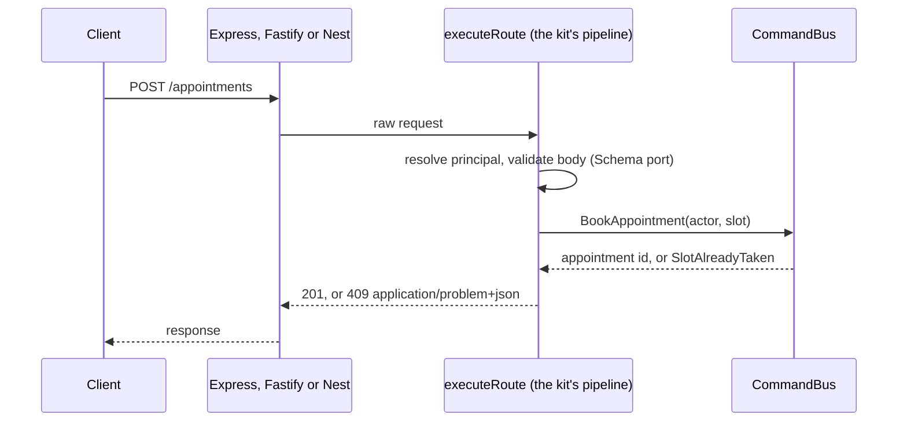

# HTTP frameworks: Express, Fastify, Hono, NestJS

**Summary.** In this kit a route is declared once, as data plus a handler, and mounted on
Express 5, Fastify 5, Hono 4 (on Node) or NestJS by an adapter of `@ddd-ts-kit/http`. All four
go through the same pipeline (validation, handler, error mapping), so the framework decides how
the server is operated, not how a use case is reached. Which framework goes with which
validation library, with measured numbers, is in [contract pairs](contract-pairs.md). The choice therefore rests on the team's habits, the
ecosystem it needs and how much of the framework it is ready to leave unused. With NestJS the
price of framework-agnostic routes is the highest: they bypass most of what makes a Nest
controller a Nest controller.

## What the framework is asked to do here

The presentation layer is thin by rule (`layer/presentation-no-infrastructure`,
`authz/in-application` in [ARCHITECTURE.md](../ARCHITECTURE.md)): a route validates the shape of
its input, builds a command or a query carrying the actor, sends it on a bus and maps the
answer. In the running domain:

What stays the framework's: listening, body parsing, plugins or middlewares in front of the
routes (compression, CORS, rate limiting), and its own answer to a body it refuses before the
pipeline runs.

## Comparison

Versions and figures checked on 2026-10-10 against the npm registry.

| | Express | Fastify | Hono | NestJS |
|---|---|---|---|---|
| Current major | 5 (5.3.0; 4.x still published under `latest-4`) | 5 (5.12.5) | 4 (4.13.13, with `@hono/node-server` 2.1.4 on Node) | 12 (12.1.2; 11.x under `legacy`) |
| Licence | MIT | MIT | MIT | MIT |
| Node required by the package | 18 or later | not checked | 16.9 or later (`hono`) | 20 or later |
| Weekly downloads | about 141 million | about 15 million | not checked | about 16 million (`@nestjs/core`) |
| Nature | minimal router and middleware chain | router with schemas, hooks, encapsulated plugins, a logger (pino) | router on Web standard `Request` and `Response`, for Node, Bun, Deno and edge runtimes | application framework: modules, DI container, decorators, on top of Express or Fastify |
| Own validation | none | JSON Schema per route | validator middlewares | pipes, usually class-validator |
| Own DI | none | none (decorators on the instance) | none | yes, central to the framework |
| Decorators | none | none | none | everywhere; legacy decorator mode in the generated projects of this kit |
| What the kit's routes use of it | the router | the router, as routes or as a plugin with a prefix | the router; the adapter reads the JSON body itself | the underlying HTTP server only |

The download figures say how widely each is installed, nothing about fitness. Performance is
measured in [contract pairs](contract-pairs.md): the pipeline of the kit costs about a
microsecond per request plus validation, the request rates of the four frameworks were within
the noise of a shared machine, and only the cold start of Nest stood apart. In a service that
talks to a database the framework is rarely where the time goes.

## Selection criteria

1. **What the team already runs.** Operational knowledge (middlewares, plugins, error
   handling, graceful shutdown) is the real cost of a framework.
2. **What surrounds the routes.** File uploads, server-side rendering, WebSockets, GraphQL:
   these live outside `@ddd-ts-kit/http` and come from the framework's ecosystem.
3. **The logger.** Fastify speaks pino; the kit has a pino adapter of its `Logger` port
   ([observability tools](observability.md)).
4. **Whether a second container is acceptable.** NestJS brings its own; see
   [dependency injection](dependency-injection.md).
5. **Decorator mode.** NestJS and class-validator impose the legacy mode on the whole program.
   The kit's own decorators work in both modes, so this constrains other libraries, not the kit.

## What "framework-agnostic routes" costs with Nest

`createRoutesModule` mounts the routes on the HTTP server underneath Nest at module init,
whether Nest runs on Express or on Fastify. No decorator per route; handlers get their
dependencies by closure. The package README is explicit about the consequence: these routes
**bypass Nest's pipes, guards, interceptors, exception filters and global prefix**. In
practice:

| Nest feature | For a route of the kit |
|---|---|
| `ValidationPipe` and other pipes | not run; validation is the `Schema` of the route |
| guards (`@UseGuards`, Passport strategies) | not run; authentication is `resolvePrincipal`, authorization the bus middleware |
| interceptors (logging, caching, transformation) | not run; use bus middlewares and aspects |
| exception filters | not run; errors become RFC 9457 problems through the error mapper |
| `setGlobalPrefix` | ignored; use `prefixRoutes` |
| `@nestjs/swagger` | does not see these routes; the contract is generated by the kit |

Three further costs follow from choosing Nest in this kit:

- **Wiring is Nest's.** `--http nest` and `--di nest` go together: the CLI refuses one
  without the other, and refuses the declared style with `--di nest`. Contexts are written in
  the explicit style, as a `<context>.module.ts` that is a function of the platform, and
  `@Injectable()` is kept out of `domain/` and `application/`.
- **Legacy decorators.** The generated `tsconfig.json` sets `experimentalDecorators` (and
  `emitDecoratorMetadata`) for Nest.
- **Two ways to do everything.** A team that also writes native Nest controllers has two
  validation paths, two error formats and two contracts to keep coherent. Pick one for the
  API of the bounded contexts.

What Nest still gives: its module system for the parts that are not use cases (health,
WebSocket gateways, GraphQL, queues), its CLI and its hiring pool. If those are the reason for
Nest, the cost is fair. If Nest was chosen for its controllers, guards and pipes, the kit's
routes remove exactly that, and Express or Fastify does the same job with less machinery.

## What this kit supports and verified

From [`packages/http/README.md`](../../packages/http/README.md) and
[`packages/cli/README.md`](../../packages/cli/README.md):

- Adapters for Express 5, Fastify 5, Hono 4 and NestJS, all through one pipeline
  (`executeRoute`); one test suite proves the behaviour is the same on the four.
- Errors answered as `application/problem+json` (RFC 9457) from one error mapper; an
  unexpected error answers 500 without detail.
- `security` is mandatory on every route; a route is never public by omission
  (`authz/declared`).
- OpenAPI 3.1 generated from the same declarations, deterministic, with a drift check for CI.
- Every request runs inside the execution scope with its correlation id when the scope is
  given in the options.
- The CLI's end-to-end proofs install and run generated projects: `proven-stacks.spec.ts`
  eight of them, seven on Express and one on Fastify (with `--di manual`), and
  `contract-pairs.spec.ts` one per pair of [contract pairs](contract-pairs.md), Express, Fastify,
  Hono on Node and NestJS (with `--di nest` and class-validator), each held to zero finding,
  its specs, its end-to-end specs and a current contract.

## Limits and when not to use it

- A body the framework itself refuses (malformed JSON, payload too large) is answered by the
  framework's own error handler, before the pipeline: its format is not the problem format
  unless you configure it.
- Routes are JSON first. A handler may answer a string or bytes with its own `content-type`;
  **streaming is out of scope**. Server-sent events, large downloads and uploads are written
  natively in the framework, outside the generated contract.
- Express needs `express.json()` installed by you: the adapter does not parse bodies.
- Paths are literal segments and `:name` parameters only, the form Express and Fastify share:
  no regular expression routes, no wildcards.
- Query values arrive as strings: coerce in the schema.
- With `stack.http: none` there is no authenticator and no boundary generated: the application
  is driven by events, jobs or a transport of your own.

Do not use the kit's routes for a backend-for-frontend that mostly proxies and streams, or for
a GraphQL API: the route declaration models request and response JSON over REST.

## Recommendation by situation

| Situation | Choice |
|---|---|
| No strong habit, a plain JSON API | Express: the kit's default, the smallest surface, the widest knowledge |
| High request volume, pino already in place, plugin encapsulation wanted | Fastify |
| A service that may move to Bun, Deno or an edge runtime, or a team at home with Web standard requests | Hono (proven on Node only) |
| An existing Nest application adopting the kit context by context | NestJS, explicit style, routes of the kit for the contexts and native Nest for the rest |
| A new project, Nest chosen "because it has structure" | reconsider: the structure here comes from the kit's tree and rules; Express or Fastify with tsyringe keeps the declared style |
| No HTTP at all (worker, consumer) | `none` |

Changing later is a change of mount in the composition root and of the platform's server
file, not of routes, handlers or contract: that is what the declaration buys.

## Sources

- Express, release notes and migration guide for version 5: https://expressjs.com
- Hono on Node: https://hono.dev/docs/getting-started/nodejs
- Fastify documentation (hooks, encapsulation, validation): https://fastify.dev/docs/latest/
- NestJS documentation (pipes, guards, interceptors, exception filters, request lifecycle):
  https://docs.nestjs.com/faq/request-lifecycle
- npm registry, `express`, `fastify`, `@nestjs/core`: versions, licences, engines and weekly
  downloads read on 2026-10-10.
- RFC 9457, Problem Details for HTTP APIs: https://www.rfc-editor.org/rfc/rfc9457
- OpenAPI Specification 3.1: https://spec.openapis.org/oas/v3.1.0
- Not verified: whether NestJS 12 can run without the legacy decorator mode. No official
  statement was found; the kit generates the legacy mode for Nest.

## See also

- [Validation libraries](validation.md)
- [Dependency injection](dependency-injection.md)
- [Layers and the dependency rule](../concepts/layers-and-dependency-rule.md)
- [Invariants, permissions and validation](../concepts/invariants-permissions-validation.md)
- [Authentication and authorization](../concepts/authentication-and-authorization.md)
- [Architecture reference](../ARCHITECTURE.md) and [configuration](../CONFIG.md)
