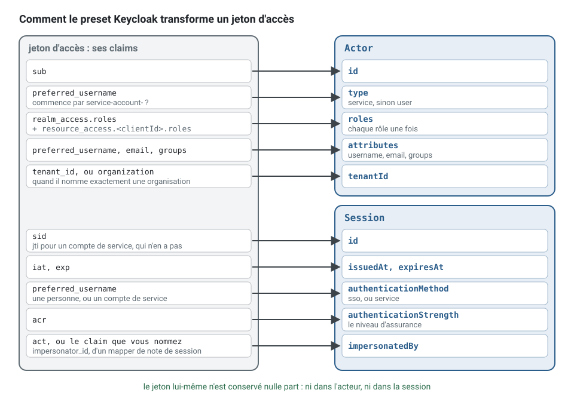

[English](identity.md) · **Français**
<!-- translation-of: identity.md sha256:5d44cf5c168afa8a -->

# Identité : Keycloak ou simple OIDC et JWT

**Résumé.** L'identité est un sous-domaine générique : qui est une personne, comment elle se
connecte, comment un mot de passe est réinitialisé. Le kit ne la construit pas. Il vérifie un
jeton signé à la frontière, le transforme en un `Actor` et une `Session`, et oublie le jeton.
Deux points d'entrée existent : un authentificateur générique de JSON Web Token qui fonctionne
avec tout fournisseur OpenID Connect publiant un jeu de clés, et un *preset* pour Keycloak qui
déduit les adresses et fait correspondre les *claims* propres à Keycloak. Cette page compare les
deux, liste ce que le *preset* fait correspondre et ce que le realm doit contenir, et dit ce que
le kit laisse au fournisseur : écrans de connexion, sessions, révocation.

## La décision

Dans l'application scheduling, clients et praticiens se connectent quelque part, et l'API reçoit
`Authorization: Bearer <token>` sur `POST /appointments`. La décision a deux parties :

1. **Quel fournisseur émet les jetons.** Auto-hébergé (Keycloak et d'autres) ou un service
   hébergé.
2. **Comment l'API fait correspondre un jeton à un acteur.** Avec l'authentificateur générique
   et une fonction de correspondance à vous, ou avec le *preset* Keycloak.

La seconde partie coûte peu à changer : c'est un adaptateur du port `Authenticator` dans
`src/platform/auth/`. La première, non : les utilisateurs, les identifiants et les applications
clientes vivent chez le fournisseur.


Quel que soit le fournisseur choisi, le jeton est vérifié une fois, à la frontière, et le reste
de l'application voit un `Actor` : un simple objet avec un identifiant, un type, des rôles, des
attributs et un *tenant*. Le cas d'usage le reçoit dans sa commande ; il ne voit jamais le jeton.

### Les deux points d'entrée, en code

Avec Keycloak, le *preset* a besoin de l'adresse du serveur, du realm et de l'audience ; il en
déduit l'émetteur et le jeu de clés. Voici l'authentificateur de l'exemple scheduling :

<!-- checked sample -->
```ts
// platform/auth/create-authenticator.ts
import type { Authenticator } from '@ddd-ts-kit/auth';
import { keycloakAuthenticator } from '@ddd-ts-kit/auth/jwt';

interface KeycloakSettings {
  readonly baseUrl: string; // KEYCLOAK_URL, sans le realm
  readonly realm: string; // KEYCLOAK_REALM
  readonly audience: string; // KEYCLOAK_AUDIENCE : ce que le claim `aud` doit nommer
  readonly clientId?: string; // KEYCLOAK_CLIENT_ID : ses rôles de client rejoignent les rôles du realm
}

export function createAuthenticator({ baseUrl, realm, audience, clientId }: KeycloakSettings): Authenticator {
  return keycloakAuthenticator({
    baseUrl,
    realm,
    audience,
    // le claim qu'écrit le mapper de note de session quand le support agit à la place d'un utilisateur
    impersonatorClaim: 'impersonator_id',
    ...(clientId === undefined ? {} : { clientId }),
  });
}
```

Avec tout autre fournisseur OpenID Connect, `JwtAuthenticator` prend l'émetteur, l'audience et
le jeu de clés explicitement. La correspondance par défaut couvre les utilisateurs ; un
`toActor` écrit une fois couvre ce qui est propre au fournisseur, ici un compte de service
reconnu par un *claim* du fournisseur :

<!-- checked sample -->
```ts
// platform/auth/create-authenticator.ts
import type { Authenticator } from '@ddd-ts-kit/auth';
import { JwtAuthenticator } from '@ddd-ts-kit/auth/jwt';
import type { Actor } from '@ddd-ts-kit/kernel';
import type { JWTPayload } from 'jose';

interface OidcSettings {
  readonly issuer: string; // AUTH_ISSUER
  readonly audience: string; // AUTH_AUDIENCE
  readonly jwksUri: string; // AUTH_JWKS_URI
}

/** Des données simples seulement : l'acteur voyage dans les commandes, les lignes de journal et les messages des files d'attente. */
export function actorOfClaims(claims: JWTPayload): Actor {
  const roles = Array.isArray(claims['roles']) ? claims['roles'].filter((role) => typeof role === 'string') : [];
  const tenantId = typeof claims['tenant_id'] === 'string' ? claims['tenant_id'] : undefined;

  return {
    id: claims.sub ?? '',
    // ce fournisseur marque avec `gty` les jetons de l'octroi client credentials
    type: claims['gty'] === 'client-credentials' ? 'service' : 'user',
    roles,
    attributes: {},
    ...(tenantId === undefined ? {} : { tenantId }),
  };
}

export function createAuthenticator({ issuer, audience, jwksUri }: OidcSettings): Authenticator {
  return new JwtAuthenticator({ issuer, audience, jwksUri, toActor: actorOfClaims });
}
```

La frontière lit ensuite le jeton bearer de chaque requête HTTP avec `principalResolver`, que
les adaptateurs HTTP reçoivent sous le nom `resolvePrincipal` :

<!-- checked sample -->
```ts
// platform/http/server.ts
import { principalResolver, type Authenticator } from '@ddd-ts-kit/auth';
import type { ExecuteOptions } from '@ddd-ts-kit/http';
import type { ExecutionScope } from '@ddd-ts-kit/kernel';

declare const authenticator: Authenticator; // l'un des deux ci-dessus, résolu depuis l'application
declare const executionScope: ExecutionScope;

export const options: ExecuteOptions = {
  // Authorization: Bearer <token> ; sans en-tête, la session anonyme, avec un en-tête mal formé, un 401
  resolvePrincipal: principalResolver(authenticator),
  executionScope,
};
```

Une route lit alors l'acteur dans le contexte d'exécution de la requête HTTP, et le met dans la
commande. Au lieu de lire le jeton dans la couche présentation et de le passer au cas d'usage :

```ts
// presentation/http/book-appointment.route.ts : refusé
async ({ body, context }) => {
  const token = String(context.raw.headers.authorization).slice('Bearer '.length);
  const claims = JSON.parse(atob(token.split('.')[1]));                  // décodé, jamais vérifié
  if (!claims.realm_access.roles.includes('client')) throw new Error();  // authz/in-application

  return { status: 201, body: { id: await commands.execute(new BookAppointment(claims.sub, body.startsAt)) } };
};
```

écrivez :

```ts
async ({ body, context }) => {
  // l'acteur du jeton vérifié ; s'il peut réserver, c'est la permission de la commande qui le dit
  const id = await commands.execute(new BookAppointment(context.execution.actor, new Date(body.startsAt)));

  return { status: 201, body: { id } };
};
```

## Comparaison

Les faits sur les produits tiers ont été vérifiés le 2026-10-10 auprès des sources listées
plus bas.

| | Keycloak avec le *preset* | Tout fournisseur OIDC avec `JwtAuthenticator` | `--authn none` |
|---|---|---|---|
| Ce que c'est | fournisseur d'identité open source, Apache-2.0, projet en incubation à la CNCF ; dernière version 26.8.0 (2026-10-01) | tout émetteur de JWT signés avec un point d'accès JWKS : un service d'identité hébergé, un autre serveur auto-hébergé, un service de jetons interne | un authentificateur de développement qui lit un en-tête ; il lève une erreur en production |
| Configuration dans le kit | URL de base, realm, audience, identifiant de client et *claim* de *tenant* facultatifs | URL du jeu de clés ou une clé, émetteur, audience, algorithmes autorisés, `toActor` facultatif | aucune |
| Émetteur et jeu de clés | déduits de l'URL de base et du realm | donnés explicitement | sans objet |
| Rôles | les rôles du realm, plus les rôles de client d'un client quand il est nommé | le premier *claim* présent parmi `realm_access.roles`, `roles`, `scope`, jamais fusionnés ; ou votre `toActor` | ce que dit l'en-tête |
| *Tenant* | un *claim* texte, ou le *claim* `organization` quand il nomme exactement une organisation | un *claim* texte (`tenant_id` par défaut) | ce que dit l'en-tête |
| Comptes de service | reconnus (`preferred_username` commençant par `service-account-`) | traduits par votre `toActor` | sans objet |
| Développement local | `init --authn keycloak` ajoute un service compose et un fichier de realm avec des utilisateurs de démonstration | vous apportez le fournisseur, ou signez vous-même des jetons de test | immédiat |
| Vous exploitez | un serveur Keycloak, sa base de données, ses mises à jour | ce que demande le fournisseur : rien pour un fournisseur hébergé | rien |

## Critères de choix

- **Qui l'exploite.** Keycloak est un serveur avec une base de données et une version publiée
  tous les quelques mois. Le projet Keycloak ne publie aucune ligne de support à long terme :
  les correctifs arrivent sur la version la plus récente (c'est ce que rapportent des suivis
  tiers ; la page de politique de support du projet lui-même n'a pas été lue pour cette page,
  tenez donc ce point pour non vérifié et contrôlez-le avant de planifier des mises à jour). Un
  fournisseur hébergé supprime ce travail et ajoute un éditeur et un prix par utilisateur.
- **Où les données des utilisateurs peuvent vivre.** Un fournisseur auto-hébergé garde les
  identifiants et les données personnelles sur votre infrastructure, ce qu'exigent certains
  périmètres de conformité.
- **Ce que les jetons doivent porter.** Rôles, groupes, *tenant* et emprunt d'identité relèvent tous de
  la configuration des *mappers* dans Keycloak. Avec un autre fournisseur, vérifiez que chaque
  *claim* sur lequel vous autorisez peut être placé dans le jeton d'accès.
- **Besoins de fédération.** Se connecter par l'annuaire propre d'un client (SAML, OIDC, LDAP)
  est une fonction du fournisseur, jamais de l'API.
- **À quelle vitesse une révocation doit agir.** Voir les limites plus bas : avec une
  vérification de la seule signature, un jeton reste valide jusqu'à son expiration.

## Ce que ce kit prend en charge et a vérifié

Tout se trouve dans [`@ddd-ts-kit/auth`](../../packages/auth/README.fr.md), entrée
`@ddd-ts-kit/auth/jwt`, le seul fichier qui importe la bibliothèque `jose` (une dépendance
*peer* facultative).

**L'authentificateur générique** vérifie la signature, l'émetteur, l'audience, l'expiration et
l'algorithme. Les familles d'algorithmes asymétriques seulement, sauf indication contraire, et
`alg: none` est toujours refusé. Un jeton refusé lève une seule erreur avec un code de raison
(`TOKEN_EXPIRED`, `CLAIM_MISMATCH`, `BAD_SIGNATURE`, `ALGORITHM_NOT_ALLOWED`, `UNKNOWN_KEY`,
`MALFORMED_TOKEN`, `UNSUPPORTED_TOKEN`, `NO_SUBJECT`). Un jeu de clés qui ne peut pas être
récupéré n'est pas un refus : il reçoit une réponse 5xx. Rien du jeton n'est gardé dans l'acteur
ni dans la session, et la clé de vérification n'est pas une propriété de l'objet, si bien que
journaliser l'authentificateur ne montre aucune clé.

Les champs de la session viennent des *claims* standard : l'identifiant de session de `sid`,
sinon `jti`, sinon du sujet et de l'instant d'émission ; les instants de `iat` et `exp`,
l'authentification multifacteur de `amr` (RFC 8176), le niveau d'assurance de `acr`, la
personne qui agit à la place de l'utilisateur d'après le *claim* `act` (RFC 8693) ou un *claim*
que vous nommez, la langue et le fuseau horaire de `locale` et `zoneinfo`, les portées
accordées de `scope` (ou `scp`), que lit à la frontière la garde `HasScope` de
`@ddd-ts-kit/http`.

**Le *preset* Keycloak** fait correspondre un jeton d'accès comme suit.



| Champ | *Claim* |
|---|---|
| `actor.id` | `sub` |
| `actor.type` | `service` pour un compte de service (octroi client credentials), sinon `user` |
| `actor.roles` | `realm_access.roles`, plus `resource_access.<clientId>.roles` quand un identifiant de client est donné, chacun une fois |
| `actor.attributes` | `username` depuis `preferred_username`, `email`, `groups` depuis le *claim* des groupes |
| `actor.tenantId` | le *claim* de *tenant* : un *claim* texte, ou le *claim* `organization` quand il nomme exactement une organisation |
| `session.id` | `sid` ; `jti` pour un compte de service, qui n'a pas de session |
| `session.authenticationMethod` | `sso` pour une personne, `service` pour un compte de service |
| `session.authenticationStrength` | le niveau d'assurance depuis `acr` |
| `session.impersonatedBy` | le *claim* nommé comme *claim* d'emprunt d'identité (par défaut `act`) |

**Ce que le realm doit contenir** pour que ces *claims* soient présents, résumé d'après le
README, qui donne les noms exacts des *mappers* :

1. un client pour l'API qui ne fait que recevoir des jetons, portant les rôles de client si vous
   les utilisez ;
2. un *mapper* d'audience sur le client par lequel les personnes se connectent : par défaut le
   *claim* `aud` ne nomme pas votre API et le jeton est refusé avec `CLAIM_MISMATCH` ;
3. la portée de client intégrée `roles` gardée sur le client frontal, avec les rôles attendus
   dans sa portée ;
4. un *mapper* d'appartenance aux groupes, si vous autorisez sur les groupes ;
5. un *tenant* : un *mapper* d'attribut d'utilisateur, ou la fonction Organizations avec sa
   portée de client ;
6. un *mapper* de note de session pour l'emprunt d'identité, si le support agit à la place
   des utilisateurs.

**Généré par la CLI.** `init --authn jwt` écrit un authentificateur configuré par
`AUTH_ISSUER`, `AUTH_AUDIENCE` et `AUTH_JWKS_URI`. `init --authn keycloak` en écrit un configuré
par `KEYCLOAK_URL`, `KEYCLOAK_REALM`, `KEYCLOAK_AUDIENCE` et le facultatif
`KEYCLOAK_CLIENT_ID`, plus un service compose (Keycloak 26.8.0 en mode développement, derrière
le profil `identity`) et un fichier de realm avec le client de l'API, un client public avec
l'octroi direct, ses *mappers* d'audience et de *tenant*, un rôle de realm et deux utilisateurs
de démonstration, pour le développement local seulement. `init --authn none` écrit un
authentificateur de développement qui fait confiance à l'en-tête `x-development-actor` et refuse
d'être construit en production. Les *specs* de bout en bout générées signent leurs propres
jetons dans le test. Chaque route déclare sa `security`, et le type de route refuse celle qui ne
le fait pas (`authz/declared` dans la [référence de l'architecture](../ARCHITECTURE.fr.md)).

**Signer un jeton dans un test.** Aucun serveur d'identité n'est nécessaire pour tester la
frontière : une *spec* génère une paire de clés, signe les jetons dont elle a besoin avec
`jose`, et donne la clé publique à l'authentificateur. Les refus se testent alors aussi
simplement que le cas nominal :

<!-- checked sample -->
```ts
import { InvalidCredentialError } from '@ddd-ts-kit/auth';
import { JwtAuthenticator } from '@ddd-ts-kit/auth/jwt';
import { SignJWT, generateKeyPair, type JWTPayload } from 'jose';
import { describe, expect, it } from 'vitest';

const ISSUER = 'https://id.example.test/realms/scheduling';
const AUDIENCE = 'scheduling-api';
const { privateKey, publicKey } = await generateKeyPair('RS256');
const authenticator = new JwtAuthenticator({ key: publicKey, issuer: ISSUER, audience: AUDIENCE });

function tokenOf(claims: JWTPayload, audience = AUDIENCE): Promise<string> {
  return new SignJWT(claims)
    .setProtectedHeader({ alg: 'RS256' })
    .setIssuer(ISSUER)
    .setAudience(audience)
    .setIssuedAt()
    .setExpirationTime('5m')
    .sign(privateKey);
}

describe('the authenticator of the API', () => {
  it('turns a token into an actor that keeps nothing of it', async () => {
    const token = await tokenOf({ sub: 'ada', realm_access: { roles: ['client'] }, tenant_id: 'practice-7' });

    const actor = await authenticator.authenticate(token);

    expect(actor).toEqual({ id: 'ada', type: 'user', tenantId: 'practice-7', roles: ['client'], attributes: {} });
    expect(JSON.stringify(actor)).not.toContain(token);
  });

  it('refuses a token meant for another API', async () => {
    const refusal = await authenticator.authenticate(await tokenOf({ sub: 'ada' }, 'billing-api')).catch((error: unknown) => error);

    expect(refusal).toBeInstanceOf(InvalidCredentialError);
    expect(refusal).toMatchObject({ code: 'UNAUTHORIZED', reason: 'CLAIM_MISMATCH' });
  });
});
```

## Limites, et quand ne pas l'utiliser

- **Aucun appel au fournisseur au-delà du jeu de clés.** Le README le dit du *preset* : une
  session révoquée n'est refusée que lorsque son jeton d'accès expire. Gardez des jetons d'accès
  de courte durée. L'introspection de jeton, la déconnexion back-channel et une liste de refus
  ne sont pas fournies ; l'une d'elles peut s'écrire comme un autre adaptateur du même port.
- **Pas de connexion, pas de gestion de session, pas d'administration des utilisateurs.** Pas de
  page de connexion, pas de gestion des jetons de rafraîchissement, pas de session par cookie,
  pas de réinitialisation de mot de passe, pas de provisionnement des utilisateurs. Tout cela
  appartient au fournisseur et au frontal.
- **Les jetons opaques ne sont pas pris en charge** par les authentificateurs livrés : ils
  vérifient des JWT.
- **Plusieurs organisations par utilisateur ne donnent aucun *tenant*** avec le *claim*
  `organization` : en choisir une est une décision du projet.
- **Une portée n'est pas un rôle.** La correspondance par défaut ne fusionne jamais `scope` avec
  les rôles ; ne le contournez pas, écrivez un `toActor`.
- **Le realm généré et l'authentificateur de développement par en-tête sont pour un usage
  local.** Le second lève une erreur en production, à dessein.
- **L'authentification n'est pas l'autorisation.** Le *preset* remplit `actor.roles` ; ce qu'un
  rôle peut faire se décide dans la couche application. Voir
  [authentification et autorisation](../concepts/authentication-and-authorization.fr.md).
- **Quand ne pas vérifier de JWT du tout :** une application web propriétaire (first-party)
  servie depuis le même site peut être plus simple et plus sûre avec une session côté serveur et un
  cookie. C'est un autre adaptateur d'`Authenticator`, et le kit n'en livre aucun.

## Recommandation selon la situation

| Situation | Choix |
|---|---|
| L'auto-hébergement est exigé, ou vous voulez un seul serveur open source avec fédération, groupes et emprunt d'identité | Keycloak avec le *preset* |
| L'organisation a déjà un fournisseur d'identité | `JwtAuthenticator` face à lui, avec un `toActor` écrit une fois et testé |
| Une petite équipe qui ne veut pas exploiter de serveur d'identité | un fournisseur OIDC hébergé avec `JwtAuthenticator` |
| Premiers jours d'un projet, aucun fournisseur choisi | `--authn none` en local, avec la décision consignée comme ouverte ; jamais déployé |
| Appels de service à service entre contextes extraits | jetons client credentials du même fournisseur, traduits en `type: 'service'` |
| La révocation doit agir en quelques secondes | des jetons courts d'abord ; si cela ne suffit pas, un adaptateur à vous qui fait de l'introspection |

## Sources

- `packages/auth/README.md` de ce dépôt (sections « Authentication », « JSON Web Tokens »,
  « Keycloak ») et `packages/cli/README.md` (`init`).
- Versions publiées de Keycloak : https://github.com/keycloak/keycloak/releases (26.8.0, licence
  Apache-2.0, vérifié le 2026-10-10). Maturité à la CNCF : https://www.cncf.io/projects/keycloak/
  (les données du paysage CNCF le donnent en incubation, vérifié le 2026-10-10).
- Guide d'administration du serveur Keycloak : https://www.keycloak.org/docs/latest/server_admin/
  (*mappers*, portées de client, organisations, emprunt d'identité).
- OpenID Connect Core 1.0 : https://openid.net/specs/openid-connect-core-1_0.html
- RFC 7519 (JSON Web Token), RFC 7517 (JSON Web Key), RFC 8176 (Authentication Method
  Reference Values), RFC 8693 (OAuth 2.0 Token Exchange, le *claim* `act`), RFC 9068 (profil JWT
  pour les jetons d'accès OAuth 2.0).
- `jose` sur npm : https://www.npmjs.com/package/jose (6.2.12, MIT, vérifié le 2026-10-10).

## Voir aussi

- [Authentification et autorisation](../concepts/authentication-and-authorization.fr.md)
- [L'acteur et la portée d'exécution](../concepts/actor-and-execution-scope.fr.md)
- [Moteurs d'autorisation](authorization-engines.fr.md)
- [Domaine et sous-domaines](../concepts/domain-and-subdomains.fr.md) : pourquoi l'identité est
  générique
- [Configuration](../CONFIG.fr.md) : `stack.authn`
