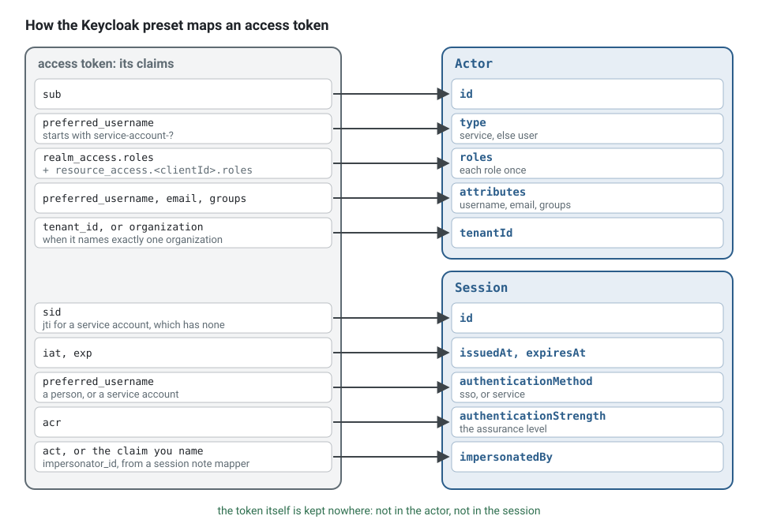

**English** · [Français](identity.fr.md)

# Identity: Keycloak or plain OIDC and JWT

**Summary.** Identity is a generic subdomain: who a person is, how they sign in, how a password
is reset. The kit does not build it. It verifies a signed token at the boundary, turns it into
an `Actor` and a `Session`, and forgets the token. Two entry points exist: a generic JSON Web
Token authenticator that works with any OpenID Connect provider publishing a key set, and a
preset for Keycloak that derives the endpoints and maps Keycloak's own claims. This page
compares the two, lists what the preset maps and what the realm must contain, and states what
the kit leaves to the provider: login screens, sessions, revocation.

## The decision

In the scheduling application, clients and practitioners sign in somewhere, and the API receives
`Authorization: Bearer <token>` on `POST /appointments`. The decision has two parts:

1. **Which provider issues the tokens.** Self-hosted (Keycloak and others) or a hosted service.
2. **How the API maps a token to an actor.** With the generic authenticator and a mapping
   function of your own, or with the Keycloak preset.

The second part is cheap to change: it is one adapter of the `Authenticator` port in
`src/platform/auth/`. The first is not: users, credentials and client applications live in the
provider.


Whichever provider is chosen, the token is verified once, at the boundary, and the rest of the
application sees an `Actor`: a plain object with an id, a type, roles, attributes and a tenant.
The use case receives it in its command; it never sees the token.

### The two entry points, in code

With Keycloak, the preset needs the address of the server, the realm and the audience; it
derives the issuer and the key set. This is the authenticator of the scheduling example:

<!-- checked sample -->
```ts
// platform/auth/authentication/create-authenticator.ts
import type { Authenticator } from '@ddd-ts-kit/auth';
import { keycloakAuthenticator } from '@ddd-ts-kit/auth/jwt';

interface KeycloakSettings {
  readonly baseUrl: string; // KEYCLOAK_URL, without the realm
  readonly realm: string; // KEYCLOAK_REALM
  readonly audience: string; // KEYCLOAK_AUDIENCE: what the `aud` claim must name
  readonly clientId?: string; // KEYCLOAK_CLIENT_ID: its client roles join the realm roles
}

export function createAuthenticator({ baseUrl, realm, audience, clientId }: KeycloakSettings): Authenticator {
  return keycloakAuthenticator({
    baseUrl,
    realm,
    audience,
    // the claim the session note mapper writes when support staff impersonate a user
    impersonatorClaim: 'impersonator_id',
    ...(clientId === undefined ? {} : { clientId }),
  });
}
```

With any other OpenID Connect provider, `JwtAuthenticator` takes the issuer, the audience and the
key set explicitly. The default mapping covers users; a `toActor` written once covers what is
specific to the provider, here a service account recognised by a claim of the provider:

<!-- checked sample -->
```ts
// platform/auth/authentication/create-authenticator.ts
import type { Authenticator } from '@ddd-ts-kit/auth';
import { JwtAuthenticator } from '@ddd-ts-kit/auth/jwt';
import type { Actor } from '@ddd-ts-kit/kernel';
import type { JWTPayload } from 'jose';

interface OidcSettings {
  readonly issuer: string; // AUTH_ISSUER
  readonly audience: string; // AUTH_AUDIENCE
  readonly jwksUri: string; // AUTH_JWKS_URI
}

/** Plain data only: the actor travels in commands, log lines and queue messages. */
export function actorOfClaims(claims: JWTPayload): Actor {
  const roles = Array.isArray(claims['roles']) ? claims['roles'].filter((role) => typeof role === 'string') : [];
  const tenantId = typeof claims['tenant_id'] === 'string' ? claims['tenant_id'] : undefined;

  return {
    id: claims.sub ?? '',
    // this provider marks the tokens of the client credentials grant with `gty`
    type: claims['gty'] === 'client-credentials' ? 'service' : 'user',
    roles,
    attributes: {},
    ...(tenantId === undefined ? {} : { tenantId }),
  };
}

export function createAuthenticator({ issuer, audience, jwksUri }: OidcSettings): Authenticator {
  return new JwtAuthenticator({ issuer, audience, jwksUri, toActor: actorOfClaims });
}
```

The boundary then reads the bearer token of each request with `principalResolver`, which the
HTTP adapters receive as `resolvePrincipal`:

<!-- checked sample -->
```ts
// platform/http/server.ts
import { principalResolver, type Authenticator } from '@ddd-ts-kit/auth';
import type { ExecuteOptions } from '@ddd-ts-kit/http';
import type { ExecutionScope } from '@ddd-ts-kit/kernel';

declare const authenticator: Authenticator; // one of the two above, resolved from the application
declare const executionScope: ExecutionScope;

export const options: ExecuteOptions = {
  // Authorization: Bearer <token>; no header gives the anonymous session, a malformed one a 401
  resolvePrincipal: principalResolver(authenticator),
  executionScope,
};
```

A route then reads the actor from the execution context of the request, and puts it in the
command. Instead of reading the token in the presentation layer and handing it to the use case:

```ts
// presentation/http/book-appointment.route.ts: refused
async ({ body, context }) => {
  const token = String(context.raw.headers.authorization).slice('Bearer '.length);
  const claims = JSON.parse(atob(token.split('.')[1]));                  // decoded, never verified
  if (!claims.realm_access.roles.includes('client')) throw new Error();  // authz/in-application

  return { status: 201, body: { id: await commands.execute(new BookAppointment(claims.sub, body.startsAt)) } };
};
```

write:

```ts
async ({ body, context }) => {
  // the actor of the verified token; whether it may book is the permission of the command
  const id = await commands.execute(new BookAppointment(context.execution.actor, new Date(body.startsAt)));

  return { status: 201, body: { id } };
};
```

## Comparison

Facts about third-party products were checked on 2026-10-10 against the sources listed below.

| | Keycloak with the preset | Any OIDC provider with `JwtAuthenticator` | `--authn none` |
|---|---|---|---|
| What it is | open-source identity provider, Apache-2.0, a CNCF incubating project; latest release 26.8.0 (2026-10-01) | any issuer of signed JWTs with a JWKS endpoint: a hosted identity service, another self-hosted server, an internal token service | a development authenticator reading a header; it throws in production |
| Configuration in the kit | base URL, realm, audience, optional client id and tenant claim, `requireExpiry` (default `true`) | key set URL or a key, issuer, audience, allowed algorithms, `requireExpiry` (default `true`), optional `toActor` | none |
| Issuer and key set | derived from the base URL and the realm | given explicitly | not applicable |
| Roles | realm roles, plus the client roles of one client when it is named | `realm_access.roles`, else `roles`, never merged and never `scope`; or your `toActor` | whatever the header says |
| Tenant | a text claim; a list or the `organization` claim: one names the tenant, several are the `tenants` attribute, among which a request names one | the same, from the tenant claim (`tenant_id` by default) | whatever the header says |
| Service accounts | recognised (`preferred_username` starting with `service-account-`) | mapped by your `toActor` | not applicable |
| Local development | `init --authn keycloak` adds a compose service and a realm file with demo users | you bring the provider, or sign test tokens yourself | immediate |
| You operate | a Keycloak server, its database, its upgrades | what the provider asks: nothing for a hosted one | nothing |

## Selection criteria

- **Who operates it.** Keycloak is a server with a database and a release every few months.
  The Keycloak project publishes no long-term support line: fixes land on the newest release
  (this is what third-party trackers report; the project's own support policy page was not
  read for this page, so treat it as not verified and check before planning upgrades). A hosted
  provider removes that work and adds a vendor and a per-user price.
- **Where user data may live.** A self-hosted provider keeps credentials and personal data on
  your infrastructure, which some compliance scopes require.
- **What the tokens must carry.** Roles, groups, a tenant and an impersonator are all mapper
  configuration in Keycloak. With another provider, check that each claim you authorize on can
  be put in the access token.
- **Federation needs.** Signing in through a customer's own directory (SAML, OIDC, LDAP) is a
  feature of the provider, never of the API.
- **How fast a revocation must act.** See the limits below: with signature-only verification, a
  token stays valid until it expires.

## What this kit supports and verified

All of it is in [`@ddd-ts-kit/auth`](../../packages/auth/README.md), entry
`@ddd-ts-kit/auth/jwt`, the only file that imports the `jose` library (an optional peer).

**The generic authenticator** verifies the signature, the issuer, the audience, the expiry and
the algorithm. A token without `exp` is refused unless `requireExpiry: false` says that the
issuer's tokens never expire. Asymmetric algorithm families only unless told otherwise
(`DEFAULT_JWT_ALGORITHMS`), and `alg: none` is always refused. A refused token raises one error
with a reason code (`TOKEN_EXPIRED`, `NO_EXPIRY`, `CLAIM_MISMATCH`, `BAD_SIGNATURE`,
`ALGORITHM_NOT_ALLOWED`, `UNKNOWN_KEY`, `MALFORMED_TOKEN`, `UNSUPPORTED_TOKEN`, `NO_SUBJECT`). A key set that cannot be fetched is not a refusal: it is
answered as a 5xx. Nothing of the token is kept in the actor or the session, and the
verification key is not a property of the object, so logging the authenticator shows no key.

Session fields come from standard claims: the session id from `sid`, else `jti`, else the
subject and the issue instant; the instants from `iat` and `exp`, multi-factor from `amr`
(RFC 8176), the assurance level from `acr`, the impersonator from the `act` claim (RFC 8693) or
a claim you name, the locale and time zone from `locale` and `zoneinfo`, the granted scopes from
`scope` (or `scp`), which the `HasScope` guard of `@ddd-ts-kit/http` reads at the edge.

**The Keycloak preset** maps an access token as follows.



| Field | Claim |
|---|---|
| `actor.id` | `sub` |
| `actor.type` | `service` for a service account (client credentials grant), else `user` |
| `actor.roles` | `realm_access.roles`, plus `resource_access.<clientId>.roles` when a client id is given, each once |
| `actor.attributes` | `username` from `preferred_username`, `email`, `emailVerified` from `email_verified`, `groups` from the groups claim, `tenants` when the tenant claim names several |
| `actor.tenantId` | the tenant claim: a text claim, or a list (the `organization` claim) when it names exactly one |
| `session.id` | `sid`; `jti` for a service account, which has no session |
| `session.authenticationMethod` | `sso` for a person, `service` for a service account |
| `session.authenticationStrength` | the assurance level from `acr` |
| `session.impersonatedBy` | the claim named as the impersonator claim (default `act`) |

**What the realm must contain** for those claims to be present, summarised from the README,
which gives the exact mapper names:

1. a client for the API that only receives tokens, holding the client roles if you use them;
2. an audience mapper on the client people sign in with: by default the `aud` claim does not
   name your API and the token is refused with `CLAIM_MISMATCH`;
3. the built-in `roles` client scope kept on the front-end client, with the expected roles in
   its scope;
4. a group membership mapper, if you authorize on groups;
5. a tenant: a user attribute mapper, or the Organizations feature with its client scope;
6. a session note mapper for the impersonator, if support staff impersonate users.

**Generated by the CLI.** `init --authn jwt` writes an authenticator configured by
`AUTH_ISSUER`, `AUTH_AUDIENCE` and `AUTH_JWKS_URI`. `init --authn keycloak` writes one
configured by `KEYCLOAK_URL`, `KEYCLOAK_REALM`, `KEYCLOAK_AUDIENCE` and the optional
`KEYCLOAK_CLIENT_ID`, plus a compose service (Keycloak 26.8.0 in development mode, behind the
`identity` profile) and a realm file with the API client, a public client with the direct
grant, its audience and tenant mappers, a realm role and two demo users, for local development
only. `init --authn none` writes a development authenticator that trusts the
`x-development-actor` header, in development and test only: the application refuses to start
without `NODE_ENV`, and with `NODE_ENV=production`. The generated end-to-end
specs sign their own tokens in the test. Every route declares
its `security`, and the route type refuses one that does not (`authz/declared` in the
[architecture reference](../ARCHITECTURE.md)).

**Signing a token in a test.** No identity server is needed to test the boundary: a spec
generates a key pair, signs the tokens it needs with `jose`, and gives the public key to the
authenticator. The refusals are then tested as plainly as the happy path:

<!-- checked sample -->
```ts
import { InvalidCredentialError } from '@ddd-ts-kit/auth';
import { JwtAuthenticator } from '@ddd-ts-kit/auth/jwt';
import { SignJWT, generateKeyPair, type JWTPayload } from 'jose';
import { describe, expect, it } from 'vitest';

const ISSUER = 'https://id.example.test/realms/scheduling';
const AUDIENCE = 'scheduling-api';
const { privateKey, publicKey } = await generateKeyPair('RS256');
const authenticator = new JwtAuthenticator({ key: publicKey, issuer: ISSUER, audience: AUDIENCE });

function tokenOf(claims: JWTPayload, audience = AUDIENCE): Promise<string> {
  return new SignJWT(claims)
    .setProtectedHeader({ alg: 'RS256' })
    .setIssuer(ISSUER)
    .setAudience(audience)
    .setIssuedAt()
    .setExpirationTime('5m')
    .sign(privateKey);
}

describe('the authenticator of the API', () => {
  it('turns a token into an actor that keeps nothing of it', async () => {
    const token = await tokenOf({ sub: 'ada', realm_access: { roles: ['client'] }, tenant_id: 'practice-7' });

    const actor = await authenticator.authenticate(token);

    expect(actor).toEqual({ id: 'ada', type: 'user', tenantId: 'practice-7', roles: ['client'], attributes: {} });
    expect(JSON.stringify(actor)).not.toContain(token);
  });

  it('refuses a token meant for another API', async () => {
    const refusal = await authenticator.authenticate(await tokenOf({ sub: 'ada' }, 'billing-api')).catch((error: unknown) => error);

    expect(refusal).toBeInstanceOf(InvalidCredentialError);
    expect(refusal).toMatchObject({ code: 'UNAUTHORIZED', reason: 'CLAIM_MISMATCH' });
  });
});
```

**The people and organisations of the application.** The provider says who signed in; which
organisation they belong to and what they may do there is the application's. `--preset identity`
writes that context whole: accounts provisioned from the token at the first sign-in, never a
password, organisations, members and roles, invitations, delegations, and the port
`IdentityProviderAdmin` that tells Keycloak 26 (organizations API) what was decided, at least
once, from the consumers of its published facts. With tenants, the authenticator reads the
`organization` claim as the tenants of the person. With `--privacy on`, the default with an ORM,
it declares what it keeps of people: the address and the name of an account, pseudonymised when
the person is erased, and the address an invitation was sent to, deleted thirty days after the
invitation expired; its erasure and its export are listed in the platform, not confined to a
tenant, since its tables belong to none ([Personal data](../concepts/personal-data.md)). The Keycloak adapter is a recipe: specified
against a local server, not run against a real Keycloak by the pipeline of the kit. See
[Bootstrap with well-designed contexts](../guides/bootstrap-with-well-designed-contexts.md).

## Limits and when not to use it

- **No call to the provider beyond the key set.** The README says it of the preset: a revoked
  session is refused only when its access token expires. Keep access tokens short-lived. Token
  introspection, back-channel logout and a deny list are not provided; one can be written as
  another adapter of the same port.
- **No login, no session management, no user administration.** No login page, no refresh token
  handling, no cookie session, no password reset, no user provisioning. Those belong to the
  provider and to the front end.
- **Opaque tokens are not supported** by the shipped authenticators: they verify JWTs.
- **Several organizations per user give no default tenant** with the `organization` claim: they
  are the `tenants` of the actor, and each request names the one it works in (`x-tenant-id`);
  one without it works in no tenant.
- **A client sends no `x-tenant-id` for an organisation the person is not a member of yet.** The
  edge holds every authenticated request to the tenants of its token, so a header naming the
  organisation of an invitation not yet accepted, or one about to be opened, is refused with 403
  on every route. The routes of the identity context that come before a membership (provisioning
  the account, accepting or declining an invitation, opening an organisation) work in no tenant:
  call them without the header, then with it once the next token names the organisation.
- **A scope is not a role.** The default mapping never reads `scope` as roles: a token that
  carries only scopes gives an actor with no role. A provider whose tokens carry no role claim
  needs a `toActor` that maps them.
- **The generated realm and the development header authenticator are for local use.** The
  second is built only where `NODE_ENV` says `development` or `test`, by design.
- **Authentication is not authorization.** The preset fills `actor.roles`; what a role may do
  is decided in the application layer. See
  [authentication and authorization](../concepts/authentication-and-authorization.md).
- **When not to use JWT verification at all:** a first-party web application served from the
  same site may be simpler and safer with a server-side session and a cookie. That is a
  different `Authenticator` adapter, and the kit ships none.

## Recommendation by situation

| Situation | Choice |
|---|---|
| Self-hosting is required, or you want one open-source server with federation, groups and impersonation | Keycloak with the preset |
| The organisation already has an identity provider | `JwtAuthenticator` against it, with a `toActor` written once and tested |
| A small team that does not want to run an identity server | a hosted OIDC provider with `JwtAuthenticator` |
| First days of a project, no provider chosen | `--authn none` locally, with the decision recorded as open; never deployed |
| Service-to-service calls between extracted contexts | client credentials tokens from the same provider, mapped to `type: 'service'` |
| Revocation must act within seconds | short tokens first; if that is not enough, an introspecting adapter of your own |

## Sources

- `packages/auth/README.md` of this repository (sections "Authentication", "JSON Web Tokens",
  "Keycloak") and `packages/cli/README.md` (`init`).
- Keycloak releases: https://github.com/keycloak/keycloak/releases (26.8.0, licence Apache-2.0,
  checked on 2026-10-10). CNCF maturity: https://www.cncf.io/projects/keycloak/ (the CNCF
  landscape data lists it as incubating, checked on 2026-10-10).
- Keycloak server administration guide: https://www.keycloak.org/docs/latest/server_admin/
  (mappers, client scopes, organizations, impersonation).
- OpenID Connect Core 1.0: https://openid.net/specs/openid-connect-core-1_0.html
- RFC 7519 (JSON Web Token), RFC 7517 (JSON Web Key), RFC 8176 (Authentication Method
  Reference Values), RFC 8693 (OAuth 2.0 Token Exchange, the `act` claim), RFC 9068 (JWT
  profile for OAuth 2.0 access tokens).
- `jose` on npm: https://www.npmjs.com/package/jose (6.2.12, MIT, checked on 2026-10-10).

## See also

- [Authentication and authorization](../concepts/authentication-and-authorization.md)
- [The actor and the execution scope](../concepts/actor-and-execution-scope.md)
- [Authorization engines](authorization-engines.md)
- [Domain and subdomains](../concepts/domain-and-subdomains.md): why identity is generic
- [Configuration](../CONFIG.md): `stack.authn`
