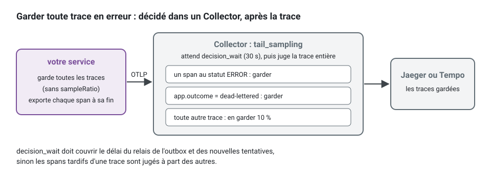

[English](observability.md) · **Français**
<!-- translation-of: observability.md sha256:e62e1ac4381cd9c6 -->

# Observabilité : backends de traçage, *loggers* et suivi des erreurs

**Résumé.** Trois décisions se cachent sous un seul mot. Où vont les traces (le kit émet des
traces OpenTelemetry en OTLP ; Jaeger et Grafana Tempo sont deux backends qui les reçoivent),
quelle bibliothèque écrit les journaux (un *logger* JSON sans dépendance, pino ou winston, tous
derrière le port `Logger` du noyau), et où sont collectées les défaillances inattendues (Sentry ou
GlitchTip, derrière le port `ErrorReporter`). Le kit câble les traces, les journaux et les
rapports d'erreur, et les relie par un même identifiant de corrélation. Il ne livre aucun
exportateur de métriques : dans un projet généré, le port `Metrics` est lié à une implémentation
qui ne fait rien tant que vous n'écrivez pas l'adaptateur.

## Ce qu'émet le kit, et ce que vous choisissez


Lisez le schéma de gauche à droite. Chaque boîte de gauche est un adaptateur que la plateforme lie
une fois, dans `src/platform/` ; aucun fichier d'un contexte délimité (bounded context) n'en
connaît aucun. Chaque boîte de droite est un outil que vous choisissez et faites tourner, et la
suite de cette page les compare. La seule flèche que vous devez tracer vous-même est la dernière :
le kit mesure des durées et des issues par le port `Metrics`, et ne les envoie nulle part tant
qu'un projet ne lie pas un exportateur.

Les concepts (ce qu'un *span* peut porter, comment l'identifiant de corrélation relie une trace,
ses lignes de journal, ses entrées d'audit et son rapport d'erreur) sont sur la
[page de concept sur l'observabilité](../concepts/observability.fr.md). Cette page porte sur les
outils du côté qui reçoit.

Les faits concernant des tiers, ci-dessous, ont été vérifiés le 2026-10-10 auprès des sources
listées à la fin.

## Traçage : OpenTelemetry, Jaeger, Grafana Tempo

OpenTelemetry est le standard d'instrumentation et le protocole de transport (OTLP), pas un
backend. Le choisir, c'est ce qui garde le backend remplaçable.

| | Jaeger | Grafana Tempo |
|---|---|---|
| Ce que c'est | un backend de traçage avec sa propre interface de recherche | un backend de traçage conçu autour du stockage objet, consulté par Grafana |
| Version vue | v2.22.0 (2026-10-06) | v3.1.0 (2026-09-29) |
| Licence | Apache-2.0 | AGPL-3.0 |
| Gouvernance | CNCF, niveau graduated | Grafana Labs |
| Ingestion | OTLP nativement depuis la v2, qui est construite sur l'OpenTelemetry Collector | OTLP, parmi d'autres protocoles |
| Stockage | la mémoire pour le développement ; une base de données pour la production (la liste prise en charge n'a pas été revérifiée pour cette page) | stockage objet (compatible S3, GCS, Azure) ou un disque local |
| Recherche | par service, opération, étiquettes, durée, identifiant de trace | TraceQL, plus la recherche par identifiant de trace |
| Convient à | un conteneur sur un portable ; une équipe qui veut une interface de traçage et rien d'autre | une équipe qui fait déjà tourner Grafana, veut les traces à côté des journaux et des métriques, avec une longue rétention à faible coût de stockage |
| Coûts | le stockage de production est une base de données à exploiter | plus de pièces mobiles en production ; l'interface est Grafana |

Critères de choix :

- **Ce que vous faites déjà tourner.** Avec Grafana, Loki et Prometheus en place, Tempo complète
  l'ensemble et permet à un tableau de bord de passer d'une ligne de journal à sa trace. Sans
  eux, Jaeger est un seul service.
- **Rétention et volume.** Le stockage objet est bon marché pour des semaines de traces ; une
  base de données indexée cherche plus vite et coûte plus cher à conserver.
- **Licence.** L'AGPL-3.0 compte pour certaines organisations, même pour un service qu'elles ne
  font que faire tourner ; vérifiez votre politique.
- **Échantillonnage.** Garder toute trace qui finit en erreur ne peut pas se décider quand une
  trace commence. C'est l'échantillonnage en fin de trace (tail sampling), fait par un
  OpenTelemetry Collector placé entre l'application et l'un ou l'autre backend. Le README du
  traçage donne une configuration de collector pour cela.



L'application échantillonne alors tout (sans `sampleRatio`), et les politiques vivent dans le
collector, à côté du backend qu'il alimente. Sans collector, `initTracing({ sampleRatio: 0.2 })`
garde un cinquième des traces, décidé là où chaque trace commence : une trace en erreur est
écartée aussi souvent que n'importe quelle autre.

Un backend hébergé qui accepte OTLP est une troisième option ; aucun n'a été évalué ici.

## *Loggers* : StdoutLogger, pino, winston

| | `StdoutLogger` (*package* aspects) | pino (`@ddd-ts-kit/pino`) | winston (`@ddd-ts-kit/winston`) |
|---|---|---|---|
| Dépendance | aucune | pino (10.4.0 sur npm, MIT) | winston (3.19.0 sur npm, MIT) |
| Sortie | des lignes JSON sur la sortie standard | des lignes JSON, un format lisible facultatif en développement, les transports de pino | des lignes JSON, les formats et transports de winston |
| Coût d'une ligne, tel que mesuré dans les README du kit | non indiqué | environ 3 microsecondes | environ 7 microsecondes, plus avec chaque format |
| Mise en tampon | aucune | aucune par défaut ; un mode asynchrone met 4 Kio en tampon et peut perdre les dernières lignes d'un processus tué | aucune dans l'adaptateur |
| Masquage des secrets | les clés du noyau, quelle que soit leur casse, au premier niveau et un niveau en dessous ; `scrubMessages` retire le message des erreurs qui ne sont pas une `DomainError` | compilé par pino | un passage sur les valeurs de premier niveau |
| Choisi par | `init --logger stdout` (le défaut) | `init --logger pino` | `init --logger winston` |
| Prenez-le quand | du JSON sur stdout est tout ce qu'il vous faut | le volume compte, le framework parle déjà pino (Fastify), ou vous voulez ses transports | l'équipe exploite déjà des transports et formats winston (fichiers tournants, syslog, transport d'un éditeur) |

Les mesures sont celles que rapportent les deux README (Node 24, un *logger* enfant, quatre champs
de corrélation, trois champs, une destination qui jette tout). Elles comparent les deux
adaptateurs entre eux, sur une machine, et ne sont pas un banc d'essai des bibliothèques.

Critères de choix : le volume d'abord (le coût de winston est « nul à quelques centaines de lignes
par seconde et visible à des dizaines de milliers », selon les mots du README), puis ce que
l'équipe exploite déjà. Les trois implémentent un même port et passent une même suite de contrat
(`loggerContract`), si bien que le choix tient en une ligne de la racine de composition et peut
être revu :

<!-- checked sample -->
```ts
import { StdoutLogger } from '@ddd-ts-kit/aspects';
import { AsyncLocalStorageExecutionScope, type Logger } from '@ddd-ts-kit/kernel';
import { createPinoLogger } from '@ddd-ts-kit/pino';
import { traceLogFields } from '@ddd-ts-kit/tracing';
import { createWinstonLogger } from '@ddd-ts-kit/winston';

declare const choice: 'stdout' | 'pino' | 'winston';

const executionScope = new AsyncLocalStorageExecutionScope();

// Lus à chaque ligne : identifiant de corrélation, origine, acteur et tenant du travail en cours,
// puis trace_id et span_id du span actif. Les mêmes champs, quelle que soit la bibliothèque.
const fields = () => traceLogFields(executionScope);

// Trois adaptateurs d'un même port, tenus à une même suite de contrat : changer de bibliothèque, c'est cette ligne.
export const logger: Logger = {
  stdout: () => new StdoutLogger({ fields, base: { service: 'scheduling' } }),
  pino: () => createPinoLogger({ service: 'scheduling', fields }),
  winston: () => createWinstonLogger({ service: 'scheduling', fields }),
}[choice]();
```

Un projet généré écrit l'un des trois dans `src/platform/observability/create-logger.ts`, selon
l'option `--logger` d'`init` ; l'application d'exemple utilise pino.

## Suivi des erreurs : Sentry, GlitchTip

| | Sentry | GlitchTip |
|---|---|---|
| Ce que c'est | suivi des erreurs et des performances, hébergé ou auto-hébergé | un outil de suivi des erreurs qui parle le protocole de Sentry |
| Licence | le serveur est sous Functional Source License (FSL-1.1-Apache-2.0), qui n'est pas une licence open source ; les SDK sont sous MIT | MIT |
| Version vue | serveur 26.9.0 (2026-09-15) ; `@sentry/node` 11.6.0 | v6.2.6 (étiquette du 2026-08-07) |
| Auto-hébergement | Docker Compose avec un script d'installation, des services sur un seul nœud dont Kafka ; la documentation demande au moins 4 cœurs de processeur et 16 Go de mémoire, plus 16 Go de swap | un service à côté de PostgreSQL 14 ou plus récent ; Valkey (ou Redis) 7 ou plus récent est facultatif, conseillé « pour des instances plus rapides ou plus grandes » |
| Périmètre, tel que chaque documentation le liste | *issues*, traces et *spans*, journaux, rejeu de session, profilage, métriques applicatives, retours des utilisateurs, tableaux de bord, versions publiées (releases), moniteurs et alertes (moniteurs de cron et de disponibilité) | suivi des erreurs, suivi des performances, suivi de disponibilité, journaux |
| Convient à | une équipe qui veut le service hébergé ou l'ensemble complet des fonctions | une petite équipe qui veut collecter les erreurs sur sa propre infrastructure avec peu à exploiter |

Les lignes sur l'auto-hébergement et le périmètre ont été lues le 2026-10-10 dans la documentation
de Sentry auto-hébergé (https://develop.sentry.dev/self-hosted/), l'index des produits de Sentry
(https://docs.sentry.io/product/), l'index de la documentation de GlitchTip
(https://glitchtip.com/documentation) et son guide d'installation
(https://glitchtip.com/documentation/install). Elles listent ce que chaque projet documente, pas
ce qui a été essayé ici. Les pages de GlitchTip lues ne mentionnent ni le rejeu de session ni le
profilage.

L'adaptateur du kit est le même pour les deux : seul le DSN change.

<!-- checked sample -->
```ts
import { reportProcessFailures } from '@ddd-ts-kit/kernel';
import { initSentry } from '@ddd-ts-kit/sentry';

// Ce que la configuration validée a lu de SENTRY_DSN, SENTRY_ENVIRONMENT et SENTRY_RELEASE.
declare const config: { readonly dsn: string; readonly environment: string; readonly release: string };

// Le DSN d'un projet Sentry ou d'un projet GlitchTip : le même appel, les mêmes rapports.
// Un DSN vide ne démarre aucun SDK, et le reporter qu'il renvoie ne signale rien.
export const errors = initSentry({ dsn: config.dsn, environment: config.environment, release: config.release });

// uncaughtException et unhandledRejection : signalées comme fatales, puis code de sortie 1.
reportProcessFailures(errors);
```

**Non vérifié :** lesquels des champs et des types d'enveloppe qu'envoie le SDK de Sentry
GlitchTip accepte ou ignore. Les pages de GlitchTip lues ne le disent pas, et rien d'autre que la
suite propre de l'adaptateur n'a été exécuté contre un serveur GlitchTip pour cette page.

## Ce que ce kit prend en charge et a vérifié

**Traçage** ([`@ddd-ts-kit/tracing`](../../packages/tracing/README.fr.md)) :

- un amorçage OpenTelemetry pour Node qui exporte les traces en OTLP/HTTP vers le point d'accès
  (endpoint) nommé par la variable standard `OTEL_EXPORTER_OTLP_ENDPOINT` ; sans elle, rien
  n'est exporté ;
- des *spans* posés autour de l'application depuis l'extérieur, une fois, par la plateforme
  (`kernelModule({ instrumentation: traceApplication() })`, `tracedPublisher(bus)` pour le
  relais) : un par cas d'usage, appel de *repository* ou d'adaptateur, événement du domaine,
  publication, consommateur et *job*, si bien qu'aucun fichier d'un contexte n'importe une
  bibliothèque de traçage (`tracing/platform-only` dans la
  [référence d'architecture](../ARCHITECTURE.fr.md)) ;
- `traceparent` porté dans l'enveloppe de l'événement et stocké avec l'enregistrement de
  l'outbox, si bien qu'une trace continue à travers le relais et le contexte consommateur, et
  qu'une décision d'échantillonnage vaut pour toute la trace ;
- une liste d'attributs autorisés, le nettoyage des secrets d'URL et des messages d'exception,
  des plafonds sur le nombre de *spans* de dépendance sous une même racine ;
- un exemple compose pour Jaeger v2 (image `jaegertracing/jaeger:2.22.0`) ; un projet généré a
  Jaeger derrière le profil `observability` de son fichier compose ;
- une configuration de collector pour l'échantillonnage en fin de trace, en exemple.

Tempo n'est pas nommé dans le README du *package*. Il reçoit l'OTLP, donc le même exportateur
devrait l'atteindre ; cela n'a pas été exécuté dans ce dépôt.

Ce que `tracing/platform-only` refuse, et ce qu'il faut écrire à la place. Au lieu d'ouvrir des
*spans* dans un gestionnaire :

```ts
// contexts/scheduling/application/book-appointment.handler.ts : refusé
import { trace } from '@opentelemetry/api';

const span = trace.getTracer('scheduling').startSpan('book appointment');
span.setAttribute('client.email', command.clientEmail); // une donnée personnelle sur un span
```

n'écrivez rien dans le gestionnaire, et enveloppez l'application une fois, depuis la plateforme.
La commande reçoit alors son *span*, `command BookAppointment`, avec son contexte et son issue, et
ses *repositories*, ses événements et ses publications reçoivent les leurs en dessous :

<!-- checked sample -->
```ts
import { kernelModule } from '@ddd-ts-kit/di';
import { traceApplication } from '@ddd-ts-kit/tracing';

// src/platform/ : une valeur, et chaque cas d'usage, adaptateur, événement, consommateur et job est tracé.
export const kernel = kernelModule({ instrumentation: traceApplication() });
```

Si le débogage a besoin de la valeur, c'est une ligne de journal avec un identifiant, écrite par
un adaptateur, avec la rétention de vos journaux.

**Journaux** : `StdoutLogger` est ce qu'un projet généré lie par défaut, avec les identifiants de
trace et les champs de corrélation de la portée d'exécution sur chaque ligne. `init --logger pino`
et `init --logger winston` génèrent à la place `src/platform/observability/create-logger.ts` sur
`@ddd-ts-kit/pino` (écrit pour pino 10) ou `@ddd-ts-kit/winston` (écrit pour winston 3.19), avec
les mêmes champs. Pour NestJS, chaque README montre un pont de quelques lignes pour les messages
propres au framework, et n'en livre aucun.

**Rapports d'erreur** ([`@ddd-ts-kit/sentry`](../../packages/sentry/README.fr.md)) : écrit pour
`@sentry/node` 11, avec cinq points de capture attachés depuis l'extérieur (bus, HTTP 5xx,
*jobs*, événements partis en file de rejet, défaillances du processus), un rapport par
défaillance, une `DomainError` jamais signalée comme un incident. Le SDK de Sentry est initialisé
de sorte qu'il n'enregistre aucun fournisseur de traceur ni aucune seconde instrumentation : le
*package* de traçage possède OpenTelemetry, et le rapport porte l'identifiant de trace du *span*
actif. `init --errors sentry` génère le câblage (`src/platform/observability/errors.ts`, configuré par
`SENTRY_DSN`) et un service compose qui fait tourner GlitchTip 6.2.6 derrière le profil
`errors`, pour le développement.

**Métriques** : le noyau définit le port `Metrics` (compteurs, histogrammes, jauges, avec des
valeurs d'étiquette tirées d'un petit ensemble fermé) et le *package* aspects enregistre des
durées et des issues par lui. `openTelemetryMetrics()` de `@ddd-ts-kit/tracing` est son
adaptateur sur l'API de métriques d'OpenTelemetry, et un projet généré le lie dans
`create-metrics.ts` : `initTracing` enregistre le fournisseur de métriques avec un lecteur
OTLP/HTTP quand `OTEL_EXPORTER_OTLP_ENDPOINT` est définie, et les métriques sortent avec les
traces. L'amorçage du traçage désactive les métriques d'exécution et d'hôte.

Ce qui est mesuré : `use_case_duration_ms` et `use_case_total` par `metricsMiddleware` sur les
bus (étiquettes `message`, `kind` et `outcome`, plus `error_code` sur le compteur),
`dependency_call_duration_ms` et `dependency_call_total` par l'aspect `timed` sur les
adaptateurs qu'il enveloppe (le préfixe est son option `name`), `cache_errors_total` par
`RedisCache`, les jauges `outbox_pending`, `outbox_failed` et `outbox_dead` par un
`OutboxRelay` qui reçoit les métriques, et `jobs_waiting`, `jobs_running` et `jobs_dead` par
`queue` par un `QueueWorker` qui les reçoit. Un projet que Prometheus vient lire enregistre à la
place son propre fournisseur de métriques avant que l'adaptateur prenne son *meter* ; cet
exemple compile contre les *packages* du *workspace*, et n'a pas été exécuté contre un backend
pour cette page :

<!-- checked sample -->
```ts
import type { Metrics } from '@ddd-ts-kit/kernel';
import { metrics as openTelemetry } from '@opentelemetry/api';
import { PrometheusExporter } from '@opentelemetry/exporter-prometheus';
import { MeterProvider } from '@opentelemetry/sdk-metrics';
import { openTelemetryMetrics } from '@ddd-ts-kit/tracing';

// src/platform/observability/create-metrics.ts : /metrics sur le port 9464, que Prometheus vient lire.
openTelemetry.setGlobalMeterProvider(new MeterProvider({ readers: [new PrometheusExporter({ port: 9464 })] }));

export const metrics: Metrics = openTelemetryMetrics({ meterName: 'scheduling' });
```

Les valeurs d'étiquette viennent d'un petit ensemble fermé (`MetricLabels` du noyau) : jamais un
identifiant, jamais une saisie d'utilisateur, si bien que le nombre de séries reste borné.

### Les quatre, câblés dans la plateforme

L'exemple ci-dessous condense ce que l'application d'exemple répartit entre
`src/platform/composition/lay-foundations.ts` (le logger pino et les métriques),
`src/platform/composition/platform.module.ts` (les liaisons) et `src/platform/observability/errors.ts` (Sentry). Un projet
généré a `lay-foundations.ts` dans les deux familles, `platform.module.ts` avec tsyringe (une plateforme
câblée à la main assemble les mêmes fondations dans `create-platform.ts`) et `errors.ts` seulement avec
`--errors sentry`.
L'amorçage du traçage
(`initTracing` de `@ddd-ts-kit/tracing/node`) n'y figure pas : il vit dans son propre module,
`src/platform/observability/tracing.ts`, importé en premier par `main.ts`, parce que les instrumentations
modifient `http` et les pilotes au moment où ils sont chargés.

<!-- checked sample -->
```ts
import { StdoutLogger } from '@ddd-ts-kit/aspects';
import { kernelModule } from '@ddd-ts-kit/di';
import { AsyncLocalStorageExecutionScope } from '@ddd-ts-kit/kernel';
import { initSentry } from '@ddd-ts-kit/sentry';
import { openTelemetryMetrics, traceApplication, traceLogFields } from '@ddd-ts-kit/tracing';

declare const sentryDsn: string;

const executionScope = new AsyncLocalStorageExecutionScope();

export const kernel = kernelModule({
  // Une seule portée pour les bus, le logger et les spans : l'identifiant de corrélation est le même dans les trois.
  executionScope,
  logger: new StdoutLogger({ fields: () => traceLogFields(executionScope) }),
  // Sur le fournisseur de métriques qu'initTracing a enregistré : exporté par OTLP avec les traces.
  metrics: openTelemetryMetrics({ meterName: 'scheduling' }),
  // Les bus et les jobs signalent par lui ; app.stop() le vide.
  errorReporter: initSentry({ dsn: sentryDsn }),
  // Des spans autour de chaque cas d'usage, adaptateur, événement, consommateur et job.
  instrumentation: traceApplication(),
});
```

Trois endroits restent hors du module du noyau et prennent chacun une enveloppe, comme le montre
le [README du traçage](../../packages/tracing/README.fr.md) : le pipeline HTTP
(`around: tracedRoutes()`, avec `onError: reportHttpErrors(errors)` pour les réponses 5xx), le
*publisher* du relais de l'outbox (`tracedPublisher(bus)`), et les files de rejet d'un *broker*
(`DeadLetterReports`).

### Suivre une action à travers les quatre


Les outils sont séparés ; les identifiants ne le sont pas. Un rapport d'erreur dans GlitchTip
porte l'identifiant de trace du *span* qui était actif quand il a échoué (`contexts.trace`) :
collez-le dans Jaeger et toute la requête HTTP s'ouvre, consommateurs de ses événements compris.
Cherchez ce `trace_id` dans le pipeline de journaux, ou son `correlationId`, et les lignes de
journal de chaque contexte délimité que l'action a atteint reviennent. Les entrées d'audit de
l'action partagent son `correlationId`. C'est pourquoi le choix de chaque outil est indépendant
des autres : ce qui les relie est écrit par le kit, pas par les outils.

## Limites, et quand ne pas l'utiliser

- **Des traces seulement par OpenTelemetry.** Aucun export de métriques ni aucun export de
  journaux en OTLP n'est fourni. Les journaux partent sur la sortie standard vers votre pipeline
  de journaux ; les métriques demandent un adaptateur du port `Metrics` que vous écrivez.
- **Les ponts de journalisation des auto-instrumentations sont désactivés** par défaut : les
  lignes de journal portent les identifiants de trace parce que le *logger* les lit, pas parce
  qu'OpenTelemetry les injecte.
- **Les *spans* portent des noms et des codes, jamais des données.** Une valeur métier voulue sur
  une trace est refusée par conception. Si le débogage a besoin des contenus, c'est une décision
  de journalisation avec sa propre rétention, pas un attribut de *span*.
- **Les plafonds de *spans* par racine** (25 par nom, 200 au total par défaut) font qu'une boucle
  sur mille appels de *repository* n'est pas entièrement tracée ; un compteur sur le *span*
  racine dit combien ont été écartés.
- **L'échantillonnage en tête dans l'application est un ratio.** Un échantillonnage qui favorise
  les erreurs demande un collector.
- **pino asynchrone peut perdre ses dernières lignes** quand le processus est tué sans
  gestionnaire.
- **Aucun pont de *logger* pour Nest n'est livré.**
- **Non vérifié dans ce dépôt :** Tempo comme backend, le service hébergé de Sentry à fort volume,
  le traitement par GlitchTip de chaque champ qu'envoie l'adaptateur. Les lignes de comparaison
  de Sentry et de GlitchTip ci-dessus reprennent la documentation de chaque projet.
- **Quand ne pas ajouter de backend de traçage du tout :** un seul processus avec peu de
  dépendances est souvent bien servi par des identifiants de corrélation dans des journaux
  structurés. Démarrez le SDK plus tard ; le code ne change pas, puisque rien dans les couches
  internes ne connaît le traçage.

## Recommandation selon la situation

| Situation | Choix |
|---|---|
| Développement local, premières semaines | Jaeger par le profil compose généré, `StdoutLogger`, aucun outil de suivi des erreurs |
| Petite équipe, auto-hébergé, peu à exploiter | Jaeger, `StdoutLogger` ou pino, GlitchTip |
| Une stack Grafana déjà en place | Tempo derrière un collector, pino ou `StdoutLogger` vers Loki, les métriques par un adaptateur que vous écrivez |
| Fort volume de journaux, ou Fastify | pino, synchrone sauf si un profilage dit le contraire |
| Des transports winston existants à garder | winston |
| Analyse produit complète des erreurs, hébergée | Sentry |
| Plusieurs contextes extraits en services | la même installation dans chacun ; un collector avec échantillonnage en fin de trace devient rentable |

## Sources

- Ce dépôt : `packages/tracing/README.md`, `packages/pino/README.md`,
  `packages/winston/README.md`, `packages/sentry/README.md`, `packages/aspects/README.md`,
  `packages/kernel/README.md` (Logger, Metrics, ErrorReporter), `packages/cli/README.md`.
- Documentation d'OpenTelemetry : https://opentelemetry.io/docs/ ; spécification d'OTLP :
  https://opentelemetry.io/docs/specs/otlp/ ; W3C Trace Context :
  https://www.w3.org/TR/trace-context/
- Jaeger : https://www.jaegertracing.io/docs/ et https://github.com/jaegertracing/jaeger/releases
- Grafana Tempo : https://grafana.com/docs/tempo/latest/ et
  https://github.com/grafana/tempo/releases (fichier de licence : AGPL-3.0).
- Processeur d'échantillonnage en fin de trace de l'OpenTelemetry Collector :
  https://github.com/open-telemetry/opentelemetry-collector-contrib/tree/main/processor/tailsamplingprocessor
- pino : https://getpino.io ; winston : https://github.com/winstonjs/winston
- Licence de Sentry : https://github.com/getsentry/sentry/blob/master/LICENSE.md ; SDK Node :
  https://docs.sentry.io/platforms/javascript/guides/node/
- GlitchTip : https://glitchtip.com/documentation , https://glitchtip.com/documentation/install
  (lus le 2026-10-10) et https://gitlab.com/glitchtip/glitchtip-backend (licence MIT, étiquettes).
- Sentry auto-hébergé : https://develop.sentry.dev/self-hosted/ ; index des produits :
  https://docs.sentry.io/product/ (lus le 2026-10-10).
- Niveaux de maturité de la CNCF lus dans les données du CNCF landscape
  (https://github.com/cncf/landscape).

## Voir aussi

- [Observabilité (concept)](../concepts/observability.fr.md)
- [L'acteur et la portée d'exécution](../concepts/actor-and-execution-scope.fr.md) : d'où vient
  l'identifiant de corrélation
- [Journal d'audit](../concepts/audit-trail.fr.md)
- [Résilience](../concepts/resilience.fr.md)
- [Frameworks HTTP](http-frameworks.fr.md)
- [Brokers de messages](message-brokers.fr.md)
