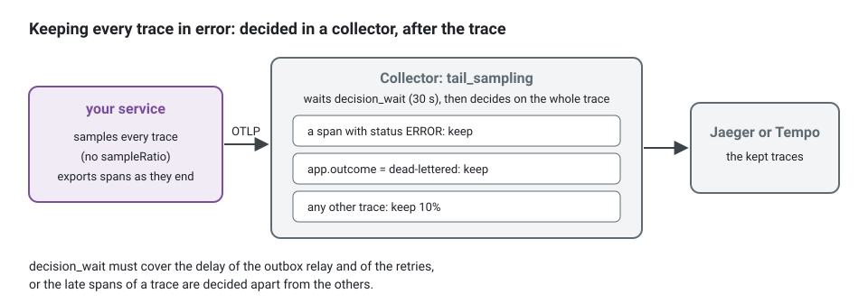

**English** · [Français](observability.fr.md)

# Observability: tracing backends, loggers and error tracking

**Summary.** Three decisions hide under one word. Where traces go (the kit emits OpenTelemetry
traces over OTLP; Jaeger and Grafana Tempo are two backends that receive them), which library
writes logs (a dependency-free JSON logger, pino or winston, all behind the kernel `Logger`
port), and where unexpected failures are collected (Sentry or GlitchTip, behind the
`ErrorReporter` port). The kit wires traces, logs and error reports and ties them by one
correlation id. It ships no metrics exporter: the `Metrics` port is bound to a no-op in a
generated project until you write the adapter.

## What the kit emits, and what you choose


Read the drawing from left to right. Each box on the left is an adapter the platform binds once,
in `src/platform/`; no file of a bounded context knows any of them. Each box on the right is a
tool you choose and run, and the rest of this page compares them. The only arrow you have to
draw yourself is the last one: the kit measures durations and outcomes through the `Metrics`
port, and sends them nowhere until a project binds an exporter.

The concepts (what a span may carry, how the correlation id links a trace, its log lines, its
audit entries and its error report) are on the [observability concept page](../concepts/observability.md).
This page is about the tools on the receiving side.

Third-party facts below were checked on 2026-10-10 against the sources listed at the end.

## Tracing: OpenTelemetry, Jaeger, Grafana Tempo

OpenTelemetry is the instrumentation standard and the wire protocol (OTLP), not a backend.
Choosing it is what keeps the backend replaceable.

| | Jaeger | Grafana Tempo |
|---|---|---|
| What it is | a tracing backend with its own search UI | a tracing backend designed around object storage, read through Grafana |
| Version seen | v2.22.0 (2026-10-06) | v3.1.0 (2026-09-29) |
| Licence | Apache-2.0 | AGPL-3.0 |
| Governance | CNCF graduated | Grafana Labs |
| Ingestion | OTLP natively since v2, which is built on the OpenTelemetry Collector | OTLP, among other protocols |
| Storage | memory for development; a database for production (the supported list was not re-checked for this page) | object storage (S3-compatible, GCS, Azure) or a local disk |
| Query | by service, operation, tags, duration, trace id | TraceQL, plus trace id lookup |
| Fits | one container on a laptop; a team that wants a tracing UI and nothing else | a team already running Grafana, wanting traces next to logs and metrics, with long retention at low storage cost |
| Costs | production storage is a database to run | more moving parts in production; the UI is Grafana |

Selection criteria:

- **What you already run.** With Grafana, Loki and Prometheus in place, Tempo completes the
  set and lets a dashboard pivot from a log line to its trace. Without them, Jaeger is one
  service.
- **Retention and volume.** Object storage is cheap for weeks of traces; an indexed database
  searches faster and costs more to keep.
- **Licence.** AGPL-3.0 matters to some organisations even for a service they only run; check
  your policy.
- **Sampling.** Keeping every trace that ends in error cannot be decided when a trace starts.
  It is tail sampling, done by an OpenTelemetry Collector between the application and either
  backend. The tracing README gives a collector configuration for it.



The application then samples everything (no `sampleRatio`), and the policies live in the
collector, next to the backend they feed. Without a collector, `initTracing({ sampleRatio: 0.2 })`
keeps a fifth of the traces, decided where each trace starts: a trace in error is dropped as
often as any other.

A hosted backend that accepts OTLP is a third option; none was evaluated here.

## Loggers: StdoutLogger, pino, winston

| | `StdoutLogger` (aspects package) | pino (`@ddd-ts-kit/pino`) | winston (`@ddd-ts-kit/winston`) |
|---|---|---|---|
| Dependency | none | pino (10.4.0 on npm, MIT) | winston (3.19.0 on npm, MIT) |
| Output | JSON lines on the standard output | JSON lines, optional pretty format in development, pino transports | JSON lines, winston formats and transports |
| Cost of a line, as measured in the kit's READMEs | not stated | about 3 microseconds | about 7 microseconds, more with each format |
| Buffering | none | none by default; an asynchronous mode buffers 4 KiB and can lose the last lines of a killed process | none in the adapter |
| Redaction of credentials | the keys of the kernel, whatever their case, at the top and one level below; `scrubMessages` removes the message of errors that are not a `DomainError` | compiled by pino | a pass over top-level values |
| Chosen by | `init --logger stdout` (the default) | `init --logger pino` | `init --logger winston` |
| Take it when | JSON on stdout is all you need | volume matters, the framework already speaks pino (Fastify), or you want its transports | the team already runs winston transports and formats (rotating files, syslog, a vendor transport) |

The measurements are those the two READMEs report (Node 24, a child logger, four correlation
fields, three fields, a sink that discards). They compare the two adapters with each other,
on one machine, and are not a benchmark of the libraries.

Selection criteria: volume first (winston's cost is "nothing at a few hundred lines per second
and visible at tens of thousands", in the README's words), then what the team already
operates. The three implement one port and pass one contract suite (`loggerContract`), so the
choice is one line of the composition root and can be revisited:

<!-- checked sample -->
```ts
import { StdoutLogger } from '@ddd-ts-kit/aspects';
import { AsyncLocalStorageExecutionScope, type Logger } from '@ddd-ts-kit/kernel';
import { createPinoLogger } from '@ddd-ts-kit/pino';
import { traceLogFields } from '@ddd-ts-kit/tracing';
import { createWinstonLogger } from '@ddd-ts-kit/winston';

declare const choice: 'stdout' | 'pino' | 'winston';

const executionScope = new AsyncLocalStorageExecutionScope();

// Read at each line: correlation id, origin, actor and tenant of the work in progress,
// then trace_id and span_id of the active span. The same fields whatever the library.
const fields = () => traceLogFields(executionScope);

// Three adapters of one port, held to one contract suite: changing library is this line.
export const logger: Logger = {
  stdout: () => new StdoutLogger({ fields, base: { service: 'scheduling' } }),
  pino: () => createPinoLogger({ service: 'scheduling', fields }),
  winston: () => createWinstonLogger({ service: 'scheduling', fields }),
}[choice]();
```

A generated project writes one of the three in `src/platform/observability/create-logger.ts`,
after the `--logger` flag of `init`; the example application uses pino.

## Error tracking: Sentry, GlitchTip

| | Sentry | GlitchTip |
|---|---|---|
| What it is | error and performance monitoring, hosted or self-hosted | an error tracker that speaks the Sentry protocol |
| Licence | the server is under the Functional Source License (FSL-1.1-Apache-2.0), which is not an open-source licence; the SDKs are MIT | MIT |
| Version seen | server 26.9.0 (2026-09-15); `@sentry/node` 11.6.0 | v6.2.6 (tag of 2026-08-07) |
| Self-hosting | Docker Compose with an install script, single-node services including Kafka; the documentation asks for at least 4 CPU cores and 16 GB of memory plus 16 GB of swap | one service next to PostgreSQL 14 or later; Valkey (or Redis) 7 or later is optional, advised "for faster or larger instances" |
| Scope, as each documentation lists it | issues, traces and spans, logs, session replay, profiling, application metrics, user feedback, dashboards, releases, monitors and alerts (cron and uptime monitors) | error tracking, performance monitoring, uptime monitoring, logs |
| Fits | a team that wants the hosted service or the full feature set | a small team that wants errors collected on its own infrastructure with little to operate |

The self-hosting and scope rows were read on 2026-10-10 from the Sentry self-hosted
documentation (https://develop.sentry.dev/self-hosted/), the Sentry product index
(https://docs.sentry.io/product/), the GlitchTip documentation index
(https://glitchtip.com/documentation) and its installation guide
(https://glitchtip.com/documentation/install). They list what each project documents, not
what was tried here. The GlitchTip pages read do not mention session replay or profiling.

The kit's adapter is the same for both: only the DSN differs.

<!-- checked sample -->
```ts
import { reportProcessFailures } from '@ddd-ts-kit/kernel';
import { initSentry } from '@ddd-ts-kit/sentry';

// What the validated configuration read from SENTRY_DSN, SENTRY_ENVIRONMENT and SENTRY_RELEASE.
declare const config: { readonly dsn: string; readonly environment: string; readonly release: string };

// The DSN of a Sentry project or of a GlitchTip project: the same call, the same reports.
// An empty DSN starts no SDK, and the reporter it answers reports nothing.
export const errors = initSentry({ dsn: config.dsn, environment: config.environment, release: config.release });

// uncaughtException and unhandledRejection: reported as fatal, then exit code 1.
reportProcessFailures(errors);
```

**Not verified:** which of the
fields and envelope types the Sentry SDK sends GlitchTip accepts or ignores. The GlitchTip
pages read do not say, and nothing beyond the adapter's own suite was run against a GlitchTip
server for this page.

## What this kit supports and verified

**Tracing** ([`@ddd-ts-kit/tracing`](../../packages/tracing/README.md)):

- an OpenTelemetry bootstrap for Node that exports traces over OTLP/HTTP to the endpoint named
  by the standard `OTEL_EXPORTER_OTLP_ENDPOINT` variable; without it nothing is exported;
- spans put around the application from outside, once, by the platform
  (`kernelModule({ instrumentation: traceApplication() })`, `tracedPublisher(bus)` for the
  relay): one per use case, repository or adapter call, domain event, publication, consumer
  and job, so that no file of a context imports a tracing library (`tracing/platform-only`
  in the [architecture reference](../ARCHITECTURE.md));
- `traceparent` carried in the event envelope and stored with the outbox record, so a trace
  continues across the relay and the consuming context, and a sampling decision holds for the
  whole trace;
- an attribute allow-list, scrubbing of URL secrets and of exception messages, caps on the
  number of dependency spans under one root;
- a compose example for Jaeger v2 (image `jaegertracing/jaeger:2.22.0`); a generated project
  has Jaeger behind the `observability` profile of its compose file;
- a collector configuration for tail sampling, as an example.

Tempo is not named in the package README. It receives OTLP, so the same exporter should reach
it; this was not run in this repository.

What `tracing/platform-only` refuses, and what to write instead. Instead of opening spans in a
handler:

```ts
// contexts/scheduling/application/book-appointment.handler.ts: refused
import { trace } from '@opentelemetry/api';

const span = trace.getTracer('scheduling').startSpan('book appointment');
span.setAttribute('client.email', command.clientEmail); // personal data on a span
```

write nothing in the handler, and wrap the application once, from the platform. The command
then gets its span, `command BookAppointment`, with its context and its outcome, and its
repositories, events and publications get theirs below it:

<!-- checked sample -->
```ts
import { kernelModule } from '@ddd-ts-kit/di';
import { traceApplication } from '@ddd-ts-kit/tracing';

// src/platform/: one value, and every use case, adapter, event, consumer and job is traced.
export const kernel = kernelModule({ instrumentation: traceApplication() });
```

If debugging needs the value, that is a log line with an identifier, written by an adapter,
with the retention of your logs.

**Logs**: `StdoutLogger` is what a generated project binds by default, with the trace ids and
the correlation fields of the execution scope on every line. `init --logger pino` and
`init --logger winston` generate `src/platform/observability/create-logger.ts` on
`@ddd-ts-kit/pino` (written against pino 10) or `@ddd-ts-kit/winston` (written against
winston 3.19) instead, with the same fields. For NestJS, each README shows a bridge of a few
lines for the framework's own messages and ships none.

**Error reports** ([`@ddd-ts-kit/sentry`](../../packages/sentry/README.md)): written against
`@sentry/node` 11, with five capture points attached from outside (buses, HTTP 5xx, jobs,
dead-lettered events, process failures), one report per failure, a `DomainError` never
reported as an incident. The Sentry SDK is initialised so that it registers no tracer provider
and no second instrumentation: the tracing package owns OpenTelemetry, and the report carries
the trace id of the active span. `init --errors sentry` generates the wiring
(`src/platform/observability/errors.ts`, configured by `SENTRY_DSN`) and a compose service running
GlitchTip 6.2.6 behind the `errors` profile, for development.

**Metrics**: the kernel defines the `Metrics` port (counters, histograms, gauges, with label
values from a small closed set) and the aspects package records durations and outcomes through
it. `openTelemetryMetrics()` of `@ddd-ts-kit/tracing` is its adapter on the OpenTelemetry
metrics API, and a generated project binds it in `create-metrics.ts`: `initTracing` registers
the meter provider with an OTLP/HTTP reader when `OTEL_EXPORTER_OTLP_ENDPOINT` is set, and the
metrics leave with the spans. The tracing bootstrap turns off runtime and host metrics.

What is measured: `use_case_duration_ms` and `use_case_total` from `metricsMiddleware` on the
buses (labels `message`, `kind` and `outcome`, plus `error_code` on the counter),
`dependency_call_duration_ms` and `dependency_call_total` from the `timed` aspect on the
adapters it wraps (the prefix is its `name` option), `cache_errors_total` from `RedisCache`,
the gauges `outbox_pending`, `outbox_failed` and `outbox_dead` from an `OutboxRelay` given the
metrics, and `jobs_waiting`, `jobs_running` and `jobs_dead` per `queue` from a `QueueWorker`
given them. A project that Prometheus scrapes instead registers its own meter provider before
the adapter takes its meter; this sample compiles against the packages of the workspace, and was
not run against a backend for this page:

<!-- checked sample -->
```ts
import type { Metrics } from '@ddd-ts-kit/kernel';
import { metrics as openTelemetry } from '@opentelemetry/api';
import { PrometheusExporter } from '@opentelemetry/exporter-prometheus';
import { MeterProvider } from '@opentelemetry/sdk-metrics';
import { openTelemetryMetrics } from '@ddd-ts-kit/tracing';

// src/platform/observability/create-metrics.ts: /metrics on port 9464, for Prometheus to scrape.
openTelemetry.setGlobalMeterProvider(new MeterProvider({ readers: [new PrometheusExporter({ port: 9464 })] }));

export const metrics: Metrics = openTelemetryMetrics({ meterName: 'scheduling' });
```

Label values come from a small closed set (`MetricLabels` of the kernel): never an identifier,
never user input, so the number of series stays bounded.

### The four, wired in the platform

The sample condenses what the example application spreads over
`src/platform/composition/lay-foundations.ts` (the pino logger and the metrics), `src/platform/composition/platform.module.ts`
(the bindings) and `src/platform/observability/errors.ts` (Sentry). A generated project has
`lay-foundations.ts` in both families, `platform.module.ts` on tsyringe (a platform wired by hand
assembles the same foundations in `create-platform.ts`) and `errors.ts` only with `--errors sentry`. The tracing bootstrap
(`initTracing` of `@ddd-ts-kit/tracing/node`) is not in it: it lives in its own module,
`src/platform/observability/tracing.ts`, imported first by `main.ts`, because the instrumentations patch
`http` and the drivers when they are loaded.

<!-- checked sample -->
```ts
import { StdoutLogger } from '@ddd-ts-kit/aspects';
import { kernelModule } from '@ddd-ts-kit/di';
import { AsyncLocalStorageExecutionScope } from '@ddd-ts-kit/kernel';
import { initSentry } from '@ddd-ts-kit/sentry';
import { openTelemetryMetrics, traceApplication, traceLogFields } from '@ddd-ts-kit/tracing';

declare const sentryDsn: string;

const executionScope = new AsyncLocalStorageExecutionScope();

export const kernel = kernelModule({
  // One scope for the buses, the logger and the spans: the correlation id is the same in all three.
  executionScope,
  logger: new StdoutLogger({ fields: () => traceLogFields(executionScope) }),
  // On the meter provider initTracing registered: exported by OTLP with the spans.
  metrics: openTelemetryMetrics({ meterName: 'scheduling' }),
  // Buses and jobs report through it; app.stop() flushes it.
  errorReporter: initSentry({ dsn: sentryDsn }),
  // Spans around every use case, adapter, event, consumer and job.
  instrumentation: traceApplication(),
});
```

Three places stay outside of the kernel module and take one wrapper each, as the
[tracing README](../../packages/tracing/README.md) shows: the HTTP pipeline
(`around: tracedRoutes()`, with `onError: reportHttpErrors(errors)` for the 5xx answers), the
publisher of the outbox relay (`tracedPublisher(bus)`), and the dead letters of a broker
(`DeadLetterReports`).

### Following one action across the four


The tools are separate; the ids are not. An error report in GlitchTip carries the trace id of
the span that was active when it failed (`contexts.trace`): paste it in Jaeger and the whole
request opens, the consumers of its events included. Search the log pipeline for that
`trace_id`, or for its `correlationId`, and the log lines of every bounded context the action
reached come back. The audit entries of the action share its `correlationId`. This is why the
choice of each tool is independent of the others: what ties them is written by the kit, not by
the tools.

## Limits and when not to use it

- **Traces only through OpenTelemetry.** No metrics export and no log export over OTLP are
  provided. Logs leave on the standard output for your log pipeline; metrics need an adapter of
  the `Metrics` port that you write.
- **Logging bridges of the auto-instrumentations are off** by default: log lines carry trace
  ids because the logger reads them, not because OpenTelemetry injects them.
- **Spans carry names and codes, never data.** A business value wanted on a trace is refused
  by design. If debugging needs payloads, that is a log decision with its own retention, not a
  span attribute.
- **Per-root span caps** (25 per name, 200 in total by default) mean a loop over a thousand
  repository calls is not fully traced; a counter on the root span says how many were dropped.
- **Head sampling in the application is a ratio.** Error-biased sampling needs a collector.
- **Asynchronous pino can lose its last lines** when the process is killed without a handler.
- **No Nest logger bridge is shipped.**
- **Not verified in this repository:** Tempo as a backend, Sentry's hosted service at volume,
  GlitchTip's handling of every field the adapter sends. The comparison rows of Sentry and
  GlitchTip above repeat each project's documentation.
- **When not to add a tracing backend at all:** a single process with few dependencies is
  often served by correlation ids in structured logs. Start the SDK later; the code does not
  change, since nothing in the inner layers knows about tracing.

## Recommendation by situation

| Situation | Choice |
|---|---|
| Local development, first weeks | Jaeger from the generated compose profile, `StdoutLogger`, no error tracker |
| Small team, self-hosted, little to operate | Jaeger, `StdoutLogger` or pino, GlitchTip |
| Grafana stack already in place | Tempo behind a collector, pino or `StdoutLogger` to Loki, metrics through an adapter you write |
| High log volume, or Fastify | pino, synchronous unless a profile says otherwise |
| Existing winston transports to keep | winston |
| Full product analytics on errors, hosted | Sentry |
| Several contexts extracted as services | the same setup in each; a collector with tail sampling becomes worth its cost |

## Sources

- This repository: `packages/tracing/README.md`, `packages/pino/README.md`,
  `packages/winston/README.md`, `packages/sentry/README.md`, `packages/aspects/README.md`,
  `packages/kernel/README.md` (Logger, Metrics, ErrorReporter), `packages/cli/README.md`.
- OpenTelemetry documentation: https://opentelemetry.io/docs/ ; OTLP specification:
  https://opentelemetry.io/docs/specs/otlp/ ; W3C Trace Context:
  https://www.w3.org/TR/trace-context/
- Jaeger: https://www.jaegertracing.io/docs/ and https://github.com/jaegertracing/jaeger/releases
- Grafana Tempo: https://grafana.com/docs/tempo/latest/ and
  https://github.com/grafana/tempo/releases (licence file: AGPL-3.0).
- OpenTelemetry Collector tail sampling processor:
  https://github.com/open-telemetry/opentelemetry-collector-contrib/tree/main/processor/tailsamplingprocessor
- pino: https://getpino.io ; winston: https://github.com/winstonjs/winston
- Sentry licence: https://github.com/getsentry/sentry/blob/master/LICENSE.md ; Node SDK:
  https://docs.sentry.io/platforms/javascript/guides/node/
- GlitchTip: https://glitchtip.com/documentation , https://glitchtip.com/documentation/install
  (read on 2026-10-10) and https://gitlab.com/glitchtip/glitchtip-backend (licence MIT, tags).
- Sentry self-hosted: https://develop.sentry.dev/self-hosted/ ; product index:
  https://docs.sentry.io/product/ (read on 2026-10-10).
- CNCF maturity levels read from the CNCF landscape data (https://github.com/cncf/landscape).

## See also

- [Observability (concept)](../concepts/observability.md)
- [The actor and the execution scope](../concepts/actor-and-execution-scope.md): where the
  correlation id comes from
- [Audit trail](../concepts/audit-trail.md)
- [Resilience](../concepts/resilience.md)
- [HTTP frameworks](http-frameworks.md)
- [Message brokers](message-brokers.md)
