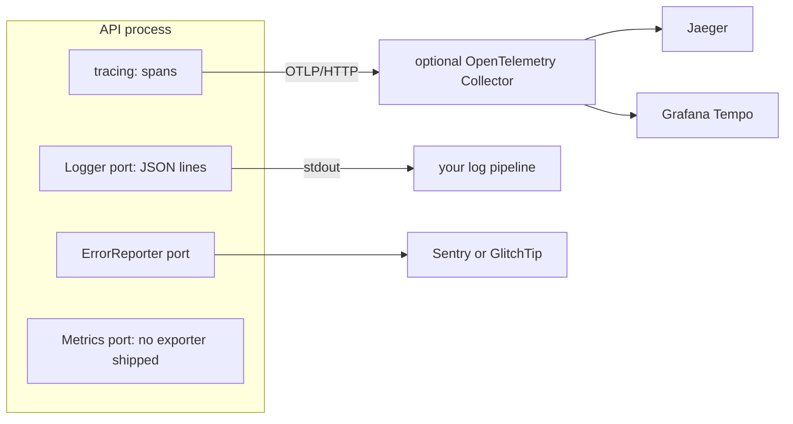

# Observability: tracing backends, loggers and error tracking

**Summary.** Three decisions hide under one word. Where traces go (the kit emits OpenTelemetry
traces over OTLP; Jaeger and Grafana Tempo are two backends that receive them), which library
writes logs (a dependency-free JSON logger, pino or winston, all behind the kernel `Logger`
port), and where unexpected failures are collected (Sentry or GlitchTip, behind the
`ErrorReporter` port). The kit wires traces, logs and error reports and ties them by one
correlation id. It ships no metrics exporter: the `Metrics` port is bound to a no-op in a
generated project until you write the adapter.

## What the kit emits, and what you choose

The concepts (what a span may carry, how the correlation id links a trace, its log lines, its
audit entries and its error report) are on the [observability concept page](../concepts/observability.md).
This page is about the tools on the receiving side.

Third-party facts below were checked on 2026-10-10 against the sources listed at the end.

## Tracing: OpenTelemetry, Jaeger, Grafana Tempo

OpenTelemetry is the instrumentation standard and the wire protocol (OTLP), not a backend.
Choosing it is what keeps the backend replaceable.

| | Jaeger | Grafana Tempo |
|---|---|---|
| What it is | a tracing backend with its own search UI | a tracing backend designed around object storage, read through Grafana |
| Version seen | v2.22.0 (2026-10-06) | v3.1.0 (2026-09-29) |
| Licence | Apache-2.0 | AGPL-3.0 |
| Governance | CNCF graduated | Grafana Labs |
| Ingestion | OTLP natively since v2, which is built on the OpenTelemetry Collector | OTLP, among other protocols |
| Storage | memory for development; a database for production (the supported list was not re-checked for this page) | object storage (S3-compatible, GCS, Azure) or a local disk |
| Query | by service, operation, tags, duration, trace id | TraceQL, plus trace id lookup |
| Fits | one container on a laptop; a team that wants a tracing UI and nothing else | a team already running Grafana, wanting traces next to logs and metrics, with long retention at low storage cost |
| Costs | production storage is a database to run | more moving parts in production; the UI is Grafana |

Selection criteria:

- **What you already run.** With Grafana, Loki and Prometheus in place, Tempo completes the
  set and lets a dashboard pivot from a log line to its trace. Without them, Jaeger is one
  service.
- **Retention and volume.** Object storage is cheap for weeks of traces; an indexed database
  searches faster and costs more to keep.
- **Licence.** AGPL-3.0 matters to some organisations even for a service they only run; check
  your policy.
- **Sampling.** Keeping every trace that ends in error cannot be decided when a trace starts.
  It is tail sampling, done by an OpenTelemetry Collector between the application and either
  backend. The tracing README gives a collector configuration for it.

A hosted backend that accepts OTLP is a third option; none was evaluated here.

## Loggers: StdoutLogger, pino, winston

| | `StdoutLogger` (aspects package) | pino (`@ddd-ts-kit/pino`) | winston (`@ddd-ts-kit/winston`) |
|---|---|---|---|
| Dependency | none | pino (10.4.0 on npm, MIT) | winston (3.19.0 on npm, MIT) |
| Output | JSON lines on the standard output | JSON lines, optional pretty format in development, pino transports | JSON lines, winston formats and transports |
| Cost of a line, as measured in the kit's READMEs | not stated | about 3 microseconds | about 7 microseconds, more with each format |
| Buffering | none | none by default; an asynchronous mode buffers 4 KiB and can lose the last lines of a killed process | none in the adapter |
| Redaction of credentials | not stated in the README read for this page | compiled by pino | a pass over top-level values |
| Take it when | JSON on stdout is all you need | volume matters, the framework already speaks pino (Fastify), or you want its transports | the team already runs winston transports and formats (rotating files, syslog, a vendor transport) |

The measurements are those the two READMEs report (Node 24, a child logger, four correlation
fields, three fields, a sink that discards). They compare the two adapters with each other,
on one machine, and are not a benchmark of the libraries.

Selection criteria: volume first (winston's cost is "nothing at a few hundred lines per second
and visible at tens of thousands", in the README's words), then what the team already
operates. The three implement one port and pass one contract suite (`loggerContract`), so the
choice is one line of the composition root and can be revisited.

## Error tracking: Sentry, GlitchTip

| | Sentry | GlitchTip |
|---|---|---|
| What it is | error and performance monitoring, hosted or self-hosted | an error tracker that speaks the Sentry protocol |
| Licence | the server is under the Functional Source License (FSL-1.1-Apache-2.0), which is not an open-source licence; the SDKs are MIT | MIT |
| Version seen | server 26.9.0 (2026-09-15); `@sentry/node` 11.6.0 | v6.2.6 (tag of 2026-08-07) |
| Self-hosting | a multi-service installation | one service next to PostgreSQL and, as its documentation recommends, Valkey |
| Scope | errors, performance, session replay, profiling and more | errors, uptime checks, basic performance data |
| Fits | a team that wants the hosted service or the full feature set | a small team that wants errors collected on its own infrastructure with little to operate |

The kit's adapter is the same for both: only the DSN differs. GlitchTip implements a subset of
what the Sentry SDK can send; which Sentry features it lacks today was not verified for this
page beyond the kit's README stating that the adapter works with both.

## What this kit supports and verified

**Tracing** ([`@ddd-ts-kit/tracing`](../../packages/tracing/README.md)):

- an OpenTelemetry bootstrap for Node that exports traces over OTLP/HTTP to the endpoint named
  by the standard `OTEL_EXPORTER_OTLP_ENDPOINT` variable; without it nothing is exported;
- spans added at the composition root for use cases, adapters, events and jobs, so that no file
  of `domain/` or `application/` imports a tracing library (`layer/domain-purity`,
  `layer/application-inward` in the [architecture reference](../ARCHITECTURE.md));
- `traceparent` carried in the event envelope and stored with the outbox record, so a trace
  continues across the relay and the consuming context, and a sampling decision holds for the
  whole trace;
- an attribute allow-list, scrubbing of URL secrets and of exception messages, caps on the
  number of dependency spans under one root;
- a compose example for Jaeger v2 (image `jaegertracing/jaeger:2.22.0`); a generated project
  has Jaeger behind the `observability` profile of its compose file;
- a collector configuration for tail sampling, as an example.

Tempo is not named in the package README. It receives OTLP, so the same exporter should reach
it; this was not run in this repository.

**Logs**: `StdoutLogger` is what a generated project binds, with the trace ids and the
correlation fields of the execution scope on every line. `@ddd-ts-kit/pino` (written against
pino 10) and `@ddd-ts-kit/winston` (written against winston 3.19) are bound by hand in the
composition root; the CLI README names no `init` option for them. For NestJS, each README
shows a bridge of a few lines for the framework's own messages and ships none.

**Error reports** ([`@ddd-ts-kit/sentry`](../../packages/sentry/README.md)): written against
`@sentry/node` 11, with five capture points attached from outside (buses, HTTP 5xx, jobs,
dead-lettered events, process failures), one report per failure, a `DomainError` never
reported as an incident. The Sentry SDK is initialised so that it registers no tracer provider
and no second instrumentation: the tracing package owns OpenTelemetry, and the report carries
the trace id of the active span. A compose example runs GlitchTip 6 for development.

**Metrics**: the kernel defines the `Metrics` port (counters, histograms, gauges, with label
values from a small closed set) and the aspects package records durations and outcomes through
it. A generated project binds a `NoopMetrics` behind a `TODO(platform)`. A search of the
repository finds no Prometheus or OpenTelemetry metrics exporter, and the tracing bootstrap
turns off runtime and host metrics.

## Limits and when not to use it

- **Traces only through OpenTelemetry.** No metrics export and no log export over OTLP are
  provided. Logs leave on the standard output for your log pipeline; metrics need an adapter of
  the `Metrics` port that you write.
- **Logging bridges of the auto-instrumentations are off** by default: log lines carry trace
  ids because the logger reads them, not because OpenTelemetry injects them.
- **Spans carry names and codes, never data.** A business value wanted on a trace is refused
  by design. If debugging needs payloads, that is a log decision with its own retention, not a
  span attribute.
- **Per-root span caps** (25 per name, 200 in total by default) mean a loop over a thousand
  repository calls is not fully traced; a counter on the root span says how many were dropped.
- **Head sampling in the application is a ratio.** Error-biased sampling needs a collector.
- **Asynchronous pino can lose its last lines** when the process is killed without a handler.
- **No Nest logger bridge is shipped.**
- **Not verified in this repository:** Tempo as a backend, Sentry's hosted service at volume,
  GlitchTip's handling of every field the adapter sends.
- **When not to add a tracing backend at all:** a single process with few dependencies is
  often served by correlation ids in structured logs. Start the SDK later; the code does not
  change, since nothing in the inner layers knows about tracing.

## Recommendation by situation

| Situation | Choice |
|---|---|
| Local development, first weeks | Jaeger from the generated compose profile, `StdoutLogger`, no error tracker |
| Small team, self-hosted, little to operate | Jaeger, `StdoutLogger` or pino, GlitchTip |
| Grafana stack already in place | Tempo behind a collector, pino or `StdoutLogger` to Loki, metrics through an adapter you write |
| High log volume, or Fastify | pino, synchronous unless a profile says otherwise |
| Existing winston transports to keep | winston |
| Full product analytics on errors, hosted | Sentry |
| Several contexts extracted as services | the same setup in each; a collector with tail sampling becomes worth its cost |

## Sources

- This repository: `packages/tracing/README.md`, `packages/pino/README.md`,
  `packages/winston/README.md`, `packages/sentry/README.md`, `packages/aspects/README.md`,
  `packages/kernel/README.md` (Logger, Metrics, ErrorReporter), `packages/cli/README.md`.
- OpenTelemetry documentation: https://opentelemetry.io/docs/ ; OTLP specification:
  https://opentelemetry.io/docs/specs/otlp/ ; W3C Trace Context:
  https://www.w3.org/TR/trace-context/
- Jaeger: https://www.jaegertracing.io/docs/ and https://github.com/jaegertracing/jaeger/releases
- Grafana Tempo: https://grafana.com/docs/tempo/latest/ and
  https://github.com/grafana/tempo/releases (licence file: AGPL-3.0).
- OpenTelemetry Collector tail sampling processor:
  https://github.com/open-telemetry/opentelemetry-collector-contrib/tree/main/processor/tailsamplingprocessor
- pino: https://getpino.io ; winston: https://github.com/winstonjs/winston
- Sentry licence: https://github.com/getsentry/sentry/blob/master/LICENSE.md ; Node SDK:
  https://docs.sentry.io/platforms/javascript/guides/node/
- GlitchTip: https://glitchtip.com/documentation and
  https://gitlab.com/glitchtip/glitchtip-backend (licence MIT, tags).
- CNCF maturity levels read from the CNCF landscape data (https://github.com/cncf/landscape).

## See also

- [Observability (concept)](../concepts/observability.md)
- [The actor and the execution scope](../concepts/actor-and-execution-scope.md): where the
  correlation id comes from
- [Audit trail](../concepts/audit-trail.md)
- [Resilience](../concepts/resilience.md)
- [HTTP frameworks](http-frameworks.md)
- [Message brokers](message-brokers.md)
