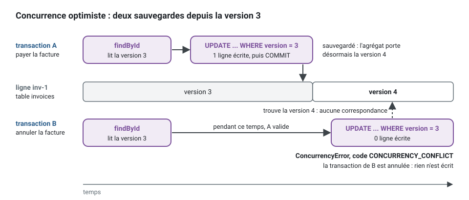

[English](persistence.md) · **Français**
<!-- translation-of: persistence.md sha256:247938ed9ea6201d -->

# Persistance : Drizzle, Knex, Prisma, TypeORM, et quelle base de données

**Résumé.** Dans cette architecture, un ORM est un détail d'implémentation de
`infrastructure/persistence/` : les lignes n'en sortent jamais, un *mapper* les transforme en
agrégats, et les transactions appartiennent à l'application par le port `UnitOfWork`. Le kit
livre les trois mêmes pièces pour quatre bibliothèques (une unité de travail avec une transaction
ambiante, un registre d'outbox, un registre des événements traités), toutes tenues aux mêmes
suites de contrat. Ce qui diffère, c'est la façon dont chaque bibliothèque gère les transactions,
les migrations, la sûreté des types et le SQL brut, et jusqu'où chaque adaptateur a réellement
été testé : PostgreSQL est couvert par les suites automatisées pour les quatre, MySQL 8 et SQLite
ont été essayés à la main une fois pour trois d'entre elles, et rien d'autre n'a été essayé du
tout.

## Ce que l'application demande à la persistance

Les exigences viennent du modèle, pas de la bibliothèque
([agrégats](../concepts/aggregates.fr.md), [outbox transactionnelle](../concepts/transactional-outbox.fr.md)) :

| Besoin | Pourquoi | Conséquence pour l'outil |
|---|---|---|
| charger et sauvegarder un agrégat entier | `Appointment` est une frontière de cohérence | un *mapper*, pas une « entité » qui serait à la fois ligne et modèle |
| une transaction par commande, ouverte par un *middleware* du bus | le gestionnaire (handler) ne la voit jamais | une transaction ambiante que le *repository* récupère |
| la concurrence optimiste sur `version` | deux reports d'un même rendez-vous | « mettre à jour là où la version correspond », compter les lignes |
| la ligne d'outbox dans la même transaction | `scheduling.appointment.booked` existe si et seulement si la réservation existe | le registre d'outbox rejoint l'unité de travail |
| la marque d'événement traité avec la modification du consommateur | `notification` ne traite qu'une fois un événement livré de nouveau | idem |
| une contrainte que la base de données impose | pas de double réservation, quoi que croie n'importe quel processus | du SQL brut dans une migration (plus bas) |
| un schéma par contexte, aucune jointure entre contextes | `context/extractable` dans [ARCHITECTURE.md](../ARCHITECTURE.fr.md) | des tables qualifiées par leur schéma |

L'invariant « pas de double réservation » montre ce que « SQL brut » veut dire en pratique. Sur
PostgreSQL, c'est une contrainte d'exclusion sur le calendrier et le créneau qu'occupe un
rendez-vous actif. Aucune des quatre bibliothèques ne l'exprime dans son langage de schéma, pour
autant que cette page ait pu l'établir : elle s'écrit à la main dans une migration, et
l'adaptateur du *repository* fait correspondre sa violation au refus `SLOT_TAKEN` du domaine
(`AppointmentError.slotTaken`). L'application d'exemple la déclare dans
`create-scheduling-tables.schema.ts`, après `create extension if not exists btree_gist` :

```sql
alter table scheduling.appointments add constraint appointments_slot_held_once
  exclude using gist (calendar_id with =, tstzrange(starts_at, held_until, '[)') with &&)
  where (status in ('requested', 'booked'));
```

Deux transactions qui lisent toutes deux un créneau libre ne peuvent pas toutes deux l'écrire :
la seconde échoue sur la contrainte (SQLSTATE `23P01`), quoi que chacune ait cru au moment de sa
vérification.

## Les pièces, en une commande

Quatre pièces font le travail, et seule la dernière connaît la bibliothèque : le port
*repository* du domaine, l'unité de travail que le bus ouvre autour de chaque commande,
l'adaptateur du *repository* avec son *mapper*, et les registres de la messagerie (outbox,
événements traités). La séquence ci-dessous suit une commande, « payer une facture », à travers
elles. Chaque instruction s'exécute dans la transaction qu'a ouverte l'unité de travail, et le
gestionnaire n'y touche jamais.


1. `unitOfWorkMiddleware` du noyau enveloppe chaque commande du bus dans `unitOfWork.run`.
   L'unité de travail Knex ouvre `knex.transaction` et la garde dans un `AsyncLocalStorage`.
2. L'adaptateur demande à `KnexContext.executor()` son point d'accès aux requêtes : à
   l'intérieur d'un `run`, c'est la transaction, en dehors, le *pool*. Aucune méthode ne prend une
   transaction en paramètre.
3. Le *mapper* transforme la ligne en `Invoice` et inversement. L'agrégat porte la `version` à
   laquelle il a été lu ; l'`UPDATE` ne correspond qu'à cette version.
4. Quand le gestionnaire a rendu la main, les événements du domaine qu'ont enregistrés les
   sauvegardes sont distribués, toujours dans la transaction. Le gestionnaire de `InvoicePaid`
   publie un événement d'intégration ; l'`OutboxPublisher` de `@ddd-ts-kit/events` se contente de
   l'ajouter au registre d'outbox, qui écrit par le même exécuteur. Un relais l'envoie plus tard
   au *broker*.
5. La validation (commit) écrit ensemble la facture et la ligne d'outbox ; tout échec annule les
   deux (rollback).

### Un adaptateur de repository

Le port est déclaré dans le domaine, l'adaptateur et son *mapper* dans
`infrastructure/persistence/`. L'exemple les réunit dans un seul module pour qu'il compile seul ;
dans un projet, chaque partie est un fichier à part, nommé dans les commentaires. Il suit le
`KnexAppointmentRepository` de l'application d'exemple.

<!-- checked sample -->
```ts
import type { Knex } from 'knex';
import { AggregateRoot, ConceptError, type DomainEvent, Repository } from '@ddd-ts-kit/kernel';
import { type KnexContext, insertIgnoringConflict, optimisticUpdate } from '@ddd-ts-kit/knex';

// domain/events/invoice-paid.event.ts : le domaine ne connaît ni ligne, ni SQL, ni bibliothèque.
export class InvoicePaid implements DomainEvent {
  static readonly eventName = 'billing.invoice.paid';

  readonly name = InvoicePaid.eventName;

  constructor(
    readonly aggregateId: string,
    readonly occurredAt: Date,
  ) {}
}

// domain/errors/invoice.error.ts
export class InvoiceError extends ConceptError {
  static alreadyPaid(invoiceId: string) {
    return InvoiceError.refusal('INVOICE_ALREADY_PAID', `Invoice ${invoiceId} is already paid.`, { invoiceId });
  }
}

// domain/aggregates/invoice.aggregate.ts
export class Invoice extends AggregateRoot {
  private constructor(
    id: string,
    readonly amountInCents: number,
    private paidOn: Date | null,
  ) {
    super(id);
  }

  static issue(id: string, amountInCents: number): Invoice {
    return new Invoice(id, amountInCents, null);
  }

  /** Reconstruit une facture stockée : utilisé par le mapper seulement. */
  static rehydrate(id: string, amountInCents: number, paidOn: Date | null): Invoice {
    return new Invoice(id, amountInCents, paidOn);
  }

  get paidAt(): Date | null {
    return this.paidOn;
  }

  pay(on: Date): void {
    if (this.paidOn !== null) {
      throw InvoiceError.alreadyPaid(this.id);
    }

    this.paidOn = on;
    this.record(new InvoicePaid(this.id, on));
  }
}

// domain/repositories/invoice.repository.ts : le port, findById et save viennent de Repository.
export abstract class InvoiceRepository extends Repository<Invoice> {}

// infrastructure/persistence/invoice-row.schema.ts : la ligne ne sort jamais de l'infrastructure.
type InvoiceRow = {
  readonly id: string;
  readonly amount_in_cents: number;
  readonly paid_at: Date | null;
  readonly version: number;
};

// infrastructure/persistence/invoice.mapper.ts
const InvoiceMapper = {
  toDomain(row: InvoiceRow): Invoice {
    const loaded = Invoice.rehydrate(row.id, row.amount_in_cents, row.paid_at);

    loaded.version = row.version;

    return loaded;
  },

  toRow(saved: Invoice, version: number): InvoiceRow {
    return { id: saved.id, amount_in_cents: saved.amountInCents, paid_at: saved.paidAt, version };
  },
};

// infrastructure/persistence/knex-invoice.repository.ts
export class KnexInvoiceRepository implements InvoiceRepository {
  constructor(private readonly database: KnexContext) {}

  async findById(id: string): Promise<Invoice | undefined> {
    const row = await invoicesOf(this.database).where({ id }).first();

    return row === undefined ? undefined : InvoiceMapper.toDomain(row);
  }

  /** Aucune ligne écrite signifie qu'une autre transaction l'a sauvegardée d'abord : optimisticUpdate lève ConcurrencyError. */
  async save(saved: Invoice): Promise<void> {
    await optimisticUpdate(saved, async ({ expected, next }) => {
      const row = InvoiceMapper.toRow(saved, next);

      if (expected === 0) {
        const inserted = await insertIgnoringConflict(this.database.executor(), invoicesOf(this.database), {
          row,
          conflict: 'id',
        });

        return inserted ? 1 : 0;
      }

      return invoicesOf(this.database).where({ id: saved.id, version: expected }).update(row);
    });
  }
}

/** La transaction de l'unité de travail en cours, ou le pool en dehors d'une unité de travail. */
function invoicesOf(database: KnexContext): Knex.QueryBuilder<InvoiceRow, InvoiceRow[]> {
  return database.executor()<InvoiceRow, InvoiceRow[]>('invoices').withSchema('billing');
}
```

Ce que contient chaque partie :

| Partie | Contient | Ne contient jamais |
|---|---|---|
| `Invoice` | les règles, l'état, les événements qu'il enregistre, et `version` (venue d'`AggregateRoot`) | un nom de colonne, une requête SQL |
| `InvoiceRepository` | ce que l'application peut demander : `findById`, `save`, les recherches que vous ajoutez | un type de la bibliothèque |
| `InvoiceMapper` | la traduction entre la ligne et l'agrégat, dans les deux sens | une requête SQL, une règle |
| `KnexInvoiceRepository` | les requêtes SQL, le schéma, la vérification de concurrence, la correspondance entre une erreur de la base de données et un refus | la transaction elle-même (`executor()` la donne) |

### Au lieu de donner des lignes au gestionnaire

Le gestionnaire parle à l'agrégat par le port ; il ne voit jamais une ligne, un *query builder*
ni une transaction.

```ts
// Au lieu de : le gestionnaire modifie une ligne, et la règle « une facture se paie une fois » ne vit nulle part.
const row = await db('billing.invoices').where({ id }).first();
await db('billing.invoices').where({ id }).update({ paid_at: new Date() });

// Écrivez : le gestionnaire charge l'agrégat, lui demande de payer (il refuse un second paiement), le sauvegarde.
const invoice = await invoices.findById(id);
if (invoice === undefined) throw new NotFoundError(`Invoice ${id} does not exist.`); // NotFoundError : @ddd-ts-kit/kernel
invoice.pay(clock.now());
await invoices.save(invoice);
```

### Composer l'unité de travail

Un seul objet répond aux deux ports : le bus fait passer les commandes par `UnitOfWork`, les
adaptateurs et les registres interrogent la base par `KnexContext`. L'application d'exemple le
compose de cette façon dans `platform/database/persistence-over.ts`.

<!-- checked sample -->
```ts
import knex from 'knex';
import { unitOfWorkMiddleware } from '@ddd-ts-kit/kernel';
import { createKnexUnitOfWork, KnexOutboxStore, KnexProcessedEventStore } from '@ddd-ts-kit/knex';

const db = knex({ client: 'pg', connection: 'postgres://localhost:5432/app' });

// Lié à UnitOfWork (pour le bus) et à KnexContext (pour les adaptateurs).
export const unitOfWork = createKnexUnitOfWork(db);

// Les registres écrivent par lui aussi : leurs lignes sont validées ou annulées avec la commande.
export const outbox = new KnexOutboxStore(unitOfWork, { schema: 'messaging' });
export const processedEvents = new KnexProcessedEventStore(unitOfWork, { schema: 'messaging' });

// Le bus exécute chaque commande dans unitOfWork.run ; une requête s'exécute hors de toute transaction.
export const transactional = unitOfWorkMiddleware(unitOfWork);

await unitOfWork.run(async () => {
  // Ici, unitOfWork.executor() est la transaction et unitOfWork.inTransaction() vaut true.
  await unitOfWork.run(async () => {
    // Un run imbriqué rejoint celui qui l'entoure : une seule validation, ou une seule annulation, pour les deux.
  });
});
```

Les mêmes pièces, sous le nom que leur donne chaque *package* :

| | Knex | Drizzle (`@ddd-ts-kit/drizzle/postgres`) | Prisma | TypeORM |
|---|---|---|---|---|
| Unité de travail | `createKnexUnitOfWork` | `createDrizzleUnitOfWork` | `createPrismaUnitOfWork` | `createTypeOrmUnitOfWork` |
| Ce par quoi les adaptateurs interrogent la base | `KnexContext` | `DrizzleContext` | `PrismaContext` | `TypeOrmContext` |
| Registre d'outbox | `KnexOutboxStore` | `DrizzleOutboxStore` | `PrismaOutboxStore` | `TypeOrmOutboxStore` |
| Registre des événements traités | `KnexProcessedEventStore` | `DrizzleProcessedEventStore` | `PrismaProcessedEventStore` | `TypeOrmProcessedEventStore` |

### La concurrence optimiste, et un seul contrat pour le fake et l'adaptateur

Deux commandes peuvent charger la même facture à la même version. La première sauvegarde
correspond à la version et la fait avancer ; la seconde ne correspond à aucune ligne, et
`optimisticUpdate` lève `ConcurrencyError` (code `CONCURRENCY_CONFLICT`), ce qui annule sa
transaction.



Le *fake* (double de test) des *specs* unitaires et l'adaptateur réel tiennent cette promesse de
la même façon : le même `repositoryContract` s'exécute contre les deux, le *fake* en mémoire et
l'adaptateur sur PGlite ou sur un vrai serveur.

<!-- checked sample -->
```ts
import { randomUUID } from 'node:crypto';
import { afterEach, beforeEach, describe, expect, it } from 'vitest';
import { AggregateRoot, type Repository } from '@ddd-ts-kit/kernel';
import { InMemoryRepository } from '@ddd-ts-kit/testing';
import { repositoryContract } from '@ddd-ts-kit/testing/contracts';

// Tirés de l'exemple ci-dessus, et de la base de données de test du projet.
declare class Invoice extends AggregateRoot {
  static issue(id: string, amountInCents: number): Invoice;
  static rehydrate(id: string, amountInCents: number, paidOn: Date | null): Invoice;
  readonly amountInCents: number;
  readonly paidAt: Date | null;
  pay(on: Date): void;
}
declare function knexInvoiceRepositoryOnAnEmptyDatabase(): Promise<Repository<Invoice>>;

const runner = { describe, it, expect, beforeEach, afterEach };

const expectations = {
  createAggregate: () => Invoice.issue(randomUUID(), 12_000),
  mutate: (invoice: Invoice) => invoice.pay(new Date('2026-10-01T09:00:00.000Z')),
  idOf: (invoice: Invoice) => invoice.id,
  stateOf: (invoice: Invoice) => ({ amountInCents: invoice.amountInCents, paidAt: invoice.paidAt }),
};

// Le fake qu'utilisent les specs unitaires : une Map qui vérifie la version comme l'adaptateur.
repositoryContract<Invoice>(runner, {
  ...expectations,
  name: 'InMemoryRepository<Invoice>',
  createRepository: () =>
    new InMemoryRepository<Invoice>({
      clone: (invoice) => Invoice.rehydrate(invoice.id, invoice.amountInCents, invoice.paidAt),
    }),
});

// L'adaptateur, sur une base de données vidée avant chaque test.
repositoryContract<Invoice>(runner, {
  ...expectations,
  name: 'KnexInvoiceRepository',
  createRepository: knexInvoiceRepositoryOnAnEmptyDatabase,
});
```

Le contrat vérifie qu'un agrégat sauvegardé est retrouvé avec son état, que deux agrégats restent
séparés, que les sauvegardes suivantes sont enregistrées, qu'une modification non sauvegardée ne
l'est pas, et qu'une sauvegarde par-dessus une version qu'elle n'a pas lue est refusée avec
`CONCURRENCY_CONFLICT`.

## Comparaison

Versions vérifiées le 2026-10-10 sur le registre npm.

| | Drizzle | Knex | Prisma | TypeORM |
|---|---|---|---|---|
| Ce que c'est | constructeur de SQL typé, schéma en TypeScript | constructeur de requêtes SQL | client généré à partir d'un fichier de schéma | ORM, *data mapper* ou *active record* |
| Version | 0.45.4 stable ; une *release candidate* 1.0 est publiée (étiquette `rc`) | 3.3.0 (juin 2026) | 7.10.0 est la dernière 7.x ; l'étiquette npm `latest` désignait 8.0.0-rc.22 le jour de la vérification | 1.1.2 (0.3.x conservée sous `legacy`) |
| Licence | Apache-2.0 | MIT | Apache-2.0 | MIT |
| Téléchargements hebdomadaires | environ 27 millions | environ 6 millions | environ 19 millions | environ 5 millions |
| Sûreté des types des requêtes | déduite des définitions de tables | faible : les types sont des annotations que vous écrivez | par le client généré | par les définitions d'entités ; les chaînes du *query builder* ne sont pas vérifiées |
| Transactions | *callback* ; *savepoints* | *callback* ou manuelle ; *savepoints* | transactions interactives, bornées dans le temps (5 s par défaut) et qui tiennent une connexion | `QueryRunner` ou *callback* |
| Verrouillage de lignes | dans le constructeur de requêtes | dans le constructeur de requêtes (`forUpdate().skipLocked()`) | aucun dans le client : SQL brut | dans le *query builder* |
| Migrations | générées par drizzle-kit à partir de la différence de schéma, fichiers SQL | JavaScript écrit à la main, *up* et *down* | générées à partir de la différence de schéma, fichiers SQL | générées à partir des entités, ou écrites à la main |
| SQL brut | gabarit `sql`, objets de table interpolés | de premier plan : c'est un constructeur de requêtes | `$queryRaw`, fichiers SQL typés | `query()` |
| Poids à l'exécution | la bibliothèque seule | la bibliothèque seule | client généré plus un adaptateur de pilote | la bibliothèque, `reflect-metadata` avec des entités décorées |
| Décorateurs | aucun | aucun | aucun | facultatifs : le kit utilise `EntitySchema`, sans décorateur |

Lire le tableau pour cette architecture : les fonctions d'ORM qui comptent le moins sont celles
que les ORM mettent le plus en avant. Relations paresseuses, *identity maps*, cascades et
*active records* ne servent à rien quand un agrégat se charge en entier et se transpose à la
main ; ce qui compte, c'est un SQL honnête, une transaction qui peut être rendue ambiante, des
verrous de ligne pour le relais de l'outbox et des migrations que l'on peut lire.

## Critères de choix

1. **Connaissances de l'équipe et schéma existant.** Une application en service sur l'une des
   quatre la garde : le domaine n'en a que faire.
2. **La part de SQL brut que vous prévoyez.** Contraintes, index partiels, modèles de lecture
   avec fonctions de fenêtrage : Knex et Drizzle restent les plus proches du SQL.
3. **Sûreté des types des modèles de lecture.** Les gestionnaires de requêtes peuvent
   contourner les agrégats et lire des projections par un port ; c'est là que les requêtes typées
   rapportent.
4. **Durée des transactions.** Les transactions interactives de Prisma sont bornées dans le temps
   par défaut.
5. **Ce que le kit génère pour elle.** Le cloisonnement par *tenant* et le journal d'audit SQL ne
   sont pas disponibles pour les quatre (plus bas).
6. **Fraîcheur de la version.** Préférez la ligne stable courante ; le jour de la vérification,
   l'étiquette npm `latest` de Prisma portait une *release candidate* : épinglez la version que
   vous avez testée.

## Ce que ce kit prend en charge et a vérifié

Commun aux quatre *packages* ([drizzle](../../packages/drizzle/README.fr.md),
[knex](../../packages/knex/README.fr.md), [prisma](../../packages/prisma/README.fr.md),
[typeorm](../../packages/typeorm/README.fr.md)) : une unité de travail dont les *repositories* ne
voient jamais la transaction, où un `run` imbriqué rejoint la transaction qui l'entoure et où les
événements du domaine sont distribués à la fin du `run` le plus extérieur, avant sa validation ;
un registre d'outbox dont `claimBatch` prend à bail les lignes échues, si bien que plusieurs
relais se partagent le travail et que les lignes d'un relais mort reviennent ; un registre des
événements traités dont la marque est validée avec les effets du gestionnaire ; les colonnes
d'audit standard et `tenant_id` ; les pages par curseur et par décalage. Les unités de travail
passent `unitOfWorkContract`, les registres `outboxStoreContract` et
`processedEventStoreContract` ; vos *repositories* sont tenus à `repositoryContract` à côté de
leur *fake* en mémoire. La livraison par l'outbox se fait au moins une fois et sans ordre.

L'isolation des *tenants* est inégale entre les quatre : Knex livre les quatre stratégies
(tables partagées, sécurité au niveau des lignes, schéma par *tenant*, base de données par
*tenant*), Drizzle les deux premières, Prisma et TypeORM aucune au-delà de la colonne
`tenant_id`. Le tableau, et le `tenantIsolationContract` que passe chaque stratégie, sont dans
[Multitenance](../concepts/multitenancy.fr.md#lisolation--quatre-stratégies).

Pour le côté lecture, chacune des quatre livre aussi un traducteur des critères du noyau vers sa
requête (`criteriaToDrizzle`, `criteriaToKnex`, `criteriaToPrisma`, `criteriaToTypeOrm`) et un
registre de modèles de lecture pour les projections, tenus à `criteriaContract` et
`readModelStoreContract` sur PostgreSQL ; ni l'un ni l'autre n'a été essayé sur MySQL ou SQLite.
La CLI ne les génère pas encore : voir la
[proposition sur le côté lecture](../proposals/read-side.fr.md) pour l'état de chaque partie.

Pour les agrégats en *event sourcing*, chacune des quatre fait tourner l'*event store*
PostgreSQL du noyau (`createKnexEventSourcing`, `createDrizzleEventSourcing`,
`createPrismaEventSourcing`, `createTypeOrmEventSourcing`) : les flux, les *snapshots*, les
points de reprise des abonnements et les clés des personnes concernées, avec les tables déclarées
comme chaque ORM migre (`createEventStoreTables`, `eventStoreTables`, les modèles de
`prisma/event-store.postgresql.prisma`, `eventStoreEntities`). Chacun est tenu à
`eventStoreContract` et à `eventStoreUnitOfWorkContract` sur PGlite dans l'exécution unitaire ;
knex, Prisma et TypeORM les ont aussi passés sur PostgreSQL 17, à la main. Non fourni sur MySQL
ni sur SQLite. Quand le choisir : [Event sourcing, par agrégat](../concepts/event-sourcing.fr.md).

### Par base de données

| | Drizzle | Knex | Prisma | TypeORM |
|---|---|---|---|---|
| PostgreSQL | automatisé : suites de contrat sur PGlite (dans le processus) ; fonctionne avec les pilotes node-postgres, postgres-js, PGlite, Neon | automatisé sur PGlite par le protocole réseau, et sur un vrai serveur quand une URL est donnée (dernière exécution : PostgreSQL 18) : contrats, annulation, unité de travail imbriquée, prises en charge concurrentes | comme Knex, par `@prisma/adapter-pg`, les deux stratégies de prise en charge | comme Knex |
| MySQL 8 | non fourni : le *package* est pour PostgreSQL seulement | à la main, une fois, contre 8.4 : contrats d'outbox et des événements traités, annulation d'`append` | à la main, une fois, contre 8.4 par `@prisma/adapter-mariadb` | à la main, une fois, contre 8.4 |
| SQLite | non fourni | à la main, une fois (`better-sqlite3`) ; pas de `SKIP LOCKED`, pas de schémas | à la main, une fois, contrat d'outbox seulement ; le registre des événements traités a besoin d'un délégué sur mesure | à la main, une fois ; pas de `SKIP LOCKED`, pas de schémas |
| MariaDB, CockroachDB, SQL Server, Oracle | non fourni | jamais essayé | CockroachDB, SQL Server jamais essayés | jamais essayé |
| MongoDB | non fourni | sans objet | jamais essayé | jamais essayé |
| Version de la bibliothèque testée | non indiquée dans le README | non indiquée | Prisma 7.10 ; la plage de pairs admet la 6, sur laquelle rien n'a été essayé | TypeORM 1.1 ; la plage de pairs admet la 0.3, sur laquelle rien n'a été essayé |

« À la main, une fois » est la formule des README eux-mêmes : ces suites ne sont pas dans la CI,
si bien qu'une régression sur MySQL ou SQLite ne serait pas détectée par le kit.

### Ce qu'ajoutent le générateur et les autres packages

D'après [`packages/cli/README.fr.md`](../../packages/cli/README.fr.md) et
[`packages/audit/README.fr.md`](../../packages/audit/README.fr.md) :

- La persistance générée des quatre ORM est écrite pour PostgreSQL. `custom` démarre sur des
  adaptateurs en mémoire tenus aux suites de contrat, que vous remplacez.
- `generate repository --tenant-scoped`, et chaque *repository* d'un projet initialisé avec
  `--tenancy shared-table`, est implémenté pour Drizzle et Knex ; avec un autre ORM, l'adaptateur
  ordinaire est écrit et une note dit quoi ajouter, et `init` refuse la stratégie.
- Le journal d'audit SQL existe pour Knex et Drizzle, sur PostgreSQL seulement. Avec Prisma,
  TypeORM, `custom` ou sans ORM, le projet généré démarre sur un journal en mémoire derrière un
  `TODO(platform)`.
- Les *specs* rapides des adaptateurs s'exécutent sur PGlite ; Docker Compose fournit le vrai
  serveur.

## PostgreSQL face aux autres

| Base de données | Place dans ce kit | Ce que vous perdez ou devez vérifier |
|---|---|---|
| PostgreSQL | la base par défaut, et la seule des suites automatisées | rien |
| MySQL 8 | registres essayés à la main une fois (Knex, Prisma, TypeORM) | pas de persistance générée, pas de journal d'audit SQL ; `DATETIME` sans fuseau horaire sous Knex ; pas de `SKIP LOCKED` sur la 5.7 ; un schéma par contexte devient une base de données ou un préfixe de table |
| SQLite | registres essayés à la main une fois | pas de schémas, prise en charge par comparaison et échange (compare-and-set), un seul écrivain : pour les tests et les outils, pas pour plusieurs instances |
| MongoDB, autres | pas d'adaptateur | `stack.orm: custom` : votre propre unité de travail (son `run` construit sur `withinUnitOfWork` du noyau), votre registre d'outbox et votre registre des événements traités, chacun passant les suites de contrat ; sans transactions multidocuments, la garantie de l'outbox n'est pas disponible |

`stack.database` accepte `postgres`, `mysql`, `sqlite`, `mongodb` et `none`
([CONFIG.md](../CONFIG.fr.md)). `init` refuse toute autre valeur que `postgres` avec l'un des
quatre ORM : les autres valeurs vont avec `--orm custom`, où elles enregistrent un choix et ne
sélectionnent aucun *package*. `init --database mongodb` est accepté avec `--orm custom` bien que
la ligne d'usage de `--help` ne le mentionne pas.

## Limites, et quand ne pas l'utiliser

- **Ordre.** Aucun registre n'ordonne les événements, pas même par agrégat ; voir
  [livraison et idempotence](../concepts/delivery-and-idempotency.fr.md).
- **Prisma.** Pas de verrouillage de lignes dans le client (un `SELECT ... FOR UPDATE SKIP LOCKED`
  brut, ou la prise en charge par comparaison et échange) ; `claim` doit être choisi par vous, parce
  que le client ne révèle pas sa base de données ; les transactions interactives expirent ; pas
  d'index partiel dans le langage de schéma ; `stats()` fait trois requêtes SQL.
- **TypeORM.** Un `EntitySchema` est statique : les types de colonnes suivent le `dialect` que
  vous passez. `synchronize: true` est réservé aux tests.
- **Knex.** Le contenu (payload) est sérialisé avec `JSON.stringify` ; MariaDB le rendrait sous
  forme de texte.
- **Drizzle.** Ne nommez jamais une table dans du SQL brut : interpolez l'objet de table pour que
  la qualification par le schéma suive (*skill* persistence). Le *package* d'audit note que
  Drizzle imprime les paramètres d'une instruction échouée dans son message d'erreur : journalisez
  le code, pas le message.
- **Toutes.** Les migrations vont seulement vers l'avant et restent compatibles avec la version
  encore en service (étendre, migrer, contracter). Le kit fournit les définitions de tables pour
  l'outillage de migration propre à chaque outil ; il n'exécute aucune migration à lui.

Quand ne pas utiliser d'adaptateur d'ORM du tout : un contexte sans état (un pur traducteur), ou
un modèle de lecture mieux servi par un moteur de recherche ou un cache, derrière un port à lui.

## Migrations : noms, fusions et ordre

Plusieurs personnes ajoutent des migrations en même temps, sur un contexte ou sur plusieurs.
Chaque migration qu'écrit un projet généré est nommée `<timestamp>_<what-it-does>`, et
`npm run db:generate` refuse de s'exécuter sans la description : deux branches n'écrivent jamais
le même fichier.

| Outil | `db:generate` | Écrit | Une migration fusionnée plus ancienne qu'une migration déjà appliquée |
|---|---|---|---|
| drizzle-kit 0.31 | `drizzle-kit generate --name` (`migrations.prefix: 'timestamp'` dans `drizzle.config.ts`) | `migrations/20261012093000_add-invoices.sql`, son *snapshot* `meta/20261012093000_snapshot.json`, une entrée de `meta/_journal.json` | **ignorée sans un mot** : le migrateur applique les entrées plus récentes que la dernière enregistrée |
| knex 3 | `knex migrate:make` (le gabarit module ES de knex, fixé dans `knexfile.js`) | `migrations/20261012093000_add-invoices.js` | appliquée : knex exécute chaque fichier qu'il n'a pas enregistré |
| Prisma 7 | `prisma migrate dev --create-only --name` | `prisma/migrations/20261012093000_add_invoices/migration.sql` (Prisma transforme `-` en `_`) | appliquée par `migrate deploy`, qui exécute chaque migration qu'il n'a pas enregistrée (d'après sa documentation ; non mesuré ici) |
| TypeORM 1.1 | `typeorm migration:generate -d <data source>`, à qui l'on donne le chemin : `npm run db:generate migrations/add-invoices` | `migrations/1791829645467-add-invoices.ts` (des millisecondes, et un `-` : TypeORM fixe les deux) | appliquée : TypeORM exécute chaque migration qu'il n'a pas enregistrée |

La commande prend la description après le script : `npm run db:generate add-invoices`
(`npm run db:generate -- audit-guard --custom` pour une migration drizzle-kit écrite à la main).
La première migration knex qu'écrit `init` est `00000000000000_initial.js` : elle se trie avant
tout horodatage ; un projet créé avant la 0.5 garde son `0001_initial.js`, puisqu'une migration
appliquée n'est jamais renommée.

**Mesuré avec drizzle-kit 0.31.11 et drizzle-orm 0.45.4 (2026-10-12)**, deux copies d'un même
projet générant chacune une migration, comme le feraient deux branches :

- avec l'ancien réglage par défaut (`prefix: 'index'`), les deux écrivent `0001_<random words>.sql`
  et `meta/0001_snapshot.json` : le *snapshot* entre en conflit comme un fichier ajouté deux fois ;
- avec `prefix: 'timestamp'`, les fichiers et les *snapshots* n'entrent plus en collision, mais
  `meta/_journal.json` reste en conflit (chaque branche ajoute une entrée au même endroit), et une
  fois la fusion faite à la main, deux *snapshots* nomment le même parent : `drizzle-kit check`
  sort avec le code 1 et `drizzle-kit generate` affiche la collision et n'écrit rien (avec le code
  de sortie 0) ;
- pire, une base de données qui a appliqué d'abord la migration la plus récente (l'autre branche a
  été fusionnée et déployée avant) ignore définitivement la plus ancienne : le migrateur de
  drizzle-orm n'applique que les entrées dont le `when` est plus récent que le dernier qu'il a
  enregistré. Mesuré sur PGlite : après `add-payments`, puis la fusion d'`add-invoices` générée
  trois secondes avant elle, la base de données avait `accounts, payments` et pas `invoices`, sans
  erreur.


La réponse du kit est la règle `persistence/migration-history` de `ddd-ts-kit check` (donc de
`npm run check:arch`, de la garde du *plugin* et du *pipeline*) : chaque migration commence par
le nombre qui l'ordonne et deux migrations n'en partagent jamais un ; sous drizzle-kit, le
journal et les fichiers `.sql` concordent, les entrées gardent l'ordre dans lequel elles ont été
générées, et chaque *snapshot* suit celui qui le précède. Sur la fusion mesurée, elle signale le
*snapshot* divergent ; sur un journal fusionné dans l'ordre des branches, elle signale aussi
l'entrée hors d'ordre.

**Après une fusion ou un rebase qui a apporté une migration de la branche principale**, tant que
la vôtre n'est pas encore fusionnée :

1. prenez les migrations de la branche principale telles qu'elles sont (fichiers `.sql`,
   *snapshots*, journal) ;
2. supprimez la vôtre : son fichier `.sql`, son *snapshot* sous `meta/` et son entrée du journal
   (drizzle-kit), ou son fichier ou son répertoire (les autres outils) ;
3. relancez `npm run db:generate <what-it-does>` : elle est générée au-dessus de la branche
   principale, avec un horodatage plus récent ;
4. `npm run check:arch` ne signale rien, et la branche est fusionnée avant qu'une autre migration
   n'arrive, sinon les étapes sont répétées.

Une migration déjà fusionnée sur la branche principale n'est jamais modifiée ni régénérée : une
correction est une nouvelle migration.

**Écarté : un dossier de migrations par contexte.** drizzle-kit peut faire tourner une
configuration par contexte (son propre `schema`, son `out` et sa table de migrations) : cela
fonctionnerait, mais cela résout la mauvaise moitié du problème. Deux personnes sur un même
contexte entrent toujours en collision, les tables de la plateforme (outbox, journal d'audit)
n'appartiennent à aucun contexte, et `db:migrate` deviendrait une liste ordonnée de commandes à
garder en phase avec la configuration. L'horodatage, la règle et la procédure ci-dessus couvrent
aussi bien un dossier unique qu'une équipe qui travaille sur un seul contexte. Un contexte extrait
en service emporte alors ses tables avec lui (`generate service`).

## Recommandation selon la situation

| Situation | Choix |
|---|---|
| Nouveau projet | Drizzle sur PostgreSQL : le choix par défaut, des requêtes typées, des migrations SQL, le cloisonnement par *tenant* et le journal d'audit SQL générés |
| Équipe tournée vers le SQL, beaucoup de requêtes écrites à la main, ou une base de code Knex existante | Knex sur PostgreSQL : la « *stack* de premier rang » éprouvée de bout en bout par la CLI l'utilise |
| Schéma Prisma existant | Prisma 7, les limites ci-dessus étant comprises ; prévoyez vous-même le registre du journal d'audit |
| Application TypeORM existante | TypeORM 1.x avec `EntitySchema` ; prévoyez vous-même le registre du journal d'audit |
| MySQL imposé | Knex ou TypeORM, et faites tourner les suites de contrat contre votre serveur dans votre propre CI |
| Un autre système de stockage | `custom`, derrière les mêmes ports, avec un enregistrement de décision |

## Sources

- Documentation de Drizzle ORM : https://orm.drizzle.team/docs/overview ; configuration de drizzle-kit, `migrations.prefix` : https://orm.drizzle.team/docs/drizzle-config-file
- drizzle-kit 0.31.11 (`prepareMigrationMetadata`) et drizzle-orm 0.45.4 (`PgDialect.migrate`), knex 3.3.0 (`MigrationGenerator`, `getNewMigrations`), Prisma 7.10.0 (`migrate dev --name`), TypeORM 1.1.2 (`MigrationGenerateCommand`, `MigrationExecutor`) : lus dans leur code publié le 2026-10-12.
- Documentation de Knex : https://knexjs.org/guide/
- Documentation de Prisma, transactions : https://www.prisma.io/docs/orm/prisma-client/queries/transactions
- Documentation de Prisma, migrations en développement et en production : https://www.prisma.io/docs/orm/prisma-migrate/workflows/development-and-production
- Documentation de TypeORM : https://typeorm.io
- Documentation de PostgreSQL, `SELECT ... FOR UPDATE SKIP LOCKED` et contraintes d'exclusion :
  https://www.postgresql.org/docs/current/sql-select.html ,
  https://www.postgresql.org/docs/current/ddl-constraints.html
- PGlite : https://pglite.dev
- Registre npm : versions, étiquettes de distribution, licences et téléchargements hebdomadaires lus le 2026-10-10.
- Martin Fowler, Patterns of Enterprise Application Architecture, Addison-Wesley, 2002 : Data
  Mapper, Unit of Work, Repository, Optimistic Offline Lock.
- Non vérifié : qu'aucune version des quatre bibliothèques ne puisse déclarer une contrainte
  d'exclusion PostgreSQL dans son langage de schéma ; la date de Drizzle 1.0 stable.

## Voir aussi

- [Agrégats](../concepts/aggregates.fr.md)
- [Les briques du domaine](../concepts/domain-building-blocks.fr.md)
- [Outbox transactionnelle](../concepts/transactional-outbox.fr.md)
- [Livraison et idempotence](../concepts/delivery-and-idempotency.fr.md)
- [Brokers de messages](message-brokers.fr.md)
- [Cache et coordination](cache-and-coordination.fr.md)
- [Configuration](../CONFIG.fr.md)
