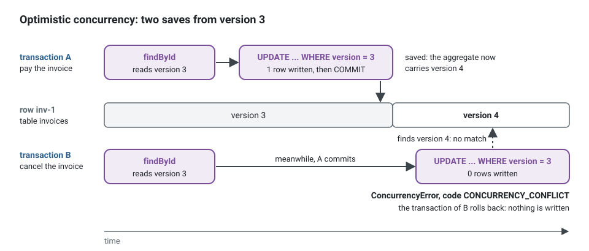

**English** · [Français](persistence.fr.md)

# Persistence: Drizzle, Knex, Prisma, TypeORM, and which database

**Summary.** In this architecture an ORM is an implementation detail of
`infrastructure/persistence/`: rows never leave it, a mapper turns them into aggregates, and
transactions belong to the application through the `UnitOfWork` port. The kit ships the same
three pieces for four libraries (a unit of work with an ambient transaction, an outbox store, a
processed-event store), all held to the same contract suites. What differs is how each library
handles transactions, migrations, type safety and raw SQL, and how far each adapter was
actually tested: PostgreSQL is covered by the automated suites for all four, SQLite by those
of the Knex stores, MySQL 8 and SQLite were otherwise run by hand once for three of them, and
nothing else was run at all.

## What the application asks of persistence

The requirements come from the model, not from the library
([aggregates](../concepts/aggregates.md), [transactional outbox](../concepts/transactional-outbox.md)):

| Need | Why | Consequence for the tool |
|---|---|---|
| load and save one whole aggregate | `Appointment` is a consistency boundary | a mapper, not an "entity" that is both row and model |
| one transaction per command, opened by a bus middleware | the handler never sees it | an ambient transaction the repository picks up |
| optimistic concurrency on `version` | two reschedules of one appointment | "update where version matches", count the rows |
| the outbox row in the same transaction | `scheduling.appointment.booked` exists if and only if the booking does | the outbox store joins the unit of work |
| the processed-event mark with the consumer's change | `notification` handles a redelivery once | same |
| a constraint the database enforces | no double booking, whatever any process believes | raw SQL in a migration (below) |
| one schema per context, no cross-context join | `context/extractable` in [ARCHITECTURE.md](../ARCHITECTURE.md) | schema-qualified tables |

The no-double-booking invariant shows what "raw SQL" means in practice. On PostgreSQL it is an
exclusion constraint over the calendar and the time an active appointment holds. None of the
four libraries expresses it in its schema language as far as this page could establish: it is
written by hand in a migration, and the repository adapter maps the violation to the refusal
`SLOT_TAKEN` of the domain (`AppointmentError.slotTaken`). The example application declares it
in `create-scheduling-tables.schema.ts`, after `create extension if not exists btree_gist`:

```sql
alter table scheduling.appointments add constraint appointments_slot_held_once
  exclude using gist (calendar_id with =, tstzrange(starts_at, held_until, '[)') with &&)
  where (status in ('requested', 'booked'));
```

Two transactions that both read a free slot cannot both write it: the second one fails on the
constraint (SQLSTATE `23P01`), whatever each believed when it checked.

## The pieces, in one command

Four pieces do the work, and only the last one knows the library: the repository port of the
domain, the unit of work the bus opens around each command, the repository adapter with its
mapper, and the stores of the messaging (outbox, processed events). The sequence below follows
one command, "pay an invoice", through them. Every statement runs in the transaction the unit of
work opened, and the handler never touches it.


1. `unitOfWorkMiddleware` of the kernel wraps every command of the bus in `unitOfWork.run`. The
   Knex unit of work opens `knex.transaction` and keeps it in an `AsyncLocalStorage`.
2. The adapter asks `KnexContext.executor()` for its query handle: inside a run it is the
   transaction, outside it the pool. No method takes a transaction as a parameter.
3. The mapper turns the row into an `Invoice` and back. The aggregate carries the `version` it
   was read at; the `UPDATE` only matches that version.
4. When the handler has returned, the domain events the saves recorded are dispatched, still
   inside the transaction. The handler of `InvoicePaid` publishes an integration event; the
   `OutboxPublisher` of `@ddd-ts-kit/events` only appends it to the outbox store, which writes
   through the same executor. A relay sends it to the broker later.
5. The commit writes the invoice and the outbox row together; any failure rolls both back.

### A repository adapter

The port is declared in the domain, the adapter and its mapper in
`infrastructure/persistence/`. The sample puts them in one module so that it compiles alone; in
a project each part is a file of its own, named in the comments. It follows `KnexAppointmentRepository` of the example
application.

<!-- checked sample -->
```ts
import type { Knex } from 'knex';
import { AggregateRoot, ConceptError, NamedDomainEvent, Repository } from '@ddd-ts-kit/kernel';
import { type KnexContext, insertIgnoringConflict, optimisticUpdate } from '@ddd-ts-kit/knex';

// domain/events/invoice-paid.event.ts: the domain knows no row, no SQL, no library.
export class InvoicePaid extends NamedDomainEvent('billing.invoice.paid') {
  constructor(
    readonly aggregateId: string,
    readonly occurredAt: Date,
  ) {
    super();
  }
}

// domain/errors/invoice.error.ts
export class InvoiceError extends ConceptError {
  static alreadyPaid(invoiceId: string) {
    return InvoiceError.refusal('INVOICE_ALREADY_PAID', `Invoice ${invoiceId} is already paid.`, { invoiceId });
  }
}

// domain/aggregates/invoice.aggregate.ts
export class Invoice extends AggregateRoot {
  private constructor(
    id: string,
    readonly amountInCents: number,
    private paidOn: Date | null,
  ) {
    super(id);
  }

  static issue(id: string, amountInCents: number): Invoice {
    return new Invoice(id, amountInCents, null);
  }

  /** Rebuilds a stored invoice: used by the mapper only. */
  static rehydrate(id: string, amountInCents: number, paidOn: Date | null): Invoice {
    return new Invoice(id, amountInCents, paidOn);
  }

  get paidAt(): Date | null {
    return this.paidOn;
  }

  pay(on: Date): void {
    if (this.paidOn !== null) {
      throw InvoiceError.alreadyPaid(this.id);
    }

    this.paidOn = on;
    this.record(new InvoicePaid(this.id, on));
  }
}

// domain/repositories/invoice.repository.ts: the port, findById and save come from Repository.
export abstract class InvoiceRepository extends Repository<Invoice> {}

// infrastructure/persistence/invoice-row.schema.ts: the row never leaves infrastructure.
type InvoiceRow = {
  readonly id: string;
  readonly amount_in_cents: number;
  readonly paid_at: Date | null;
  readonly version: number;
};

// infrastructure/persistence/invoice.mapper.ts
const InvoiceMapper = {
  toDomain(row: InvoiceRow): Invoice {
    const loaded = Invoice.rehydrate(row.id, row.amount_in_cents, row.paid_at);

    loaded.version = row.version;

    return loaded;
  },

  toRow(saved: Invoice, version: number): InvoiceRow {
    return { id: saved.id, amount_in_cents: saved.amountInCents, paid_at: saved.paidAt, version };
  },
};

// infrastructure/persistence/knex-invoice.repository.ts
export class KnexInvoiceRepository implements InvoiceRepository {
  constructor(private readonly database: KnexContext) {}

  async findById(id: string): Promise<Invoice | undefined> {
    const row = await invoicesOf(this.database).where({ id }).first();

    return row === undefined ? undefined : InvoiceMapper.toDomain(row);
  }

  /** No row written means another transaction saved it first: optimisticUpdate throws ConcurrencyError. */
  async save(saved: Invoice): Promise<void> {
    await optimisticUpdate(saved, async ({ expected, next }) => {
      const row = InvoiceMapper.toRow(saved, next);

      if (expected === 0) {
        const inserted = await insertIgnoringConflict(this.database.executor(), invoicesOf(this.database), {
          row,
          conflict: 'id',
        });

        return inserted ? 1 : 0;
      }

      return invoicesOf(this.database).where({ id: saved.id, version: expected }).update(row);
    });
  }
}

/** The transaction of the running unit of work, or the pool outside one. */
function invoicesOf(database: KnexContext): Knex.QueryBuilder<InvoiceRow, InvoiceRow[]> {
  return database.executor()<InvoiceRow, InvoiceRow[]>('invoices').withSchema('billing');
}
```

What each part holds:

| Part | Holds | Never holds |
|---|---|---|
| `Invoice` | the rules, the state, the events it records, and `version` (from `AggregateRoot`) | a column name, a query |
| `InvoiceRepository` | what the application may ask: `findById`, `save`, the finders you add | a type of the library |
| `InvoiceMapper` | the translation between the row and the aggregate, both ways | a query, a rule |
| `KnexInvoiceRepository` | the queries, the schema, the concurrency check, the mapping of a database error to a refusal | the transaction itself (`executor()` gives it) |

### Instead of handing rows to the handler

The handler talks to the aggregate through the port; it never sees a row, a query builder or a
transaction.

```ts
// Instead of: the handler edits a row, and the rule "an invoice is paid once" lives nowhere.
const row = await db('billing.invoices').where({ id }).first();
await db('billing.invoices').where({ id }).update({ paid_at: new Date() });

// Write: the handler loads the aggregate, asks it (it refuses a second payment), saves it.
const invoice = await invoices.findById(id);
if (invoice === undefined) throw new NotFoundError(`Invoice ${id} does not exist.`); // NotFoundError: @ddd-ts-kit/kernel
invoice.pay(clock.now());
await invoices.save(invoice);
```

### Composing the unit of work

One object answers both ports: the bus runs commands through `UnitOfWork`, the adapters and the
stores query through `KnexContext`. The example application composes it this way in
`platform/database/persistence-over.ts`.

<!-- checked sample -->
```ts
import knex from 'knex';
import { unitOfWorkMiddleware } from '@ddd-ts-kit/kernel';
import { createKnexUnitOfWork, KnexOutboxStore, KnexProcessedEventStore } from '@ddd-ts-kit/knex';

const db = knex({ client: 'pg', connection: 'postgres://localhost:5432/app' });

// Bound to UnitOfWork (for the bus) and to KnexContext (for the adapters).
export const unitOfWork = createKnexUnitOfWork(db);

// The stores write through it too: their rows commit or roll back with the command.
export const outbox = new KnexOutboxStore(unitOfWork, { schema: 'messaging' });
export const processedEvents = new KnexProcessedEventStore(unitOfWork, { schema: 'messaging' });

// The bus runs every command in unitOfWork.run; a query runs outside any transaction.
export const transactional = unitOfWorkMiddleware(unitOfWork);

await unitOfWork.run(async () => {
  // Here unitOfWork.executor() is the transaction and unitOfWork.inTransaction() is true.
  await unitOfWork.run(async () => {
    // A nested run joins the outer one: one commit, or one rollback, for both.
  });
});
```

The same pieces, under the name each package gives them:

| | Knex | Drizzle (`@ddd-ts-kit/drizzle/postgres`) | Prisma | TypeORM |
|---|---|---|---|---|
| Unit of work | `createKnexUnitOfWork` | `createDrizzleUnitOfWork` | `createPrismaUnitOfWork` | `createTypeOrmUnitOfWork` |
| What adapters query through | `KnexContext` | `DrizzleContext` | `PrismaContext` | `TypeOrmContext` |
| Outbox store | `KnexOutboxStore` | `DrizzleOutboxStore` | `PrismaOutboxStore` | `TypeOrmOutboxStore` |
| Processed-event store | `KnexProcessedEventStore` | `DrizzleProcessedEventStore` | `PrismaProcessedEventStore` | `TypeOrmProcessedEventStore` |

### Optimistic concurrency, and one contract for the fake and the adapter

Two commands may load the same invoice at the same version. The first save matches the
version and moves it on; the second matches no row, and `optimisticUpdate` throws
`ConcurrencyError` (code `CONCURRENCY_CONFLICT`), which rolls its transaction back.



The fake of the unit specs and the real adapter keep that promise alike: the same
`repositoryContract` runs against both, the fake in memory and the adapter on PGlite or a real
server.

<!-- checked sample -->
```ts
import { randomUUID } from 'node:crypto';
import { afterEach, beforeEach, describe, expect, it } from 'vitest';
import { AggregateRoot, type Repository } from '@ddd-ts-kit/kernel';
import { InMemoryRepository } from '@ddd-ts-kit/testing';
import { repositoryContract } from '@ddd-ts-kit/testing/contracts';

// From the sample above, and from the test database of the project.
declare class Invoice extends AggregateRoot {
  static issue(id: string, amountInCents: number): Invoice;
  static rehydrate(id: string, amountInCents: number, paidOn: Date | null): Invoice;
  readonly amountInCents: number;
  readonly paidAt: Date | null;
  pay(on: Date): void;
}
declare function knexInvoiceRepositoryOnAnEmptyDatabase(): Promise<Repository<Invoice>>;

const runner = { describe, it, expect, beforeEach, afterEach };

const expectations = {
  createAggregate: () => Invoice.issue(randomUUID(), 12_000),
  mutate: (invoice: Invoice) => invoice.pay(new Date('2026-10-01T09:00:00.000Z')),
  idOf: (invoice: Invoice) => invoice.id,
  stateOf: (invoice: Invoice) => ({ amountInCents: invoice.amountInCents, paidAt: invoice.paidAt }),
};

// The fake the unit specs use: a Map that checks the version like the adapter.
repositoryContract<Invoice>(runner, {
  ...expectations,
  name: 'InMemoryRepository<Invoice>',
  createRepository: () =>
    new InMemoryRepository<Invoice>({
      clone: (invoice) => Invoice.rehydrate(invoice.id, invoice.amountInCents, invoice.paidAt),
    }),
});

// The adapter, on a database emptied before each test.
repositoryContract<Invoice>(runner, {
  ...expectations,
  name: 'KnexInvoiceRepository',
  createRepository: knexInvoiceRepositoryOnAnEmptyDatabase,
});
```

The contract checks that a saved aggregate is found with its state, that two aggregates stay
apart, that later saves are stored, that a change not saved is not, and that a save over a
version it did not read is refused with `CONCURRENCY_CONFLICT`.

## Comparison

Versions checked on 2026-10-10 against the npm registry.

| | Drizzle | Knex | Prisma | TypeORM |
|---|---|---|---|---|
| What it is | typed SQL builder with schema in TypeScript | SQL query builder | client generated from a schema file | ORM, data mapper or active record |
| Version | 0.45.4 stable; a 1.0 release candidate is published (`rc` tag) | 3.3.0 (June 2026) | 7.10.0 is the last 7.x; the npm `latest` tag pointed at 8.0.0-rc.22 on the day of the check | 1.1.2 (0.3.x kept under `legacy`) |
| Licence | Apache-2.0 | MIT | Apache-2.0 | MIT |
| Weekly downloads | about 27 million | about 6 million | about 19 million | about 5 million |
| Type safety of queries | inferred from the table definitions | weak: types are annotations you write | from the generated client | from entity definitions; query builder strings are unchecked |
| Transactions | callback; savepoints | callback or manual; savepoints | interactive transactions, bounded in time (5 s by default) and holding a connection | `QueryRunner` or callback |
| Row locking | in the builder | in the builder (`forUpdate().skipLocked()`) | none in the client: raw SQL | in the query builder |
| Migrations | generated from the schema diff by drizzle-kit, SQL files | hand-written JavaScript, up and down | generated from the schema diff, SQL files | generated from entities, or hand-written |
| Raw SQL | `sql` template, table objects interpolated | first class: it is a query builder | `$queryRaw`, typed SQL files | `query()` |
| Runtime weight | library only | library only | generated client plus a driver adapter | library, `reflect-metadata` with decorated entities |
| Decorators | none | none | none | optional: the kit uses `EntitySchema`, no decorator |

Reading the table for this architecture: the ORM features that matter least are the ones
ORMs advertise most. Lazy relations, identity maps, cascades and active records have no use
when an aggregate is loaded whole and mapped by hand; what matters is honest SQL, a
transaction that can be made ambient, row locks for the outbox relay and migrations you can
read.

## Selection criteria

1. **Team knowledge and existing schema.** A running application on one of the four keeps it:
   the domain does not care.
2. **How much raw SQL you expect.** Constraints, partial indexes, read models with window
   functions: Knex and Drizzle stay closest to SQL.
3. **Type safety of read models.** Query handlers may bypass aggregates and read projections
   through a port; typed queries pay off there.
4. **Transaction length.** Prisma's interactive transactions are bounded in time by default.
5. **What the kit generates for it.** Tenant scoping and the SQL audit trail are not available
   for all four (below).
6. **Version currency.** Prefer the current stable line; on the day of the check Prisma's npm
   `latest` tag carried a release candidate, so pin the version you tested.

## What this kit supports and verified

Common to the four packages ([drizzle](../../packages/drizzle/README.md),
[knex](../../packages/knex/README.md), [prisma](../../packages/prisma/README.md),
[typeorm](../../packages/typeorm/README.md)): a unit of work whose transaction repositories
never see, where a nested `run` joins the outer transaction and the domain events are
dispatched at the end of the outermost `run`, before its commit; an outbox store whose
`claimBatch` leases due rows so several relays share the work and a dead relay's rows come
back; a processed-event store whose mark commits with the handler's effects; the standard
audit columns and `tenant_id`; cursor and offset pages. The units of work pass
`unitOfWorkContract`, the stores `outboxStoreContract` and `processedEventStoreContract`; your repositories are held to `repositoryContract` next to
their in-memory fake. Delivery through the outbox is at least once and unordered.

Tenant isolation is uneven across the four: Knex ships the four strategies (shared tables, row-level
security, schema per tenant, database per tenant), Drizzle the first two, Prisma and TypeORM none
beyond the `tenant_id` column. The table, and the `tenantIsolationContract` each strategy passes,
are in [Multitenancy](../concepts/multitenancy.md#isolation-four-strategies).

For the read side, each of the four also ships a translator of the kernel criteria into its
query (`criteriaToDrizzle`, `criteriaToKnex`, `criteriaToPrisma`, `criteriaToTypeOrm`) and a
read model store for projections, held to `criteriaContract` and `readModelStoreContract` on
PostgreSQL; neither was run on MySQL or SQLite. The CLI does not generate them yet: see the
[read side proposal](../proposals/read-side.md) for the status per part.

For event-sourced aggregates, each of the four runs the PostgreSQL event store of the kernel
(`createKnexEventSourcing`, `createDrizzleEventSourcing`, `createPrismaEventSourcing`,
`createTypeOrmEventSourcing`): the streams, the snapshots, the checkpoints of the subscriptions
and the keys of the data subjects, with the tables declared the way each ORM migrates
(`createEventStoreTables`, `eventStoreTables`, the models of
`prisma/event-store.postgresql.prisma`, `eventStoreEntities`). Each is held to
`eventStoreContract` and `eventStoreUnitOfWorkContract` on PGlite in the unit run; knex, Prisma
and TypeORM also passed them on PostgreSQL 17 by hand. Not provided on MySQL or SQLite. When to
choose it: [Event sourcing, per aggregate](../concepts/event-sourcing.md).

### Per database

| | Drizzle | Knex | Prisma | TypeORM |
|---|---|---|---|---|
| PostgreSQL | automated: contract suites on PGlite (in process); works with node-postgres, postgres-js, PGlite, Neon drivers | automated on PGlite over the wire protocol, and on a real server when a URL is given (last run: PostgreSQL 18): contracts, rollback, nested unit of work, concurrent claims | same as Knex, through `@prisma/adapter-pg`, both claim strategies | same as Knex |
| MySQL 8 | not provided: the package is PostgreSQL only | by hand, once, against 8.4: outbox and processed-event contracts, rollback of `append` | by hand, once, against 8.4 through `@prisma/adapter-mariadb` | by hand, once, against 8.4 |
| SQLite | not provided | automated, in the unit run: outbox and processed-event contracts on an in-memory database (`better-sqlite3`); no `SKIP LOCKED`, no schemas | by hand, once, outbox contract only; the processed-event store needs a custom delegate | by hand, once; no `SKIP LOCKED`, no schemas |
| MariaDB, CockroachDB, SQL Server, Oracle | not provided | never run | CockroachDB, SQL Server never run | never run |
| MongoDB | not provided | not applicable | never run | never run |
| Library version tested | not stated in the README | not stated | Prisma 7.10; the peer range admits 6, on which nothing was run | TypeORM 1.1; the peer range admits 0.3, on which nothing was run |

"By hand, once" is the READMEs' own wording: those suites are not in CI, so a regression on
MySQL, or on SQLite outside the Knex stores, would not be caught by the kit.

### What the generator and the other packages add

From [`packages/cli/README.md`](../../packages/cli/README.md) and
[`packages/audit/README.md`](../../packages/audit/README.md):

- The generated persistence of the four ORMs is written for PostgreSQL. `custom` starts on
  in-memory adapters held to the contract suites, for you to replace.
- `generate repository --tenant-scoped`, and every repository of a project initialised with
  `--tenancy shared-table`, is implemented for Drizzle and Knex; with another ORM the regular
  adapter is written and a note says what to add, and `init` refuses the strategy.
- The SQL audit trail exists for Knex and Drizzle, on PostgreSQL only. With Prisma, TypeORM,
  `custom` or no ORM the generated project starts on an in-memory trail behind a
  `TODO(platform)`.
- Fast adapter specs run on PGlite; Docker Compose provides the real server.

## PostgreSQL versus the others

| Database | Position in this kit | What you lose or must check |
|---|---|---|
| PostgreSQL | the default, and the only one in the automated suites of every adapter | nothing |
| MySQL 8 | stores run by hand once (Knex, Prisma, TypeORM) | no generated persistence, no SQL audit trail; `DATETIME` without time zone under Knex; no `SKIP LOCKED` on 5.7; one schema per context becomes one database or a table prefix |
| SQLite | Knex stores automated in the unit run, the others run by hand once | no schemas, compare-and-set claim, single writer: tests and tools, not several instances |
| MongoDB, others | no adapter | `stack.orm: custom`: your own unit of work (its `run` built on `withinUnitOfWork` of the kernel), outbox store and processed-event store, each passing the contract suites; without multi-document transactions the outbox guarantee is not available |

`stack.database` accepts `postgres`, `mysql`, `sqlite`, `mongodb` and `none`
([CONFIG.md](../CONFIG.md)). `init` refuses anything but `postgres` with one of the four
ORMs: the other values go with `--orm custom`, where they record a choice and select no
package. `init --database mongodb` is accepted with `--orm custom` although the usage line of
`--help` does not list it.

## Limits and when not to use it

- **Ordering.** No store orders events, not even per aggregate; see
  [delivery and idempotency](../concepts/delivery-and-idempotency.md).
- **Prisma.** No row locking in the client (one raw `SELECT ... FOR UPDATE SKIP LOCKED`, or
  the compare-and-set claim); `claim` must be chosen by you because the client does not reveal
  its database; interactive transactions time out; no partial index in the schema language;
  `stats()` is three queries.
- **TypeORM.** An `EntitySchema` is static: column types follow the `dialect` you pass.
  `synchronize: true` is for tests only.
- **Knex.** The payload is serialized with `JSON.stringify`; MariaDB would return it as text.
- **Drizzle.** Never name a table in raw SQL: interpolate the table object so the schema
  qualification follows (persistence skill). The audit package notes that Drizzle prints the
  parameters of a failed statement in its error message: log the code, not the message.
- **All.** Migrations are forward-only and compatible with the version still running (expand,
  migrate, contract). The kit provides table definitions for each tool's own migration
  tooling; it runs no migration of its own.

When not to use an ORM adapter at all: a context with no state (a pure translator), or a read
model better served by a search engine or a cache, behind a port of its own.

## Migrations: names, merges and order

Several people add migrations at the same time, on one context or on several. Every migration
a generated project writes is named `<timestamp>_<what-it-does>`, and `npm run db:generate`
refuses to run without the description: two branches never write the same file.

| Tool | `db:generate` | Writes | A migration merged older than one already applied |
|---|---|---|---|
| drizzle-kit 0.31 | `ddd-ts-kit drizzle-generate --name`, which runs `drizzle-kit generate --name` (`migrations.prefix: 'timestamp'` in `drizzle.config.ts`) | `migrations/20261012093000_add-invoices.sql`, its snapshot `meta/20261012093000_snapshot.json`, one entry of `meta/_journal.json` | **skipped without a word**: the migrator applies the entries newer than the last one recorded |
| knex 3 | `knex migrate:make` (the ES module stub of knex, set in `knexfile.js`) | `migrations/20261012093000_add-invoices.js` | applied: knex runs every file it has not recorded |
| Prisma 7 | `prisma migrate dev --create-only --name` | `prisma/migrations/20261012093000_add_invoices/migration.sql` (Prisma turns `-` into `_`) | applied by `migrate deploy`, which runs every migration it has not recorded (its documentation; not measured here) |
| TypeORM 1.1 | `typeorm migration:generate -d <data source>`, given the path: `npm run db:generate migrations/add-invoices` | `migrations/1791829645467-add-invoices.ts` (milliseconds, and a `-`: TypeORM fixes both) | applied: TypeORM runs every migration it has not recorded |

The command takes the description after the script: `npm run db:generate add-invoices`
(`npm run db:generate -- audit-guard --custom` for a hand-written drizzle-kit migration).

**Without a terminal.** When a change of the schema could be a rename (a column or a table gone
and another one added), drizzle-kit asks on a terminal whether it is created or renamed.
Measured with drizzle-kit 0.31.11 (2026-10-15): without a terminal, as an agent or a pipeline
runs it, it prints `Interactive prompts require a TTY terminal`, writes nothing and exits 0;
under a pseudo-terminal (`script -qec`) it asks and waits for an answer nobody gives. It has no
option to answer in advance. So the script goes through `ddd-ts-kit drizzle-generate`: in a
terminal it is `drizzle-kit generate` as is; without one, that output, and the forked snapshot
below, become an error that names the fix (exit code 2). The fix is a change that cannot be
read two ways: add the new column in one migration and drop the old one in a later one, or
write the statements in a custom migration. Prisma 7 does not wait either: where
`prisma migrate dev` would ask (a warning of data loss), it stops with an error in a
non-interactive environment (read in its code, not measured); knex and TypeORM ask nothing.
**A changed primary key.** drizzle-kit can write the statement that adds the new primary key of a
table before the one that drops the old key, which fails on the database (a table has one primary
key), or drop a column of the old key before the statement that drops the key, which then fails
because the column took the key with it; not measured here. So `ddd-ts-kit drizzle-generate`
reads the SQL it has just written and warns, exit code unchanged, with the file, the two
statements and the fix: drop the old key first, by reordering the statements of that new
migration, which is still unapplied, or write the migration with `--custom`. It reads the
`ALTER TABLE` statements of PostgreSQL: a dropped constraint is a primary key when the snapshot
before the migration records it, or when its name ends in `_pkey` (the name PostgreSQL gives a
key) or `_pk` (the one drizzle-kit gives a composite key); the columns of a key come from that
snapshot, else from the name drizzle-kit gives a composite key. A key of another name that the
snapshot does not record, or a statement written in another form (`DROP` of a column without
`COLUMN`, a `DO` block), is not seen: read the SQL of such a migration before committing it.

**Formatted as the project.** drizzle-kit writes the snapshot and the journal under `meta/` in
its own layout, which the format gate of a project can refuse. Once a migration is written,
`ddd-ts-kit drizzle-generate` formats the JSON files it wrote under `meta/` with the formatter
the `format` script of `package.json` runs, Biome or Prettier, as installed in the project, given
those paths only (the script itself would format the whole project); the SQL stays as drizzle-kit
wrote it, and a path the configuration of the formatter ignores is passed over (the `biome.json`
that `init` writes ignores `migrations/meta`). It says what it formatted; without such a script,
or when the formatter fails, it says so, and the migration stays written.

The first knex migration that `init` writes is `00000000000000_initial.js`: it sorts before any
timestamp; a project created before 0.5 keeps its `0001_initial.js`, since an applied
migration is never renamed.

**Measured with drizzle-kit 0.31.11 and drizzle-orm 0.45.4 (2026-10-12)**, two copies of one
project each generating a migration, as two branches would:

- with the former default (`prefix: 'index'`), both write `0001_<random words>.sql` and
  `meta/0001_snapshot.json`: the snapshot conflicts as a file added twice;
- with `prefix: 'timestamp'`, the files and the snapshots no longer collide, but
  `meta/_journal.json` still conflicts (each branch appends an entry at the same place), and
  once merged by hand two snapshots name the same parent: `drizzle-kit check` exits 1 and
  `drizzle-kit generate` prints the collision and writes nothing (with exit code 0, which
  `ddd-ts-kit drizzle-generate` turns into exit code 2);
- worse, a database that applied the later migration first (the other branch was merged and
  deployed before) skips the earlier one for good: drizzle-orm's migrator applies only the
  entries whose `when` is newer than the last one it recorded. Measured on PGlite: after
  `add-payments`, then the merge of `add-invoices` generated three seconds before it, the
  database had `accounts, payments` and no `invoices`, without an error.


The kit's answer is the rule `persistence/migration-history` of `ddd-ts-kit check` (so
`npm run check:arch`, the guard of the plugin and the pipeline): every migration starts with the
number that orders it and no two share one; under drizzle-kit, the journal and the `.sql` files
match, the entries keep the order they were generated in, and each snapshot follows the one
before it. On the measured merge it reports the forked snapshot; on a journal merged in the
order of the branches it also reports the entry out of order.

**After a merge or a rebase that brought a migration from the main branch**, while yours is
not merged yet:

1. take the migrations of the main branch as they are (`.sql` files, snapshots, journal);
2. delete yours: its `.sql` file, its snapshot under `meta/` and its entry of the journal
   (drizzle-kit), or its file or directory (the other tools);
3. run `npm run db:generate <what-it-does>` again: it is generated on top of the main branch,
   with a later timestamp;
4. `npm run check:arch` reports nothing, and the branch is merged before another migration
   lands, or the steps are repeated.

**`npx ddd-ts-kit merge-trunk` does steps 2 and 3 as it brings the main branch in**: when both
sides added a migration since its base, it takes the journal and snapshots of the main branch and
runs the replay below itself; a refusal of the replay stops the merge with its fix. With
`--to-land`, which the conductor runs just before the squash merge, the migrations of the branch
the main branch does not have get their real names: replayed under drizzle-kit (the `working-`
prefix goes, in the worktree of a worker too), renamed under knex, Prisma and TypeORM (a number
after the last one of the main branch, without `working-`, the content kept; TypeORM's class and
`name` follow, Prisma's folder). When a migration the main branch gained since the base and one
of the branch change the same table, their order is a decision: the merge stops and says to
generate the branch's again on the main branch (`npm run db:generate <what-it-does>`).

**Under drizzle-kit, `ddd-ts-kit drizzle-generate --replay` does steps 2 and 3** on its own too,
on the branch once the main branch is merged into it without `merge-trunk`:

```bash
git merge origin/main                                       # meta/_journal.json conflicts
git checkout origin/main -- migrations/meta/_journal.json   # the journal of the main branch
npx ddd-ts-kit drizzle-generate --replay                    # --base <ref>, origin/main by default
```

It compares the `.sql` files of the migrations folder with those of `--base`: the ones the base
does not have are the branch's. It deletes them, with their snapshots and their journal entries
(the journal becomes the one of the base, whose last snapshot is then the parent of what
follows), generates each again on top, in their order and under their names, and says what it
deleted and generated. A custom migration (its snapshot repeats the one before it) is generated
again with `--custom` and gets its statements back. It refuses, with the fix: a journal that
still holds conflict markers (take the one of the base, as above: the replay finds the
migrations of the branch by their files), a base with migrations the branch has not merged, and
two migrations of the branch that change the schema: drizzle-kit generates the difference
between the schema files and the last snapshot, so it can generate the changes of a branch again
as one migration only (delete them and generate that one by hand). The replay is Drizzle's:
under knex, Prisma and TypeORM, which keep no journal, `merge-trunk --to-land` renames the
migrations, and generating one again after an overlap stays by hand.

`npx ddd-ts-kit verify-merge`, run after the merge, reports a migration of either side that the
result lost. It knows a migration by its description, its name without its number and without
`working-`: a migration generated again under another number, or without the prefix, is kept.

A migration already merged on the main branch is never edited or regenerated: a correction is a
new migration.

**In a parallel build**, a worker whose slice changes the stored state generates a working
migration in its worktree, `npm run db:generate working-<what-it-does>`, so that the specs of its
branch run against the tables they need; the guard refuses it any other migration. The name is
the marker because every tool above keeps it after its number (`20261015101500_working-add-claims.sql`,
`20261015101500_working_add_claims/` under Prisma, `1791829645467-working-add-claims.ts` under
TypeORM): the migrator applies it like any other, and nothing in the configuration of the tool
changes. `persistence/migration-history` accepts it where the worker scope file
`.ddd-ts-kit/worker.json` exists, and reports it everywhere else. When the conductor merges the
branch under drizzle-kit, `npx ddd-ts-kit drizzle-generate --replay` (the trunk before the merge
as `--base`) deletes the working migration, with its snapshot and its journal entry, and
generates it again on the trunk, after the branches merged before it, under its name without
`working-`; the conductor commits the real migration with the merge. In the worktree of a worker,
which merges the trunk into its branch, the replay keeps the prefix. With pull requests merged by
squash, the conductor runs `npx ddd-ts-kit merge-trunk --to-land --cwd <worktree>` before the
squash instead: the migration gets its real name on the branch, under every tool (replayed under
drizzle-kit, renamed under the others), and lands with it; the guard refuses `--to-land` to a
sub-agent. A migration of the branch and one the trunk gained on the same table stop it: the
conductor generates that one again on the trunk with `npm run db:generate <what-it-does>`.

**Not chosen: one migrations folder per context.** drizzle-kit can run one config per context
(its own `schema`, `out` and migrations table), so it would work, but it solves the wrong half:
two people on one context still collide, the platform tables (outbox, audit trail) belong to no
context, and `db:migrate` would become an ordered list of commands to keep in step with the
config. The timestamp, the rule and the procedure above cover a single folder and a team
working on one context alike. A context extracted as a service takes its tables with it then
(`generate service`).

## Recommendation by situation

| Situation | Choice |
|---|---|
| New project | Drizzle on PostgreSQL: the default, typed queries, SQL migrations, tenant scoping and SQL audit trail generated |
| SQL-first team, many hand-written queries, or an existing Knex code base | Knex on PostgreSQL: the "first-class stack" proven end to end by the CLI uses it |
| Existing Prisma schema | Prisma 7, with the limits above understood; plan the audit trail store yourself |
| Existing TypeORM application | TypeORM 1.x with `EntitySchema`; plan the audit trail store yourself |
| MySQL imposed | Knex or TypeORM, and run the contract suites against your server in your own CI |
| Another store | `custom`, behind the same ports, with a decision record |

## Sources

- Drizzle ORM documentation: https://orm.drizzle.team/docs/overview ; drizzle-kit configuration, `migrations.prefix`: https://orm.drizzle.team/docs/drizzle-config-file
- drizzle-kit 0.31.11 (`prepareMigrationMetadata`) and drizzle-orm 0.45.4 (`PgDialect.migrate`), knex 3.3.0 (`MigrationGenerator`, `getNewMigrations`), Prisma 7.10.0 (`migrate dev --name`), TypeORM 1.1.2 (`MigrationGenerateCommand`, `MigrationExecutor`): read in their published code on 2026-10-12.
- Knex documentation: https://knexjs.org/guide/
- Prisma documentation, transactions: https://www.prisma.io/docs/orm/prisma-client/queries/transactions
- Prisma documentation, migrations in development and production: https://www.prisma.io/docs/orm/prisma-migrate/workflows/development-and-production
- TypeORM documentation: https://typeorm.io
- PostgreSQL documentation, `SELECT ... FOR UPDATE SKIP LOCKED` and exclusion constraints:
  https://www.postgresql.org/docs/current/sql-select.html ,
  https://www.postgresql.org/docs/current/ddl-constraints.html
- PGlite: https://pglite.dev
- npm registry: versions, dist-tags, licences and weekly downloads read on 2026-10-10.
- Martin Fowler, Patterns of Enterprise Application Architecture, Addison-Wesley, 2002: Data
  Mapper, Unit of Work, Repository, Optimistic Offline Lock.
- Not verified: that no version of the four libraries can declare a PostgreSQL exclusion
  constraint in its schema language; the latest stable Drizzle 1.0 date.

## See also

- [Aggregates](../concepts/aggregates.md)
- [Domain building blocks](../concepts/domain-building-blocks.md)
- [Transactional outbox](../concepts/transactional-outbox.md)
- [Delivery and idempotency](../concepts/delivery-and-idempotency.md)
- [Message brokers](message-brokers.md)
- [Cache and coordination](cache-and-coordination.md)
- [Configuration](../CONFIG.md)
