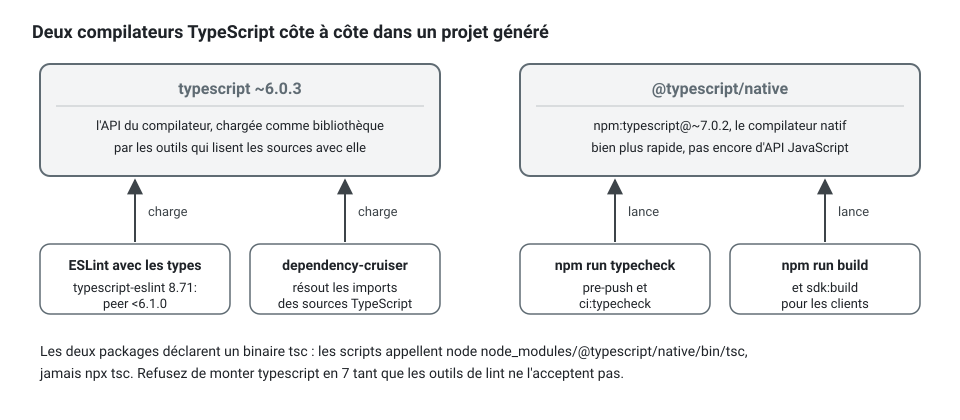

[English](static-analysis-and-pipeline.md) · **Français**
<!-- translation-of: static-analysis-and-pipeline.md sha256:c3d5e1145246bb77 -->

# L'analyse statique et le pipeline

**Résumé.** L'architecture est tenue par des analyseurs, pas par des commentaires de relecture.
Trois d'entre eux partagent un même ensemble d'identifiants de règle, chacun là où il est exact :
le *checker* du kit lit les chemins, le texte et le glossaire ; le *plugin* ESLint lit l'arbre
syntaxique ; dependency-cruiser lit le graphe des imports résolu. knip trouve le code mort, et le
compilateur TypeScript en mode strict complète l'ensemble. Un projet généré porte deux versions de
TypeScript côte à côte, parce que le compilateur natif (7) n'a pas encore d'API JavaScript et que
les outils de lint en ont besoin d'une. Les mêmes portes tournent sur GitHub Actions et sur GitLab
CI à partir des mêmes scripts npm. Cette page compare les outils, dit ce qui a été vérifié et ce
qui ne l'a pas été, et quand une configuration plus légère suffit.

## Pourquoi plusieurs analyseurs

Une même règle comme `layer/domain-purity` (voir la table des règles de la
[référence d'architecture](../ARCHITECTURE.fr.md)) peut être enfreinte de façons que des outils
différents voient. Chaque cas ci-dessous a été passé aux trois analyseurs sur un petit projet :

- un `import { z } from 'zod'` direct dans un objet-valeur : les trois le signalent ;
- le même texte dans un commentaire ou une chaîne : une simple recherche textuelle le
  signalerait ; le lexer du *checker* saute les commentaires et les chaînes, et l'arbre
  syntaxique n'y contient aucun import, donc aucun ne le signale, à raison ;
- un import par un chemin de `tsconfig` autre que l'alias du projet
  (`#billing-infra/invoice-row`, qui mène à `infrastructure/`) : le *checker* et le *plugin*
  ESLint lisent le spécificateur tel qu'il est écrit et signalent « le *package*
  `#billing-infra` » ; dependency-cruiser le résout comme le compilateur et nomme le vrai fichier,
  `infrastructure/invoice-row.ts` ;
- un type de `zod` réexporté par `shared-kernel/index.ts`, que le domaine a le droit d'importer :
  aucun ne le signale. Le *checker* ne résout pas les réexports, le *plugin* ESLint voit un import
  autorisé, et les règles dependency-cruiser générées jugent chaque arête isolément. Ce qu'aucune
  règle ne contraint se relit à la main (voir [Limites](#limites-et-quand-ne-pas-lutiliser)).


L'outil le moins coûteux tourne donc le plus souvent, et le plus exact a le dernier mot.

À quoi ressemble un constat, et ce qu'il faut écrire à la place. Le *checker* répond à l'import
direct avec la règle, l'emplacement et la correction :

```ts
// À éviter : domain/value-objects/email.vo.ts qui valide avec une bibliothèque
import { ValueObject } from '@ddd-ts-kit/kernel';
import { z } from 'zod';

export class Email extends ValueObject<{ readonly value: string }> {
  private constructor(props: { readonly value: string }) {
    super(props);
  }

  static create(value: string): Email {
    return new Email({ value: z.string().email().parse(value) });
  }
}
```

```text
$ npx ddd-ts-kit check-file src/contexts/billing/domain/value-objects/email.vo.ts
src/contexts/billing/domain/value-objects/email.vo.ts:2  error  layer/domain-purity
  The domain imports the package "zod".
  fix: Remove the import: express the need as plain TypeScript or as a port in application/ports, and keep decorators and schemas of "zod" in infrastructure or presentation.

1 error, 0 warnings, 0 suppressions in 1 file.
```

La forme d'une requête HTTP est validée à l'entrée, par le schéma de sa route ; la règle du
métier reste en TypeScript simple, avec un refus nommé d'après ce qu'il refuse :

<!-- checked sample -->
```ts
import { DomainRefusal, ValueObject } from '@ddd-ts-kit/kernel';

// identity.codes.ts
export const IdentityCodes = { InvalidEmail: 'INVALID_EMAIL' } as const;

// domain/errors/invalid-email.error.ts
export class InvalidEmail extends DomainRefusal {
  readonly code = IdentityCodes.InvalidEmail;

  static forAddress(value: string) {
    return InvalidEmail.refusal(`"${value}" is not an email address.`, { value });
  }
}

// domain/value-objects/email.vo.ts : le domaine n'importe que le noyau du kit
export class Email extends ValueObject<{ readonly value: string }> {
  private constructor(props: { readonly value: string }) {
    super(props);
  }

  static create(value: string): Email {
    const address = value.trim().toLowerCase();

    if (!/^[^@\s]+@[^@\s]+\.[^@\s]+$/.test(address)) {
      throw InvalidEmail.forAddress(value);
    }

    return new Email({ value: address });
  }

  get value(): string {
    return this.props.value;
  }
}
```

## Comparaison

Versions et licences lues sur npm le 2026-10-10.

| | `ddd-ts-kit check` | `@ddd-ts-kit/eslint-plugin` | dependency-cruiser | knip | TypeScript (strict) |
|---|---|---|---|---|---|
| Lit | les chemins, le texte par un petit lexer, `CONTEXT.md`, la config | l'arbre syntaxique d'un fichier, les types sur demande | le graphe des modules résolu | les points d'entrée et les exports du projet | le programme entier |
| Fait autorité pour | l'arborescence, les noms, le glossaire, la config, les *specs* et *builders* exigés, le *barrel* généré, l'unicité des noms de consommateurs et de *jobs* | les règles de code : couches, imports entre contextes, pureté, code propre, forme des agrégats et des gestionnaires, ports, déclarations | les mêmes frontières à travers les *barrels* et les réexports, les cycles, les orphelins, les dépendances non déclarées | les fichiers, exports, types et dépendances inutilisés | les types |
| Dépendances | aucune | ESLint 9 ou 10, typescript-eslint, `@stylistic/eslint-plugin` | dependency-cruiser 18.5.0 (MIT), un analyseur TypeScript | knip 6.41.0 (ISC) | le compilateur |
| Tourne | après chaque écriture de fichier (*hook* de l'éditeur), sur les fichiers indexés, en CI | sur les fichiers indexés, en CI | en CI | en CI | avant le *push*, en CI |
| Coût sur le projet d'exemple du README du pipeline (trois contextes, 87 fichiers) | 0,3 s | 4,5 s avec les types | 0,8 s | 0,6 s | 0,4 s avec le compilateur natif |
| Angles morts | pas de compilateur : *barrels* et réexports non résolus, fonctions fléchées non jugées par certaines règles, heuristiques sur les commentaires | un fichier à la fois : rien sur le projet dans son ensemble | ne dit rien de ce que fait un fichier, seulement de ce qu'il importe | a besoin de points d'entrée corrects ; les fichiers découverts doivent être déclarés comme entrées | ne connaît pas l'architecture |

D'autres outils existent pour des parties de ce travail (*plugins* ESLint de frontières
d'import, règles de frontières de monorepo, autres détecteurs de code mort). Aucun n'a été évalué
pour cette page. La configuration de dependency-cruiser du kit, `.dependency-cruiser.cjs`, est
générée à partir de `ddd-ts-kit.config.json`, et c'est ce qui lui fait suivre la carte des
contextes sans retouche à la main : `ddd-ts-kit depcruise-config --write` la réécrit
(`generate context` aussi), et le `npm run depcruise` généré commence par
`depcruise-config --check`, qui échoue sur un fichier périmé.

`ddd-ts-kit rules` liste chaque identifiant de règle avec sa sévérité par défaut. La plupart des
règles de code existent à la fois dans le *checker* (une approximation rapide sur le texte) et
dans le *plugin* ESLint (la version exacte). Treize ne sont tenues que par le *plugin* ESLint, et
la liste le dit : `domain/aggregate-encapsulation`, `domain/value-object-immutability`,
`domain/no-generic-error`, `errors/through-factory`, `errors/constructor-not-public`,
`errors/factory-name`, `clean/no-magic-number`, `application/handler-shape`,
`application/command-query-separation`, `presentation/controller-shape`,
`presentation/controller-delegates`, `presentation/shared-cache-varies`,
`presentation/guard-at-the-edge`. Une, `clean/formatted`, n'est tenue par aucun des deux : le
formateur du projet, Biome, met en forme chaque fichier, et la liste indique
« checked by Biome » :

```text
$ npx ddd-ts-kit rules
...
domain/aggregate-encapsulation             error  An aggregate or entity has a private or protected constructor, no public mutable property and no setter. (checked by @ddd-ts-kit/eslint-plugin)
...
clean/formatted                            error  Every TypeScript, JavaScript and JSON file is laid out by the formatter of the project, Biome, at a line width of 120: the format check reports nothing to change. (checked by Biome)
```

Le côté ESLint d'un projet tient en une fonction, qui lit le `ddd-ts-kit.config.json` placé à
côté d'elle :

<!-- checked sample -->
```ts
// eslint.config.ts (init écrit la même chose dans eslint.config.mjs)
import { dddTsKit } from '@ddd-ts-kit/eslint-plugin';

export default dddTsKit({ tsconfigRootDir: import.meta.dirname });
```

Ce que reçoit chaque projet, outil par outil, est sur la page du
[socle de qualité](quality-baseline.fr.md).

## Critères de choix

- **Le temps de retour.** Une règle qui répond en moins d'une seconde peut tourner à chaque
  écriture. Une règle qui a besoin des types, non. Gardez les deux, dans cet ordre.
- **L'exactitude.** Quand deux outils sont en désaccord sur une règle de code, l'arbre syntaxique
  l'emporte : le README du *plugin* ESLint dit que c'est alors le *checker* qu'il faut corriger.
- **Ce qui doit être jugé à l'échelle du projet.** Une *spec* manquante, un *barrel* périmé, un
  nom absent du glossaire ou un cycle dans la carte des contextes ne sont pas des faits d'un seul
  fichier.
- **Le coût d'un faux positif.** Une règle heuristique (commentaires de bruit, code commenté) est
  par défaut un avertissement ; les règles structurelles sont par défaut des erreurs. Les scripts
  `lint` et `ci:lint` échouent sur les deux (`ddd-ts-kit lint`, sauf pour une règle du kit en transition, affichée sans échouer) : un avertissement dit de quelle
  sorte est le constat, pas qu'il peut rester.

Mis bout à bout, un projet généré fait tourner chaque analyseur au moment que son coût permet :


Les *hooks* du poste de travail sont dans le `lefthook.yml` qu'écrit `init`. Sa ligne
`lefthook:` fait lancer au *hook* le lefthook du *checkout* où il se déclenche : les *hooks* d'un
dépôt sont partagés par tous ses *worktrees*, et sans cette ligne ils lanceraient le lefthook du
dernier *checkout* qui les a installés, ou sauteraient toutes les vérifications une fois ce
*checkout* disparu. Un *worktree* sans ses dépendances fait désormais échouer le *commit*
bruyamment ; `npx ddd-ts-kit doctor` signale une ligne ou un *hook* installé qui manque.

```yaml
lefthook: node_modules/.bin/lefthook

pre-commit:
  parallel: true
  jobs:
    - name: eslint
      glob: '*.{ts,mts,cts,js,mjs,cjs}'
      run: npx --no -- eslint --no-warn-ignored {staged_files}
    - name: format
      glob: '*.{ts,mts,cts,js,mjs,cjs,json,jsonc}'
      run: npx --no -- biome format --no-errors-on-unmatched {staged_files}
    - name: architecture
      glob: 'src/**/*.{ts,mts,cts}'
      run: npx --no -- ddd-ts-kit check {staged_files}
    - name: commit size
      run: npx --no -- ddd-ts-kit check --commit-size --staged

pre-push:
  jobs:
    - name: typecheck
      run: npm run ci:typecheck
    - name: unit tests
      # The contexts the branch reaches and the ones downstream of them, as on a pull request; everything when git
      # cannot tell (no origin/HEAD: `git remote set-head origin --auto`). The pipeline runs everything on the trunk.
      run: npx --no -- ddd-ts-kit affected --base origin/HEAD --run ci:test:unit
    - name: merges
      run: npx --no -- ddd-ts-kit verify-merge --warn

commit-msg:
  jobs:
    - name: conventional commit
      run: npx --no -- commitlint --edit {1}
```

Avant un *push*, les *specs* unitaires tournent comme sur une *pull request* :
`ddd-ts-kit affected --run` met dans `DDD_TS_KIT_AFFECTED` les contextes que la branche atteint
depuis `origin/HEAD` et ceux qui en dépendent, ne lance rien quand seuls des documents ont
changé, et lance tout quand un chemin partagé a changé ou que git ne sait pas le dire. Un *push*
ne lance plus toutes les *specs* d'un projet qui grossit ; le *pipeline* le fait, sur le tronc et
chaque nuit. Hors *pipeline*, le lanceur de tests prend la moitié des cœurs
([Isoler les agents de code](../guides/agent-sandbox.fr.md)).

Le *job* ESLint d'avant *commit* n'a pas de `--max-warnings` : il affiche un avertissement et
laisse passer le *commit*, et `npm run lint`, `verify` et le *pipeline* échouent dessus. Comment un
projet fait par une version antérieure prend la limite, en corrigeant ou en consignant les
avertissements qu'il a déjà : [Base de qualité](quality-baseline.fr.md#un-avertissement-fait-échouer-le-lint).

## TypeScript 6 et 7 côte à côte

TypeScript 7 est le compilateur natif. Il compile et vérifie les types beaucoup plus vite, et,
tel qu'il est publié, il ne livre aucune API JavaScript. Les outils qui chargent le compilateur
comme une bibliothèque ne peuvent pas tourner dessus.

Ce qui a été constaté le 2026-10-10 :

- `typescript` sur npm est en 7.0.2 ;
- `typescript-eslint` 8.71.1 déclare la plage de pair `typescript >=4.8.4 <6.1.0`, il n'accepte
  donc pas TypeScript 7 ;
- des articles sur la sortie de la 7.0 indiquent qu'une nouvelle API programmatique est attendue
  dans une version 7.x ultérieure. Si et quand typescript-eslint la prendra en charge n'a pas pu
  être vérifié dans une déclaration officielle de ce projet.

La réponse du kit, telle que l'énoncent ses README : un projet généré installe les deux.
`typescript` 6 sert les outils qui lisent les sources par l'API du compilateur (ESLint avec les
types, dependency-cruiser), et `@typescript/native`, un alias npm de `typescript` 7, compile et
vérifie les types ; il est appelé par son chemin, parce que les deux *packages* déclarent un
binaire `tsc` et que `npx tsc` en choisirait un.



Dans le `package.json` d'un projet généré :

```json
{
  "scripts": {
    "typecheck": "node node_modules/@typescript/native/bin/tsc -p tsconfig.json --noEmit",
    "build": "node node_modules/@typescript/native/bin/tsc -p tsconfig.build.json && ddd-ts-kit build-aliases"
  },
  "devDependencies": {
    "@typescript/native": "npm:typescript@~7.0.2",
    "typescript": "~6.0.3",
    "typescript-eslint": "^8.71.1"
  }
}
```

Avec `typescript` 7 seul, ESLint avec les types ne démarre pas, et la configuration de
dependency-cruiser se replie sur `@swc/core` quand il est installé (elle suit alors les imports
de types seuls sans les distinguer) et échoue bruyamment sinon.

Le coût, ce sont deux compilateurs à garder compatibles : une syntaxe acceptée par la 7 et pas
par la 6 passerait la vérification de types puis échouerait au lint. Renovate ou Dependabot
proposeront de faire passer `typescript` lui-même en 7 ; refusez-le tant que les outils de lint
ne l'acceptent pas.

## GitHub Actions et GitLab CI

La règle du répertoire du *pipeline* : la logique de CI vit dans des scripts npm, et les deux
fichiers de plateforme ne font qu'orchestrer. Chaque porte tourne donc sur un poste de travail
avec la même commande. La même porte, dans les deux fichiers qu'écrit `init` :

```yaml
# .github/workflows/ci.yml : les étapes du job Architecture
- name: Architecture rules
  run: npm run ci:arch:check -- --format github
- name: Dependency graph
  run: npm run ci:arch:graph
```

```yaml
# .gitlab-ci.yml : le job architecture
architecture:
  extends: .node
  stage: test
  needs: [install]
  script:
    - mkdir -p reports
    - npm run --silent ci:arch:check -- --format gitlab > reports/gl-code-quality-arch.json
    - npm run ci:arch:graph
```

et sur un poste de travail, `npm run ci:arch`, qui lance les deux.

| Élément | GitHub Actions | GitLab CI |
|---|---|---|
| Déclencheurs | les *push* sur la branche par défaut et les *pull requests* | les *merge requests* et la branche par défaut |
| Machine d'exécution | `ubuntu-26.04`, épinglée : une nouvelle image de GitHub atteint le projet quand l'équipe change le libellé, pas quand `ubuntu-latest` bouge | l'image que nomme chaque job (`node:24-bookworm-slim` par défaut) |
| Node | le dernier correctif de la version majeure (`check-latest` de `setup-node`), pas la version plus ancienne que peut contenir l'image de la machine : une version de sécurité de Node atteint l'exécution suivante | l'étiquette de l'image, qui suit le dernier correctif de sa version majeure |
| Exécutions redondantes | annulées par des groupes de concurrence | annulées par des *jobs* interruptibles |
| Portes | les mêmes scripts `ci:*` | les mêmes scripts `ci:*` |
| Constats de lint et d'architecture | des annotations sur la *pull request* (`check --format github`) | des rapports Code Quality (`check --format gitlab` écrit directement le rapport ; ESLint par son formateur GitLab) |
| Un avertissement de lint | fait échouer le *job* de lint (`ci:lint` lance `ddd-ts-kit lint` ; une règle du kit en transition est affichée sans échouer) | fait échouer le *job* de lint, et figure dans le rapport Code Quality |
| La raison d'une règle, pour qui relit | `check --format github --explain` : chaque annotation se termine par elle | `check --format gitlab --explain` : chaque problème se termine par elle, les empreintes inchangées |
| Rapports de tests | le *reporter* Vitest pour Actions, la couverture comme artefact | des rapports JUnit et Cobertura dans la *merge request* |
| Recherche de secrets | gitleaks | gitleaks |
| Construction d'image sans *push* | l'action Docker de *build* | BuildKit sans privilèges (rootless) |
| Vérification du titre | commitlint sur le titre de la *pull request* | commitlint sur le titre de la *merge request* |
| Ce qui la rend obligatoire | un *job* `gate` comme contrôle obligatoire | « pipelines must succeed » |
| Mises à jour des dépendances | Renovate ou Dependabot | Renovate |

Les *pipelines* qu'écrit `init` n'utilisent que des outils gratuits. Ce qui dépend d'une offre,
ou dépense des jetons d'API, est à activer (`init --ci-extras`, `ci.extras` dans la config) :
CodeQL et la revue des dépendances, gratuits sur les dépôts GitHub publics et payants sur les
privés ; le SAST, Secret Detection (constats dans la *merge request* sur Ultimate seulement) et
Dependency Scanning (Ultimate) de GitLab ; et deux *jobs* qui lancent Claude Code sur les deux
plateformes, `claude-review` (une revue de chaque *pull request* ou *merge request*, publiée en
commentaire qui n'approuve ni ne bloque) et `claude-triage` (un triage en trois lignes d'une
exécution en échec, en lecture seule, dans le résumé du *job* et sur la demande) ; et, sur GitHub
seulement, `intent-to-spec` (le skill de *story* lancé sans responsable sur chaque intention
qu'une fusion accepte, sa spécification ouverte en *pull request*). Aucun des trois n'est exigé
par le *job* `gate` : une personne approuve toujours. Sur les deux plateformes, les
deux contrôles qui bloquent quelle que soit l'offre sont `npm audit` et gitleaks. La table de
chaque outil, de sa catégorie, de son coût et des pages des éditeurs où elle a été lue est dans
[pipeline/README.md](../../pipeline/README.md#free-by-default-paid-on-request).

Le choix entre les deux est rarement libre : il suit l'endroit où le code est hébergé. Le but de
la conception est que ce choix ne coûte rien dans les portes elles-mêmes.

## Ce que le kit prend en charge et a vérifié

D'après [`pipeline/README.md`](../../pipeline/README.md), le
[README de la CLI](../../packages/cli/README.fr.md) et le
[README du *plugin* ESLint](../../packages/eslint-plugin/README.fr.md) :

- **Le *checker*.** Aucune dépendance à l'exécution. Chaque violation a un identifiant de règle,
  une sévérité, un emplacement et une phrase `fix` ; `explain <rule-id>` en donne la raison avec
  un mauvais et un bon exemple, et `check --explain` la raison de chaque règle qu'une exécution
  signale, une fois. Des formats de sortie pour les personnes, JSON, les annotations
  GitHub et GitLab Code Quality. Un test de génération produit chaque sorte de fichier pour chaque
  *stack* et exige zéro violation, si bien que le générateur et le *checker* ne peuvent pas être
  en désaccord.
- **Le *plugin* ESLint.** Configuration *flat* seulement, ESLint 9 et 10. Une fonction de
  *preset* renvoie une configuration complète avec les règles strictes et typées de
  typescript-eslint ; des règles standard sont activées là où elles couvrent entièrement une
  convention, et dix règles strictes sont ajustées, chacune pour une raison énoncée. Lancé sur un
  projet généré, propre puis avec une violation délibérée par règle.
- **dependency-cruiser.** Configuration dérivée de la config du projet ; lancé en version 18 avec
  l'analyseur TypeScript 6 et avec `@swc/core`, chaque règle signalant sa violation délibérée.
- **knip.** Fichier, export, type et dépendance inutilisés signalés sur le projet d'exemple.
- **Les *hooks*.** lefthook : ESLint, la vérification du format par Biome et le *checker* sur les
  fichiers indexés avant un *commit*, avec `check --commit-size --staged` à titre indicatif ;
  vérification de types et tests unitaires avant un *push* ; commitlint sur le message.
- **Des seuils de couverture par couche**, les plus hauts pour `domain/`, les plus bas pour
  `infrastructure/`, lus dans le fichier de config, appliqués à chaque contexte, imposés par
  `verify` et par le *pipeline*.
- **Les portes de dérive.** La carte des contextes, les parties générées de chaque `CONTEXT.md`,
  les *barrels* (`declarations/barrel-current`), `.dependency-cruiser.cjs`, le document OpenAPI,
  le document AsyncAPI et le catalogue d'événements sont régénérés et comparés.

**Non exécuté, de l'aveu même du README du pipeline :** les *workflows* GitHub ont été analysés
et vérifiés avec actionlint, pas exécutés sur GitHub ; le fichier GitLab a été analysé et ses
étapes résolues par un script, `glab ci lint` n'a pas été lancé, et il n'a pas été exécuté sur
GitLab ; la protection des branches et les réglages des *merge requests* ont été écrits d'après
la documentation de l'API.

**Les tests de mutation tournent chaque nuit.** Le *job* `mutation` du *pipeline* lance
`npm run test:mutation` sur la branche par défaut quand la planification se déclenche : Stryker
10.1.1 avec le lanceur du projet, Vitest ou Jest, sur les couches domaine et application de chaque contexte, sa
configuration lue dans le kit (`governedMutation()`, tenue par `test/mutation-governed` : les textes
des refus et les mutants statiques laissés de côté), puis `ddd-ts-kit mutation`, qui tient chaque
contexte au plancher `mutation` de `ddd-ts-kit.config.json`, les mutants ignorés affichés à côté de
chaque score. Pas une porte de *pull request* : cinq minutes pour l'exemple sont trop longues pour la
boucle d'un changement. Une *pull request* reçoit à la place le *job* `mutation-changed`, une
lecture : Stryker réutilise le rapport de la dernière nuit pour ce que le changement ne touche pas,
une minute environ quand le changement reste dans le domaine, les cas d'usage et les *specs*, et relance tout, cinq minutes environ, quand il touche un code qu'il ne compare pas (une route, un adaptateur, un *fake*, un *builder*, la plateforme, une dépendance), le cas courant d'une fonctionnalité, et `ddd-ts-kit mutation --changed <base>` liste les
survivants des fichiers que le changement a touchés. Le README du *pipeline* tient les mesures qui
l'ont décidé (2026-10-24).

## Limites, et quand ne pas l'utiliser

- **Le *checker* est un lecteur de texte.** Son README liste ce qu'il manque : réexports et
  *barrels*, `.tsx`, fonctions fléchées pour les règles d'ordre de lecture (stepdown) et de
  taille, imports par alias pour plusieurs règles, un nom de schéma dans du SQL brut, une
  transaction entre contextes. C'est le filet rapide, pas la preuve.
- **Le *plugin* ESLint juge un fichier.** Il ne peut pas savoir qu'une *spec* manque ou que deux
  consommateurs partagent un nom.
- **Rien ne contraint ce qu'importent `shared-kernel/`, `platform/` et `main.ts`** dans le
  *checker*. Relisez-les à la main.
- **Les analyseurs vérifient la forme, pas la conception.** Un agrégat anémique dont les
  *setters* privés ont été renommés en méthodes passe toutes les règles. L'agent
  `architecture-reviewer` et la relecture humaine existent pour cela.
- **Un fichier tout juste généré peut être signalé** : un port ou un *fake* généré avant que quoi
  que ce soit ne l'utilise est un fichier inutilisé pour knip et un orphelin pour
  dependency-cruiser, d'après le README du pipeline. Générez-le avec le cas d'usage qui en a
  besoin.
- **Le lint typé est la porte statique la plus lente** (des secondes, pas des millisecondes).
  Sans les types, le *preset* est plus rapide et perd les règles qui lisent les types.
- **Quand une configuration plus légère suffit :** un prototype ou un script sans contexte
  délimité (bounded context) gagne peu aux règles structurelles. Le *checker* a un mode qui ne
  lance que les règles de code propre, sur n'importe quel répertoire, sans projet ni config.
- **Assouplir une règle est une décision consignée**, pas une modification locale : voir
  `governance/recorded-deviation`.

## Recommandation selon la situation

| Situation | Choix |
|---|---|
| Un projet généré par `init` | tout garder tel que généré ; marquer le *job* de porte unique comme obligatoire |
| Adopter le kit dans une base de code existante | commencer par le *checker* et le *preset* ESLint ; consigner les constats de lint que l'existant a déjà dans `eslint-suppressions.json` (`npx eslint . --suppress-all`, un avertissement passé d'abord à `error`), qui ne fait ensuite que rétrécir ; chaque assouplissement d'une règle consigné avec son enregistrement de décision ; ajouter dependency-cruiser quand l'arborescence est en place |
| La boucle d'édition d'un agent de code | la vérification par fichier après chaque écriture, la porte complète avant de terminer |
| Un monorepo avec ses propres outils de frontières | les garder pour les frontières entre *packages* ; les règles du kit s'appliquent toujours à l'intérieur de chaque service |
| TypeScript 7 seul, sans TypeScript 6 | pas possible aujourd'hui avec le lint typé ; garder les deux |
| GitLab en offre gratuite | le *pipeline* tel que généré : audit et gitleaks bloquent ; les constats des scanners ne sont visibles que dans les journaux des *jobs* |
| Vouloir le score de mutation avant la nuit | `npm run test:mutation` à la main : Stryker sur les couches domaine et application de chaque contexte, puis chaque couche de chaque contexte face à son plancher ; le rapport html arrive dans `reports/mutation/` |

## Sources

- Ce dépôt : `pipeline/README.md`, `packages/cli/README.md` (sections `check`, « Limits »),
  `packages/eslint-plugin/README.md`, `docs/ARCHITECTURE.md` (« Who checks what »).
- typescript-eslint : https://typescript-eslint.io ; plage de pair lue avec
  `npm view typescript-eslint peerDependencies`.
- Annonce de TypeScript 7.0 : https://devblogs.microsoft.com/typescript/announcing-typescript-7-0/
- Configuration *flat* d'ESLint : https://eslint.org/docs/latest/use/configure/configuration-files
- dependency-cruiser : https://github.com/sverweij/dependency-cruiser
- knip : https://knip.dev
- GitHub Actions : https://docs.github.com/actions ; GitLab CI/CD : https://docs.gitlab.com/ci/
- gitleaks : https://github.com/gitleaks/gitleaks ; lefthook : https://github.com/evilmartians/lefthook ;
  commitlint : https://commitlint.js.org
- Stryker : https://stryker-mutator.io
- Robert C. Martin, Clean Architecture, Prentice Hall, 2017 (la règle de dépendance que font
  respecter les analyseurs).

## Voir aussi

- [Les couches et la règle de dépendance](../concepts/layers-and-dependency-rule.fr.md)
- [Code propre](../concepts/clean-code.fr.md)
- [Exécuteurs de tests](test-runners.fr.md)
- [Discipline des commits](../guides/commit-discipline.fr.md)
- [Organisation du travail en équipe](../guides/team-workflow.fr.md)
- [Configuration](../CONFIG.fr.md) : `rules`, `limits`, `deviations`, `guard`
