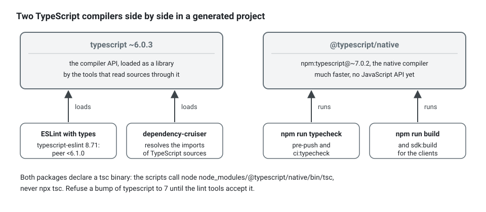

**English** · [Français](static-analysis-and-pipeline.fr.md)

# Static analysis and the pipeline

**Summary.** The architecture is held by analyzers, not by review comments. Three of them share
one set of rule ids, each where it is exact: the kit's own checker reads paths, text and the
glossary; the ESLint plugin reads the syntax tree; dependency-cruiser reads the resolved import
graph. knip finds dead code, and the TypeScript compiler in strict mode closes the set. A
generated project carries two TypeScript versions side by side, because the native compiler
(7) has no JavaScript API yet and the lint tools need one. The same gates run on GitHub Actions
and on GitLab CI from the same npm scripts. This page compares the tools, says what was
verified and what was not, and when a lighter setup is enough.

## Why several analyzers

A single rule such as `layer/domain-purity` (see the rule table of the
[architecture reference](../ARCHITECTURE.md)) can be broken in ways that different tools see.
Each case below was run through the three analyzers on a small project:

- a direct `import { z } from 'zod'` in a value object: all three report it;
- the same text in a comment or a string: a plain text search would report it; the checker's
  lexer skips comments and strings, and the syntax tree has no import there, so none does,
  rightly;
- an import through a `tsconfig` path other than the alias of the project
  (`#billing-infra/invoice-row`, leading to `infrastructure/`): the checker and the ESLint
  plugin read the specifier as written and report "the package `#billing-infra`";
  dependency-cruiser resolves it like the compiler and names the real file,
  `infrastructure/invoice-row.ts`;
- a type of `zod` re-exported by `shared-kernel/index.ts`, which the domain may import: none
  reports it. The checker does not resolve re-exports, the ESLint plugin sees an allowed import,
  and the generated dependency-cruiser rules judge each edge alone. What no rule constrains is
  reviewed by hand (see [Limits](#limits-and-when-not-to-use-it)).


So the cheapest tool runs most often and the most exact one has the last word.

What a finding looks like, and what to write instead. The checker answers the direct import
with the rule, the place and the fix:

```ts
// Instead of: domain/value-objects/email.vo.ts validating with a library
import { ValueObject } from '@ddd-ts-kit/kernel';
import { z } from 'zod';

export class Email extends ValueObject<{ readonly value: string }> {
  private constructor(props: { readonly value: string }) {
    super(props);
  }

  static create(value: string): Email {
    return new Email({ value: z.string().email().parse(value) });
  }
}
```

```text
$ npx ddd-ts-kit check-file src/contexts/billing/domain/value-objects/email.vo.ts
src/contexts/billing/domain/value-objects/email.vo.ts:2  error  layer/domain-purity
  The domain imports the package "zod".
  fix: Remove the import: express the need as plain TypeScript or as a port in application/ports, and keep decorators and schemas of "zod" in infrastructure or presentation.

1 error, 0 warnings, 0 suppressions in 1 file.
```

The shape of a request is validated at the edge, by the schema of its route; the rule of the
business stays in plain TypeScript, with a refusal of its concept:

<!-- checked sample -->
```ts
import { ConceptError, ValueObject } from '@ddd-ts-kit/kernel';

// domain/errors/email.error.ts
export class EmailError extends ConceptError {
  static invalid(value: string) {
    return EmailError.refusal('INVALID_EMAIL', `"${value}" is not an email address.`, { value });
  }
}

// domain/value-objects/email.vo.ts: the domain imports only the kernel
export class Email extends ValueObject<{ readonly value: string }> {
  private constructor(props: { readonly value: string }) {
    super(props);
  }

  static create(value: string): Email {
    const address = value.trim().toLowerCase();

    if (!/^[^@\s]+@[^@\s]+\.[^@\s]+$/.test(address)) {
      throw EmailError.invalid(value);
    }

    return new Email({ value: address });
  }

  get value(): string {
    return this.props.value;
  }
}
```

## Comparison

Versions and licences were read from npm on 2026-10-10.

| | `ddd-ts-kit check` | `@ddd-ts-kit/eslint-plugin` | dependency-cruiser | knip | TypeScript (strict) |
|---|---|---|---|---|---|
| Reads | paths, text through a small lexer, `CONTEXT.md`, the config | the syntax tree of one file, types when asked | the resolved module graph | the project's entry points and exports | the whole program |
| Authority for | the tree, names, the glossary, the config, required specs and builders, the generated barrel, unique consumer and job names | code rules: layers, context imports, purity, clean code, aggregate and handler shape, ports, declarations | the same boundaries through barrels and re-exports, cycles, orphans, undeclared dependencies | unused files, exports, types, dependencies | types |
| Dependencies | none | ESLint 9 or 10, typescript-eslint, `@stylistic/eslint-plugin` | dependency-cruiser 18.5.0 (MIT), a TypeScript parser | knip 6.41.0 (ISC) | the compiler |
| Runs | after each file write (editor hook), on staged files, in CI | on staged files, in CI | in CI | in CI | pre-push, in CI |
| Cost on the sample project of the pipeline README (three contexts, 87 files) | 0.3 s | 4.5 s with types | 0.8 s | 0.6 s | 0.4 s with the native compiler |
| Blind spots | no compiler: barrels and re-exports not resolved, arrow functions not judged for some rules, heuristics on comments | one file at a time: nothing about the project as a whole | says nothing about what a file does, only what it imports | needs correct entry points; discovered files must be declared as entries | does not know the architecture |

Other tools exist for parts of this job (import-boundary ESLint plugins, monorepo boundary
rules, other dead-code finders). None was evaluated for this page. The kit's configuration for
dependency-cruiser, `.dependency-cruiser.cjs`, is generated from `ddd-ts-kit.config.json`,
which is what makes it follow the context map without hand editing:
`ddd-ts-kit depcruise-config --write` rewrites it (`generate context` does too), and the
generated `npm run depcruise` starts with `depcruise-config --check`, which fails on a stale
file.

`ddd-ts-kit rules` lists every rule id with its default severity. Most code rules exist in
both the checker (a fast approximation on text) and the ESLint plugin (the exact one). Thirteen
are held by the ESLint plugin only, and the listing says so: `domain/aggregate-encapsulation`,
`domain/value-object-immutability`, `domain/no-generic-error`, `errors/through-factory`,
`errors/constructor-not-public`, `errors/factory-name`, `clean/no-magic-number`,
`application/handler-shape`, `application/command-query-separation`,
`presentation/controller-shape`, `presentation/controller-delegates`,
`presentation/shared-cache-varies`, `presentation/guard-at-the-edge`. One, `clean/formatted`, is
held by neither: the formatter of the project, Biome, lays out every file, and the listing says
"checked by Biome":

```text
$ npx ddd-ts-kit rules
...
domain/aggregate-encapsulation             error  An aggregate or entity has a private or protected constructor, no public mutable property and no setter. (checked by @ddd-ts-kit/eslint-plugin)
...
clean/formatted                            error  Every TypeScript, JavaScript and JSON file is laid out by the formatter of the project, Biome, at a line width of 120: the format check reports nothing to change. (checked by Biome)
```

The ESLint side of a project is one function, which reads `ddd-ts-kit.config.json` next to it:

<!-- checked sample -->
```ts
// eslint.config.ts (init writes the same as eslint.config.mjs)
import { dddTsKit } from '@ddd-ts-kit/eslint-plugin';

export default dddTsKit({ tsconfigRootDir: import.meta.dirname });
```

What every project gets, tool by tool, is on the [quality baseline](quality-baseline.md) page.

## Selection criteria

- **Feedback time.** A rule that answers in under a second can run at every write. One that
  needs types cannot. Keep both, in that order.
- **Exactness.** When two tools disagree on a code rule, the syntax tree wins: the ESLint
  plugin README says the checker is then the one to fix.
- **What must be judged project-wide.** A missing spec, a stale barrel, a name absent from the
  glossary or a cycle in the context map are not facts of one file.
- **Cost of a false positive.** A heuristic rule (noise comments, commented-out code) defaults
  to a warning; structural rules default to errors. The `lint` and `ci:lint` scripts fail on
  both (`ddd-ts-kit lint`, but for a rule of the kit in transition, shown without failing): a warning says what kind of finding it is, not that it may stay.

Put together, a generated project runs each analyzer at the moment its cost allows:


The hooks of the laptop are in the `lefthook.yml` that `init` writes. Its `lefthook:` line makes
the hook run the lefthook of the checkout it fires in: the hooks of a repository are shared by
all its worktrees, and without that line they would run the lefthook of whichever checkout
installed them last, or skip every check once that checkout is gone. A worktree without its
dependencies now fails the commit loudly; `npx ddd-ts-kit doctor` says when the line or the
installed hook is missing.

```yaml
lefthook: node_modules/.bin/lefthook

pre-commit:
  parallel: true
  jobs:
    - name: eslint
      glob: '*.{ts,mts,cts,js,mjs,cjs}'
      run: npx --no -- eslint --no-warn-ignored {staged_files}
    - name: format
      glob: '*.{ts,mts,cts,js,mjs,cjs,json,jsonc}'
      run: npx --no -- biome format --no-errors-on-unmatched {staged_files}
    - name: architecture
      glob: 'src/**/*.{ts,mts,cts}'
      run: npx --no -- ddd-ts-kit check {staged_files}
    - name: commit size
      run: npx --no -- ddd-ts-kit check --commit-size --staged

pre-push:
  jobs:
    - name: typecheck
      run: npm run ci:typecheck
    - name: unit tests
      run: npm run ci:test:unit
    - name: merges
      run: npx --no -- ddd-ts-kit verify-merge --warn

commit-msg:
  jobs:
    - name: conventional commit
      run: npx --no -- commitlint --edit {1}
```

The ESLint job before a commit has no `--max-warnings`: it shows a warning and lets the commit
through, and `npm run lint`, `verify` and the pipeline fail on it. How a project made by an
earlier version takes the limit, fixing or recording the warnings it already has:
[Quality baseline](quality-baseline.md#warnings-fail-the-lint).

## TypeScript 6 and 7 side by side

TypeScript 7 is the native compiler. It compiles and type-checks much faster, and as released
it ships no JavaScript API. Tools that load the compiler as a library cannot run on it.

What was found on 2026-10-10:

- `typescript` on npm is 7.0.2;
- `typescript-eslint` 8.71.1 declares the peer range `typescript >=4.8.4 <6.1.0`, so it does
  not accept TypeScript 7;
- articles on the 7.0 release report that a new programmatic API is expected in a later 7.x
  release. Whether and when typescript-eslint will support it could not be verified from an
  official statement of that project.

The kit's answer, as its READMEs state: a generated project installs both. `typescript` 6
serves the tools that read sources through the compiler API (ESLint with types,
dependency-cruiser), and `@typescript/native`, an npm alias of `typescript` 7, compiles and
type-checks, called by its path because both packages declare a `tsc` binary and `npx tsc`
would pick one of them.



In the `package.json` of a generated project:

```json
{
  "scripts": {
    "typecheck": "node node_modules/@typescript/native/bin/tsc -p tsconfig.json --noEmit",
    "build": "node node_modules/@typescript/native/bin/tsc -p tsconfig.build.json && ddd-ts-kit build-aliases"
  },
  "devDependencies": {
    "@typescript/native": "npm:typescript@~7.0.2",
    "typescript": "~6.0.3",
    "typescript-eslint": "^8.71.1"
  }
}
```

With `typescript` 7 alone, ESLint with types does not start, and the
dependency-cruiser configuration falls back to `@swc/core` when it is installed (it then
follows type-only imports without telling them apart) and fails loudly otherwise.

The cost is two compilers to keep compatible: a syntax accepted by 7 and not by 6 would
type-check and then fail to lint. Renovate or Dependabot will propose bumping `typescript`
itself to 7; refuse it until the lint tools accept it.

## GitHub Actions and GitLab CI

The rule of the pipeline directory: CI logic lives in npm scripts, and the two platform files
only orchestrate. Every gate therefore runs on a laptop with the same command. The same gate, in
the two files `init` writes:

```yaml
# .github/workflows/ci.yml: the steps of the Architecture job
- name: Architecture rules
  run: npm run ci:arch:check -- --format github
- name: Dependency graph
  run: npm run ci:arch:graph
```

```yaml
# .gitlab-ci.yml: the architecture job
architecture:
  extends: .node
  stage: test
  needs: [install]
  script:
    - mkdir -p reports
    - npm run --silent ci:arch:check -- --format gitlab > reports/gl-code-quality-arch.json
    - npm run ci:arch:graph
```

and on a laptop, `npm run ci:arch`, which runs both.

| Piece | GitHub Actions | GitLab CI |
|---|---|---|
| Triggers | pushes to the default branch and pull requests | merge requests and the default branch |
| Redundant runs | cancelled by concurrency groups | cancelled by interruptible jobs |
| Gates | the same `ci:*` scripts | the same `ci:*` scripts |
| Lint and architecture findings | annotations on the pull request (`check --format github`) | Code Quality reports (`check --format gitlab` writes the report directly; ESLint through its GitLab formatter) |
| A lint warning | fails the lint job (`ci:lint` runs `ddd-ts-kit lint`; a rule of the kit in transition is shown without failing) | fails the lint job, and is in the Code Quality report |
| Test reports | the Vitest reporter for Actions, coverage as an artifact | JUnit and Cobertura reports in the merge request |
| Secrets scan | gitleaks | gitleaks |
| Image build without push | the Docker build action | BuildKit rootless |
| Title check | commitlint on the pull request title | commitlint on the merge request title |
| What makes it binding | one `gate` job as the required check | "pipelines must succeed" |
| Dependency updates | Renovate or Dependabot | Renovate |

The pipelines `init` writes use free tools only. What depends on a plan is opt-in
(`init --ci-extras`, `ci.extras` in the config): CodeQL and dependency review, free on public
GitHub repositories and paid on private ones; GitLab's SAST, Secret Detection (findings in the
merge request on Ultimate only) and Dependency Scanning (Ultimate). On both platforms the two
checks that block on every plan are `npm audit` and gitleaks. The table of every tool, its
class and the vendors' pages it was read from is in
[pipeline/README.md](../../pipeline/README.md#free-by-default-paid-on-request).

Selection between the two is rarely a free choice: it follows where the code is hosted. The
point of the design is that the choice costs nothing in the gates themselves.

## What this kit supports and verified

From [`pipeline/README.md`](../../pipeline/README.md), the
[CLI README](../../packages/cli/README.md) and the
[ESLint plugin README](../../packages/eslint-plugin/README.md):

- **Checker.** No runtime dependency. Each violation has a rule id, a severity, a location and
  a `fix` sentence; `explain <rule-id>` gives the reason with a bad and a good example. Output
  formats for people, JSON, GitHub annotations and GitLab Code Quality. A generation test
  produces every kind for every stack and requires zero violation, so generator and checker
  cannot disagree.
- **ESLint plugin.** Flat config only, ESLint 9 and 10. A preset function returns a complete
  configuration with typescript-eslint strict and type-checked rules; standard rules are
  enabled where they fully cover a convention, and ten strict rules are adjusted, each for a
  stated reason. Run on a generated project clean and with one deliberate violation per rule.
- **dependency-cruiser.** Configuration derived from the project config; run with version 18
  with the TypeScript 6 parser and with `@swc/core`, every rule reporting its deliberate
  violation.
- **knip.** Unused file, export, type and dependency reported on the sample project.
- **Hooks.** lefthook: ESLint, the Biome format check and the checker on staged files before a
  commit, with the advisory `check --commit-size --staged`; type check and unit tests before a
  push; commitlint on the message.
- **Coverage thresholds per layer**, highest for `domain/`, lowest for `infrastructure/`, read
  from the config file, applied to each context, enforced by `verify` and by the pipeline.
- **Drift gates.** The context map, the generated parts of each `CONTEXT.md`, the barrels
  (`declarations/barrel-current`), `.dependency-cruiser.cjs`, the OpenAPI document, the
  AsyncAPI document and the event catalog are regenerated and compared.

**Not executed, by the pipeline README's own account:** the GitHub workflows were parsed and
checked with actionlint, not run on GitHub; the GitLab file was parsed and its stages resolved
by a script, `glab ci lint` was not run, and it was not executed on GitLab; branch protection
and merge request settings were written from the API documentation.

**Mutation testing is not shipped.** The pipeline README reports that Stryker 10, run on the
domain layer of a generated project with Vitest 5, executed no test per mutant and reported
every mutant as survived, and that its core rewrites the tsconfig through an API the native
compiler lacks. It will be added as a scheduled job when the runner supports Vitest 5. (On
npm, `@stryker-mutator/vitest-runner` 10.0.0 declares the peer `vitest >=2.0.0`, checked on
2026-10-10; the behaviour itself was not re-run for this page.)

## Limits and when not to use it

- **The checker is a text reader.** Its README lists what it misses: re-exports and barrels,
  `.tsx`, arrow functions for the stepdown and size rules, aliased imports for several rules,
  a schema name in raw SQL, a cross-context transaction. It is the fast net, not the proof.
- **The ESLint plugin judges one file.** It cannot know that a spec is missing or that two
  consumers share a name.
- **Nothing constrains what `shared-kernel/`, `platform/` and `main.ts` import** in the
  checker. Review those by hand.
- **Analyzers check shape, not design.** An anemic aggregate with private setters renamed as
  methods passes every rule. The `architecture-reviewer` agent and human review exist for that.
- **A fresh scaffold can be reported**: a port or a fake generated before anything uses it is
  an unused file for knip and an orphan for dependency-cruiser, per the pipeline README.
  Generate it with the use case that needs it.
- **Typed lint is the slowest static gate** (seconds, not milliseconds). Without types the
  preset is faster and loses the rules that read types.
- **When a lighter setup is enough:** a prototype or a script with no bounded context gains
  little from the structural rules. The checker has a mode that runs only the clean code rules
  on any directory, without a project or a config.
- **Relaxing a rule is a recorded decision**, not a local edit: see
  `governance/recorded-deviation`.

## Recommendation by situation

| Situation | Choice |
|---|---|
| A project generated by `init` | keep everything as generated; mark the single gate job as required |
| Adopting the kit in an existing codebase | start with the checker and the ESLint preset; record the lint findings the legacy already has in `eslint-suppressions.json` (`npx eslint . --suppress-all`, a warning raised to `error` first), which then only shrinks; each relaxation of a rule recorded with its decision record; add dependency-cruiser when the tree is in place |
| The editor loop of a coding agent | the per-file check after each write, the full gate before finishing |
| A monorepo with its own boundary tooling | keep it for package boundaries; the kit's rules still hold inside each service |
| TypeScript 7 only, no TypeScript 6 | not possible today with typed lint; keep both |
| GitLab on a free tier | the pipeline as generated: audit and gitleaks block; scanner findings are visible in the job logs only |
| Wanting mutation testing now | run it by hand on TypeScript 6 and an older Vitest in a side branch, knowing the kit does not support it |

## Sources

- This repository: `pipeline/README.md`, `packages/cli/README.md` (sections `check`, "Limits"),
  `packages/eslint-plugin/README.md`, `docs/ARCHITECTURE.md` ("Who checks what").
- typescript-eslint: https://typescript-eslint.io ; peer range read with
  `npm view typescript-eslint peerDependencies`.
- TypeScript 7.0 announcement: https://devblogs.microsoft.com/typescript/announcing-typescript-7-0/
- ESLint flat config: https://eslint.org/docs/latest/use/configure/configuration-files
- dependency-cruiser: https://github.com/sverweij/dependency-cruiser
- knip: https://knip.dev
- GitHub Actions: https://docs.github.com/actions ; GitLab CI/CD: https://docs.gitlab.com/ci/
- gitleaks: https://github.com/gitleaks/gitleaks ; lefthook: https://github.com/evilmartians/lefthook ;
  commitlint: https://commitlint.js.org
- Stryker: https://stryker-mutator.io
- Robert C. Martin, Clean Architecture, Prentice Hall, 2017 (the dependency rule the analyzers
  enforce).

## See also

- [Layers and the dependency rule](../concepts/layers-and-dependency-rule.md)
- [Clean code](../concepts/clean-code.md)
- [Test runners](test-runners.md)
- [Commit discipline](../guides/commit-discipline.md)
- [Team workflow](../guides/team-workflow.md)
- [Configuration](../CONFIG.md): `rules`, `limits`, `deviations`, `guard`
