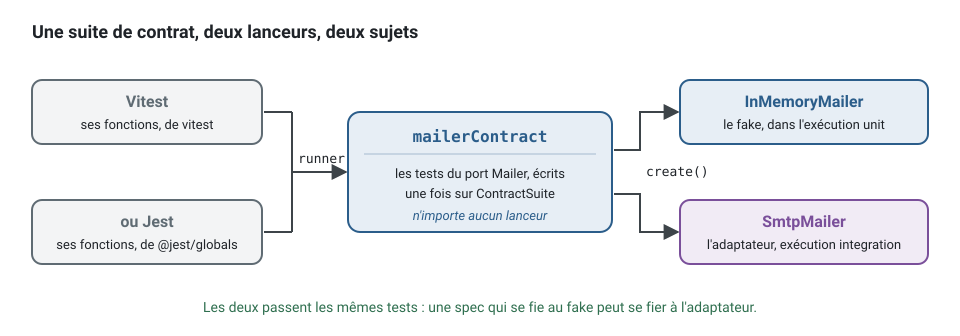

[English](test-runners.md) · **Français**
<!-- translation-of: test-runners.md sha256:c8878dd81a9ea8a7 -->

# Lanceurs de tests : Vitest et Jest

**Résumé.** L'approche des tests du kit (des *fakes* au lieu de *mocks*, des *builders*, des
suites de contrat, quatre niveaux de tests) ne dépend pas d'un lanceur : les utilitaires n'en
importent aucun, et les suites de contrat prennent les fonctions du lanceur en argument. Il faut
tout de même en choisir un. Vitest est le défaut, et c'est sur lui que reposent le *pipeline*
propre au kit, les seuils de couverture et les preuves de bout en bout. Jest est pris en charge
par le générateur avec une configuration plus étroite. Cette page compare les deux pour ce genre
de projet et dit exactement ce que chaque choix vous donne.

## Ce que le lanceur doit faire ici

Un contexte de l'application scheduling a des *specs* à plusieurs niveaux (voir la
[stratégie de test](../concepts/testing-strategy.fr.md) et la section 7 de la
[référence de l'architecture](../ARCHITECTURE.fr.md)) :

- `Appointment` refuse une seconde annulation : une *spec* pure du domaine, des millisecondes ;
- `CancelAppointment` par le bus de commandes en mémoire avec des *fakes* : des millisecondes ;
- le *repository* des rendez-vous face à PostgreSQL, tenu au contrat des *repositories* : des
  secondes ;
- `POST /appointments` de bout en bout par HTTP et le bus d'événements : des secondes.


Le lanceur doit donc exécuter du TypeScript écrit en modules ES, gérer les décorateurs (le style
déclaré en place un sur les gestionnaires et les adaptateurs), séparer *specs* rapides et lentes,
et mesurer la couverture par couche. Il n'a pas besoin d'un système de *mocks* : `test/no-mocks`
les décourage. Au lieu d'un *mock* qui vérifie un appel :

```ts
// contexts/notification/test/unit/send-reminder.handler.spec.ts : signalé par test/no-mocks
const mailer = { deliver: vi.fn() };
await new SendReminderHandler(mailer).execute(reminder);
expect(mailer.deliver).toHaveBeenCalledWith('ada@example.test', expect.anything()); // lie la spec à l'appel
```

écrivez un *fake* qui implémente le port, et vérifiez le résultat. Rien dedans n'appartient à un
lanceur, sauf `it` et `expect` :

<!-- checked sample -->
```ts
import { expect, it } from 'vitest';

// application/ports/mailer.port.ts et le gestionnaire testé, réduits à ce qu'utilise la spec
abstract class Mailer {
  abstract deliver(address: string, subject: string): Promise<void>;
}
class SendReminderHandler {
  constructor(private readonly mailer: Mailer) {}

  async execute({ address, startsAt }: { address: string; startsAt: Date }): Promise<void> {
    await this.mailer.deliver(address, `Reminder: your appointment at ${startsAt.toISOString()}`);
  }
}

// test/fakes/in-memory-mailer.ts : un fake implémente le port et garde ce qu'on lui a donné
class InMemoryMailer implements Mailer {
  readonly sent: { address: string; subject: string }[] = [];

  async deliver(address: string, subject: string): Promise<void> {
    this.sent.push({ address, subject });
  }
}

it('reminds the client of the appointment', async () => {
  const mailer = new InMemoryMailer();

  await new SendReminderHandler(mailer).execute({ address: 'ada@example.test', startsAt: new Date('2026-03-02T09:00:00Z') });

  expect(mailer.sent).toEqual([{ address: 'ada@example.test', subject: 'Reminder: your appointment at 2026-03-02T09:00:00.000Z' }]);
});
```

Sous Jest, la même *spec* importe `expect` et `it` depuis `@jest/globals` ; le reste ne change
pas.

## Comparaison

Versions et licences lues sur npm le 2026-10-10.

| | Vitest | Jest |
|---|---|---|
| Version, licence | 5.0.3, MIT | 30.5.2, MIT |
| TypeScript | pris en charge d'emblée, par les transformateurs de Vite | demande un transformateur (`babel-jest` avec votre configuration Babel par défaut) : le *template* du kit utilise `@swc/jest` |
| Modules ES | « ESM first », selon ses propres mots | expérimental, selon les propres mots de Jest, par l'option `--experimental-vm-modules` de Node, que passent les scripts générés |
| Décorateurs | abaisse lui-même les décorateurs legacy et non les standard (TC39), qui demandent le *plugin* du kit (comme l'indique le README de testing et comme l'exercent les suites du kit ; introuvable sur vitest.dev) | ce que fait le transformateur : le *template* du kit règle `@swc/jest` sur le mode du projet, legacy avec métadonnées (class-validator, NestJS) ou standard (`decoratorVersion: '2022-03'`) |
| Projets (unit et integration séparés) | oui, utilisé par le kit | oui, comme fonction de Jest (`projects`) ; non utilisé par le *template* du kit |
| Couverture | fournisseur `v8`, `istanbul` ou personnalisé ; seuils par motif glob, utilisés par le kit | fournisseur `babel` (par défaut) ou `v8` ; `coverageThreshold` global, par glob ou par chemin ; le *template* du kit le fixe par `governedJestCoverage()` à partir de `ddd-ts-kit.config.json`, par contexte et par couche, en une seule exécution |
| Mode surveillance (watch) | relance les tests liés à un changement en parcourant le graphe des modules | `--watch` relance les tests liés aux fichiers modifiés, ce qui demande un dépôt git ou hg et un graphe de dépendances statique ; `--watchAll` relance tout |
| Globales | importées de `vitest` | importées de `@jest/globals` dans les *specs* générées |
| Écosystème (un jugement, pas un fait mesuré) | plus récent, aligné sur Vite | plus ancien, beaucoup de suites existantes |

Les lignes consacrées aux fonctionnalités ont été lues le 2026-10-10 dans la documentation de Vitest 5.0.3
(https://vitest.dev/guide/features , https://vitest.dev/config/coverage) et de Jest 30.5
(https://jestjs.io/docs/configuration , https://jestjs.io/docs/ecmascript-modules ,
https://jestjs.io/docs/cli). La ligne des décorateurs pour Vitest et la ligne de l'écosystème ne
viennent pas de ces pages et sont marquées comme telles.

La vérification des types n'est faite par aucun des deux : tous deux retirent les types. Le
compilateur s'en charge, dans sa propre porte.

Les comparaisons de vitesse entre les deux dépendent du projet et n'ont pas été mesurées pour
cette page.

## Critères de choix

- **Ce que le kit prouve.** Les *stacks* que la CLI génère, exécute et passe au *lint* de bout en
  bout dans sa propre suite de tests sont des projets Vitest. Avec Jest, vous quittez ce chemin
  vérifié (détails plus bas).
- **Suites existantes.** Une organisation avec des milliers de *specs* Jest, des *presets*
  partagés et des personnes formées a une vraie raison de rester sur Jest.
- **Mode des décorateurs du projet.** Avec class-validator ou NestJS, le projet est dans le mode
  legacy des décorateurs et les deux lanceurs le gèrent. Dans le mode standard, Vitest a besoin
  d'une ligne de *plugin*, que la configuration générée contient ; le *template* Jest règle le
  mode standard dans les options de `@swc/jest`.
- **Portes de couverture par couche.** Les deux configurations lisent les seuils dans `ddd-ts-kit.config.json` (`governedCoverage`, `governedJestCoverage`). La porte Vitest est exécutée sur des projets générés par la suite de bout en bout de la CLI ; celle de Jest est écrite mais pas exécutée là, le *workspace* n'installe pas Jest.
- **Habitudes du framework.** La documentation et les générateurs de NestJS supposent Jest ;
  c'est une habitude, pas une contrainte, puisque les gestionnaires et les agrégats du kit se
  testent sans le framework.

## Ce que ce kit prend en charge et a vérifié

**Les parties indépendantes du lanceur** ([`@ddd-ts-kit/testing`](../../packages/testing/README.fr.md)) :

- les *builders*, les scénarios étant donné / quand / alors, `createTestBuses` et
  `InMemoryRepository` n'importent aucun lanceur ni aucune bibliothèque ;
- les suites de contrat de `@ddd-ts-kit/testing/contracts` (`repositoryContract`,
  `unitOfWorkContract`, `eventBusContract`, `outboxStoreContract`,
  `processedEventStoreContract`, `cacheContract`, `lockContract`, `rateLimiterContract`,
  `jobSchedulerContract`, `loggerContract` et les autres que liste son README) prennent
  `{ describe, it, expect, beforeEach }`, et `afterEach` quand il est donné, de l'appelant, et
  n'utilisent que `toBe` et `toEqual`, « which the globals of vitest and jest both provide »,
  selon les mots du README ;
- la règle contre les *mocks* nomme les fonctions `vi.*` et `jest.*` de la même façon.

Un port à vous reçoit un contrat de la même façon, sur la classe de base `ContractSuite`, et le
*fake* comme l'adaptateur réel y sont tous deux tenus, quel que soit le lanceur du projet :



<!-- checked sample -->
```ts
import { ContractSuite, type Awaitable, type ContractRunner } from '@ddd-ts-kit/testing/contracts';
import { afterEach, beforeEach, describe, expect, it } from 'vitest';

// application/ports/mailer.port.ts
export abstract class Mailer {
  abstract deliver(address: string, subject: string): Promise<void>;
  abstract deliveredTo(address: string): Promise<readonly string[]>;
}

// test/contracts/mailer.contract.ts : ce que tout Mailer doit faire, sans aucun lanceur importé
export function mailerContract(runner: ContractRunner, options: { name: string; create(): Awaitable<Mailer> }): void {
  new MailerSuite(runner, () => options.create()).describe(`${options.name} (mailer contract)`);
}

class MailerSuite extends ContractSuite<Mailer> {
  protected tests(): void {
    this.it('keeps what it delivered, per address', async () => {
      await this.subject.deliver('ada@example.test', 'Reminder');

      this.expect(await this.subject.deliveredTo('ada@example.test')).toEqual(['Reminder']);
      this.expect(await this.subject.deliveredTo('bob@example.test')).toEqual([]);
    });
  }
}

// test/fakes/in-memory-mailer.ts
class InMemoryMailer implements Mailer {
  private readonly sent = new Map<string, string[]>();

  async deliver(address: string, subject: string): Promise<void> {
    this.sent.set(address, [...(this.sent.get(address) ?? []), subject]);
  }

  async deliveredTo(address: string): Promise<readonly string[]> {
    return this.sent.get(address) ?? [];
  }
}

// test/unit/in-memory-mailer.contract.spec.ts : le lanceur remet ses fonctions
mailerContract({ describe, it, expect, beforeEach, afterEach }, { name: 'InMemoryMailer', create: () => new InMemoryMailer() });
```

La *spec* de l'adaptateur, sous `test/integration/`, appelle le même `mailerContract` avec un
`create` qui construit l'adaptateur réel. Sous Jest, la première ligne importe plutôt les cinq
fonctions depuis `@jest/globals` ; `ContractRunner` ne leur demande rien de plus.

**Avec Vitest (le défaut) :**

- `vitest.config.ts` avec les projets `unit` et `integration` et les seuils de couverture du
  fichier de configuration, par contexte et par couche (le domaine le plus haut,
  l'infrastructure le plus bas, cette dernière mesurée par l'exécution integration du
  *pipeline*), et les *specs* des contextes qu'une *pull request* n'atteint pas laissées à la
  branche par défaut (`unaffectedContexts()`). Réduit à ses parties, pour un projet dans le mode
  standard des décorateurs :

<!-- checked sample -->
```ts
// vitest.config.ts
import { governedCoverage } from '@ddd-ts-kit/testing/coverage';
import { decorators } from '@ddd-ts-kit/testing/vitest';
import { defineConfig } from 'vitest/config';

const INTEGRATION_SPECS = 'src/contexts/*/test/integration/**/*.spec.ts';

export default defineConfig(({ mode }) => ({
  // décorateurs standard, compilés par le compilateur du projet ; les legacy n'ont besoin d'aucun plugin
  plugins: [decorators({ compiler: '@typescript/native' })],
  resolve: { tsconfigPaths: true },
  test: {
    projects: [
      { extends: true, test: { name: 'unit', include: ['src/**/*.spec.ts'], exclude: [INTEGRATION_SPECS] } },
      { extends: true, test: { name: 'integration', include: [INTEGRATION_SPECS] } },
    ],
    // ce qui est mesuré et le plancher de chaque couche : lus dans ddd-ts-kit.config.json
    coverage: { provider: 'v8', reporter: ['text', 'cobertura', 'lcov'], ...governedCoverage(mode) },
  },
}));
```

- hors *pipeline* (pas de variable `CI`), les *specs* prennent la moitié des cœurs
  (`maxWorkers: '50%'`) : une machine de développement les partage avec l'éditeur et les agents
  de code. `VITEST_MAX_WORKERS` fixe un autre nombre, pour un bac à sable plafonné sous les cœurs
  de son hôte ;
- une configuration de bout en bout séparée qui démarre toute l'application sur un port libre,
  sur un PostgreSQL dans le processus, sauf si une URL de base de données est donnée ;
- des rapports JUnit et Cobertura pour GitLab, le rapporteur Actions pour GitHub ;
- `decorators()` de `@ddd-ts-kit/testing/vitest` pour les projets dans le mode standard des
  décorateurs : Vitest 5 n'abaisse pas les décorateurs standard, et une *spec* qui importe un
  fichier décoré s'arrêterait sur une erreur de syntaxe. Le *plugin* ne compile que les fichiers
  qui portent un décorateur, avec le compilateur du projet (TypeScript 7 natif compris, puisqu'il
  exécute le binaire), met le résultat en cache (environ 60 ms par fichier la première fois avec
  TypeScript 7, 220 ms avec TypeScript 6, rien ensuite, comme mesuré dans le README), garde les
  *source maps*, et s'efface dans le mode legacy. Il ne vérifie pas les types et ne touche pas
  aux `.tsx` ;
- les projets générés que la CLI prouve entièrement (*specs*, *specs* de bout en bout, build,
  vérifications de la documentation, *lint*, graphe des imports, code mort) sont listés dans le
  README de la CLI ; aucun n'y est décrit comme un projet Jest.

**Avec Jest (`init --tests jest`).** Ce qui suit a été lu dans un projet généré le
2026-10-10 :

- un `jest.config.js` qui utilise `@swc/jest`, avec les décorateurs compilés dans le mode du
  projet (legacy avec métadonnées, ou standard), la gestion des modules ES, l'alias d'import
  traduit et les contextes qu'une *pull request* n'atteint pas laissés de côté :

```js
// jest.config.js, tel que généré pour un projet dans le mode standard des décorateurs (réduit)
import { governedJestCoverage, unaffectedContexts } from '@ddd-ts-kit/testing/coverage';

export default {
  testEnvironment: 'node',
  moduleNameMapper: { '^@/(.*)$': '<rootDir>/src/$1.ts' }, // les "paths" de tsconfig.json, répétés
  testPathIgnorePatterns: ['/node_modules/', ...unaffectedContexts().map((directory) => `/${directory}`)],
  extensionsToTreatAsEsm: ['.ts'],
  transform: {
    '^.+\\.ts$': ['@swc/jest', { jsc: { parser: { syntax: 'typescript', decorators: true }, transform: { decoratorVersion: '2022-03' }, target: 'es2022' } }],
  },
  ...(process.env.CI ? {} : { maxWorkers: '50%' }), // half of the cores outside a pipeline
  coverageProvider: 'v8',
  ...governedJestCoverage(),
};
```

- un `jest.e2e.config.js` qui l'étend, avec un délai plus long et un seul *worker* ;
- `jest`, `@jest/globals`, `@swc/core` et `@swc/jest` en dépendances de développement ; les
  *specs* générées importent leurs globales depuis `@jest/globals` ;
- un seul script de test pour les *specs* unitaires et d'adaptateurs ensemble, lancé avec
  `node --experimental-vm-modules` : le script d'intégration du *pipeline* se contente d'afficher
  que les *specs* d'adaptateurs s'exécutent avec les *specs* unitaires ;
- `jest.config.js` avec le fournisseur de couverture `v8` et les seuils du fichier de
  configuration, par contexte et par couche, dans l'unique exécution que fait Jest
  (`npm run test:coverage`) ;
- des tests unitaires de la CLI vérifient que ces fichiers et la *stack* enregistrée sont
  produits. Aucune preuve n'a été trouvée qu'un projet Jest généré soit installé et exécuté par
  la suite de bout en bout propre au kit.

## Limites, et quand ne pas l'utiliser

**Vitest**

- Les décorateurs standard ont besoin du *plugin* ; l'oublier donne une erreur de syntaxe au
  premier import décoré, pas un message utile.
- Le *plugin* appelle le compilateur du projet une fois par fichier décoré quand le cache est
  froid : une première exécution en CI sans cache le paie pour chacun de ces fichiers.
- L'outillage autour d'une nouvelle version majeure peut être en retard : le README du
  *pipeline* rapporte que l'outil de test de mutation essayé ne fonctionnait pas avec Vitest 5.

**Jest**

- Les modules ES reposent sur `--experimental-vm-modules`. La documentation de Node.js
  (v26.11.1, lue le 2026-10-10, https://nodejs.org/api/vm.html) qualifie `vm.Module`,
  `vm.SourceTextModule` et `vm.SyntheticModule` de « Stability: 1 - Experimental », et la page
  propre à Jest dit sa prise en charge d'ESM expérimentale ; simuler un module en ESM passe par
  `jest.unstable_mockModule`.
- `@swc/jest` a été publié pour la dernière fois en septembre 2025 (0.2.39 sur npm) ; il
  fonctionne avec le Jest actuel dans la mesure où le *template* le suppose, ce qui n'a pas été
  exécuté pour cette page.
- Le *template* écrit le mode des décorateurs du projet dans `jest.config.js` quand le projet est
  généré : Jest ne lit pas `tsconfig.json`, si bien qu'un projet qui change plus tard son mode
  là-bas change aussi les options de `transform` de `jest.config.js`.
- Pas de séparation unit et integration, pas de preuve dans le dépôt d'une exécution
  complète : c'est à vous de les ajouter et de les faire fonctionner.

**L'un comme l'autre**

- Un lanceur ne rend pas un test bon. Une *spec* qui vérifie des appels au lieu de résultats est
  aussi fragile sous Vitest que sous Jest.
- Ne mélangez pas les deux lanceurs dans un projet : deux configurations, deux chaînes de
  transformation et deux jeux de globales, sans rien y gagner.

## Recommandation selon la situation

| Situation | Choix |
|---|---|
| Nouveau projet | Vitest : le défaut, le chemin vérifié, seuils et rapports compris |
| Style déclaré dans le mode standard des décorateurs | Vitest avec le *plugin* `decorators()` |
| Projet NestJS ou class-validator (décorateurs legacy) | Vitest fonctionne sans le *plugin* ; Jest si l'outillage NestJS de l'équipe repose dessus |
| Base de code existante avec une grosse suite Jest qui adopte le kit | Jest, en ajoutant à la main la séparation des projets et les seuils ; ne planifiez une migration que si elle est rentable |
| Une bibliothèque ou un adaptateur publié pour d'autres | écrivez son contrat avec `ContractSuite`, pour que les consommateurs l'exécutent sous l'un ou l'autre lanceur |
| Vouloir des tests de mutation | non disponible dans le kit aujourd'hui, avec l'un comme l'autre lanceur |
| Vouloir des tests par propriétés | `fast-check`, ajouté avec la première propriété (`npm i -D fast-check`), sous l'un comme l'autre lanceur : une loi d'un objet-valeur énoncée une fois et vérifiée sur des valeurs générées, `fc.assert` une assertion pour `test/assertion-present` |

## Sources

- Ce dépôt : `packages/testing/README.md` (suites de contrat, « Standard decorators under
  Vitest »), `packages/cli/README.md` (`init`, « Development »), `pipeline/README.md` (seuils de
  couverture, rapports, tests de mutation), `docs/ARCHITECTURE.md` sections 5 et 7 ; les
  *templates* `packages/cli/templates/init/jest.config.js.tpl` et
  `packages/cli/templates/init/e2e/jest.e2e.config.js.tpl`.
- Vitest : https://vitest.dev/guide/features et https://vitest.dev/config/coverage (v5.0.3, lus
  le 2026-10-10) ; npm : https://www.npmjs.com/package/vitest
- Jest 30.5 : https://jestjs.io/docs/configuration , https://jestjs.io/docs/ecmascript-modules
  et https://jestjs.io/docs/cli (lus le 2026-10-10) ; npm : https://www.npmjs.com/package/jest
- Node.js, module `vm` (stabilité des modules VM) : https://nodejs.org/api/vm.html
- `@swc/jest` : https://www.npmjs.com/package/@swc/jest
- Proposition TC39 sur les décorateurs : https://github.com/tc39/proposal-decorators
- Martin Fowler, « Mocks Aren't Stubs », martinfowler.com.
- Steve Freeman et Nat Pryce, Growing Object-Oriented Software, Guided by Tests,
  Addison-Wesley, 2009.

## Voir aussi

- [Stratégie de test](../concepts/testing-strategy.fr.md)
- [L'analyse statique et le *pipeline*](static-analysis-and-pipeline.fr.md)
- [Ports et composition](../concepts/ports-and-composition.fr.md) : modes des décorateurs
- [Injection de dépendances](dependency-injection.fr.md)
- [Configuration](../CONFIG.fr.md) : `stack.tests`
