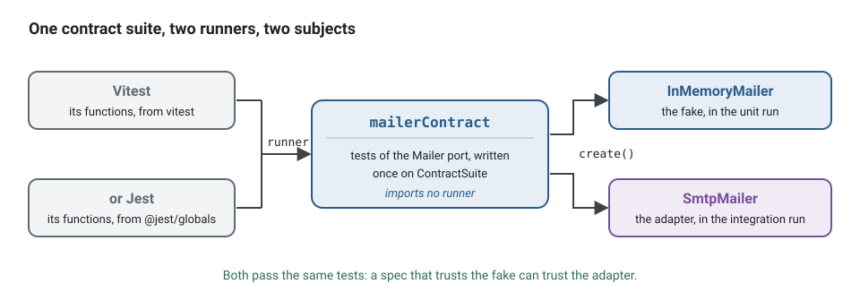

**English** · [Français](test-runners.fr.md)

# Test runners: Vitest and Jest

**Summary.** The testing approach of the kit (fakes instead of mocks, builders, contract
suites, four test levels) does not depend on a runner: the helpers import none, and the
contract suites take the runner's functions as an argument. A runner still has to be chosen.
Vitest is the default and the one the kit's own pipeline, coverage thresholds and end-to-end
proofs are built on. Jest is supported by the generator with a narrower setup. This page
compares the two for this kind of project and states exactly what each choice gives you.

## What the runner has to do here

A context of the scheduling application has specs at several levels (see the
[testing strategy](../concepts/testing-strategy.md) and section 7 of the
[architecture reference](../ARCHITECTURE.md)):

- `Appointment` refuses a second cancellation: a pure domain spec, milliseconds;
- `CancelAppointment` through the in-memory command bus with fakes: milliseconds;
- the appointment repository against PostgreSQL, held to the repository contract: seconds;
- `POST /appointments` end to end over HTTP and the event bus: seconds.


So the runner must run TypeScript written as ES modules, handle decorators (the declared style
puts one on handlers and adapters), split fast and slow specs, and measure coverage per layer.
It does not need a mocking system: `test/no-mocks` discourages one. Instead of a mock that
asserts a call:

```ts
// contexts/notification/test/unit/send-reminder.handler.spec.ts: reported by test/no-mocks
const mailer = { deliver: vi.fn() };
await new SendReminderHandler(mailer).execute(reminder);
expect(mailer.deliver).toHaveBeenCalledWith('ada@example.test', expect.anything()); // ties the spec to the call
```

write a fake that implements the port, and assert the outcome. Nothing in it belongs to a
runner but `it` and `expect`:

<!-- checked sample -->
```ts
import { expect, it } from 'vitest';

// application/ports/mailer.port.ts and the handler under test, reduced to what the spec uses
abstract class Mailer {
  abstract deliver(address: string, subject: string): Promise<void>;
}
class SendReminderHandler {
  constructor(private readonly mailer: Mailer) {}

  async execute({ address, startsAt }: { address: string; startsAt: Date }): Promise<void> {
    await this.mailer.deliver(address, `Reminder: your appointment at ${startsAt.toISOString()}`);
  }
}

// test/fakes/in-memory-mailer.ts: a fake implements the port and keeps what it was given
class InMemoryMailer implements Mailer {
  readonly sent: { address: string; subject: string }[] = [];

  async deliver(address: string, subject: string): Promise<void> {
    this.sent.push({ address, subject });
  }
}

it('reminds the client of the appointment', async () => {
  const mailer = new InMemoryMailer();

  await new SendReminderHandler(mailer).execute({ address: 'ada@example.test', startsAt: new Date('2026-03-02T09:00:00Z') });

  expect(mailer.sent).toEqual([{ address: 'ada@example.test', subject: 'Reminder: your appointment at 2026-03-02T09:00:00.000Z' }]);
});
```

Under Jest, the same spec imports `expect` and `it` from `@jest/globals`; the rest is unchanged.

## Comparison

Versions and licences were read from npm on 2026-10-10.

| | Vitest | Jest |
|---|---|---|
| Version, licence | 5.0.3, MIT | 30.5.2, MIT |
| TypeScript | supported out of the box, through Vite's transformers | needs a transformer (`babel-jest` with your Babel configuration by default): the kit's template uses `@swc/jest` |
| ES modules | "ESM first" in its own words | experimental in Jest's own words, through Node's `--experimental-vm-modules` flag, which the generated scripts pass |
| Decorators | lowers legacy decorators itself and not standard (TC39) ones, which need the kit's plugin (as the testing README states and the kit's suites exercise; not found on vitest.dev) | whatever the transformer does: the kit's template sets `@swc/jest` to the mode of the project, legacy with metadata (class-validator, NestJS) or standard (`decoratorVersion: '2022-03'`) |
| Projects (unit and integration apart) | yes, used by the kit | yes as a Jest feature (`projects`); not used by the kit's template |
| Coverage | `v8`, `istanbul` or a custom provider; thresholds per glob pattern, used by the kit | `babel` (default) or `v8` provider; `coverageThreshold` global, per glob or per path; the kit's template sets it through `governedJestCoverage()` from `ddd-ts-kit.config.json`, per context and layer, in a single run |
| Watch mode | reruns the tests related to a change by searching the module graph | `--watch` reruns the tests related to changed files, which needs a git or hg repository and a static dependency graph; `--watchAll` reruns everything |
| Globals | imported from `vitest` | imported from `@jest/globals` in generated specs |
| Ecosystem (a judgement, not a measured fact) | newer, aligned with Vite | older, many existing suites |

The feature rows were read on 2026-10-10 from the documentation of Vitest 5.0.3
(https://vitest.dev/guide/features , https://vitest.dev/config/coverage) and of Jest 30.5
(https://jestjs.io/docs/configuration , https://jestjs.io/docs/ecmascript-modules ,
https://jestjs.io/docs/cli). The decorator row for Vitest and the ecosystem row are not from
those pages and are marked as such.

Type checking is done by neither: both strip types. The compiler does it in its own gate.

## Speed, measured

Measured on 2026-10-27, on one workstation (Intel Core i7-12700H, 20 logical CPUs, 31 GB, Linux,
Node.js 24.22.1). Each pair of projects is the same project twice but for `--tests`: kit 0.97.0
installed from npm, Vitest 5.0.3 (5.0.5 in the example), Jest 30.5.2 with `@swc/jest` 0.2.39 and
`@swc/core` 1.16.20, the configurations `init` writes, coverage by the `v8` provider on both.

| Project | Spec files | Tests | Decorators |
|---|---|---|---|
| `init --context billing:core` | 2 | 51 | standard |
| `init --context billing:core --preset identity` | 60 (9 against PGlite) | 295 | standard |
| the scheduling example, its specs ported to Jest (below) | 283 (32 against PGlite) | 1,549 | legacy, with metadata |

The example was ported by changing only the runner: the 283 spec files import `describe`, `it`,
`expect` and the hooks from `@jest/globals` instead of `vitest`, and `jest.config.js` is the one
the template writes for the legacy decorator mode. Both runs pass the same 1,549 tests. The
end-to-end specs, which do not run in the unit job, were left out.

How it was measured: each runner started directly, as the `test` script of the project starts it
(`vitest run`; `node --experimental-vm-modules node_modules/jest/bin/jest.js`), one command at a
time, alternating Vitest and Jest, under `nice`. Workers as the generated configurations set them
on a workstation, half the logical CPUs (10). "Cold" removes the cache of the runner first
(`node_modules/.vite`, the `cacheDirectory` of Jest); "warm" keeps it. "4 CPUs, CI" is the same
run with `CI=1` on four logical CPUs (two cores and their hyperthreads, `taskset`), the size of a
hosted runner, where each runner picks its own number of workers. Each figure is the median of 3
to 5 runs (2 for the cold runs of the example); the slowest and the fastest run of a series were
within 8 percent of each other, 10 for Jest with coverage on four CPUs (193 to 212 s). CPU is
user plus system time of the whole process tree; memory is the peak of the summed resident memory
of the tree, which counts shared pages more than once: compare it between the two columns, not
with the memory of a machine. A run during which other processes of the machine took more than
one CPU on average was discarded and taken again.

**The example (283 files)**

| Run | Vitest | Jest |
|---|---|---|
| all specs, warm | 25.4 s, 373 CPU s, 7.8 GB | **18.1 s**, 260 CPU s, 8.8 GB |
| all specs, cold | 24.7 s, 361 CPU s, 7.1 GB | **21.2 s**, 314 CPU s, 11.2 GB |
| unit specs only, warm | 12.8 s, 170 CPU s | **8.9 s**, 120 CPU s |
| integration specs only (PGlite), warm | 11.6 s, 180 CPU s | **10.4 s**, 148 CPU s |
| all specs with coverage, warm | **29.5 s**, 417 CPU s, 7.6 GB | 47.9 s, 563 CPU s, 9.3 GB |
| one spec file, warm | 0.42 s | 0.35 s |
| all specs, 4 CPUs, CI | 74.3 s, 275 CPU s | **56.4 s**, 206 CPU s |
| all specs with coverage, 4 CPUs, CI | **85.3 s**, 312 CPU s | 201.3 s, 665 CPU s |

**The identity preset (60 files)**

| Run | Vitest | Jest |
|---|---|---|
| all specs, warm | 6.3 s, 69 CPU s, 8.9 GB | **4.8 s**, 70 CPU s, 7.9 GB |
| all specs, cold | 10.2 s, 74 CPU s | **5.5 s**, 72 CPU s |
| unit specs only, warm | 3.6 s, 41 CPU s | **2.8 s**, 23 CPU s |
| integration specs only (PGlite), warm | 3.4 s, 28 CPU s | 3.4 s, 45 CPU s |
| all specs with coverage, warm | 7.2 s, 75 CPU s, 9.0 GB | **6.4 s**, 74 CPU s, 6.2 GB |
| one spec file, warm | 1.30 s | **0.48 s** |
| all specs, 4 CPUs, CI | 16.8 s, 58 CPU s | **11.4 s**, 41 CPU s |
| all specs with coverage, 4 CPUs, CI | **18.6 s** | 19.8 s |

**A new project (2 files):** 2.1 s for both without coverage, cold or warm; with coverage 2.4 s
on Vitest and 2.7 s on Jest. Below some ten files the start of the runner is the whole run.

What the figures say:

- **Without coverage, Jest is the faster of the two here:** 24 to 29 percent less wall time warm
  on the two larger projects, and 30 to 45 percent less CPU on the unit specs. A workstation
  running the specs while it works gets the results sooner on Jest.
- **With coverage, the order turns on a grown project:** on the identity preset the two stay
  close (Jest 6.4 s against 7.2 on the workstation, Vitest 18.6 s against 19.8 on four CPUs), but on
  the example Vitest takes 29.5 s against 47.9 s, and 85 s against 201 s on four CPUs. Jest's `v8`
  provider is the cost: the same Jest run with the `babel` provider takes 20.5 s, and 64.7 s on
  four CPUs, faster than Vitest on both (below). The pipeline a project gets runs its specs with
  coverage (`ci:test:unit`): with the `v8` provider the Jest template of 0.97.0 set, measured
  here, the example's unit job was faster on Vitest; the template now sets `babel`.
- **A cold start costs Vitest in the standard decorator mode:** 10.2 s against 6.3 s warm on the
  identity preset, since the `decorators()` plugin compiles each decorated file once (see the
  limits below); the example, in the legacy mode, does not need that plugin and runs as fast cold
  as warm. A pipeline that does not keep `node_modules/.vite` pays the cold figure.
- **The integration specs measure the template as much as the runner.** The Vitest template
  starts PostgreSQL in process once per run and each spec opens a copy of it (a global setup,
  `test/support/test-database-template.ts`); the Jest template of 0.97.0, measured here, started
  one per spec file. On the identity preset that cost Jest 45 CPU s against 28 for the same wall
  time; the same Jest run given that global setup took 3.1 s and 26 CPU s, and the Jest template
  now writes it. The example opens its database the same way under both runners.
- **One file, the loop of a developer:** under half a second on both for a file of the example;
  1.3 s on Vitest against 0.5 s on Jest on the identity preset, most likely the decorator plugin
  of Vitest starting for that one file: on the example, which has none, the gap is 0.07 s.

**Coverage providers.** Each runner has two; the same runs, warm, with what each one reports for
the whole project. Every provider met the thresholds of both projects but `istanbul` on the
example.

| Provider | Example | Identity preset | Statements, branches reported (example; identity) |
|---|---|---|---|
| Vitest `v8` (the template) | 29.5 s, 418 CPU s | 7.2 s | 99.6 %, 95.3 % of 637; 99.0 %, 94.4 % of 234 |
| Vitest `istanbul` | 26.1 s, 369 CPU s, fails a threshold | 8.4 s | 99.7 %, 91.3 % of 699; 99.0 %, 94.4 % of 234 |
| Jest `v8` (the template) | 48.0 s, 562 CPU s | 6.5 s | 98.1 %, 97.6 %; 99.0 %, 97.5 % |
| Jest `babel` | **20.6 s**, 286 CPU s | **6.4 s**, 85 CPU s | 99.6 %, 95.3 %; 98.7 %, 94.4 % |

On four CPUs with `CI=1`, warm: the example takes 85.3 s on Vitest `v8`, 201.3 s on Jest `v8` and
**64.7 s** on Jest `babel`; the identity preset 18.6, 19.8 and **16.4 s**. Jest's `babel` provider
reports the same branch figures as Vitest's `v8`; Jest's `v8` provider reports two to three points
more branches covered than the other two, so a threshold set on it can fail after a change of
provider. Vitest's `istanbul` counts 62 more branches on the example, in its legacy decorator
mode, and one folder falls under its threshold (75 % against 80).

**Workers.** The example, warm, without coverage, with `--maxWorkers` forced (the generated
configurations use half the logical CPUs on a workstation, 10 here):

| Workers | Vitest | Jest |
|---|---|---|
| 1 | 114.9 s, 1.5 GB | 111.7 s, 3.5 GB |
| 2 | 60.7 s, 2.1 GB | 49.2 s, 4.3 GB |
| 4 | 35.6 s, 3.8 GB | 26.5 s, 5.4 GB |
| 10 (the default here) | 25.4 s, 8.0 GB | 18.2 s, 8.8 GB |
| 20 | 23.9 s, 15.4 GB | 19.1 s, 17.0 GB |

On one worker the two runners take the same time: Jest's lead appears with parallel workers.
Beyond half the logical CPUs (the hyperthreads), the run gains 1.5 s on Vitest, loses 0.9 s on
Jest, and doubles the memory. The single-worker figure is one run; the others are the median of
two.

**Other settings of the runner**, the example, warm, without coverage, all 1,549 tests passing in
each case:

| Setting | Vitest | Jest |
|---|---|---|
| as generated (`forks`, isolated; child processes) | 25.4 s, 373 CPU s | 18.1 s, 260 CPU s |
| `--pool=threads` | 20.1 s, 256 CPU s | |
| `--no-isolate` | **12.1 s**, 180 CPU s | |
| `--workerThreads` | | 17.2 s, 217 CPU s |

**The loop of a developer.** The specs related to one changed file (`vitest related --run <file>`,
`jest --findRelatedTests <file>`): both runners pick the same files from the import graph.

| Changed file of the example | Specs picked | Vitest | Jest |
|---|---|---|---|
| `calendar.aggregate.ts` | 47 files, 356 tests | 5.3 s | 4.7 s |
| `slot.vo.ts` (a value object used across the context) | 83 files, 558 tests | 8.7 s | 7.5 s |
| a filter that matches no file | 0 | 0.20 s | 0.25 s |

The start of either runner alone is a fifth of a second: the 1.3 s of one Vitest file on the
identity preset come from the configuration of that project (the decorator plugin, the two
projects), not from the start of the runner.

**A pipeline that keeps no cache**, four CPUs, `CI=1`, with coverage, cold against warm:

| Project | Vitest `v8` | Jest `v8` | Jest `babel` |
|---|---|---|---|
| example, cold | 85.2 s | 260.2 s | 89.4 s |
| example, warm | 85.3 s | 201.3 s | 64.7 s |
| identity preset, cold | 22.5 s | 21.8 s | 20.3 s |
| identity preset, warm | 18.6 s | 19.8 s | 16.4 s |

Jest's transform cache is worth 25 to 59 s on the example; Vitest's cache is worth something only
in the standard decorator mode (4 s on the identity preset).

**Install.** `npm ci` of the new project on a warm npm cache: 4.5 s for Vitest, 5.2 s for Jest;
`node_modules` weighs 563 MB with 743 packages against 620 MB with 1,015.

**Mutation testing.** Stryker on the identity preset, as `init` configures it (659 mutants), one
run each. A run was stopped once the machine had less than 5 GB of memory available, and taken again.

| Test runner processes | Vitest | Jest |
|---|---|---|
| 19 (what Stryker picks here) | 1 min 46 s, score 85.0 %, 1,621 CPU s, 11.6 GB | stopped, 8 attempts |
| 8 (`--concurrency 8`) | 1 min 54 s, score 85.0 %, 980 CPU s, 5.4 GB | stopped, 8 attempts |
| 8, each restarted after 10 runs (`--maxTestRunnerReuse 10`) | | stopped, 2 attempts |

Under Jest the first run of the specs passes, in 6 s against 19 under Vitest; then the memory
available falls from about 25 GB to under 5 GB within the first minute, after some 65 mutants,
about 2.5 GB per Jest process. The restart after 10 runs never came into play: each process had
run about 8 by then. Before each stop, Stryker estimated the whole run at about 12 minutes, six to
seven times the Vitest run at the same number of processes. Under Vitest, 8 processes take 8 s
more than 19 for half the memory.

Neither runner wins every row: the choice stays a matter of the criteria below, speed weighing
for Jest on these projects, with coverage too since its template measures through `babel`, and
for Vitest on a cold pipeline of the example (85 s against 89). The settings that move these
figures are in the next section.

## Recommendations by case, for speed

Each line is a setting a project can change, with the gain measured above. None of them changes
which runner the kit verifies.

| Case | Setting | Measured gain | What to watch |
|---|---|---|---|
| Jest project whose pipeline runs coverage (every generated one) | `coverageProvider: 'babel'` in `jest.config.js`, which the template now sets; a project generated before had `'v8'` | example 48.0 to 20.6 s warm, 201 to 65 s on four CPUs, 260 to 89 s cold; identity preset 19.8 to 16.4 s on four CPUs | branches reported drop two to three points (97.6 to 95.3 % on the example): read the figures again before the next threshold change; a line left out of the measure carries `istanbul ignore`, which `babel` reads, not `v8 ignore`; the identity preset takes 14 percent more CPU |
| Jest project with specs against PGlite | start PostgreSQL once in a `globalSetup` and give each spec a copy, as both templates now do (`test/support/test-database-template.ts`, and `test-database-teardown.ts` under Jest) | identity preset 45 to 26 CPU s, 3.4 to 3.1 s | a project generated before keeps one initdb per spec file until it takes the two files of a new project and names them in `jest.config.js` |
| Vitest project with coverage | keep `v8`, the template's provider | `istanbul` is 3.4 s faster on the example, 1.2 s slower on the identity preset | `istanbul` counts more branches in the legacy decorator mode: one folder of the example fails its threshold |
| A workstation | keep the generated `maxWorkers: '50%'` | doubling it gains 1.5 s on Vitest and loses 0.9 s on Jest, for twice the memory (15 to 17 GB on the example) | on a machine short of memory, 4 workers take 36 s (Vitest) and 27 s (Jest) at 4 to 5 GB |
| Vitest on a workstation, the whole suite often | `--pool=threads` | 25.4 to 20.1 s, 31 percent less CPU | threads share one process: a spec that calls `process.chdir`, changes `process.env` for good or loads a native module behaves differently; the example passes |
| Vitest, the local loop | `--no-isolate` | 25.4 to 12.1 s | the modules loaded by one spec file are kept for the next ones of the worker: a spec that leaves a module in another state (a registry, a global clock, a module mock) breaks another one, in an order that changes from run to run; keep isolation in the pipeline |
| Jest, the whole suite often | `--workerThreads` | 18.1 to 17.2 s, 16 percent less CPU | Jest documents the option as experimental |
| Working on one file | `vitest related --run <file>`, `jest --findRelatedTests <file>`, or watch mode | example 25.4 to 5.3 s (Vitest), 18.1 to 4.7 s (Jest) for an aggregate | a file imported everywhere picks a third of the suite |
| A pipeline | keep the cache of the runner between runs: `node_modules/.vite` for Vitest, the `cacheDirectory` of Jest (by default under the system temporary folder, so name it in the config to cache it) | Jest 25 to 59 s on the example; Vitest 4 s in the standard decorator mode, nothing in the legacy one | a cache keyed on the lockfile and the configuration, so that a new transform does not reuse stale output |
| Fewer than ten spec files | either runner | 2.1 s on both | the start of the runner is the whole run |
| Mutation testing | at night, as shipped, not on each push; on Vitest, `--concurrency 8` on a workstation | 19 to 8 processes: 11.6 to 5.4 GB for 8 s more (1 min 54 s) on the identity preset | under Jest, Stryker did not complete the identity preset on a workstation of 31 GB, even at 8 processes: plan the job on Vitest, or try fewer processes restarted every few runs, not measured here |

## Selection criteria

- **What the kit proves.** The stacks the CLI generates, runs and lints end to end in its own
  test suite are Vitest projects. With Jest you leave that verified path (details below).
- **Existing suites.** An organisation with thousands of Jest specs, shared presets and
  trained people has a real reason to stay on Jest.
- **Decorator mode of the project.** With class-validator or NestJS the project is in the
  legacy decorator mode and both runners handle it. In the standard mode, Vitest needs one
  plugin line, which the generated config has; the Jest template sets the standard mode in the
  options of `@swc/jest`.
- **Coverage gates per layer.** Both configs read the thresholds from `ddd-ts-kit.config.json` (`governedCoverage`, `governedJestCoverage`). The Vitest gate is run on generated projects by the end-to-end suite of the CLI; the Jest one is written and not run there, although the suite runs the specs of a Jest stack (below).
- **Speed.** Measured above: Jest runs the specs of these projects faster without coverage,
  and with coverage through the `babel` provider its template sets (20.6 s against 29.5 on the
  example); through `v8`, the provider of its template until then, it was 1.6 to 2.4 times slower
  than Vitest there.
- **Framework habits.** NestJS documentation and generators assume Jest; that is a habit, not
  a constraint, since handlers and aggregates of the kit are tested without the framework.

## What this kit supports and verified

**Runner-agnostic parts** ([`@ddd-ts-kit/testing`](../../packages/testing/README.md)):

- builders, given/when/then scenarios, `createTestBuses` and `InMemoryRepository` import no
  runner and no library;
- the contract suites of `@ddd-ts-kit/testing/contracts` (`repositoryContract`,
  `unitOfWorkContract`, `eventBusContract`, `outboxStoreContract`,
  `processedEventStoreContract`, `cacheContract`, `lockContract`, `rateLimiterContract`,
  `jobSchedulerContract`, `loggerContract` and the others its README lists) take
  `{ describe, it, expect, beforeEach }`, and `afterEach` when given, from the caller and use
  only `toBe` and `toEqual`, "which the globals of vitest and jest both provide", in the
  README's words;
- the rule against mocks names the `vi.*` and the `jest.*` functions alike.

A port of your own gets a contract the same way, on the base class `ContractSuite`, and the
fake and the real adapter are both held to it, under whichever runner the project uses:



<!-- checked sample -->
```ts
import { ContractSuite, type Awaitable, type ContractRunner } from '@ddd-ts-kit/testing/contracts';
import { afterEach, beforeEach, describe, expect, it } from 'vitest';

// application/ports/mailer.port.ts
export abstract class Mailer {
  abstract deliver(address: string, subject: string): Promise<void>;
  abstract deliveredTo(address: string): Promise<readonly string[]>;
}

// test/contracts/mailer.contract.ts: what any Mailer must do, with no runner imported
export function mailerContract(runner: ContractRunner, options: { name: string; create(): Awaitable<Mailer> }): void {
  new MailerSuite(runner, () => options.create()).describe(`${options.name} (mailer contract)`);
}

class MailerSuite extends ContractSuite<Mailer> {
  protected tests(): void {
    this.it('keeps what it delivered, per address', async () => {
      await this.subject.deliver('ada@example.test', 'Reminder');

      this.expect(await this.subject.deliveredTo('ada@example.test')).toEqual(['Reminder']);
      this.expect(await this.subject.deliveredTo('bob@example.test')).toEqual([]);
    });
  }
}

// test/fakes/in-memory-mailer.ts
class InMemoryMailer implements Mailer {
  private readonly sent = new Map<string, string[]>();

  async deliver(address: string, subject: string): Promise<void> {
    this.sent.set(address, [...(this.sent.get(address) ?? []), subject]);
  }

  async deliveredTo(address: string): Promise<readonly string[]> {
    return this.sent.get(address) ?? [];
  }
}

// test/unit/in-memory-mailer.contract.spec.ts: the runner hands its functions over
mailerContract({ describe, it, expect, beforeEach, afterEach }, { name: 'InMemoryMailer', create: () => new InMemoryMailer() });
```

The adapter's spec, under `test/integration/`, calls the same `mailerContract` with a `create`
that builds the real adapter. Under Jest the first line imports the five functions from
`@jest/globals` instead; `ContractRunner` asks nothing more of them.

**With Vitest (the default):**

- `vitest.config.ts` with `unit` and `integration` projects and the coverage thresholds of the
  config file, per context and layer (domain highest, infrastructure lowest, the latter measured
  by the integration run of the pipeline), and the specs of the contexts a pull request does
  not reach left to the default branch (`unaffectedContexts()`). Reduced to its parts, for a
  project in the standard decorator mode:

<!-- checked sample -->
```ts
// vitest.config.ts
import { governedCoverage } from '@ddd-ts-kit/testing/coverage';
import { decorators } from '@ddd-ts-kit/testing/vitest';
import { defineConfig } from 'vitest/config';

const INTEGRATION_SPECS = 'src/contexts/*/test/integration/**/*.spec.ts';

export default defineConfig(({ mode }) => ({
  // standard decorators, compiled by the compiler of the project; legacy ones need no plugin
  plugins: [decorators({ compiler: '@typescript/native' })],
  resolve: { tsconfigPaths: true },
  test: {
    projects: [
      { extends: true, test: { name: 'unit', include: ['src/**/*.spec.ts'], exclude: [INTEGRATION_SPECS] } },
      { extends: true, test: { name: 'integration', include: [INTEGRATION_SPECS] } },
    ],
    // what is measured and the floor of each layer: read from ddd-ts-kit.config.json
    coverage: { provider: 'v8', reporter: ['text', 'cobertura', 'lcov'], ...governedCoverage(mode) },
  },
}));
```

- outside a pipeline (no `CI` variable) the specs take half of the cores (`maxWorkers: '50%'`):
  a developer machine shares them with the editor and the coding agents. `VITEST_MAX_WORKERS`
  sets another number, for a sandbox capped below the cores of its host;
- a separate end-to-end configuration that starts the whole application on a free port, on an
  in-process PostgreSQL unless a database URL is given;
- JUnit and Cobertura reports for GitLab, the Actions reporter for GitHub;
- `decorators()` of `@ddd-ts-kit/testing/vitest` for projects in the standard decorator mode:
  Vitest 5 does not lower standard decorators, and a spec importing a decorated file would
  stop on a syntax error. The plugin compiles only the files holding a decorator with the
  compiler of the project (the native TypeScript 7 included, since it runs the binary), caches
  the result (about 60 ms per file the first time with TypeScript 7, 220 ms with TypeScript 6,
  nothing after, as measured in the README), keeps source maps, and steps aside in the legacy
  mode. It does not type-check and does not touch `.tsx`;
- the generated projects that the CLI proves in full (specs, end-to-end specs, build,
  documentation checks, lint, import graph, dead code) are listed in the CLI README; none of
  them is described there as a Jest project.

**With Jest (`init --tests jest`).** What follows was read in a project generated on
2026-10-10:

- a `jest.config.js` using `@swc/jest`, with decorators compiled in the mode of the project
  (legacy with metadata, or standard), ES module handling, the import alias mapped and the
  contexts a pull request does not reach left out:

```js
// jest.config.js, as generated for a project in the standard decorator mode (reduced)
import { governedJestCoverage, unaffectedContexts } from '@ddd-ts-kit/testing/coverage';

export default {
  testEnvironment: 'node',
  moduleNameMapper: { '^@/(.*)$': ['<rootDir>/src/$1.ts', '<rootDir>/src/$1/index.ts'] }, // the "paths" of tsconfig.json, repeated
  testPathIgnorePatterns: ['/node_modules/', ...unaffectedContexts().map((directory) => `/${directory}`)],
  extensionsToTreatAsEsm: ['.ts'],
  transform: {
    '^.+\\.ts$': ['@swc/jest', { jsc: { parser: { syntax: 'typescript', decorators: true }, transform: { decoratorVersion: '2022-03' }, target: 'es2022' } }],
  },
  ...(process.env.CI ? {} : { maxWorkers: '50%' }), // half of the cores outside a pipeline
  coverageProvider: 'babel', // faster than v8 under @swc/jest; reads `istanbul ignore`
  ...governedJestCoverage(),
};
```

- a `jest.e2e.config.js` extending it, with a longer timeout and one worker;
- on an ORM, the global setup that starts PostgreSQL in process once per run and saves its
  cluster (`test/support/test-database-template.ts`), each spec opening a copy, and its global
  teardown (`test/support/test-database-teardown.ts`), both named in `jest.config.js`;
- `jest`, `@jest/globals`, `@swc/core` and `@swc/jest` as development dependencies; generated
  specs import their globals from `@jest/globals`;
- one test script for unit and adapter specs together, run with
  `node --experimental-vm-modules`: the integration script of the pipeline only prints that
  adapter specs run with the unit specs;
- `jest.config.js` with the `babel` coverage provider and the thresholds of the config file, per
  context and layer, in the one run Jest makes (`npm run test:coverage`);
- unit tests of the CLI check that these files and the recorded stack are produced. No
  evidence was found that a generated Jest project is installed and run by the kit's own
  end-to-end suite.

## Limits and when not to use it

**Vitest**

- Standard decorators need the plugin; forgetting it gives a syntax error at the first
  decorated import, not a helpful message.
- The plugin calls the project's compiler once per decorated file on a cold cache: a first run
  in CI without a cache pays it for every such file.
- Tooling around a new major version can lag: the mutation testing tool the pipeline README
  measures executed no test per mutant under Vitest 5 until its release of 2026-10-23.

**Jest**

- ES modules rely on `--experimental-vm-modules`. The Node.js documentation (v26.11.1, read
  on 2026-10-10, https://nodejs.org/api/vm.html) labels `vm.Module`, `vm.SourceTextModule` and
  `vm.SyntheticModule` "Stability: 1 - Experimental", and Jest's own page calls its ESM
  support experimental; mocking a module in ESM goes through `jest.unstable_mockModule`.
- `@swc/jest` was last published in September 2025 (0.2.39 on npm); it runs with Jest 30.5.2,
  which the workspace installs: the end-to-end suite of the CLI runs the specs of a generated
  project on Jest from its first minute, and the identity preset on NestJS, class-validator,
  Prisma and Jest, the stack of the spend management example.
- The template writes the decorator mode of the project into `jest.config.js` when the
  project is generated: Jest does not read `tsconfig.json`, so a project that later changes
  its mode there changes the `transform` options of `jest.config.js` too.
- No unit and integration split: the specs run in one Jest project, given 60 seconds per test
  and per hook (`testTimeout`), as Vitest gives the hooks that open the test database.
- Coverage goes through the `babel` provider, which the template sets: on the example it takes a
  run from 18 to 21 s, where `v8` took it to 48 s (measured above). It reads `istanbul ignore`,
  not `v8 ignore`, and counts the branches as the `v8` provider of Vitest does.
- Mutation testing: Stryker under Jest did not complete the identity preset on a workstation of
  31 GB, at 19 or 8 processes, each Jest process reaching about 2.5 GB within the first minute
  (measured above); under Vitest it takes under two minutes.
- An import without an ending can name a directory: each alias is mapped to the source, then to
  the barrel of the directory (`['<rootDir>/src/$1.ts', '<rootDir>/src/$1/index.ts']`). On Prisma,
  the client `prisma generate` writes names its own modules with `.js`, mapped back to their
  sources (`'^(\\.{1,2}/.*)\\.js$': '$1'`).

**Either one**

- A runner does not make a test good. A spec that asserts calls instead of outcomes is as
  brittle under Vitest as under Jest.
- Do not mix both runners in one project: two configurations, two transform pipelines and two
  sets of globals for no gain.

## Recommendation by situation

| Situation | Choice |
|---|---|
| New project | Vitest: the default, the verified path, thresholds and reports included |
| Declared style in the standard decorator mode | Vitest with the `decorators()` plugin |
| NestJS or class-validator project (legacy decorators) | Vitest works without the plugin; Jest if the team's NestJS tooling is built on it |
| Existing codebase with a large Jest suite adopting the kit | Jest, adding the project split and thresholds by hand; plan a migration only if it pays |
| A library or adapter published for others | write its contract with `ContractSuite`, so consumers run it under either runner |
| Wanting mutation testing | shipped on both: `npm run test:mutation` and the job of the night, each context held to the `mutation` floor of the config. Vitest runs the unit specs of `vitest.mutation.config.ts`; Jest those of `jest.mutation.config.js`, as ES modules under the flag of the `test` script. Measured on the identity preset, only the Vitest run completed (above) |
| Wanting the specs held to a time budget | both: the reporter of the kit, `@ddd-ts-kit/testing/budget/vitest` or `/budget/jest`, named in the runner config `init` writes; five seconds per unit spec file and thirty per integration spec file by the reference |
| Wanting property-based tests | `fast-check`, added with the first property (`npm i -D fast-check`), under either runner: a law of a value object stated once and checked on generated values, `fc.assert` an assertion for `test/assertion-present` |

## Sources

- This repository: `packages/testing/README.md` (contract suites, "Standard decorators under
  Vitest"), `packages/cli/README.md` (`init`, "Development"), `pipeline/README.md` (coverage
  thresholds, reports, mutation testing), `docs/ARCHITECTURE.md` sections 5 and 7; templates
  `packages/cli/templates/init/jest.config.js.tpl` and
  `packages/cli/templates/init/e2e/jest.e2e.config.js.tpl`.
- Vitest: https://vitest.dev/guide/features and https://vitest.dev/config/coverage (v5.0.3, read
  on 2026-10-10); npm: https://www.npmjs.com/package/vitest
- Jest 30.5: https://jestjs.io/docs/configuration , https://jestjs.io/docs/ecmascript-modules
  and https://jestjs.io/docs/cli (read on 2026-10-10); npm: https://www.npmjs.com/package/jest
- Node.js, `vm` module (stability of VM modules): https://nodejs.org/api/vm.html
- `@swc/jest`: https://www.npmjs.com/package/@swc/jest
- TC39 decorators proposal: https://github.com/tc39/proposal-decorators
- Martin Fowler, "Mocks Aren't Stubs", martinfowler.com.
- Steve Freeman and Nat Pryce, Growing Object-Oriented Software, Guided by Tests,
  Addison-Wesley, 2009.

## See also

- [Testing strategy](../concepts/testing-strategy.md)
- [Static analysis and pipeline](static-analysis-and-pipeline.md)
- [Ports and composition](../concepts/ports-and-composition.md): decorator modes
- [Dependency injection](dependency-injection.md)
- [Configuration](../CONFIG.md): `stack.tests`
