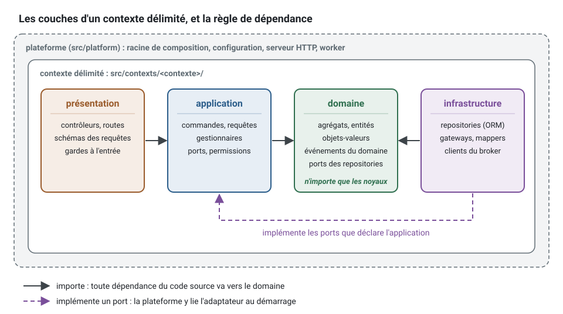

[English](translation.md) · **Français**
<!-- translation-of: translation.md sha256:320b1f939636d60d -->

# La documentation en français

**Résumé.** Chaque page qu'ouvre un lecteur de ddd-ts-kit existe en anglais et en français. La
page anglaise est la source ; sa jumelle française la traduit tout entière et note quelle
version de la page anglaise elle traduit, pour qu'un script sache dire quand la traduction est
en retard. Cette page s'adresse aux contributeurs : ce qui est traduit, la forme d'une page
française, les commandes, que faire quand une page anglaise change, le glossaire qui garde le
vocabulaire cohérent, le style des schémas et la convention des exemples de code que la
pipeline compile.

## Ce qui est traduit

Chaque page Markdown du dépôt a une jumelle française dans le même répertoire, nommée d'après
elle : `README.md` et `README.fr.md`, `docs/concepts/aggregates.md` et
`docs/concepts/aggregates.fr.md`. Sont exclus :

| Exclu | Pourquoi |
|---|---|
| `*.fr.md` | ce sont les traductions |
| chaque `CHANGELOG.md` | les notes de version, écrites une fois, en anglais |
| chaque `CLAUDE.md`, tout ce qui est sous `.claude/` et `plugin/` | des consignes pour les agents de code, lues par des agents |
| chaque `CONTEXT.md` | en partie généré par `ddd-ts-kit docs` |
| tout ce qui est sous `.github/`, `.gitlab/`, `pipeline/`, `node_modules/` | l'outillage, et les copies faites pour les projets générés |
| tout ce qui est sous `packages/cli/templates/` | les fichiers que `ddd-ts-kit init` et `generate` écrivent dans un projet |
| `examples/scheduling/clients/api/README.md`, `examples/scheduling/docs/integration/event-catalog.md` | générés |

La liste se trouve en tête de
[`pipeline/monorepo/translations.mjs`](../pipeline/monorepo/translations.mjs) : une page est
concernée quand ce script le dit.

Le code, les messages de *commit*, l'aide de la CLI, les messages du *checker* et les
identifiants de règle restent en anglais. La référence générée de
[Quelle commande, quand](guides/commands.fr.md) est l'aide de la CLI : sa page française porte
la même référence anglaise entre les mêmes marqueurs, écrite par
`node pipeline/monorepo/commands-guide.mjs`.

## La forme d'une page française

La première ligne d'une page anglaise concernée est son sélecteur de langue, suivi d'une ligne
vide :

```md
**English** · [Français](aggregates.fr.md)

# Aggregates
```

La page française commence par son propre sélecteur, puis une ligne qui dit quelle version de
la page anglaise elle traduit, puis une ligne vide :

```md
[English](aggregates.md) · **Français**
<!-- translation-of: aggregates.md sha256:3f2a9c0d41b7e865 -->

# Agrégats
```

Le point entre les deux liens est le point médian (U+00B7). L'empreinte est faite des 16
premiers chiffres hexadécimaux du sha256 du fichier anglais, sa ligne de sélecteur mise à part.
Ne la calculez jamais à la main : `--stamp` l'écrit.

Une page française traduit **toute** sa page anglaise : les mêmes sections dans le même ordre,
les mêmes tableaux, les mêmes listes, les mêmes schémas aux mêmes endroits, le même code. Dans
les blocs de code, seuls les commentaires sont traduits ; les identifiants, les commandes, les
clés de configuration, les identifiants de règle, les chemins de fichiers et les codes d'erreur
restent tels quels, dans les blocs de code comme dans le texte.

**Les liens.** Un lien vers une autre page concernée pointe vers sa jumelle française
(`aggregates.fr.md`, pas `aggregates.md`). Un lien vers du code, vers un fichier qui n'est pas
une page ou vers un site extérieur reste tel quel. Un lien vers un titre d'une page française
utilise l'ancre que GitHub donne au titre français : en minuscules, accents gardés, ponctuation
retirée, espaces changées en traits d'union (`## Règles de l'agrégat` devient
`#règles-de-lagrégat`).

## Les commandes

| Commande | Ce qu'elle fait |
|---|---|
| `node pipeline/monorepo/translations.mjs --check` | chaque problème de la documentation française, un par ligne, code de sortie 1 s'il y en a : une page sans sélecteur, une page française absente ou en retard, un lien qui ne mène nulle part, une ancre qu'aucun titre ne porte, une page française qui renvoie à une page anglaise dont la jumelle française existe, un schéma sans son dessin français, un schéma mal formé. `npm run docs:translations` la lance, et le job `docs` de la CI aussi |
| `node pipeline/monorepo/translations.mjs --check <pages...>` | la même chose, pour ces pages seulement (chemins anglais ou français) et les schémas qu'elles montrent |
| `node pipeline/monorepo/translations.mjs --stamp <page anglaise>` | écrit ou met à jour le sélecteur et la ligne `translation-of` de la page française ; elle ne crée rien d'autre |
| `node pipeline/monorepo/translations.mjs --stale` | les pages françaises dont la page anglaise a changé depuis leur dernier tampon |
| `node pipeline/monorepo/translations.mjs --add-switchers` | met le sélecteur sur la première ligne de chaque page anglaise concernée qui n'en a pas ; idempotente |
| `node pipeline/monorepo/doc-samples.mjs --check [pages...]` | compile les exemples vérifiés de ces pages (de chaque page concernée et de sa page française sans argument) : voir [Exemples vérifiés](#exemples-vérifiés). Demande un `npm run build` d'abord. `npm run docs:samples` la lance, et `ci:typecheck` aussi |
| `node pipeline/monorepo/commands-guide.mjs` | écrit la référence générée de `docs/guides/commands.md` et de `docs/guides/commands.fr.md` depuis l'aide de la CLI construite ; `--check` dit quand l'une est périmée |

## Quand une page anglaise change

La page anglaise est la source. Qui la modifie tient sa page française à jour, dans la même
*pull request* :

1. modifiez la page anglaise ;
2. `node pipeline/monorepo/translations.mjs --stale` liste les pages françaises désormais en
   retard ;
3. mettez chacune à jour : traduisez ce qui a changé, rien de plus ;
4. `node pipeline/monorepo/translations.mjs --stamp <page anglaise>` enregistre la nouvelle
   version ;
5. `node pipeline/monorepo/translations.mjs --check <page anglaise>` ne répond rien.

Tamponner une page française qui n'a pas été mise à jour masque l'écart : ne tamponnez que ce
qui a été traduit. Une nouvelle page anglaise arrive avec sa page française et son sélecteur
(`--add-switchers` l'écrit).

## Écrire en français

- Un français correct, avec tous les accents et signes diacritiques : é, è, ê, à, â, ç, î, ô,
  û, ù, œ. Une page écrite sans accents n'est pas terminée.
- Ni tiret cadratin ni tiret demi-cadratin, dans aucune langue : écrivez deux-points, une
  virgule, des parenthèses ou un trait d'union entouré d'espaces. `npm run check:dashes` les
  refuse partout.
- Les guillemets typographiques « » sont bienvenus dans le texte ; le code garde les
  guillemets droits.
- Une espace avant `:` et `;`, comme le veut la typographie française ; une espace simple
  suffit.
- Le vocabulaire du [glossaire](#glossaire), partout. La première occurrence d'un terme dans une
  page peut donner le terme anglais entre parenthèses : « contexte délimité (bounded context) ».
- Les titres sont traduits ; l'amorce `**Summary.**` d'une page devient `**Résumé.**`, et une
  section `## See also` devient `## Voir aussi`.
- Adressez-vous au lecteur en le vouvoyant. Des phrases courtes, à la voix active, comme dans les
  pages anglaises.

## Glossaire

Le terme français à employer pour chaque terme anglais de la documentation. Un terme en
italique dans la colonne française est gardé en anglais, parce que les développeurs français le
disent ainsi.

### Conception stratégique

| Anglais | Français |
|---|---|
| domain | domaine |
| subdomain (core, supporting, generic) | sous-domaine (cœur, de soutien, générique) |
| bounded context | contexte délimité (bounded context) |
| ubiquitous language | langage omniprésent (ubiquitous language) |
| glossary | glossaire |
| context map | carte des contextes |
| upstream, downstream | amont, aval |
| relationship pattern | patron de relation |
| customer-supplier | client-fournisseur |
| conformist | conformiste |
| anti-corruption layer | couche anticorruption |
| open host service | service hôte ouvert (open host service) |
| published language | langage publié |
| shared kernel | noyau partagé |
| statement of needs | expression des besoins |
| domain discovery, event storming | découverte du domaine, *event storming* |
| modular monolith | monolithe modulaire |
| microservice, extraction | microservice, extraction |

### Conception tactique

| Anglais | Français |
|---|---|
| aggregate | agrégat |
| aggregate root | racine d'agrégat |
| entity | entité |
| value object | objet-valeur |
| domain event | événement du domaine |
| integration event | événement d'intégration |
| domain service | service du domaine |
| domain error | erreur du domaine |
| refusal | refus |
| invariant | invariant |
| specification | spécification |
| factory | fabrique (factory) |
| repository | *repository* (jamais « dépôt », qui désigne le dépôt git) |
| state machine | machine à états |
| state, transition | état, transition |
| guard (of a transition, of a route) | garde |
| event sourcing | *event sourcing* |
| upcaster | *upcaster* |
| snapshot | *snapshot* |
| anemic model | modèle anémique |

### Application et architecture

| Anglais | Français |
|---|---|
| layer | couche |
| dependency rule | règle de dépendance |
| presentation, application, domain, infrastructure | présentation, application, domaine, infrastructure |
| platform | plateforme |
| command | commande |
| query | requête |
| request (HTTP) | requête HTTP : toujours qualifiée, pour la distinguer d'une requête (query) |
| response | réponse |
| handler | gestionnaire (handler) |
| use case | cas d'usage |
| command bus, query bus, event bus | bus de commandes, bus de requêtes, bus d'événements |
| middleware | *middleware* |
| port | port |
| adapter | adaptateur |
| gateway | *gateway* |
| mapper | *mapper* |
| composition root | racine de composition |
| dependency injection, container | injection de dépendances, conteneur |
| injection token | jeton d'injection |
| binding, to bind | liaison, lier |
| wiring | câblage |
| declaration, decorator | déclaration, décorateur |
| controller | contrôleur |
| route, route group | route, groupe de routes |
| endpoint | point d'accès (endpoint) |
| DTO, schema, validation | DTO, schéma, validation |
| problem document | document *problem* (RFC 9457) |
| policy (of authorization) | politique (policy) |
| permission, role | permission, rôle |
| actor, system actor | acteur, acteur système |
| execution scope | portée d'exécution |
| access scope | périmètre d'accès |
| tenant | *tenant* |
| multitenancy, multitenant | multitenance, multitenant |
| elevation | élévation |
| CQRS, read side, write side | CQRS, côté lecture, côté écriture |
| read model | modèle de lecture |
| projection, projector | projection, projecteur |
| criteria | critères (`Criteria`) |
| hydration | hydratation |
| page, cursor | page, curseur |

### Messagerie, cohérence et jobs

| Anglais | Français |
|---|---|
| transactional outbox | outbox transactionnelle |
| relay | relais |
| unit of work | unité de travail |
| commit, rollback | validation (commit), annulation (rollback) |
| producer, consumer | producteur, consommateur |
| publisher, subscriber | *publisher*, abonné |
| broker, queue | *broker*, file d'attente |
| dead letter | file de rejet (dead letter) |
| at-least-once, at-most-once, exactly-once | au moins une fois, au plus une fois, exactement une fois |
| idempotent, idempotency | idempotent, idempotence |
| eventual consistency, strong consistency | cohérence à terme, cohérence forte |
| dual write | double écriture |
| event versioning, breaking change | versionnement des événements, changement cassant |
| saga, process manager | saga, gestionnaire de processus |
| compensation | compensation |
| worker | *worker* |
| job, scheduled job, background job | *job*, *job* planifié, *job* en arrière-plan |
| lease, checkpoint | bail, point de reprise |
| lock | verrou |
| overlap, missed occurrence | chevauchement, occurrence manquée |
| scheduler | planificateur |
| claim (of outbox entries) | réclamation, réclamer |
| acknowledgement, poison message | accusé de réception, message empoisonné |
| backoff, jitter | *backoff*, gigue (jitter) |
| fencing token | jeton de clôture (fencing token) |

### Préoccupations transverses

| Anglais | Français |
|---|---|
| audit trail | journal d'audit |
| observability, tracing, span | observabilité, traçage, *span* |
| log, logger | journal, *logger* |
| metrics | métriques |
| error reporting | remontée des erreurs |
| correlation id | identifiant de corrélation |
| resilience | résilience |
| retry, timeout | nouvelle tentative (retry), délai d'expiration (timeout) |
| circuit breaker, bulkhead | disjoncteur (circuit breaker), cloison (bulkhead) |
| aspect, advice, advised call | aspect, *advice*, appel intercepté (advised call) |
| cache, HTTP cache, purge | cache, cache HTTP, purge |
| cache miss, rate limiter | défaut de cache, limiteur de débit |
| flush, redaction | vidage (flush), masquage |
| file storage, signed link | stockage de fichiers, lien signé |
| identity provider, token, claim | fournisseur d'identité, jeton, *claim* |
| impersonation | emprunt d'identité (impersonation) |
| authorizer | autorisateur |
| RBAC, ABAC, ReBAC | contrôle d'accès par rôles (RBAC), par attributs (ABAC), par relations (ReBAC) |

### Outils, tests et façon de travailler

| Anglais | Français |
|---|---|
| checker (the tool behind `ddd-ts-kit check`) | *checker* |
| rule, rule id | règle, identifiant de règle |
| finding, violation | constat, violation |
| severity | sévérité |
| fix (of a finding) | correction |
| deviation, decision record (ADR) | dérogation, enregistrement de décision (ADR) |
| suppression (of a lint rule) | désactivation |
| pipeline, gate | *pipeline*, porte |
| quality gate | porte de qualité |
| dead code, import graph | code mort, graphe des imports |
| generator, template | générateur, *template* |
| scaffold (verb) | générer |
| stack (the choices of `init`) | *stack* |
| preset (`--preset`, a context written whole) | *preset* (un exemple commenté de configuration reste un « préréglage ») |
| spec, fake, builder | *spec*, *fake* (double de test), *builder* |
| mock, stub, spy | *mock*, *stub*, *spy* |
| contract suite | suite de contrat |
| fixture | *fixture* |
| unit, integration, end-to-end test | test unitaire, d'intégration, de bout en bout |
| coverage | couverture |
| given, when, then | étant donné, quand, alors |
| vertical slice | tranche verticale |
| conductor, briefing | chef d'orchestre, consigne |
| worktree | *worktree* |
| skill, agent, hook, plugin | *skill*, agent, *hook*, *plugin* |
| package, workspace | *package*, *workspace* |
| repository (git) | dépôt |
| commit, branch, pull request | *commit*, branche, *pull request* |
| release | version publiée (release) |
| deployment | déploiement |

Un terme qui manque ici s'ajoute ici, dans la même *pull request* que la page qui en a besoin,
dans la version anglaise et la version française de cette page.

## Schémas

Un schéma mérite sa place quand il montre une structure ou un flux qu'un paragraphe décrit mal :
des couches, une suite d'appels, un cycle de vie, qui dépend de qui. Chaque schéma est dessiné
deux fois, avec des libellés anglais et avec des libellés français, et les deux dessins sont la
même image.



C'est le dessin de référence : reprenez son style.

### Fichiers et références

| | |
|---|---|
| Dessin anglais | `docs/assets/diagrams/<page-slug>-<what>.svg` |
| Dessin français | `docs/assets/diagrams/<page-slug>-<what>.fr.svg`, le même dessin avec des libellés français |
| Depuis une page sous `docs/` | un chemin relatif : `` |
| Depuis une page hors de `docs/` (README des packages, exemples, README racine) | l'URL absolue, pour que npm l'affiche aussi : `` |

Le texte alternatif dit ce que montre le schéma, dans la langue de la page. La page française
montre le dessin `.fr.svg` à l'endroit où la page anglaise montre le dessin `.svg` ; `--check`
y veille.

### Style

- Du SVG écrit à la main, autonome : pas de script, pas de référence externe, pas d'image
  matricielle intégrée, pas de police web. Le texte est fait de vrais éléments `<text>`, jamais
  de tracés.
- Un `viewBox`, une largeur d'au plus 960, un rectangle de fond blanc aux coins arrondis comme
  première forme, pour qu'un schéma se lise de la même façon sur une page sombre.
- Un `<title>` et un `<desc>` : ce que montre le schéma, dans la langue de ses libellés.
- Du texte d'au moins 13px : 13 ou 14 pour les libellés, 16 pour le nom d'une boîte, 18 pour un
  titre.
- `font-family="system-ui, -apple-system, 'Segoe UI', Roboto, sans-serif"` sur l'élément racine.
- Les flèches sont des lignes ou des tracés munis d'un marqueur. Une flèche pleine est une
  dépendance ou un appel, une flèche en pointillés une implémentation ou un message asynchrone ;
  une légende dit laquelle est laquelle quand les deux apparaissent.
- Aucune flèche ne traverse une boîte ou une autre flèche ; faites-la passer autour.
- Une couleur d'accent par sorte de chose, la même dans tous les schémas : une teinte claire de
  la couleur pour le fond d'une boîte, la couleur elle-même pour sa bordure et son nom, `#1f2328`
  pour le reste du texte.

| Sorte de chose | Couleur | Teinte |
|---|---|---|
| domaine | `#2f6f4f` | `#e8f1ec` |
| application | `#2b5d8a` | `#e7eef5` |
| infrastructure | `#7a4f9a` | `#f1ebf5` |
| présentation | `#9a5b2b` | `#f6ede6` |
| plateforme, système externe | `#5f6b73` | `#f3f4f5` |
| flèches, neutre | `#3d4449` | |

### Un squelette à copier

```svg
<svg xmlns="http://www.w3.org/2000/svg" viewBox="0 0 640 240" width="640" height="240"
     role="img" aria-labelledby="title desc"
     font-family="system-ui, -apple-system, 'Segoe UI', Roboto, sans-serif">
  <title id="title">Un gestionnaire dépend d'un port du domaine</title>
  <desc id="desc">Le gestionnaire de l'application appelle le port de repository du domaine.</desc>
  <defs>
    <marker id="arrow" viewBox="0 0 10 10" refX="9" refY="5" markerWidth="8" markerHeight="8"
            orient="auto-start-reverse">
      <path d="M0,0 L10,5 L0,10 z" fill="#3d4449"/>
    </marker>
  </defs>
  <rect width="640" height="240" rx="16" fill="#ffffff"/>
  <rect x="40" y="80" width="200" height="80" rx="10" fill="#e7eef5" stroke="#2b5d8a" stroke-width="2"/>
  <text x="140" y="126" font-size="16" font-weight="700" fill="#2b5d8a" text-anchor="middle">gestionnaire</text>
  <rect x="400" y="80" width="200" height="80" rx="10" fill="#e8f1ec" stroke="#2f6f4f" stroke-width="2"/>
  <text x="500" y="126" font-size="16" font-weight="700" fill="#2f6f4f" text-anchor="middle">port de repository</text>
  <line x1="244" y1="120" x2="396" y2="120" stroke="#3d4449" stroke-width="2" marker-end="url(#arrow)"/>
  <text x="320" y="108" font-size="13" fill="#1f2328" text-anchor="middle">dépend de</text>
</svg>
```

### Le valider, puis le regarder

```bash
xmllint --noout docs/assets/diagrams/<file>.svg
node pipeline/monorepo/translations.mjs --check docs/assets/diagrams/<file>.svg
google-chrome --headless=new --disable-gpu --no-sandbox --hide-scrollbars \
  --screenshot=/tmp/diagram.png --window-size=1000,<height> file://$PWD/docs/assets/diagrams/<file>.svg
```

Ouvrez le PNG et regardez-le avant de committer : un texte qui en chevauche un autre ou qui est
coupé, une flèche qui traverse une boîte, un libellé plus long que sa boîte (les libellés
français sont souvent plus longs : vérifiez les deux dessins). `convert <file>.svg <file>.png`
(ImageMagick) donne un aperçu rapide, mais ne dessine pas les pointes de flèche : le navigateur
fait référence.

## Exemples vérifiés

Un bloc TypeScript qui montre comment utiliser le kit est une promesse : un lecteur le copie.
Quand il est précédé de la ligne `<!-- checked sample -->`, la pipeline le compile avec les
packages du *workspace*, si bien qu'il ne peut pas s'écarter de l'API :

````md
<!-- checked sample -->
```ts
import { ConceptError } from '@ddd-ts-kit/kernel';

export class InvoiceError extends ConceptError {
  static alreadyPaid(invoiceId: string) {
    return InvoiceError.refusal('INVOICE_ALREADY_PAID', `Invoice ${invoiceId} is already paid.`, { invoiceId });
  }
}
```
````

qui s'affiche ainsi :

<!-- checked sample -->
```ts
import { ConceptError } from '@ddd-ts-kit/kernel';

export class InvoiceError extends ConceptError {
  static alreadyPaid(invoiceId: string) {
    return InvoiceError.refusal('INVOICE_ALREADY_PAID', `Invoice ${invoiceId} is already paid.`, { invoiceId });
  }
}
```

Les règles d'un exemple vérifié :

- Il compile seul, comme un module : il importe ce qu'il utilise depuis `@ddd-ts-kit/*` (ou
  depuis une bibliothèque installée dans le *workspace*), et déclare les petits types et les
  valeurs dont il a besoin (`declare const clock: Clock;`, `interface OrderRow { ... }`). Pas
  d'alias `@/` : il se résout dans un projet, pas ici.
- Il est compilé en mode strict, comme le dit `tsconfig.base.json` (`strict`,
  `noUncheckedIndexedAccess`, `exactOptionalPropertyTypes`, `verbatimModuleSyntax` : un type
  s'importe avec `type`), avec les décorateurs standard de TypeScript. Un exemple écrit pour les
  anciens décorateurs est précédé de `<!-- checked sample: legacy-decorators -->` à la place.
- N'inventez jamais une API : lisez d'abord le code source du package et ses tests.
- La page française porte les mêmes exemples, commentaires traduits, et ils sont vérifiés eux
  aussi.
- Un court fragment qui ne peut pas compiler seul (une ligne de configuration, une méthode
  sortie de sa classe) reste sans marqueur.

```bash
npm run build
node pipeline/monorepo/doc-samples.mjs --check docs/concepts/aggregates.md docs/concepts/aggregates.fr.md
```

Chaque échec affiche la page et la ligne où se trouve l'erreur, puis le message du compilateur.
Les modules sont écrits sous `.ddd-ts-kit/doc-samples/`, que git ignore.

## Voir aussi

- [Index de la documentation](README.fr.md)
- [Contribuer](../CONTRIBUTING.fr.md)
- [Les couches et la règle de dépendance](concepts/layers-and-dependency-rule.fr.md)
