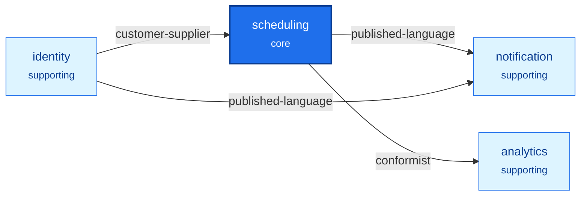

[English](README.md) · **Français**
<!-- translation-of: README.md sha256:82b0561c204a7704 -->

# Scheduling : l'application d'exemple de ddd-ts-kit

Une plateforme de prise de rendez-vous pour des cabinets, construite avec le kit comme la
construirait un utilisateur du kit : à partir d'une expression des besoins d'une page, à travers
les étapes stratégiques de la méthode, une seule commande `init`, puis les contextes délimités
(bounded contexts) tranche par tranche, par plusieurs *workers* en parallèle. Elle existe pour deux
choses : montrer ce que l'outil donne sur des règles métier qui ne sont pas triviales (des
disponibilités à travers les jours de changement d'heure, une seule réservation par créneau sous
concurrence, des droits qui dépendent de relations), et mesurer honnêtement comment l'outil s'est
comporté ([docs/tooling-report.fr.md](docs/tooling-report.fr.md)).

Quatre contextes délimités dans une seule application déployable et un processus *worker* :
`scheduling` (cœur), `identity`, `notification`, `analytics`. Express, class-validator, tsyringe
dans le style déclaré, Knex sur PostgreSQL, l'outbox transactionnelle, un seul serveur au
protocole Redis (Dragonfly) pour le cache, le limiteur de débit, le verrou des *jobs* et les flux
d'événements, Keycloak, une autorisation par relations combinée aux rôles, le journal d'audit,
pino, OpenTelemetry, le protocole Sentry, et Varnish devant l'API.

## Les chiffres clés de la construction

| | |
|---|---|
| De l'expression des besoins à une porte verte et une exécution réelle enregistrée | environ 1 h 25 min de temps réel |
| Exécutions du générateur | 213 réussies, 27 refusées |
| Fichiers | 831 : 133 générés et laissés tels quels, 584 générés puis remplis, 106 écrits à la main, 8 dérivés |
| Lignes | 19 577 gardées des générateurs, 21 937 écrites à la main (tests et documents compris) |
| Marqueurs remplis | 656 `TODO(domain)`, 317 `it.todo` |
| Tests | 1 288 unitaires et d'adaptateurs, 57 de bout en bout ; les tests d'adaptateurs tournent aussi sur PostgreSQL 18 |
| Défauts trouvés dans le kit | 2, avec des reproductions, et 13 frictions classées avec des propositions |

Après la livraison, `analytics` a été changé pour calculer ses chiffres au moment de la lecture
(un seul modèle de lecture stocké au lieu de deux, plus de *job* de nuit) : les chiffres ci-dessus
sont ceux de la construction, le changement et ses décomptes sont dans la dernière section du
rapport sur l'outillage.

## Le lancer en trois commandes

Depuis la racine du dépôt, une fois (`npm ci && npm run build`), puis ici :

```bash
cp .env.example .env && docker compose --profile identity --profile observability up -d --wait
set -a && . ./.env && set +a && npm run db:migrate && (node dist/src/main.js & node dist/src/apps/worker/main.js &)
node --env-file=.env scripts/demo.mjs
```

La première commande démarre les conteneurs, la deuxième migre la base de données et démarre les
deux processus de l'application, la troisième joue le scénario de
[docs/demo-transcript.fr.md](docs/demo-transcript.fr.md) avec de vrais jetons du Keycloak local.

![Les deux processus de l'application et les conteneurs qu'ils utilisent : un client appelle l'API sur le port 54300, ou Varnish sur le port 54081, qui répond aux lectures publiques depuis son cache et transmet le reste à l'API ; le processus API exécute le serveur HTTP, les cas d'usage des quatre contextes, les consommateurs d'événements, le relais de l'outbox et le rattrapage de l'event store ; le processus worker exécute les jobs planifiés et les consommateurs d'événements ; les deux utilisent PostgreSQL, Dragonfly, Keycloak, Jaeger et GlitchTip ; le relais purge Varnish par tag après une validation](https://raw.githubusercontent.com/gbourgeat/ddd-ts-kit/main/docs/assets/diagrams/scheduling-example-runtime.fr.svg)

Tout écoute sur 127.0.0.1, sur des ports 54xxx choisis pour ne croiser aucune autre *stack* :

| Ouvrir | À | Démarré par |
|---|---|---|
| L'API, et sa documentation interactive | `http://127.0.0.1:54300`, `http://127.0.0.1:54300/docs` | la deuxième commande, `node dist/src/main.js` |
| La même API derrière Varnish | `http://127.0.0.1:54081` | la première commande, quels que soient les profils |
| Keycloak, et les utilisateurs de démonstration ci-dessous | `http://127.0.0.1:54080` | `--profile identity` |
| Jaeger, les traces | `http://127.0.0.1:54686` | `--profile observability`, avec `OTEL_EXPORTER_OTLP_ENDPOINT=http://127.0.0.1:54318` dans `.env` |
| GlitchTip, les rapports d'erreur | `http://127.0.0.1:54800` | `--profile errors`, avec dans `SENTRY_DSN` le DSN qu'affiche `docker compose logs glitchtip \| grep 'DSN:'` |

Varnish sert la même API : les horaires d'ouverture d'un calendrier
(`GET /calendars/:calendarId/opening-hours`, publics) viennent de son cache (`x-cache: HIT`)
jusqu'à ce qu'un changement du calendrier soit validé et que le relais les purge, deux fois à deux
secondes d'intervalle ; une lecture authentifiée passe jusqu'à l'API. L'API purge avec la
`VARNISH_PURGE_KEY` de `.env`, avec laquelle Varnish est démarré aussi. [Comment une réponse
publique est mise en cache, puis
purgée](#comment-une-réponse-publique-est-mise-en-cache-puis-purgée) suit un changement de bout en
bout.

La porte est `npm run verify` (types, lint avec le *preset* du kit, format, tests, bout en bout,
règles d'architecture, graphe des imports, code mort, dérive de la documentation) ; elle n'a besoin
d'aucun conteneur. Pour arrêter :
`docker compose --profile identity --profile observability --profile errors down --volumes`.

## Les utilisateurs de démonstration

Pour le développement local seulement : ils existent dans `docker/keycloak/scheduling-realm.json`,
et le mot de passe de chacun est son nom d'utilisateur.

| Utilisateur | Rôle dans le jeton | Ce qui fait ses droits |
|---|---|---|
| `demo-admin` | `network-admin`, réseau `north` | le rôle : ouvre les cabinets de son réseau |
| `demo-ops` | `platform-admin`, aucun réseau | le rôle : lit le journal d'audit de chaque réseau, par une élévation que le journal enregistre |
| `demo-manager`, `demo-manager-b` | aucun | la relation `manager` d'un cabinet chacun, écrite à l'ouverture du cabinet |
| `demo-practitioner` | aucun | `practitioner` du cabinet, `holder` de son poste |
| `demo-assistant` | aucun | `assistant` du cabinet ; `delegate` d'un poste une fois la délégation accordée |
| `demo-patient`, `demo-patient-2` | `patient` | le rôle pour réserver pour soi ; `patient` de chacun de ses rendez-vous |
| `demo-support` | `support` | rien par lui-même : prend l'identité d'un utilisateur dans Keycloak, et cette session est en lecture seule ici |

## Ce que montre l'exemple, et où regarder

| Concept ou patron | Où |
|---|---|
| La méthode, étape par étape | `docs/architecture/` : `needs.md`, `discovery.md`, `contexts.md`, `before-bootstrap/`, `plan.md`, `slices.md`, `briefings/` |
| Le langage omniprésent (ubiquitous language) de chaque contexte, référence générée | `src/contexts/*/CONTEXT.md` |
| La carte des contextes avec ses patrons | [docs/context-map.fr.md](docs/context-map.fr.md) |
| Des agrégats avec des objets-valeurs, sans obsession des primitives | `src/contexts/scheduling/domain/` (`Calendar`, `Appointment`, `Waitlist`) |
| Les fuseaux horaires et le changement d'heure dans le domaine, sans bibliothèque | `scheduling/domain/value-objects/time-zone.vo.ts`, `test/unit/time-zone.vo.spec.ts`, `calendar.aggregate.spec.ts` |
| Un service du domaine sur deux agrégats | `scheduling/domain/services/scheduler.service.ts` |
| Un chevauchement décidé par le domaine et par une contrainte d'exclusion de PostgreSQL | `scheduling/infrastructure/persistence/create-scheduling-tables.schema.ts`, `knex-appointment.repository.ts`, `test/integration/concurrent-booking.spec.ts` |
| Des permissions sur chaque cas d'usage, des politiques sur l'élément chargé | `scheduling/application/authorization/` |
| Des relations (à la Zanzibar) combinées aux rôles | `src/platform/auth/relationships/relationship-schema.ts`, `role-grants.ts`, `roles-and-relationships.authorizer.ts`, [ADR 0001](docs/adr/0001-combine-token-roles-with-relationships-in-one-authorizer.fr.md) |
| Des tuples de relation persistants, écrits dans l'unité de travail | `src/platform/auth/relationships/knex-relation-tuple-store.ts` ; `*/application/ports/*-relationships.port.ts` et leurs adaptateurs |
| Des recherches restreintes dans la requête SQL par le périmètre d'accès, avec des critères | `scheduling/application/queries/search-appointments/`, `search-practice-agenda/`, `analytics/application/queries/search-occupancy/` |
| Une différence au niveau des champs : occupé sans le nom | `scheduling/application/queries/get-calendar-day/` |
| Un champ réservé à l'équipe, dans toutes les représentations : la note interne, cachée au patient, en lecture seule pour un assistant, écrite par qui tient l'agenda | `scheduling/presentation/http/appointments/book-appointment/book-appointment.controller.ts`, `get-appointment/get-appointment.controller.ts` (`withFieldAccess`), `test/e2e/book-appointment.e2e.spec.ts` |
| Une seule route en JSON, XML et CSV selon l'en-tête `Accept` ; un corps XML lu et validé comme du JSON ; une liste diffusée page par page à travers le bus à mesure qu'elle est lue | `scheduling/presentation/http/practices/` (`produces`), `export-practice-agenda/`, `src/platform/http/presentation-of.ts`, `test/e2e/export-practice-agenda.e2e.spec.ts` |
| Un formulaire décrit par le serveur, pour l'appelant qui le demande (JSON Forms, ou un arbre de blocs) | `GET /forms/bookAppointment`, le `form` de `book-appointment.controller.ts`, `src/platform/http/with-forms.ts`, `openapi/forms/bookAppointment.json` |
| Une prise d'identité en lecture seule, visible dans le journal | `src/platform/buses/read-only-impersonation.ts`, `test/e2e/journey-authorization.e2e.spec.ts` |
| Des événements d'intégration, versionnés, à travers l'outbox | `src/contexts/*/published-language/`, `docs/integration/event-catalog.md` |
| Une projection d'un autre contexte (décide, libelle des listes) | `scheduling/application/projections/practitioners.projection.ts` |
| Une *gateway* avec hydratation (un élément frais) | `scheduling/application/queries/get-appointment/`, `infrastructure/external/in-process-person-directory.gateway.ts` |
| Une projection des propres événements du contexte | `scheduling/application/projections/agenda.projection.ts` |
| Des modèles de lecture et leur reconstruction | `analytics/application/projections/`, `analytics/test/integration/outcome-register.rebuild.spec.ts` |
| Un agrégat gardé sous forme de ses événements, à côté d'agrégats gardés en lignes : son historique est le métier | `scheduling/domain/aggregates/attendance-record.aggregate.ts` (méthodes apply), `infrastructure/persistence/attendance-record-events.mapper.ts` (formes stockées, un motif scellé par patient), `event-store-attendance-record.repository.ts` (*snapshots* tous les 20 événements), `stored-events.lock.json` |
| Une projection alimentée par l'event store : rattrapage avec un point de reprise, reconstruction depuis la position zéro, un patient effacé | `scheduling/application/projections/attendance-history.projection.ts`, `src/platform/event-store/store-fed-projections.ts`, `test/integration/attendance-history.rebuild.spec.ts`, `test/integration/appointment-journey.spec.ts` ; un effacement par `npm run erase:patient` |
| Une ligne par fait, calculée à la lecture : des chiffres groupés dans une seule requête SQL au moment où on les lit, au lieu de compteurs tenus par des événements (rien qui dérive, rien à vérifier la nuit) | `analytics/CONTEXT.md` (« How occupancy is measured »), `analytics/infrastructure/persistence/knex-occupancy-reader.repository.ts` |
| Une définition métier et son SQL gardés égaux par un seul contrat | `analytics/domain/services/occupancy-measure.service.ts`, `analytics/test/integration/occupancy-reader.contract.spec.ts` |
| Un consommateur avec un port sortant, nouvelle tentative (retry) puis file de rejet (dead letter) | `notification/application/integration/handlers/`, `infrastructure/external/remote-mailer.adapter.ts`, `test/integration/mailer-outage.spec.ts` |
| La résilience sur la classe d'adaptateur, et à la liaison | le *mailer* ci-dessus (`@Retry`, `@Timeout`) ; `src/platform/composition/platform.module.ts` (`builder.around`) |
| Des fichiers gardés dans un stockage, jamais dans la base : un envoi lu en flux et contrôlé, un lien signé court, une suppression après la validation, chaque lecture d'un document auditée | `scheduling/application/commands/attach-appointment-document/`, `queries/get-appointment-document/`, `domain/value-objects/attached-document.vo.ts`, `src/platform/files/`, `test/e2e/journey-documents.e2e.spec.ts` |
| Des *jobs* planifiés qui ne font qu'envoyer une commande, dans un *worker* | `application/scheduling/` de `scheduling`, `identity` et `notification`, `src/apps/worker/main.ts` |
| Une trace par action, des journaux, l'audit, un rapport d'erreur | `test/e2e/journey-observability.e2e.spec.ts` |
| Un client typé du contrat, ses refus typés par leurs codes d'erreur, appelé par les *specs* de bout en bout comme le ferait un consommateur | `clients/api/` (généré par `ddd-ts-kit sdk`, régénéré par `docs:generate`), `test/e2e/support/start-application.ts` (`apiAs`), `expect-answer.ts`, `expect-refusal.ts`, `test/e2e/identity-register-person.e2e.spec.ts` |
| Une dérogation enregistrée, puis retirée quand le kit a fait des projections un rôle à part entière | [ADR 0002](docs/adr/0002-keep-read-models-with-projections-in-application-projections.fr.md), remplacé |
| Des dépendances énoncées une seule fois, par le constructeur : aucune liste dans un décorateur, et chaque classe de chaque contexte construite par la racine de composition | n'importe quel gestionnaire, par exemple `identity/application/commands/register-person/register-person.handler.ts` ; le `<context>.declarations.ts` généré ; `test/architecture/every-class-resolves.spec.ts` |

## La carte des contextes

Une copie du diagramme que `ddd-ts-kit docs` génère dans
[docs/context-map.fr.md](docs/context-map.fr.md), à partir de `ddd-ts-kit.config.json` et des
fichiers `CONTEXT.md` ; les raisons y sont écrites aussi.



Le journal d'audit est une capacité de la plateforme (`src/platform/audit/`), pas un contexte : il
enregistre autour de chaque cas d'usage et ne décide rien par lui-même.

## Les règles métier, par contexte

Les chemins sont sous `src/contexts/<context>/`.

**scheduling**

| Règle | Tenue par | Prouvée par |
|---|---|---|
| Les horaires d'ouverture sont des plages d'heure murale du fuseau du cabinet ; un jour de 23 ou 25 heures les garde | `domain/value-objects/time-zone.vo.ts`, `opening-hours.vo.ts` | `test/unit/time-zone.vo.spec.ts`, `calendar.aggregate.spec.ts` |
| Une exception remplace son jour ; une indisponibilité ferme tout ce qu'elle couvre et est refusée sur des rendez-vous actifs | `domain/aggregates/calendar.aggregate.ts`, `application/commands/add-time-off/` | `test/unit/calendar.aggregate.spec.ts`, `add-time-off.handler.spec.ts` |
| Un créneau commence sur la grille de son type, dans une seule plage d'ouverture, dans la fenêtre de réservation | `Calendar.slotFor` | `test/unit/calendar.aggregate.spec.ts` |
| Aucun chevauchement avec un rendez-vous actif, battement compris ; au plus N rendez-vous futurs par patient et praticien | `domain/services/scheduler.service.ts` | `test/unit/scheduler.service.spec.ts` |
| De deux réservations concurrentes d'un même créneau, exactement une gagne ; l'autre reçoit `SLOT_TAKEN`, 409 | contrainte d'exclusion, `knex-appointment.repository.ts` | `test/integration/concurrent-booking.spec.ts` (réellement concurrent avec `DATABASE_URL`) |
| Demandé, réservé, confirmé, déplacé, annulé avec la partie et le motif, expiré, terminé, absence ; un rendez-vous fini ne change plus | `domain/aggregates/appointment.aggregate.ts` | `test/unit/appointment.aggregate.spec.ts` |
| Déplacer est un seul changement d'un seul agrégat | `application/commands/reschedule-appointment/` | la *spec* de son gestionnaire, `test/integration/appointment-journey.spec.ts` |
| Un patient annule ou déplace jusqu'à 24 heures avant ; le cabinet à tout moment, avec un motif | les deux politiques de `application/authorization/`, `Cancellation` | les *specs* des politiques, `test/e2e/journey-authorization.e2e.spec.ts` |
| Un créneau libéré est proposé à la première personne en attente à qui il convient, comme un rendez-vous demandé qui expire | `domain/aggregates/waitlist.aggregate.ts`, `application/commands/offer-freed-slot/` | `test/unit/waitlist.aggregate.spec.ts`, `offer-freed-slot.handler.spec.ts` |
| Les rendez-vous non confirmés expirent, de façon idempotente, à partir du `scheduledAt` du *job* | `application/commands/expire-unconfirmed-appointments/`, `application/scheduling/` | les *specs* de son gestionnaire et de son *job* |

**identity** : un rôle par membre et par cabinet, le dernier responsable reste, retirer un membre
met fin à ses délégations (`domain/aggregates/practice.aggregate.ts`,
`application/commands/remove-member/`) ; une délégation lie un praticien et un assistant d'un même
cabinet, avec ou sans les disponibilités, jusqu'à une fin facultative, révocable
(`domain/aggregates/delegation.aggregate.ts`) ; les relations suivent chaque fait dans la même
transaction (`application/event-handlers/`). Prouvé par `test/unit/` et
`test/e2e/identity-*.e2e.spec.ts`.

**notification** : une notification par événement consommé et par destinataire ; un rappel par
rendez-vous et par début, dû 24 heures avant, envoyé une seule fois (`domain/aggregates/`,
`application/commands/send-due-reminders/`) ; un *mailer* en échec fait l'objet de nouvelles
tentatives, puis l'événement part en file de rejet et est signalé
(`test/integration/mailer-outage.spec.ts`).

**analytics** : une ligne par fait, calculée à la lecture. L'issue de chaque rendez-vous est posée
entière par chaque événement, si bien que les rejeux et les livraisons tardives aboutissent à la
même ligne, et c'est la seule chose stockée (`application/projections/outcomes.projection.ts`) ;
elle est reconstruite à partir de l'export de `scheduling`
(`test/integration/outcome-register.rebuild.spec.ts`). L'occupation d'un calendrier sur un jour est
mesurée à partir des issues au moment où on la lit, dans une seule requête SQL groupée, restreinte
par le cabinet, les filtres et le périmètre de l'acteur
(`infrastructure/persistence/knex-occupancy-reader.repository.ts`) : le temps occupé par les
rendez-vous tenus, terminés ou manqués, les décomptes par état, un rendez-vous annulé ou expiré
libérant son temps. Aucun compteur n'est tenu, si bien qu'aucun ne peut dériver et qu'aucun *job*
n'en vérifie. La définition est le service du domaine `OccupancyMeasureService` ; la requête SQL
lui est tenue égale par `test/integration/occupancy-reader.contract.spec.ts`. Une version
antérieure stockait une ligne par calendrier et par jour, recomptée à chaque événement et vérifiée
chaque nuit : voir [docs/tooling-report.fr.md](docs/tooling-report.fr.md), « Après la livraison : des
statistiques calculées à la lecture ».

## Réseaux de cabinets : un *tenant* chacun

L'application sert plusieurs réseaux de cabinets depuis un seul déploiement, et chaque réseau est
un *tenant* ([ADR-0003](docs/adr/0003-one-network-is-one-tenant.fr.md),
`"stack.tenancy": "shared-table"`) : chaque table des contextes porte le réseau de ses lignes,
chaque *repository* l'atteint par `tenantTable` et `ownTenantTable`, l'outbox garde le réseau de
chaque événement pour que ses consommateurs s'y exécutent, et chaque *job* planifié s'exécute une
fois par réseau de `NETWORKS`. Le jeton nomme le réseau de son utilisateur (`tenant_id`) ; une
requête HTTP peut le nommer dans `x-tenant-id`, nommer un autre réseau que celui de l'appelant est
refusé par un 403 avant que rien ne s'exécute, et un réseau absent de `NETWORKS` n'est pas trouvé
(404), pour que rien ne soit écrit là où aucun *job* ne s'exécute. Une personne appartient à un
seul réseau : un second réseau demande un second compte. L'équipe de la plateforme n'appartient à
aucun réseau : elle lit le journal d'audit de chaque réseau par une élévation que le journal
enregistre d'abord. Les cabinets restent des relations à l'intérieur d'un réseau.
`test/e2e/journey-tenancy.e2e.spec.ts` tient tout cela ; `tenantIsolationContract` le tient pour
chaque *repository*.

## Le modèle d'autorisation, avec deux cas déroulés

Trois questions, trois endroits. Qui appelle : Keycloak, vérifié à la frontière. A-t-il le droit de
faire ceci, sur cela : décidé avant le gestionnaire par un seul autorisateur, qui regarde d'abord
les rôles du jeton (`network-admin`, `platform-admin` ; `patient` pour le libre-service ; rien pour `support`), puis
les relations stockées en tuples `object#relation@subject` et dérivées comme le fait Zanzibar. Est-ce
valide tout court : le domaine. Les contextes ne nomment jamais un rôle ni une relation : ils
nomment des permissions, et écrivent des relations par un port à eux quand un fait se produit.

![Une requête HTTP franchit quatre contrôles dans l'ordre : la frontière HTTP vérifie le jeton Keycloak (401 sans jeton valide), l'autorisateur décide avant le gestionnaire à partir des rôles du jeton, puis des relations (403 quand aucun n'accorde), le gestionnaire charge l'élément et exécute les politiques de la permission (403 quand l'une dit non), et le domaine garde ses invariants (422) ; trois cas sont suivis : un assistant qui réserve sur un calendrier délégué obtient 201, un patient qui annule moins de 24 heures avant obtient 403 de la politique, un praticien qui annule sans motif obtient 422 du domaine](https://raw.githubusercontent.com/gbourgeat/ddd-ts-kit/main/docs/assets/diagrams/scheduling-example-authorization-path.fr.svg)

Un gestionnaire ne teste donc jamais lui-même un rôle ni une relation. Au lieu de :

```ts
// Le gestionnaire décide qui a le droit : la règle se perd dans le code métier, et change avec chaque rôle.
if (!actor.roles.includes('practice-manager') && appointment.patientId !== actor.id) {
  throw new ForbiddenError();
}
```

la commande nomme la permission qu'elle exige et l'élément sur lequel elle porte, et la plateforme
décide à partir des rôles et des relations ; seule une règle qui a besoin de l'élément chargé reste
dans le contexte, sous forme de politique (second cas ci-dessous).

**Un assistant réserve sur un calendrier délégué.** `POST /appointments` pour un autre patient
exige `scheduling:appointment.book` sur `calendar:<id>`. L'assistant n'a aucun rôle qui l'accorde,
donc les relations décident : la permission est `run` sur un calendrier, qui est `run`
sur son poste (`calendar:<id>#desk@desk:<practice>.<practitioner>`, écrit par `scheduling` à la
création du calendrier), qui vaut pour le `holder`, un `delegate`, ou un responsable du cabinet.
Le tuple `desk:<practice>.<practitioner>#delegate@user:<assistant>` a été écrit par `identity` dans
la transaction qui a accordé la délégation : avant lui la réponse est 403, après lui 201, et après
la révocation de nouveau 403. Changer les horaires d'ouverture demande `plan`, qu'un délégué n'a
que par `availability_delegate`. `scheduling` n'a jamais copié la délégation.

![La vérification de scheduling:appointment.book sur calendar:c1 pour user:linus : la permission signifie run sur le calendrier, qui est run sur son poste desk:p1.grace par le tuple écrit par scheduling à la création du calendrier ; run sur le poste vaut pour son holder user:grace, pour un delegate, et pour les responsables de son cabinet practice:p1 comme user:ada ; le chemin est trouvé par le tuple desk:p1.grace#delegate@user:linus qu'identity a écrit à l'octroi de la délégation, et effacé à sa révocation](https://raw.githubusercontent.com/gbourgeat/ddd-ts-kit/main/docs/assets/diagrams/scheduling-example-delegation-tuples.fr.svg)

La même vérification, exécutée avec le store en mémoire de `@ddd-ts-kit/auth/rebac` sur la partie
de `src/platform/auth/relationships/relationship-schema.ts` qu'elle parcourt (l'exemple lie un store sur
PostgreSQL, `knex-relation-tuple-store.ts`, derrière le même port) :

<!-- checked sample -->
```ts
import { definePermissions } from '@ddd-ts-kit/auth';
import { defineSchema, InMemoryRelationTupleStore, RelationBasedAuthorizer, via } from '@ddd-ts-kit/auth/rebac';
import type { Actor } from '@ddd-ts-kit/kernel';

const schedulingPermissions = definePermissions('scheduling', {
  'appointment.book': { description: 'Book appointment' },
});

// Qui est quoi pour quel élément : un poste (desk) est la place d'un praticien dans un cabinet.
const schema = defineSchema({
  user: {},
  practice: {
    relations: { manager: ['user'] },
    derived: { manage: 'manager' },
  },
  desk: {
    relations: { holder: ['user'], delegate: ['user'], practice: ['practice'] },
    derived: { run: { anyOf: ['holder', 'delegate', via('practice', 'manage')] } },
  },
  calendar: {
    relations: { desk: ['desk'] },
    // Réserver sur un calendrier, c'est `run` sur ce calendrier : la relation dérivée nommée d'après la permission l'accorde.
    derived: { run: via('desk', 'run'), [schedulingPermissions['appointment.book'].id]: 'run' },
  },
});

const store = new InMemoryRelationTupleStore();
const relationships = new RelationBasedAuthorizer({ schema, store });

const linus: Actor = { id: 'linus', type: 'user', roles: [], attributes: {} };
const booking = {
  actor: linus,
  permission: schedulingPermissions['appointment.book'],
  resource: { type: 'calendar', id: 'c1' },
};

// Écrit par scheduling à la création du calendrier.
await store.write([{ object: 'calendar:c1', relation: 'desk', subject: 'desk:p1.grace' }]);
console.log(await relationships.check(booking)); // { allowed: false, reason: ... } : 403

// Écrit par identity, dans la transaction qui accorde la délégation.
const delegation = { object: 'desk:p1.grace', relation: 'delegate', subject: 'user:linus' };
await store.write([delegation]);
console.log(await relationships.check(booking)); // { allowed: true } : 201

// Effacé par identity, dans la transaction qui la révoque.
await store.delete([delegation]);
console.log(await relationships.check(booking)); // { allowed: false, reason: ... } : de nouveau 403
```

**Un patient annule trop tard.** `POST /appointments/<id>/cancellation` exige
`scheduling:appointment.cancel` sur `appointment:<id>` ; le patient passe
(`appointment:<id>#patient@user:<patient>`, écrit à la réservation). Le gestionnaire charge ensuite
le rendez-vous et interroge `Access.authorize` avec lui : la politique
`scheduling.patient-cancels-until-notice` répond non quand l'acteur est le patient et que le début
est à moins de 24 heures, et la réponse est 403. Le praticien du calendrier passe les deux, et le
domaine demande alors un motif (`REASON_REQUIRED`, 422) : c'est un invariant, pas un droit.

Les trois endroits, dans le code de ce cas (le domaine de `scheduling` est réduit aux déclarations
dont le gestionnaire a besoin ; les vrais fichiers sont sous
`src/contexts/scheduling/application/`) :

<!-- checked sample: legacy-decorators -->
```ts
import { Access, definePermissions, type PolicyContext } from '@ddd-ts-kit/auth';
import { AuthorizedCommand, isAuthenticated, type Actor, type Clock } from '@ddd-ts-kit/kernel';
import { CommandHandler, Policy, Requires } from '@ddd-ts-kit/kernel/declarations';

// Le domaine de scheduling, réduit à ce dont ce cas a besoin.
declare class Appointment {
  readonly id: string;
  readonly patientId: string;
  readonly slot: { readonly startsAt: Date };
  cancel(cancellation: Cancellation, at: Date): void;
}
declare class Cancellation {
  /** Refuse avec REASON_REQUIRED (422) quand le cabinet ne donne aucun motif : un invariant. */
  static create(by: 'patient' | 'practice', reason?: string): Cancellation;
}
declare class UnknownAppointment {
  static forAppointment(appointmentId: string): Error;
}
declare abstract class AppointmentRepository {
  abstract findById(id: string): Promise<Appointment | undefined>;
  abstract save(appointment: Appointment): Promise<void>;
}

const schedulingPermissions = definePermissions('scheduling', {
  'appointment.cancel': { description: 'Patient cancels until notice' },
});

// 1. Avant le gestionnaire : l'autorisateur vérifie la permission sur l'élément que nomme la commande.
@Requires(schedulingPermissions['appointment.cancel'], {
  resource: (command: CancelAppointmentCommand) => ({ type: 'appointment', id: command.appointmentId }),
})
export class CancelAppointmentCommand extends AuthorizedCommand<string> {
  constructor(
    actor: Actor,
    readonly appointmentId: string,
    readonly reason?: string,
  ) {
    super(actor);
  }
}

const NOTICE_MS = 24 * 60 * 60_000;

// 2. Sur l'élément chargé : une politique de la permission, exécutée par Access.authorize.
@Policy(schedulingPermissions['appointment.cancel'], { name: 'scheduling.patient-cancels-until-notice' })
export class PatientCancelsUntilNoticePolicy {
  appliesTo(subject: unknown): subject is Appointment {
    return subject instanceof Appointment;
  }

  allows(actor: Actor, appointment: Appointment, { now }: PolicyContext): boolean {
    if (!isAuthenticated(actor)) {
      return false;
    }

    return actor.id !== appointment.patientId || appointment.slot.startsAt.getTime() - now.getTime() >= NOTICE_MS;
  }
}

@CommandHandler(CancelAppointmentCommand)
export class CancelAppointmentHandler implements CommandHandler<CancelAppointmentCommand> {
  constructor(
    private readonly appointmentRepository: AppointmentRepository,
    private readonly access: Access,
    private readonly clock: Clock,
  ) {}

  async execute({ actor, appointmentId, reason }: CancelAppointmentCommand): Promise<string> {
    const appointment = await this.appointmentRepository.findById(appointmentId);

    if (appointment === undefined) {
      throw UnknownAppointment.forAppointment(appointmentId);
    }

    // Lève ForbiddenError (403) quand une politique dit non.
    await this.access.authorize(actor, schedulingPermissions['appointment.cancel'], appointment);

    // 3. Le domaine : qui n'est pas le patient agit pour le cabinet, et dit pourquoi.
    const cancellation = Cancellation.create(actor.id === appointment.patientId ? 'patient' : 'practice', reason);

    appointment.cancel(cancellation, this.clock.now());
    await this.appointmentRepository.save(appointment);

    return appointment.id;
  }
}
```

Chaque cabinet est gardé à part par le même modèle : l'agenda et l'occupation d'un cabinet exigent
une relation avec ce cabinet, et chaque recherche est restreinte dans la requête SQL par le
périmètre que l'autorisateur calcule pour l'acteur.

## Comment une requête HTTP est tracée

Une réservation est une seule trace : `POST /appointments`, `command BookAppointmentCommand`, chaque
appel de *repository*, l'événement du domaine et ses gestionnaires (les relations, l'échéance de
confirmation, la projection de l'agenda, l'ajout à l'outbox), puis, plus tard et dans la même
trace, `publish scheduling.appointment.booked` par le relais, et ce que chaque consommateur en
fait : `process notification.scheduling-appointment-booked` avec les commandes qu'il envoie (la
notification, puis le rappel), `process analytics.outcomes` avec la ligne qu'il écrit.

![L'arbre des spans d'une réservation, en deux parties : dans la requête HTTP, avant la réponse 201, POST /appointments contient la commande BookAppointmentCommand, ses appels de repository et son unité de travail, où l'événement du domaine scheduling.appointment.booked exécute ses gestionnaires : les relations, l'échéance de confirmation, l'agenda et l'ajout à l'outbox ; après la réponse, le relais de l'outbox publie l'événement dans la même trace, et notification et analytics le traitent chacun, notification envoyant un courriel par son mailer et planifiant un rappel, analytics écrivant l'issue du rendez-vous](https://raw.githubusercontent.com/gbourgeat/ddd-ts-kit/main/docs/assets/diagrams/scheduling-example-booking-trace.fr.svg)

Aucun contexte n'importe de bibliothèque de traçage : les *spans* sont ouverts autour des bus, des
*repositories*, des adaptateurs et du relais par la plateforme. Le même identifiant de trace figure
sur les lignes de journal et sur le rapport d'erreur d'un échec inattendu ; les entrées d'audit
portent l'identifiant de corrélation. `test/e2e/journey-observability.e2e.spec.ts` vérifie l'arbre
des *spans* ; l'exécution réelle relit la trace dans Jaeger.

## Comment une réponse publique est mise en cache, puis purgée

Les horaires d'ouverture d'un calendrier sont lus bien plus souvent qu'ils ne changent, et ils sont
les mêmes pour tout le monde : leur route le dit, et Varnish les garde une heure sous le tag du
calendrier. Un changement des horaires demande la purge de ce tag, dans la transaction du
changement : la demande entre dans l'outbox avec l'événement, si bien qu'un changement refusé ne
purge rien, et qu'un changement validé est purgé même si le processus s'arrête juste après la
validation.

![La séquence d'une réponse mise en cache : un premier GET des horaires d'ouverture ne trouve rien dans le cache de Varnish, atteint l'API et est gardé sous le tag calendar:c1 ; un second GET est un HIT et n'atteint jamais l'API ; un PUT des horaires exécute la commande, dont le gestionnaire de l'événement du domaine écrit une demande de purge dans l'outbox dans la même transaction ; après la validation, le relais de l'outbox envoie à Varnish une PURGE du tag, puis une seconde deux secondes plus tard ; le GET suivant n'est plus en cache, atteint l'API et rend au client les nouveaux horaires](https://raw.githubusercontent.com/gbourgeat/ddd-ts-kit/main/docs/assets/diagrams/scheduling-example-cache-purge.fr.svg)

La route déclare comment sa réponse est mise en cache, et sous quel tag (un extrait de
`presentation/http/calendars/get-opening-hours/get-opening-hours.controller.ts`) :

```ts
cache: {
  scope: CacheScope.public,
  maxAge: '1m',
  sMaxAge: '1h',
  staleWhileRevalidate: '30s',
  staleIfError: '1d',
  etag: { version: 'version' },
  tags: [{ resource: 'calendar', param: 'calendarId' }],
},
```

et un gestionnaire de l'événement du domaine nomme le même tag avec la même fonction, si bien que
la réponse et la purge se rejoignent toujours
(`application/event-handlers/calendar-opening-hours-set.event-handler.ts`) :

<!-- checked sample: legacy-decorators -->
```ts
import { cacheTag, type CacheInvalidation, type DomainEvent } from '@ddd-ts-kit/kernel';
import { DomainEventHandler } from '@ddd-ts-kit/kernel/declarations';

export class CalendarOpeningHoursSet implements DomainEvent {
  static readonly eventName = 'scheduling.calendar.opening-hours-set';

  readonly name = CalendarOpeningHoursSet.eventName;

  constructor(
    readonly aggregateId: string,
    readonly occurredAt: Date,
  ) {}
}

// S'exécute avant la validation, dans l'unité de travail du changement : la purge est écrite avec lui, et envoyée après lui.
@DomainEventHandler(CalendarOpeningHoursSet)
export class CalendarOpeningHoursSetEventHandler implements DomainEventHandler<CalendarOpeningHoursSet> {
  constructor(private readonly cacheInvalidation: CacheInvalidation) {}

  async handle(event: CalendarOpeningHoursSet): Promise<void> {
    await this.cacheInvalidation.invalidate([cacheTag('calendar', event.aggregateId)]);
  }
}
```

Le relais de `src/main.ts` envoie ces demandes à Varnish et chaque autre événement au *broker*, et
purge une seconde fois deux secondes plus tard : une lecture qui a chargé les anciens horaires avant
la validation peut atteindre Varnish après la première purge. Le `PUT` lui-même peut porter l'`ETag`
des horaires qu'il a lus (`If-Match`) : quand quelqu'un les a changés depuis, la réponse est 412.

## Les étapes recommandées

Suivez-les dans l'ordre : c'est le chemin que le kit prend en charge, et chaque étape laisse ce que
la suivante lit. Cet exemple les a suivies depuis son expression de besoins, et chaque étape
ci-dessous nomme ce qu'elle a laissé ici. Avec le *plugin* ddd-ts-kit de Claude Code,
`/ddd-ts-kit:start` conduit les étapes 1 à 7 et les consigne dans `docs/architecture/plan.md` ;
`npx ddd-ts-kit status` (`node scripts/kit.mjs status` dans ce dépôt) dit quelle étape vient
ensuite.

1. **Découvrir le domaine** (`/ddd-ts-kit:discover-domain`) : acteurs, commandes, événements et
   politiques. Ici : [discovery.fr.md](docs/architecture/discovery.fr.md).
2. **Trouver les *bounded contexts*** (`/ddd-ts-kit:bounded-contexts`). Ici :
   [contexts.fr.md](docs/architecture/contexts.fr.md).
3. **Écrire les glossaires** (`/ddd-ts-kit:glossary`) avant tout code : les générateurs refusent
   un nom que le glossaire de son contexte ne contient pas. Ici : le glossaire de
   [before-bootstrap/](docs/architecture/before-bootstrap/README.fr.md), puis le `CONTEXT.md` de
   chaque contexte.
4. **Dessiner la carte des contextes** (`/ddd-ts-kit:context-map`) : qui est en amont, selon quel
   *pattern*. Ici : [context-map.fr.md](docs/context-map.fr.md).
5. **Amorcer** : c'est le travail d'`init`. Déclarez chaque contexte avec son langage et ses
   contextes amont, l'amont d'abord : `npx ddd-ts-kit generate context <name> --classification <core|supporting|generic> --term "<Term>=<meaning>" --upstream <context>:<pattern>`.
   Ici : les commandes consignées dans [plan.fr.md](docs/architecture/plan.fr.md).
6. **Planifier les tranches** (`/ddd-ts-kit:plan-slices`) : un cas d'usage par tranche. Ici :
   [slices.fr.md](docs/architecture/slices.fr.md).
7. **Construire tranche par tranche** (`/ddd-ts-kit:use-case`) : `npx ddd-ts-kit generate ...`,
   puis les endroits `TODO(domain)` qu'il liste (`npx ddd-ts-kit todo <context>`) ; des *builders*
   et des *fakes*, pas de *mocks*. Ici : cinq *workers* parallèles, munis des
   [briefings](docs/architecture/briefings/README.fr.md).
8. **Passer la barrière de qualité** (`/ddd-ts-kit:quality-gate`) : `npm run verify` avant chaque
   fusion.
9. **Documenter** (`/ddd-ts-kit:document`) : `npm run docs:generate`, commité avec le code. Ici :
   `openapi/` et les [notes d'intégration](docs/integration/README.fr.md).

Une étape sautée coûte plus tard : des frontières tracées d'après les tables, un glossaire écrit
après le code, une première intégration faite par un import direct que le vérificateur refuse
ensuite. La méthode, étape par étape : [methodology.fr.md](../../docs/guides/methodology.fr.md) ;
la commande de chaque moment du projet : [commands.fr.md](../../docs/guides/commands.fr.md).

## Rejouer la méthode

1. Lisez `docs/architecture/needs.md` : c'est la seule entrée.
2. Avec le *plugin*, `/ddd-ts-kit:start` sur ces besoins donne, étape par étape, `discovery.md`,
   `contexts.md`, le glossaire et l'ébauche de carte (`before-bootstrap/`), chacun clos par une
   question au propriétaire ; `plan.md` contient les décisions.
3. L'amorçage est la commande `init` enregistrée mot pour mot dans `plan.md`, puis un
   `generate context` par contexte avec ses termes.
4. `slices.md` est le *backlog* : les contrats et les squelettes d'abord, puis une ligne par cas
   d'usage, avec les commandes du générateur et les règles. `briefings/` contient ce qui a été donné
   à chaque *worker* parallèle.
5. `docs/tooling/generator-log.jsonl` liste chaque exécution du générateur pendant la
   construction, dans l'ordre, avec ses arguments ; `docs/commit-plan.md` découpe le résultat en
   *commits*.

## Event sourcing : le rattrapage, un effacement, les clés

Le registre de présence d'un patient est gardé sous forme de ses événements ; son historique
(`scheduling.attendance-history`) est une projection alimentée par l'event store.

- **Où tourne le rattrapage.** Dans le processus API (`src/main.ts`), au rythme du relais de
  l'outbox, et pas dans le *worker* : l'historique est lu par l'API, et un lecteur le voit à jour à
  un intervalle du relais près. Avec plusieurs réplicas, chacun interroge, et le
  *compare-and-set* du point de reprise laisse l'un d'eux appliquer chaque lot ; les autres
  sautent ce tour (une ligne de débogage, pas une erreur). Un déclenchement qui arrive pendant
  qu'un tour s'exécute est sauté.
- **Un effacement.** `DATABASE_URL=<url> NETWORKS=<tenant,...> npm run erase:patient -- <patientId> <operatorId>`
  efface une personne de tout ce que l'application garde d'elle en clair, et de ce qu'elle garde
  scellé. La clé avec laquelle les paroles du patient ont été scellées est détruite d'abord, et
  l'effacement écrit dans le journal d'audit ; puis chaque copie qu'un contexte garde de la
  personne est effacée, réseau par réseau, chacune dans un contexte d'exécution de ce réseau,
  puisqu'une écriture de données de *tenant* n'est jamais élargie
  (`src/platform/erasure/copies-of-a-person.ts`) : `identity` oublie la personne, nom et adresse
  (`PersonRepository.erase`) ; `notification` oublie l'adresse à laquelle elle la joignait
  (`Contacts.delete`, sous un tampon de cet instant, pour que l'annonce livrée de nouveau plus
  tard ne la ramène pas) ; `scheduling` remplace par `[erased]` les notes que le personnel a
  écrites sur les rendez-vous du patient et les motifs de ses annulations, dans les rendez-vous et
  dans l'agenda, supprime du stockage de fichiers les documents attachés à ces rendez-vous et les
  oublie, et remplace le nom affiché que son annuaire des praticiens avait copié d'identity
  (`KnexPatientErasure`) ; puis chaque projection alimentée par le store est reconstruite
  (`src/platform/erasure/erase-data-subject.ts`, `src/platform/erasure/erase-on-the-command-line.ts`,
  `scripts/erase-patient.ts`) : le flux et les *snapshots* affichent `[erased]` immédiatement, et
  l'historique aussi une fois reconstruit. Les rendez-vous et les registres de présence restent :
  ce sont des faits du cabinet, et ils nomment la personne par un seul identifiant opaque. Le
  rapport du script compte les lignes que chaque copie a atteintes (`copies`) et les événements
  que chaque projection a rejoués (`rebuilt`). Une reconstruction n'arrête jamais le rattrapage,
  donc l'API peut continuer de tourner. Le relancer achève un effacement dont l'entrée, une copie
  ou la reconstruction a échoué : une copie qui échoue n'arrête pas les autres, et son échec est
  levé une fois que tout a tourné. La clé est détruite qu'identity connaisse encore le patient ou
  non : la clé d'abord, la fiche ensuite. Quand aucune clé n'a été détruite et aucune copie
  effacée, l'id est cherché parmi les personnes de tous les réseaux, sous une élévation que le
  journal enregistre (`tenancy:elevate`, raison `PATIENT_ERASURE`), pour distinguer une relance
  d'une faute de frappe, refusée avant les reconstructions (code de sortie 2) ; une relance pour
  une personne dont il ne reste rien l'est aussi, et le journal l'enregistre tout de même. Une
  valeur qui n'est pas un identifiant opaque (lettres, chiffres, `_`, `-`), un nom ou un email
  collé à la place de l'id, est refusée avant qu'une clé ne soit touchée ou qu'une entrée ne soit
  écrite : l'entrée l'emporterait dans le journal en ajout seul.
  `src/platform/erasure/erase-a-person.spec.ts` relit chaque table après un effacement.
- **La preuve d'un effacement.** Le stockage des clés lié par la plateforme est décoré par
  `auditedSubjectKeys` (`src/platform/audit/create-audit.ts`), donc chaque effacement, depuis ce
  script ou depuis un cas d'usage, écrit une entrée : action `personal-data:erase`, le patient
  comme ressource `data-subject`, `keyDestroyed: true` ou `false`, l'opérateur comme acteur,
  origine `cli`. L'opérateur est obligatoire : sans lui, le script refuse de tourner et ne touche
  à rien, puisqu'une preuve qui nomme le script et non une personne ne dit pas qui a effacé ; son
  id est pris tel que saisi, l'accès au script étant le justificatif. L'entrée est dans la chaîne
  globale, que lit le personnel de la plateforme : les clés sont hors des réseaux (ADR-0004). Sa
  date plus la rétention des sauvegardes des clés donne le jour où l'effacement est complet.
- **Ce qu'un effacement n'atteint pas.** Ce qui a quitté l'application avant lui : les
  événements d'intégration `identity.person.registered` et `identity.practice.member-added`
  portent le nom et l'adresse de la personne, et les copies qu'ils ont laissées dans l'outbox
  jusqu'à sa purge, dans le *broker* jusqu'à l'expiration de sa rétention et dans ce qui les a
  consommés hors de cette application ne sont pas atteintes ; un déploiement qui promet
  l'effacement limite ces charges aux identifiants, ou borne la rétention du *broker* et le dit.
  Les sauvegardes : une sauvegarde prise avant l'effacement détient les lignes et la clé jusqu'à
  son expiration, donc la date de l'entrée plus la plus longue rétention des sauvegardes donne le
  jour où l'effacement est complet. Le journal d'audit, par conception : il nomme la personne par
  un identifiant opaque, jamais par un nom. L'id doit être fait de ce dont un slug ou un UUID est
  fait (`src/platform/erasure/is-subject-id.ts`) : un fournisseur d'identité dont les sujets
  portent un autre caractère (`auth0|abc`) demande d'élargir cette grammaire, en connaissance de
  cause, puisque ce qu'elle laisse passer peut atteindre le journal. Une faute de frappe qui
  respecte cette grammaire laisse une entrée `keyDestroyed: false` définitive : un identifiant,
  pas une donnée personnelle, et une trace fidèle de la tentative. L'id de l'opérateur est pris
  tel que saisi, et l'entrée de la clé ne nomme aucun réseau, comme dit plus haut.
- **Les clés.** `PostgresSubjectKeyStore`, dans le schéma `scheduling` de l'unique base, à côté des
  événements, pour que l'exemple tourne avec un seul PostgreSQL. Une sauvegarde de cette base prise
  avant un effacement détient encore la clé et les paroles scellées jusqu'à son expiration. Un
  déploiement qui promet l'effacement donne au store de clés une base à lui, sauvegardée avec une
  rétention plus courte, ou un service de gestion de clés derrière `SubjectKeyStore` :
  [Event sourcing, par agrégat](../../docs/concepts/event-sourcing.fr.md#données-personnelles--crypto-shredding).

## Travailler dans ce dépôt

L'exemple est un *workspace* npm du dépôt du kit et y résout `@ddd-ts-kit/*` et la CLI :
`node scripts/kit.mjs <command>` équivaut à `npx ddd-ts-kit <command>`. Trois choses diffèrent d'un
projet autonome, toutes consignées dans le rapport sur l'outillage : `scripts/tsc.mjs`,
`scripts/kit.mjs` et `.dependency-cruiser.workspace.mjs`. Les *pipelines* générés par `init`
(`.github/`, `.gitlab-ci.yml`) sont gardés tels que générés ; dans ce dépôt, ils ne tournent pas
depuis un sous-répertoire, et le *pipeline* racine a un *job* `example` à la place. Les règles pour
les agents de code sont les fichiers qu'`init` a générés à la racine de l'exemple.

## Les imports

Chaque fichier est importé par un alias depuis la racine du projet, jamais par un chemin relatif,
et sans extension : `@/contexts/scheduling/domain/aggregates/appointment.aggregate`,
`$test/e2e/support/...`, `$scripts/...` (`"importExtension": "none"` dans
`ddd-ts-kit.config.json`). Un répertoire s'écrit tel quel :
`.../published-language`.

```ts
// Au lieu de : un chemin relatif, une extension, un répertoire
import { Appointment } from '../../domain/aggregates/appointment.aggregate.js';
import { appointmentBookedV1 } from '../../published-language';

// écrivez : l'alias depuis la racine du projet, un fichier, sans extension
import { Appointment } from '@/contexts/scheduling/domain/aggregates/appointment.aggregate';
import { appointmentBookedV1 } from '@/contexts/scheduling/published-language';
```

L'alias est déclaré une seule fois, sous `paths` dans `tsconfig.json`, que lisent le compilateur,
`npm run dev` (tsx), vitest, knip et dependency-cruiser : ils chargent tous `src/`. Node ne lit
aucun alias et a besoin de l'extension : `npm run build` compile, puis
`ddd-ts-kit build-aliases` réécrit chaque alias de `dist/` en un chemin relatif terminé par `.js`,
si bien que `npm start` et l'image Docker sont du simple `node` sur `dist/`. `npm run lint:fix`
transforme un import relatif en son alias et retire une extension ; `npm run check:arch` signale
une déclaration qui ne suit plus `importAlias` et `importExtension` de `ddd-ts-kit.config.json`, ou
une construction qui saute la réécriture. Les raisons et ce qui a été mesuré :
[docs/tools/import-aliases.fr.md](../../docs/tools/import-aliases.fr.md).

## Ce qui n'est pas construit

Listé précisément dans [docs/tooling-report.fr.md](docs/tooling-report.fr.md), « Non construit, ou
construit plus petit que demandé » : le code de motif de la politique dans la réponse HTTP, un adaptateur de
métriques, un vrai fournisseur de courriel, l'occupation exprimée en taux, quitter une liste
d'attente, les listes des membres et des délégations.
