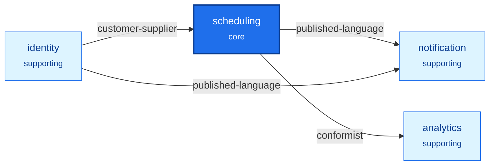

# Scheduling: the example application of ddd-ts-kit

An appointment scheduling platform for practices, built with the kit the way a user of the kit
would build it: from a one-page statement of needs, through the strategic steps of the method,
one `init` command, then the bounded contexts slice by slice, by several workers in parallel.
It exists for two things: to show what the tool yields on business rules that are not trivial
(availability across daylight-saving days, one hold per slot under concurrency, rights that
depend on relationships), and to measure honestly how the tool behaved
([docs/tooling-report.md](docs/tooling-report.md)).

Four bounded contexts in one deployable application and a worker process: `scheduling` (core),
`identity`, `notification`, `analytics`. Express, class-validator, tsyringe in the declared
style, Knex on PostgreSQL, the transactional outbox, one Redis protocol server (Dragonfly) for
the cache, the rate limiter, the job lock and the event streams, Keycloak, relationship-based
authorization combined with roles, the audit trail, pino, OpenTelemetry, the Sentry protocol.

## Headline numbers of the build

| | |
|---|---|
| From the statement of needs to a green gate and a recorded real run | about 1 h 25 min of wall clock |
| Generator runs | 213 succeeded, 27 refused |
| Files | 831: 133 generated and untouched, 584 generated then filled, 106 written by hand, 8 derived |
| Lines | 19 577 kept from generators, 21 937 written by hand (tests and documents included) |
| Markers filled | 656 `TODO(domain)`, 317 `it.todo` |
| Tests | 1 288 unit and adapter, 57 end to end; adapter tests also on PostgreSQL 18 |
| Defects found in the kit | 2, with reproductions, and 13 ranked frictions with proposals |

After delivery, `analytics` was changed to compute its figures at read time (one stored read
model instead of two, no nightly job): the numbers above are those of the build, the change and
its counts are in the last section of the tooling report.

## Run it in three commands

From the root of the repository, once (`npm ci && npm run build`), then here:

```bash
cp .env.example .env && docker compose --profile identity --profile observability up -d --wait
set -a && . ./.env && set +a && npm run db:migrate && (node dist/src/main.js & node dist/src/apps/worker/main.js &)
node --env-file=.env scripts/demo.mjs
```

The third command plays the scenario of [docs/demo-transcript.md](docs/demo-transcript.md) with
real tokens of the local Keycloak. For traces, set
`OTEL_EXPORTER_OTLP_ENDPOINT=http://127.0.0.1:54318` in `.env` and open
`http://127.0.0.1:54686`; for the error tracker add `--profile errors` and put the DSN that
`docker compose logs glitchtip | grep 'DSN:'` prints in `SENTRY_DSN`. The API documentation is
at `http://127.0.0.1:54300/docs`. Everything listens on 127.0.0.1, on ports 54xxx chosen not to
meet another stack. The gate is `npm run verify` (types, lint with the kit's preset, format, tests, end
to end, architecture rules, import graph, dead code, documentation drift); it needs no
container. Stop with `docker compose --profile identity --profile observability --profile
errors down --volumes`.

## Demo users

Local development only: they exist in `docker/keycloak/scheduling-realm.json`, and the password
of each is its user name.

| User | Role in the token | What makes their rights |
|---|---|---|
| `demo-admin` | `platform-admin` | the role: opens practices, reads the audit trail |
| `demo-manager`, `demo-manager-b` | none | the relationship `manager` of one practice each, written when the practice is opened |
| `demo-practitioner` | none | `practitioner` of the practice, `holder` of their desk |
| `demo-assistant` | none | `assistant` of the practice; `delegate` of a desk once delegated |
| `demo-patient`, `demo-patient-2` | `patient` | the role to book for themselves; `patient` of each of their appointments |
| `demo-support` | `support` | nothing by itself: impersonates a user in Keycloak, and that session is read-only here |

## What the example shows, and where to look

| Concept or pattern | Where |
|---|---|
| The method, step by step | `docs/architecture/`: `needs.md`, `discovery.md`, `contexts.md`, `before-bootstrap/`, `plan.md`, `slices.md`, `briefings/` |
| Ubiquitous language per context, generated reference | `src/contexts/*/CONTEXT.md` |
| Context map with its patterns | [docs/context-map.md](docs/context-map.md) |
| Aggregates with value objects, no primitive obsession | `src/contexts/scheduling/domain/` (`Calendar`, `Appointment`, `Waitlist`) |
| Time zones and daylight saving in the domain, without a library | `scheduling/domain/value-objects/time-zone.vo.ts`, `test/unit/time-zone.vo.spec.ts`, `calendar.aggregate.spec.ts` |
| A domain service over two aggregates | `scheduling/domain/services/scheduler.service.ts` |
| Overlap decided by the domain and by a PostgreSQL exclusion constraint | `scheduling/infrastructure/persistence/create-scheduling-tables.schema.ts`, `knex-appointment.repository.ts`, `test/integration/concurrent-booking.spec.ts` |
| Permissions on every use case, policies on the loaded element | `scheduling/application/authorization/` |
| Relationships (Zanzibar style) combined with roles | `src/platform/auth/relationship-schema.ts`, `resource-permissions.ts`, `role-grants.ts`, `roles-and-relationships.authorizer.ts`, [ADR 0001](docs/adr/0001-combine-token-roles-with-relationships-in-one-authorizer.md) |
| Persistent relation tuples, written in the unit of work | `src/platform/auth/knex-relation-tuple-store.ts`; `*/application/ports/*-relationships.port.ts` and their adapters |
| Searches narrowed in the statement by the access scope, with criteria | `scheduling/application/queries/search-appointments/`, `search-practice-agenda/`, `analytics/application/queries/search-occupancy/` |
| Field-level difference: busy without the name | `scheduling/application/queries/get-calendar-day/` |
| Read-only impersonation, visible in the trail | `src/platform/buses/read-only-impersonation.ts`, `test/e2e/journey-authorization.e2e.spec.ts` |
| Integration events, versioned, through the outbox | `src/contexts/*/published-language/`, `docs/integration/event-catalog.md` |
| A projection of another context (decides, labels lists) | `scheduling/application/projections/practitioners.projection.ts` |
| A gateway with hydration (one fresh element) | `scheduling/application/queries/get-appointment/`, `infrastructure/external/in-process-person-directory.gateway.ts` |
| A projection of the context's own events | `scheduling/application/projections/agenda.projection.ts` |
| Read models and their rebuild | `analytics/application/projections/`, `analytics/test/integration/outcome-register.rebuild.spec.ts` |
| One row per fact, computed at read time: figures grouped in one statement when they are read, instead of counters kept by events (nothing to drift, nothing to verify at night) | `analytics/CONTEXT.md` ("How occupancy is measured"), `analytics/infrastructure/persistence/knex-occupancy-reader.repository.ts` |
| A business definition and its SQL held equal by one contract | `analytics/domain/services/occupancy-measure.service.ts`, `analytics/test/integration/occupancy-reader.contract.spec.ts` |
| A consumer with an outbound port, retry then dead letter | `notification/application/integration/handlers/`, `infrastructure/external/remote-mailer.adapter.ts`, `test/integration/mailer-outage.spec.ts` |
| Resilience on the adapter class, and at the binding | the mailer above (`@Retry`, `@Timeout`); `src/platform/platform.module.ts` (`builder.around`) |
| Files kept in a storage, never in the database: an upload streamed and checked, a short signed link, a removal after the commit, every read of a document audited | `scheduling/application/commands/attach-appointment-document/`, `queries/get-appointment-document/`, `domain/value-objects/attached-document.vo.ts`, `src/platform/files/`, `test/e2e/journey-documents.e2e.spec.ts` |
| Scheduled jobs that only send a command, in a worker | `application/scheduling/` of `scheduling`, `identity` and `notification`, `src/apps/worker/main.ts` |
| One trace per action, logs, audit, error report | `test/e2e/journey-observability.e2e.spec.ts` |
| A deviation that was recorded, then retired when the kit made projections a role of its own | [ADR 0002](docs/adr/0002-keep-read-models-with-projections-in-application-projections.md), superseded |
| Dependencies stated once, by the constructor: no list in a decorator, and every class of every context built by the composition root | any handler, for instance `identity/application/commands/register-person/register-person.handler.ts`; the generated `<context>.declarations.ts`; `test/architecture/every-class-resolves.spec.ts` |

## Context map

Generated by `ddd-ts-kit docs`; the reasons are in [docs/context-map.md](docs/context-map.md).



The audit trail is a capability of the platform (`src/platform/audit/`), not a context: it
records around every use case and decides nothing of its own.

## Business rules, by context

Paths are under `src/contexts/<context>/`.

**scheduling**

| Rule | Held by | Proven by |
|---|---|---|
| Opening hours are wall-clock ranges of the practice's time zone; a day of 23 or 25 hours keeps them | `domain/value-objects/time-zone.vo.ts`, `opening-hours.vo.ts` | `test/unit/time-zone.vo.spec.ts`, `calendar.aggregate.spec.ts` |
| An exception replaces its day; a time off closes everything it covers and is refused over active appointments | `domain/aggregates/calendar.aggregate.ts`, `application/commands/add-time-off/` | `test/unit/calendar.aggregate.spec.ts`, `add-time-off.handler.spec.ts` |
| A slot starts on the grid of its type, inside one opening range, inside the booking window | `Calendar.slotFor` | `test/unit/calendar.aggregate.spec.ts` |
| No overlap with an active appointment, buffer included; at most N future appointments per patient and practitioner | `domain/services/scheduler.service.ts` | `test/unit/scheduler.service.spec.ts` |
| Of two concurrent bookings of one slot exactly one wins; the other gets `SLOT_TAKEN`, 409 | exclusion constraint, `knex-appointment.repository.ts` | `test/integration/concurrent-booking.spec.ts` (truly concurrent with `DATABASE_URL`) |
| Requested, booked, confirmed, rescheduled, cancelled with party and reason, expired, completed, no-show; an ended appointment does not change | `domain/aggregates/appointment.aggregate.ts` | `test/unit/appointment.aggregate.spec.ts` |
| Rescheduling is one change of one aggregate | `application/commands/reschedule-appointment/` | its handler spec, `test/integration/appointment-journey.spec.ts` |
| A patient cancels or reschedules until 24 hours before; the practice at any time, with a reason | the two policies of `application/authorization/`, `Cancellation` | the policy specs, `test/e2e/journey-authorization.e2e.spec.ts` |
| A freed slot is offered to the first waiter it suits, as a requested appointment that expires | `domain/aggregates/waitlist.aggregate.ts`, `application/commands/offer-freed-slot/` | `test/unit/waitlist.aggregate.spec.ts`, `offer-freed-slot.handler.spec.ts` |
| Unconfirmed appointments expire, idempotently, from the job's `scheduledAt` | `application/commands/expire-unconfirmed-appointments/`, `application/scheduling/` | its handler and job specs |

**identity**: one role per member and practice, the last manager stays, removing a member ends
their delegations (`domain/aggregates/practice.aggregate.ts`, `application/commands/remove-member/`);
a delegation is between a practitioner and an assistant of one practice, with or without
availability, until an optional end, revocable (`domain/aggregates/delegation.aggregate.ts`);
relationships follow each fact in the same transaction (`application/event-handlers/`). Proven
by `test/unit/` and `test/e2e/identity-*.e2e.spec.ts`.

**notification**: one notification per consumed event and recipient; one reminder per
appointment and start, due 24 hours before, sent once (`domain/aggregates/`,
`application/commands/send-due-reminders/`); a failing mailer is retried, then the event is
dead-lettered and reported (`test/integration/mailer-outage.spec.ts`).

**analytics**: one row per fact, computed at read time. An outcome per appointment is set whole
by each event, so replays and late deliveries end on the same row, and it is the only thing
stored (`application/projections/outcomes.projection.ts`); it is rebuilt from the export of
`scheduling` (`test/integration/outcome-register.rebuild.spec.ts`). The occupancy of a calendar
on a day is measured from the outcomes when it is read, in one grouped statement narrowed by the
practice, the filters and the scope of the actor
(`infrastructure/persistence/knex-occupancy-reader.repository.ts`): the time held by the
appointments held, completed or missed, the counts by state, a cancelled or expired appointment
freeing its time. No counter is kept, so none can drift and no job verifies one. The definition
is the domain service `OccupancyMeasureService`; the statement is held to it by
`test/integration/occupancy-reader.contract.spec.ts`. An earlier version stored a line per
calendar and day, recounted at each event and verified nightly: see
[docs/tooling-report.md](docs/tooling-report.md), "After delivery: analytics computed at read time".

## The authorization model, with two worked cases

Three questions, three places. Who is calling: Keycloak, verified at the boundary. May they do
this, on this: decided before the handler by one authorizer that first looks at the roles of
the token (`platform-admin`; `patient` for self-service; nothing for `support`), then at
relationships stored as tuples `object#relation@subject` and rewritten Zanzibar style. Is it
valid at all: the domain. The contexts never name a role or a relation: they name permissions,
and write relationships through a port of their own when a fact happens.

**An assistant books on a delegated calendar.** `POST /appointments` for another patient
requires `scheduling:appointment.book` on `calendar:<id>`. The assistant has no role that
grants it, so the relationships decide: the permission maps to `run` on a calendar, which is
`run` on its desk (`calendar:<id>#desk@desk:<practice>.<practitioner>`, written by `scheduling`
when the calendar was created), which holds for the `holder`, a `delegate`, or a manager of the
practice. The tuple `desk:<practice>.<practitioner>#delegate@user:<assistant>` was written by
`identity` in the transaction that granted the delegation: before it the answer is 403, after
it 201, and after the revocation 403 again. Changing opening hours asks for `plan`, which a
delegate has only through `availability_delegate`. `scheduling` never copied the delegation.

**A patient cancels too late.** `POST /appointments/<id>/cancellation` requires
`scheduling:appointment.cancel` on `appointment:<id>`; the patient passes
(`appointment:<id>#patient@user:<patient>`, written at booking). The handler then loads the
appointment and asks `Access.authorize` with it: the policy
`scheduling.patient-cancels-until-notice` answers no when the actor is the patient and the start
is less than 24 hours away, and the answer is 403. The practitioner of the calendar passes both,
and the domain then asks for a reason (`REASON_REQUIRED`, 422): that is an invariant, not a
right.

Each practice is kept to itself by the same model: the agenda and the occupancy of a practice
require a relationship to that practice, and every search is narrowed in the SQL statement by the
scope the authorizer computes for the actor.

## How one request is traced

A booking is one trace: `POST /appointments`, `command BookAppointmentCommand`, each repository
call, the domain event and its handlers (the relationships, the agenda projection, the outbox
append), then, later and in the same trace, `publish scheduling.appointment.booked` by the
relay and `process notification.scheduling-appointment-booked` and `process analytics.outcomes`
with the commands they send. No context imports a tracing
library. The same trace id is on the log lines and on the error report of an unexpected
failure; audit entries carry the correlation id. `test/e2e/journey-observability.e2e.spec.ts`
asserts the span tree; the real run reads the trace back from Jaeger.

## Replay the method

1. Read `docs/architecture/needs.md`: it is the only input.
2. With the plugin, `/ddd-ts-kit:start` on those needs gives, step by step, `discovery.md`,
   `contexts.md`, the glossary and the draft map (`before-bootstrap/`), each closed by a question
   to the owner; `plan.md` holds the decisions.
3. The bootstrap is the `init` command recorded verbatim in `plan.md`, then one
   `generate context` per context with its terms.
4. `slices.md` is the backlog: contracts and skeletons first, then one row per use case, with
   the generator commands and the rules. `briefings/` holds what each parallel worker was given.
5. `docs/tooling/generator-log.jsonl` lists every generator run of the build, in order, with
   its arguments; `docs/commit-plan.md` cuts the result into commits.

## Working in this repository

The example is an npm workspace of the kit's repository and resolves `@ddd-ts-kit/*` and the
CLI from it: `node scripts/kit.mjs <command>` is `npx ddd-ts-kit <command>`. Three things differ
from a project of its own, all recorded in the tooling report: `scripts/tsc.mjs`,
`scripts/kit.mjs` and `.dependency-cruiser.workspace.mjs`. The pipelines generated by `init`
(`.github/`, `.gitlab-ci.yml`) are kept as generated; in this repository they do not run from a
sub-directory, and the root pipeline has an `example` job instead. The rules for coding agents are the files `init` generated at the root of the example.

## Imports

Every file is imported by an alias from the project root, never by a relative path, and
without an extension: `@/contexts/scheduling/domain/aggregates/appointment.aggregate`,
`$test/e2e/support/...`, `$scripts/...` (`"importExtension": "none"` in
`ddd-ts-kit.config.json`). An import names a file, never a directory:
`.../published-language/index`. The alias is declared once, under `paths` in `tsconfig.json`,
which the compiler, `npm run dev` (tsx), vitest, knip and dependency-cruiser read: they all
load `src/`. Node reads no alias and needs the extension: `npm run build` compiles, then
`ddd-ts-kit build-aliases` rewrites each alias of `dist/` into a relative path ending in `.js`,
so `npm start` and the Docker image are plain `node` on `dist/`. `npm run lint:fix` turns a
relative import into its alias and removes an extension; `npm run check:arch` reports a
declaration that no longer follows `importAlias` and `importExtension` of
`ddd-ts-kit.config.json`, or a build that skips the rewrite. The reasons and
what was measured: [docs/tools/import-aliases.md](../../docs/tools/import-aliases.md).

## What is not built

Listed precisely in [docs/tooling-report.md](docs/tooling-report.md), "Not built, or built
smaller than asked": the policy's reason code in the HTTP answer, a metrics adapter, a real mail
provider, occupancy as a rate, leaving a waitlist, listings of members and delegations.
